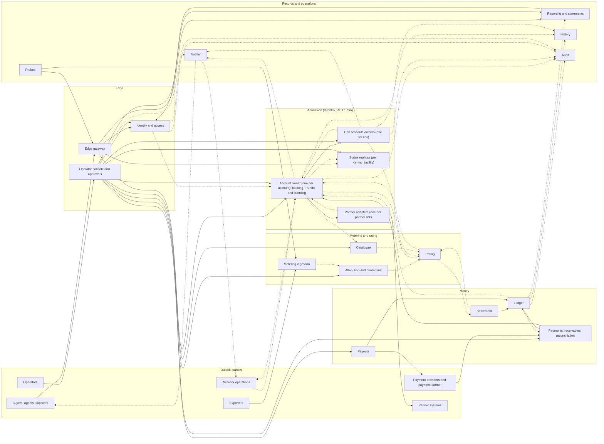
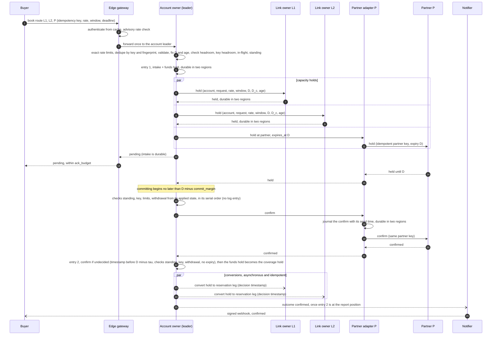
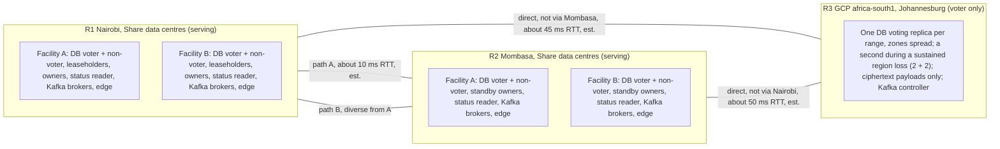

# RFC-000. Architecture overview: single-writer owners on two-region consensus storage

| | |
|---|---|
| Status | **Accepted — revision 4 under review.** Revision 4 resolves the architecture issues raised by the six detailed RFCs (AI-R1-*, B-AI-*, AI3-*, AI4-*, AI5-*, AI-1 … AI-4) and RFC-006's risk RK10, and, by the coordinator's decision, moves the platform substrate from a custom multi-group Raft platform to a Postgres-compatible distributed SQL database (CockroachDB; YugabyteDB the alternative) with TypeScript/NestJS owners and Kafka; see "Revision 4 resolution" at the end. History: revision 3.2 (W-01, W-02 from the verification's confirmation); revision 3.1: revision 3 revised per the [second adversarial review](../reviews/08-rfc-000-review-2.md) (A0R-01 … A0R-14, R2-D1 … R2-D7), then corrected per its [verification](../reviews/10-rfc-000-verification.md) (V-01 … V-08), after revision 2 applied the [first](../reviews/06-rfc-000-review.md) (A0-01 … A0-21); see "Review resolution" |
| Satisfies | All — structural. Allocates every need (P1-N1 … X2-N6, 66 in all) to an owning component and to the detailed RFC that specifies it; the scenarios themselves are satisfied by RFC-001 … RFC-006 |
| Policies | POL-01 … POL-33 (every entry of the register; §7 names the component that applies each need, and §2 the policies each component serves) |
| Prior decisions | History log D3, D12, D13, D21 (carried forward in Competition); the coordinator's substrate decision of revision 4 (distributed SQL, TypeScript/NestJS owners, Kafka; RFC-006 RK10) |
| Builds on | The requirements at tag `requirements-v1.5` ([problem statements](../01-discovery/), [specs](../02-specs/), [policy register](../02-specs/policy-register.md), [glossary](../02-specs/glossary.md)), which include RQ-1 … RQ-6 ([review 07](../reviews/07-requirements-amendments-from-rfc-000-review.md)), and the decisions on RQ-7 … RQ-12 raised by the second review and this revision, which `requirements-v1.4` and `requirements-v1.5` record ([review 09](../reviews/09-requirements-amendments-from-rfc-000-review-2.md)): the confirm fence (RQ-7), reporting once releases are durable (RQ-8), P1-S54 (RQ-9), the status-read exception (RQ-10, RQ-12), payments in flight in reconciliation (RQ-11), and diverse fibre paths as a go-live condition (A0R-05). Revision 4 also builds on three **binding decisions of the `requirements-v1.6` amendments, in progress**: the funds, capacity-in-flight and key-limit checks of concurrent requests apply one at a time in arrival order (B-RQ-1); a confirmation in flight when a capacity reduction is recorded may complete and becomes an affected reservation, alerted (AI-R1-4, B-RQ-2); personal data never enters logs (pseudonymous identifiers in every log; an erasable personal-data store with crypto-shredding) |
| Supersedes | The structural parts of the pre-baseline drafts RFC-001 … RFC-004, which were written from a prototype |

**Revision 4 in one paragraph.** The logical design is unchanged: one writer per account,
link and partition; fenced terms; append-only entries; conditional deciding entries; the
report position; read leases; closed positions. What changes is what it runs on. Instead
of a custom multi-group Raft platform in Go (revision 3.2, RFC-006 §3), every owner's log
is an append-only table in a **Postgres-compatible distributed SQL database**
(CockroachDB; YugabyteDB the alternative), placed 2 + 2 + 1 across R1, R2 and R3 with
leaseholders preferred in R1; owners are **TypeScript/NestJS services** holding
**epoch-fenced owner leases**, every write a transaction conditional on the owner epoch;
closed timestamps and bounded-staleness follower reads give closed positions and back the
status replicas; **Kafka** (Redpanda acceptable) carries the metering hand-off, the
outcome feed, the standing feed and webhook delivery, fed by a transactional outbox from
the database. §5.5 gives the mapping and the argument that every principle and crash point
still holds; §3 re-derives the latency budget; Competition records the custom-Raft design
as the rejected alternative.

Terms are used in the sense of the [glossary](../02-specs/glossary.md). In particular,
"reserved rate" is capacity and "traffic" is bytes; neither is called "usage". Every
round-trip time, latency, volume and size in this RFC is an **estimate**, to be replaced
by measurement (Risks, R1), unless it is a requirement's own figure.

## Need

The requirements describe one marketplace with four very different workloads, which the
architecture has to make possible at once without one compromising another:

1. **A capacity decision that can never be wrong in the generous direction** (P1-N1, POL-05)
   and that is answered within `ack_budget` (200 ms at p99, POL-04) at 25,000 requests/s
   overall and 2,500/s on the hottest link (POL-06), whatever the booking's length
   (X2-N3). Every booking on a link, single-link or route, is decided by that link's one
   schedule owner (P1-N3), and every request has **one decision point** (POL-04) against
   which its account's suspension, its key's revocation, its withdrawal and its deadline
   are judged.
2. **A multi-party booking that is all or nothing** across Share links, partner systems that
   cannot join a transaction, and the buyer's funds (P2-N1, P2-N7, P2-N8), bounded by a
   deadline after which it is never confirmed and its holds are released (P2-N3, POL-26,
   with `release_grace` when the decision record, or the schedule of a link it holds, is
   unavailable), confirmed only by a decision timestamped before the deadline, and reported
   not confirmed only once the Share-link capacity it frees is durably released (POL-04,
   RQ-7, RQ-8), with contention resolved
   by an explicit priority rule on Share links and at partners alike (P2-N4, POL-02), and
   recovery from Share's own crashes (P2-N5, POL-03).
3. **A metering and rating pipeline** that takes about 260,000 flow records/s (600,000/s
   peak), duplicated, late and out of order (P3-N3), keeps every one of them for 7 years
   (P3-N7, X2-N6), counts each accepted record in headroom within `attribution_lag_max`
   (P3-N10), and turns reservations and traffic into charges that are exactly once,
   reproducible and amended rather than rewritten (P3-N2, P3-N8, P3-N9), posted within
   2 min of each minute's end (X2-N3).
4. **A money system** that is conserved and immutable (P4-N7), moves money once per source
   reference for 7 years (P4-N15, POL-29), holds funds before capacity (POL-25), suspends
   and resumes by rule (P4-N5), splits exactly (P4-N8), pays out once (P4-N12), reconciles
   daily with the outside world (P4-N14, POL-24) and can rebuild any past headroom exactly
   as shown (P4-N16).

Across all four: every operation by an authenticated principal, accounts isolated, operator
power controlled and every change attributable (X1-N1 … X1-N10); availability per
capability and per serving region of 99.99% (admission, including the funds holds a
booking needs; ingestion) or 99.9% (wallet, payouts, reporting); RPO 0 with **every fact
acknowledged only once durable in two regions** (X2-N4); RTO from 1 min to 30 min on node
or zone loss and 1 h on region loss (X2-N5); latency targets suspended, but RPO 0 kept,
during a declared region disaster (POL-06); 7-year retention (X2-N6).

**The sites are given.** Share serves from its own data centres in **Nairobi** and
**Mombasa** and runs on Google Cloud as well ([company profile](../01-discovery/company-profile.md)).
The coordinator has fixed the geography (decision D1 of the review, as overridden): R1
Nairobi and R2 Mombasa (Share's own data centres) serve traffic; R3, Google Cloud
`africa-south1` (Johannesburg), is the third voting region and serves none.

The architecture must therefore decide: what the components are and what each one alone
may write; which interactions are synchronous on the 200 ms path and which can lag; where
atomicity is needed and how it is achieved without a global transaction; and how state is
replicated so that two-region acknowledgement fits inside `ack_budget` on these three
sites and a link or an account never has two writers, even across failures.

## Approach

### 1. Principles

| # | Principle | Why (requirement) |
|---|---|---|
| A1 | **Every piece of state has exactly one writer component.** Others read it, subscribe to it, or ask its owner to change it. | POL-05 for link schedules; the same discipline makes the account, reservation, ledger and request invariants each provable in one place. |
| A2 | **Each owner is partitioned by its natural serial key** (link, account, partner link, exporter, ledger account) and each partition is a **single-writer state machine over its own append-only log**, fenced by the owner's term. In revision 4 the log is an append-only table in the distributed SQL database, the writer is the NestJS service instance holding the partition's **owner lease**, and the term is the lease's **epoch**: every write is one transaction conditional on that epoch (§5.2, §5.5). | "Decided as if one at a time" is stated per link (P1-N2), per account and key (P2-N8, P4-N3, POL-25) and per reservation (P2-N9). A single writer per partition gives that order directly, without locks or retries; the database never sees two writers contend for one partition. |
| A3 | **Every log commits only through a quorum that spans two regions.** There is no one-region state on any path that answers a buyer. In revision 4 the quorum is the database's: five voting replicas of every range, 2 + 2 + 1, no region holding three. | X2-N4, POL-06: a fact is acknowledged only once durable in two regions. P4-S72: what a buyer was shown must survive a region loss. |
| A4 | **Facts are append-only; current state is derived.** Corrections are new facts. | P1-N7, P1-N9 (known-at history), P3-N7, P3-N8, P4-N7, X1-N8. |
| A5 | **The 200 ms path touches only admission components**, synchronously; everything else (rating, settlement, statements, history, notifications) is asynchronous and catches up from the owners' logs. | POL-04 `ack_budget`; POL-06 gives rating no availability target of its own, only timeliness. |
| A6 | **Every command between components carries a deterministic idempotency identity**; every external input carries its own (idempotency key, source reference, record identity). Delivery between components is at least once. | POL-29, P2-N6, P3-N2, P3-N3, P4-N1, P4-N15. |
| A7 | **One decision point per request, and it is a log entry.** A request's outcome is fixed by the first deciding entry in its account owner's log: a conditional *confirm*, a conditional *expire*, or an ending entry (rejected, withdrawn, key revoked, account suspended). Log order, not clocks, decides which comes first. | POL-04 (one decision per request), POL-26 (never confirmed after the deadline), P2-S69, P2-S103. |
| A8 | **Deadlines are data; clocks drive liveness only.** The deadline is in the request record and in every hold. Clocks decide *when* a participant asks for expiry and *whether* a confirm may still be proposed; they never decide which of two outcomes wins. | POL-26: failed as of the deadline, whatever Share's state; review A0-01. |
| A9 | **Only a request's account owner ends its holds, and a release ends them for good.** A link owner or partner adapter releases a request's hold only on that owner's say-so (an outcome, an accepted yield). A release for an outcome is **request-scoped**: it ends every hold, waiter registration and grant the request has at that participant, whatever the attempt, and leaves a tombstone that refuses any later hold or grant for the request (A0R-03). | All or nothing (P2-N1): no participant can release a hold the decision still depends on, and no late or retried command can recreate one after the outcome. |
| A10 | **An outcome is reported only once it is final everywhere a buyer could see it.** A confirmation is reported once its deciding entry, and a non-confirmed outcome once a **"releases durable"** entry in the same log recording that every Share-link release it needs is durable (A0R-02), is at the log's **report position** (§4.6): committed in the database and applied by every status replica holding a read lease. The edge's synchronous final answer, status replicas, the outcome feed and webhooks are all reports and all obey this gate (V-01, V-02). | POL-04 as amended by RQ-6 and RQ-8: capacity is free from the moment the outcome is reported. |

| A11 | **Personal data never enters a log** (v1.6, binding). Owner logs, feeds and Kafka topics, the history archive, the audit store, application logs and traces carry only **pseudonymous identifiers** (account, user, key, supplier and contact identifiers that name no person). Names, contact details, KYB documents and any other personal data live only in the **personal-data store** of identity and access, encrypted per data subject; erasure destroys the subject's key (crypto-shredding), so every copy, backup and archive becomes unreadable without rewriting any log. | Append-only, 7-year logs (A4, X2-N6) and erasure of personal data are reconciled only if the logs never hold it; X1-N2, X1-N8 (changes still attributable, to a pseudonymous principal). |

### 2. Component decomposition

Each component below owns the state listed and is its only writer. "Serves" names the
needs and policies it is the primary owner of; the full allocation is in §7.

#### Admission (capability: admission API, 99.99%, RTO 1 min)

| Component | Single responsibility | State it owns (only writer) | Partition | Serves |
|---|---|---|---|---|
| **Link schedule owner** | Decide every capacity question on one Share link, and record every change to what the link has sold or can carry | Per link: capacity history (baseline, unplanned outages and restorations, planned maintenance bookings, permanent reductions and their notice); confirmed reservation legs and their parts, and every leg change (`end_leg`, `reduce_parts`), each carrying the account owner's decision time (AI-R1-1, AI-R1-7); capacity holds, each carrying its account, request identity, deadline `D`, **commit fence `D_c`** and `request_age` (AI-R1-9, B-AI-3); Share's own holds for firm equivalent-path offers (**offer holds**, taken, accepted, moved and released through the link hold port, AI-R1-2), at full rate from the offer to the reservation's end, counted as committed for new sales while the offer is open (POL-07, RQ-4); the link's waiter queue ordered by the priority rule, with waiter registrations, waiting marks (`mark_waiting`), waiting notices, yields and **displacement notices** (`DISPLACED`: a held or waiting request that no longer fits after a capacity reduction, AI-R1-3) as **log entries**; granting skips a waiter past its commit fence `D_c`; **request tombstones** (one per request released or refused on the link, kept until its `D` + `release_grace`, the release carrying `D`, AI-R1-8; any hold or grant for a tombstoned request, or for one past its `D`, is refused); the link's bitemporal change log. **Affected flags** per reservation and minute are *derived* state, a deterministic projection of the log (A4), not entries: the cuts that change them are entries (AI-R1-6) | One partition per link; a hot link has a group to itself | P1-N1 … P1-N9, POL-05, POL-07, POL-09, POL-10, POL-31 |
| **Account owner** | Decide every booking request and every change of one account, and keep everything that account-level admission depends on, **in one serial order on one two-region log** | Per account. *Booking module* (RFC-002): booking requests (idempotency key, fingerprint, principal, `D`, `request_age`, `wait`, progress per leg, waiting, withdrawing and takeover marks, the **deciding entry** with its reason, and for a non-confirmed outcome its **"releases durable"** record, built from the release acknowledgements of every Share leg in the intake); reservations as route-level units (legs, parts, locked prices, partner terms shown at booking, lifecycle and end cause, partner-leg affected status, equivalent-path offers); per-reservation change queue. *Funds and standing module* (RFC-004 Part A): funds holds and credit holds, taken **one at a time in arrival order** with capacity in flight and key limits, so a request refused because a concurrent request's hold is in place is rejected (v1.6, B-RQ-1); capacity in flight per key and account; key spending per `key_spend_period`; booking-rate counters per key and account, **in the owner's memory**, rebuilt by a new owner from the last second's intake entries, so exact except for one second after an owner change, when a key or account can be admitted up to twice its limit (the retries its predecessor answered from state are not in the log; D5, B-AI-4); **key status and KYB status as applied here** (a funds kind, F4: limits feed key headroom, KYB gates credit limits; the booking module reads revocation from it; D6, AI4-2, AI4-3); headroom inputs as applied feed entries (ledger balance through a ledger position; unposted usage through a rating position **and the ledger position X it was computed against, applied only once the applied ledger position has reached X**, AI3-3); credit limit as applied; standing, its cause, grace start and resume amount, and network operations' **enforcement acknowledgements** (F8, AI4-5); low-balance warning state | By account (idempotency keys, limits and headroom are all per account) | P2-N1 … P2-N11, P4-N3 … P4-N6, P4-N17 (limit and standing side), POL-03, POL-04, POL-08, POL-15, POL-16, POL-18, POL-25, POL-26, POL-29 |
| **Partner adapters** | Speak one partner's API safely, and **stand in for a schedule owner for Share's own position at each partner link**: idempotent hold (with an absolute expiry set to `D`), confirm, final booking, release and cancel; classify answers (held, definite refusal, transient, unknown); order Share's own waiters by the priority rule; reconcile | Per partner link: the partner's classification under POL-26 (offers holds only if they last at least `route_deadline_max` + `commit_margin` **and** accept an expiry set by Share; otherwise without holds, P2-S102); Share's outstanding holds and bookings at the partner, each with its request, `D` and age; the waiter queue of Share requests refused because of Share's own position (POL-02), by `priority_rule`, each waiter with its `D` and commit fence; request tombstones as on a link owner; call journal with idempotency keys and the time each partner confirm was sent (the request's "begin committing" time, POL-26); reconciliation results and mismatches | By partner link, on a two-region log | P2-N7, part of P2-N4, POL-02 (partner refusals), POL-26 (partner holds), POL-28 |

**Why the coordinator and the account funds are one component** (review A0-02). In the
previous draft the booking coordinator's request log and the account's funds and
standing were two components on the same partition key, the second durable in one region
only. That gave each request two decision points (the *bind* and the *decision record*),
so P2-S69 and P2-S103 could not both hold; it gave the account two serial orders, so
"concurrent bookings checked as if one at a time" (POL-25) spanned two logs; and it lost
the shown headroom on a region loss (P4-S72). Merging them gives one writer process per
account, whose decision entry checks standing, key status, the withdrawal mark, any
expiry entry and every limit in one place, and binds the funds in the same entry. The
two modules keep separate specifications (RFC-002 and RFC-004 Part A) and separate
invariants, but one log and one writer (one owner lease). The account owner is engineered to admission's
targets (99.99%, RTO 1 min), as POL-06 now requires for the funds holds a booking needs.

**Where the booking workflow runs.** The workflow that drives a request (taking holds,
calling the partner adapter, asking for expiry) runs **in the NestJS service instance that
holds the account's owner lease** (the "account owner leader" below), which placement
keeps in the region of the database leaseholders of the account's ranges, so every step it
takes is in the same region as the log it writes. The edge forwards each request once, to
that instance. A new lease holder resumes every unfinished workflow from the log (POL-03).

#### Metering and rating (capabilities: usage ingestion 99.99%, RTO 1 min; rating and posting, judged by timeliness, RTO 5 min ceiling)

| Component | Single responsibility | State it owns | Partition | Serves |
|---|---|---|---|---|
| **Metering ingestion** | Accept every flow record, durably, exactly as received; acknowledge only once it is durable in two regions | The raw record log (every record received, accepted or not, with its reason); record-identity index per exporter as run-length range sets of (exporter epoch, sequence number), for the retention period | By exporter | P3-N3, P3-N7, P3-N11, X2-N4 for records |
| **Attribution and quarantine** | Decide, for each accepted record, the account, route, product and reservation it belongs to, which leg's count is the egress count, and the record's **traffic class** under POL-17 (the class only; whether bytes are covered, burst or excess depends on the minute's total and the reservation history, which rating applies, AI3-1); keep what cannot be attributed in quarantine | Attribution results per record and minute; the attribution keys from provisioning, including the **observation point → link mapping** (AI3-8); quarantine entries and finance attributions within `dispute_window`, each finance attribution checked here for principal and contents by its source reference (AI4-1) | By account once attributed; by exporter in quarantine | P3-N4, P3-N6, P3-N13, POL-13, POL-17 (class) |
| **Rating** | Turn reservation history, attributed traffic and price history into charge lines, cost lines and amendments, exactly once and reproducibly, **applying POL-17's billing rule** to each minute (AI3-1); feed unposted usage to the account owner | Charge lines (reservation, usage, fee) and **cost lines** (carried excess, dearer path, Share-borne fees, each with its payer, weights version and reason; AI3-5, AI4-7) and their amendments, each with its source reference and reason; per-line rated totals and posted marks (set only on the ledger's posting acknowledgement); unposted usage per account and product, each figure carrying the ledger position it was computed against (AI3-3); lateness and attribution-lag breach reports; POL-28 residue fees from the lifecycle feed (AI3-4) | By buyer account | P3-N1, P3-N2, P3-N5, P3-N8, P3-N9, P3-N10, P3-N12, POL-01, POL-11, POL-14, POL-17 (rule), POL-27 |
| **Catalogue** | Hold the reference data every other owner prices, splits or validates against | Links (supplier, Share or partner, endpoints, probe flag), products, account-product terms including **`usage_rate_cap`** (AI3-6; the edge's policing, run by network operations, reads it), `reservation_price` and `usage_price` history on minute boundaries, price corrections (as bitemporal facts, POL-23; each checked here for principal and contents by its source reference, AI4-1), a **read model of locked prices** from the reservation lifecycle feed, against which a correction is validated as downward only (AI3-7), split weights per route and party, partner terms (minimum term, cancellation fee, hold length, whether the partner accepts an expiry set by Share), probe designations | By entity | Inputs to P1, P2, P3, P4; POL-12 weights, POL-23 corrections, POL-27 |

**The attribution → unposted-usage → account path and the reservation-accrual posting
path run with hot standbys** (review A0-07): a standby NestJS instance tails the same
partitions and takes the owner lease when it expires. The takeover is bounded at **about
5 s at p99 (est.)**: owner-lease expiry (a 3 s lease for these classes) plus resumption
from state the standby already holds, and a database range-lease move after a node loss
runs in parallel with it, not after it (AI3-9). Revision 3.2's 30 s alone breached
`attribution_lag_max` (10 s) on every takeover; with the normal path at about 2 to 3 s
(est., §3: direct publish after commit, Kafka hops) a takeover keeps an accepted record
within 10 s. The 5 min RTO of rating and posting is a ceiling, not the design point:
X2-S13 and X2-S22 are counted per minute at 99.99%, which allows about 4.3 min a month.
RFC-006 states the per-minute budget arithmetic on the 5 s figure.

#### Money (capabilities: wallet, payouts and reporting 99.9%; rating and posting RTO 5 min)

| Component | Single responsibility | State it owns | Partition | Serves |
|---|---|---|---|---|
| **Ledger** | Be the only writer of money movements: validate (sums to zero per currency, every amount tagged), deduplicate by source reference (for a movement caused by an operator correction or attribution, a **derived reference** from the receiving owner's checked source reference, AI4-1), compute the amounts that depend on the partition's own state at append (M1's repayment, M18's write-off amount; deterministic and partition-local, AI4-8), append, never alter; publish **closed positions** | The journal of movements; source-reference deduplication (7 years) as watermarks per structured reference plus exception sets, with principal and content digest; per-partition closed positions ("closed through T"); per-account balances as derived projections | Journal partitioned by the movement's **home**, a function of its source reference alone, so a redelivery always lands where the original did: (1) the buyer, if the movement touches a buyer (charges, amendments, fees, top-ups, invoice payments, reversals, write-offs, corrections Share bears for a buyer); (2) otherwise the **buyer whose request, reservation or traffic caused it**, where there is one (carried excess paid by Share, the dearer-path difference, a partner cancellation fee Share bears, the FX difference on a buyer's top-up, a supplier debt raised by an amendment); the buyer's own balance is not touched, so it stays wholly in its partition; (3) otherwise the supplier, if it touches exactly one (payouts, supplier debts and their payments, duplicate-payout debts); (4) otherwise one of N **Share sub-partitions** by a hash of the source reference (FX differences on payouts, Share's own deposits and withdrawals). A movement never touches two buyers. Supplier and Share balances are aggregates over partitions at closed positions, so no partition is a hot row (A0R-09) | P4-N7, P4-N15, P4-N16 (movements), POL-11, POL-20, POL-29 |
| **Settlement** | Turn each charge, cost line or amendment into one movement split among its route's parties; pay the costs Share bears; raise supplier debts in the buyer partition that causes them (M9) | Per charge line: the posted total, from which normal-mode shares per party are derived; shares per party stored only for own-mode lines (AI4-9); the posting acknowledgement passed back to rating (AI3-3); deviation from exact proportions per party per payout period, aggregated per supplier | By buyer account (charges); by supplier (the deviation report aggregate only, AI4-4) | P4-N8, P4-N9, P4-N11, POL-12, POL-23 |
| **Payments, receivables and reconciliation** | Everything that moves money between Share and the outside on the buyer side, and the daily proof that the books match the money | Payment events as received (authenticated, 2-region durable before the provider is acknowledged); the **binding of each provider transaction reference to its account**, fixed by the first authenticated **and well-formed** event, which every later event for that reference is checked against (a malformed event is recorded and rejected without creating a binding, P4-S05; V-05); top-up conversions; pending orphan reversals (72 h); invoices, invoice payments as applied to invoices, and write-offs; daily reconciliation runs, each at one closed position per ledger partition, and their differences, including incoming payments received by the partner and not yet posted (RQ-11); an **investigation stream**, partitioned by provider, recording every notification whose authenticity is not proven, which never creates a binding (X1-S10, AI5-5) | Per kind of state (V-04): payment events, their reference bindings and pending orphan reversals by **(provider, transaction reference)**, so every event for one provider transaction, its reversal included, is in one partition (A0R-04); invoices, invoice payments as applied and write-offs **by account**, fed idempotently by the payment's reference (the overdue and paid feeds go to that account's owner); reconciliation runs **by day** | P4-N1, P4-N2, P4-N13, P4-N14, P4-N17 (invoices), POL-15, POL-20, POL-21, POL-24 |
| **Payouts** | Pay suppliers weekly, once, net supplier debts and recover what a provider executes twice | Payout runs (each at closed positions), instructions (with their references), **transfer confirmations and failures** (authenticated by RFC-005's verifier, AI5-2; routed by the instruction reference, with the provider's reference recorded, and deduplicated here; payouts is their only writer, V-04), the **supplier-debt register** (debts raised in buyer partitions, M9, or by payouts, M16; netting and invoicing are payout rules, POL-22; AI4-4), escalations, residues carried | By supplier | P4-N12, POL-22 |
| **Reporting and statements** | Serve every account its statement and every supplier its view, from the owners' feeds | Read models only (no facts of its own): statements, supplier schedules with opaque reservation references, deviation reports | By account | P4-N10, the supplier view of X1-N2 and POL-33 |

#### Cross-cutting

| Component | Single responsibility | State it owns | Serves |
|---|---|---|---|
| **Edge gateway** | Terminate every external call: authenticate, resolve the principal, shed gross abuse with advisory rate counters, **enforce `key_poll_limit` exactly**, forward once to the owner partition's lease holder, answer within `ack_budget` | Advisory booking-rate counters (soft state; the exact booking limits are enforced by the account owner, D5); **exact poll counters, sharded by key** onto poll-limiter instances in the leader region, every poll of one key routed to its shard (AI4-6, AI5-1). Counters are soft state: for one `key_poll_limit` window after a shard moves, a key can be answered up to twice its limit (the bound) | X1-N1; P2-S67 |
| **Identity and access** | Principals, agent keys and their limits, roles, consent to identify an account to a named supplier, webhook endpoints, the personal-data store, and the authorisation decision for every operation | Accounts' users and administrators (pseudonymous identifiers only in its log, A11); agent keys, their limits and revocations, and KYB status as recorded by onboarding, all pushed to the account owner on the **identity status push**, which the funds module applies (D6, AI4-2, AI4-3); operator roles; supplier-consent records (POL-33); **webhook endpoint registrations and their signing secrets**, as administrator-managed credentials, which the notifier reads (AI5-4); refused attempts at its own key and consent commands, in its own log (AI5-6); the **personal-data store**: every item of personal data, encrypted under a per-subject key held in Kenyan HSMs, erased by destroying the key (A11) | X1-N1 … X1-N4, X1-N9, X1-N10, POL-25, POL-32, POL-33 |
| **Operator console and approvals** | The only way operators act: every action names its role and reason, four-eyes actions wait for a second compliance approval, then the action is sent to the component that owns the state | Operator action requests, pending approvals and their outcomes, on a two-region log; refused attempts at privileged actions made through the console (refusals of identity and access's own commands are recorded there, AI5-6) | X1-N7, POL-30, POL-32 |
| **Audit** | Keep the immutable record of every change to money, capacity, links or keys, every operator action and every refused privileged attempt, for the retention period | The audit store, built from audit fields every owner writes in its own log (pseudonymous principal, time, role, reason), indexing the refusals recorded by the console and by identity and access alike | X1-N8, POL-19 |
| **History** | Answer "as known at T" questions and keep every owner's log for 7 years | Archived owner-log segments in object storage replicated in two regions, and their bitemporal indexes (read models; owners stay the writers of the facts) | P1-N9 (storage), P4-N16 (rebuild), X2-N6, POL-19 |
| **Notifier** | Deliver every outbound notice: signed buyer webhooks retried for `webhook_retry`, affected-reservation notices within `affected_notice_time`, suspension and low-balance notices, supplier notices, operational alerts | Delivery attempts and their status; it consumes Kafka topics and reads endpoints and signing secrets from identity and access (AI5-4); contact details are resolved from the personal-data store at send time and never stored here (A11) | P2-N2 (webhooks), part of P1-N8, P4-N5, X1-N6 (signing with keys from identity and access) |
| **Probes** | Measure availability from outside each serving region as the designated probe account on designated probe links and exporters | Probe results per capability and minute | X2-N1 |
| **Placement and time** (platform) | Map every partition to an owner slot and every slot to its owner lease; keep the database leaseholders **and** the owner-lease holders of **every** group (admission, ingestion, ledger, payments, rating and the rest) in one Kenyan region while it is healthy and move them together, region-wide, when it is not (AI-3); reconfigure the database's replica placement to 2 + 2 automatically after a sustained region loss (AI-2); move partitions with an epoch; publish closed positions and report positions (§4.6); provide the clock bound `ε`, the database's maximum clock offset | The placement table (slot → owner kind, preferred region, epoch) and the owner-lease table, in the database at 2 + 2 + 1; the database's zone configurations (voter constraints, lease preferences); leader-placement policy and its triggers | Single writer across failures (POL-05), deadlines (POL-26), status reads (POL-04) |
| **Status replicas** (platform) | Answer status reads and headroom reads in each serving region off the owner's write path | Soft state only: per account slot, the recently decided requests pushed by the owner lease holder, under a read lease; anything older is read from the database by bounded-staleness follower reads. One status-reader instance per Kenyan facility, each reading through the database replicas in its own facility: the three Kenyan voting replicas other than the leaseholder's, plus one **non-voting replica** per Kenyan facility for the account tables (AI-4, §4.6) | P2-N2, POL-04 |

**Merges and splits, and why.**

- *Booking and account funds are one component* (above). One serial order per account
  covers requests, decisions, holds, limits, key status and standing (POL-04, POL-25).
- *Waiting, crossings and deadlines* are not a separate component. The waiter queue for a
  Share link is part of that link's schedule (POL-02, POL-05); for Share's own position at
  a partner link it is part of that link's partner adapter; the request's waiting state
  and deadline are part of the request (the account owner). A separate "contention
  manager" would be a third writer between owners whose state it reads on every decision.
- *Funds holds are split from the ledger.* Holds are not money movements (the glossary's
  funds hold: "it is not a money movement"; POL-18), change on every booking, and gate
  admission at 99.99%; movements are conserved, immutable and 7-year idempotent.
  Different invariants, different write rates, different availability classes.
- *Rating is split from settlement*, at the charge (P3 ends at a charge, P4 starts from
  one): rating's correctness is per charge line, settlement's per party.
- *Attribution is split from ingestion*, because ingestion must acknowledge within 1 s at
  99.99% and must never depend on reservation or provisioning data being available;
  attribution can lag and catch up within `attribution_lag_max`.
- *Reporting owns no facts*, so its 30-minute RTO can be met by rebuilding from feeds.
- *History is a read model, not a writer.* Each owner's own log is the bitemporal record of
  its state; history archives and indexes it. This keeps POL-05's single writer intact.
- *Personal data is split from every log* (A11, v1.6). It is one store, owned by identity
  and access, that is erasable; everything append-only refers to it by pseudonymous
  identifiers only.
- *Status replicas are platform components, not owners.* They hold no facts, only what
  the owner pushed under a read lease and what the database serves to follower reads
  (AI-4).

### 3. Interaction overview



Solid arrows are synchronous requests; dashed arrows are asynchronous feeds from the
writer's log (at least once, ordered per partition by sequence, consumed idempotently).
In revision 4 every feed is a **Kafka topic fed by the transactional outbox**: the feed
event is a row written in the same database transaction as the fact, published directly
by the owner after commit and relayed again by a database changefeed as the guaranteed
path; consumers apply per partition in sequence order and drop duplicates (§5.5). The
synchronous commands between owners (hold, release, leg change, partner calls) are gRPC
calls between NestJS services in the leader region. The flows added in revision 4 are
catalogue's read model of locked prices (AO → CAT, AI3-7), the posting acknowledgement
(ST → RA) and the usage-applied acknowledgement (AO → RA, AI3-3), network operations'
enforcement acknowledgement (NET → AO, AI4-5), and console → reporting, console →
status replicas, reporting → identity (consent at view time) and identity → notifier
(endpoints and signing secrets) (AI5-7).

| Interaction | Mode | Why |
|---|---|---|
| Edge → identity and access | Synchronous, from a local cache refreshed by push; cache entries for agent keys live at most 30 s | Authentication must be on every call (X1-N1) but cannot cost a remote call within 200 ms. A revocation reaches every edge within 60 s for new requests (X1-N3). |
| Edge → account owner leader | Synchronous, one forward; the edge answers `pending` if no final answer is ready in time for `ack_budget` | POL-04. The workflow runs at the account leader, so the edge makes one hop, not four (A0-05). |
| Account owner → link owners | Synchronous on the booking path (hold, with `D` and the commit fence `D_c`; `mark_waiting`); asynchronous after the decision (convert, with reservation, part and decision time; request-scoped release, with `D`; leg changes `end_leg` and `reduce_parts` and the offer-hold commands, each with the decision time); each release and leg change is acknowledged once durable | The answer within `ack_budget` needs the hold; conversions can lag because the hold keeps counting; a non-confirmed outcome is reported only once every Share leg has acknowledged its release (A10); known-at history needs the decision time of every leg change (AI-R1-7). |
| Link owner or partner adapter → account owner (waiting notice, capacity released to a waiter, yield requested, **displaced**, affected reservation, revocation due, expire requested, release acknowledged) | Asynchronous notification or command, idempotent by (link, epoch, sequence) | The participant observes; the account owner decides (A9). A yield or a displacement takes effect only once the account owner accepts it in its own order (`displacement_accept` beside yield acceptance), so a hold is never released under a request that is already committing; a request already decided confirmed when the reduction reaches it becomes an affected reservation, and the link alerts (v1.6, AI-R1-4). |
| Account owner → partner adapter → partner | Asynchronous to the buyer (the buyer gets `pending`), synchronous within the request's own workflow | Partner calls are slow and unreliable (P2 C7); only the request's deadline bounds them (POL-26). |
| Identity and access → account owner (identity status push: key revoked, key limits, KYB status) | Asynchronous push, applied as an entry within 60 s of the administrator's action | Gives P2-S72 and P2-S103 one order (D6); F5 refuses a credit limit on an account whose applied KYB status is not vetted (AI4-2). |
| Ledger → account owner (balance through position); rating → account owner (unposted usage through a rating position, with the ledger position X it was computed against); payments → account owner (invoice overdue, invoices paid); account owner → rating (usage applied, through which position) | Asynchronous feeds, applied as log entries | Headroom is computed from inputs at recorded positions, so every shown figure is reproducible (P4-S72, A0-21). An unposted-usage figure is applied only once the applied ledger position has reached its X, so a line is never out of both the unposted usage and the balance (headroom never overstated; a line in both understates it, which is safe) (AI3-3). |
| Account owner → rating, history (reservation lifecycle); link owner → rating, notifier, history (capacity and affected flags) | Asynchronous feeds | Rating has 2 min per minute; affected notices have 60 s (POL-07); history and statements have minutes. |
| Rating → settlement → ledger, and back | Asynchronous feed; posting is a synchronous call to the ledger from settlement, idempotent by source reference; settlement returns a **posting acknowledgement** per line (with the ledger position) to rating | A posting must be acknowledged durable before rating marks a line posted (AI3-3). |
| Payment notification → payments → ledger → account owner | Synchronous acknowledgement to the provider after 2-region durability; posting and headroom update asynchronous | X2-S14; top-up to credited headroom within 10 s at p99 (X2-N3). |
| Account owner → network operations (standing), and back | Asynchronous feed (Kafka) with per-account sequence numbers, plus a query; network operations returns an **enforcement acknowledgement** (account, standing sequence, enforced at), applied as an entry (F8) | At least once, within `standing_notice_time` (10 s); repeats change nothing (P4-N6); P4-S27 needs to know when enforcement happened (AI4-5). |
| Operator console → owners | Synchronous command after authorisation (and approval where four eyes apply) | Each owner stays the only writer; the console only carries authorised intent (X1-N7). |

#### A route booking with a funds hold and a partner leg

Route over Share links L1, L2 and partner link P (a partner with holds under POL-26),
default deadline 30 s, so `commit_margin` = 10 s applies. `D` is the deadline; `τ` is the
confirm fence (§4.3), about 260 ms with the revision-4 estimates (the database's 100 ms
maximum clock offset plus the worst-case `δ_x`).



Share's checks before the partner confirm are made from the account owner's applied state
and are **not a log entry** (A0R-14: the committing mark of revision 2 is dropped). They
are not a decision point. An event after them (a suspension, a revocation, a withdrawal)
still makes entry 2 end the request not confirmed, as POL-04 requires; the partner
booking is then cancelled at once at Share's cost (POL-28 as amended by RQ-2). The window
is one partner round trip. A new owner-lease holder that resumes the request learns whether a confirm
is outstanding from the partner adapter's call journal, which is two-region durable and
records when the confirm was sent. Its **resume query is itself an entry in the adapter's
log, recording the new holder's owner-lease epoch** (the account owner's term in revision 4), so the journal is complete once queried: the
adapter refuses, journals as refused and never sends a confirm or final booking that
carries a lower account-owner epoch than the highest it has recorded for the request, one
for a tombstoned request, or one arriving when its own clock is past `D − commit_margin`
less the partner-skew budget (R17). A partner booking it nonetheless finds for a
tombstoned request is cancelled at once at Share's cost (POL-28; V-03). The journaled send time is the request's "begin committing" time, which is therefore
never later than `D − commit_margin` (POL-26, P2-S109). The partner confirm thus has
`commit_margin − τ` (about 9.7 s) before the confirm fence (RQ-7, R2-D1).

#### The deadline path

```mermaid
sequenceDiagram
  autonumber
  participant Ao as Account owner (leader)
  participant L1 as Link owner L1
  participant PA as Partner adapter P
  participant Pa as Partner P
  participant No as Notifier

  Note over Ao: no confirm accepted from D minus tau on
  Note over Ao: at D minus epsilon minus delta_x by its own clock, no decision yet
  Ao->>Ao: expire if undecided (reason from the request's state), durable in two regions
  Note over Ao: the first of confirm and expire in log order wins, here expire wins
  Ao--)L1: outcome failed, request-scoped release
  L1->>L1: release entry and tombstone, capacity free by D
  L1--)Ao: release durable
  Ao--)PA: outcome failed, request-scoped release
  PA->>Pa: release (the partner hold also lapses at D by itself)
  Ao->>Ao: releases durable (every Share leg in the intake acknowledged), batched in the next batch transaction
  Ao--)No: outcome failed as of D, once releases durable is at the report position
  Note over L1: if no outcome has reached L1 by D, L1 asks the account owner to expire the request, keeps the hold and alerts; the answer carries the committed outcome, confirmed (convert) or not (release), within release_grace
```

What changes on the other paths (each specified in RFC-002):

- **A leg does not fit on committed capacity** (L2 rejects): L2 records the refusal with a
  tombstone for the request, so the refusal is also L2's release acknowledgement; the
  account owner appends the ending entry *rejected*, with the blocking link and the route
  counter-offer (P2-N11), and sends request-scoped releases; the outcome is reported once
  the "releases durable" entry records L1's and L2's acknowledgements (§4.3). The partner
  release at P is sent at the same time but does not gate the report (RQ-6 concerns Share
  links; P's hold lapses at `D` in any case).
- **A leg is blocked only by capacity in flight**: the link owner queues the request as a
  waiter by age; the account owner marks the request *waiting* and tells every link owner
  and partner adapter where it holds capacity (`mark_waiting` on the link waiting port). A link owner whose older waiter is blocked
  by a younger request's hold, where that younger request is itself waiting, asks the
  younger request's account owner to yield; the account owner accepts in its own order
  only if the request is still waiting (not committing), and then the hold is released
  and the request keeps its age and its place (POL-02). Cycles of any length break without
  being detected. A holder that is not waiting is never pre-empted.
- **The partner refuses definitively** while another Share request holds, or has a
  final-only booking for an undecided request, overlapping capacity there: the partner
  adapter recognises Share's own position, queues the refused request in its waiter queue
  by `priority_rule`, and applies the same yield rule to Share's own partner holds. When
  the request ahead resolves (and, if not confirmed, Share's cancellation at the partner
  is done), it asks the partner again for its waiters strictly in priority order (POL-02,
  A0-04). It skips a waiter past its commit fence (`D − commit_margin`, from the waiter
  entry) or already ended by its account owner, because a re-ask is a partner hold that
  would block the next waiter until it is released or lapses (A0R-08). Re-asks are
  serialised per pair of conflicting windows, not per chain of overlapping windows, so
  one busy partner link is not serialised as a whole.
- **A capacity reduction** (outage, maintenance, permanent reduction) recorded on a link
  where a request holds or waits and no longer fits: the link owner sends `DISPLACED` and
  keeps the hold (A9). The account owner, in its own order, ends the request *rejected* if
  it is still undecided and answers `displacement_accept` or the request-scoped release; a
  waiter that no longer fits is refused with a tombstone. If the account owner had already
  decided the request confirmed (the conversion was in flight when the reduction was
  recorded), the confirmation stands and becomes a confirmed reservation flagged
  **affected** at those minutes, notified within `affected_notice_time`, and the link
  raises an operational alert (v1.6, binding; AI-R1-4, B-RQ-2). The race is one notice
  transit wide.
- **A partner without holds** (including one whose holds are too short or cannot take an
  expiry set by Share, POL-26, P2-S102) is booked last, after every other leg is held,
  after the funds hold and after Share's checks, at most one per route (POL-28). If
  the request then ends not confirmed, the adapter cancels it at once at Share's cost.
- **Withdrawal**: the account owner appends a withdrawing mark; the next deciding entry
  (normally at once) ends the request "withdrawn"; a partner booking already confirmed or
  final is cancelled at Share's cost (POL-08, RQ-2).
- **Single-link booking** (80% of the load): the same protocol with one participant and no
  partner: intake + funds hold, link hold, decision. If the decision is not at the report
  position in time for `ack_budget`, the edge answers `pending`, which is safe because the intake is
  already durable.

#### Latency budget

**Round-trip-time assumptions (all estimates, to be measured; R1).**

| Pair | RTT (estimate) |
|---|---|
| Two facilities ("zones") in one metro, Nairobi or Mombasa | 1 to 2 ms |
| R1 Nairobi ↔ R2 Mombasa (Share's own fibre) | about 10 ms |
| R1 Nairobi ↔ R3 Johannesburg (GCP `africa-south1`) | about 45 ms |
| R2 Mombasa ↔ R3 Johannesburg | about 50 ms |
| A probe (D2) or a buyer in the same metro ↔ that region's edge | up to 10 ms |
| Buyers elsewhere (Djibouti, Marseille) ↔ R1 or R2 | Not budgeted: `ack_budget` is measured at the system boundary (X2-N3) |

Each figure assumes the **go-live fibre condition** (A0R-05, R2-D2, recorded in RFC-006):
at least two Nairobi–Mombasa paths with no shared risk (no common duct, landing station or
right of way), and a Nairobi–Johannesburg and a Mombasa–Johannesburg path that each go
directly, not via the other Kenyan city, and share no risk with each other or with the
Nairobi–Mombasa paths. Without it, the subsea routes landing at Mombasa would put the
Nairobi–Mombasa fibre on Nairobi's path to Johannesburg too, and one cut could isolate R1
(§5.1).

**Two-region quorum write on the database (revision 4; estimates).** Every range of the
database has five voting replicas placed 2 (R1) + 2 (R2) + 1 (R3), majority 3, with its
leaseholder in R1. An owner's write is one transaction: the epoch guard (a read of the
owner-lease epoch at its leaseholder, in R1), the appended entries and their outbox rows,
and the commit. When every row is in one range the database commits in one phase; when
not, its parallel commits still take **one consensus round**. A commit therefore needs the
leaseholder and the two fastest other voters, as in revision 3.2, plus the owner → gateway
hop, the guard read and SQL overhead, about 2 to 5 ms (est.).

| State | Who completes the majority (leaseholder in R1 unless stated) | p50 | p99 |
|---|---|---|---|
| Steady state | R1 peer and the nearer R2 voter (one 10 ms round trip) | about 15 ms | about 30 ms |
| One Nairobi–Mombasa path cut (traffic on the diverse path, assumed up to about 15 ms) | As steady state | about 18 ms | about 35 ms |
| One facility lost in R1 (leaseholders and owner leases move to the R1 survivor) | Both R2 voters | about 15 ms | about 30 ms |
| One facility lost in R2 | R1 peer and the remaining R2 voter (R3 as the spare) | about 15 ms | about 35 ms |
| **R2 lost** (leaseholders in R1) | R1 peer and **R3** (45 ms round trip) | about 52 ms | about 70 ms |
| **R1 lost** (leaseholders and owner leases move to R2) | R2 peer and **R3** (50 ms round trip) | about 57 ms | about 75 ms |
| Either loss, after the automatic reconfiguration to **2 + 2** (§5.1; majority 3 of 4) | Surviving Kenyan peer and the nearer R3 voter | unchanged | unchanged |

R3 is never on the commit path while both Kenyan regions are up. Once either is lost,
every commit must reach R3: that is the price of keeping every fact durable in two
regions (RPO 0), and no placement avoids it (RQ-3).

**One transaction in flight per partition.** Each partition's entries are appended by
sequential batch transactions (each reads the previous one's head row, which keeps the
sequence contiguous and the entry timestamps monotone, §5.5); entries that arrive while
one is committing go into the next. A partition whose log is idle pays nothing; a **busy
partition** (the hottest links, an account near `account_rate_limit`) adds up to one
commit of batching wait, about 15 ms at p50 and 30 ms at p99 (est.). Revision 3.2's Raft
pipelining (a group commit every 5 ms) avoided most of it; this is part of what the
substrate costs (Competition).

**Leader placement** (AI-3). The database leaseholders **and** the owner-lease holders of
**every** group, admission, ingestion, ledger, payments, rating and the rest, are kept in
one Kenyan region while it is healthy: **R1 by default, until the spike (R1) measures each
Kenyan region's RTT to R3, and then the nearer one** (R2-D7). The database's zone
configurations give every range the lease preferences `[R1], [R2]`; placement keeps each
owner slot's lease holder in the same region (an owner whose leaseholder is elsewhere pays
one Kenyan round trip per commit, "drift" below). Placement fails both over
**region-wide**, not per group, so a partial failure in R1 does not leave account and link
owners, or an owner and its leaseholders, in different regions (A0-05), and the failover
reasoning is one for every owner. RFC-006 specifies the region-wide failover (A0R-13): the
placement table at 2 + 2 + 1; the triggers (the leader region unreachable, which the
database acts on by itself, moving leases to the second preference; its probes failing;
the region gated; an operator's order, for which placement swaps the preferences); the
stagger by owner class, so thousands of owner leases are not taken at once; and the
expected time to move every leaseholder and owner lease, which must fit within
admission's 1 min RTO. The R1 spike tests it.

**Single-link booking, steady state, p99 (estimates; the sum of p99s, so conservative).**

| Step | Durability | p99 |
|---|---|---|
| Edge: TLS on a persistent connection, authentication from cache, advisory limits, routing | none | 10 ms |
| Hops in one region (gRPC between NestJS services): edge → account owner → link owner → account owner → edge | — | 6 ms |
| Entry 1 at the account owner: exact rate limits, dedupe, headroom, key headroom, in-flight, standing (in memory, in arrival order); intake + funds hold, one transaction | two regions | 30 ms |
| Capacity check (in-memory peak query) and hold at the link owner, one transaction | two regions | 30 ms |
| Entry 2 at the account owner: confirm if undecided (fence checked against the transaction's commit timestamp), binding the funds | two regions | 30 ms |
| Report position reaches entry 2: the committed batch is pushed to every status replica holding a read lease and each acknowledges applying it (V-01, V-02); the edge answers final only then | — | 10 ms |
| **Total, edge in R1** | | **about 115 ms**, against 200 ms |

| Variant | Estimate (p99) |
|---|---|
| Edge in R2 (a Mombasa buyer, or the R2 probe), owners in R1: one extra R2 ↔ R1 round trip | about 125 ms |
| Probe overhead (D2: within 10 ms of the region, persistent TLS) | + up to 10 ms, so about 125 to 135 ms measured |
| A busy account or link partition on the path (batching wait, above) | + up to 30 ms each, so about 145 ms on the hottest link |
| Drift in steady state (an account and a link owner, or an owner and its leaseholder, in different regions, before placement corrects it): + 10 ms per crossing | at worst about 150 ms |
| One facility lost in R1 or R2 | about 115 to 135 ms |
| Single-link **rejection** on committed capacity: the link's refusal entry carries the request's tombstone, so the ending entry also records the release as durable and no further entry is needed | about 115 ms, as a confirmation |
| Single-link request ended not confirmed after its hold (suspension, revocation, withdrawal): ending entry, request-scoped release at the link (hop + commit), "releases durable" entry, report position | about 106 + 5 + 30 + 30 + 10, so about 180 ms |
| Route booking, time to `pending` (edge, hop, entry 1, response) | about 45 ms steady; about 90 ms after a region loss |
| Route ended not confirmed, from its ending entry to the report: release at each held link (hop + commit, in parallel), "releases durable" entry, report position | about 75 ms steady; about 165 ms after a region loss; within `status_staleness` (1 s) |
| **R2 lost**, R1 serving: three commits at about 70 ms + 16 ms, plus the report position (status replicas in R1 only, once R2's read leases have expired, about 5 ms) | **about 230 ms** (p50 about 175 ms) |
| **R1 lost**, R2 serving: three commits at about 75 ms + 16 ms, plus the report position (about 5 ms) | **about 245 ms** (p50 about 190 ms) |

The **report-position delay** is one push of the committed batch to the leased status
replicas and their acknowledgement: about 10 ms steady (the farthest replica is in R2),
about 5 ms once a region is lost (every live replica is then in the surviving metro). It no
longer contains a majority round trip: the database acknowledges a commit only once it is
durable on a two-region majority, so a committed entry is already one that "every later
majority holds" (revision 3.2 needed a further heartbeat round for that, V-02). It is the
price of "a reported outcome stays reported" (POL-04, P2-S10, P2-S108) when the edge's own
answer is a report. `pending` is not a report and is not delayed. A slow replica delays a
report by at most its lease.

In steady state the budget leaves about 85 ms of margin (about 10 ms less than revision
3.2, the cost of the database's per-transaction overhead), and about 55 ms on the hottest
link. After a region loss a single-link booking's **final** answer misses 200 ms at p99;
the **acknowledgement** still fits, because the edge answers `pending` once entry 1 is
durable (about 90 ms) and the outcome follows by poll or webhook. POL-06 (RQ-3) suspends
the latency targets for the declared disaster; RPO 0 is kept. Reconfiguring to 2 + 2
(§5.1) restores fault tolerance during the disaster but not latency. Two mitigations are
open for RFC-006: a two-write fast path for single-link bookings in the degraded state
(about 10 + 6 + 2 × 70 + 5 = 160 ms at p99; Competition, R13), which on this substrate
brings a degraded single-link final answer **under** 200 ms, and is therefore also the
lever for the double Nairobi–Mombasa cut (§5.1); and a replacement site for the lost
region, which ends the disaster as POL-06 defines it.

### 4. Consistency model

#### 4.1 Where atomicity is needed, and how it is achieved

| Unit that must be atomic | Mechanism | Owner RFC |
|---|---|---|
| **One decision on one link** (check the peak and record the hold or the confirmation) | A single entry in the link's log, decided in memory by the link's single owner-lease holder and appended by one transaction conditional on its epoch; no locks, no database contention | RFC-001 |
| **One booking: every leg, the partner's included, and the funds hold, or none** (P2-N1, P2-N8) | A commit protocol whose **decision log is the account owner's log**. Participants prepare: the funds hold (in entry 1), capacity holds on Share links and partner holds with expiry `D`. The decision is one conditional entry in the account owner's log; conversions follow idempotently. Because the decision log is itself two-region durable (the database's quorum), a dead coordinator does not block: whoever next holds the partition's owner lease reads the decision and resumes. Partners cannot prepare in Share's sense, so a partner leg is confirmed after Share's own checks and **before** the decision (Share never confirms a leg the partner has not confirmed, P2-N7); any partner booking left without a Share confirmation is cancelled at once at Share's cost (POL-28, RQ-2). | RFC-002 |
| **Account-level admission** (headroom, key headroom, capacity in flight, rate limits, standing, key revocation, withdrawal, deadline; concurrent bookings by one account decided as if one at a time) | The account owner's serial order. The funds, capacity-in-flight and key-limit checks of concurrent requests apply **one at a time in arrival order** (intake order), so the holds of the requests confirmed are those of a one-at-a-time order, and a request refused because of a concurrent request's hold is rejected even if that request later fails (v1.6, binding; B-RQ-1, P2-S70, P4-S66). The **decision entry is the single POL-04 decision point**: it checks all of these and binds the funds in the same entry. | RFC-002 (state machine and decision); RFC-004 Part A (funds and standing rules) |
| **One change to one reservation** (P2-N9) | The reservation's change queue in the account owner: changes applied in arrival order; a cancellation is never queued and fails a pending change; an extension or increase is a new admission of the difference through the same booking protocol | RFC-002 |
| **One money movement** (P4-N7) | One journal record holding all its entries, written to one ledger partition (its home's, §2), validated to sum to zero per currency before append. Double entry is atomic by construction, because a movement never spans partitions. A movement that carries many charge lines is balanced line by line, so dropping a line keeps it balanced (§4.4). | RFC-004 |
| **Posting a charge or amendment once** (P3-N2, P4-N15) | The ledger's append is conditional on each line's source reference being new; the deduplication state is in the same partition as the movement | RFC-004 |
| **Accepting a payment once** (P4-N1) | One payments partition per (provider, transaction reference): the first authenticated event binds the reference to its account in the same entry that records it; every later event for that reference is checked against the binding there (A0R-04) | RFC-004 |
| **Accepting a flow record once** (P3-N3) | The record-identity check and the append of the batch are one entry, one transaction, in the exporter's ingestion partition; the Kafka hand-off to attribution follows from the outbox | RFC-003 |
| **An operator action and its audit record** (X1-N7, X1-N8) | The audit fields are part of the owner's own log entry for the change; there is no separate audit write to lose | RFC-005 |

Serialisability across links follows from the protocol's shape: a request takes all its
holds before its decision and keeps them until it (strict two-phase locking, with holds
as the locks and the priority rule as the conflict policy), so concurrent bookings end in
the state of some one-at-a-time order (P1-N2, P2-N9). A yield is the only early release,
and it is accepted only while the request is waiting, so it never removes a lock a
decision relies on (A9). The funds and limit checks are not locks of this kind: they are
taken in intake order, one at a time, and a request refused because of a concurrent
request's hold stays rejected (v1.6, §4.1).

#### 4.2 Where eventual consistency is acceptable

| What lags | Bound | Why it is acceptable |
|---|---|---|
| Conversion of holds into reservation legs on link owners after the decision | Milliseconds; the hold keeps counting against capacity until converted | Capacity is counted either way; nothing can be sold in between. The conversion carries the decision's timestamp, so "known at T" is defined (§4.3). |
| Status reads behind the decision | `status_staleness` (1 s); up to `release_grace` while a link the request held fails over (P2-S107), or while its decision record is unavailable at its deadline; while the account partition fails over before the deadline, until its owner lease is held again (and, after a database node loss, its ranges have a leaseholder again, seconds, est.), bounded by admission's 1 min RTO (RQ-12, P2-S111); never `pending` after a reported outcome (P2-S108) | POL-04 as amended by RQ-8, RQ-10 and RQ-12; §4.3, §4.6. |
| Rating and posting behind the reservation and traffic feeds | 2 min per minute (`max_lateness` + 2 min for traffic), 99.99% of minutes (X2-N3) | Funds holds already cover accrued-but-unposted charges (POL-18). |
| Accepted record reaching headroom | `attribution_lag_max` (10 s), 99.99% of minutes, with hot standbys taking over in about 5 s (§2) | POL-14 now includes this lag in the lateness bound; later records are reported as breaches. |
| Kafka feeds behind the owner's commit | Tens of milliseconds by the owner's direct publish after commit; about 1 s (est.) by the changefeed relay when the owner died between commit and publish | Every feed event is a row committed with its fact (transactional outbox), so a feed can lag but never lose or invent an event; consumers apply in sequence and deduplicate (§5.5). |
| Supplier balances and Share's own balance | Aggregated at closed positions; closed per payout run and per reconciliation day | Payouts are weekly; reconciliation is daily (POL-22, POL-24). Share-only movements are homed by their causing buyer or spread over N Share sub-partitions (§2), so no partition is the hot row that Share's own account would otherwise be (A0R-09). |
| Statements, supplier views, history, audit store | Minutes | Reporting RTO is 30 min; none of them is a writer of facts. |
| Standing at network operations | `standing_notice_time` (10 s) | POL-06 splits the 60 s enforcement target. |
| Affected-reservation notices | `affected_notice_time` (60 s) | POL-07. |
| Agent-key revocation at the edge (new requests) and at the account owner (undecided requests) | 60 s | X1-N3, POL-25, D6. |

#### 4.3 Deadlines, expiry and the decision point

- **The deadline is data.** `D`, the commit fence `D_c` (`D − commit_margin` with a
  partner leg, `D − τ` without) and `request_age` are fixed in entry 1 (intake) and are
  part of every hold the request takes; every release carries `D` (AI-R1-8, AI-R1-9). A
  retry with the same key finds them there.
- **Entry timestamps are commit timestamps.** In revision 4 an entry's timestamp is its
  transaction's commit timestamp in the database's hybrid-logical clock, read inside the
  transaction, so it is exact for the entry as committed (a transaction pushed to a later
  timestamp re-checks its conditions and retries). It is monotone within a partition
  across owner changes (each batch transaction reads its predecessor's head row, so the
  database orders it later), and within the database's maximum clock offset of true time.
- **The confirm fence** (A0R-01, RQ-7, R2-D1). One fence for every request: a confirm
  entry carries its commit timestamp, and the transaction appends it only if that
  timestamp is earlier than `D − τ`, with **`τ = max(ack_budget, ε + δ_x)`**, configured
  from the worst-case values: with `ε` = 100 ms and `δ_x` = 160 ms (below), **about
  260 ms** (revision 3.2: 200 ms, with its own 40 ms clock bound). The requirements
  (POL-26 as amended by RQ-7) count a confirmation only if its entry is timestamped before
  `D`, and require a request to **begin committing** no later than `D − commit_margin` with a
  partner leg and `D − ack_budget` without one. The design meets both: without a partner
  leg, committing is proposing the confirm entry, which the fence puts before
  `D − τ` ≤ `D − ack_budget`; with a partner leg, committing begins when the partner confirm
  is sent, which the partner adapter journals with its time, no later than
  `D − commit_margin`, and the confirm entry then still has `commit_margin − τ` (about
  9.7 s) for the partner's answer (P2-S109, P2-S110). The fence is stricter than the requirement by `τ` so
  that, under one owner, a confirm accepted by the guard always precedes the expiry entry
  in the log, and the expiry still has time to release every Share-link hold by `D`. The
  **decision point** of a request (POL-04) is its deciding entry, and its time is that
  entry's timestamp: a request is never decided confirmed after its deadline.
- **Expiry is a log entry, not a read** (A0-01). At `D − ε − δ_x` by its own clock, the
  account owner appends a conditional **"expire if undecided"** entry. `ε` is the clock
  bound, in revision 4 **the database's configured maximum clock offset** (**100 ms**, a fifth
  of the database's default, a coordinator decision of revision 4 that relies on RFC-006's
  GNSS/PTP clock discipline in every facility; a database node whose offset leaves the
  bound is removed by the database itself, and an owner host whose clock differs from the
  database's by more than 50 ms gives up its owner leases; R4). `δ_x` covers everything that must be durable by `D` for
  P2-S93: the expiry's commit, the notice to the link owner and the release's commit
  there, at p99 about 30 + 5 + 30 ≈ 65 ms steady and, in the worst degraded state (R1
  lost, owners in R2, both commits through R3), 75 + 10 + 75 ≈ 160 ms (est.). RFC-006
  configures `δ_x` per topology state, quoted at **p99.9**, since P2-S93 needs every
  release durable by `D` (a tail requirement, AI-1). Any participant may also ask for the
  same entry (idempotent), and a link owner or partner adapter that has seen no outcome by
  `D` does so.
- **What is monitored** (AI-1). `τ = max(ack_budget, ε + δ_x)` holds for the configured
  values by construction, so monitoring it detects nothing. RFC-006 instead monitors the
  **measured** quantities against the **configured** ones: the measured clock offsets (the
  database's per-node offsets and each owner host's offset to the database) against `ε`;
  measured `δ_x` at p99.9 and its maximum, per topology state, against the configured
  `δ_x`; and **every release durable after `D`**, each counted and alarmed as a P2-S93
  breach. When a measurement approaches its configured value the configuration is raised,
  which moves the fence and the expiry earlier, never the release later.
- **First in log wins.** The state machine keeps whichever deciding entry comes first in
  log order: confirm, expire, or an ending entry. Each is conditional ("if undecided"), so
  a later one changes nothing. No participant releases a hold until it learns of a
  committed non-confirmed outcome (A9). There is no read that could miss a decision still
  being replicated, so no hold is ever released under a confirmed reservation.
- **Releases are request-scoped, with tombstones** (A0R-03, R2-D5). The outcome notice to
  a link owner carries a release that ends every hold, waiter registration and grant the
  request has on that link, whatever the attempt. The link owner records, in the same
  entry, a **tombstone** for the request, kept until `D` + `release_grace`, and refuses any
  hold or grant for a tombstoned request or for one past its `D` by the link owner's clock,
  and skips, when granting, a waiter past its commit fence `D_c`
  (refusing is always safe: a request that cannot hold cannot confirm). A late or retried
  hold command, or a hold re-granted after a yield (attempt n + 1) that the account owner
  has not yet heard of, can therefore never outlive the outcome. A refusal on committed
  capacity records a tombstone too, so it doubles as that link's release. The link owner
  acknowledges a release once it is durable. Partner adapters keep the same rule for
  Share's own position at a partner link, and their tombstone also refuses a **confirm or
  final booking**, as do the adapter's own `D − commit_margin` clock check and its
  account-owner epoch check (§3, V-03).
- **"Releases durable", and when an outcome is reported** (A0R-02, RQ-6, RQ-8). The
  account owner collects release acknowledgements from **every Share leg in the intake**,
  not only from the legs it believes it holds, and records them in a **"releases durable"**
  entry, batched into its next batch transaction. When every acknowledgement is already in hand
  as the ending entry is appended (the only leg refused, or the request ended at intake
  before any hold was sent), the ending entry records it itself. A non-confirmed outcome is
  **reported** (status reads, the outcome feed, webhooks) only once that entry is at the
  report position (§4.6), so no buyer or competitor sees an outcome while capacity is still
  held for it (POL-04, P2-S14). Normally that is about 75 ms after the decision (est.),
  well within `status_staleness`. While a link's schedule owner fails over, its release
  becomes durable once the link's owner lease is held again, within seconds and at most
  `release_grace` after the decision, and the outcome is reported then (P2-S107); nobody can book
  that link meanwhile, so nothing is lost commercially (RQ-8). In the same way a release
  due at `D` is made within `release_grace` after `D` if the link's schedule is unavailable
  at `D`. A new account owner re-sends releases for every ending entry that has no
  "releases durable" entry yet. A partner release is sent at the same time but does not
  gate the report; the partner hold lapses at `D` by itself in any case (P2-S101).
- **An expiry request is answered with the outcome** (A0R-03). The answer to a
  participant's "expire if undecided" request carries the committed outcome, either way:
  *confirmed*, with its decision timestamp, and the link owner converts the hold; or not
  confirmed, and it releases.
- **When the decision record is unavailable at the deadline** (no instance holds the
  account's owner lease, or its ranges have no leaseholder or have lost quorum), no
  participant can learn the outcome, so every Share-link hold is kept, which is safe, and
  an alert is raised. The new owner-lease holder's first entry is a **takeover** entry; it
  then appends the expiry for every request past its deadline, and holds are released
  within `release_grace` (1 min) after `D` (POL-26). An owner-lease takeover takes seconds
  (the lease, plus a range-lease move after a database node loss, in parallel), so this
  bound is met with a wide margin; a partition unavailable for longer than 1 min has
  already missed admission's RTO. A confirm transaction committed with a timestamp before
  `D − τ` whose owner failed before learning the result (the database resolves an
  in-flight transaction, committed or aborted, when the next reader meets it) is found by
  the new owner and kept: the request is then **confirmed by a decision in time that
  becomes known after `D`**, at most `release_grace` after it, and status reads report
  `pending` meanwhile. POL-26 and POL-04 as amended by RQ-5 allow exactly this. The case
  needs an owner failure within about one commit before the fence with a confirm in
  flight.
- **Reasons** (A0-20, B-AI-5). The expiry entry takes its reason from the request's
  state: "deadline passed while waiting" with its `retry_after` (taken from the waiting
  notice, which carries the deadline of the request ahead) if it was waiting;
  "interrupted by an internal failure" only if a takeover entry occurred after its last
  progress **at or after `D`**, so it could not be resumed at all (P2-S23); otherwise,
  including a request resumed before `D` but after its commit fence, "deadline passed"
  (P2-S110).
- **Non-confirmed outcomes before `D`** (rejected, withdrawn, key revoked, account
  suspended) are fixed by their ending entry, which is the decision point, and reported
  under the "releases durable" rule above.
- A request still undecided at `D` raises an operational alert (P2-N10, POL-26).

#### 4.4 Idempotency (POL-29)

| Input | Identity | Where it is checked | Retention |
|---|---|---|---|
| Booking request | (account, idempotency key); sameness = route, window, rate, product and `wait`, plus the principal; the deadline is not part of sameness | The account owner, in entry 1, **atomically with the request record and the funds hold**, before any capacity hold (A0-03). Two concurrent submissions with one key are ordered by the account log: the first creates the request; the other is the same request (and gets its answer) or is not accepted. A submission over a rate limit is not accepted and creates nothing (D5). | `idempotency_retention` 24 h |
| Internal command (hold, convert, release, release acknowledgement, leg change `end_leg` and `reduce_parts`, offer-hold commands, `mark_waiting`, yield request and acceptance, displacement notice and `displacement_accept`, expire request, revoke, release after grace, move hold, posting and usage-applied acknowledgements, enforcement acknowledgement) | Derived from the request or reservation identity, the leg and the step (and an attempt number where a hold can be re-granted after a yield). A **release is request-scoped**: it carries no attempt number and ends every attempt; the tombstone it leaves refuses every later hold or grant for the request (§4.3) | The receiving owner's partition, in the same log entry as the effect | Life of the request or reservation, plus 24 h; tombstones until `D` + `release_grace` |
| Partner call | Partner key derived from the request, leg and operation | The partner (P2 C7), and the adapter's call journal | 7 years with the partner booking record |
| Flow record | (exporter, exporter epoch, sequence number); the epoch distinguishes counter restarts (P3 open question 1, decided in RFC-003) | Ingestion partition of the exporter, as run-length range sets per (exporter, epoch): mostly contiguous sequences make the index the size of its gaps, not of the 7-year record count (about 6×10¹³) | 7 years |
| Charge, amendment and fee lines | (reservation or usage key, minute, amendment sequence) | Ledger partition, as a watermark per reservation and product ("posted through minute m") plus an exception set for amendments and late lines, not a hash index over about 2×10¹⁴ line references (A0-08). Deduplication is **per line, not per movement** (A0R-10): in a movement carrying many lines, a line already posted with the same contents is dropped; a line whose contents differ from what was posted is excluded and reported; the remaining lines are posted. Each line is balanced on its own, so the movement stays balanced. A settlement batch re-composed after a crash is therefore neither refused nor double-posted | 7 years |
| Payment events (top-up, invoice payment, reversal) | (provider, transaction reference, event kind); a reversal shares its payment's transaction reference | The payments partition of (provider, transaction reference) (A0R-04, R2-D6). The first authenticated **and well-formed** event **binds the reference to its account** (a malformed one is recorded and rejected, creating no binding, P4-S05; V-05); the posting carries that binding, so the ledger's home for the movement follows from the reference. A later event for the reference whose contents differ (another account reference, amount or currency) moves nothing and is reported (P4-N1); a different principal is refused. Orphan reversals (72 h) are matched in the same partition | 7 years |
| Invoice payment as applied to an invoice; write-off | The payment's (provider, transaction reference) for an invoice payment; the write-off's own reference | The account's receivables partition (V-04), fed idempotently from the payments partition | 7 years |
| Transfer confirmation or failure (payouts) | The payout instruction reference, with the provider's transaction reference recorded | Payouts, the only writer, in the supplier's partition (V-04; P4-S87, P4-S95) | 7 years |
| Reconciliation run | The day reconciled | The run's partition, by day (V-04) | 7 years |
| Operator price correction; finance attribution of quarantined traffic | Its source reference | **The owner that receives it** (catalogue for a correction, attribution and quarantine for an attribution), for principal and contents; one correction fans out to many lines in many buyer partitions, so each movement it causes carries a **derived reference** (source reference, line), which the ledger checks in the movement's home (AI4-1) | 7 years |
| Other money-moving inputs (payout instruction, escalation resolution, write-off posting, Share-borne cost, supplier debt, movement of Share's own funds) | Its source reference, generated inside Share and unique by construction | Ledger partition of the movement's home, atomically with the movement; a redelivery with different contents moves nothing and is reported; a different principal is refused | 7 years |
| Feed events between components | (producer partition, epoch, sequence); the sequence is contiguous per partition, so a consumer detects a gap and waits for it | Each consumer's own state; the duplicates that the owner's direct publish and the changefeed relay produce for every event are dropped here (§5.5) | Until consumed and checkpointed |

#### 4.5 Ordering

| Scope | Order | Source |
|---|---|---|
| One link | Total order of every schedule change, waiter registration and yield (the link log) | P1-N2, POL-05 |
| One account | Total order of intakes, holds, marks, deciding entries, rate counts, key revocations, credit limits, feed positions applied and standing changes | P2-N8, P4-N3, POL-04, POL-25 |
| One request | The first deciding entry in the account log wins; the outcome never changes once reported | P2-N2, POL-04 |
| One reservation | Changes in arrival order; cancellation first | P2-N9, POL-08 |
| Waiters on one Share link | Priority rule (`request_age`: the intake entry's timestamp, ties by request identity) | POL-02 |
| Share's waiters at one partner link | The same priority rule, kept by the partner adapter; re-asks serialised per pair of conflicting windows, skipping waiters past their commit fence or already ended (A0R-08) | POL-02 |
| One charge line | Amendments in sequence; each is the new total rounded once less what was posted, so the result does not depend on arrival order | P3-N3, P3-N8, P4-N9 |
| One account's standing feed | Sequence numbers; a consumer applies the latest | P4-N6 |
| Across ledger partitions | Closed positions only: "closed through T" means no entry with a posting time at or before T will be appended. In revision 4 the posting time is the entry's commit timestamp, and **the database's closed timestamp** gives the guarantee for every partition at once: no transaction can commit at or below it, an in-flight one included (it is pushed above it and re-checks its conditions). Reconciliation for day D and each payout run read every partition **at one database timestamp T** below the closed timestamp (a historical read), a consistent cut by construction; each run records its T. **Posting time is monotone across owner changes** (A0R-10), because commit timestamps are monotone within a partition (§4.3) | P4-N14, POL-22, POL-24 |
| One account's reservation lifecycle feed | Sequence per account; an **effective-time closure**: the feed's closed time is the changefeed's resolved timestamp for the account ranges, published only once no transaction can still commit at or below it; every entry's effective time is at or after its commit timestamp, so no later entry affects a minute before a published closed time, across owner changes and for a late-known confirmation (RQ-5) alike (AI3-2) | P3-N1, P3-N8 (rating's minute closure) |
| Globally | **None needed.** No requirement orders events across links, accounts or exporters, so there is no global sequencer | — |

#### 4.6 Status reads and headroom reads

- **Status replicas** (AI-4). Status reads (polls, retries with a key) are served by
  **status replicas**, never through the owner's write path: one status-reader instance
  (NestJS) per Kenyan facility, four in all, each holding for every account slot (a) the
  requests the owner has pushed to it since its read lease began, and (b) bounded-staleness
  **follower reads** through the database replicas in its own facility, for anything older:
  the three Kenyan voting replicas other than the leaseholder's, plus one non-voting replica
  per Kenyan facility added for read capacity on the account tables (§5.1). Every serving
  region therefore answers status reads and headroom reads from its own metro. R3's
  replica serves no reads.
- **Closed and report positions.** The owner publishes two positions on its heartbeats to
  the status replicas. The **closed position** is the database's closed timestamp for the
  account's ranges (everything up to it is applied and no transaction can still commit at or
  below it), which is what a follower read is served at. The **report position** is the
  owner's own: the highest commit timestamp P such that every entry at or below P is
  committed **and** every status replica holding a **read lease** has acknowledged
  applying it (the owner pushes each committed batch to the leased replicas). Status
  replicas hold read leases from the owner, renewed on heartbeats (W-01). A lease lasts at
  most `read_lease` ≈ 400 ms (est.), chosen so that the worst decision-to-report path
  (about 165 ms, §3) plus one lease plus ε (100 ms) fits within `status_staleness` (1 s), with margin.
  The replica times its lease from when it *sent* the request, and treats it as expired ε
  before the owner does, so clock skew cannot let a replica answer from an expired lease.
  The owner does not renew the lease of a replica that is behind the report position it is
  trying to reach. Read leases are granted only within the owner's own **owner lease**, so a
  new owner, which cannot know its predecessor's read leases, starts reporting only after
  the old owner lease (and with it every read lease it granted) has expired, which it does
  anyway, since it can take the owner lease only then. An outcome is **reported**, by the
  edge's synchronous final answer, a replica, the outcome feed or the notifier, only once
  its deciding entry, and for a non-confirmed outcome its "releases durable" entry, is at or
  below the report position. So every replica that may answer `pending` from its lease
  already has it, and, because the entry is committed in the database, every later read of
  the database finds it: a reported outcome can always be found again (P2-S10, P2-S108).
  The outcome feed carries the report position as markers written in the owner's next
  batch; the notifier delivers an outcome only at or below a marker.
- **Replica rule** (A0R-06, R2-D4, B-AI-6). For a given request, a replica answers:
  1. if it has applied a committed outcome (with, for a non-confirmed one, its "releases
     durable" entry): that outcome, however stale the replica is (a reported outcome is
     final, P2-S10; an outcome committed but not yet reported is never wrong either);
  2. otherwise, if it holds a **live read lease**: `pending` (the lease guarantees it has
     applied every reported position, and that it is within `status_staleness` of the
     owner);
  3. otherwise, if a **consistent read** of the owner-lease row shows that **no instance
     holds the account's owner lease**: it reads the request's rows through the database
     at the present timestamp, which sees every committed entry, and answers as in rule 1
     if it finds a committed outcome, otherwise `pending`. "Found" now has an exact
     operational meaning: committed in the database (B-AI-6). This is the POL-04 exception
     (the decision record unavailable, at the deadline at most `release_grace` after it,
     before it until the owner lease is held again, RQ-12). It **never misses an outcome
     already reported** (RQ-10). When the ranges themselves are moving their range lease
     after a database node loss, the read waits for the new leaseholder (seconds, est.)
     rather than answer;
  4. otherwise (an owner holds the lease but the replica holds no read lease, or the
     database cannot be reached): it refuses with a retry, and the client's retry reaches
     another replica.

  Rule 3's lease check keeps a replica that is merely cut off from a healthy owner from
  answering `pending` for longer than `status_staleness`. A replica reports *failed as of
  D* only once a committed expiry or ending entry, and its "releases durable" entry, are
  applied, never from the clock alone (P2-S99, P2-S10, P2-S103, P2-S106, P2-S108). Before
  `D`, rule 3 also answers `pending` while the record is unavailable, as POL-04 now allows
  (RQ-12, P2-S111). Rules 1 and 3 may answer a committed outcome that is not yet reported;
  `requirements-v1.6` allows exactly this (RQ-13, review 11): while a decision record is
  unavailable a status read answers `pending` or the outcome already decided, never a
  contrary outcome and never `pending` after a report.
- **Headroom answers** are computed at one recorded account-log position. Because the
  ledger balance (through a ledger position), unposted usage (through a rating position),
  holds and limits all enter the account owner's log, the state at that position is the
  whole input. Every headroom answer carries its position, and an answer that gates a
  decision is evaluated inside the deciding entry, so any past headroom can be rebuilt
  exactly as shown (P4-S72, A0-21). With the home-account rule (§2) a buyer's ledger
  balance is the balance of one partition, so it is exact, not an estimate. The
  unposted-usage input is applied only once the applied ledger position has reached the
  position X it was computed against (AI3-3), so the two inputs at one position never
  leave a line out of both.

### 5. Deployment and durability topology

#### 5.1 Regions, zones and voters



The four fibre paths share no risk with each other (no common duct, landing station or
right of way). That is a **go-live condition**, verified by Share's network team and
recorded in RFC-006 (A0R-05, R2-D2); the cut analysis below depends on it.

- **Regions.** R1 Nairobi and R2 Mombasa are Share's own data centres and are the serving
  regions (POL-06): their edges answer buyers, suppliers, exporters and payment
  providers. R3, Google Cloud `africa-south1` (Johannesburg), keeps voters only, has no
  edge and so no targets of its own. The three are in different metros and, for R3, a
  different operator, so no single disaster loses two of them.
- **Zones.** Within R1 and R2, a zone is one of Share's independent facilities (own power
  and fibre entry) in the metro. The design assumes **at least two facilities per Kenyan
  metro** (Share reports 10 data centres); this is to be confirmed (R2). R3 uses Google's
  zones.
- **Voters.** Every range of the database (link, account, partner-adapter, ingestion,
  ledger, approvals and every other owner's tables, the placement and owner-lease tables,
  and the database's own system ranges) has five voting replicas: two in R1 (different
  facilities), two in R2 (different facilities), one in R3, set by the zone
  configurations' voter constraints (a multi-region database with R1 as primary region and
  region survival). No region holds three voters, so **every majority spans at least two
  regions**: a commit is, by construction, durable in two regions (A3, X2-N4). The account
  tables also have one **non-voting replica** per Kenyan facility for status reads (§4.6).
  Lease preferences `[R1], [R2]` keep leaseholders in Kenya; R3's replica holds a range
  lease only transiently (the database prefers Kenyan replicas, and with both Kenyan
  regions down there is no majority to lead). Ingestion keeps five voters (RFC-006 decided
  it; Competition).
- **Encryption, so R3 votes on ciphertext** (AI5-3). Owners encrypt every entry's payload
  columns before the write, with data keys wrapped by keys held only in Kenyan HSMs; the
  database stores, replicates and votes on ciphertext; only the columns needed for keys,
  sequence, epoch and timestamps are in clear, and they carry pseudonymous identifiers only
  (A11). The database's own encryption at rest is on for every store as well, but it is not
  what protects R3: R3's database process holds its store key, never a payload key. Kafka
  payloads are encrypted the same way, and Kafka keeps no broker in R3 (only one KRaft
  controller, which holds metadata). RFC-006 adds sealed-segment Merkle roots in the
  archive (RFC-005's hook).
- **Reconfiguration after a sustained region loss** (A0R-12, R2-D3, AI-2). When R1 or R2
  is lost, only 3 of 5 voters survive, so every commit needs all of them and one more node,
  facility or R3-zone fault would stop every write. Placement therefore reconfigures every
  range to **2 + 2**: the surviving Kenyan region's two voters and two R3 voters in
  different GCP zones. A majority, 3 of 4, still spans two regions (it always includes an R3
  voter and a Kenyan one), one further fault is tolerated, and commit latency is unchanged
  (leaseholder, Kenyan peer, nearer R3 voter). It reverts to 2 + 2 + 1 when the lost region
  is restored. No third site is needed; the cost is one extra R3 replica per range while the
  loss lasts. **The change no longer waits for a declaration** (AI-2): placement starts it
  automatically once the region has been unreachable for `region_detect` plus 10 min (a
  sustained loss, not a blip), whether it is lost or only isolated, including a fibre
  isolation that is never declared; the declaration then governs only measurement (POL-06),
  and restoration reverts it. This is safe even if the region is only isolated, because the
  change is made by the database's own replication changes, each an **atomic membership
  change through a joint configuration** whose old and new majorities must both agree, so
  the disjoint-majority hazard of a one-step switch ({B1, B2, C1} against {A1, A2, C2},
  V-07) cannot arise; the new R3 replica is added as a learner and promoted only once
  caught up (W-02's order: the group never needs 4 of 4). Placement changes the zone
  configurations, placement table first, then the owner classes in a staggered order; the
  database applies them range by range. Until a range's change completes, all three
  surviving voters are needed for its commits.
- **Leaders.** The database leaseholders and the owner-lease holders of every group are
  in one Kenyan region while it is healthy (R1 until measured otherwise, R2-D7), failed
  over region by region (§3, AI-3). NestJS owner services run in both facilities of R1 and
  R2; those in the preferred region hold the owner leases, those in the other are warm
  standbys (tailing the same partitions), ready to take a lease when it expires. Stateless
  services (edge, status readers, rating and settlement workers) run in both regions. Each
  region's edge answers its own probes; writes go to the owner-lease holder.
- **Kafka** (Redpanda acceptable) runs as one cluster stretched over the four Kenyan
  facilities, replication factor 4 (one replica per facility), at least two in-sync
  replicas in different regions for an acknowledged write, with KRaft controllers 2 + 2 + 1
  (the R3 one holds metadata only). Kafka is transport, not record: every event it carries
  is a committed row in the database, so a Kafka loss is repaired by replaying the
  changefeed from the consumers' last resolved timestamp, never by losing a fact (§5.5).
- **Probes** (D2) run from colocation sites within about 10 ms of each serving region,
  outside Share's facilities, over persistent TLS connections, as the designated probe
  account, which books on a credit limit set by finance (D3, POL-06). The 200 ms limit is
  measured end to end from the probe.

| Failure | What happens | Effect on acknowledged facts | Effect on latency (single-link, p99, est.) |
|---|---|---|---|
| A node (database or owner service) | The database moves the node's range leases to another Kenyan replica in seconds; the owner leases the node's owners held expire and are taken by standbys (about 3 to 5 s) | None (RPO 0) | None after the move |
| A facility (zone) | At most one voter per range lost; ranges keep quorum; leases and owner leases on that facility move within R1 (or region-wide to R2 if R1 can no longer lead) | None | About 115 to 135 ms |
| Region R2 | Ranges keep quorum with R1 + R1 + R3; R1 serves alone; after `region_detect` + 10 min each range is reconfigured to 2 + 2 (R1 + R1 + R3 + R3), so one further fault is tolerated, declared or not (AI-2) | None | About 230 ms; `pending` within about 90 ms; targets suspended once declared (RQ-3) |
| Region R1 | Ranges keep quorum with R2 + R2 + R3; the database moves every range lease to its second preference, R2, by itself; owner leases expire and are taken in R2, staggered by class; R2 serves alone; then 2 + 2 as above | None; admission back within seconds to a minute, inside the 1 h target | About 245 ms; `pending` within about 90 ms; targets suspended once declared (RQ-3) |
| Region R3 | Ranges keep quorum with R1 and R2 | None | None |
| One Nairobi–Mombasa path | Traffic moves to the diverse path | None | About 115 to 125 ms (the other path may be longer) |
| The R1 ↔ R3 or R2 ↔ R3 path | R3 is not on the commit path while both Kenyan regions are up; ranges lose their spare voter for the cut's duration | None | None |
| **Both** Nairobi–Mombasa paths, both regions up (two independent cuts) | Leaseholders in R1 keep quorum through R1 peer + R3 (commits about 70 ms); R2's edge reaches the owners only through R3 | None | R1 final answers about 230 ms (p50 about 175 ms), so the edge answers `pending` within the budget but final answers miss 200 ms; R2 unavailable. Not a declared disaster: it counts against availability (POL-06, R2-D2). The two-write single-link path (R13, about 160 ms) would bring R1 back within 200 ms. With the go-live condition this needs two independent cuts |
| **R1 isolated** (every path from R1 cut, or Nairobi's metro fibre lost; at least three independent cuts under the go-live condition) | R1 keeps 2 of 5 voters and loses quorum; leases and owner leases move region-wide to R2 (R2 + R2 + R3); R1's edge is down; R1's owners cannot commit (their epoch-guarded writes fail) and their owner leases expire | None | R1 unavailable; R2 final answers about 245 ms (p50 about 190 ms). It counts against availability unless an operator declares the loss of R1 (POL-06), after which it is handled as that row |
| **R2 isolated** | Leaseholders in R1 keep quorum with R1 + R1 + R3; R2's edge is down | None | R1 final answers about 230 ms; R2 unavailable; counts against availability unless declared |

#### 5.2 Single writer per partition, across failures (fencing)

- The link owner for a link **is** the NestJS service instance holding the **owner lease**
  of that link's slot; the account owner for an account is the holder of the account
  slot's owner lease. Partitions hash into a fixed number of slots per owner kind; a slot
  is the unit of leasing and of moving. Each lease holder is the only process that can
  append to its partitions' logs, and every entry carries the lease's **epoch** (the term).
- **Owner leases** are rows of the owner-lease table (slot → holder, epoch, expiry), in the
  database at 2 + 2 + 1. A lease is taken by a transaction that succeeds only if the
  current lease has expired by the transaction's timestamp, and it increments the epoch;
  it is renewed by its holder well before expiry. The epoch and the expiry are kept in
  separate column families, so renewals never conflict with the epoch reads below.
- **Every write is conditional on the epoch.** Each batch transaction reads the slot's
  epoch and the partition's head row (last sequence) and appends entries only if the epoch
  is the holder's own; the database's serialisable isolation orders a deposed holder's
  in-flight transaction either wholly before the new holder's epoch increment (and the new
  holder then reads it) or not at all (it aborts). So a deposed owner, however long it is
  paused, can never commit an entry after its successor started, which is the safety
  revision 3.2 took from the Raft term. Sequence numbers are contiguous because the head
  row is the primary-key successor of the last entry.
- **Liveness timing.** A lease holder stops proposing, deciding in memory, granting read
  leases and sending commands at its lease's expiry less `ε` by its own clock; a successor
  can take the lease only after expiry by the database's clock. So two holders do not act
  at once even before fencing is needed. Safety does not depend on this timing (A8): the
  conditional write does. Outbound commands a deposed holder sends anyway are fenced by
  their receivers: each carries (partition, epoch, sequence), and every participant
  ignores a command older than what it has applied, and a partner adapter refuses a
  confirm with a lower epoch than the highest it has journaled for the request (V-03).
- **An owner's memory is a cache of its log.** A holder decides from in-memory state (the
  link's peak profile, the account's limits) that it rebuilt from its log on taking the
  lease and updates only from its own committed batches; after any failed transaction it
  reloads from the log before deciding again.
- Every command to an owner carries the slot epoch it was routed with; a command routed
  with a stale epoch is refused and re-routed. Every notification from an owner carries
  (partition, epoch, sequence); consumers ignore anything older than what they applied.
- Moving a partition to another slot (rebalancing a hot link to a dedicated slot and owner
  instance) is a handoff through the placement table with an epoch increment: the old
  holder appends a final *moved* entry and refuses further commands. The database splits
  and moves ranges under the owners by itself (load-based splitting), which changes no
  owner and no epoch.
- The same mechanism fences every owner partition (link, account, partner link, exporter,
  ledger, and every other owner), so no state has two writers at any moment.

#### 5.3 What is durable where

| State | Durability before it is acknowledged or acted on | After a region loss |
|---|---|---|
| Every owner's log (an append-only table in the database, with its outbox rows): confirmed reservations, schedule changes, capacity holds, request tombstones, waiter entries, requests and their marks, decisions and "releases durable" entries, funds and credit holds, key spending, capacity in flight, standing, credit limits, invoices, partner holds and bookings, payout instructions and confirmations, pending approvals | Two regions | Itself; nothing is rebuilt |
| Ledger movements, payment events, accepted flow records | Two regions (X2-N4) | Itself |
| Sealed log segments older than the live tail | Object storage replicated in two regions (A0-16) | Itself |
| The personal-data store (identity and access) | Two regions, encrypted per data subject | Itself; erasure destroys the subject's key, which makes every copy, backup and archive of the data unreadable (A11) |
| Kafka topics | Two Kenyan regions (in-sync replicas in both) | Transport only: replayed from the database's changefeed if lost (§5.5) |
| Advisory edge counters, exact poll counters, status-replica memory, caches, read models | None or local | Reset or rebuilt from feeds and follower reads |

The previous draft's one-region account partition, and its rebuild after a region loss,
are removed (A0-02).

#### 5.4 Recovery targets per capability

| Capability (POL-06) | Components | Availability | RTO node or zone | RTO region | How it is met |
|---|---|---|---|---|---|
| Admission (including the funds holds and headroom checks a booking needs) | Edge, identity and access (cache), account owners, link owners, partner adapters, status replicas | 99.99% | 1 min | 1 h (designed for minutes) | Range-lease moves and owner-lease takeovers within seconds; requests, holds and decisions are in the log; a new account owner resumes every workflow (POL-03) |
| Usage ingestion | Edge for exporters, metering ingestion | 99.99% | 1 min | 1 h | Same log topology; exporters retry; acknowledgement only after two-region durability |
| Rating and posting | Attribution, rating, settlement, ledger | Judged by timeliness | Designed for about 5 s (hot standbys, AI3-9); 5 min ceiling | 1 h | Hot standbys tailing the same partitions on the unposted-usage and reservation-accrual paths, taking the owner lease on expiry, so X2-S13 and X2-S22 keep their per-minute budgets and an accepted record stays within `attribution_lag_max` (A0-07) |
| Wallet (other operations) | Account owner replicas (balance and headroom answers), payments, ledger reads | 99.9% | 5 min | 1 h | As admission |
| Payouts | Payouts, ledger | 99.9% | 15 min | 1 h | Instructions are facts; a restarted run resumes by reference and never re-instructs |
| Reporting and statements | Reporting, history | 99.9% | 30 min | 1 h | Read models rebuilt from feeds and history |

Probes (X2-N1) run as the designated probe account on probe links and probe exporters in
every serving region, through the real path; every consumer that would rate, settle,
report to suppliers or report quarantine checks the probe designation from the catalogue
and identity and access, and excludes it (POL-06).

#### 5.5 The substrate: the logical design on distributed SQL, NestJS and Kafka

The coordinator's decision of revision 4 (RFC-006 RK10): the logical design stays; it is
implemented on a **Postgres-compatible distributed SQL database**, **CockroachDB** (the
choice) or **YugabyteDB** (the alternative, below), by **TypeScript/NestJS owner
services**, with **Kafka** (Redpanda acceptable) for feeds. The database's own consensus
(Raft per range) provides the two-region quorum; Share writes no consensus code.

| Logical element (§1 … §4) | Revision 3.2 (custom platform) | Revision 4 |
|---|---|---|
| Partition log | Raft log of a multi-partition group in a Go partition host | An **append-only table** per owner kind, primary key (partition, sequence); entries carry kind, epoch, commit timestamp, audit fields (pseudonymous) and an encrypted payload. No role is granted update or delete on a log table; the head row and the projection rows (current state, written in the same transaction) are the only rows an owner updates, and they are derived from the log (A4) |
| Single writer, term | Raft leader, term | The **owner-lease holder** (a NestJS instance), the lease **epoch**; every write a transaction conditional on the epoch (§5.2) |
| Entry commit, two regions | Majority of five voters, 2 + 2 + 1 | One database transaction: one consensus round on ranges whose five voters are 2 + 2 + 1, leaseholder in R1 (§3) |
| Group commit | Raft batching every 1 to 5 ms, pipelined | One batch transaction in flight per partition; entries arriving meanwhile form the next batch (§3) |
| Conditional deciding entry ("confirm if undecided", "expire if undecided") | State-machine guard at apply | The owner's in-memory guard, enforced again by the database: the decision row's primary key is the request, so a second deciding entry cannot commit; the fence is checked against the transaction's commit timestamp (§4.3) |
| Entry timestamp, monotone posting time | Leader clock, `max(clock, previous, closed + 1 µs)` | The transaction's commit timestamp (hybrid-logical clock), monotone per partition (§4.3, §4.5) |
| Clock bound `ε` | Platform time service, about 40 ms | The database's **maximum clock offset**, 100 ms, enforced by the database on its nodes and by the owners on their hosts (§4.3, R4) |
| Closed position | Leader-published "closed through T", heartbeats | The database's **closed timestamp** (no transaction can commit at or below it); the changefeed's **resolved timestamp** on feeds (§4.5) |
| Report position, read leases, status replicas | Raft positions known to a majority, leases inside the leader lease, voters and learners | The owner's report position over commit timestamps; read leases granted by the owner-lease holder within its owner lease; status readers per Kenyan facility over Kenyan voting and **non-voting replicas**, with **bounded-staleness follower reads** for anything not pushed (§4.6) |
| Replica rule 3's majority check | A majority of voters' committed positions | A consistent read of the owner-lease row and of the request's rows at the present timestamp (§4.6) |
| Leader placement, region-wide failover | Election priorities, transfers, non-campaigning R3 voters | Zone configurations: voter constraints 2 + 2 + 1, lease preferences `[R1], [R2]`; placement keeps owner leases with the leaseholders and swaps the preferences for an operator-ordered or probe-triggered failover (§3) |
| 2 + 2 reconfiguration | Single-voter steps, own-term-entry guard | Zone-configuration change; the database's atomic replication changes through joint configurations, started automatically after `region_detect` + 10 min (§5.1, AI-2) |
| Feeds | Owner-log tailing by consumers | **Transactional outbox**: feed rows committed with the fact; the owner publishes them to Kafka after commit, and a **changefeed** relays the same rows to Kafka as the guaranteed path; consumers apply per partition in sequence order and deduplicate. Kafka carries the **metering hand-off** (ingestion → attribution), the **request outcome feed**, the **standing feed** and **webhook delivery**, and every other asynchronous feed of §8 |
| Sealed segments, history | Segments sealed from the Raft log | The history service reads the log tables (and their changefeeds), seals columnar segments to two-region object storage, and the live tail is truncated from the database after sealing and verification (RFC-006) |
| Synchronous commands between owners | Partition-host RPC | gRPC between NestJS services, routed by slot to the lease holder |

**The principles still hold.**

| # | Why it still holds on this substrate |
|---|---|
| A1 | One writer per piece of state is an application rule enforced by owner leases and epoch-conditional writes; the database's grants give each owner's role write access to its own tables only. |
| A2 | Partitions are unchanged; each has one lease holder; the epoch is the term (§5.2). |
| A3 | Every range has 2 + 2 + 1 voters and the database acknowledges a commit only from a majority, which always spans two regions; no owner acknowledges anything before its transaction commits. |
| A4 | Log tables are insert-only; projections and memory are derived, rebuilt from the log. |
| A5 | The 200 ms path is edge → account owner → link owner and three database transactions; Kafka, rating, settlement and history are off it. |
| A6 | Unchanged; the outbox adds the duplicates of its two publish paths, which consumers drop by (partition, epoch, sequence). |
| A7 | One deciding entry per request, its primary key the request; first committed wins. |
| A8 | Deadlines are columns; clocks drive only when the owner proposes; safety rests on conditional writes and commit timestamps. |
| A9 | Unchanged: link owners release only on the account owner's committed outcome or accepted yield or displacement. |
| A10 | The report position is over committed entries and leased status replicas (§4.6). |
| A11 | Pseudonymous identifiers in every table, topic and log; personal data only in the personal-data store. |

**The crash points still hold.**

- *An owner dies with a batch in flight.* The transaction is atomic: it commits or it does
  not. The successor can take the lease only after expiry, and its epoch increment is
  serialised after any transaction that read the old epoch, so its first read of the log
  sees every entry the old holder will ever commit; an in-flight transaction left staged
  by the dead holder is resolved, committed or aborted, by the first reader that meets it.
  A confirm in that state is the late-known confirmation of §4.3 (RQ-5).
- *A deposed owner is paused, then resumes.* Its writes fail the epoch condition; its
  commands carry a stale epoch and are ignored or refused (§5.2).
- *The owner dies between commit and the Kafka publish.* The changefeed relays the
  committed rows; nothing is lost and nothing is published that did not commit, because
  the owner publishes only after commit.
- *A link owner dies after recording a release but before acknowledging it.* The release
  and its tombstone are one committed entry; the account owner re-sends the release (it is
  request-scoped and idempotent) and the successor acknowledges it from the log.
- *A confirm and an expiry race.* Both are conditional on "undecided" in the same
  partition, under one writer, and the decision row's key admits only one; first committed
  wins (A7).
- *The partner adapter's journal and the resume query.* Both are entries in the adapter's
  partition, conditional on its own epoch, recording the account owner's epoch; the
  refusal rules of V-03 are unchanged.
- *A status replica is cut off.* Its read lease lapses; rule 3 or rule 4 applies (§4.6).
- *A region is lost or isolated.* The database keeps quorum with the other Kenyan region
  and R3; isolated owners cannot commit (their writes need a majority) and their owner
  leases expire before successors take them (§5.1, §5.2).
- *A ledger posting is retried after a crash.* Deduplication watermarks and exception sets
  are rows in the movement's home partition, read and written in the posting transaction
  (§4.4).

**What the substrate costs** (the trade, recorded in Competition): about 5 ms more per
commit and one transaction in flight per partition (§3); a clock bound of 100 ms instead of
about 40 ms, so the confirm fence is about 260 ms before `D` instead of 200 ms (§4.3); a
status read during a range-lease move waits seconds instead of reading a majority (§4.6);
leases and timing (election priorities, lease durations, closed-timestamp cadence) are the
database's, tuned by configuration rather than designed; and a commercial licence for the
database's enterprise features (multi-region placement, changefeeds, follower reads,
encryption at rest).

**YugabyteDB, the alternative.** The same mapping holds: tablets are ranges, with Raft per
tablet, replica placement 2 + 2 + 1 and preferred leader zones in R1; follower reads with
bounded staleness and read replicas give the status replicas; its change data capture
feeds Kafka; its maximum clock skew bounds `ε`. It is kept if the R1 spike or the licence
terms rule CockroachDB out; RFC-006 states the differences it would change (closed
timestamps are not exposed in the same form, so the effective-time closure and the
reconciliation cut use the CDC stream's checkpoints).

**What RFC-006 must change.** RFC-006 was written for the custom platform (its §3 and §10
specify a Go partition host on `etcd-io/raft`). It must be revised to:

1. Replace §3 (the partition host, consensus profile, four Raft extensions, snapshots,
   membership) with the database topology: zone configurations, voter and non-voter
   placement, lease preferences, closed-timestamp and changefeed settings, the
   `max_offset` and clock discipline, schema conventions for log tables, and the
   owner-lease protocol and NestJS owner runtime (lease taking, renewal, epoch-guarded
   batch transactions, reload on failure, standby tailing).
2. Restate §4 (time) on the database's maximum clock offset: `ε` = 100 ms with the GNSS/PTP discipline it relies on, the owner
   hosts' offset check, `δ_x` per topology state at p99.9, and the monitored quantities of
   AI-1 instead of the invariant.
3. Restate §5 and §6: placement over leaseholders and owner leases for **every** group
   (AI-3); triggers acting through lease preferences; the automatic 2 + 2 change after
   `region_detect` + 10 min through the database's replication changes (AI-2).
4. Restate §3.6 and §10.4 for report positions, read leases and status replicas on
   follower reads and non-voting replicas, with the replicas named (AI-4).
5. Add the transactional outbox, changefeeds, the Kafka cluster and its topic
   conventions (§10.5 and §13 for webhook delivery).
6. Restate §8.3's per-minute arithmetic with the 5 s hot-standby takeover (AI3-9).
7. Re-cost §17 (replication bandwidth, storage, node counts) for the database and Kafka,
   and §20's spike and fault-injection suite for the new substrate (TLA+ now models the
   owner-lease protocol, not Raft).
8. Close RK10 and replace its Competition row on building Raft with this RFC's.
9. Add the encryption hooks of AI5-3 as owner-side payload encryption (no log hook), and
   the personal-data store's backups and key destruction to §11 and §12.

### 6. Partitioning and sizing for the design load

All volumes are estimates from POL-06's provisional design load and the assumptions
stated; RFC-006 replaces them with measurements.

| Load | Partitioning | Sizing note |
|---|---|---|
| 25,000 booking requests/s | Account owners by account; link owners by link | `account_rate_limit` (200/s) bounds any account partition. Each request writes 2 entries to its account log (intake, deciding entry), with or without a partner leg (the committing mark is dropped, A0R-14), plus waiting marks, plus a share of a batched "releases durable" entry when it ends not confirmed after taking a hold |
| 2,500 requests/s on the hottest link | That link's slot alone, on its own owner instance and its own ranges (split by the database's load-based splitting); one batch transaction in flight | At least 2 link-log entries per request (hold, then convert or release; a refusal is one entry that also records the tombstone), plus waiter and yield entries: at least 5,000 entries/s, about 75 to 150 per batch transaction at 15 to 30 ms a commit (est.), a few hundred kB per batch, well within one range's write rate. A hold lives from its own commit to the conversion, about 75 ms, so about 190 holds are in flight at once. Tombstones live until `D` + `release_grace`: at most about 750 releases and refusals a second (30% of 2,500/s, est.) × (60 s + 60 s) ≈ 90,000 small entries in memory on the hottest link, a few MB (R2-D5). A request on that link sees capacity in flight, and may get `pending` instead of a final answer, only when the link's free capacity is below those holds' Mbps; RFC-001 measures the share (A0-19) |
| Status polls | Served by the status replicas, from pushed state and follower reads (§4.6) | Requests that end `pending` (routes, about 5,000/s, plus contended single-link ones) polled about once a second for a few seconds: about 25,000 to 70,000 polls/s; sized for 100,000/s, about 25,000/s per Kenyan facility, most answered from memory. `key_poll_limit` bounds any one key, enforced exactly at the edge (§2). Polls never touch the owner's write path or the leaseholders |
| 260,000 records/s (600,000/s peak) | Ingestion by exporter; attribution and rating by account | Records accepted in batches; one two-region transaction per batch (the batch compressed in one row, its identity ranges in the same transaction), then handed to attribution through Kafka. At about 60 MB/s raw at peak, about 20 MB/s compressed (est.), the live tail of a day is a few TB per copy in the database before it is sealed. 7 years at about 100 B a record is about 5.7 PB of raw records; sealed segments are kept twice (two regions), not five times (A0-16) |
| Reservation charge lines | Rating, settlement and ledger by buyer account | 70% of 25,000/s fit, so about 17,500 confirmed/s; with an **assumed** mean reservation of 1 h, about 63 M reservations are active and about **1 M reservation lines/s** are rated (more than the flow-record peak). Settlement posts **one movement per account and minute** carrying all that account's lines, each line keeping its own source reference: at an assumed 100,000 active buyer accounts, about 1,700 movements/s. Deduplication by watermark per reservation (§4.4), about 63 M live watermarks rather than 2×10¹⁴ references (A0-08) |
| 1,000 payment notifications/s | Payments by (provider, transaction reference) (A0R-04) | Spreads evenly by construction; locality by account is not needed by any operation. Reference bindings are kept for 7 years, about 2×10¹¹ (est.), as the source-reference index |
| Ledger journal storage, 7 years (A0R-11) | Sealed segments per ledger partition | About 1 M lines/s for 7 years is about 2.2×10¹⁴ lines: about 22 PB per copy at 100 B a line (est.), four times the raw flow records. The design keeps per-party totals in each movement and the lines in **sealed columnar segments** ordered by reservation and minute (reservation, minute and amount, delta-encoded; about 10 B a line, so about 2.2 PB per copy, 4.4 PB in two regions, est.), which still answer P4-N16 (trace and rebuild) and P3-N9 (reproduce a charge) by reservation and minute. Only the live tail is on five voters. RFC-004 confirms the encoding and the access paths |

### 7. Allocation of needs

Every need is allocated to the component or components that own it and to the detailed RFC
that will specify it. "Also" names RFCs that specify a contract the need depends on.
"Account owner (booking)" and "account owner (funds)" are the two modules of the one
account owner (§2).

| Need | Owning component(s) | Specified in |
|---|---|---|
| P1-N1 Never oversold | Link schedule owner | RFC-001; also RFC-002 (only the account owner ends a hold), RFC-006 (single writer across failures) |
| P1-N2 Requests that fit are confirmed | Link schedule owner | RFC-001 |
| P1-N3 One schedule per link; holds; waiting | Link schedule owner (holds with `D` and `D_c`, waiter queue, `mark_waiting`, displacement), account owner (booking: yield and displacement acceptance) | RFC-001; also RFC-002 (waiting, yield and displacement protocol) |
| P1-N4 Rejections actionable and discreet | Link schedule owner | RFC-001 |
| P1-N5 Malformed requests are errors | Account owner (booking: intake), link schedule owner (window and horizon rules) | RFC-001 (validity rules); also RFC-002 (intake) |
| P1-N6 Open-ended and long reservations | Link schedule owner | RFC-001 |
| P1-N7 Only facts recorded | Link schedule owner | RFC-001 |
| P1-N8 Loss of supply never revokes silently | Link schedule owner (affected flags as a projection of its log, offer holds for firm offers, `DISPLACED` notices, the alert for a confirmation that completed across a reduction, v1.6); account owner (booking: offers, moves, revocations of the route-level reservation, partner-leg affected status); notifier | RFC-001; also RFC-002, RFC-006 (notices) |
| P1-N9 Decisions explained after the fact | Link schedule owner (bitemporal log, conversions carrying the decision time); history | RFC-001; also RFC-006 (retention) |
| P2-N1 All or nothing | Account owner (booking), partner adapters | RFC-002 |
| P2-N2 Fast, uniform answer | Edge gateway (exact `key_poll_limit`), account owner (booking; outcomes reported at the report position), status replicas (the replica rule), notifier | RFC-002; also RFC-005 (webhook signing, poll limiter), RFC-006 (delivery, closed and report positions, status replicas) |
| P2-N3 Bounded wait | Account owner (booking: confirm fence, expiry entries, decision point, "releases durable" entries), link schedule owner (request-scoped release, tombstones, release acknowledgement), partner adapters (hold expiry at `D`, tombstones) | RFC-002; also RFC-001 |
| P2-N4 Fair contention | Account owner (booking: yield acceptance), link schedule owner (waiter queues), partner adapters (waiter queues and yields at partners) | RFC-002; also RFC-001 |
| P2-N5 Recovery from Share's own faults | Account owner (booking: takeover and resumption) | RFC-002; also RFC-006 |
| P2-N6 Retries never book twice | Account owner (booking) | RFC-002; also RFC-005 (scope) |
| P2-N7 Partners booked safely | Partner adapters, account owner (booking) | RFC-002 |
| P2-N8 Funds and limits at admission | Account owner (booking and funds: holds, key headroom, in-flight, exact rate limits), edge gateway (advisory limits) | RFC-002; also RFC-004 (funds rules), RFC-005 (key limits) |
| P2-N9 Changed or ended as one unit | Account owner (booking) | RFC-002; also RFC-001, RFC-004 |
| P2-N10 Operations see requests in trouble | Account owner (booking), operator console | RFC-002; also RFC-006 (alerting) |
| P2-N11 Route counter-offer | Account owner (booking), link schedule owner | RFC-002; also RFC-001 |
| P3-N1 Reservations accrue what was sold | Rating | RFC-003 |
| P3-N2 Each charge line charged once | Rating, ledger | RFC-003; also RFC-004 |
| P3-N3 Traffic counted exactly once | Metering ingestion, rating | RFC-003 |
| P3-N4 Traffic in well-defined minutes | Attribution and quarantine | RFC-003 |
| P3-N5 Priced as it happened | Rating, catalogue | RFC-003 |
| P3-N6 Each kind of traffic by its rule | Attribution and quarantine (the class), rating (POL-17's rule, cost lines), settlement (carried excess) | RFC-003; also RFC-004 |
| P3-N7 No record silently discarded | Metering ingestion | RFC-003 |
| P3-N8 Amended, never rewritten | Rating, catalogue (price corrections), ledger | RFC-003; also RFC-004 |
| P3-N9 Every charge reproducible | Rating | RFC-003; also RFC-006 (inputs retained) |
| P3-N10 Usage exposure visible | Rating (unposted usage within `attribution_lag_max`, hot standby), account owner (funds) | RFC-003; also RFC-004 |
| P3-N11 Metered traffic is evidence | Metering ingestion, attribution (observation point → link), history; the evidence query | RFC-003; also RFC-006 |
| P3-N12 Partner fees by rule | Rating, account owner (booking: fee shown, who ended) | RFC-003; also RFC-002 |
| P3-N13 Billed once per route at egress | Attribution and quarantine | RFC-003 |
| P4-N1 Top-up exactly once | Payments, receivables and reconciliation (partitioned by provider and transaction reference, reference bound to its account); ledger | RFC-004 |
| P4-N2 Converted at the shown rate | Payments, receivables and reconciliation | RFC-004 |
| P4-N3 Funds held for the coverage window | Account owner (funds) | RFC-004 |
| P4-N4 Headroom itemised | Account owner (funds), ledger, rating | RFC-004 |
| P4-N5 Suspension predictable and reversible | Account owner (funds: standing; booking: release after grace), notifier | RFC-004; also RFC-002 |
| P4-N6 Network operations knows standing | Account owner (funds: standing feed, enforcement acknowledgements applied as F8) | RFC-004 |
| P4-N7 Money conserved, history fixed | Ledger | RFC-004 |
| P4-N8 Split exactly and fairly | Settlement | RFC-004 |
| P4-N9 Late charges settle like on-time ones | Settlement, rating | RFC-004; also RFC-003 |
| P4-N10 Statements checkable | Reporting and statements | RFC-004; also RFC-005 (visibility) |
| P4-N11 Supplier earnings final | Settlement | RFC-004 |
| P4-N12 Payouts weekly, exact, once | Payouts (including the supplier-debt register and netting) | RFC-004; also RFC-005 (authenticity of transfer confirmations) |
| P4-N13 Reversals and bad debt by rule | Payments, receivables and reconciliation; account owner (funds) | RFC-004 |
| P4-N14 Books reconcile with the money | Payments, receivables and reconciliation (at closed positions, with incoming payments received by the partner and not yet posted, RQ-11); ledger (monotone posting time) | RFC-004; also RFC-006 (closed-position convention) |
| P4-N15 Every money-moving input once | Ledger | RFC-004 |
| P4-N16 Traced, and the past rebuilt | Ledger, account owner (funds: headroom at recorded positions), history | RFC-004; also RFC-006 |
| P4-N17 Credit only to vetted accounts | Account owner (funds: credit limit and credit holds, KYB status as applied), payments and receivables (invoices), identity and access (finance role, KYB status on the identity status push) | RFC-004; also RFC-005 |
| X1-N1 Authenticated principal | Edge gateway, identity and access | RFC-005 |
| X1-N2 Accounts isolated | Identity and access (webhook endpoints and signing secrets; the personal-data store); every owner (tenant scoping, pseudonymous identifiers only, A11; payload encryption, so R3 holds ciphertext); reporting (supplier view); notifier (delivers to endpoints read from identity) | RFC-005 |
| X1-N3 Agent keys in scope; revocation | Identity and access, edge gateway, account owner (applies revocation; undecided requests fail) | RFC-005; also RFC-002 |
| X1-N4 Idempotency keys scoped to the account | Account owner (booking) | RFC-005; also RFC-002 |
| X1-N5 Only authentic payment notifications | Payments, receivables and reconciliation (notifications and the payment partner's reports; unproven ones in the investigation stream); payouts (transfer confirmations) | RFC-005 (authenticity of every money-moving input); also RFC-004 |
| X1-N6 Webhooks verifiable | Notifier, identity and access (signing keys) | RFC-005 |
| X1-N7 Operator power controlled | Operator console and approvals (two-region approvals), identity and access | RFC-005 |
| X1-N8 Every change attributable | Audit (including refused privileged attempts, from the console and from identity and access); every owner's log (pseudonymous principals) | RFC-005; also RFC-006 (retention) |
| X1-N9 Only an administrator manages keys | Identity and access | RFC-005 |
| X1-N10 Only the link's supplier changes what it sells | Identity and access, link schedule owner | RFC-005; also RFC-001 |
| X2-N1 Availability per capability | Probes; every capability's topology, including the go-live fibre condition (§5.1) | RFC-006 |
| X2-N2 Design load | Every owner's partitioning and sizing (§6) | RFC-006; also RFC-001 … RFC-004 |
| X2-N3 Latency per operation | Admission path (account owner, link owners); rating (hot standbys); payments | RFC-006 (budgets, RTT matrix); also RFC-001, RFC-002, RFC-003, RFC-004 |
| X2-N4 No loss of recorded facts | The database's 2 + 2 + 1 ranges and the transactional outbox (§5), including the automatic 2 + 2 reconfiguration after a sustained region loss | RFC-006 |
| X2-N5 Recovery time | Every owner (owner-lease takeover); placement (region-wide failover of leaseholders and owner leases for every group: triggers, stagger, time to move every lease) | RFC-006 |
| X2-N6 Retention | History, ledger, metering ingestion | RFC-006 |

**Coverage:** 9 (P1) + 11 (P2) + 13 (P3) + 17 (P4) + 10 (X1) + 6 (X2) = 66 needs, every one
allocated to at least one owning component and exactly one primary detailed RFC.

**The RFC split.** One detailed RFC per problem is kept, because each problem's needs fall
almost entirely to its own components, and cross-RFC dependencies are carried by the
contracts in §8.

| RFC | Title | Components it specifies |
|---|---|---|
| RFC-001 | Link schedule and admission (P1) | Link schedule owner; the link part of the catalogue |
| RFC-002 | Account owner and booking coordination (P2) | The account owner's state machine, log and entry kinds (intake, marks, deciding entries, "releases durable", takeover), its booking module and workflow; the status replica rule; partner adapters |
| RFC-003 | Rating and metering (P3) | Metering ingestion; attribution and quarantine; rating; catalogue (prices, corrections, account-product terms, locked-price read model); the quarantine and breach report feeds and the evidence query |
| RFC-004 | Wallet, ledger and settlement (P4) | Part A: the account owner's funds-and-standing module (hold sizing, headroom, key headroom, in-flight, standing transitions), as deterministic rules the account owner's entries evaluate. Part B: ledger; settlement; payments, receivables and reconciliation; payouts; reporting and statements |
| RFC-005 | Security and tenancy (X1) | Edge gateway (including the exact poll limiter); identity and access (including webhook endpoints and the personal-data store); operator console and approvals; audit; webhook signing; the authenticity verifier for every money-moving input; payload encryption |
| RFC-006 | Availability, durability and operations (X2) | Database topology and configuration, the owner-lease runtime for NestJS owners, regions and replicas, placement and fencing, closed and report positions, status replicas, time; the outbox, changefeeds and Kafka; history; notifier; probes; alerting (to be revised for revision 4, §5.5) |

Three adjustments, and why:

- **The account owner is one component specified by two RFCs**, with a strict division:
  RFC-002 owns the state machine (its log, its entry kinds, the decision entry and the
  workflow), RFC-004 Part A owns the funds-and-standing rules that those entries apply.
  The rules are a deterministic module with its own invariants (P4-N3 … P4-N6) and no
  writer of its own. RFC-002 and RFC-004 Part A are reviewed and approved together.
- **RFC-004 stays one RFC**, although it is the largest. Its invariants are one argument:
  headroom is computed from the ledger balance and the holds; every money input is
  idempotent by one source-reference regime; reconciliation proves the whole.
- **The catalogue is specified in RFC-003, with its link part in RFC-001**, because rating
  is the component whose correctness depends on price history and corrections (P3-N5,
  P3-N8), while the link registry is what the link owner validates against.

### 8. Cross-RFC contracts

Names and owners only; each detailed RFC defines the semantics of the contracts it owns,
and the delivery phase ([contracts](../04-delivery/contracts.md), to be rewritten) defines
schemas and wire formats.

| Contract | Kind | Owner (defines it) | Consumers |
|---|---|---|---|
| Link hold port: **hold** (account, request, rate, window, `D`, commit fence `D_c`, age; AI-R1-9, B-AI-3); **convert** (reservation, part, decision time); **request-scoped release** (with `D`, which bounds its tombstone, AI-R1-8) and its acknowledgement once durable; **leg changes** `end_leg` (reservation, leg, effective minute) and `reduce_parts` (reservation, leg, parts, effective minute, newest part first), each with change id and decision time, acknowledged once durable and idempotent by change id (AI-R1-1, B-AI-1); **offer holds** `offer_hold`, `offer_accept`, `offer_move_at`, `offer_release`, each with the decision time (AI-R1-2, AI-R1-7); query hold. Port invariants (A0R-03): a release ends every hold, waiter registration and grant of the request, whatever the attempt; a tombstone kept until `D` + `release_grace` refuses any later hold or grant for the request; no hold or grant is made past `D`, and a waiter past `D_c` is skipped when granting; a refusal records a tombstone and counts as the release acknowledgement | Synchronous command | RFC-001 | RFC-002 |
| Link waiting port: register waiter; **`mark_waiting`** (the account owner's mark that the request waits, sent to every link where it holds capacity); waiting notice (with the deadline of the request ahead); capacity released; yield request; **`DISPLACED`** (a held or waiting request no longer fits after a capacity reduction; the link keeps the hold until the account owner answers) (AI-R1-3, B-AI-2) | Command and notification | RFC-001 | RFC-002 |
| Outcome and expiry port: outcome notice to participants; expire-if-undecided request, **answered with the committed outcome, confirmed (with its decision timestamp) or not**; yield acceptance or refusal; **`displacement_accept`** or the request-scoped release in answer to `DISPLACED`; a request already decided confirmed stays confirmed and is flagged affected, and the link alerts (v1.6; AI-R1-4) | Command and notification | RFC-002 | RFC-001, partner adapters |
| Link availability query: peak and free-capacity profile for counter-offers | Synchronous query | RFC-001 | RFC-002 |
| Link supply commands: unplanned outage and restoration, maintenance booking, permanent reduction | Synchronous command | RFC-001 | Supplier API and operator console (RFC-005) |
| Link schedule feed: schedule changes, capacity history, affected flags (a projection of the log) | Asynchronous feed (Kafka) | RFC-001 | RFC-002 (affected reservations, revocations due), RFC-003, RFC-006 (history, notifier) |
| Booking API: book, change, cancel, withdraw, status | External API | RFC-002 | Buyers through RFC-005's edge |
| Request outcome feed, with report-position markers (the notifier delivers only at or below a marker) | Asynchronous feed (Kafka) | RFC-002 | RFC-006 (notifier, alerting), operator console |
| Reservation lifecycle feed: parts, locked prices, legs, effective minutes, end cause, fees shown at booking, **POL-28 residue events** (a partner booking cancelled at Share's cost because its request was withdrawn or failed, AI3-4); with its **effective-time closure** (the changefeed's resolved timestamp; no later entry affects a minute before it, AI3-2) | Asynchronous feed (Kafka) | RFC-002 | RFC-003 (rating; the catalogue's locked-price read model, AI3-7), RFC-006 (history), reporting |
| Reservation command port: revoke or reduce (from RFC-001), release after grace (internal to the account owner, rule from RFC-004), terminate (from the operator console), offer and move to an equivalent path (RQ-4), whose holds on links go through the link hold port's offer commands | Synchronous command | RFC-002 | RFC-001, RFC-005 |
| Partner port: classify (POL-26 test), hold with `expires_at = D`, confirm (journaled with its send time), book final, release, cancel, resume query (an adapter log entry recording the account owner's owner-lease epoch). Port invariants (V-03), beside the link hold port's: a confirm or final booking is refused, journaled as refused and never sent for a tombstoned request, when the adapter's clock is past `D − commit_margin` less the partner-skew budget, or when it carries an account-owner epoch lower than the highest recorded for the request; a partner booking found for a tombstoned request is cancelled at once at Share's cost. RFC-002 budgets partner clock skew inside `commit_margin` and states the reconcile-then-cancel path for a confirm the partner answers "unknown" after its own `D` (A0R-08) | Adapter interface, per partner | RFC-002 | Partner adapters |
| Partner reconciliation feed: mismatches and actions; a Share reservation the partner lacks is recorded as affected on its partner leg by the account owner | Asynchronous feed (Kafka) | RFC-002 | Operator console, notifier |
| Equivalent-path source | External input | Routing (out of scope) | RFC-002 (the link receives offer holds and needs no path, AI-R1-5) |
| Funds-and-standing module: hold sizing, headroom, key headroom, in-flight, rate limits, standing transitions, resume amount; checks of concurrent requests one at a time in arrival order (v1.6) | In-process deterministic module | RFC-004 (Part A) | RFC-002 (the account owner) |
| Headroom and balance query (at a recorded position) | Synchronous query, served by status replicas | RFC-004 | Edge (buyer API), probes |
| Standing feed and query | Asynchronous feed (Kafka) and query | RFC-004 (semantics), emitted by the account owner | Network operations |
| **Standing enforcement acknowledgement**: account, standing sequence, enforced at; applied as an entry (F8) | Asynchronous feed (Kafka) | RFC-004 (semantics; AI4-5) | Account owner, from network operations |
| **Identity status push**: key revocations and limit changes, and **KYB status**; applied by the account owner's funds module as an entry within 60 s; the booking module reads revocation from it (AI4-2, AI4-3) | Asynchronous feed (Kafka), applied as an entry | RFC-005 | RFC-004 Part A (applies), RFC-002 (reads) |
| Flow-record ingestion protocol | External protocol | RFC-003 | Exporters |
| **Metering hand-off**: accepted record batches, by exporter, from ingestion to attribution | Asynchronous feed (Kafka, from the outbox) | RFC-003 | Attribution and quarantine |
| Attribution keys from provisioning, including the **observation point → link mapping** (AI3-8) | External input | Provisioning (Problem 5) | RFC-003 |
| Catalogue: products, account-product terms (including **`usage_rate_cap`**, AI3-6), prices and corrections, weights, partner terms, probe designations | Query and feed | RFC-003 (link registry: RFC-001) | RFC-001, RFC-002, RFC-004, RFC-006, network operations (the edge's policing reads `usage_rate_cap`) |
| Unposted-usage feed (through a rating position, each figure carrying the ledger position X it was computed against; applied only once the applied ledger position has reached X, AI3-3) | Asynchronous feed (Kafka) | RFC-003 | RFC-002 (applied in the account owner's log), RFC-004 (semantics) |
| **Usage-applied acknowledgement**: through which rating position the account owner has applied unposted usage | Asynchronous feed (Kafka) | RFC-002 (emitted by the account owner; AI3-3) | RFC-003 |
| Charge-line feed: charges, **cost lines** (carried excess, dearer path, Share-borne fees) and amendments, each with source reference, payer, weights version and reason (AI3-5, AI4-7) | Asynchronous feed (Kafka) | RFC-003 | RFC-004 (settlement) |
| **Posting acknowledgement**: per line, posted (with the ledger position) or excluded and why; rating marks a line posted only on it (AI3-3) | Asynchronous feed (Kafka) | RFC-004 (settlement) | RFC-003 |
| **Quarantine report feed** (quarantined traffic per supplier and link, P3-S26) and **breach report feed** (lateness and attribution-lag breaches) | Asynchronous feed (Kafka) | RFC-003 (AI3-5) | Operator console, notifier, reporting, RFC-006 (alerting) |
| **Evidence query**: accepted records by reservation, link and minute (P3-N11, P3-S39) | Query | RFC-003 (semantics; AI3-5), served by RFC-006's history | Operations, support, finance |
| Ledger posting port (one movement per account and minute, many lines, each line balanced and deduplicated on its own; posting time monotone, §4.5; derived references for corrections, AI4-1) | Synchronous command | RFC-004 | Settlement, payments, payouts (all within RFC-004) |
| Ledger movement feed and closed positions (the database's closed timestamp; runs read at one timestamp) | Asynchronous feed (Kafka) | RFC-004 | Account owner, reporting, reconciliation, payouts, RFC-006 (history, audit) |
| Payment notification ingress (routed by provider and transaction reference); unproven notifications recorded in the investigation stream (AI5-5) | External API | RFC-004 (authenticity: RFC-005) | Payment providers |
| Payout instruction and **transfer confirmation**; payment partner's reports | External API | RFC-004 (**authenticity: RFC-005**, by the same verifier as payment notifications, AI5-2) | Payout providers, payment partner |
| Principal and authorisation context (pseudonymous principals) | Library and feed | RFC-005 | Every component |
| **Personal-data store**: put, get by pseudonymous identifier, erase (key destruction); the only place personal data lives (A11) | Synchronous query and command | RFC-005 | Identity and access, notifier (contact details at send time), console (support views), reporting (statements at view time) |
| **Webhook endpoints and signing secrets**: registrations per account, managed by administrators (AI5-4) | Query and feed | RFC-005 | RFC-006 (notifier) |
| Operator action envelope: role, reason, approver | Command wrapper | RFC-005 | Every owner that accepts operator actions |
| Audit record | Field set in every owner's log (pseudonymous principal); feed | RFC-005 | RFC-006 (retention) |
| Signed webhook | Outbound protocol, delivered from a Kafka topic | RFC-005 (signing), RFC-006 (delivery) | Buyers |
| Payload encryption: owner-side envelope encryption of every entry's payload with keys held in Kenyan HSMs, so R3 (and any database or Kafka node) holds ciphertext (AI5-3) | Library | RFC-005 | Every owner, RFC-006 (history) |
| Substrate conventions: database topology and zone configurations, log-table schema, owner leases and epoch-conditional writes, leader placement for every group and region-wide failover, the automatic 2 + 2 reconfiguration, closed and report positions, read leases and status replicas, the transactional outbox, changefeeds and Kafka topics; the clock bound `ε` (the database's maximum clock offset) and the monitored quantities (measured `ε` and `δ_x` at p99.9 against configured values, late releases counted, AI-1) | Platform contract | RFC-006 | Every owner |
| History query: as known at T | Query | RFC-006 (storage); semantics in RFC-001, RFC-002, RFC-004 | Operations, support, finance |
| Probe designation and exclusion | Flag in catalogue and identity | RFC-006 | RFC-003, RFC-004, reporting |
| Operational alert feed | Asynchronous feed (Kafka) | RFC-006 | Every owner raises alerts through it |

## Benefits

Figures marked "est." are estimates (§3, §6), to be replaced by measurement (R1).

| Target or policy | How the architecture meets it |
|---|---|
| Never oversell (P1-N1, POL-05) | One writer per link, by construction: the link owner is the holder of the link slot's owner lease, and every write is conditional on its epoch. Every booking on the link goes through it. Only the request's account owner ends a hold, after a committed outcome, so no hold is released under a confirmed reservation, whatever the replication delay. |
| One decision per request (POL-04) | The first deciding entry in one account log; suspension, revocation, withdrawal and the deadline are all ordered against it. |
| Concurrent decisions equal some one-at-a-time order (P1-N2, P2-N8, P2-N9, POL-25) | Serial order per link and per account (one log each); holds until the decision give serialisability across them. |
| `ack_budget` 200 ms at p99 (POL-04, X2-N3) | Only admission components on the path; three two-region database transactions for a single-link booking, each about 30 ms (est.) on the Nairobi–Mombasa pair: about 115 ms at p99 from R1 including the report position, about 125 to 150 ms from R2, on the hottest link or with drift (est.). After a region loss, `pending` within about 90 ms (est.); final answers then about 230 to 245 ms (est.), while the latency targets are suspended (RQ-3), and about 160 ms with the two-write path RFC-006 evaluates. |
| Deadline (POL-26, P2-N3) | Expiry is a conditional log entry appended before `D`; Share-link holds are released by `D` normally and within `release_grace` if the decision record or the link's schedule is unavailable; a confirmation is never decided after `D − τ` (about 260 ms before `D`, est.), stricter than RQ-7's "before `D`"; partner routes begin committing by `D − commit_margin` and keep about 9.7 s for the partner confirm; partner holds carry expiry `D`; holds carry the commit fence, so no capacity is granted to a waiter that can no longer commit. |
| Capacity free once the outcome is reported (POL-04, RQ-6, RQ-8) | Request-scoped releases with tombstones, so no late command recreates a hold; a non-confirmed outcome is reported only after a "releases durable" entry, about 75 ms after the decision (est.), within `release_grace` while a link fails over. |
| Status reads never wrong, never `pending` after a reported outcome (POL-04, RQ-10) | Every report, the edge's synchronous answer included, gated on the report position, which waits for every leased status replica; the four-step replica rule (§4.6), whose fallback reads the database at the present timestamp. |
| All or nothing with partners (P2-N1, P2-N7, POL-28) | Account log as decision log; everything Share decides is checked just before the partner confirm; any partner booking left without a confirmation is cancelled at once at Share's cost; at most one final-only partner, booked last. |
| Fair contention, partners included (P2-N4, POL-02) | Waiter queues by `priority_rule` at every link owner and at every partner adapter; yields accepted by the account owner only while the request is waiting. |
| RPO 0, two-region acknowledgement (X2-N4) | Five voting replicas per database range, 2 + 2 + 1 across Nairobi, Mombasa and Johannesburg, no region with a majority: every commit is two-region durable, for every fact and every figure shown; feed events are committed with their facts (outbox), so Kafka can lose nothing that matters. After a sustained region loss, 2 + 2 keeps that and tolerates one further fault, without waiting for a declaration. |
| RTO (X2-N5) | Range-lease and owner-lease failover in seconds for node and facility loss, and region-wide failover of every group's leases for region loss, with nothing to rebuild. |
| Availability per capability (X2-N1) | Capabilities are separate components with separate failure domains; probes measure each serving region end to end; diverse fibre paths are a go-live condition, so no single cut makes a serving region unavailable or marginal. |
| Every payment once (P4-N1, P4-N15) | Payment events partitioned by (provider, transaction reference), each reference bound to its account by its first event; a redelivery naming another account moves nothing. |
| Design load (X2-N2) | Partitioned by natural keys with no global sequencer; the hottest link is the one irreducible serial point (at least 5,000 entries/s, est.), an in-memory state machine whose entries are batched into one database transaction at a time. Charge lines (about 1 M/s, est.) are posted as one movement per account and minute. |
| Charge and attribution timeliness, exactly once (X2-N3, P3-N2, P3-N10) | Rating consumes owner feeds; hot standbys take over in about 5 s (est.), inside `attribution_lag_max`; postings are idempotent by source reference and acknowledged back to rating; unposted usage and the balance are applied at consistent positions. |
| Immutability and audit (P4-N7, X1-N8, POL-19) | Insert-only log tables everywhere; audit fields written in the same entry as the change. |
| Personal data erasable without rewriting history (v1.6, X1-N2) | No log, topic or archive holds personal data (A11); the personal-data store is crypto-shredded per subject; R3 and every database and Kafka node hold only ciphertext payloads. |
| A platform the team can build and run (RFC-006 RK10) | No consensus code of Share's own: an off-the-shelf distributed SQL database and Kafka under TypeScript/NestJS owners, one language with the rest of Share's stack. |
| Past headroom rebuilt as shown (P4-N16, P4-S72) | Every input to headroom is an entry in the account log; every answer carries its position. |
| Reconciliation (P4-N14, POL-24) | Each movement is zero-sum within one partition; posting time (the commit timestamp) is monotone across owner changes; every run reads all partitions at one database timestamp below the closed timestamp and counts incoming payments received by the partner but not yet posted (RQ-11). |
| Retention (X2-N6) | Owner logs archived to two-region object storage; nothing is deleted inside 7 years. |
| Policy changes without mechanism changes (policy register preamble) | Parameters (`priority_rule`, deadlines, windows, limits, prices, weights, `release_grace`) are data read by owners; no parameter is built into the structure. |

## Competition

| Alternative | Why it loses |
|---|---|
| **A custom multi-group Raft platform** (revision 3.2 and RFC-006's draft: `etcd-io/raft` embedded in a Go partition host, about 5,000 groups, with four extensions: non-campaigning R3 voters, leadership and read leases, report position and lease-status query, the own-term-entry guard) | **Rejected in revision 4** (coordinator's decision, RFC-006 RK10). It is the design this RFC's logic was first written on, and it is technically sound, but it does not fit Share: a company of **11 to 50 people** would have to build, prove (TLA+, fault injection) and operate at 99.99% a consensus platform hosting every owner, with its own write-ahead log, snapshots, membership changes, lease timing, placement and on-call, and staff a platform team of at least four before go-live; it puts **Go** under owners in a **TypeScript** stack, so two runtimes, two toolchains and two hiring profiles; and its **operating burden** (5,000 groups, coalesced heartbeats, staggered elections, a custom archive path) is all Share's. A distributed SQL database gives the same quorum, placement, leases and closed timestamps as a product. **What is given up** is fine-grained control of leases and timing: the report position was one heartbeat round on Raft positions; the clock bound was a 40 ms platform figure rather than the database's 100 ms maximum offset (the fence moves from about 200 to about 260 ms before `D`); R3 voters could be forbidden to lead rather than merely not preferred; election priorities and group-commit pipelining were tuned per owner class rather than configured; replica rule 3 could read a majority's committed positions rather than wait for a range lease; per-commit overhead was about 5 ms lower. None of these changes a guarantee; each costs latency or margin, stated in §3, §4.3 and §4.6 |
| **Build Raft in TypeScript** | No production-grade multi-group Raft exists for Node.js; writing one is a multi-year correctness risk, worse than the rejected Go platform |
| **One database transaction for everything**: a distributed SQL database used as the *coordination mechanism*, with serialisable transactions spanning the link schedules, the funds hold and the ledger, written by any process | Revision 4 uses a distributed SQL database, but as the *substrate* under single writers: each partition has one owner, its log is append-only, and no transaction spans two owners' partitions, so the database never arbitrates contention. Used as the coordinator instead, it loses as before: partner legs cannot join it (P2 C6); on a hot link at 2,500 requests/s, serialisable transactions from many writers conflict and retry, and the prototype found that optimistic or serialisable concurrency "wrecks the tail latency" under contention (history D3); it makes Share's own account a hot row on every charge, and ties admission's availability to the ledger's. |
| **Kafka (or Redpanda) as the system of record** (event sourcing on topics, with transactional producers fencing zombie writers) | Transactional producers fence a stale writer, but a topic cannot make an append conditional on the partition's state ("confirm if undecided", "binding is new"), cannot serve a consistent read for replica rule 3 or a consistent cut for reconciliation, and with `acks=all` an acknowledgement waits for every in-sync replica, R3's included, rather than a majority. Kept as transport, fed by the outbox, where losing it loses nothing |
| **Postgres with synchronous quorum replication** (a single primary per shard, Patroni-style failover) | RPO 0 is possible with quorum commit across regions, but failover safety rests on an external lease manager and fencing scripts, sharding across 25,000 bookings/s and about 1 M charge lines/s is Share's to build and rebalance, and a region loss is a per-shard promotion rather than a lease move. Distributed SQL gives sharding, placement and failover as one product, with the Postgres wire protocol the TypeScript stack already speaks |
| **YugabyteDB instead of CockroachDB** | Not rejected: the alternative (§5.5). CockroachDB is chosen for its exposed closed timestamps and resolved timestamps (the closure and cut semantics of §4.5 map onto them directly), its non-voting replicas, and its changefeeds to Kafka; YugabyteDB is retained if the R1 spike or licence terms rule CockroachDB out |
| **Status reads from follower reads alone** (no owner push, no read leases; report once the closed timestamp passes the outcome) | Simpler, but the report would wait for the closed timestamp to pass the commit at every leased replica, the database's closed-timestamp lag plus its propagation (tens to hundreds of milliseconds, est.), on every final answer within `ack_budget`. The owner's push under read leases keeps the report delay at one round trip; follower reads serve everything older |
| **Waiting for a declaration before reconfiguring to 2 + 2** (revision 3.2) | Between a region's loss and its declaration, and for the whole of a fibre isolation, which is never declared, every range runs on three of five voters with no fault tolerance. The database's membership changes are safe even if the region is only isolated, so nothing requires waiting (AI-2) |
| **Per-link SQL row locks as the authority** (pre-baseline RFC-001) | Measured on the prototype at p99 115.5 ms with 50 clients on one link, the lock wait being most of it, and per-link throughput about one over the transaction time. With a two-region commit inside the lock, one link would sustain well under 100 decisions/s against the 2,500/s target. Correctness also depended on the isolation level (`REPEATABLE READ` oversold, history D12), and the database's lock queue cannot express POL-02's priority rule or the crossing rule. |
| **Booking coordinator and account funds as two components** (this RFC's previous draft) | Two decision points per request (bind and decision record), so P2-S69 and P2-S103 cannot both hold; two serial orders per account; funds state durable in one region, lost with it (P4-S72). It saved about one 25 ms write. Replaced by the account owner (A0-02). |
| **Expiry by a strong read of the decision log** (this RFC's previous draft) | A linearisable read does not see a decision proposed but not yet committed, so a link could release a hold under a confirmation that commits a moment later: an oversell or a partly booked route. Replaced by the expiry entry (A0-01). |
| **Event-sourced monolith**: one log, one process applying every command | A single total order makes every invariant easy, but nothing requires a global order (§4.5), and one sequencer must then carry 25,000 bookings/s, 600,000 records/s and every posting. One failure domain cannot give admission 99.99% while rating is judged by timeliness. Its good part, facts as an append-only log that can be replayed (A4), is kept per partition. |
| **Deterministic ordering in the style of Calvin** (a sequencing layer orders all transactions, then every partition executes them deterministically, with no commit protocol) | Removes two-phase commit among Share's own partitions, but a sequencer batch adds a round per transaction (an epoch of about 10 ms plus a two-region commit of the batch), the sequencer is a global ordering layer the requirements do not need, and partner legs are non-deterministic external calls that cannot be executed deterministically, so the commit protocol is still needed for every partner route. |
| **Parallel commits across owners** (the booking's transaction record kept with a participant; the decision implied once every participant's hold and a staged record are durable, as CockroachDB does inside one transaction) | Saves one write (three become two: about 85 ms steady, about 160 ms after a region loss, est., with the report position). But the decision is then a derived fact spread over the account and link logs, so "one decision point" (POL-04) and status reads need a resolution step that reads every participant, and suspension, revocation and withdrawal must be ordered against a distributed condition. Kept as a fallback for the single-link path in the degraded state (R13), not adopted. |
| **Three voters, one per region** | Same steady-state latency (leaseholder in R1 plus R2) and 40% fewer copies. But a single node or facility loss leaves a region with no voter, so the next commit must reach R3 (about 70 ms) during an event that counts against availability, and two node losses lose quorum. RFC-006 rejected it for ingestion too (a single loss would put R3 on every ingestion commit). |
| **Actor per link** (virtual actors, cluster sharding) | The right shape, and the link owner is an actor per link. As usually deployed, actor runtimes guarantee single activation only in the absence of partitions: a split-brain or a slow failure detector can activate the same link twice, and persistence plugins append without a term fence. Two activations are two schedule owners, which POL-05 forbids. The architecture keeps the actor model but puts each actor behind an owner lease whose epoch fences every write it makes. |
| **Saga with compensation and wound-wait** (pre-baseline RFC-002) | Wound-wait lets an older request pre-empt any younger unpinned hold; POL-02 forbids pre-empting a holder that is not waiting and asks instead that a *waiting* younger holder yield. The prototype's single coordinator process was a single point of failure, and compensating after a commit decision left routes partly booked (history D21). The account log as decision log keeps the commit point and removes the single coordinator. |
| **Two-phase commit including partners** (XA) | Partners do not offer it (P2 C6, history D13). |
| **Capacity first, funds checked after** | Breaks POL-25 (no capacity hold before the funds hold) and invites squatting. |
| **Active-active multi-region with conflict resolution** (CRDTs, last writer wins) | Two regions could each confirm the last Mbps of a link; merging afterwards is overselling. "Never oversell" needs a single decision per link, which needs consensus. |
| **A third voting region in Nairobi or Mombasa** (a third Share facility in the same metro as R1 or R2) | Lower latency in the degraded state, but one metro-wide disaster could lose a fact committed only in that metro's two sites, breaking RPO 0. R3 in another country and with another operator avoids that. |
| **Partition the booking by route rather than by link** | Links are shared between routes and single-link bookings (POL-05); a route owner would be a second writer for every link it crosses. |
| **A committing mark in the account log before the partner confirm** (revision 2) | Not needed for correctness: the same checks are made from the applied state in the same serial order, the deciding entry makes them again, and the outstanding confirm is in the partner adapter's two-region call journal. It cost every partner route one extra two-region write. Dropped (A0R-14). |
| **Confirm fence at `D − commit_margin` for partner routes** (v1.3's literal POL-26) | Committing may begin at `D − commit_margin` but would have to be decided before it, leaving no time for the partner confirm, or shortening every partner deadline by a confirm budget. Replaced by one fence `D − τ` for every request (RQ-7, R2-D1). |
| **Payments partitioned by provider and account** (revision 2) | A redelivery naming another account lands in another partition, where its reference is new, and is credited again (P4-N1). Replaced by (provider, transaction reference) (A0R-04). |
| **One ledger partition for Share's own account** (revision 2) | Carried excess, dearer-path differences, FX differences and partner fees all land in it: the serial point the home-account rule was meant to remove. Replaced by homing by the causing buyer, else hashing (A0R-09). |
| **A third site, or one voter less, after a region loss** | A third site costs a new facility and its fibre; running on 3 of 5 tolerates no further fault (A0R-12). Reconfiguring to 2 + 2 with a second R3 voter costs neither (R2-D3). |
| **Reporting at commit, with rule 3 refusing when it finds an outcome entry it cannot prove committed** (an alternative to V-01 and V-02) | Saves the report-position delay (about 10 ms steady, 5 ms degraded in revision 4), but answers a status read with a refusal, not `pending`, for an unreported outcome during a failover, against P2-S106 and P2-S111, and it does not fix a fresh but lagging replica (V-01). |
| **Treating a fibre cut as a declared disaster** | It would hide hours of unavailability in a serving region from the 99.99% measurement. Fibre diversity is a go-live condition instead, and an isolated region counts against availability unless its loss is declared (R2-D2). |
| **Single-entry balances updated in place** (pre-baseline RFC-004 alternatives) | No conservation check and no history (P4-N7); hot rows on supplier and Share accounts. The journal per home account makes double entry atomic within one partition and removes the hot rows. |

## Risks and open issues

| # | Risk or issue | Mitigation or next step |
|---|---|---|
| R1 | **The latency budget is an estimate.** The Nairobi–Mombasa and Kenya–Johannesburg round-trip times, two-region database transactions at p99 under load, the database's per-transaction overhead, batching on the hottest link and the edge's overhead are not measured. | Before RFC-001, RFC-002 and RFC-004 are approved, a spike runs the database at 2 + 2 + 1 (2 Nairobi, 2 Mombasa, 1 `africa-south1`) under NestJS account and link owners on the single-link path, in steady state and with each region cut off. It measures each Kenyan region's RTT to R3 (which fixes the leader region, R2-D7), commit p99 and p99.9, `δ_x`, the report-position delay, changefeed and Kafka latency, owner-lease and range-lease takeover, and a region-wide failover of every lease (R16). RFC-006 sets the measurement. |
| R2 | **Facilities as zones.** The design assumes at least two independent Share facilities in each of Nairobi and Mombasa. If a metro has only one, a facility loss is a region loss (a declared disaster) and more frequent. Nairobi and Mombasa share a country, a grid operator and some fibre routes, so a correlated loss of both is more likely than for distant cloud regions; it is outside X2-N4 (two-region loss) but would stop admission. | Confirm the facility inventory with Share's platform team; RFC-006 records it. After a sustained region loss, ranges are reconfigured to 2 + 2 automatically (§5.1), so one further fault is tolerated without a replacement site. |
| R3 | **One geography only.** A single-link booking where the account and the link have their owners in different geographies would cross a long round trip and miss X2-S15. | Start with one geography (Kenya plus Johannesburg). Multi-geography (Djibouti, Marseille) is a later RFC; it must keep every account's partitions and the links it books in the same geography, or accept `pending` for cross-geography bookings. |
| R4 | **Clock uncertainty.** The expiry timing, the confirm fence's timestamp guard, the closed positions and `request_age` depend on a bounded `ε`, now the database's maximum clock offset, set to **100 ms** by the coordinator's decision, relying on RFC-006's GNSS/PTP clock discipline; it puts the fence about 260 ms before `D`. Safety against overselling and partial booking does not depend on it (A8). | **If clocks degrade:** a database node whose offset from a majority of its peers reaches 80% of `max_offset` (80 ms) terminates itself, and its ranges move to other replicas (a node loss, §5.1); an owner host whose offset to the database exceeds 50 ms gives up its owner leases and a standby takes them; the confirm guard is checked against the commit timestamp, so it fails safe. RFC-006 **alarms** when any measured offset exceeds 40 ms (40% of the bound), before nodes start to stop, and when a facility's time source (GNSS or PTP grandmaster) is lost; a facility that loses its time source for longer than its holdover runs on its peers' clocks, and if a whole region drifts, its nodes self-terminate and the region is handled as lost (region-wide failover). Raising `max_offset` needs a rolling restart and moves the fence earlier (`τ` = 100 + `δ_x` grows with it), never the release later; RFC-006 monitors measured offsets and `δ_x` against the configured values (AI-1). |
| R5 | **The hottest link is a serial point.** 2,500 requests/s is provisional (POL-06; P1 open question 1). | Group commit and an in-memory schedule; RFC-001 states the measured ceiling per link and the share of `pending` (§6). |
| R6 | **The account owner is a large state machine.** An account with many reservations or agent keys concentrates state and work in one partition. | `account_rate_limit` bounds its booking rate; reservations and charge-line state can be sub-partitioned by reservation under the account's log if needed, without a second writer of decisions. RFC-002 sets the limit. |
| R7 | *(Resolved.)* Waiter queues across a failover. | Waiter registrations, waiting notices and yields are log entries (§2). |
| R8 | **Decision record unavailable at a deadline.** Holds stay until the outcome is committed. | Bounded by `release_grace` (RQ-1) through takeover and expiry entries (§4.3); alerted. |
| R9 | **Attribution depends on provisioning data** (P3 open question 2). | An external contract (§8); RFC-003 defines the minimum it needs. |
| R10 | **Webhook load is unknown** (X2 open question 2). | The notifier is partitioned by account and scaled independently; RFC-006 sets a provisional figure. |
| R11 | **RFC-004 is large, and its Part A is now inside RFC-002's component.** | The division in §7; RFC-002 and RFC-004 Part A are reviewed together. |
| R12 | *(Resolved by RQ-4.)* Firm equivalent-path offers hold capacity on the new path for `offer_window`. | A move hold on each new-path link, owned by the reservation's move command; no funds hold, since the price is no higher (D4). RFC-001 and RFC-002 specify it. |
| R13 | **Degraded latency after a region loss, or while R1 commits through R3** (about 230 to 245 ms for a final single-link answer, est., report position included). | Allowed by RQ-3 for a declared disaster; not allowed for a fibre cut. RFC-006 evaluates a two-write single-link path while degraded (about 160 ms, est., so within `ack_budget`) against both cases, and a replacement site for a lost region. |
| R14 | **Fibre paths.** The subsea routes to southern Africa land at Mombasa, so without diverse paths one Nairobi–Mombasa cut could isolate R1 from R2 and R3 at once, and even a cut that does not would make R2 unavailable and R1 marginal for the hours a repair takes, outside any declared disaster (A0R-05). | **Go-live condition** (R2-D2, recorded in the requirements' topology assumption and in RFC-006): two Nairobi–Mombasa paths, and Nairobi–Johannesburg and Mombasa–Johannesburg paths not via each other, with no shared risk, verified by Share's network team. The cut analysis (§5.1) depends on it. |
| R15 | **Charge-line volume depends on reservation length**, which is assumed (mean 1 h); so does journal storage (about 2.2 PB per copy over 7 years in columnar segments, est.; §6). | RFC-003 and RFC-004 size from a stated distribution; posting one movement per account and minute keeps the ledger's write rate independent of it; RFC-004 confirms the segment encoding (A0R-11). |
| R16 | **Region-wide failover is a mechanism of its own** (A0R-13): what decides that a region can no longer lead, and how the database's range leases and thousands of owner leases move within admission's 1 min RTO, together, for every group. | RFC-006 specifies the placement table (2 + 2 + 1), the triggers, the lease-preference swap, the owner-lease stagger by class and the expected time to move every lease; the R1 spike tests it. |
| R17 | **Partner clocks** (A0R-08). A partner applies the hold expiry `D` by its own clock, so a confirm that reaches it after its `D` is answered "unknown" (P2 C8). | RFC-002 budgets partner clock skew inside `commit_margin`, and states the path: reconcile, then cancel at Share's cost (POL-28) if the partner booked it. |
| R18 | **The substrate is a product Share does not control** (the trade of revision 4). Closed-timestamp cadence, changefeed latency, range-lease failover time, per-transaction overhead and behaviour with thousands of owner slots and millions of partitions are the database's. | The R1 spike measures each against the figures of §3 and §4; the logical design does not depend on the vendor (§5.5), and YugabyteDB is the retained alternative. A support contract and the enterprise licence are go-live conditions; RFC-006 records them. |
| R19 | **Busy partitions pay a batching wait** (one transaction in flight per partition, §3): up to about 30 ms at p99 on the hottest link (est.). | Measured in the spike; if it eats the margin, the hottest links get a second in-flight batch with an application-assigned sequence (RFC-006), or RFC-001 lowers the share of `pending` by sizing. |
| R20 | **Kafka is a second distributed system to run.** | It is transport only (§5.5): a lost topic is replayed from the database, so its failures cost latency, never facts. Redpanda is acceptable if it is simpler to run; RFC-006 picks. |
| R21 | **Payload encryption and the personal-data store** add key management on the write path and an availability dependency for anything that shows personal data. | Data keys are cached in owner memory and rotated per period; HSMs are in both Kenyan regions. The personal-data store is engineered to identity's targets; nothing on the booking or posting path reads it (A11). RFC-005 specifies. |

## Requirements issues

**Resolved.** Every issue this RFC and its reviews raised, RQ-1 … RQ-12, is settled in the
requirements:

| # | Issue | Resolution |
|---|---|---|
| RI-1 | Partner holds outliving the deadline | Resolved in `requirements-v1.1`: a partner offers holds only if it accepts an expiry set by Share, which Share sets to `D` (POL-26, POL-28; P2-S100 … S102). See [review 05](../reviews/05-requirements-amendments-from-architecture.md). |
| RI-2 | Propagation lag of unposted usage | Resolved in v1.1: unposted usage counts accepted records; `attribution_lag_max` added to the lateness bound and as a timeliness target (POL-14, POL-18, POL-06; P3-S61, P3-S62, X2-S22). Review 05. |
| RI-3 | Which point decides "still pending" | Resolved in v1.1 **against this RFC's earlier reading**: one decision per request, and status reads lag it by at most `status_staleness` (POL-04; P2-S99, P2-S103). Adopted: the account owner's deciding entry (§4.3). Review 05. |
| RI-4 | Funds holds on the admission path | Resolved in v1.1: the funds holds and headroom checks a booking needs meet admission's targets (POL-06; X2-S21). Review 05. |
| RI-5 | "Per region" | Resolved in v1.1: every target is per serving region (POL-06; X2-S01). Review 05. |
| RQ-1 | Release at the deadline when the decision record is unavailable | Resolved in v1.2: Share-link holds are released at the deadline, or within `release_grace` (1 min) after it if the decision record is unavailable; never confirmed after the deadline (POL-26; P2-S104, P1-S54; glossary *Decision record*). See [review 07](../reviews/07-requirements-amendments-from-rfc-000-review.md). |
| RQ-2 | Partner booking left without a Share confirmation | Resolved in v1.2: cancelled at once at Share's cost, with or without holds (POL-28, POL-08). Review 07. |
| RQ-3 | Latency during a declared region disaster | Resolved in v1.2: latency targets are suspended from the declaration until the region is restored or replaced; RPO 0 still applies (POL-06). Review 07. |
| RQ-4 | Equivalent-path offers | Resolved in v1.2: the offer is firm and its capacity held for `offer_window` (POL-07); the probe account books on a credit limit set by finance (POL-06, decision D3). Review 07. |
| RQ-5 | A confirmation in flight when the decision record fails at the deadline | Resolved in v1.3: a request is confirmed only by a decision timestamped in time; one decided in time may become known up to `release_grace` after the deadline if the record was unavailable, status reads reporting `pending` until then (POL-26, POL-04; P2-S106). Applied in §4.3 and §4.6. Review 07. |
| RQ-6 | Release at the instant of the outcome | Resolved in v1.3 as this RFC proposed: a non-confirmed outcome is reported only once the Share-link releases it needs are durable, and the capacity is free from the report (POL-04; glossary *Capacity hold*; P2-S14). Designed in revision 3 as the "releases durable" entry (§4.3, A0R-02). Review 07. |
| RQ-7 | The confirm fence for partner routes contradicted `commit_margin` | Resolved in v1.4: a request is confirmed only by a decision entry timestamped before its deadline; a request with a partner leg begins committing no later than deadline − `commit_margin`, one without no later than deadline − `ack_budget`. The design's fence `D − τ` is stricter (§4.3, R2-D1). See [review 09](../reviews/09-requirements-amendments-from-rfc-000-review-2.md). |
| RQ-8 | RQ-6 against `status_staleness` while a link's owner fails over | Resolved in v1.4: a non-confirmed outcome is reported only once its Share-link releases are durable, within `status_staleness` of the decision normally and within `release_grace` while a link's schedule owner fails over; a release due at the deadline likewise within `release_grace` if the link's schedule is unavailable (POL-04, POL-26; P2-S93, P2-S99). §4.3. Review 09. |
| RQ-9 | P1-S54 lacked the "no confirmation decided in time" Given | Resolved in v1.4 as proposed (P1-S54). Review 09. |
| RQ-10 | The status-read exception covered outcomes already reported | Resolved in v1.4: the `pending`-while-unavailable exception never applies to an outcome already reported (POL-04; glossary *Status read*). Replica rule 3 and the report position (§4.6). Review 09. |
| RQ-11 | Reconciliation lacked incoming payments in flight | Resolved in v1.4: reconciliation includes payments received and reported by the partner but not yet posted (P4-N14 (1) and (2)). §2, §7. Review 09. |
| RQ-12 | The status-read exception covered only unavailability at the deadline | Resolved in v1.5 as this RFC proposed: while a request's decision record is unavailable, before or at its deadline, a status read of an outcome not yet reported reports `pending`, never a wrong outcome (POL-04; glossary *Status read*; P2-S111). Replica rule 3 (§4.6), §4.2. Review 09. |

**Applied in revision 4 from the `requirements-v1.6` amendments (in progress, binding).**

| # | Decision | Where applied |
|---|---|---|
| v1.6-1 (B-RQ-1) | The funds, capacity-in-flight and key-limit checks of concurrent requests apply one at a time in arrival order; a request refused because of a concurrent request's hold is rejected | §2 (funds module), §4.1, §4.2, §8 (funds-and-standing module) |
| v1.6-2 (AI-R1-4, B-RQ-2) | A confirmation in flight when a capacity reduction is recorded may complete; it becomes an affected reservation, and the link alerts | §3 (capacity-reduction path, interaction table), §7 (P1-N8), §8 (outcome and expiry port) |
| v1.6-3 | Personal data never enters logs: pseudonymous identifiers; an erasable personal-data store with crypto-shredding | A11, §2 (identity and access, notifier, audit), §5.1 (encryption), §5.3, §8 (personal-data store), Benefits |

| RQ-13 (from RFC-002's B-RQ-7) | While a decision record is unavailable a status replica cannot tell an outcome reported a moment before the failure from one committed but not yet reported, so replica rules 1 and 3 answer any committed outcome, where P2-S111 read `pending` | **Resolved in `requirements-v1.6`** ([review 11](../reviews/11-requirements-amendments-from-detailed-rfcs.md)): while a decision record is unavailable a status read may answer `pending` or the outcome already decided, never a contrary outcome, and never `pending` after a report (POL-04, P2-S111). Replica rules 1 and 3 (§4.6) |

**New.** None in revision 4.

RFC-002's other requirement questions (B-RQ-3 … B-RQ-8) do not touch the architecture and
stay with RFC-002 and the v1.6 amendments.

## Review resolution

How each finding and decision of the [first review](../reviews/06-rfc-000-review.md) was
applied in revision 2, and of the [second review](../reviews/08-rfc-000-review-2.md) in
revision 3 (below the first tables), and of its [verification](../reviews/10-rfc-000-verification.md)
in revision 3.1 (last table).

**First review (revision 2; A0-06 and A0-10 reopened by v1.3 and resolved again in revision 3).**

| Finding | Severity | Change in this revision |
|---|---|---|
| A0-01 | Blocker | Expiry is a conditional "expire if undecided" entry in the request's decision log (the account owner's log), appended by its leader at `D − ε − δ_x` or at any participant's request; the first deciding entry in log order wins; a participant releases only on a committed non-confirmed outcome (A9); clocks drive liveness only (A8); the confirm fence stays as a liveness rule with a timestamp guard; status reads report "failed" only after the expiry is applied; record unavailable at `D` → holds kept, takeover, release within `release_grace` (RQ-1). §1, §3 (deadline diagram), §4.3, §4.6, R4, R8; residual case raised as RQ-5. |
| A0-02 | Blocker | Booking coordinator and account funds merged into one **account owner** on a 2 + 2 + 1 log, with a booking module (RFC-002) and a funds-and-standing module (RFC-004 Part A), one writer process; entries are intake + funds hold, marks, and the decision entry, which is the single POL-04 decision point and binds the funds. One-region durability, the rebuild (old §5.3 row 4 and R6) and the "all two-region" fallback are deleted. §2, §3, §4.1, §5.3, §7, §8, Competition. |
| A0-03 | Major | The request record is written first, in entry 1, atomically with the idempotency check and the funds hold, before any capacity hold; every hold carries account, request, `D` and age. §3, §4.4. |
| A0-04 | Major | Partner adapters keep Share's waiter queue at each partner link by `priority_rule`, apply the yield rule to Share's own partner holds (accepted by the account owner), and re-ask strictly in priority order, one at a time per overlapping window (refined in revision 3 by A0R-08). RFC-002's acceptance tests gain a partner-leg variant of P2-S87. §2, §3, §4.5. |
| A0-05 | Major | RTT matrix and quorum latencies for every failure state on the coordinator's geography; the workflow runs at the account leader and the edge forwards once; leaders co-located in R1 with region-wide failover; probe path budgeted (D2); degraded case after losing R1 or R2 stated, with RQ-3 applied. §3, §5.1. |
| A0-06 | Major | Status reads served by account-log replicas at closed positions within `status_staleness`, "failed" only once applied; poll load sized at 100,000/s on replicas. §4.6, §6. **Reopened by v1.3** (`pending`, not "unavailable", while the record is unavailable at the deadline); resolved again in revision 3 by the replica rule and the report position (A0R-06). |
| A0-07 | Major | Hot standbys (takeover about 30 s) on the attribution → unposted-usage → account path and the reservation-accrual posting path; per-minute budget arithmetic assigned to RFC-006. §2, §5.4. |
| A0-08 | Major | Charge-line volume sized from an assumed 1 h mean reservation (about 1 M lines/s); one movement per account and minute; deduplication by watermark plus exception set for postings and by run-length range sets for flow records. §4.4, §6, R15. |
| A0-09 | Major | Order: committing mark (all of Share's checks) → partner confirm → decision; the same for partners without holds; the residue is cancelled at once at Share's cost (RQ-2). The committing mark is not a decision point, so a later event still ends the request not confirmed, keeping POL-04. §3, §4.1. (Revision 3 keeps the order and drops the mark as a log entry, A0R-14.) |
| A0-10 | Major | Rebased on `requirements-v1.1` and the RQ amendments; partner port gains `expires_at = D` and the POL-26 classification test (P2-S102); the 70 s partner hold is removed; the Requirements-issues table now points to the resolutions. Header, §2, §3, §8, Requirements issues. **Reopened** (revision 2 was not rebased on v1.3); resolved again in revision 3: rebased on v1.3 and the RQ-7 … RQ-11 decisions (A0R-07). |
| A0-11 | Major | Ledger partitions by **home account** (a movement touching a buyer lives in that buyer's partition), so a buyer's balance is exact in one partition, which is strictly better than the review's conservative aggregate; per-partition closed positions give reconciliation and payout runs a consistent cut; the home-account rule names every movement kind. §2, §4.5. |
| A0-12 | Minor | Booking-rate limits enforced exactly in the account owner before a request is created; edge counters advisory (D5). §2, §4.4. |
| A0-13 | Minor | A revocation takes effect for undecided requests when applied in the account owner's log, within 60 s (D6); identity and access stays the writer of the key record. §2, §3, §8. |
| A0-14 | Minor | The account owner records partner-leg affected status from the partner reconciliation feed; the notifier tells the holder. §2, §8. |
| A0-15 | Minor | Known-at for a link is the link log with each conversion carrying its decision timestamp. §4.2, §7 (P1-N9). |
| A0-16 | Minor | Five voters for the live tail only; sealed segments in two-region object storage; three voters per region considered for ingestion. §5.1, §5.3, §6, Competition. |
| A0-17 | Minor | Pending approvals on a two-region log; refused privileged attempts audited. §2, §5.3. |
| A0-18 | Minor | Competition adds the merged account owner (now adopted, with the old split as the loser), parallel commits, Calvin-style ordering and three voters; Benefits figures marked as estimates; Prior decisions row added; Policies field complete. |
| A0-19 | Minor | Hot-link entries per request, group-commit size, holds in flight and the condition for `pending` stated. §6. |
| A0-20 | Minor | Takeover entries; the expiry entry records its reason from the request's state, including "interrupted by an internal failure" (P2-S23). §4.3. |
| A0-21 | Minor | Headroom inputs enter the account log as feed entries; every headroom answer carries its one position, so the past is rebuilt exactly as shown. §4.6. |

| Decision | Applied |
|---|---|
| D1 | **Replaced by the coordinator's decision**: R1 Nairobi and R2 Mombasa (Share's own data centres, about 10 ms apart) serve; R3 GCP `africa-south1` Johannesburg (about 45 ms from Nairobi, 50 ms from Mombasa) is the third voting region. Edge in each Kenyan region instead of separate points of presence. §5.1, §3. |
| D2 | Accepted: probes within about 10 ms of each serving region, persistent TLS, measured end to end. §5.1. |
| D3 | Applied in the requirements (POL-06) and here: the probe account books on a finance-set credit limit. §5.1. |
| D4 | Accepted: firm equivalent-path offers with move holds for `offer_window`, no funds hold. §2, R12. |
| D5 | Accepted: exact rate limits at the account owner. |
| D6 | Accepted: revocation effective when applied in the account owner's log, within 60 s. |
| D7 | Accepted in revision 2, with one refinement: the committing mark precedes the partner confirm but does not block withdrawal or later events, since only the decision entry may be the POL-04 decision point. **Superseded in revision 3** by A0R-14: the checks are kept, made from the applied state just before the partner confirm, but the mark is no longer a log entry. |

**Second review (revision 3).**

| Finding | Severity | Change in this revision |
|---|---|---|
| A0R-01 | Major | One confirm fence for every request, `D − τ` with `τ = max(ack_budget, ε + δ_x)` (200 ms, est.), following RQ-7 as decided (confirmed only by an entry timestamped before `D`; begin committing by `D − commit_margin` with a partner leg, `D − ack_budget` without). "Begin committing" for a partner route is the journaled send of the partner confirm, which then has about 9.8 s. §3 (route sequence), §4.3, Benefits, Competition. |
| A0R-02 | Major | A **"releases durable"** entry in the account log, built from the release acknowledgements of every Share leg in the intake and batched into group commits (folded into the ending entry when every acknowledgement is already in hand); a non-confirmed outcome is reported only once it is at the report position; a new leader re-sends releases for every ending entry without one; while a link fails over the report waits, within `release_grace` (RQ-8). `δ_x` restated as two commits plus two hops (about 60 ms steady, 145 ms degraded, est.) with `ack_budget ≥ τ > ε + δ_x` monitored. A10, §3 (deadline diagram, rejected path), §3 latency table, §4.3, R4. |
| A0R-03 | Major | Releases are **request-scoped** (every hold, waiter registration and grant, whatever the attempt), leave a tombstone until `D` + `release_grace`, and any hold or grant for a tombstoned request or one past `D` is refused; a refusal records a tombstone too; "releases durable" counts every leg in the intake; the answer to an expiry request carries the committed outcome, confirmed or not. Stated as link hold port invariants for RFC-001 and RFC-002. A9, §2, §3, §4.3, §4.4, §6 (tombstone sizing), §8. |
| A0R-04 | Major | Payment events partitioned by **(provider, transaction reference)**; the first authenticated event binds the reference to its account and the posting carries the binding; a later event with different contents moves nothing and is reported; orphan reversals matched in one partition; internally generated references keep the home rule. §2, §4.1, §4.4, §6, §7, §8. |
| A0R-05 | Major | Diverse fibre paths are a **go-live condition** (two Nairobi–Mombasa paths; Nairobi and Mombasa each to Johannesburg, not via each other; no shared risk). Cut analysis redone: one Nairobi–Mombasa cut changes nothing material; a Kenya–R3 cut changes nothing; a double Nairobi–Mombasa cut makes R2 unavailable and R1 marginal (counts against availability); R1 isolated and R2 isolated rows added. Leader region chosen by measured RTT to R3 (R2-D7). The degraded two-write path is evaluated against the double cut too. §3 (RTT note, quorum table, leader placement, mitigations), §5.1, R13, R14. |
| A0R-06 | Major | Replica rule in four steps (reported outcome always reported; `pending` within freshness; `pending` past it only once a majority of voters confirms no leader holds the lease, after catching up to their committed positions; otherwise refuse with retry), with a **report position** so that a reported outcome is always found again (RQ-10). §4.6, §4.2. Before the deadline, raised as RQ-12 (resolved in v1.5). Corrected in revision 3.1 by read leases and an edge gated on the report position (V-01, V-02). |
| A0R-07 | Minor | Rebased on `requirements-v1.3` plus the RQ-7 … RQ-11 decisions (v1.4); RQ-5 and RQ-6 moved to Resolved (review 07), RQ-7 … RQ-11 too (review 09); the P2-S104 sentence dropped; §4.3 restated on v1.3's late-known confirmation. Header, §4.3, Requirements issues. |
| A0R-08 | Minor | The partner adapter skips waiters past their commit fence or already ended; re-asks serialised per pair of conflicting windows; RFC-002 budgets partner clock skew inside `commit_margin` and states reconcile-then-cancel. §2, §3, §4.5, §8, R17. |
| A0R-09 | Minor | A movement that touches no buyer is homed with the buyer whose request, reservation or traffic caused it; otherwise with its one supplier; otherwise in one of N Share sub-partitions by a hash of its source reference; the home is a function of the source reference. §2, §4.2, Competition. |
| A0R-10 | Minor | Posting time `max(leader clock, previous posting time, last closed T + 1 µs)`, read from the log, so monotone across leader changes; deduplication per line within a movement (already-posted lines dropped, conflicting lines excluded and reported, the rest posted; each line balanced). §4.1, §4.4, §4.5, §8; RFC-004 specifies. |
| A0R-11 | Minor | Journal storage sized: about 2.2×10¹⁴ lines over 7 years, about 22 PB per copy at 100 B; per-party totals in the movement and lines in sealed columnar segments (about 10 B a line, about 2.2 PB per copy, est.) that still answer P4-N16 and P3-N9; RFC-004 confirms. §6, R15. |
| A0R-12 | Minor | On a declared region disaster each group (the placement log first) is reconfigured to **2 + 2**: two surviving Kenyan voters and two R3 voters in different zones; majority 3 of 4 spans two regions, one further fault tolerated, latency unchanged; reverted on restoration. §2 (placement), §3 quorum table, §5.1, R2. |
| A0R-13 | Minor | Region-wide failover assigned to RFC-006 (placement log 2 + 2 + 1, trigger, staggered elections, time to move every leader within 1 min) and tested in the R1 spike. §2, §3 (leader placement), §7 (X2-N5), R1, R16. |
| A0R-14 | Minor | **Decided: the committing mark is dropped.** The checks are made from the applied state, in the account owner's serial order, just before the partner confirm; the deciding entry repeats them; the outstanding confirm and its send time are in the partner adapter's two-region call journal. Each partner route saves one two-region write. §2, §3, §6, Competition; D7 superseded. |

| Decision | Applied |
|---|---|
| R2-D1 | Accepted; consistent with RQ-7 as decided (the requirement's fence is `D`, the design's `D − τ` is stricter). §4.3. |
| R2-D2 | Accepted, with the binding decision: diverse fibre paths are a go-live condition; a fibre cut is not a declared disaster, and an isolated serving region counts against availability unless its loss is declared. §3, §5.1, R14. |
| R2-D3 | Accepted: 2 + 2 reconfiguration during a declared region disaster. §5.1. |
| R2-D4 | Accepted: the replica rule, with the lease check and, added here, the report position that makes RQ-10 hold. §4.6. |
| R2-D5 | Accepted: request-scoped releases with tombstones until `D` + `release_grace`; sized at a few MB on the hottest link. §4.3, §6. |
| R2-D6 | Accepted: payments by (provider, transaction reference); Share-only movements homed by the causing buyer, otherwise by hash; supplier-only movements without a causing buyer stay with their supplier. §2, §4.4. |
| R2-D7 | Accepted: R1 leads by default until the spike measures each Kenyan region's RTT to R3. §3, R1. |

**Verification of revision 3 (revision 3.1).**

| Defect | Change in this revision |
|---|---|
| V-01 | Status replicas hold **read leases** (at most `status_staleness` − ε, renewed on heartbeats); the report position advances to P only once a majority of voters knows P committed and every leased replica has applied P (or its lease expired); replica rule 2 is now "holds a live read lease → `pending`"; a replica without one goes to rule 3 or 4. §4.6, A10. |
| V-02 | The edge's synchronous final answer is a report and is gated on the report position, as are replicas, the outcome feed and webhooks; A10 restated. The report delay is restated as one majority round trip (about 10 ms steady, 65 to 70 ms with a region lost, est.) and added to the latency tables and Benefits: single-link about 105 ms from R1, 115 ms from R2, 135 ms with drift, 280 ms (R2 lost) and 300 ms (R1 lost); rejection likewise; route report about 70 ms. Fibre-cut rows and R13 updated (the two-write lever is about 210 ms). The alternative of refusing instead is in Competition. §3, §4.6, §5.1, Benefits, R13. |
| V-03 | Partner adapters refuse (journal as refused, never send) a confirm or final booking for a tombstoned request, past `D − commit_margin` less the partner-skew budget by the adapter's clock, or with an account-owner term lower than the highest recorded for the request; a new leader's resume query is an adapter log entry recording its term; any partner booking found for a tombstoned request is cancelled at once at Share's cost. Added to the partner port invariants. §3, §4.3, §8. |
| V-04 | Payments state partitioned per kind: payment events, reference bindings and orphan reversals by (provider, transaction reference); invoices, invoice payments as applied and write-offs by account; reconciliation runs by day. Transfer confirmations and failures moved to payouts (their only writer), keyed by the instruction reference with the provider reference recorded. §2, §4.4. |
| V-05 | The binding is made only by the first authenticated **and well-formed** event; malformed events are recorded and rejected without a binding (P4-S05). §2, §4.4. |
| V-06 | Worst case restated: `δ_x` ≈ 70 + 10 + 70 = 150 ms (R1 lost), `ε + δ_x` ≈ 190 ms, a 10 ms margin to `τ`; RFC-006 alarms on the monitored invariant before the margin is used up. §4.3. |
| W-01 | Read lease bounded by `read_lease` ≈ 500 ms so decision-to-report + lease + ε ≤ `status_staleness`; replica-side expiry ε early; no renewal for lagging replicas; leases only within the leader's leadership lease |
| W-02 | Membership steps reordered (remove B1 first) so the group never needs 4 of 4; new leader commits an own-term entry before a configuration change |
| V-07 | The 2 + 2 change is specified as single-voter steps (W-02 reorders: remove B1, add C2 as learner, promote, remove B2; reversed on restoration), with joint consensus as an equivalent alternative for RFC-006; all survivors are needed until step 3, so the change starts at once on declaration, the placement log first. §5.1. |
| V-08 | §4.2 adds the account partition failing over before the deadline (RQ-12, bounded by the 1 min RTO); RQ-12 moved to Resolved (v1.5, review 09); P2-S107 cited in §4.3 and §4.2, P2-S108 in §4.6, P2-S109 and P2-S110 in the fence bullet and §3, P2-S111 in §4.2 and §4.6. Header rebased on `requirements-v1.5`. |

## Revision 4 resolution

How each architecture issue raised by the detailed RFCs, and RFC-006's risk RK10, is
resolved in revision 4. "Adopted" means the detailed RFC's proposal is now RFC-000's.

**RFC-001, link schedule and admission.**

| Issue | Change in revision 4 |
|---|---|
| AI-R1-1 | Link hold port gains `end_leg` and `reduce_parts` (change id, effective minute, parts, decision time), acknowledged once durable, idempotent by change id. §2, §3 (interaction table), §4.4, §8 |
| AI-R1-2 | Link hold port gains the offer-hold commands `offer_hold`, `offer_accept`, `offer_move_at`, `offer_release`; the reservation command port's move uses them. §2, §8 |
| AI-R1-3 | Link waiting port gains `mark_waiting` and `DISPLACED`; outcome and expiry port gains `displacement_accept`. §2, §3 (capacity-reduction path), §8 |
| AI-R1-4 | Closed by the v1.6 decision: a confirmation in flight when a reduction is recorded may complete and becomes an affected reservation, alerted; an undecided request is displaced. §3, §7 (P1-N8), §8, Requirements issues |
| AI-R1-5 | The equivalent-path source's consumer is RFC-002 only. §8 |
| AI-R1-6 | Adopted: affected flags are a derived projection of the link log, not entries. §2, §8 (schedule feed) |
| AI-R1-7 | Every leg change, offer command and release carries the account owner's decision time. §2, §3, §8 |
| AI-R1-8 | The release carries `D`, which bounds its tombstone. §2, §4.3, §8 |
| AI-R1-9 | The hold carries the commit fence `D_c`; granting skips waiters past it. §2, §3 (route sequence), §4.3, §8 |

**RFC-002, account owner and booking coordination.**

| Issue | Change in revision 4 |
|---|---|
| B-AI-1 | As AI-R1-1; `convert` carries the reservation and part. §8 |
| B-AI-2 | As AI-R1-3 and AI-R1-4. §3, §8 |
| B-AI-3 | As AI-R1-9. §8 |
| B-AI-4 | Rate counters are owner memory, rebuilt from the last second's intake entries; **bound**: for one second after an owner change a key or account can be admitted up to twice its limit. §2 |
| B-AI-5 | Erratum adopted: "interrupted" only for a takeover at or after `D`; a request resumed before `D` but after its fence fails "deadline passed". §4.3 |
| B-AI-6 | "Found" in replica rule 3 now means committed in the database, read at the present timestamp; answering the decided outcome is allowed by RQ-13, resolved in v1.6 ([review 11](../reviews/11-requirements-amendments-from-detailed-rfcs.md)). §4.6, Requirements issues |

**RFC-003, rating and metering.**

| Issue | Change in revision 4 |
|---|---|
| AI3-1 | Attribution fixes the traffic class; rating applies POL-17's rule. §2, §7 (P3-N6) |
| AI3-2 | The lifecycle feed carries an effective-time closure: the changefeed's resolved timestamp over commit timestamps, which are monotone across owner changes and cover in-flight transactions, so no closed time passes an uncommitted entry. §4.3, §4.5, §8 |
| AI3-3 | Posting acknowledgement (settlement → rating) and usage-applied acknowledgement (account owner → rating) added; every unposted-usage figure carries the ledger position X it was computed against and is applied only once the applied ledger position has reached X. §2, §3, §4.6, §8 |
| AI3-4 | The lifecycle feed carries POL-28 residue events. §2 (rating), §8 |
| AI3-5 | Quarantine report feed, breach report feed, evidence query and cost lines added, owned by RFC-003. §2, §7, §8 |
| AI3-6 | `usage_rate_cap` is owned by the catalogue (account-product terms); the edge's policing reads it. §2, §8 |
| AI3-7 | The catalogue keeps a read model of locked prices from the lifecycle feed; the diagram gains AO → CAT. §2, §3, §8 |
| AI3-8 | The observation point → link mapping is part of provisioning's attribution-key input, held by attribution. §2, §7, §8 |
| AI3-9 | Hot-standby takeover is bounded at about 5 s at p99 (est.), keeping `attribution_lag_max`; RFC-006's per-minute budget uses it. §2, §4.2, §5.4, §5.5 |

**RFC-004, wallet, ledger and settlement.**

| Issue | Change in revision 4 |
|---|---|
| AI4-1 | A correction's or finance attribution's source reference is checked by the owner that receives it (catalogue, attribution) for principal and contents, 7 years; each movement it causes carries a derived reference checked by the ledger. §2, §4.4, §8 |
| AI4-2 | KYB status travels on the identity status push. §2, §3, §8 |
| AI4-3 | Key status as applied is a funds-module kind (F4); identity and access stays its writer; the booking module reads revocation from it; the push's consumer is RFC-004 Part A, read by RFC-002. §2, §8 |
| AI4-4 | The supplier-debt register is payout state; settlement's supplier partition aggregates the deviation report only. §2, §7 |
| AI4-5 | A standing enforcement acknowledgement from network operations, applied as F8. §2, §3, §7, §8 |
| AI4-6 | `key_poll_limit` is enforced exactly at the edge, by key-sharded poll counters in the leader region (RFC-005's design), with a stated bound across a shard move. §2, §6, §7 |
| AI4-7 | The charge-line feed carries Share-borne cost lines with payer, weights version and reason. §2, §8 |
| AI4-8 | Adopted: amounts computed at append from the partition's state (M1, M18) are within the ledger's responsibility. §2 |
| AI4-9 | Adopted: per-line shares derived for normal-mode lines, stored only for own-mode lines. §2 |

**RFC-005, security and tenancy.**

| Issue | Change in revision 4 |
|---|---|
| AI5-1 | As AI4-6: the edge enforces `key_poll_limit` exactly. §2 |
| AI5-2 | RFC-005 owns the authenticity of every money-moving input: payment notifications, payout-provider transfer confirmations and the payment partner's reports, by one verifier. §2, §7 (X1-N5), §8 |
| AI5-3 | Owners encrypt every entry's payload with keys held only in Kenyan HSMs, so R3's database replica and every Kafka node hold ciphertext; Kafka keeps no broker in R3; database encryption at rest on every store besides; segment Merkle roots in the archive. §5.1, §8 |
| AI5-4 | Identity and access owns webhook endpoints and signing secrets; the notifier reads them. §2, §3, §8 |
| AI5-5 | Payments records unproven notifications in an investigation stream partitioned by provider, never creating a binding. §2, §8 |
| AI5-6 | Identity and access records refusals of its own commands; audit indexes them with the console's. §2, §7 |
| AI5-7 | The diagram gains console → reporting, console → status replicas, identity → notifier and reporting → identity. §3 |

**RFC-006, availability and operations.**

| Issue | Change in revision 4 |
|---|---|
| AI-1 | The monitored invariant is replaced by measured quantities against configured ones: measured clock offsets against `ε`, measured `δ_x` at p99.9 and its maximum against configured `δ_x`, every late release counted; `δ_x` quoted at p99.9. §4.3, §8, R4 |
| AI-2 | The 2 + 2 reconfiguration starts automatically after `region_detect` + 10 min, declared or not, through the database's joint-configuration membership changes, safe if the region is only isolated; the declaration governs measurement only. §5.1, §5.5, Competition |
| AI-3 | Leader placement covers every group: database leaseholders and owner leases of all owners stay together in the preferred region and fail over together. §2, §3, §5.1 |
| AI-4 | Status replicas named: one status reader per Kenyan facility over the three Kenyan voting replicas other than the leaseholder's and one non-voting replica per Kenyan facility; their lease acknowledgements are in the report-position delay (about 10 ms). §2, §4.6, §5.1 |
| RK10 | **Substrate changed** (coordinator's decision): the logical design runs on CockroachDB (YugabyteDB the alternative) at 2 + 2 + 1 with leaseholders preferred in R1, TypeScript/NestJS owners with epoch-fenced owner leases, append-only log tables, closed timestamps and follower reads, and Kafka fed by a transactional outbox. Latency re-derived (single-link about 115 ms at p99 steady, 230 to 245 ms after a region loss, `pending` about 90 ms; `τ` about 260 ms with `max_offset` 100 ms); principles and crash points re-checked; custom Raft is the rejected alternative; RFC-006's required changes listed. Header, §1 (A2, A3), §2, §3, §4.3, §4.5, §4.6, §5, §5.5, §6, §8, Benefits, Competition, Risks R18 … R21 |

**Coordinator decisions during revision 4 (binding).** (1) The database's `max_offset`
is 100 ms, relying on RFC-006's GNSS/PTP clock discipline: `ε` = 100 ms, `δ_x` unchanged
(about 65 ms steady, 160 ms worst, p99), `τ` = max(200, 100 + 160) ≈ 260 ms, the partner
confirm window `commit_margin − τ` ≈ 9.7 s; R4 states what happens when clocks degrade
and the alarm threshold. §3, §4.3, §4.6, §5.5, Benefits, Competition, R4. (2) RQ-13
resolved in `requirements-v1.6` ([review 11](../reviews/11-requirements-amendments-from-detailed-rfcs.md)). §4.6, Requirements issues.

**Not resolved here.** While a database range moves its lease after a node
loss, replica rule 3 waits for the new leaseholder (seconds, est.) instead of answering at
once; the R1 spike measures how long.
