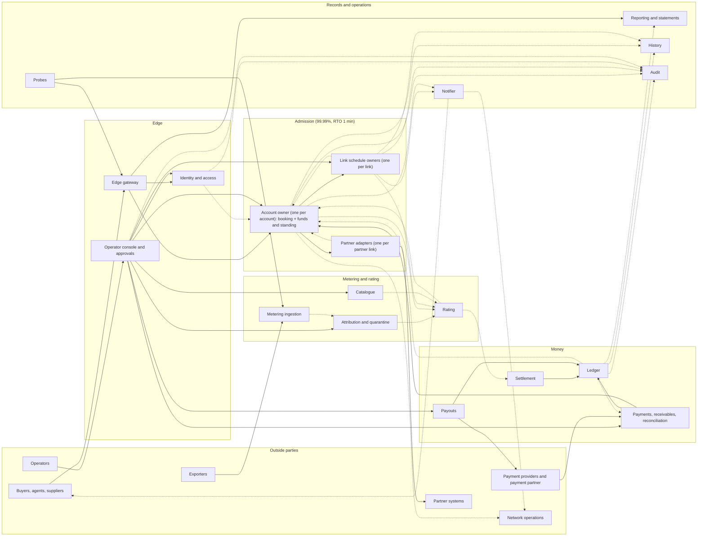
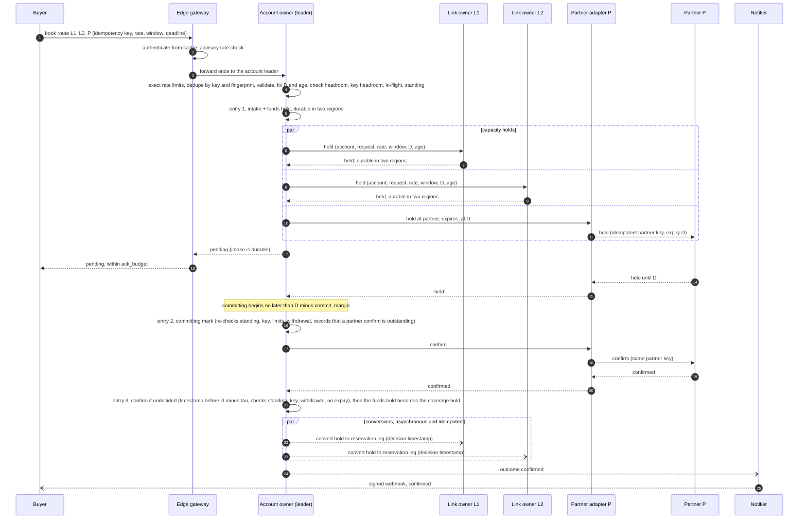
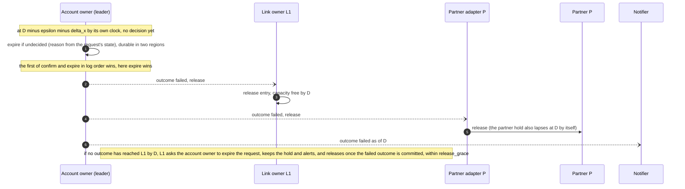
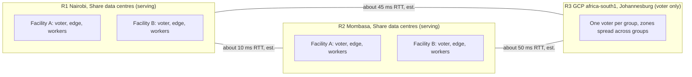

# RFC-000. Architecture overview: single-writer owners on two-region consensus logs

| | |
|---|---|
| Status | Draft, revision 2: revised per the [adversarial review](../reviews/06-rfc-000-review.md) (A0-01 … A0-21); see "Review resolution" at the end |
| Satisfies | All — structural. Allocates every need (P1-N1 … X2-N6, 66 in all) to an owning component and to the detailed RFC that specifies it; the scenarios themselves are satisfied by RFC-001 … RFC-006 |
| Policies | POL-01 … POL-33 (every entry of the register; §7 names the component that applies each need, and §2 the policies each component serves) |
| Prior decisions | History log D3, D12, D13, D21 (carried forward in Competition) |
| Builds on | The requirements at tag `requirements-v1.1` ([problem statements](../01-discovery/), [specs](../02-specs/), [policy register](../02-specs/policy-register.md), [glossary](../02-specs/glossary.md)), plus the amendments that resolve this RFC's review, RQ-1 … RQ-4 ([review 07](../reviews/07-requirements-amendments-from-rfc-000-review.md)) |
| Supersedes | The structural parts of the pre-baseline drafts RFC-001 … RFC-004, which were written from a prototype |

Terms are used in the sense of the [glossary](../02-specs/glossary.md). In particular,
"reserved rate" is capacity and "traffic" is bytes; neither is called "usage". Every
round-trip time, latency, volume and size in this RFC is an **estimate**, to be replaced
by measurement (Risks, R1), unless it is a requirement's own figure.

## Need

The requirements describe one marketplace with four very different workloads, which the
architecture has to make possible at once without one compromising another:

1. **A capacity decision that can never be wrong in the generous direction** (P1-N1, POL-05)
   and that is answered within `ack_budget` (200 ms at p99, POL-04) at 25,000 requests/s
   overall and 2,500/s on the hottest link (POL-06), whatever the booking's length
   (X2-N3). Every booking on a link, single-link or route, is decided by that link's one
   schedule owner (P1-N3), and every request has **one decision point** (POL-04) against
   which its account's suspension, its key's revocation, its withdrawal and its deadline
   are judged.
2. **A multi-party booking that is all or nothing** across Share links, partner systems that
   cannot join a transaction, and the buyer's funds (P2-N1, P2-N7, P2-N8), bounded by a
   deadline after which it is never confirmed and its holds are released (P2-N3, POL-26,
   with `release_grace` when the decision record is unavailable), with contention resolved
   by an explicit priority rule on Share links and at partners alike (P2-N4, POL-02), and
   recovery from Share's own crashes (P2-N5, POL-03).
3. **A metering and rating pipeline** that takes about 260,000 flow records/s (600,000/s
   peak), duplicated, late and out of order (P3-N3), keeps every one of them for 7 years
   (P3-N7, X2-N6), counts each accepted record in headroom within `attribution_lag_max`
   (P3-N10), and turns reservations and traffic into charges that are exactly once,
   reproducible and amended rather than rewritten (P3-N2, P3-N8, P3-N9), posted within
   2 min of each minute's end (X2-N3).
4. **A money system** that is conserved and immutable (P4-N7), moves money once per source
   reference for 7 years (P4-N15, POL-29), holds funds before capacity (POL-25), suspends
   and resumes by rule (P4-N5), splits exactly (P4-N8), pays out once (P4-N12), reconciles
   daily with the outside world (P4-N14, POL-24) and can rebuild any past headroom exactly
   as shown (P4-N16).

Across all four: every operation by an authenticated principal, accounts isolated, operator
power controlled and every change attributable (X1-N1 … X1-N10); availability per
capability and per serving region of 99.99% (admission, including the funds holds a
booking needs; ingestion) or 99.9% (wallet, payouts, reporting); RPO 0 with **every fact
acknowledged only once durable in two regions** (X2-N4); RTO from 1 min to 30 min on node
or zone loss and 1 h on region loss (X2-N5); latency targets suspended, but RPO 0 kept,
during a declared region disaster (POL-06); 7-year retention (X2-N6).

**The sites are given.** Share serves from its own data centres in **Nairobi** and
**Mombasa** and runs on Google Cloud as well ([company profile](../01-discovery/company-profile.md)).
The coordinator has fixed the geography (decision D1 of the review, as overridden): R1
Nairobi and R2 Mombasa (Share's own data centres) serve traffic; R3, Google Cloud
`africa-south1` (Johannesburg), is the third voting region and serves none.

The architecture must therefore decide: what the components are and what each one alone
may write; which interactions are synchronous on the 200 ms path and which can lag; where
atomicity is needed and how it is achieved without a global transaction; and how state is
replicated so that two-region acknowledgement fits inside `ack_budget` on these three
sites and a link or an account never has two writers, even across failures.

## Approach

### 1. Principles

| # | Principle | Why (requirement) |
|---|---|---|
| A1 | **Every piece of state has exactly one writer component.** Others read it, subscribe to it, or ask its owner to change it. | POL-05 for link schedules; the same discipline makes the account, reservation, ledger and request invariants each provable in one place. |
| A2 | **Each owner is partitioned by its natural serial key** (link, account, partner link, exporter, ledger account) and each partition is a **single-leader state machine over a replicated log**, fenced by the log's term. | "Decided as if one at a time" is stated per link (P1-N2), per account and key (P2-N8, P4-N3, POL-25) and per reservation (P2-N9). A single leader per partition gives that order directly, without locks or retries. |
| A3 | **Every replicated log commits only through a quorum that spans two regions.** There is no one-region state on any path that answers a buyer. | X2-N4, POL-06: a fact is acknowledged only once durable in two regions. P4-S72: what a buyer was shown must survive a region loss. |
| A4 | **Facts are append-only; current state is derived.** Corrections are new facts. | P1-N7, P1-N9 (known-at history), P3-N7, P3-N8, P4-N7, X1-N8. |
| A5 | **The 200 ms path touches only admission components**, synchronously; everything else (rating, settlement, statements, history, notifications) is asynchronous and catches up from the owners' logs. | POL-04 `ack_budget`; POL-06 gives rating no availability target of its own, only timeliness. |
| A6 | **Every command between components carries a deterministic idempotency identity**; every external input carries its own (idempotency key, source reference, record identity). Delivery between components is at least once. | POL-29, P2-N6, P3-N2, P3-N3, P4-N1, P4-N15. |
| A7 | **One decision point per request, and it is a log entry.** A request's outcome is fixed by the first deciding entry in its account owner's log: a conditional *confirm*, a conditional *expire*, or an ending entry (rejected, withdrawn, key revoked, account suspended). Log order, not clocks, decides which comes first. | POL-04 (one decision per request), POL-26 (never confirmed after the deadline), P2-S69, P2-S103. |
| A8 | **Deadlines are data; clocks drive liveness only.** The deadline is in the request record and in every hold. Clocks decide *when* a participant asks for expiry and *whether* a confirm may still be proposed; they never decide which of two outcomes wins. | POL-26: failed as of the deadline, whatever Share's state; review A0-01. |
| A9 | **Only a request's account owner ends its holds.** A link owner or partner adapter releases a request's hold only on that owner's say-so (an outcome, an accepted yield). | All or nothing (P2-N1): no participant can release a hold the decision still depends on. |

### 2. Component decomposition

Each component below owns the state listed and is its only writer. "Serves" names the
needs and policies it is the primary owner of; the full allocation is in §7.

#### Admission (capability: admission API, 99.99%, RTO 1 min)

| Component | Single responsibility | State it owns (only writer) | Partition | Serves |
|---|---|---|---|---|
| **Link schedule owner** | Decide every capacity question on one Share link, and record every change to what the link has sold or can carry | Per link: capacity history (baseline, unplanned outages and restorations, planned maintenance bookings, permanent reductions and their notice); confirmed reservation legs and their parts; capacity holds, each carrying its account, request identity, deadline `D` and `request_age`; Share's own holds for firm equivalent-path offers, at full rate from the offer to the reservation's end, counted as committed for new sales while the offer is open (POL-07, RQ-4); the link's waiter queue ordered by the priority rule, with waiter registrations, waiting notices and yields as **log entries**; affected flags per reservation and minute; the link's bitemporal change log | One partition per link; a hot link has a group to itself | P1-N1 … P1-N9, POL-05, POL-07, POL-09, POL-10, POL-31 |
| **Account owner** | Decide every booking request and every change of one account, and keep everything that account-level admission depends on, **in one serial order on one two-region log** | Per account. *Booking module* (RFC-002): booking requests (idempotency key, fingerprint, principal, `D`, `request_age`, `wait`, progress per leg, waiting, withdrawing, committing and takeover marks, the **decision entry** with its reason); reservations as route-level units (legs, parts, locked prices, partner terms shown at booking, lifecycle and end cause, partner-leg affected status, equivalent-path offers); per-reservation change queue. *Funds and standing module* (RFC-004 Part A): funds holds and credit holds; capacity in flight per key and account; key spending per `key_spend_period`; booking-rate counters per key and account (exact, D5); key status as applied here (D6); headroom inputs as applied feed entries (ledger balance through a ledger position, unposted usage through a rating position); credit limit as applied; standing, its cause, grace start and resume amount; low-balance warning state | By account (idempotency keys, limits and headroom are all per account) | P2-N1 … P2-N11, P4-N3 … P4-N6, P4-N17 (limit and standing side), POL-03, POL-04, POL-08, POL-15, POL-16, POL-18, POL-25, POL-26, POL-29 |
| **Partner adapters** | Speak one partner's API safely, and **stand in for a schedule owner for Share's own position at each partner link**: idempotent hold (with an absolute expiry set to `D`), confirm, final booking, release and cancel; classify answers (held, definite refusal, transient, unknown); order Share's own waiters by the priority rule; reconcile | Per partner link: the partner's classification under POL-26 (offers holds only if they last at least `route_deadline_max` + `commit_margin` **and** accept an expiry set by Share; otherwise without holds, P2-S102); Share's outstanding holds and bookings at the partner, each with its request, `D` and age; the waiter queue of Share requests refused because of Share's own position (POL-02), by `priority_rule`; call journal with idempotency keys; reconciliation results and mismatches | By partner link, on a two-region log | P2-N7, part of P2-N4, POL-02 (partner refusals), POL-26 (partner holds), POL-28 |

**Why the coordinator and the account funds are one component** (review A0-02). In the
previous draft the booking coordinator's request log and the account's funds and
standing were two components on the same partition key, the second durable in one region
only. That gave each request two decision points (the *bind* and the *decision record*),
so P2-S69 and P2-S103 could not both hold; it gave the account two serial orders, so
"concurrent bookings checked as if one at a time" (POL-25) spanned two logs; and it lost
the shown headroom on a region loss (P4-S72). Merging them gives one writer process per
account, whose decision entry checks standing, key status, the withdrawal mark, any
expiry entry and every limit in one place, and binds the funds in the same entry. The
two modules keep separate specifications (RFC-002 and RFC-004 Part A) and separate
invariants, but one log and one leader. The account owner is engineered to admission's
targets (99.99%, RTO 1 min), as POL-06 now requires for the funds holds a booking needs.

**Where the booking workflow runs.** The workflow that drives a request (taking holds,
calling the partner adapter, asking for expiry) runs **in the account owner's leader
process**, so every step it takes is in the same region as the log it writes. The edge
forwards each request once, to that leader. A new leader resumes every unfinished
workflow from the log (POL-03).

#### Metering and rating (capabilities: usage ingestion 99.99%, RTO 1 min; rating and posting, judged by timeliness, RTO 5 min ceiling)

| Component | Single responsibility | State it owns | Partition | Serves |
|---|---|---|---|---|
| **Metering ingestion** | Accept every flow record, durably, exactly as received; acknowledge only once it is durable in two regions | The raw record log (every record received, accepted or not, with its reason); record-identity index per exporter as run-length range sets of (exporter epoch, sequence number), for the retention period | By exporter | P3-N3, P3-N7, P3-N11, X2-N4 for records |
| **Attribution and quarantine** | Decide, for each accepted record, the account, route, product and reservation it belongs to, which leg's count is the egress count, and which billing rule of POL-17 applies; keep what cannot be attributed in quarantine | Attribution results per record and minute; quarantine entries and finance attributions within `dispute_window` | By account once attributed; by exporter in quarantine | P3-N4, P3-N6, P3-N13, POL-13, POL-17 |
| **Rating** | Turn reservation history, attributed traffic and price history into charge lines and amendments, exactly once and reproducibly; feed unposted usage to the account owner | Charge lines (reservation, usage, fee) and their amendments, each with its source reference and reason; per-line rated totals; unposted usage per account and product; lateness and attribution-lag breach reports | By buyer account | P3-N1, P3-N2, P3-N5, P3-N8, P3-N9, P3-N10, P3-N12, POL-01, POL-11, POL-14, POL-27 |
| **Catalogue** | Hold the reference data every other owner prices, splits or validates against | Links (supplier, Share or partner, endpoints, probe flag), products, `reservation_price` and `usage_price` history on minute boundaries, price corrections (as bitemporal facts, POL-23), split weights per route and party, partner terms (minimum term, cancellation fee, hold length, whether the partner accepts an expiry set by Share), probe designations | By entity | Inputs to P1, P2, P3, P4; POL-12 weights, POL-23 corrections, POL-27 |

**The attribution → unposted-usage → account path and the reservation-accrual posting
path run with hot standbys** that take over within about 30 s (review A0-07). The 5 min
RTO of rating and posting is a ceiling, not the design point: X2-S13 and X2-S22 are
counted per minute at 99.99%, which allows about 4.3 min a month, and one 5-minute
recovery would spend all of it. With a 30 s takeover a zone loss costs one or two
breaching minutes. RFC-006 states the per-minute budget arithmetic.

#### Money (capabilities: wallet, payouts and reporting 99.9%; rating and posting RTO 5 min)

| Component | Single responsibility | State it owns | Partition | Serves |
|---|---|---|---|---|
| **Ledger** | Be the only writer of money movements: validate (sums to zero per currency, every amount tagged), deduplicate by source reference, append, never alter; publish **closed positions** | The journal of movements; source-reference deduplication (7 years) as watermarks per structured reference plus exception sets, with principal and content digest; per-partition closed positions ("closed through T"); per-account balances as derived projections | Journal partitioned by the movement's **home account**: the buyer, if the movement touches a buyer (charges, amendments, fees, top-ups, invoice payments, reversals, write-offs, corrections Share bears for a buyer); otherwise the supplier, if it touches exactly one (payouts, supplier debts and their payments, duplicate-payout debts); otherwise Share's own account (carried excess paid by Share, the dearer-path difference, FX differences, Share's own deposits and withdrawals). A movement never touches two buyers. A buyer's balance therefore lives wholly in its own partition; supplier and Share balances are aggregates over partitions at closed positions | P4-N7, P4-N15, P4-N16 (movements), POL-11, POL-20, POL-29 |
| **Settlement** | Turn each charge or amendment into one movement split among its route's parties; pay the costs Share bears; raise supplier debts | Per charge line: shares already posted per party; deviation from exact proportions per party per payout period | By buyer account (charges); by supplier (debts) | P4-N8, P4-N9, P4-N11, POL-12, POL-23 |
| **Payments, receivables and reconciliation** | Everything that moves money between Share and the outside on the buyer side, and the daily proof that the books match the money | Payment events as received (authenticated, 2-region durable before the provider is acknowledged); top-up conversions; pending orphan reversals (72 h); invoices and invoice payments; write-offs; daily reconciliation runs, each at one closed position per ledger partition, and their differences | By provider and account | P4-N1, P4-N2, P4-N13, P4-N14, P4-N17 (invoices), POL-15, POL-20, POL-21, POL-24 |
| **Payouts** | Pay suppliers weekly, once, and recover what a provider executes twice | Payout runs (each at closed positions), instructions (with their references), confirmations and failures, escalations, residues carried | By supplier | P4-N12, POL-22 |
| **Reporting and statements** | Serve every account its statement and every supplier its view, from the owners' feeds | Read models only (no facts of its own): statements, supplier schedules with opaque reservation references, deviation reports | By account | P4-N10, the supplier view of X1-N2 and POL-33 |

#### Cross-cutting

| Component | Single responsibility | State it owns | Serves |
|---|---|---|---|
| **Edge gateway** | Terminate every external call: authenticate, resolve the principal, shed gross abuse with advisory rate counters, forward once to the owner partition's leader, answer within `ack_budget` | Advisory rate counters (soft state; the exact limits are enforced by the account owner, D5) | X1-N1 |
| **Identity and access** | Principals, agent keys and their limits, roles, consent to identify an account to a named supplier, and the authorisation decision for every operation | Accounts' users and administrators; agent keys, their limits and revocations (pushed to the account owner, which applies them, D6); operator roles; supplier-consent records (POL-33); KYB status as recorded by onboarding | X1-N1 … X1-N4, X1-N9, X1-N10, POL-25, POL-32, POL-33 |
| **Operator console and approvals** | The only way operators act: every action names its role and reason, four-eyes actions wait for a second compliance approval, then the action is sent to the component that owns the state | Operator action requests, pending approvals and their outcomes, on a two-region log; refused attempts at privileged actions | X1-N7, POL-30, POL-32 |
| **Audit** | Keep the immutable record of every change to money, capacity, links or keys, every operator action and every refused privileged attempt, for the retention period | The audit store, built from audit fields every owner writes in its own log (principal, time, role, reason) | X1-N8, POL-19 |
| **History** | Answer "as known at T" questions and keep every owner's log for 7 years | Archived owner-log segments in object storage replicated in two regions, and their bitemporal indexes (read models; owners stay the writers of the facts) | P1-N9 (storage), P4-N16 (rebuild), X2-N6, POL-19 |
| **Notifier** | Deliver every outbound notice: signed buyer webhooks retried for `webhook_retry`, affected-reservation notices within `affected_notice_time`, suspension and low-balance notices, supplier notices, operational alerts | Delivery attempts and their status | P2-N2 (webhooks), part of P1-N8, P4-N5, X1-N6 (signing with keys from identity and access) |
| **Probes** | Measure availability from outside each serving region as the designated probe account on designated probe links and exporters | Probe results per capability and minute | X2-N1 |
| **Placement and time** (platform) | Map every partition to its replicated log; keep all admission leaders in one region while it is healthy; move partitions with an epoch; publish closed positions; provide the clock-uncertainty bound `ε` | Partition map and epochs; leader-placement policy | Single writer across failures (POL-05), deadlines (POL-26), status reads (POL-04) |

**Merges and splits, and why.**

- *Booking and account funds are one component* (above). One serial order per account
  covers requests, decisions, holds, limits, key status and standing (POL-04, POL-25).
- *Waiting, crossings and deadlines* are not a separate component. The waiter queue for a
  Share link is part of that link's schedule (POL-02, POL-05); for Share's own position at
  a partner link it is part of that link's partner adapter; the request's waiting state
  and deadline are part of the request (the account owner). A separate "contention
  manager" would be a third writer between owners whose state it reads on every decision.
- *Funds holds are split from the ledger.* Holds are not money movements (the glossary's
  funds hold: "it is not a money movement"; POL-18), change on every booking, and gate
  admission at 99.99%; movements are conserved, immutable and 7-year idempotent.
  Different invariants, different write rates, different availability classes.
- *Rating is split from settlement*, at the charge (P3 ends at a charge, P4 starts from
  one): rating's correctness is per charge line, settlement's per party.
- *Attribution is split from ingestion*, because ingestion must acknowledge within 1 s at
  99.99% and must never depend on reservation or provisioning data being available;
  attribution can lag and catch up within `attribution_lag_max`.
- *Reporting owns no facts*, so its 30-minute RTO can be met by rebuilding from feeds.
- *History is a read model, not a writer.* Each owner's own log is the bitemporal record of
  its state; history archives and indexes it. This keeps POL-05's single writer intact.

### 3. Interaction overview

Solid arrows are synchronous requests; dashed arrows are asynchronous feeds from the
writer's log (at least once, ordered per partition, consumed idempotently).

| Interaction | Mode | Why |
|---|---|---|
| Edge → identity and access | Synchronous, from a local cache refreshed by push; cache entries for agent keys live at most 30 s | Authentication must be on every call (X1-N1) but cannot cost a remote call within 200 ms. A revocation reaches every edge within 60 s for new requests (X1-N3). |
| Edge → account owner leader | Synchronous, one forward; the edge answers `pending` if no final answer is ready in time for `ack_budget` | POL-04. The workflow runs at the account leader, so the edge makes one hop, not four (A0-05). |
| Account owner → link owners | Synchronous on the booking path (hold); asynchronous after the decision (convert, release) | The answer within `ack_budget` needs the hold; conversions can lag because the hold keeps counting. |
| Link owner or partner adapter → account owner (waiting notice, capacity released to a waiter, yield requested, affected reservation, revocation due, expire requested) | Asynchronous notification or command, idempotent by (link, epoch, sequence) | The participant observes; the account owner decides (A9). A yield takes effect only once the account owner accepts it in its own order, so a hold is never yielded under a request that is already committing. |
| Account owner → partner adapter → partner | Asynchronous to the buyer (the buyer gets `pending`), synchronous within the request's own workflow | Partner calls are slow and unreliable (P2 C7); only the request's deadline bounds them (POL-26). |
| Identity and access → account owner (key revoked) | Asynchronous push, applied as an entry within 60 s of the administrator's action | Gives P2-S72 and P2-S103 one order (D6). |
| Ledger → account owner (balance through position); rating → account owner (unposted usage through position); payments → account owner (invoice overdue, invoices paid) | Asynchronous feeds, applied as log entries | Headroom is computed from inputs at recorded positions, so every shown figure is reproducible (P4-S72, A0-21). |
| Account owner → rating, history (reservation lifecycle); link owner → rating, notifier, history (capacity and affected flags) | Asynchronous feeds | Rating has 2 min per minute; affected notices have 60 s (POL-07); history and statements have minutes. |
| Rating → settlement → ledger | Asynchronous feed; posting is a synchronous call to the ledger from settlement, idempotent by source reference | A posting must be acknowledged durable before rating marks a line posted. |
| Payment notification → payments → ledger → account owner | Synchronous acknowledgement to the provider after 2-region durability; posting and headroom update asynchronous | X2-S14; top-up to credited headroom within 10 s at p99 (X2-N3). |
| Account owner → network operations (standing) | Asynchronous feed with per-account sequence numbers, plus a query | At least once, within `standing_notice_time` (10 s); repeats change nothing (P4-N6). |
| Operator console → owners | Synchronous command after authorisation (and approval where four eyes apply) | Each owner stays the only writer; the console only carries authorised intent (X1-N7). |

#### A route booking with a funds hold and a partner leg

Route over Share links L1, L2 and partner link P (a partner with holds under POL-26),
default deadline 30 s, so `commit_margin` = 10 s applies. `D` is the deadline; `τ` is the
confirm fence (§4.3).

The committing mark (entry 2) is not a decision point: it only makes sure that
everything Share can check is checked just before the partner is confirmed (D7). An event
between entries 2 and 3 (a suspension, a revocation, a withdrawal) still makes entry 3
end the request not confirmed, as POL-04 requires; the partner booking is then cancelled
at once at Share's cost (POL-28 as amended by RQ-2). The window is one partner round trip.

#### The deadline path

What changes on the other paths (each specified in RFC-002):

- **A leg does not fit on committed capacity** (L2 rejects): the account owner appends the
  ending entry *rejected*, with the blocking link and the route counter-offer (P2-N11);
  the outcome is reported once the releases on L1 and at P are durable (§4.3).
- **A leg is blocked only by capacity in flight**: the link owner queues the request as a
  waiter by age; the account owner marks the request *waiting* and tells every link owner
  and partner adapter where it holds capacity. A link owner whose older waiter is blocked
  by a younger request's hold, where that younger request is itself waiting, asks the
  younger request's account owner to yield; the account owner accepts in its own order
  only if the request is still waiting (not committing), and then the hold is released
  and the request keeps its age and its place (POL-02). Cycles of any length break without
  being detected. A holder that is not waiting is never pre-empted.
- **The partner refuses definitively** while another Share request holds, or has a
  final-only booking for an undecided request, overlapping capacity there: the partner
  adapter recognises Share's own position, queues the refused request in its waiter queue
  by `priority_rule`, and applies the same yield rule to Share's own partner holds. When
  the request ahead resolves (and, if not confirmed, Share's cancellation at the partner
  is done), it asks the partner again for its waiters strictly in priority order, one at a
  time per overlapping window (POL-02, A0-04).
- **A partner without holds** (including one whose holds are too short or cannot take an
  expiry set by Share, POL-26, P2-S102) is booked last, after every other leg is held,
  after the funds hold and after the committing mark, at most one per route (POL-28). If
  the request then ends not confirmed, the adapter cancels it at once at Share's cost.
- **Withdrawal**: the account owner appends a withdrawing mark; the next deciding entry
  (normally at once) ends the request "withdrawn"; a partner booking already confirmed or
  final is cancelled at Share's cost (POL-08, RQ-2).
- **Single-link booking** (80% of the load): the same protocol with one participant and no
  partner: intake + funds hold, link hold, decision. If the decision is not committed in
  time for `ack_budget`, the edge answers `pending`, which is safe because the intake is
  already durable.

#### Latency budget

**Round-trip-time assumptions (all estimates, to be measured; R1).**

| Pair | RTT (estimate) |
|---|---|
| Two facilities ("zones") in one metro, Nairobi or Mombasa | 1 to 2 ms |
| R1 Nairobi ↔ R2 Mombasa (Share's own fibre) | about 10 ms |
| R1 Nairobi ↔ R3 Johannesburg (GCP `africa-south1`) | about 45 ms |
| R2 Mombasa ↔ R3 Johannesburg | about 50 ms |
| A probe (D2) or a buyer in the same metro ↔ that region's edge | up to 10 ms |
| Buyers elsewhere (Djibouti, Marseille) ↔ R1 or R2 | Not budgeted: `ack_budget` is measured at the system boundary (X2-N3) |

**Two-region quorum write, five voters placed 2 (R1) + 2 (R2) + 1 (R3), majority 3,
group commit (estimates).** A commit needs the leader and the two fastest other voters.

| State | Who completes the majority (leader in R1 unless stated) | p50 | p99 |
|---|---|---|---|
| Steady state | R1 peer and the nearer R2 voter (one 10 ms round trip) | about 13 ms | about 25 ms |
| One facility lost in R1 (leader stays in R1, or moves to the R1 survivor) | Both R2 voters | about 13 ms | about 25 ms |
| One facility lost in R2 | R1 peer and the remaining R2 voter (R3 as the spare) | about 13 ms | about 30 ms |
| **R2 lost** (declared disaster; leader in R1) | R1 peer and **R3** (45 ms round trip) | about 50 ms | about 65 ms |
| **R1 lost** (declared disaster; leaders move to R2) | R2 peer and **R3** (50 ms round trip) | about 55 ms | about 70 ms |

R3 is never on the commit path while both Kenyan regions are up. Once either is lost,
every commit must reach R3: that is the price of keeping every fact durable in two
regions (RPO 0), and no placement avoids it (RQ-3).

**Leader placement.** All admission leaders (account owners, link owners, partner
adapters) are kept in R1 while R1 is healthy. R1 is preferred over R2 because it is the
nearer of the two to R3, so losing R2 costs less than losing R1 (65 against 70 ms per
commit), and because Nairobi is assumed to be the larger market. Placement fails leaders
over **region-wide**, not per group, so a partial failure in R1 does not leave account and
link leaders in different regions (A0-05).

**Single-link booking, steady state, p99 (estimates; the sum of p99s, so conservative).**

| Step | Durability | p99 |
|---|---|---|
| Edge: TLS on a persistent connection, authentication from cache, advisory limits, routing | none | 10 ms |
| Hops in one region: edge → account leader → link leader → account leader → edge | — | 5 ms |
| Entry 1 at the account owner: exact rate limits, dedupe, headroom, key headroom, in-flight, standing; intake + funds hold | two regions | 27 ms |
| Capacity check (in-memory peak query) and hold at the link owner | two regions | 27 ms |
| Entry 3 at the account owner: confirm if undecided, binding the funds | two regions | 25 ms |
| **Total, edge in R1** | | **about 95 ms**, against 200 ms |

| Variant | Estimate (p99) |
|---|---|
| Edge in R2 (a Mombasa buyer, or the R2 probe), leaders in R1: one extra R2 ↔ R1 round trip | about 105 ms |
| Probe overhead (D2: within 10 ms of the region, persistent TLS) | + up to 10 ms, so about 105 to 115 ms measured |
| Leader drift in steady state (an account and a link leader in different regions, before placement corrects it): + 10 ms per crossing call | at worst about 125 ms |
| One facility lost in R1 or R2 | about 95 to 110 ms |
| Route booking, time to `pending` (edge, hop, entry 1, response) | about 45 ms steady; about 90 ms after a region loss |
| **R2 lost**, R1 serving: three commits at about 65 ms + 20 ms | **about 215 ms** (p50 about 170 ms) |
| **R1 lost**, R2 serving: three commits at about 70 ms + 20 ms | **about 230 ms** (p50 about 185 ms) |

In steady state the budget leaves about 85 ms of margin, more than the previous draft's
claim, because the Kenyan pair is closer (10 ms) and no write is made in one region only.
After a region loss a single-link booking's **final** answer misses 200 ms at p99; the
**acknowledgement** still fits, because the edge answers `pending` once entry 1 is durable
(about 90 ms) and the outcome follows by poll or webhook. POL-06 (RQ-3) suspends the
latency targets for the declared disaster; RPO 0 is kept. Two mitigations are open for
RFC-006: a parallel-commit fast path for single-link bookings in the degraded state (two
writes instead of three, about 150 to 160 ms; Competition), and moving the lost region's
voters to a replacement site, which ends the disaster as POL-06 defines it.

### 4. Consistency model

#### 4.1 Where atomicity is needed, and how it is achieved

| Unit that must be atomic | Mechanism | Owner RFC |
|---|---|---|
| **One decision on one link** (check the peak and record the hold or the confirmation) | A single entry in the link's log, applied by its single leader; no locks | RFC-001 |
| **One booking: every leg, the partner's included, and the funds hold, or none** (P2-N1, P2-N8) | A commit protocol whose **decision log is the account owner's log**. Participants prepare: the funds hold (in entry 1), capacity holds on Share links and partner holds with expiry `D`. The decision is one conditional entry in the account owner's log; conversions follow idempotently. Because the decision log is itself a two-region consensus log, a dead coordinator does not block: whoever leads the partition reads the decision and resumes. Partners cannot prepare in Share's sense, so a partner leg is confirmed after the committing mark and **before** the decision (Share never confirms a leg the partner has not confirmed, P2-N7); any partner booking left without a Share confirmation is cancelled at once at Share's cost (POL-28, RQ-2). | RFC-002 |
| **Account-level admission** (headroom, key headroom, capacity in flight, rate limits, standing, key revocation, withdrawal, deadline; concurrent bookings by one account decided as if one at a time) | The account owner's serial order. The **decision entry is the single POL-04 decision point**: it checks all of these and binds the funds in the same entry. | RFC-002 (state machine and decision); RFC-004 Part A (funds and standing rules) |
| **One change to one reservation** (P2-N9) | The reservation's change queue in the account owner: changes applied in arrival order; a cancellation is never queued and fails a pending change; an extension or increase is a new admission of the difference through the same booking protocol | RFC-002 |
| **One money movement** (P4-N7) | One journal record holding all its entries, written to one ledger partition (its home account's), validated to sum to zero per currency before append. Double entry is atomic by construction, because a movement never spans partitions. | RFC-004 |
| **Posting a charge or amendment once** (P3-N2, P4-N15) | The ledger's append is conditional on the source reference being new; the deduplication state is in the same partition as the movement | RFC-004 |
| **Accepting a flow record once** (P3-N3) | The record-identity check and the append are one entry in the exporter's ingestion partition | RFC-003 |
| **An operator action and its audit record** (X1-N7, X1-N8) | The audit fields are part of the owner's own log entry for the change; there is no separate audit write to lose | RFC-005 |

Serialisability across links follows from the protocol's shape: a request takes all its
holds before its decision and keeps them until it (strict two-phase locking, with holds
as the locks and the priority rule as the conflict policy), so concurrent bookings end in
the state of some one-at-a-time order (P1-N2, P2-N9). A yield is the only early release,
and it is accepted only while the request is waiting, so it never removes a lock a
decision relies on (A9).

#### 4.2 Where eventual consistency is acceptable

| What lags | Bound | Why it is acceptable |
|---|---|---|
| Conversion of holds into reservation legs on link owners after the decision | Milliseconds; the hold keeps counting against capacity until converted | Capacity is counted either way; nothing can be sold in between. The conversion carries the decision's timestamp, so "known at T" is defined (§4.3). |
| Status reads behind the decision | `status_staleness` (1 s) | POL-04; §4.6. |
| Rating and posting behind the reservation and traffic feeds | 2 min per minute (`max_lateness` + 2 min for traffic), 99.99% of minutes (X2-N3) | Funds holds already cover accrued-but-unposted charges (POL-18). |
| Accepted record reaching headroom | `attribution_lag_max` (10 s), 99.99% of minutes, with hot standbys (§2) | POL-14 now includes this lag in the lateness bound; later records are reported as breaches. |
| Supplier balances and Share's own balance | Aggregated at closed positions; closed per payout run and per reconciliation day | Payouts are weekly; reconciliation is daily (POL-22, POL-24). Aggregates remove the hot row that Share's own account would otherwise be. |
| Statements, supplier views, history, audit store | Minutes | Reporting RTO is 30 min; none of them is a writer of facts. |
| Standing at network operations | `standing_notice_time` (10 s) | POL-06 splits the 60 s enforcement target. |
| Affected-reservation notices | `affected_notice_time` (60 s) | POL-07. |
| Agent-key revocation at the edge (new requests) and at the account owner (undecided requests) | 60 s | X1-N3, POL-25, D6. |

#### 4.3 Deadlines, expiry and the decision point

- **The deadline is data.** `D` and `request_age` are fixed in entry 1 (intake) and are
  part of every hold the request takes. A retry with the same key finds them there.
- **Expiry is a log entry, not a read** (A0-01). At `D − ε − δ_x` by its own clock, the
  account owner's leader appends a conditional **"expire if undecided"** entry; `ε` is the
  clock-uncertainty bound and `δ_x` covers one commit and one notice at p99 (about 100 ms
  in the degraded state), so that in the normal case the failed outcome is committed and
  every Share-link hold is released by `D` (P2-S93). Any participant may also ask for the
  same entry (idempotent), and a link owner or partner adapter that has seen no outcome
  by `D` does so.
- **First in log wins.** The state machine keeps whichever deciding entry comes first in
  log order: confirm, expire, or an ending entry. Each is conditional ("if undecided"), so
  a later one changes nothing. No participant releases a hold until it learns of a
  committed non-confirmed outcome (A9). There is no read that could miss a decision still
  being replicated, so no hold is ever released under a confirmed reservation.
- **The confirm fence, a liveness rule with a timestamp guard.** A confirm entry carries
  the leader's timestamp from when it is appended, and the state machine accepts it only
  if that timestamp is earlier than `D − τ`, with `τ > ε + δ_x`, so that under one leader
  a confirm always precedes the expire entry in the log. A request with a partner leg
  does not begin committing later than `D − commit_margin` (POL-26). The **decision point**
  of a request (POL-04) is its deciding entry, and its time is that entry's timestamp,
  which for a confirmation is always before `D − τ`: a request is never decided confirmed
  after its deadline (POL-26 as amended by RQ-1).
- **When the decision record is unavailable at the deadline** (the account partition is
  electing a leader, or has lost quorum), no participant can learn the outcome, so every
  Share-link hold is kept, which is safe, and an alert is raised. The new leader's first
  entry is a **takeover** entry; it then appends the expiry for every request past its
  deadline, and holds are released within `release_grace` (1 min) after `D` (RQ-1). An
  election takes seconds, so this bound is met with a wide margin; a partition without
  quorum for longer than 1 min has already missed admission's RTO. One residual case:
  a confirm appended before `D − τ` whose leader failed before it was replicated to a
  majority, and which the new leader, elected after `D`, carries. A new leader cannot tell
  whether such an entry was already committed (and possibly reported), so it must keep
  it; the request is then confirmed by an entry timestamped before `D − τ` that becomes
  durable, and known, only after the takeover, at most `release_grace` after `D`. `τ` is
  small (about `ε` + `δ_x`, so that 1 s deadlines stay usable), so the case needs a leader
  failure within a fraction of a second before the deadline with a confirm in flight. No
  design can close it: no consensus log bounds when a proposed entry becomes durable. It
  conflicts with the literal text of P2-S104; requirements issue RQ-5 asks for the
  reading the design follows.
- **Reasons** (A0-20). The expiry entry takes its reason from the request's state:
  "deadline passed while waiting" with its `retry_after` (taken from the waiting notice,
  which carries the deadline of the request ahead) if it was waiting; "interrupted by an
  internal failure" if a takeover entry occurred after its last progress and it could not
  be resumed in time (P2-S23); otherwise "deadline passed".
- **Non-confirmed outcomes before `D`** (rejected, withdrawn, key revoked, account
  suspended) are fixed by their ending entry, which is the decision point. The outcome is
  **reported** (in status reads, webhooks and the outcome feed) only once the request's
  Share-link releases are durable, so no buyer or competitor sees an outcome while
  capacity is still held for it (P2-N3, P2-S14; RQ-6). A partner hold is released at the
  same time, and lapses at `D` by itself in any case (P2-S101).
- A request still undecided at `D` raises an operational alert (P2-N10, POL-26).

#### 4.4 Idempotency (POL-29)

| Input | Identity | Where it is checked | Retention |
|---|---|---|---|
| Booking request | (account, idempotency key); sameness = route, window, rate, product and `wait`, plus the principal; the deadline is not part of sameness | The account owner, in entry 1, **atomically with the request record and the funds hold**, before any capacity hold (A0-03). Two concurrent submissions with one key are ordered by the account log: the first creates the request; the other is the same request (and gets its answer) or is not accepted. A submission over a rate limit is not accepted and creates nothing (D5). | `idempotency_retention` 24 h |
| Internal command (hold, convert, release, yield request and acceptance, expire request, revoke, release after grace, move hold) | Derived from the request or reservation identity, the leg and the step (and an attempt number where a step can be retried after a yield) | The receiving owner's partition, in the same log entry as the effect | Life of the request or reservation, plus 24 h |
| Partner call | Partner key derived from the request, leg and operation | The partner (P2 C7), and the adapter's call journal | 7 years with the partner booking record |
| Flow record | (exporter, exporter epoch, sequence number); the epoch distinguishes counter restarts (P3 open question 1, decided in RFC-003) | Ingestion partition of the exporter, as run-length range sets per (exporter, epoch): mostly contiguous sequences make the index the size of its gaps, not of the 7-year record count (about 6×10¹³) | 7 years |
| Charge, amendment and fee lines | (reservation or usage key, minute, amendment sequence) | Ledger partition, as a watermark per reservation and product ("posted through minute m") plus an exception set for amendments and late lines, not a hash index over about 2×10¹⁴ line references (A0-08). A redelivery below the watermark is compared with the line recomputed from its inputs; different contents move nothing and are reported | 7 years |
| Other money-moving inputs (payment notification, invoice payment, transfer confirmation or failure, payout instruction, operator correction or attribution, escalation resolution, write-off, Share-borne cost, supplier debt, movement of Share's own funds) | Its source reference: for providers, provider, transaction reference and event kind (a reversal shares its payment's transaction reference) | Ledger partition, atomically with the movement; a redelivery with different contents moves nothing and is reported; a different principal is refused | 7 years |
| Feed events between components | (producer partition, epoch, sequence) | Each consumer's own state | Until consumed and checkpointed |

#### 4.5 Ordering

| Scope | Order | Source |
|---|---|---|
| One link | Total order of every schedule change, waiter registration and yield (the link log) | P1-N2, POL-05 |
| One account | Total order of intakes, holds, marks, deciding entries, rate counts, key revocations, credit limits, feed positions applied and standing changes | P2-N8, P4-N3, POL-04, POL-25 |
| One request | The first deciding entry in the account log wins; the outcome never changes once reported | P2-N2, POL-04 |
| One reservation | Changes in arrival order; cancellation first | P2-N9, POL-08 |
| Waiters on one Share link | Priority rule (`request_age`: the intake entry's timestamp, ties by request identity) | POL-02 |
| Share's waiters at one partner link | The same priority rule, kept by the partner adapter; re-asks one at a time per overlapping window | POL-02 |
| One charge line | Amendments in sequence; each is the new total rounded once less what was posted, so the result does not depend on arrival order | P3-N3, P3-N8, P4-N9 |
| One account's standing feed | Sequence numbers; a consumer applies the latest | P4-N6 |
| Across ledger partitions | Closed positions only: each partition commits "closed through T", after which no entry with a posting time at or before T is appended; reconciliation for day D and each payout run read every partition at its closed T | P4-N14, POL-22, POL-24 |
| Globally | **None needed.** No requirement orders events across links, accounts or exporters, so there is no global sequencer | — |

#### 4.6 Status reads and headroom reads

- **Status reads** (polls, retries with a key) are served by replicas of the account
  owner's log, never through the leader's write path. A replica answers only once it has
  applied the log up to a **closed position** no more than `status_staleness` − (a margin
  for `ε`) old; the leader closes positions every 200 ms or so (piggybacked on
  heartbeats). A replica therefore reports the decided outcome from `status_staleness`
  after the decision at the latest, and reports *failed as of D* only once a committed
  expiry or ending entry has been applied, never from the clock alone. That removes the
  contradiction the previous draft allowed (P2-S99, P2-S10, P2-S103, A0-06). While the
  decision record is unavailable, status reads are unavailable, never wrong.
- **Headroom answers** are computed at one recorded account-log position. Because the
  ledger balance (through a ledger position), unposted usage (through a rating position),
  holds and limits all enter the account owner's log, the state at that position is the
  whole input. Every headroom answer carries its position, and an answer that gates a
  decision is evaluated inside the deciding entry, so any past headroom can be rebuilt
  exactly as shown (P4-S72, A0-21). With the home-account rule (§2) a buyer's ledger
  balance is the balance of one partition, so it is exact, not an estimate.

### 5. Deployment and durability topology

#### 5.1 Regions, zones and voters

- **Regions.** R1 Nairobi and R2 Mombasa are Share's own data centres and are the serving
  regions (POL-06): their edges answer buyers, suppliers, exporters and payment
  providers. R3, Google Cloud `africa-south1` (Johannesburg), keeps voters only, has no
  edge and so no targets of its own. The three are in different metros and, for R3, a
  different operator, so no single disaster loses two of them.
- **Zones.** Within R1 and R2, a zone is one of Share's independent facilities (own power
  and fibre entry) in the metro. The design assumes **at least two facilities per Kenyan
  metro** (Share reports 10 data centres); this is to be confirmed (R2). R3 uses Google's
  zones.
- **Voters.** Every replicated log (link, account, partner-adapter, ingestion, ledger,
  approvals) has five voters: two in R1 (different facilities), two in R2 (different
  facilities), one in R3. No region holds three voters, so **every majority spans at
  least two regions**: a commit is, by construction, durable in two regions (A3, X2-N4).
  Ingestion may instead use three voters, one per region (RFC-003 and RFC-006 decide;
  Competition), since its 1 s budget absorbs a commit through R3.
- **Leaders** of the admission tier are all in R1 while it is healthy, failed over region
  by region (§3). Stateless services (edge, workflow workers co-located with account
  leaders, rating and settlement workers and their hot standbys) run in both facilities
  of R1 and R2. Each region's edge answers its own probes; writes go to the leader.
- **Probes** (D2) run from colocation sites within about 10 ms of each serving region,
  outside Share's facilities, over persistent TLS connections, as the designated probe
  account, which books on a credit limit set by finance (D3, POL-06). The 200 ms limit is
  measured end to end from the probe.

| Failure | What happens | Effect on acknowledged facts | Effect on latency (single-link, p99, est.) |
|---|---|---|---|
| A node | Leader moves within its group in seconds | None (RPO 0) | None after the move |
| A facility (zone) | At most one voter per group lost; groups keep quorum; leaders on that facility move within R1 (or region-wide to R2 if R1 can no longer lead) | None | About 95 to 110 ms |
| Region R2 (declared disaster) | Groups keep quorum with R1 + R1 + R3; R1 serves alone | None | About 215 ms; `pending` within about 90 ms; targets suspended (RQ-3) |
| Region R1 (declared disaster) | Groups keep quorum with R2 + R2 + R3; all leaders move to R2 automatically, region-wide; R2 serves alone | None; admission back within minutes, inside the 1 h target | About 230 ms; `pending` within about 90 ms; targets suspended (RQ-3) |
| Region R3 | Groups keep quorum with R1 and R2 | None | None |
| The R1 ↔ R2 path, both regions up | Leaders in R1 keep quorum through R3 (commits about 65 ms); R2's edge reaches the leaders only through R3 | None | R1 about 215 ms; R2 unavailable against its probes. Not a declared disaster, so it counts against availability: R1 ↔ R2 must have diverse paths (R14) |

#### 5.2 Single writer per partition, across failures (fencing)

- The link owner for a link **is** the leader of that link's partition; the account owner
  for an account is the leader of that account's partition. Each is the only process that
  can append to its log, and every entry carries the group's term.
- Leadership is held under a lease shorter than the election timeout, so a deposed leader
  stops deciding before a new one can start.
- Every command to an owner carries the partition epoch it was routed with; a command
  routed with a stale epoch is refused and re-routed. Every notification from an owner
  carries (partition, term, sequence); consumers ignore anything older than what they
  applied.
- Moving a partition to another group (rebalancing a hot link) is a handoff through the
  placement map with an epoch increment: the old group appends a final *moved* entry and
  refuses further commands.
- The same mechanism fences every owner partition (link, account, partner link, exporter,
  ledger), so no state has two writers at any moment.

#### 5.3 What is durable where

| State | Durability before it is acknowledged or acted on | After a region loss |
|---|---|---|
| Every owner's log: confirmed reservations, schedule changes, capacity holds, waiter entries, requests and their marks, decisions, funds and credit holds, key spending, capacity in flight, standing, credit limits, invoices, partner holds and bookings, payout instructions and confirmations, pending approvals | Two regions | Itself; nothing is rebuilt |
| Ledger movements, payment events, accepted flow records | Two regions (X2-N4) | Itself |
| Sealed log segments older than the live tail | Object storage replicated in two regions (A0-16) | Itself |
| Advisory edge counters, caches, read models | None or local | Reset or rebuilt from feeds |

The previous draft's one-region account partition, and its rebuild after a region loss,
are removed (A0-02).

#### 5.4 Recovery targets per capability

| Capability (POL-06) | Components | Availability | RTO node or zone | RTO region | How it is met |
|---|---|---|---|---|---|
| Admission (including the funds holds and headroom checks a booking needs) | Edge, identity and access (cache), account owners, link owners, partner adapters | 99.99% | 1 min | 1 h (designed for minutes) | Leader election within seconds; requests, holds and decisions are in the log; a new account leader resumes every workflow (POL-03) |
| Usage ingestion | Edge for exporters, metering ingestion | 99.99% | 1 min | 1 h | Same log topology; exporters retry; acknowledgement only after two-region durability |
| Rating and posting | Attribution, rating, settlement, ledger | Judged by timeliness | Designed for about 30 s (hot standbys); 5 min ceiling | 1 h | Hot standbys over checkpoints on the unposted-usage and reservation-accrual paths, so X2-S13 and X2-S22 keep their per-minute budgets (A0-07) |
| Wallet (other operations) | Account owner replicas (balance and headroom answers), payments, ledger reads | 99.9% | 5 min | 1 h | As admission |
| Payouts | Payouts, ledger | 99.9% | 15 min | 1 h | Instructions are facts; a restarted run resumes by reference and never re-instructs |
| Reporting and statements | Reporting, history | 99.9% | 30 min | 1 h | Read models rebuilt from feeds and history |

Probes (X2-N1) run as the designated probe account on probe links and probe exporters in
every serving region, through the real path; every consumer that would rate, settle,
report to suppliers or report quarantine checks the probe designation from the catalogue
and identity and access, and excludes it (POL-06).

### 6. Partitioning and sizing for the design load

All volumes are estimates from POL-06's provisional design load and the assumptions
stated; RFC-006 replaces them with measurements.

| Load | Partitioning | Sizing note |
|---|---|---|
| 25,000 booking requests/s | Account owners by account; link owners by link | `account_rate_limit` (200/s) bounds any account partition. Each request writes 2 entries to its account log (intake, decision), 3 with a partner leg, plus waiting marks |
| 2,500 requests/s on the hottest link | That link's group alone; one leader, group commit about every 5 ms | At least 2 link-log entries per request (hold, then convert or release), plus waiter and yield entries: at least 5,000 entries/s, about 25 to 40 per group commit. A hold lives from its own commit to the conversion, about 75 ms, so about 190 holds are in flight at once. A request on that link sees capacity in flight, and may get `pending` instead of a final answer, only when the link's free capacity is below those holds' Mbps; RFC-001 measures the share (A0-19) |
| Status polls | Served by account-log replicas at closed positions (§4.6) | Requests that end `pending` (routes, about 5,000/s, plus contended single-link ones) polled about once a second for a few seconds: about 25,000 to 70,000 polls/s; sized for 100,000/s. `key_poll_limit` bounds any one key. Polls never touch the leader's log |
| 260,000 records/s (600,000/s peak) | Ingestion by exporter; attribution and rating by account | Records accepted in batches; one two-region commit per batch. 7 years at about 100 B a record is about 5.7 PB of raw records; sealed segments are kept twice (two regions), not five times (A0-16) |
| Reservation charge lines | Rating, settlement and ledger by buyer account | 70% of 25,000/s fit, so about 17,500 confirmed/s; with an **assumed** mean reservation of 1 h, about 63 M reservations are active and about **1 M reservation lines/s** are rated (more than the flow-record peak). Settlement posts **one movement per account and minute** carrying all that account's lines, each line keeping its own source reference: at an assumed 100,000 active buyer accounts, about 1,700 movements/s. Deduplication by watermark per reservation (§4.4), about 63 M live watermarks rather than 2×10¹⁴ references (A0-08) |
| 1,000 payment notifications/s | Payments by provider and account | — |

### 7. Allocation of needs

Every need is allocated to the component or components that own it and to the detailed RFC
that will specify it. "Also" names RFCs that specify a contract the need depends on.
"Account owner (booking)" and "account owner (funds)" are the two modules of the one
account owner (§2).

| Need | Owning component(s) | Specified in |
|---|---|---|
| P1-N1 Never oversold | Link schedule owner | RFC-001; also RFC-002 (only the account owner ends a hold), RFC-006 (single writer across failures) |
| P1-N2 Requests that fit are confirmed | Link schedule owner | RFC-001 |
| P1-N3 One schedule per link; holds; waiting | Link schedule owner, account owner (booking) | RFC-001; also RFC-002 (waiting and yield protocol) |
| P1-N4 Rejections actionable and discreet | Link schedule owner | RFC-001 |
| P1-N5 Malformed requests are errors | Account owner (booking: intake), link schedule owner (window and horizon rules) | RFC-001 (validity rules); also RFC-002 (intake) |
| P1-N6 Open-ended and long reservations | Link schedule owner | RFC-001 |
| P1-N7 Only facts recorded | Link schedule owner | RFC-001 |
| P1-N8 Loss of supply never revokes silently | Link schedule owner (affected flags, move holds for firm offers); account owner (booking: offers, moves, revocations of the route-level reservation, partner-leg affected status); notifier | RFC-001; also RFC-002, RFC-006 (notices) |
| P1-N9 Decisions explained after the fact | Link schedule owner (bitemporal log, conversions carrying the decision time); history | RFC-001; also RFC-006 (retention) |
| P2-N1 All or nothing | Account owner (booking), partner adapters | RFC-002 |
| P2-N2 Fast, uniform answer | Edge gateway, account owner (booking; status reads from replicas), notifier | RFC-002; also RFC-005 (webhook signing), RFC-006 (delivery, closed positions) |
| P2-N3 Bounded wait | Account owner (booking: expiry entries, decision point), link schedule owner (release on outcome), partner adapters (hold expiry at `D`) | RFC-002; also RFC-001 |
| P2-N4 Fair contention | Account owner (booking: yield acceptance), link schedule owner (waiter queues), partner adapters (waiter queues and yields at partners) | RFC-002; also RFC-001 |
| P2-N5 Recovery from Share's own faults | Account owner (booking: takeover and resumption) | RFC-002; also RFC-006 |
| P2-N6 Retries never book twice | Account owner (booking) | RFC-002; also RFC-005 (scope) |
| P2-N7 Partners booked safely | Partner adapters, account owner (booking) | RFC-002 |
| P2-N8 Funds and limits at admission | Account owner (booking and funds: holds, key headroom, in-flight, exact rate limits), edge gateway (advisory limits) | RFC-002; also RFC-004 (funds rules), RFC-005 (key limits) |
| P2-N9 Changed or ended as one unit | Account owner (booking) | RFC-002; also RFC-001, RFC-004 |
| P2-N10 Operations see requests in trouble | Account owner (booking), operator console | RFC-002; also RFC-006 (alerting) |
| P2-N11 Route counter-offer | Account owner (booking), link schedule owner | RFC-002; also RFC-001 |
| P3-N1 Reservations accrue what was sold | Rating | RFC-003 |
| P3-N2 Each charge line charged once | Rating, ledger | RFC-003; also RFC-004 |
| P3-N3 Traffic counted exactly once | Metering ingestion, rating | RFC-003 |
| P3-N4 Traffic in well-defined minutes | Attribution and quarantine | RFC-003 |
| P3-N5 Priced as it happened | Rating, catalogue | RFC-003 |
| P3-N6 Each kind of traffic by its rule | Attribution and quarantine, rating, settlement (carried excess) | RFC-003; also RFC-004 |
| P3-N7 No record silently discarded | Metering ingestion | RFC-003 |
| P3-N8 Amended, never rewritten | Rating, catalogue (price corrections), ledger | RFC-003; also RFC-004 |
| P3-N9 Every charge reproducible | Rating | RFC-003; also RFC-006 (inputs retained) |
| P3-N10 Usage exposure visible | Rating (unposted usage within `attribution_lag_max`, hot standby), account owner (funds) | RFC-003; also RFC-004 |
| P3-N11 Metered traffic is evidence | Metering ingestion, history | RFC-003; also RFC-006 |
| P3-N12 Partner fees by rule | Rating, account owner (booking: fee shown, who ended) | RFC-003; also RFC-002 |
| P3-N13 Billed once per route at egress | Attribution and quarantine | RFC-003 |
| P4-N1 Top-up exactly once | Payments, receivables and reconciliation; ledger | RFC-004 |
| P4-N2 Converted at the shown rate | Payments, receivables and reconciliation | RFC-004 |
| P4-N3 Funds held for the coverage window | Account owner (funds) | RFC-004 |
| P4-N4 Headroom itemised | Account owner (funds), ledger, rating | RFC-004 |
| P4-N5 Suspension predictable and reversible | Account owner (funds: standing; booking: release after grace), notifier | RFC-004; also RFC-002 |
| P4-N6 Network operations knows standing | Account owner (funds) | RFC-004 |
| P4-N7 Money conserved, history fixed | Ledger | RFC-004 |
| P4-N8 Split exactly and fairly | Settlement | RFC-004 |
| P4-N9 Late charges settle like on-time ones | Settlement, rating | RFC-004; also RFC-003 |
| P4-N10 Statements checkable | Reporting and statements | RFC-004; also RFC-005 (visibility) |
| P4-N11 Supplier earnings final | Settlement | RFC-004 |
| P4-N12 Payouts weekly, exact, once | Payouts | RFC-004 |
| P4-N13 Reversals and bad debt by rule | Payments, receivables and reconciliation; account owner (funds) | RFC-004 |
| P4-N14 Books reconcile with the money | Payments, receivables and reconciliation (at closed positions) | RFC-004; also RFC-006 (closed-position convention) |
| P4-N15 Every money-moving input once | Ledger | RFC-004 |
| P4-N16 Traced, and the past rebuilt | Ledger, account owner (funds: headroom at recorded positions), history | RFC-004; also RFC-006 |
| P4-N17 Credit only to vetted accounts | Account owner (funds: credit limit and credit holds), payments and receivables (invoices), identity and access (finance role, KYB status) | RFC-004; also RFC-005 |
| X1-N1 Authenticated principal | Edge gateway, identity and access | RFC-005 |
| X1-N2 Accounts isolated | Identity and access; every owner (tenant scoping); reporting (supplier view); notifier (webhook endpoints) | RFC-005 |
| X1-N3 Agent keys in scope; revocation | Identity and access, edge gateway, account owner (applies revocation; undecided requests fail) | RFC-005; also RFC-002 |
| X1-N4 Idempotency keys scoped to the account | Account owner (booking) | RFC-005; also RFC-002 |
| X1-N5 Only authentic payment notifications | Payments, receivables and reconciliation | RFC-005; also RFC-004 |
| X1-N6 Webhooks verifiable | Notifier, identity and access (signing keys) | RFC-005 |
| X1-N7 Operator power controlled | Operator console and approvals (two-region approvals), identity and access | RFC-005 |
| X1-N8 Every change attributable | Audit (including refused privileged attempts); every owner's log | RFC-005; also RFC-006 (retention) |
| X1-N9 Only an administrator manages keys | Identity and access | RFC-005 |
| X1-N10 Only the link's supplier changes what it sells | Identity and access, link schedule owner | RFC-005; also RFC-001 |
| X2-N1 Availability per capability | Probes; every capability's topology | RFC-006 |
| X2-N2 Design load | Every owner's partitioning and sizing (§6) | RFC-006; also RFC-001 … RFC-004 |
| X2-N3 Latency per operation | Admission path (account owner, link owners); rating (hot standbys); payments | RFC-006 (budgets, RTT matrix); also RFC-001, RFC-002, RFC-003, RFC-004 |
| X2-N4 No loss of recorded facts | Replicated logs (§5) | RFC-006 |
| X2-N5 Recovery time | Every owner; placement | RFC-006 |
| X2-N6 Retention | History, ledger, metering ingestion | RFC-006 |

**Coverage:** 9 (P1) + 11 (P2) + 13 (P3) + 17 (P4) + 10 (X1) + 6 (X2) = 66 needs, every one
allocated to at least one owning component and exactly one primary detailed RFC.

**The RFC split.** One detailed RFC per problem is kept, because each problem's needs fall
almost entirely to its own components, and cross-RFC dependencies are carried by the
contracts in §8.

| RFC | Title | Components it specifies |
|---|---|---|
| RFC-001 | Link schedule and admission (P1) | Link schedule owner; the link part of the catalogue |
| RFC-002 | Account owner and booking coordination (P2) | The account owner's state machine, log and entry kinds (intake, marks, deciding entries, takeover), its booking module and workflow; partner adapters |
| RFC-003 | Rating and metering (P3) | Metering ingestion; attribution and quarantine; rating; catalogue (prices, corrections) |
| RFC-004 | Wallet, ledger and settlement (P4) | Part A: the account owner's funds-and-standing module (hold sizing, headroom, key headroom, in-flight, standing transitions), as deterministic rules the account owner's entries evaluate. Part B: ledger; settlement; payments, receivables and reconciliation; payouts; reporting and statements |
| RFC-005 | Security and tenancy (X1) | Edge gateway; identity and access; operator console and approvals; audit; webhook signing |
| RFC-006 | Availability, durability and operations (X2) | Replicated-log topology, regions and voters, placement and fencing, closed positions, time; history; notifier; probes; alerting |

Three adjustments, and why:

- **The account owner is one component specified by two RFCs**, with a strict division:
  RFC-002 owns the state machine (its log, its entry kinds, the decision entry and the
  workflow), RFC-004 Part A owns the funds-and-standing rules that those entries apply.
  The rules are a deterministic module with its own invariants (P4-N3 … P4-N6) and no
  writer of its own. RFC-002 and RFC-004 Part A are reviewed and approved together.
- **RFC-004 stays one RFC**, although it is the largest. Its invariants are one argument:
  headroom is computed from the ledger balance and the holds; every money input is
  idempotent by one source-reference regime; reconciliation proves the whole.
- **The catalogue is specified in RFC-003, with its link part in RFC-001**, because rating
  is the component whose correctness depends on price history and corrections (P3-N5,
  P3-N8), while the link registry is what the link owner validates against.

### 8. Cross-RFC contracts

Names and owners only; each detailed RFC defines the semantics of the contracts it owns,
and the delivery phase ([contracts](../04-delivery/contracts.md), to be rewritten) defines
schemas and wire formats.

| Contract | Kind | Owner (defines it) | Consumers |
|---|---|---|---|
| Link hold port: hold (with account, request, `D`, age), convert (with the decision timestamp), release, query hold | Synchronous command | RFC-001 | RFC-002 |
| Link waiting port: register waiter, waiting notice (with the deadline of the request ahead), capacity released, yield request | Command and notification | RFC-001 | RFC-002 |
| Outcome and expiry port: outcome notice to participants; expire-if-undecided request; yield acceptance or refusal | Command and notification | RFC-002 | RFC-001, partner adapters |
| Link availability query: peak and free-capacity profile for counter-offers | Synchronous query | RFC-001 | RFC-002 |
| Link supply commands: unplanned outage and restoration, maintenance booking, permanent reduction | Synchronous command | RFC-001 | Supplier API and operator console (RFC-005) |
| Link schedule feed: schedule changes, capacity history, affected flags | Asynchronous feed | RFC-001 | RFC-002 (affected reservations, revocations due), RFC-003, RFC-006 (history, notifier) |
| Booking API: book, change, cancel, withdraw, status | External API | RFC-002 | Buyers through RFC-005's edge |
| Request outcome feed | Asynchronous feed | RFC-002 | RFC-006 (notifier, alerting), operator console |
| Reservation lifecycle feed: parts, locked prices, legs, effective minutes, end cause, fees shown at booking | Asynchronous feed | RFC-002 | RFC-003, RFC-006 (history), reporting |
| Reservation command port: revoke or reduce (from RFC-001), release after grace (internal to the account owner, rule from RFC-004), terminate (from the operator console), offer and move to an equivalent path with its move hold (RQ-4) | Synchronous command | RFC-002 | RFC-001, RFC-005 |
| Partner port: classify (POL-26 test), hold with `expires_at = D`, confirm, book final, release, cancel, query | Adapter interface, per partner | RFC-002 | Partner adapters |
| Partner reconciliation feed: mismatches and actions; a Share reservation the partner lacks is recorded as affected on its partner leg by the account owner | Asynchronous feed | RFC-002 | Operator console, notifier |
| Equivalent-path source | External input | Routing (out of scope) | RFC-001, RFC-002 |
| Funds-and-standing module: hold sizing, headroom, key headroom, in-flight, rate limits, standing transitions, resume amount | In-process deterministic module | RFC-004 (Part A) | RFC-002 (the account owner) |
| Headroom and balance query (at a recorded position) | Synchronous query, served by account-owner replicas | RFC-004 | Edge (buyer API), probes |
| Standing feed and query | Asynchronous feed and query | RFC-004 (semantics), emitted by the account owner | Network operations |
| Key-status push: revocations and limit changes | Asynchronous feed, applied as an entry within 60 s | RFC-005 | RFC-002 |
| Flow-record ingestion protocol | External protocol | RFC-003 | Exporters |
| Attribution keys from provisioning | External input | Provisioning (Problem 5) | RFC-003 |
| Catalogue: products, prices and corrections, weights, partner terms, probe designations | Query and feed | RFC-003 (link registry: RFC-001) | RFC-001, RFC-002, RFC-004, RFC-006 |
| Unposted-usage feed (through a rating position) | Asynchronous feed | RFC-003 | RFC-002 (applied in the account owner's log), RFC-004 (semantics) |
| Charge-line feed: charges and amendments with source references and reasons | Asynchronous feed | RFC-003 | RFC-004 (settlement) |
| Ledger posting port (one movement per account and minute, many lines) | Synchronous command | RFC-004 | Settlement, payments, payouts (all within RFC-004) |
| Ledger movement feed and closed positions | Asynchronous feed | RFC-004 | Account owner, reporting, reconciliation, payouts, RFC-006 (history, audit) |
| Payment notification ingress | External API | RFC-004 (authenticity: RFC-005) | Payment providers |
| Payout instruction and confirmation | External API | RFC-004 | Payout providers |
| Principal and authorisation context | Library and feed | RFC-005 | Every component |
| Operator action envelope: role, reason, approver | Command wrapper | RFC-005 | Every owner that accepts operator actions |
| Audit record | Field set in every owner's log; feed | RFC-005 | RFC-006 (retention) |
| Signed webhook | Outbound protocol | RFC-005 (signing), RFC-006 (delivery) | Buyers |
| Replicated-log, placement, leader-placement and fencing conventions; closed positions; clock-uncertainty bound | Platform contract | RFC-006 | Every owner |
| History query: as known at T | Query | RFC-006 (storage); semantics in RFC-001, RFC-002, RFC-004 | Operations, support, finance |
| Probe designation and exclusion | Flag in catalogue and identity | RFC-006 | RFC-003, RFC-004, reporting |
| Operational alert feed | Asynchronous feed | RFC-006 | Every owner raises alerts through it |

## Benefits

Figures marked "est." are estimates (§3, §6), to be replaced by measurement (R1).

| Target or policy | How the architecture meets it |
|---|---|
| Never oversell (P1-N1, POL-05) | One writer per link, by construction: the link owner is the leader of the link's log, fenced by term and epoch. Every booking on the link goes through it. Only the request's account owner ends a hold, after a committed outcome, so no hold is released under a confirmed reservation, whatever the replication delay. |
| One decision per request (POL-04) | The first deciding entry in one account log; suspension, revocation, withdrawal and the deadline are all ordered against it. |
| Concurrent decisions equal some one-at-a-time order (P1-N2, P2-N8, P2-N9, POL-25) | Serial order per link and per account (one log each); holds until the decision give serialisability across them. |
| `ack_budget` 200 ms at p99 (POL-04, X2-N3) | Only admission components on the path; three two-region writes for a single-link booking, each about 25 ms (est.) on the Nairobi–Mombasa pair: about 95 ms at p99 from R1, about 105 to 125 ms from R2 or with drift (est.). After a region loss, `pending` within about 90 ms (est.); final answers then about 215 to 230 ms (est.), while the latency targets are suspended (RQ-3). |
| Deadline (POL-26, P2-N3) | Expiry is a conditional log entry appended before `D`; Share-link holds are released by `D` normally and within `release_grace` if the record is unavailable; a confirmation is never decided after `D − τ`; partner holds carry expiry `D`. |
| All or nothing with partners (P2-N1, P2-N7, POL-28) | Account log as decision log; everything Share decides is checked just before the partner confirm; any partner booking left without a confirmation is cancelled at once at Share's cost; at most one final-only partner, booked last. |
| Fair contention, partners included (P2-N4, POL-02) | Waiter queues by `priority_rule` at every link owner and at every partner adapter; yields accepted by the account owner only while the request is waiting. |
| RPO 0, two-region acknowledgement (X2-N4) | Five-voter groups, 2 + 2 + 1 across Nairobi, Mombasa and Johannesburg, no region with a majority: every commit is two-region durable, for every fact and every figure shown. |
| RTO (X2-N5) | Automatic leader failover in seconds for node and facility loss, and region-wide failover for region loss with nothing to rebuild. |
| Availability per capability (X2-N1) | Capabilities are separate components with separate failure domains; probes measure each serving region end to end. |
| Design load (X2-N2) | Partitioned by natural keys with no global sequencer; the hottest link is the one irreducible serial point (at least 5,000 entries/s, est.), an in-memory state machine with group commit. Charge lines (about 1 M/s, est.) are posted as one movement per account and minute. |
| Charge and attribution timeliness, exactly once (X2-N3, P3-N2, P3-N10) | Rating consumes owner logs; hot standbys take over in about 30 s (est.); postings are idempotent by source reference. |
| Immutability and audit (P4-N7, X1-N8, POL-19) | Append-only logs everywhere; audit fields written in the same entry as the change. |
| Past headroom rebuilt as shown (P4-N16, P4-S72) | Every input to headroom is an entry in the account log; every answer carries its position. |
| Reconciliation (P4-N14, POL-24) | Each movement is zero-sum within one partition; every run reads all partitions at one closed position. |
| Retention (X2-N6) | Owner logs archived to two-region object storage; nothing is deleted inside 7 years. |
| Policy changes without mechanism changes (policy register preamble) | Parameters (`priority_rule`, deadlines, windows, limits, prices, weights, `release_grace`) are data read by owners; no parameter is built into the structure. |

## Competition

| Alternative | Why it loses |
|---|---|
| **One database transaction for everything**: a distributed SQL database with serialisable transactions spanning the link schedules, the funds hold and the ledger | Partner legs cannot join it (P2 C6). On a hot link at 2,500 requests/s, serialisable transactions conflict and retry; the prototype found that optimistic or serialisable concurrency "wrecks the tail latency" under contention (history D3). It also makes Share's own account a hot row on every charge, and ties admission's availability to the ledger's. Distributed SQL is still a good *store* for the ledger (RFC-004 may choose it), but not as the coordination mechanism. |
| **Per-link SQL row locks as the authority** (pre-baseline RFC-001) | Measured on the prototype at p99 115.5 ms with 50 clients on one link, the lock wait being most of it, and per-link throughput about one over the transaction time. With a two-region commit inside the lock, one link would sustain well under 100 decisions/s against the 2,500/s target. Correctness also depended on the isolation level (`REPEATABLE READ` oversold, history D12), and the database's lock queue cannot express POL-02's priority rule or the crossing rule. |
| **Booking coordinator and account funds as two components** (this RFC's previous draft) | Two decision points per request (bind and decision record), so P2-S69 and P2-S103 cannot both hold; two serial orders per account; funds state durable in one region, lost with it (P4-S72). It saved about one 25 ms write. Replaced by the account owner (A0-02). |
| **Expiry by a strong read of the decision log** (this RFC's previous draft) | A linearisable read does not see a decision proposed but not yet committed, so a link could release a hold under a confirmation that commits a moment later: an oversell or a partly booked route. Replaced by the expiry entry (A0-01). |
| **Event-sourced monolith**: one log, one process applying every command | A single total order makes every invariant easy, but nothing requires a global order (§4.5), and one sequencer must then carry 25,000 bookings/s, 600,000 records/s and every posting. One failure domain cannot give admission 99.99% while rating is judged by timeliness. Its good part, facts as an append-only log that can be replayed (A4), is kept per partition. |
| **Deterministic ordering in the style of Calvin** (a sequencing layer orders all transactions, then every partition executes them deterministically, with no commit protocol) | Removes two-phase commit among Share's own partitions, but a sequencer batch adds a round per transaction (an epoch of about 10 ms plus a two-region commit of the batch), the sequencer is a global ordering layer the requirements do not need, and partner legs are non-deterministic external calls that cannot be executed deterministically, so the commit protocol is still needed for every partner route. |
| **Parallel commits** (the transaction record kept with a participant; the decision implied once every participant's hold and a staged record are durable, as in CockroachDB) | Saves one write (three become two: about 70 ms steady, about 150 to 160 ms after a region loss, est.). But the decision is then a derived fact spread over the account and link logs, so "one decision point" (POL-04) and status reads need a resolution step that reads every participant, and suspension, revocation and withdrawal must be ordered against a distributed condition. Kept as a fallback for the single-link path in the degraded state (R13), not adopted. |
| **Three voters, one per region** | Same steady-state latency (leader in R1 plus R2) and 40% fewer copies. But a single node or facility loss leaves a region with no voter, so the next commit must reach R3 (about 65 to 70 ms) during an event that counts against availability, and two node losses lose quorum. Kept as an option for ingestion, whose budget is 1 s (§5.1). |
| **Actor per link** (virtual actors, cluster sharding) | The right shape, and the link owner is an actor per link. As usually deployed, actor runtimes guarantee single activation only in the absence of partitions: a split-brain or a slow failure detector can activate the same link twice, and persistence plugins append without a term fence. Two activations are two schedule owners, which POL-05 forbids. The architecture keeps the actor model but puts each actor on a consensus log whose term fences it. |
| **Saga with compensation and wound-wait** (pre-baseline RFC-002) | Wound-wait lets an older request pre-empt any younger unpinned hold; POL-02 forbids pre-empting a holder that is not waiting and asks instead that a *waiting* younger holder yield. The prototype's single coordinator process was a single point of failure, and compensating after a commit decision left routes partly booked (history D21). The account log as decision log keeps the commit point and removes the single coordinator. |
| **Two-phase commit including partners** (XA) | Partners do not offer it (P2 C6, history D13). |
| **Capacity first, funds checked after** | Breaks POL-25 (no capacity hold before the funds hold) and invites squatting. |
| **Active-active multi-region with conflict resolution** (CRDTs, last writer wins) | Two regions could each confirm the last Mbps of a link; merging afterwards is overselling. "Never oversell" needs a single decision per link, which needs consensus. |
| **A third voting region in Nairobi or Mombasa** (a third Share facility in the same metro as R1 or R2) | Lower latency in the degraded state, but one metro-wide disaster could lose a fact committed only in that metro's two sites, breaking RPO 0. R3 in another country and with another operator avoids that. |
| **Partition the booking by route rather than by link** | Links are shared between routes and single-link bookings (POL-05); a route owner would be a second writer for every link it crosses. |
| **Single-entry balances updated in place** (pre-baseline RFC-004 alternatives) | No conservation check and no history (P4-N7); hot rows on supplier and Share accounts. The journal per home account makes double entry atomic within one partition and removes the hot rows. |

## Risks and open issues

| # | Risk or issue | Mitigation or next step |
|---|---|---|
| R1 | **The latency budget is an estimate.** The Nairobi–Mombasa and Kenya–Johannesburg round-trip times, two-region quorum writes at p99 under load, group commit on the hottest link and the edge's overhead are not measured. | Before RFC-001, RFC-002 and RFC-004 are approved, a spike measures a five-voter group (2 Nairobi, 2 Mombasa, 1 `africa-south1`) running the account-owner and link-owner path, in steady state and with each region cut off. RFC-006 sets the measurement. |
| R2 | **Facilities as zones.** The design assumes at least two independent Share facilities in each of Nairobi and Mombasa. If a metro has only one, a facility loss is a region loss (a declared disaster) and more frequent. Nairobi and Mombasa share a country, a grid operator and some fibre routes, so a correlated loss of both is more likely than for distant cloud regions; it is outside X2-N4 (two-region loss) but would stop admission. | Confirm the facility inventory with Share's platform team; RFC-006 records it. Consider a replacement site for the voters of a lost region (§3). |
| R3 | **One geography only.** A single-link booking where the account and the link have their leaders in different geographies would cross a long round trip and miss X2-S15. | Start with one geography (Kenya plus Johannesburg). Multi-geography (Djibouti, Marseille) is a later RFC; it must keep every account's partitions and the links it books in the same geography, or accept `pending` for cross-geography bookings. |
| R4 | **Clock uncertainty.** The expiry timing, the confirm fence's timestamp guard, the closed positions and `request_age` depend on a bounded `ε`. Safety against overselling and partial booking does not (A8). | The platform monitors `ε` (target in RFC-006); a node whose clock is out of bound stops leading; the confirm guard fails safe (no confirm) when uncertainty is unknown. |
| R5 | **The hottest link is a serial point.** 2,500 requests/s is provisional (POL-06; P1 open question 1). | Group commit and an in-memory schedule; RFC-001 states the measured ceiling per link and the share of `pending` (§6). |
| R6 | **The account owner is a large state machine.** An account with many reservations or agent keys concentrates state and work in one partition. | `account_rate_limit` bounds its booking rate; reservations and charge-line state can be sub-partitioned by reservation under the account's log if needed, without a second writer of decisions. RFC-002 sets the limit. |
| R7 | *(Resolved.)* Waiter queues across a failover. | Waiter registrations, waiting notices and yields are log entries (§2). |
| R8 | **Decision record unavailable at a deadline.** Holds stay until the outcome is committed. | Bounded by `release_grace` (RQ-1) through takeover and expiry entries (§4.3); alerted. |
| R9 | **Attribution depends on provisioning data** (P3 open question 2). | An external contract (§8); RFC-003 defines the minimum it needs. |
| R10 | **Webhook load is unknown** (X2 open question 2). | The notifier is partitioned by account and scaled independently; RFC-006 sets a provisional figure. |
| R11 | **RFC-004 is large, and its Part A is now inside RFC-002's component.** | The division in §7; RFC-002 and RFC-004 Part A are reviewed together. |
| R12 | *(Resolved by RQ-4.)* Firm equivalent-path offers hold capacity on the new path for `offer_window`. | A move hold on each new-path link, owned by the reservation's move command; no funds hold, since the price is no higher (D4). RFC-001 and RFC-002 specify it. |
| R13 | **Degraded latency after a region loss** (about 215 to 230 ms for a final single-link answer, est.). | Allowed by RQ-3. Options for RFC-006: a parallel-commit single-link path while degraded; a replacement site for the lost region's voters. |
| R14 | **The R1 ↔ R2 path.** If it is cut while both regions are up, R2 cannot serve within its budget and the outage counts against availability. | Diverse physical paths between Nairobi and Mombasa (Share runs its own fibre); RFC-006 states the requirement. |
| R15 | **Charge-line volume depends on reservation length**, which is assumed (mean 1 h). | RFC-003 and RFC-004 size from a stated distribution; posting one movement per account and minute keeps the ledger independent of it. |

## Requirements issues

**Resolved.** Every issue this RFC and its review raised is now settled in the requirements:

| # | Issue | Resolution |
|---|---|---|
| RI-1 | Partner holds outliving the deadline | Resolved in `requirements-v1.1`: a partner offers holds only if it accepts an expiry set by Share, which Share sets to `D` (POL-26, POL-28; P2-S100 … S102). See [review 05](../reviews/05-requirements-amendments-from-architecture.md). |
| RI-2 | Propagation lag of unposted usage | Resolved in v1.1: unposted usage counts accepted records; `attribution_lag_max` added to the lateness bound and as a timeliness target (POL-14, POL-18, POL-06; P3-S61, P3-S62, X2-S22). Review 05. |
| RI-3 | Which point decides "still pending" | Resolved in v1.1 **against this RFC's earlier reading**: one decision per request, and status reads lag it by at most `status_staleness` (POL-04; P2-S99, P2-S103). This revision adopts it: the account owner's deciding entry (§4.3). Review 05. |
| RI-4 | Funds holds on the admission path | Resolved in v1.1: the funds holds and headroom checks a booking needs meet admission's targets (POL-06; X2-S21). Review 05. |
| RI-5 | "Per region" | Resolved in v1.1: every target is per serving region (POL-06; X2-S01). Review 05. |
| RQ-1 | Release at the deadline when the decision record is unavailable | Resolved: Share-link holds are released at the deadline, or within `release_grace` (1 min) after it if the decision record is unavailable; never confirmed after the deadline (POL-26; P2-S104, P1-S54; glossary *Decision record*). One residual case is raised again as RQ-5. See [review 07](../reviews/07-requirements-amendments-from-rfc-000-review.md). |
| RQ-2 | Partner booking left without a Share confirmation | Resolved: cancelled at once at Share's cost, with or without holds (POL-28, POL-08). Review 07. |
| RQ-3 | Latency during a declared region disaster | Resolved: latency targets are suspended from the declaration until the region is restored or replaced; RPO 0 still applies (POL-06). Review 07. |
| RQ-4 | Equivalent-path offers | Resolved: the offer is firm and its capacity held for `offer_window` (POL-07); the probe account books on a credit limit set by finance (POL-06, decision D3). Review 07. |

**New.** Found while applying the review. Neither blocks the architecture; the design follows
the reading given until the requirements decide.

| # | Requirement | Issue | Reading the design follows, and what would resolve it |
|---|---|---|---|
| RQ-5 | POL-26 as amended by RQ-1 ("never confirmed after the deadline"); P2-S104 ("never confirmed, even once its decision record is available again"); glossary *Decision record*; POL-04 and P2-S99 (status reads reflect the decision within `status_staleness`) | No consensus log can bound when a proposed entry becomes durable. If the account owner's leader appends a confirmation shortly before `D − τ` and fails before a majority stores it, and the record stays unavailable across `D`, the new leader may carry the entry and must keep it, because it cannot tell whether it was already committed and reported; voiding it could contradict a reported confirmation (P2-S10). The confirmation then becomes durable and known only after `D`. P2-S104, read literally, forbids that outcome, and no design can guarantee it. | The design times a request's decision by its deciding entry's timestamp, which for a confirmation is before `D − τ`; such a confirmation may become known up to `release_grace` after `D`, and only when the decision record became unavailable while it was in flight; status reads are unavailable, never wrong, meanwhile. POL-26 and P2-S104 would settle it by saying: "a request is never decided confirmed after its deadline. If its decision record is unavailable at the deadline, the request has failed as of its deadline, unless a confirmation was already being recorded before the deadline, in which case that confirmation may become known up to `release_grace` after it; status reads report no outcome until the record is available." |
| RQ-6 | Glossary *Capacity hold* ("on a Share link it is released the moment the request has an outcome other than confirmed"); P2-S14 ("available to other buyers from the moment of the outcome") | With one decision point per request (POL-04) in the account's log, and holds in other links' logs, the release cannot be the same instant as the decision; it follows it by one notice and one commit (milliseconds). | The design fixes the outcome at its deciding entry and **reports** it only once the Share-link releases are durable (§4.3), so no buyer or competitor observes an outcome while capacity is still held. The glossary and P2-S14 would settle it by reading "from the moment the outcome is reported". |

## Review resolution

How each finding and decision of the [review](../reviews/06-rfc-000-review.md) is applied.

| Finding | Severity | Change in this revision |
|---|---|---|
| A0-01 | Blocker | Expiry is a conditional "expire if undecided" entry in the request's decision log (the account owner's log), appended by its leader at `D − ε − δ_x` or at any participant's request; the first deciding entry in log order wins; a participant releases only on a committed non-confirmed outcome (A9); clocks drive liveness only (A8); the confirm fence stays as a liveness rule with a timestamp guard; status reads report "failed" only after the expiry is applied; record unavailable at `D` → holds kept, takeover, release within `release_grace` (RQ-1). §1, §3 (deadline diagram), §4.3, §4.6, R4, R8; residual case raised as RQ-5. |
| A0-02 | Blocker | Booking coordinator and account funds merged into one **account owner** on a 2 + 2 + 1 log, with a booking module (RFC-002) and a funds-and-standing module (RFC-004 Part A), one writer process; entries are intake + funds hold, marks, and the decision entry, which is the single POL-04 decision point and binds the funds. One-region durability, the rebuild (old §5.3 row 4 and R6) and the "all two-region" fallback are deleted. §2, §3, §4.1, §5.3, §7, §8, Competition. |
| A0-03 | Major | The request record is written first, in entry 1, atomically with the idempotency check and the funds hold, before any capacity hold; every hold carries account, request, `D` and age. §3, §4.4. |
| A0-04 | Major | Partner adapters keep Share's waiter queue at each partner link by `priority_rule`, apply the yield rule to Share's own partner holds (accepted by the account owner), and re-ask strictly in priority order, one at a time per overlapping window. RFC-002's acceptance tests gain a partner-leg variant of P2-S87. §2, §3, §4.5. |
| A0-05 | Major | RTT matrix and quorum latencies for every failure state on the coordinator's geography; the workflow runs at the account leader and the edge forwards once; leaders co-located in R1 with region-wide failover; probe path budgeted (D2); degraded case after losing R1 or R2 stated, with RQ-3 applied. §3, §5.1. |
| A0-06 | Major | Status reads served by account-log replicas at closed positions within `status_staleness`, "failed" only once applied; poll load sized at 100,000/s on replicas. §4.6, §6. |
| A0-07 | Major | Hot standbys (takeover about 30 s) on the attribution → unposted-usage → account path and the reservation-accrual posting path; per-minute budget arithmetic assigned to RFC-006. §2, §5.4. |
| A0-08 | Major | Charge-line volume sized from an assumed 1 h mean reservation (about 1 M lines/s); one movement per account and minute; deduplication by watermark plus exception set for postings and by run-length range sets for flow records. §4.4, §6, R15. |
| A0-09 | Major | Order: committing mark (all of Share's checks) → partner confirm → decision; the same for partners without holds; the residue is cancelled at once at Share's cost (RQ-2). The committing mark is not a decision point, so a later event still ends the request not confirmed, keeping POL-04. §3, §4.1. |
| A0-10 | Major | Rebased on `requirements-v1.1` and the RQ amendments; partner port gains `expires_at = D` and the POL-26 classification test (P2-S102); the 70 s partner hold is removed; the Requirements-issues table now points to the resolutions. Header, §2, §3, §8, Requirements issues. |
| A0-11 | Major | Ledger partitions by **home account** (a movement touching a buyer lives in that buyer's partition), so a buyer's balance is exact in one partition, which is strictly better than the review's conservative aggregate; per-partition closed positions give reconciliation and payout runs a consistent cut; the home-account rule names every movement kind. §2, §4.5. |
| A0-12 | Minor | Booking-rate limits enforced exactly in the account owner before a request is created; edge counters advisory (D5). §2, §4.4. |
| A0-13 | Minor | A revocation takes effect for undecided requests when applied in the account owner's log, within 60 s (D6); identity and access stays the writer of the key record. §2, §3, §8. |
| A0-14 | Minor | The account owner records partner-leg affected status from the partner reconciliation feed; the notifier tells the holder. §2, §8. |
| A0-15 | Minor | Known-at for a link is the link log with each conversion carrying its decision timestamp. §4.2, §7 (P1-N9). |
| A0-16 | Minor | Five voters for the live tail only; sealed segments in two-region object storage; three voters per region considered for ingestion. §5.1, §5.3, §6, Competition. |
| A0-17 | Minor | Pending approvals on a two-region log; refused privileged attempts audited. §2, §5.3. |
| A0-18 | Minor | Competition adds the merged account owner (now adopted, with the old split as the loser), parallel commits, Calvin-style ordering and three voters; Benefits figures marked as estimates; Prior decisions row added; Policies field complete. |
| A0-19 | Minor | Hot-link entries per request, group-commit size, holds in flight and the condition for `pending` stated. §6. |
| A0-20 | Minor | Takeover entries; the expiry entry records its reason from the request's state, including "interrupted by an internal failure" (P2-S23). §4.3. |
| A0-21 | Minor | Headroom inputs enter the account log as feed entries; every headroom answer carries its one position, so the past is rebuilt exactly as shown. §4.6. |

| Decision | Applied |
|---|---|
| D1 | **Replaced by the coordinator's decision**: R1 Nairobi and R2 Mombasa (Share's own data centres, about 10 ms apart) serve; R3 GCP `africa-south1` Johannesburg (about 45 ms from Nairobi, 50 ms from Mombasa) is the third voting region. Edge in each Kenyan region instead of separate points of presence. §5.1, §3. |
| D2 | Accepted: probes within about 10 ms of each serving region, persistent TLS, measured end to end. §5.1. |
| D3 | Applied in the requirements (POL-06) and here: the probe account books on a finance-set credit limit. §5.1. |
| D4 | Accepted: firm equivalent-path offers with move holds for `offer_window`, no funds hold. §2, R12. |
| D5 | Accepted: exact rate limits at the account owner. |
| D6 | Accepted: revocation effective when applied in the account owner's log, within 60 s. |
| D7 | Accepted, with one refinement: the committing mark precedes the partner confirm but does not block withdrawal or later events, since only the decision entry may be the POL-04 decision point. |
