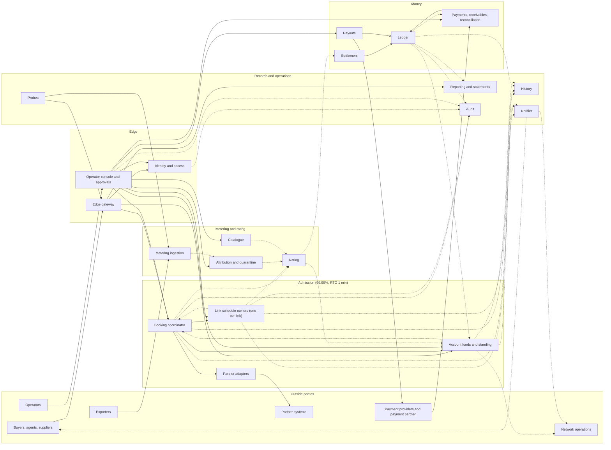
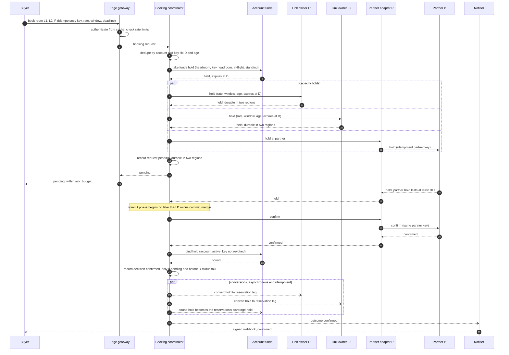

# RFC-000. Architecture overview: single-writer owners on two-region consensus logs

| | |
|---|---|
| Status | Draft |
| Satisfies | All — structural. Allocates every need (P1-N1 … X2-N6, 66 in all) to an owning component and to the detailed RFC that specifies it; the scenarios themselves are satisfied by RFC-001 … RFC-006 |
| Policies | POL-02, POL-03, POL-04, POL-05, POL-06, POL-07, POL-08, POL-11, POL-14, POL-15, POL-16, POL-18, POL-19, POL-22, POL-24, POL-25, POL-26, POL-28, POL-29, POL-32, POL-33 |
| Builds on | The requirements baseline (tag `requirements-v1`): [problem statements](../01-discovery/), [specs](../02-specs/), [policy register](../02-specs/policy-register.md), [glossary](../02-specs/glossary.md) |
| Supersedes | The structural parts of the pre-baseline drafts RFC-001 … RFC-004, which were written from a prototype |

Terms are used in the sense of the [glossary](../02-specs/glossary.md). In particular,
"reserved rate" is capacity and "traffic" is bytes; neither is called "usage".

## Need

The requirements describe one marketplace with four very different workloads, which the
architecture has to make possible at once without one compromising another:

1. **A capacity decision that can never be wrong in the generous direction** (P1-N1, POL-05)
   and that is answered within `ack_budget` (200 ms at p99, POL-04) at 25,000 requests/s
   overall and 2,500/s on the hottest link (POL-06), whatever the booking's length
   (X2-N3). Every booking on a link, single-link or route, is decided by that link's one
   schedule owner (P1-N3).
2. **A multi-party booking that is all or nothing** across Share links, partner systems that
   cannot join a transaction, and the buyer's funds (P2-N1, P2-N7, P2-N8), bounded by a
   deadline that holds even when Share's own booking process is down (P2-N3, POL-26), with
   contention resolved by an explicit priority rule (P2-N4, POL-02) and recovery from
   Share's own crashes (P2-N5, POL-03).
3. **A metering and rating pipeline** that takes about 260,000 flow records/s (600,000/s
   peak), duplicated, late and out of order (P3-N3), keeps every one of them for 7 years
   (P3-N7, X2-N6), and turns reservations and traffic into charges that are exactly once,
   reproducible and amended rather than rewritten (P3-N2, P3-N8, P3-N9), posted within
   2 min of each minute's end (X2-N3).
4. **A money system** that is conserved and immutable (P4-N7), moves money once per source
   reference for 7 years (P4-N15, POL-29), holds funds before capacity (POL-25), suspends
   and resumes by rule (P4-N5), splits exactly (P4-N8), pays out once (P4-N12) and
   reconciles daily with the outside world (P4-N14, POL-24).

Across all four: every operation by an authenticated principal, accounts isolated, operator
power controlled and every change attributable (X1-N1 … X1-N10); availability per
capability of 99.99% (admission, ingestion) or 99.9% (wallet, payouts, reporting); RPO 0
with **every fact acknowledged only once durable in two regions** (X2-N4); RTO from 1 min to
30 min on node or zone loss and 1 h on region loss (X2-N5); 7-year retention (X2-N6).

The architecture must therefore decide: what the components are and what each one alone
may write; which interactions are synchronous on the 200 ms path and which can lag; where
atomicity is needed and how it is achieved without a global transaction; and how state is
replicated so that two-region acknowledgement fits inside `ack_budget` and a link never
has two writers, even across failures.

## Approach

### 1. Principles

| # | Principle | Why (requirement) |
|---|---|---|
| A1 | **Every piece of state has exactly one writer component.** Others read it, subscribe to it, or ask its owner to change it. | POL-05 for link schedules; the same discipline makes the account, reservation, ledger and request invariants each provable in one place. |
| A2 | **Each owner is partitioned by its natural serial key** (link, account, reservation, exporter, supplier) and each partition is a **single-leader state machine over a replicated log**, fenced by the log's term. | "Decided as if one at a time" is stated per link (P1-N2), per account and key (P2-N8, P4-N3) and per reservation (P2-N9). A single leader per partition gives that order directly, without locks or retries. |
| A3 | **Every replicated log commits only through a quorum that spans two regions.** | X2-N4, POL-06: a fact is acknowledged only once durable in two regions. |
| A4 | **Facts are append-only; current state is derived.** Corrections are new facts. | P1-N7, P1-N9 (known-at history), P3-N7, P3-N8, P4-N7, X1-N8. |
| A5 | **The 200 ms path touches only admission components**, synchronously; everything else (rating, settlement, statements, history, notifications) is asynchronous and catches up from the owners' logs. | POL-04 `ack_budget`; POL-06 gives rating no availability target of its own, only timeliness. |
| A6 | **Every command between components carries a deterministic idempotency identity**; every external input carries its own (idempotency key, source reference, record identity). Delivery between components is at least once. | POL-29, P2-N6, P3-N2, P3-N3, P4-N1, P4-N15. |
| A7 | **Deadlines are data, not timers.** A request's outcome after its deadline is a function of its record and the clock, so it holds whatever state Share's processes are in. | POL-26: failed as of the deadline, whatever Share's state; holds expire on their own. |

### 2. Component decomposition

Each component below owns the state listed and is its only writer. "Serves" names the
needs and policies it is the primary owner of; the full allocation is in §7.

#### Admission (capability: admission API, 99.99%, RTO 1 min)

| Component | Single responsibility | State it owns (only writer) | Partition | Serves |
|---|---|---|---|---|
| **Link schedule owner** | Decide every capacity question on one Share link, and record every change to what the link has sold or can carry | Per link: capacity history (baseline, unplanned outages and restorations, planned maintenance bookings, permanent reductions and their notice); confirmed reservation legs and their parts; capacity holds with their deadlines; the link's waiter queue ordered by the priority rule; affected flags per reservation and minute; the link's bitemporal change log | One partition per link; a hot link has a group to itself | P1-N1 … P1-N9, POL-05, POL-07, POL-09, POL-10, POL-31 |
| **Booking coordinator** | Drive every booking request and every change to a reservation to exactly one outcome by its deadline, across link owners, partners and funds | Booking requests (idempotency key, fingerprint, principal, deadline, `wait`, age, progress per leg, **the decision record**); reservations as route-level units (legs, parts, locked prices, partner terms shown at booking, lifecycle and end cause); per-reservation change queue; partner booking records | By account (idempotency keys are per account, POL-29); a reservation lives in its account's partition | P2-N1 … P2-N11, POL-02, POL-03, POL-04, POL-08, POL-26 |
| **Partner adapters** | Speak one partner's API safely: idempotent hold, confirm, final booking, release and cancel; classify answers (held, definite refusal, transient, unknown); reconcile | Per partner link: Share's outstanding holds and bookings at the partner (to recognise refusals caused by Share's own holds, POL-02); call journal with idempotency keys; reconciliation results and mismatches | By partner link | P2-N7, POL-28, part of P2-N4 |
| **Account funds and standing** | Decide every account-level admission question in one serial order per account, and keep holds, headroom and standing | Per account: funds holds and credit holds (pending and bound); capacity in flight per key and account; key spending per `key_spend_period`; headroom components (ledger balance as of a ledger position, holds, usage exposure, credit limit); standing, its cause, grace start and resume amount; low-balance warning state | By account | P4-N3 … P4-N6, P4-N17 (limit and standing side), POL-15, POL-16, POL-18, POL-25 |

The account funds component sits on the 200 ms path, so it is engineered to admission's
targets (99.99%, RTO 1 min), not only the wallet's (99.9%, 5 min); see Requirements issues,
RI-4.

#### Metering and rating (capabilities: usage ingestion 99.99%, RTO 1 min; rating and posting, judged by timeliness, RTO 5 min)

| Component | Single responsibility | State it owns | Partition | Serves |
|---|---|---|---|---|
| **Metering ingestion** | Accept every flow record, durably, exactly as received; acknowledge only once it is durable in two regions | The raw record log (every record received, accepted or not, with its reason); record identity index (exporter, exporter epoch, sequence number) for the retention period | By exporter | P3-N3, P3-N7, P3-N11, X2-N4 for records |
| **Attribution and quarantine** | Decide, for each accepted record, the account, route, product and reservation it belongs to, which leg's count is the egress count, and which billing rule of POL-17 applies; keep what cannot be attributed in quarantine | Attribution results per record and minute; quarantine entries and finance attributions within `dispute_window` | By account once attributed; by exporter in quarantine | P3-N4, P3-N6, P3-N13, POL-13, POL-17 |
| **Rating** | Turn reservation history, attributed traffic and price history into charge lines and amendments, exactly once and reproducibly | Charge lines (reservation, usage, fee) and their amendments, each with its source reference and reason; per-line rated totals; unposted usage per account and product; lateness-breach reports | By buyer account | P3-N1, P3-N2, P3-N5, P3-N8, P3-N9, P3-N10, P3-N12, POL-01, POL-11, POL-14, POL-27 |
| **Catalogue** | Hold the reference data every other owner prices, splits or validates against | Links (supplier, Share or partner, endpoints, probe flag), products, `reservation_price` and `usage_price` history on minute boundaries, price corrections (as bitemporal facts, POL-23), split weights per route and party, partner terms (minimum term, cancellation fee, hold length), probe designations | By entity | Inputs to P1, P2, P3, P4; POL-12 weights, POL-23 corrections, POL-27 |

#### Money (capabilities: wallet, payouts and reporting 99.9%; rating and posting RTO 5 min)

| Component | Single responsibility | State it owns | Partition | Serves |
|---|---|---|---|---|
| **Ledger** | Be the only writer of money movements: validate (sums to zero per currency, every amount tagged), deduplicate by source reference, append, never alter | The journal of movements; the source-reference index (7 years, with principal and content digest); per-account balances as derived projections | Journal partitioned by the **paying** account of each movement (the buyer for charges and top-ups; the supplier for payouts and supplier debts; Share's own account for costs it bears); supplier and Share balances are aggregates over partitions | P4-N7, P4-N15, P4-N16 (movements), POL-11, POL-20, POL-29 |
| **Settlement** | Turn each charge or amendment into one movement split among its route's parties; pay the costs Share bears; raise supplier debts | Per charge line: shares already posted per party; deviation from exact proportions per party per payout period | By buyer account (charges); by supplier (debts) | P4-N8, P4-N9, P4-N11, POL-12, POL-23 |
| **Payments, receivables and reconciliation** | Everything that moves money between Share and the outside on the buyer side, and the daily proof that the books match the money | Payment events as received (authenticated, 2-region durable before the provider is acknowledged); top-up conversions; pending orphan reversals (72 h); invoices and invoice payments; write-offs; daily reconciliation runs and their differences | By provider and account | P4-N1, P4-N2, P4-N13, P4-N14, P4-N17 (invoices), POL-15, POL-20, POL-21, POL-24 |
| **Payouts** | Pay suppliers weekly, once, and recover what a provider executes twice | Payout runs, instructions (with their references), confirmations and failures, escalations, residues carried | By supplier | P4-N12, POL-22 |
| **Reporting and statements** | Serve every account its statement and every supplier its view, from the owners' feeds | Read models only (no facts of its own): statements, supplier schedules with opaque reservation references, deviation reports | By account | P4-N10, the supplier view of X1-N2 and POL-33 |

#### Cross-cutting

| Component | Single responsibility | State it owns | Serves |
|---|---|---|---|
| **Edge gateway** | Terminate every external call: authenticate, resolve the principal, enforce request-rate limits (`key_rate_limit`, `account_rate_limit`, `key_poll_limit`), route to the owner's partition leader, answer within `ack_budget` | Rate-limit counters (soft state) | X1-N1, the rate-limit part of P2-N8 |
| **Identity and access** | Principals, agent keys and their limits, roles, consent to identify an account to a named supplier, and the authorisation decision for every operation | Accounts' users and administrators; agent keys, their limits and revocations; operator roles; supplier-consent records (POL-33); KYB status as recorded by onboarding | X1-N1 … X1-N4, X1-N9, X1-N10, POL-25, POL-32, POL-33 |
| **Operator console and approvals** | The only way operators act: every action names its role and reason, four-eyes actions wait for a second compliance approval, then the action is sent to the component that owns the state | Operator action requests, approvals and their outcomes | X1-N7, POL-30, POL-32 |
| **Audit** | Keep the immutable record of every change to money, capacity, links or keys and every operator action, for the retention period | The audit store, built from audit fields every owner writes in its own log (principal, time, role, reason) | X1-N8, POL-19 |
| **History** | Answer "as known at T" questions and keep every owner's log for 7 years | Archived owner logs and their bitemporal indexes (read models; owners stay the writers of the facts) | P1-N9 (storage), P4-N16 (rebuild), X2-N6, POL-19 |
| **Notifier** | Deliver every outbound notice: signed buyer webhooks retried for `webhook_retry`, affected-reservation notices within `affected_notice_time`, suspension and low-balance notices, supplier notices, operational alerts | Delivery attempts and their status | P2-N2 (webhooks), part of P1-N8, P4-N5, X1-N6 (signing with keys from identity and access) |
| **Probes** | Measure availability from outside each region as the designated probe account on designated probe links and exporters | Probe results per capability and minute | X2-N1 |
| **Placement and time** (platform) | Map every partition to its replicated log, move partitions with an epoch, and provide the clock-uncertainty bound every deadline comparison uses | Partition map and epochs | Single writer across failures (POL-05), deadlines (POL-26) |

**Merges and splits, and why.**

- *Waiting, crossings and deadlines* are not a separate component. The waiter queue for a
  link is part of that link's schedule (the link owner decides who gets released capacity,
  POL-02, POL-05); the request's waiting state and deadline are part of the request (the
  coordinator). Splitting a "contention manager" out would put a third writer between the
  two owners whose state it would have to read on every decision.
- *Funds holds are split from the ledger.* Holds are not money movements (the glossary's
  funds hold: "it is not a money movement"; POL-18), change on every booking, and gate admission at 99.99%;
  movements are conserved, immutable and 7-year idempotent. Different invariants, different
  write rates, different availability classes.
- *Funds holds, capacity in flight and key spending are one component* (account funds), not
  three, because POL-25 requires concurrent bookings by one account or key to be checked
  against all of them "as if applied one at a time": one serial order per account covers
  all three.
- *Rating is split from settlement*, at the charge (P3 ends at a charge, P4 starts from
  one): rating's correctness is per charge line, settlement's per party.
- *Attribution is split from ingestion*, because ingestion must acknowledge within 1 s at
  99.99% and must never depend on reservation or provisioning data being available;
  attribution can lag and catch up (POL-06: ingestion may lag but must not lose a record).
- *Reporting owns no facts*, so its 30-minute RTO can be met by rebuilding from feeds.
- *History is a read model, not a writer.* Each owner's own log is the bitemporal record of
  its state; history archives and indexes it. This keeps POL-05's single writer intact.

### 3. Interaction overview

Solid arrows are synchronous requests; dashed arrows are asynchronous feeds from the
writer's log (at least once, ordered per partition, consumed idempotently).

| Interaction | Mode | Why |
|---|---|---|
| Edge → identity and access | Synchronous, from a local cache refreshed by push; cache entries for agent keys live at most 30 s | Authentication must be on every call (X1-N1) but cannot cost a remote call within 200 ms. A revocation reaches every edge within 60 s (X1-N3): push on revoke plus the 30 s bound as a backstop. |
| Edge → coordinator; coordinator → account funds → link owners | Synchronous on the booking path | The answer within `ack_budget` depends on all three (POL-04); funds before capacity (POL-25). |
| Coordinator → partner adapters → partner | Asynchronous to the buyer (the buyer gets `pending`), synchronous within the request's own workflow | Partner calls are slow and unreliable (P2 C7); only the request's deadline bounds them (POL-26). |
| Link owner → coordinator (capacity released to a waiter, yield in a crossing, affected reservation, revocation due) | Asynchronous notification, idempotent by (link, epoch, sequence) | The link owner decides; the coordinator acts on the request or reservation it owns. |
| Coordinator → rating, account funds, history (reservation lifecycle); link owner → rating, notifier, history (capacity and affected flags) | Asynchronous feeds | Rating has 2 min per minute; affected notices have 60 s (POL-07); history and statements have minutes. |
| Rating → account funds (unposted usage); rating → settlement → ledger | Asynchronous feed; posting is a synchronous call to the ledger from settlement, idempotent by source reference | Exposure is eventually consistent (see RI-2); a posting must be acknowledged durable before rating marks a line posted. |
| Payment notification → payments → ledger → account funds | Synchronous acknowledgement to the provider after 2-region durability; posting and headroom update asynchronous | X2-S14 (a notification is acknowledged only once durable in two regions); top-up to credited headroom within 10 s at p99 (X2-N3). |
| Account funds → network operations (standing) | Asynchronous feed with per-account sequence numbers, plus a query | At least once, within `standing_notice_time` (10 s); repeats change nothing (P4-N6). |
| Operator console → owners | Synchronous command after authorisation (and approval where four eyes apply) | Each owner stays the only writer; the console only carries authorised intent (X1-N7). |

#### A route booking with a funds hold and a partner leg

Route over Share links L1, L2 and partner link P (a partner with holds), default deadline
30 s, so `commit_margin` = 10 s applies. `D` is the deadline; `τ` is the commit fence
(clock-uncertainty bound plus one decision-log write, set in RFC-006).

What changes on the other paths (each specified in RFC-002):

- **A leg does not fit on committed capacity** (L2 rejects): the coordinator releases the
  holds on L1 and at P, and only then records the outcome *rejected*, with the blocking
  link and the route counter-offer (P2-N11), so no Share-link capacity is held once the
  outcome exists (P2-N3).
- **A leg is blocked only by capacity in flight**: the link owner queues the request as a
  waiter by age; the coordinator tells every link owner where the request holds capacity
  that it is now *waiting*. A link owner whose older waiter is blocked by a younger
  request's hold, where that younger request is itself waiting, releases the younger hold
  and tells its coordinator (the crossing rule of POL-02, which breaks cycles of any length
  without detecting them). A holder that is not waiting is never pre-empted.
- **The partner refuses definitively** while another Share request holds, or has a
  final-only booking for an undecided request, overlapping capacity there: the partner
  adapter recognises Share's own position from its state, and the coordinator waits for
  that request's outcome (and Share's cancellation of its booking, if not confirmed), then
  asks again (POL-02, POL-28).
- **A partner without holds** is booked last, after every other leg is held and the funds
  hold is taken, at most one per route (POL-28); if the request then fails, the coordinator
  cancels it at Share's cost.
- **The deadline passes** without a decision: the request has failed as of `D`. Link
  owners release unresolved holds on their own just before `D` (after a strong read of the
  decision log shows no decision, §4.3); the funds hold expires; the partner adapter
  releases the partner hold at `D`.
- **Single-link booking** (80% of the load): the same protocol with one participant. The
  pending record is written only if a final answer is not ready in time to fit
  `ack_budget`; otherwise the only two-region writes on the path are the hold on the link
  and the decision.

#### Latency budget for a single-link booking (p99)

The design is sized against an estimate, to be replaced by measurement (Risks, R1). The
figures assume a region pair with a round-trip time of at most 20 ms and a two-region
quorum write of about 35 ms at p99.

| Step | Durability | p99 estimate |
|---|---|---|
| Edge: TLS, authentication from cache, rate limits, routing | none | 10 ms |
| Funds hold taken at the account partition | zone-replicated in the leader's region (§5.3) | 5 ms |
| Capacity check and hold at the link owner (group commit) | two regions | 35 ms |
| Bind at the account partition | zone-replicated (§5.3) | 5 ms |
| Decision record | two regions | 35 ms |
| Hops between components (4 to 6) | — | 10 ms |
| **Total** | | **about 100 ms**, against 200 ms |

If every step were made two-region durable, the estimate rises to about 170 ms; that is
the fallback if the account-partition rebuild of §5.3 proves too complex (RFC-004 and
RFC-006 decide, from measurement).

### 4. Consistency model

#### 4.1 Where atomicity is needed, and how it is achieved

| Unit that must be atomic | Mechanism | Owner RFC |
|---|---|---|
| **One decision on one link** (check the peak and record the hold or the confirmation) | A single entry in the link's log, applied by its single leader; no locks | RFC-001 |
| **One booking: every leg, the partner's included, and the funds hold, or none** (P2-N1, P2-N8) | A commit protocol with a **replicated decision log** as coordinator: participants prepare (capacity holds and the funds hold, each expiring at `D`; partner holds), the decision is one conditional write in the request's account partition, conversions follow idempotently. Because the decision log is itself a two-region consensus log, the classic blocking failure of two-phase commit (a dead coordinator) does not arise: whoever leads the partition can read the decision. Partners cannot prepare in Share's sense, so a partner leg is confirmed **before** the decision (Share never confirms a leg the partner has not confirmed, P2-N7), and a partner booking left without a confirmed Share decision is cancelled at Share's cost (POL-28). | RFC-002 |
| **Account-level admission** (headroom, key headroom, capacity in flight, standing, key revocation; concurrent bookings by one account decided as if one at a time) | The account partition's serial order. The *bind* is the linearisation point: it checks standing and key status and makes the hold unvoidable for the decision that follows (see RI-3). | RFC-004 (state), RFC-002 (protocol) |
| **One change to one reservation** (P2-N9) | The reservation's change queue in the coordinator: changes applied in arrival order; a cancellation is never queued and fails a pending change; an extension or increase is a new admission of the difference through the same booking protocol | RFC-002 |
| **One money movement** (P4-N7) | One journal record holding all its entries, written to one ledger partition (the paying account's), validated to sum to zero per currency before append. Double entry is atomic by construction, because a movement never spans partitions. | RFC-004 |
| **Posting a charge or amendment once** (P3-N2, P4-N15) | The ledger's append is conditional on the source reference being new; the source-reference index is in the same partition as the movement | RFC-004 |
| **Accepting a flow record once** (P3-N3) | The record-identity check and the append are one entry in the exporter's ingestion partition | RFC-003 |
| **An operator action and its audit record** (X1-N7, X1-N8) | The audit fields are part of the owner's own log entry for the change; there is no separate audit write to lose | RFC-005 |

Serialisability across links follows from the protocol's shape: a request takes all its
holds before its decision and keeps them until it (strict two-phase locking, with holds
as the locks and the priority rule as the conflict policy), so concurrent bookings end in
the state of some one-at-a-time order (P1-N2, P2-N9).

#### 4.2 Where eventual consistency is acceptable

| What lags | Bound | Why it is acceptable |
|---|---|---|
| Conversion of holds into reservation legs on link owners after the decision | Milliseconds; the hold keeps counting against capacity until converted | Capacity is counted either way; nothing can be sold in between. |
| Rating and posting behind the reservation and traffic feeds | 2 min per minute (`max_lateness` + 2 min for traffic), 99.99% of minutes (X2-N3) | Funds holds already cover accrued-but-unposted charges (POL-18); headroom counts them within funds held. |
| Unposted usage reaching headroom | Seconds; see RI-2 | The lateness bound already absorbs unseen traffic; the propagation lag needs an explicit bound. |
| Supplier balances and Share's own balance | Seconds to minutes; closed per payout period and per reconciliation day | Payouts are weekly; reconciliation is daily (POL-22, POL-24). Making them aggregates removes the hot row that Share's own account would otherwise be. |
| Statements, supplier views, history, audit store | Minutes | Reporting RTO is 30 min; none of them is a writer of facts. |
| Standing at network operations | `standing_notice_time` (10 s) | POL-06 splits the 60 s enforcement target. |
| Affected-reservation notices | `affected_notice_time` (60 s) | POL-07. |
| Agent-key revocation at the edge | 60 s | X1-N3, POL-25. |

#### 4.3 Deadlines, holds that expire on their own, and the commit fence

- A request's deadline `D` is fixed when it is received and is part of every hold it takes
  (funds and capacity). Every participant compares against `D` using a clock with a
  bounded uncertainty `ε`, monitored by the platform (RFC-006).
- The decision *confirmed* may be written only if its commit timestamp is earlier than
  `D − τ`, with `τ ≥ 2ε` plus one decision-log read. A request with a partner leg does not
  begin committing later than `D − commit_margin` (POL-26).
- A link owner releases every unresolved hold at `D − ε` by its own clock, after a strong
  read of the request's decision log shows no decision. By then no decision can still be
  written, so the read is final and no hold outlives `D`. Holds therefore expire **on their
  own**: by the link owner, without the booking coordinator taking part (POL-26).
- A request's reported outcome is computed from its record and the clock: *confirmed* if a
  decision says so; otherwise *failed as of its deadline* once `D` has passed, whatever any
  process is doing (A7, POL-26). A request still without a decision at `D` raises an
  operational alert (P2-N10).
- A non-confirmed outcome before `D` (rejected, withdrawn, key revoked, account suspended)
  is recorded only **after** the request's Share-link holds are released, so no Share-link
  capacity is ever held by a request that has an outcome (P2-N3, P1-N7). A withdrawal
  first marks the request *withdrawing*, which blocks the decision, then releases, then
  records the outcome.

#### 4.4 Idempotency (POL-29)

| Input | Identity | Where it is checked | Retention |
|---|---|---|---|
| Booking request | (account, idempotency key); sameness = route, window, rate, product and `wait`, plus the principal; the deadline is not part of sameness | The coordinator's account partition, atomically with the request record | `idempotency_retention` 24 h |
| Internal command (hold, convert, release, bind, yield, revoke, release after grace) | Derived from the request or reservation identity, the leg and the step (and an attempt number where a step can be retried after a yield) | The receiving owner's partition, in the same log entry as the effect | Life of the request or reservation, plus 24 h |
| Partner call | Partner key derived from the request, leg and operation | The partner (P2 C7), and the adapter's call journal | 7 years with the partner booking record |
| Flow record | (exporter, exporter epoch, sequence number); the epoch distinguishes counter restarts (P3 open question 1, decided in RFC-003) | Ingestion partition of the exporter | 7 years |
| Money-moving input (payment notification, invoice payment, transfer confirmation or failure, payout instruction, operator correction or attribution, escalation resolution, write-off, charge, amendment or fee line, Share-borne cost, supplier debt, movement of Share's own funds) | Its source reference: for providers, provider, transaction reference and event kind (a reversal shares its payment's transaction reference); for internal postings, the charge line and its amendment sequence | Ledger partition, atomically with the movement; a redelivery with different contents moves nothing and is reported; a different principal is refused | 7 years |
| Feed events between components | (producer partition, epoch, sequence) | Each consumer's own state | Until consumed and checkpointed |

#### 4.5 Ordering

| Scope | Order | Source |
|---|---|---|
| One link | Total order of every schedule change (the link log) | P1-N2, POL-05 |
| One account | Total order of holds, binds, releases, standing changes | P2-N8, P4-N3, POL-25 |
| One reservation | Changes in arrival order; cancellation first | P2-N9, POL-08 |
| One request | First decision or terminal outcome wins; never changes once reported | P2-N2 |
| Waiters on one link | Priority rule (`request_age`: receipt time at the coordinator, ties by request identity) | POL-02 |
| One charge line | Amendments in sequence; each is the new total rounded once less what was posted, so the result does not depend on arrival order | P3-N3, P3-N8, P4-N9 |
| One account's standing feed | Sequence numbers; a consumer applies the latest | P4-N6 |
| Globally | **None needed.** No requirement orders events across links, accounts or exporters, so there is no global sequencer | — |

### 5. Deployment and durability topology

#### 5.1 Regions and zones

- A **geography** is three cloud regions: two near regions R1 and R2 with a round-trip time
  of at most 20 ms, each with three zones, and a third region R3. The first geography is
  chosen for the markets served first (Nairobi and Mombasa live, Djibouti and Marseille
  next, P2 C14); RFC-006 names the regions from measured round-trip times.
- Every **replicated log** (a link partition, an account partition, an ingestion
  partition, a ledger partition) has five voters: two in R1 (different zones), two in R2
  (different zones), one in R3. No region holds three voters, so **every majority spans at
  least two regions**: a commit is, by construction, durable in two regions (A3, X2-N4).
- Leaders are preferred in R1; a commit needs the leader, one peer in its region and the
  nearest voter in another region, so its latency is one inter-region round trip.
- Stateless services (edge, coordinator workers, rating workers, settlement workers) run in
  R1 and R2, active-active. Each region's edge answers its own probes; writes are routed to
  the partition's leader wherever it is. Availability is therefore measured per serving
  region, as POL-06 requires.

| Failure | What happens | Effect on acknowledged facts |
|---|---|---|
| A node | Leader moves within its partition's group in seconds | None (RPO 0) |
| A zone | At most one voter per group lost; groups keep quorum, leaders on that zone move | None |
| Region R1 | Groups keep quorum with R2 + R2 + R3; leaders move to R2 automatically; stateless services in R2 take over | None; admission RTO well inside the 1 h regional target |
| Region R2 or R3 | Quorum with the remaining two regions | None |

#### 5.2 Single writer per link, across failures (fencing)

- The link owner for a link **is** the leader of that link's partition. It is the only
  process that can append to the link's log, and every entry carries the group's term.
- Leadership is held under a lease shorter than the election timeout, so a deposed leader
  stops deciding before a new one can start.
- Every command to a link owner carries the partition epoch it was routed with; a command
  routed with a stale epoch is refused and re-routed. Every notification from a link owner
  carries (link, term, sequence); consumers ignore anything older than what they applied.
- Moving a link to another group (rebalancing a hot link) is a handoff through the
  placement map with an epoch increment: the old group appends a final *moved* entry and
  refuses further commands.
- The same mechanism fences every other owner partition (account, reservation, exporter,
  ledger), so no state has two writers at any moment.

#### 5.3 What is durable where

| State | Durability before it is acknowledged | Rebuilt after a region loss from |
|---|---|---|
| Confirmed reservations, schedule changes, capacity holds, decisions, request records | Two regions | Itself |
| Ledger movements, payment events, accepted flow records | Two regions (X2-N4) | Itself |
| Standing changes, credit limits, invoices, payout instructions and confirmations | Two regions | Itself |
| Funds holds and binds for pending requests; capacity-in-flight and key-spending counters | Three zones in the leader's region (not an acknowledged fact under X2-N4) | Confirmed reservations (their coverage holds), pending request records (which fail by their deadlines anyway), the ledger and rating's unposted usage. RFC-004 must prove the rebuild exact. |
| Rate-limit counters, caches, read models | None or local | Reset or rebuilt from feeds |

#### 5.4 Recovery targets per capability

| Capability (POL-06) | Components | Availability | RTO node or zone | RTO region | How it is met |
|---|---|---|---|---|---|
| Admission | Edge, identity and access (cache), coordinator, link owners, partner adapters, account funds | 99.99% | 1 min | 1 h (designed for minutes) | Leader election within seconds; holds and requests survive in the log; POL-03 resumption from the request log |
| Usage ingestion | Edge for exporters, metering ingestion | 99.99% | 1 min | 1 h | Same log topology; exporters retry; acknowledgement only after two-region durability |
| Rating and posting | Attribution, rating, settlement, ledger | Judged by timeliness | 5 min | 1 h | Workers are stateless over checkpoints; catch-up capacity sized so that a 5-minute outage is absorbed within the 7-minute bound |
| Wallet | Account funds (query side), payments, ledger reads | 99.9% (engineered to 99.99% because admission depends on it, RI-4) | 5 min (1 min for the admission path) | 1 h | As admission |
| Payouts | Payouts, ledger | 99.9% | 15 min | 1 h | Instructions are facts; a restarted run resumes by reference and never re-instructs |
| Reporting and statements | Reporting, history | 99.9% | 30 min | 1 h | Read models rebuilt from feeds and history |

Probes (X2-N1) run as the designated probe account on probe links and probe exporters in
every serving region, through the real path; every consumer that would rate, settle,
report to suppliers or report quarantine checks the probe designation from the catalogue
and identity and access, and excludes it (POL-06).

### 6. Partitioning for the design load

| Load (POL-06) | Partitioning | Note |
|---|---|---|
| 25,000 booking requests/s | Coordinator and account funds by account; link owners by link | `account_rate_limit` (200/s) bounds any account partition |
| 2,500 requests/s on the hottest link | That link's group alone; one leader, group commit every few milliseconds | One decision is an in-memory peak query of logarithmic cost (RFC-001); the limit is the log, batched |
| 260,000 records/s (600,000/s peak) | Ingestion by exporter; attribution and rating by account | Records are accepted in batches; one two-region commit per batch |
| Charge lines | Rating, settlement and ledger by buyer account | One reservation line per active reservation per minute; supplier and Share balances are aggregates, never hot rows |
| 1,000 payment notifications/s | Payments by provider and account | — |

### 7. Allocation of needs

Every need is allocated to the component or components that own it and to the detailed RFC
that will specify it. "Also" names RFCs that specify a contract the need depends on.

| Need | Owning component(s) | Specified in |
|---|---|---|
| P1-N1 Never oversold | Link schedule owner | RFC-001; also RFC-006 (single writer across failures) |
| P1-N2 Requests that fit are confirmed | Link schedule owner | RFC-001 |
| P1-N3 One schedule per link; holds; waiting | Link schedule owner, booking coordinator | RFC-001; also RFC-002 (waiting protocol) |
| P1-N4 Rejections actionable and discreet | Link schedule owner | RFC-001 |
| P1-N5 Malformed requests are errors | Booking coordinator (intake), link schedule owner (window and horizon rules) | RFC-001 (validity rules); also RFC-002 (intake) |
| P1-N6 Open-ended and long reservations | Link schedule owner | RFC-001 |
| P1-N7 Only facts recorded | Link schedule owner | RFC-001 |
| P1-N8 Loss of supply never revokes silently | Link schedule owner; booking coordinator (offers, moves, revocations of the route-level reservation); notifier | RFC-001; also RFC-002, RFC-006 (notices) |
| P1-N9 Decisions explained after the fact | Link schedule owner (bitemporal log); history | RFC-001; also RFC-006 (retention) |
| P2-N1 All or nothing | Booking coordinator, partner adapters | RFC-002 |
| P2-N2 Fast, uniform answer | Edge gateway, booking coordinator, notifier | RFC-002; also RFC-005 (webhook signing), RFC-006 (delivery) |
| P2-N3 Bounded wait | Booking coordinator, link schedule owner (hold expiry), partner adapters | RFC-002; also RFC-001 |
| P2-N4 Fair contention | Booking coordinator, link schedule owner (waiter queues, yield), partner adapters | RFC-002; also RFC-001 |
| P2-N5 Recovery from Share's own faults | Booking coordinator | RFC-002; also RFC-006 |
| P2-N6 Retries never book twice | Booking coordinator | RFC-002; also RFC-005 (scope) |
| P2-N7 Partners booked safely | Partner adapters, booking coordinator | RFC-002 |
| P2-N8 Funds and limits at admission | Booking coordinator, account funds and standing, edge gateway (rate limits) | RFC-002; also RFC-004 (holds, key headroom, in-flight), RFC-005 (edge limits) |
| P2-N9 Changed or ended as one unit | Booking coordinator | RFC-002; also RFC-001, RFC-004 |
| P2-N10 Operations see requests in trouble | Booking coordinator, operator console | RFC-002; also RFC-006 (alerting) |
| P2-N11 Route counter-offer | Booking coordinator, link schedule owner | RFC-002; also RFC-001 |
| P3-N1 Reservations accrue what was sold | Rating | RFC-003 |
| P3-N2 Each charge line charged once | Rating, ledger | RFC-003; also RFC-004 |
| P3-N3 Traffic counted exactly once | Metering ingestion, rating | RFC-003 |
| P3-N4 Traffic in well-defined minutes | Attribution and quarantine | RFC-003 |
| P3-N5 Priced as it happened | Rating, catalogue | RFC-003 |
| P3-N6 Each kind of traffic by its rule | Attribution and quarantine, rating, settlement (carried excess) | RFC-003; also RFC-004 |
| P3-N7 No record silently discarded | Metering ingestion | RFC-003 |
| P3-N8 Amended, never rewritten | Rating, catalogue (price corrections), ledger | RFC-003; also RFC-004 |
| P3-N9 Every charge reproducible | Rating | RFC-003; also RFC-006 (inputs retained) |
| P3-N10 Usage exposure visible | Rating, account funds and standing | RFC-003; also RFC-004 |
| P3-N11 Metered traffic is evidence | Metering ingestion, history | RFC-003; also RFC-006 |
| P3-N12 Partner fees by rule | Rating, booking coordinator (fee shown, who ended) | RFC-003; also RFC-002 |
| P3-N13 Billed once per route at egress | Attribution and quarantine | RFC-003 |
| P4-N1 Top-up exactly once | Payments, receivables and reconciliation; ledger | RFC-004 |
| P4-N2 Converted at the shown rate | Payments, receivables and reconciliation | RFC-004 |
| P4-N3 Funds held for the coverage window | Account funds and standing | RFC-004 |
| P4-N4 Headroom itemised | Account funds and standing, ledger, rating | RFC-004 |
| P4-N5 Suspension predictable and reversible | Account funds and standing, booking coordinator (release after grace), notifier | RFC-004; also RFC-002 |
| P4-N6 Network operations knows standing | Account funds and standing | RFC-004 |
| P4-N7 Money conserved, history fixed | Ledger | RFC-004 |
| P4-N8 Split exactly and fairly | Settlement | RFC-004 |
| P4-N9 Late charges settle like on-time ones | Settlement, rating | RFC-004; also RFC-003 |
| P4-N10 Statements checkable | Reporting and statements | RFC-004; also RFC-005 (visibility) |
| P4-N11 Supplier earnings final | Settlement | RFC-004 |
| P4-N12 Payouts weekly, exact, once | Payouts | RFC-004 |
| P4-N13 Reversals and bad debt by rule | Payments, receivables and reconciliation; account funds and standing | RFC-004 |
| P4-N14 Books reconcile with the money | Payments, receivables and reconciliation | RFC-004 |
| P4-N15 Every money-moving input once | Ledger | RFC-004 |
| P4-N16 Traced, and the past rebuilt | Ledger, account funds and standing, history | RFC-004; also RFC-006 |
| P4-N17 Credit only to vetted accounts | Account funds and standing, payments and receivables (invoices), identity and access (finance role, KYB status) | RFC-004; also RFC-005 |
| X1-N1 Authenticated principal | Edge gateway, identity and access | RFC-005 |
| X1-N2 Accounts isolated | Identity and access; every owner (tenant scoping); reporting (supplier view); notifier (webhook endpoints) | RFC-005 |
| X1-N3 Agent keys in scope; revocation | Identity and access, edge gateway, booking coordinator (pending requests fail) | RFC-005; also RFC-002 |
| X1-N4 Idempotency keys scoped to the account | Booking coordinator | RFC-005; also RFC-002 |
| X1-N5 Only authentic payment notifications | Payments, receivables and reconciliation | RFC-005; also RFC-004 |
| X1-N6 Webhooks verifiable | Notifier, identity and access (signing keys) | RFC-005 |
| X1-N7 Operator power controlled | Operator console and approvals, identity and access | RFC-005 |
| X1-N8 Every change attributable | Audit; every owner's log | RFC-005; also RFC-006 (retention) |
| X1-N9 Only an administrator manages keys | Identity and access | RFC-005 |
| X1-N10 Only the link's supplier changes what it sells | Identity and access, link schedule owner | RFC-005; also RFC-001 |
| X2-N1 Availability per capability | Probes; every capability's topology | RFC-006 |
| X2-N2 Design load | Every owner's partitioning | RFC-006; also RFC-001 … RFC-004 |
| X2-N3 Latency per operation | Admission path; rating; payments; account funds | RFC-006 (budgets); also RFC-001, RFC-002, RFC-003, RFC-004 |
| X2-N4 No loss of recorded facts | Replicated logs (§5) | RFC-006 |
| X2-N5 Recovery time | Every owner; placement | RFC-006 |
| X2-N6 Retention | History, ledger, metering ingestion | RFC-006 |

**Coverage:** 9 (P1) + 11 (P2) + 13 (P3) + 17 (P4) + 10 (X1) + 6 (X2) = 66 needs, every one
allocated to at least one owning component and exactly one primary detailed RFC.

**The RFC split.** The planned split is kept: one detailed RFC per problem, because each
problem's needs fall almost entirely to its own components, and cross-RFC dependencies are
carried by the contracts in §8.

| RFC | Title | Components it specifies |
|---|---|---|
| RFC-001 | Link schedule and admission (P1) | Link schedule owner; the link part of the catalogue |
| RFC-002 | Booking coordination (P2) | Booking coordinator; partner adapters |
| RFC-003 | Rating and metering (P3) | Metering ingestion; attribution and quarantine; rating; catalogue (prices, corrections) |
| RFC-004 | Wallet, ledger and settlement (P4) | Account funds and standing; ledger; settlement; payments, receivables and reconciliation; payouts; reporting and statements |
| RFC-005 | Security and tenancy (X1) | Edge gateway; identity and access; operator console and approvals; audit; webhook signing |
| RFC-006 | Availability, durability and operations (X2) | Replicated-log topology, placement and fencing, time; history; notifier; probes; alerting |

Two adjustments, and why:

- **RFC-004 stays one RFC**, although it is the largest (six components, 17 needs). Its
  invariants are one argument: headroom is computed from the ledger balance and the holds;
  every money input is idempotent by one source-reference regime; reconciliation proves
  the whole. Splitting holds from the ledger across two RFCs would put the headroom
  invariant (P4-N4) across a document boundary. It is written in two parts with different
  availability classes: Part A, account funds and standing (on the admission path);
  Part B, ledger, settlement, payments, payouts and statements.
- **The catalogue is specified in RFC-003, with its link part in RFC-001**, because rating
  is the component whose correctness depends on price history and corrections (P3-N5,
  P3-N8), while the link registry is what the link owner validates against.

### 8. Cross-RFC contracts

Names and owners only; each detailed RFC defines the semantics of the contracts it owns,
and the delivery phase ([contracts](../04-delivery/contracts.md), to be rewritten) defines
schemas and wire formats.

| Contract | Kind | Owner (defines it) | Consumers |
|---|---|---|---|
| Link hold port: hold, convert, release, query hold | Synchronous command | RFC-001 | RFC-002 |
| Link waiting port: register waiter, waiting notice, capacity released, yield | Command and notification | RFC-001 | RFC-002 |
| Link availability query: peak and free-capacity profile for counter-offers | Synchronous query | RFC-001 | RFC-002 |
| Link supply commands: unplanned outage and restoration, maintenance booking, permanent reduction | Synchronous command | RFC-001 | Supplier API and operator console (RFC-005) |
| Link schedule feed: schedule changes, capacity history, affected flags | Asynchronous feed | RFC-001 | RFC-002 (affected reservations, revocations due), RFC-003, RFC-006 (history, notifier) |
| Booking API: book, change, cancel, withdraw, status | External API | RFC-002 | Buyers through RFC-005's edge |
| Request outcome feed | Asynchronous feed | RFC-002 | RFC-006 (notifier, alerting), operator console |
| Reservation lifecycle feed: parts, locked prices, legs, effective minutes, end cause, fees shown at booking | Asynchronous feed | RFC-002 | RFC-003, RFC-004 (holds follow reservations), RFC-006 (history), reporting |
| Reservation command port: revoke or reduce (from RFC-001), release after grace (from RFC-004), terminate (from the operator console), move to an equivalent path | Synchronous command | RFC-002 | RFC-001, RFC-004, RFC-005 |
| Partner port: hold, confirm, book final, release, cancel, query | Adapter interface, per partner | RFC-002 | Partner adapters |
| Partner reconciliation feed: mismatches and actions | Asynchronous feed | RFC-002 | Operator console, RFC-001 (a reservation the partner lacks is affected) |
| Equivalent-path source | External input | Routing (out of scope) | RFC-001, RFC-002 |
| Funds port: take hold, bind, release, resize; key headroom and in-flight check | Synchronous command | RFC-004 | RFC-002 |
| Headroom and balance query | Synchronous query | RFC-004 | Edge (buyer API), RFC-002, probes |
| Standing feed and query | Asynchronous feed and query | RFC-004 | Network operations, RFC-002 |
| Flow-record ingestion protocol | External protocol | RFC-003 | Exporters |
| Attribution keys from provisioning | External input | Provisioning (Problem 5) | RFC-003 |
| Catalogue: products, prices and corrections, weights, partner terms, probe designations | Query and feed | RFC-003 (link registry: RFC-001) | RFC-001, RFC-002, RFC-004, RFC-006 |
| Unposted-usage feed | Asynchronous feed | RFC-003 | RFC-004 |
| Charge-line feed: charges and amendments with source references and reasons | Asynchronous feed | RFC-003 | RFC-004 (settlement) |
| Ledger posting port | Synchronous command | RFC-004 | Settlement, payments, payouts (all within RFC-004) |
| Ledger movement feed | Asynchronous feed | RFC-004 | Account funds, reporting, reconciliation, RFC-006 (history, audit) |
| Payment notification ingress | External API | RFC-004 (authenticity: RFC-005) | Payment providers |
| Payout instruction and confirmation | External API | RFC-004 | Payout providers |
| Principal and authorisation context; key-status propagation | Library and feed | RFC-005 | Every component |
| Operator action envelope: role, reason, approver | Command wrapper | RFC-005 | Every owner that accepts operator actions |
| Audit record | Field set in every owner's log; feed | RFC-005 | RFC-006 (retention) |
| Signed webhook | Outbound protocol | RFC-005 (signing), RFC-006 (delivery) | Buyers |
| Replicated-log, placement and fencing conventions; clock-uncertainty bound | Platform contract | RFC-006 | Every owner |
| History query: as known at T | Query | RFC-006 (storage); semantics in RFC-001, RFC-002, RFC-004 | Operations, support, finance |
| Probe designation and exclusion | Flag in catalogue and identity | RFC-006 | RFC-003, RFC-004, reporting |
| Operational alert feed | Asynchronous feed | RFC-006 | Every owner raises alerts through it |

## Benefits

| Target or policy | How the architecture meets it |
|---|---|
| Never oversell (P1-N1, POL-05) | One writer per link, by construction: the link owner is the leader of the link's log, fenced by term and epoch. Every booking on the link, single-link or route, goes through it. No path writes a reservation leg any other way. |
| Concurrent decisions equal some one-at-a-time order (P1-N2, P2-N8, P2-N9) | Serial order per link, per account and per reservation; holds until the decision give serialisability across them. |
| `ack_budget` 200 ms at p99 (POL-04, X2-N3) | Only admission components on the path; two two-region writes for a single-link booking; estimated about 100 ms at p99 (§3), to be measured. |
| Deadline holds whatever Share's state (POL-26, P2-N3) | Outcome computed from the record and the clock; holds carry `D`; link owners release on their own just before `D`; the decision is fenced at `D − τ`. |
| All or nothing with partners (P2-N1, P2-N7, POL-28) | Replicated decision log as commit coordinator; partners confirmed before the decision, cancelled at Share's cost if no decision follows; at most one final-only partner, booked last. |
| Funds before capacity, limits as if one at a time (POL-25) | The funds hold is the first participant; the account partition's serial order covers headroom, key headroom, capacity in flight, standing and revocation together. |
| RPO 0, two-region acknowledgement (X2-N4) | Five-voter groups across three regions, no region with a majority: every commit is two-region durable, for every acknowledged fact. |
| RTO (X2-N5) | Automatic leader failover in seconds for node and zone loss, and for region loss too; the 1 h regional target is a ceiling, not the expectation. Stateless workers resume from checkpoints. |
| Availability per capability (X2-N1) | Capabilities are separate components with separate failure domains: a ledger or reporting outage does not stop admission; an attribution outage does not stop ingestion. |
| Design load (X2-N2) | Partitioned by natural keys with no global sequencer; the hottest link is the one irreducible serial point, and it is an in-memory state machine with group commit. |
| Charge timeliness and exactly once (X2-N3, P3-N2) | Rating consumes owner logs; postings are idempotent by source reference; a 5-minute outage is caught up inside the 7-minute bound. |
| Immutability and audit (P4-N7, X1-N8, POL-19) | Append-only logs everywhere; audit fields written in the same entry as the change. |
| Retention (X2-N6) | Owner logs archived to history; nothing is deleted inside 7 years. |
| Policy changes without mechanism changes (policy register preamble) | Parameters (`priority_rule`, deadlines, windows, limits, prices, weights) are data read by owners; no parameter is built into the structure. |

## Competition

| Alternative | Why it loses |
|---|---|
| **One database transaction for everything**: a distributed SQL database with serialisable transactions spanning the link schedules, the funds hold and the ledger | Partner legs cannot join it (P2 C6). On a hot link at 2,500 requests/s, serialisable transactions conflict and retry; the prototype found that optimistic or serialisable concurrency "wrecks the tail latency" under contention (decision log D3). It also makes Share's own account a hot row on every charge, and ties admission's availability to the ledger's. Distributed SQL is still a good *store* for the ledger and the request log (RFC-004 and RFC-002 may choose it), but not as the coordination mechanism. |
| **Per-link SQL row locks as the authority** (pre-baseline RFC-001) | Measured on the prototype at p99 115.5 ms with 50 clients on one link, the lock wait being most of it, and per-link throughput about one over the transaction time. With a two-region commit of about 35 ms inside the lock, one link would sustain roughly 30 decisions/s against the 2,500/s target. Correctness also depended on the isolation level (`REPEATABLE READ` oversold, D12), and the database's lock queue cannot express POL-02's priority rule or the crossing rule. |
| **Event-sourced monolith**: one log, one process applying every command | A single total order makes every invariant easy, but nothing requires a global order (§4.5), and one sequencer must then carry 25,000 bookings/s, 600,000 records/s and every posting. One failure domain cannot give admission 99.99% while rating is judged by timeliness, and replaying one log breaks a 1-minute RTO. Its good part, facts as an append-only log that can be replayed (A4), is kept per partition. |
| **Actor per link** (virtual actors, cluster sharding) | The right shape, and the link owner is an actor per link. As usually deployed, actor runtimes guarantee single activation only in the absence of partitions: a split-brain or a slow failure detector can activate the same link twice, and persistence plugins append without a term fence. Two activations are two schedule owners, which POL-05 forbids. The architecture keeps the actor model but puts each actor on a consensus log whose term fences it. |
| **Saga with compensation and wound-wait** (pre-baseline RFC-002) | Wound-wait lets an older request pre-empt any younger unpinned hold; POL-02 forbids pre-empting a holder that is not waiting and asks instead that a *waiting* younger holder yield. The prototype's single coordinator process was a single point of failure, and compensating after a commit decision left routes partly booked (D21). The replicated decision log keeps the commit point and removes the single coordinator. |
| **Two-phase commit including partners** (XA) | Partners do not offer it (P2 C6, decision log D13). |
| **Capacity first, funds checked after** | Breaks POL-25 (no capacity hold before the funds hold) and invites squatting. |
| **Active-active multi-region with conflict resolution** (CRDTs, last writer wins) | Two regions could each confirm the last Mbps of a link; merging afterwards is overselling. "Never oversell" needs a single decision per link, which needs consensus. |
| **Every write two-region durable, holds included** | Simpler, and kept as the fallback; estimated at about 170 ms at p99 for a single-link booking, too close to the 200 ms budget to adopt before measuring. Holds for pending requests are not acknowledged facts and can be rebuilt (§5.3). |
| **Partition the booking by route rather than by link** | Links are shared between routes and single-link bookings (POL-05); a route owner would be a second writer for every link it crosses. |
| **Single-entry balances updated in place** (pre-baseline RFC-004 alternatives) | No conservation check and no history (P4-N7); hot rows on supplier and Share accounts. The journal-per-paying-account design makes double entry atomic within one partition and removes the hot rows. |

## Risks and open issues

| # | Risk or issue | Mitigation or next step |
|---|---|---|
| R1 | **The latency budget is an estimate.** Two-region quorum writes at p99 under load, group commit on the hottest link and the edge's overhead are not measured. | RFC-006 sets the measurement; a spike measures a five-voter group across a candidate region pair before RFC-001 and RFC-002 are approved. Fallbacks: a parallel-commit style decision (the decision implied once every participant's hold is durable, saving one round), or co-locating a single-link decision with the link's log. |
| R2 | **Region pair availability.** The design needs two regions within about 20 ms of each other near the markets served, and a third region. East Africa may not offer such a pair today. | RFC-006 chooses from measured round-trip times; if no pair exists near Nairobi, the geography is placed where one exists, since `ack_budget` is measured at the system boundary (X2-N3). |
| R3 | **One geography only.** A single-link booking where the account and the link have their leaders in different geographies would cross a long round trip and miss X2-S15's final answer within 200 ms. | Start with one geography. Multi-geography is a later RFC; it must keep every account's partitions and the links it books in the same geography, or accept `pending` for cross-geography single-link bookings. |
| R4 | **Clock uncertainty.** The commit fence, release at `D − ε` and `request_age` all depend on a bounded `ε`. If clocks drift beyond it, a hold could be released while a decision is still writable. | The platform monitors `ε` and a node whose clock is out of bound stops leading; the fence fails safe (no decision) when uncertainty is unknown. Specified in RFC-006. |
| R5 | **The hottest link is a serial point.** 2,500 requests/s is provisional (POL-06; P1 open question 1). | Group commit and an in-memory schedule; RFC-001 states the measured ceiling per link. |
| R6 | **Rebuilding account partitions after a region loss** (§5.3) must reproduce holds, key spending and capacity in flight exactly. | RFC-004 proves the rebuild from facts; failure-injection tests in RFC-006. Fallback: make holds two-region durable (Competition). |
| R7 | **Waiter queues across a link owner failover.** Waiter registrations could be soft state re-sent by coordinators, or log entries. | RFC-001 and RFC-002 decide; the priority rule must survive a failover either way. |
| R8 | **Decision-log unavailability at a deadline.** A link owner cannot release an unresolved hold without a strong read of the decision log; if the log has no quorum, the hold stays, which is safe for overselling but holds capacity past `D`. | The decision log has the same topology and availability as the link log; while it has no quorum, admission is down anyway. The case is alerted. |
| R9 | **Attribution depends on provisioning data** (P3 open question 2): what makes traffic "unattributable" in practice depends on interface, VLAN or address keys from provisioning (Problem 5, out of scope). | An external contract (§8); RFC-003 defines the minimum it needs. |
| R10 | **Webhook load is unknown** (X2 open question 2). | The notifier is partitioned by account and scaled independently; RFC-006 sets a provisional figure. |
| R11 | **RFC-004 is large.** | Written in two parts (§7); split into two RFCs at review if needed, keeping the headroom invariant in one. |
| R12 | **Equivalent paths come from routing**, which is out of scope (POL-07). Whether an offered path's capacity is held during `offer_window` is not stated by the requirements. | RFC-001 and RFC-002 state the assumption; if capacity must be held, it is a hold of the reservation command port. |

### Requirements issues

None of these blocks the architecture; each is recorded for the business or the
requirements owners to confirm. The design follows the reading given here until they do.

| # | Requirement | Issue | Reading the design follows, and what would resolve it |
|---|---|---|---|
| RI-1 | P2-N3 (measure: "no capacity held … after its deadline on any leg … even across an outage of Share's booking process"); POL-26 (partner holds last at least `route_deadline_max` + `commit_margin`, and Share releases every hold at the deadline) | On Share links holds expire on their own (§4.3). A partner hold expires on its own only at the partner's own expiry, which POL-26 requires to be at least 70 s. If Share's partner adapter is unavailable at `D` (a node or zone failure of up to its 1-minute RTO, or a region disaster), the partner hold outlives `D` until Share recovers or the partner's hold expires. Share cannot make a partner's hold expire at a time Share chooses unless the partner's API accepts a caller-set expiry. | The design releases partner holds at `D` whenever the adapter is up, and alerts otherwise. To meet the measure literally, POL-26 or POL-28 would have to require partners with holds to accept a caller-set expiry (set to `D`), or the measure would have to exclude partner legs during Share outages. |
| RI-2 | P3-N10 and POL-18 (unposted usage = usage-priced traffic in records *received* but not yet posted, counted in headroom); POL-14 (the lateness bound covers `max_lateness` + 60 s) | Records are accepted by ingestion at up to 600,000/s and reach the account's headroom only after attribution and rating, which takes seconds. The requirement has no tolerance for that propagation lag, and the lateness bound does not include it. During the lag, headroom is slightly overstated and admission or suspension can act on it. | The design bounds the lag (target: 10 s, set in RFC-003) and reports it. To close the gap, POL-14's bound would add that propagation bound to `max_lateness` + 60 s, or POL-18 would define "received" as received by the exposure calculation. |
| RI-3 | P2-N8 ("a request still pending when its account is suspended is not confirmed"; "revoking a key fails its pending requests") | Suspension and key status are decided by account funds; the booking decision by the coordinator. The design orders them in the account's serial order at the *bind* (§4.1): a request whose funds were bound before the suspension is confirmed, although its status still reads *pending* for the few milliseconds until the decision record is written. | The design takes the bind as the moment that decides whether a request was pending when the account was suspended. If the literal reading is required, the bind and the decision must be one write in one component, merging the request log into account funds, at the cost of the decomposition in §2. |
| RI-4 | X2-N1 and X2-N5 (wallet: 99.9%, RTO 5 min) against X2-N1 and X2-N5 for admission (99.99%, RTO 1 min); POL-25 (no capacity hold before the funds hold) | Not a contradiction, since targets are minimums, but the wallet's own targets are not the binding ones: every booking needs a funds hold and a headroom check, so the funds-hold path must meet admission's targets. POL-06 already notes that the wallet's probe limit is 200 ms because "it gates admission". | The design engineers account funds to admission's targets (§2, §5.4). No change needed; recorded so that sizing does not follow the wallet's looser figures. |
| RI-5 | X2-N1 and POL-06 ("every target per region") | "Region" is not defined for a deployment whose state spans three regions. | The design reads it as every serving region, meaning every region whose edge answers buyers or exporters (R1 and R2); R3 holds voters only and serves no traffic. A definition in POL-06 would settle it. |
