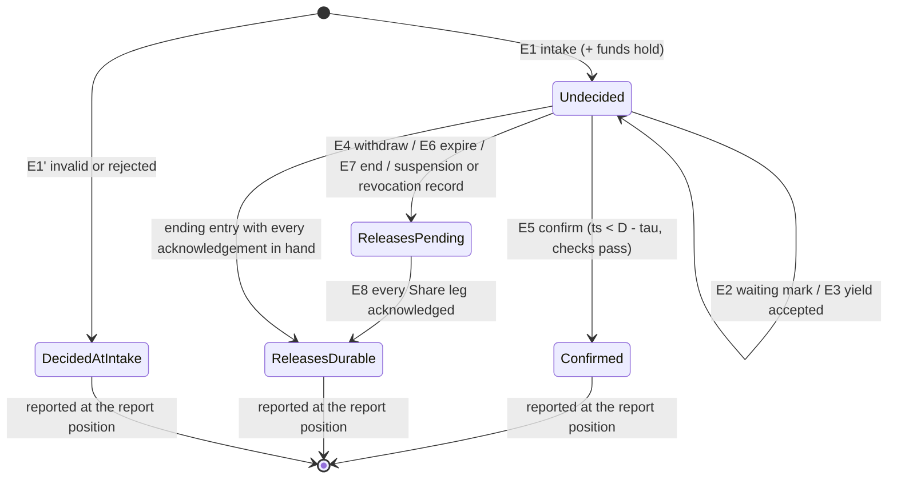
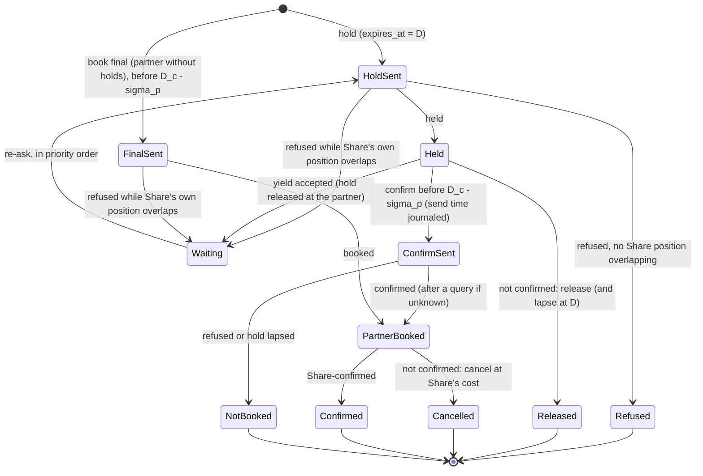

# RFC-002. Account owner and booking coordination: one decision log per account, request-scoped holds, and partner adapters that stand in for a schedule owner

| | |
|---|---|
| Status | **Draft, revision 2.** Revision 2 rebases revision 1 on `requirements-v1.6` and on [RFC-000](RFC-000-architecture.md) revision 4 (the distributed SQL substrate); see "Revision 2 resolution" at the end. To be reviewed and approved **together with RFC-004 Part A** (the funds-and-standing module of the same account owner, RFC-000 §7); §2.4 is the interface both must accept |
| Satisfies | P2-S01 … P2-S116 (all 116 P2 scenarios; the traceability table at the end maps each to its section). Also the booking side of P1-S07, P1-S08, P1-S11, P1-S12, P1-S14, P1-S34, P1-S41, P1-S42, P1-S54, P1-S62, P1-S63, P1-S70, P1-S73 and of the equivalent-path scenarios P1-S31 … P1-S61 (reservation-level offers, moves, revocations); the account-owner side of P4-S20, P4-S23, P4-S66, P4-S97, X1-S05 … X1-S09, X2-S03, X2-S05, X2-S06, X2-S15, X2-S21; the "fee shown, who ended" input of P3-S11, P3-S43, P3-S44, P3-S60, P3-S63 |
| Policies | POL-01, POL-02, POL-03, POL-04, POL-05, POL-06, POL-07, POL-08, POL-09, POL-10, POL-15, POL-16, POL-18, POL-23, POL-25, POL-26, POL-27, POL-28, POL-29, POL-30, POL-31, POL-32, POL-33 |
| Prior decisions | History log D13, D14, D16, D17, D21, D22 (carried forward or rejected in Competition) |
| Builds on | The requirements at tag `requirements-v1.6` (which decide this RFC's B-RQ-1 … B-RQ-8, [review 11](../reviews/11-requirements-amendments-from-detailed-rfcs.md)) and [RFC-000](RFC-000-architecture.md) revision 4: its principles A1 … A11, the account owner and partner adapters of §2, the protocols of §3 and §4, the substrate of §5.5 (CockroachDB at 2 + 2 + 1, NestJS owners with epoch-fenced owner leases, insert-only log tables, commit timestamps, closed timestamps and changefeeds, Kafka through a transactional outbox, status readers per Kenyan facility) and the contracts of §8, which resolve B-AI-1 … B-AI-6 |
| Supersedes | Revision 1 (written on RFC-000 revision 3.2's custom Raft platform and `requirements-v1.5`); the pre-baseline draft "Route reservation: a saga over held capacity" (both kept in git history) |

**Revision 2 in one paragraph.** The logic of revision 1 stands: one conditional deciding
entry per request in the account log, request-scoped holds with tombstones, the "releases
durable" gate, waiting and yields, partner adapters with journals and waiter queues. What
changes is what it runs on and four rules from `requirements-v1.6`. The account log is an
insert-only table in the database, appended by the NestJS instance holding the account
slot's **owner lease** in one batch transaction at a time, each conditional on the lease's
**epoch** and the partition's head row; an entry's timestamp is its **commit timestamp**,
and the confirm fence is checked against it (§2.5). Status replicas answer by RFC-000
§4.6's rule, now with RQ-13's "pending or the decided outcome, never contrary" (§8.2).
The v1.6 rules applied: checks of concurrent requests in arrival order (P2-S112); a
displaced request that **had begun committing** may complete and becomes affected
(P1-S63); change-request sameness (P2-S113); a decrease forbidden by a partner's shown
terms is rejected (P2-S115); the last-`ack_budget` unavailability exception (P2-S114);
`retry_after` as the latest remaining deadline (P2-S116). The entry kind E10 is retired
(§5.7) and the crash points are re-checked on the substrate (§12.2).

Terms are used in the sense of the [glossary](../02-specs/glossary.md); "reserved rate" is
capacity and "traffic" is bytes. Every latency, rate, size and count in this RFC is an
**estimate** (marked "est.") to be replaced by the R1 spike's measurements (RFC-000 R1),
unless it is a requirement's own figure or a policy default.

## Need

RFC-000 decided the shape: every booking request of an account is decided by that
account's **account owner**, a single-writer state machine over an insert-only log table
whose every commit is durable in two regions (RFC-000 §5.5); every Share link's capacity is decided by its **link schedule owner**; every partner
link is represented by a **partner adapter** that stands in for a schedule owner for
Share's own position there. RFC-000 left to this RFC the parts that make that shape
buildable (RFC-000 §7, "The RFC split"):

1. **The account owner's state machine**: the exact log entry kinds, which module of the
   account owner (booking, or funds and standing) owns each piece of state and each entry,
   the in-process interface between the two modules, and the state machine of a request
   and of a reservation.
2. **The booking workflow** that runs in the owner: intake and idempotency (P2-N6,
   POL-29), holds, waiting and yields (P2-N4, POL-02, POL-05), the decision entry (P2-N1,
   P2-N8, POL-04), the confirm fence and expiry (P2-N3, POL-26), releases and the
   "releases durable" record (RQ-6, RQ-8), withdrawal, revocation and suspension of
   undecided requests, and recovery from every crash point (P2-N5, POL-03).
3. **Reporting**: the edge's synchronous answer, the status replica rule, the outcome feed
   and webhooks (P2-N2, POL-04).
4. **Reservations and their changes** as one unit (P2-N9, POL-08), and the reservation-level
   side of revocations, equivalent-path offers and moves, release after grace and
   termination (P1-N8, POL-07, POL-16, POL-30).
5. **Partner adapters**: their log and call journal, the partner port, answer
   classification, fences, Share's waiter queue at each partner link, yields of Share's own
   partner holds, and reconciliation (P2-N7, POL-26, POL-28).
6. **The contention guarantee on every path** (POL-02): waiting, `wait = false`, short
   deadlines, crossings and cycles, and partner refusals caused by Share.

The hard parts, which every section below has to keep true at once:

- **One decision point per request** (POL-04, A7) that suspension, key revocation,
  withdrawal and the deadline are all judged against, while a partner leg, which cannot
  prepare in Share's sense, must be confirmed *before* that decision (P2-N7) and a
  confirmation must be decided before `D` (POL-26).
- **No hold ends except on the account owner's word** (A9), yet capacity is free by the
  deadline, or within `release_grace` when the decision record or a link's schedule owner
  is unavailable (POL-26), and no non-confirmed outcome is reported while a Share-link
  release it needs is not durable (RQ-6, RQ-8).
- **The process deciding can die at any point** (C12), on the Share side, at a link owner,
  at a partner adapter, or at the partner, without a route ever ending part-booked
  (P2-N1, P2-N5) and without a reported outcome ever changing (P2-S10, P2-S108).
- **Contention must not make every waiting competitor lose** across Share links and
  partner links alike, without a global component (POL-02, RFC-000 §2 "Merges and
  splits").
- **The design load is ×50** (POL-06): 25,000 booking requests/s, an account at
  `account_rate_limit` (200/s), status polls sized at 100,000/s.

## Approach

### 1. Scope, boundaries and notation

#### 1.1 What this RFC specifies, and what it relies on

| Specified here | Relied on (owner) |
|---|---|
| The account owner's log, entry kinds, apply rules, its tables and batch transactions on the substrate, takeover and recovery queries (§2, §12) | The substrate conventions (RFC-006, RFC-000 §5.5): the database at 2 + 2 + 1, owner leases and epochs, epoch-conditional batch transactions, commit timestamps, closed timestamps and changefeeds, the transactional outbox and Kafka topics, status readers, read leases and report positions, placement and region-wide failover, `ε` (the database's maximum clock offset, 100 ms) and the configured `δ_x` with the monitored quantities (AI-1); payload encryption and pseudonymous principals (RFC-005, A11) |
| The booking module: requests, reservations, change queues, the workflow (§3 … §9) | The funds-and-standing module: hold sizing, headroom, key headroom, capacity in flight, rate limits, standing transitions, resume amount (RFC-004 Part A), called through §2.4 |
| The status replica rule, the edge's answer gate, the request outcome feed, the reservation lifecycle feed, the booking API's semantics (§8, §13) | Authentication, principals, key scope, webhook signing (RFC-005); delivery of webhooks and notices (RFC-006 notifier) |
| The outcome and expiry port, the reservation command port, the partner port, the partner reconciliation feed (§13) | The link hold port, link waiting port, link availability query and link schedule feed (RFC-001) |
| Partner adapters (§10) | Partner terms and classification inputs in the catalogue (RFC-003; link registry RFC-001); equivalent paths from routing (out of scope) |

#### 1.2 Which module owns what

The account owner is **one writer process per account** with two modules (RFC-000 §2). The
modules never write each other's state; both write only through log entries of the one
log, applied by the one owner in one serial order.

| State | Module | Notes |
|---|---|---|
| Booking requests: idempotency key, fingerprint, principal, kind (book or change), legs and their kinds, window, rate, product, `wait`, `D`, `request_age`, commit fence `D_c`, locked prices and partner terms shown, waiting marks, yielded legs, withdrawal, the deciding entry and its reason, the "releases durable" record | Booking (RFC-002) | §2.2, §4 |
| The idempotency index (account, key) → request, for `idempotency_retention` | Booking | §3.3 |
| Reservations as route-level units: legs, parts (each with rate, effective minutes, locked price, age), partner terms shown at booking (minimum term, cancellation fee, whether the leg's rate can be decreased), lifecycle and end cause, partner-leg affected status, equivalent-path offers and move holds | Booking | §9 |
| Per-reservation change queue | Booking | §9.2 |
| Workflow progress per leg (held, waiting, refused, confirm sent, …) | Booking, **owner memory only**; rebuilt on takeover by querying participants, whose own logs are durable (§12.1) | Not in the log, by design (Competition) |
| Funds holds and credit holds (per request and per reservation), capacity in flight per key and account, key spending per `key_spend_period`, key status and KYB status as applied (F4; identity and access stays their writer; booking reads revocation from it, AI4-3), headroom inputs as applied feed positions (ledger position, rating position), credit limit, standing, its cause, grace start, resume amount, low-balance warning state | Funds and standing (RFC-004 Part A) | §2.3 |
| Booking-rate counters per key and account | Funds and standing (rule); kept in **owner memory**, rebuilt by a new owner from the last second's intakes; for one second after an owner change a key or account can be admitted up to twice its limit (RFC-000 §2, B-AI-4) | Not in the log: a submission over a limit "creates nothing" (D5) |

#### 1.3 Notation and parameters

| Symbol | Meaning | Value |
|---|---|---|
| owner | The NestJS instance holding the account slot's **owner lease**, which alone appends to the account's log ("leader" in revision 1); its **epoch** is the term of RFC-000 A2 | RFC-000 §5.2 |
| `ts` | An entry's **commit timestamp**: its batch transaction's commit timestamp in the database's hybrid-logical clock, read inside the transaction | RFC-000 §4.3 |
| `D` | The request's deadline: intake `ts` + the requested deadline (or `route_deadline_default`) | POL-26 |
| `request_age` | The intake entry's `ts`; ties broken by request identity (account partition, sequence) | POL-02 (`priority_rule = request_age`) |
| `D_c` | Commit fence, written in E1 and carried by every hold: `D − commit_margin` with a partner leg, `D − τ` without; the request may not begin committing after it ("`F`" in revision 1) | POL-26, RFC-000 §4.3 |
| `τ` | Confirm fence offset: a confirm entry is appended only if its `ts` is before `D − τ`; `τ = max(ack_budget, ε + δ_x)` | about 260 ms (est., RFC-000 §4.3) |
| `ε` | Clock bound: the database's configured maximum clock offset | 100 ms (RFC-000 coordinator decision) |
| `δ_x` | Time for the expiry's commit, the release notice and the release's commit at a link; configured per topology state at p99.9 (AI-1) | about 65 ms steady, 160 ms worst degraded (p99, est.) |
| `σ_p` | Partner-skew budget of partner link p: `ε` plus the adapter's commit-to-send bound `h_s` plus the measured bound on the partner's clock offset; part of `commit_margin` | design parameter per partner, default 250 ms (est.) |
| `T_x` | Expiry time by the owner's clock: `D − ε − δ_x` | — |
| `release_grace` | Bound on releases and late-known confirmations when a record or a schedule owner is unavailable | 1 min (POL-26) |
| `read_lease` | A status replica's read lease | about 400 ms (est., RFC-000 §4.6) |

Every entry's `ts` is its commit timestamp, so it is exact for the entry as committed and
replayed identically. Entries committed in one batch transaction share its `ts` and are
ordered by sequence. Timestamps are monotone within a partition across owner changes,
because each batch transaction reads its predecessor's head row (RFC-000 §4.3), and they
are within `ε` of true time. Every check against `D − τ` (and `D` for E8, §6.5) is made
against the `ts` the transaction will commit with; a transaction pushed to a later
timestamp re-checks and retries (§2.5). The owner's own clock only schedules: when to
propose an expiry, whether a confirm is still worth proposing (A8).

### 2. The account owner's log

#### 2.1 Entries, apply and conditional effects

- **Envelope.** Every entry is a row of the account log table (§2.5) carrying (account
  partition, sequence), the owner's epoch, `ts`, its kind, the audit fields of RFC-005
  (pseudonymous principal; for an operator, role, reason and approver; A11), and an
  encrypted payload of one or more **records**, each owned by one module: booking records
  (`B:` below) and funds records (`F:`). An entry is applied by applying its records in the
  order written.
- **Effects are computed at composition and logged.** The owner evaluates every rule, the
  funds rules included, against its projected state (everything it has committed, plus the
  batch in flight) and writes the results into the entry: verdicts, amounts, the requests a
  suspension ends. Booking records are applied as written; the funds module's outcomes are
  re-computed from the recorded inputs and rules version by every replay of the log (a new
  owner's rebuild, a standby tailing it, history's rebuild) and compared (RFC-004 A §A4).
  Every figure a buyer was shown can be rebuilt exactly (P4-N16, A0-21).
- **Deciding records are conditional.** A record that decides a request (*confirm*,
  *expire*, *end*, *withdraw*) is composed only if the request is undecided in the
  projected state. The database enforces it again: each deciding record also inserts the
  request's **decision row**, whose primary key is the request, so a second deciding record
  for one request cannot commit (RFC-000 §5.5). A batch that meets that key (only a bug can
  compose one) aborts as a whole; the owner reloads and recomposes it without the losing
  record. The first deciding record in log order is therefore the only one (A7).
- **One owner, projected state, one batch in flight.** The owner keeps a projected copy of
  the state that includes the batch transaction in flight, so two concurrent submissions
  with one key, a yield request and a grant, or a suspension and a confirm are ordered the
  moment they are composed. Nothing is sent to a participant, and no answer given, on the
  strength of an entry that has not committed (§2.2 states, per kind, what is sent after
  commit). If the batch fails or its result is ambiguous, the owner reloads its state from
  the log before deciding again (RFC-000 §5.2) and recomposes, against the reloaded state,
  every entry that did not commit; submissions waiting on the failed batch are processed
  again.

#### 2.2 Booking entry kinds

| # | Entry | Booking records | Funds records it also carries (computed by §2.4) | Deciding? | Sent to participants only after commit |
|---|---|---|---|---|---|
| E1 | **Intake** | Request record: id = (account partition, sequence), idempotency key, fingerprint (§3.1, §9.2), principal, kind (`book` or `change` with reservation id and change kind), legs (link, kind: Share, partner with holds, partner without holds), window, rate, product, `wait`, `D`, `request_age` (= `ts`), `D_c`, the receipt minute for window rules (POL-09), locked prices and the partner terms shown (minimum term, cancellation fee, whether a decrease is allowed) | Funds hold or credit hold for the request; capacity in flight +rate on key and account | No, unless the request is refused at intake (E1′) | Holds (§5.1) |
| E1′ | **Intake, decided** | As E1 plus the outcome: *invalid* (with the rule), or *rejected* (insufficient funds with the two amounts; a limit with its name; account suspended with the resume amount; more than one partner without holds; a change to part of a route; a decrease over a partner leg whose shown terms do not allow one, stating that the reservation may be cancelled instead, B-RQ-8) | None (nothing held) | Yes; "releases durable" is implied (no hold was sent) | Nothing; the outcome is reportable at once |
| E2 | **Waiting mark** | Request, and per waiting leg the deadline of the request ahead (from the waiting notice; the latest among several blockers), or "ahead resolved" | — | No | Waiting hints to every participant where the request holds (§5.2) |
| E3 | **Yield or displacement accepted** | Request, leg, attempt, the participant's yield request or displacement notice; the leg is marked yielded (it becomes a waiter at the request's age) | — | No | `yield_accept` or `displacement_accept` to that participant (§5.3, §5.2) |
| E4 | **Withdraw** | Request, principal; if undecided: outcome failed, "withdrawn" | Release of the funds hold; capacity in flight −rate | Yes, if undecided | Request-scoped releases; partner cancellations at Share's cost (§7.1) |
| E5 | **Confirm** | Request; for each leg the hold attempt confirmed or the partner booking reference; `ts` (appended only if its commit timestamp is before `D − τ`, with the `τ` used, §2.5); the check results (standing, key, withdrawal); for `book`, the new reservation record; for a change, the new part | Bind: the funds hold becomes the reservation's coverage hold (or grows it, for a change); capacity in flight −rate | Yes, if undecided and in time | Conversions (§5.7); partner outcome notices |
| E6 | **Expire** | Request; reason: "deadline passed", "deadline passed while waiting" with `retry_after`, or "interrupted by an internal failure" (§6.2) | Release of the funds hold; capacity in flight −rate | Yes, if undecided | Request-scoped releases; partner releases or cancellations (§6) |
| E7 | **End** | Request; outcome and reason: rejected for no fit (blocking link, counter-offer, or `retry_after` for `wait = false`); rejected by a partner's definite refusal (partner link); failed: partner fault (leg); failed: "reservation ended" (a change whose reservation ended); and the suspension and key-revocation endings when carried by a funds entry (§7.2) | Release of the funds hold; capacity in flight −rate | Yes, if undecided | Request-scoped releases; partner cancellations at Share's cost |
| E8 | **Releases durable** | A batch of (request, the Share legs whose release acknowledgement is in hand); complete for a request when every Share leg of its intake is acknowledged. For an expired request it is committed only with a `ts` at or after `D` (§6.5) | — | No (it gates reporting, A10) | Nothing |
| E9 | **Takeover** | New epoch, holder identity; the first entry of each epoch in the partition (§2.5) | — | No | Resume queries (§12.1) |
| E10 | *Retired in revision 2* | Not used; the number is not reused. Conversions still pending are found by recovery query instead (§5.7, §2.5) | — | — | — |
| E11 | **Reservation change** | Reservation; cause (the change request, or a Share cause: revocation or reduction under POL-07, move, release after grace under POL-16, termination under POL-30, a price change taking effect under POL-27); effective minute; the parts removed or added; the new end or rate; for an ending change, the changes it fails ("reservation ended"); the fee payer for any cancellation fee shown, including a shortening into a partner's minimum term (POL-08, RQ3-4) | Hold resize or release (POL-15) | Decides its change request if it is one (§9) | Leg changes (`end_leg`, `reduce_parts`) to every Share leg, with change id and decision time; partner change or cancel (§9.3) |
| E12 | **Leg changes durable** | As E8, for an E11: every Share leg has acknowledged its leg change | — | No (it gates reporting of changes that free capacity, §9.3) | Nothing |
| E13 | **Offer** | Equivalent-path offer prepared (the path chosen, with an offer id), made (every offer hold acknowledged; `offer_window` end), answered (accepted, declined, lapsed), partner leg booked or failed at acceptance | — | No | After *prepared*: `offer_hold` on every Share leg of the path, idempotent by (reservation, offer id); after *made*: the notice to the holder; after *accepted*: `offer_accept`; after *declined* or *lapsed*: `offer_release`; each with the decision time (§9.4) |
| E14 | **Partner leg affected** | Reservation, partner leg, from minute, source (reconciliation) | — | No | Notice through the notifier (POL-07, POL-28) |

There is no entry for a capacity hold acknowledgement, a grant to a waiter, or a partner
confirm being sent. Those facts are durable in the participant's own log, and a new owner
learns them by query (§12.1). The workflow's entries per request are therefore the two
RFC-000 §6 counts (intake, deciding entry), plus waiting marks when contended, a yield
acceptance only in a crossing or cycle, and an E8 for a request ended after its holds were
taken. Each is a row in a batch transaction; a single-link booking costs two transactions
at the account owner, as RFC-000 §3 budgets.

#### 2.3 Funds-and-standing entry kinds (owned by RFC-004 Part A)

RFC-004 Part A defines these kinds, their payloads and apply rules (its §A4); this RFC
registers them in the account log's closed registry beside E1 … E14. Each is appended by
the owner from a feed event or a timer, and its recorded **outcomes** can require booking
records, which the booking module writes **in the same entry** (§2.4 rule 5).

| Kind (RFC-004 A) | What it applies | Booking records its outcomes can require |
|---|---|---|
| F1 Ledger applied | Ledger balance and posted-through minutes through a ledger position | A suspension: ending records for every undecided request and every undecided addition of the account (rejected, "account suspended", resume amount) (P2-S69) |
| F2 Usage applied | Unposted usage through a rating position | As F1 |
| F3 Exposure parameters | Inputs of the lateness bound | As F1 |
| F4 Key status | Key revocation, key limits and KYB status from the identity status push (Kafka), applied within 60 s (D6, AI4-2, AI4-3) | A revocation: ending records (failed, "key revoked") for the key's undecided requests; its reservations are untouched (P2-S72) |
| F5 Credit limit | Credit limit set or removed (KYB status travels in F4; RFC-000 rev. 4.1) | As F1 |
| F6 Invoice status | Invoice overdue or paid | As F1 |
| F7 Funds tick | Fee term ended; grace ended | Grace ended with `release_due`: E11 records, **in the F7 entry itself**, ending every listed reservation, cause "released" (POL-16), buyer pays a shown fee (P4-S23; JR-2) |
| F8 Enforcement acknowledgement | Network operations' acknowledgement of a standing change | None |
| F9 Probe designation | The account is a probe account (POL-06) | None |
| F10 Rules version | The funds rules version in force from this position | None |

#### 2.4 The in-process interface between booking and funds

RFC-004 Part A provides the funds-and-standing module as a library linked into the
account owner, with no I/O, no clock and no randomness (its §A10). The booking module calls
it only at the owner, while composing an entry, against the projected state; the entry
records the module's inputs and outcomes; every replay of the log re-runs the module on the
recorded inputs with the recorded rules version (F10) and compares (RFC-004 A §A4). The calls, in RFC-004 A's
signatures, and where this RFC makes them:

| Call (RFC-004 A §A10) | Booking passes | Booking uses the result | Where |
|---|---|---|---|
| `rate_check(soft, ts, principal)` | The submitting key or user | `NotAccepted{retry_after}` → not accepted, nothing logged; `NotAccepted{revoked}` for a key revoked as applied by F4 → not accepted, as an unauthenticated submission (JR-1) | §3.1, before anything else; polls never reach it |
| `admit(S, ctx, ask)` | `Ask`: request id, principal and key, kind (`New`, `Increase`, `Extend`), the reservation's schedule after (and before, for a change) with its locked price per Mbps-minute, the shown partner fee terms, the rate in flight (once, whatever the number of legs) | `Admit{hold, hold_kind, mbps}` → E1 with it as the funds payload; `Refuse{reason}` → E1′ rejected with that reason and amounts. Called in the owner's serial order of intakes (arrival order), each call counting the holds and capacity in flight of every request then undecided in the projected state, the batch in flight included (POL-25, B-RQ-1, P2-S112) | §3.2, §9.3 |
| `standing(S)` | — | Must be active for a request that adds something to be confirmed; checked before a partner confirm is sent (from the applied state, §5.5) and in E5 | §5.5, §5.6 |
| `apply(S, ctx, Intake{…})`, `apply(S, ctx, Decided{Confirmed{reservation, schedule} \| NotConfirmed})`, `apply(S, ctx, ReservationChanged{reservation, schedule, end?{cause, fee_due}, fee_due?})` (the last for a shortening into a partner's minimum term, RQ3-4), `apply(S, ctx, PriceTookEffect{reservation, price version, effective minute})` | The booking entry's own content, as an `Input` | The outcomes (hold changes, any standing transition) recorded in that entry | E1, E4 … E7, E11 |
| `apply(S, ctx, F1 … F10)` | — (the owner builds the funds entry from the feed or timer) | Outcomes `standing` (to suspended), `release_due`, and a key revoked as applied (F4) → booking records in the same entry (§2.3) | §7.2, §9.4 |
| `due(S)` | — | Instants for F7 ticks (fee term end, grace end); the owner arms them with the booking timers (§6.1) | §6.1 |
| `answer(S, ctx, principal)` | Account or key | The itemised headroom at a stated position; its insufficient-funds amounts are those `admit` returned | Rejection texts; status replicas serve the headroom query (RFC-004 A §A9) |

What the booking module provides to the funds module, and nothing else: the `Ask` and
`Input` values above, built from the request and reservation records (rate, parts and
their schedule, locked prices, the partner fee and minimum term shown at booking, the key
that booked it, the end cause and who pays a shown fee under POL-08, §9.5).

Rules both modules keep:

1. **One entry, both effects.** An intake records the request and its funds hold in one
   entry, before any capacity hold is sent (POL-25, A0-03). A deciding entry records the
   outcome and the funds release or binding in one entry. A request is never decided with
   its funds not, or the reverse.
2. **No I/O in the funds module.** Its inputs arrive only as entries; the booking module
   never computes an amount.
3. **Order inside an entry.** For a booking entry, the booking record first, then the funds
   payload; for a funds entry, the funds payload first, then the booking records its
   outcomes require. Apply follows the written order.
4. **Determinism.** Only the owner calls `admit`, `rate_check` and `standing` to decide;
   what they return is logged. A rules change takes effect at an F10 boundary and never
   alters a logged figure (P4-N16).
5. **Who ends what.** Only the booking module ends a request or a reservation. A funds
   outcome that requires an ending (suspension, a key revoked as applied by F4,
   `release_due`) is turned into booking records in the **same entry**, so the funds event
   and the endings it causes have one log position: the decision point of each request it
   ends (POL-04). The entry is one row of one batch transaction, so it commits or does not;
   there is no state with the cause and not its endings.

**Alignment items with RFC-004 Part A, resolved in revision 2** as RFC-000 revision 4
directs:

| # | Item | Resolution |
|---|---|---|
| JR-1 | Key revocation as applied | RFC-000 rev. 4 (AI4-3): key status as applied is a funds kind (F4), identity and access stays its writer, and the booking module reads revocation from it. The interface stays as agreed: the read is through `rate_check` (`NotAccepted{revoked}` at intake, §3.1) and through F4's `apply` outcome (the key's undecided requests, ended in the same entry, §7.2). If RFC-004 A prefers a plain read of `S` for the same fact, booking uses it at the same two points and nothing else changes |
| JR-2 | Release after grace | Kept: the release records are written in the F7 entry itself (rule 5); RFC-000 §8 names release after grace "internal to the account owner, rule from RFC-004". RFC-004 A reads "appends" so |
| JR-3 | Rate counts after an owner change | RFC-000 rev. 4 (B-AI-4) adopts owner-memory counters with the bound "up to twice the limit for one second after an owner change" (§1.2, §3.1) |
| JR-4 | Price changes (POL-27) for open-ended reservations | Kept, with v1.6's RQ3-5: E11 cause "price change" at the effective minute applies the new price to every part of the reservation, parts added after the notice included, carrying `PriceTookEffect` (§9.4) |

**Interface points RFC-004 Part A must match** (all inside the agreed calls and kinds):

1. `admit` is called once per intake in the account log's serial order and counts the
   holds and capacity in flight of every request undecided in the projected state; nothing
   is re-checked at the decision; a refusal caused by a hold later released stands (POL-25,
   P2-S70, P2-S112, P4-S66).
2. `rate_check` returns `NotAccepted{revoked}` for a key revoked as applied by F4; F4's
   `apply` outcome names the revoked key, and booking writes the endings in the F4 entry.
3. F7's `release_due` outcome is answered by E11 records in the same F7 entry.
4. `ReservationChanged` carries `fee_due` for a shortening whose new end falls inside a
   partner's minimum term (RQ3-4, P3-S63), paid as for a cancellation, as well as for an
   ending; booking names the payer (§9.5).
5. `PriceTookEffect{reservation, price version, effective minute}` re-prices every part
   from the effective minute (RQ3-5); its hold and any suspension follow RFC-004 A (RQ4-8,
   P4-S108).
6. There are no followers on the substrate: RFC-004 A §A4's "followers re-compute and
   compare" is read as every replay of the log (a new owner's rebuild, a standby, history).
7. Every entry is committed in a batch transaction of one or more entries sharing one
   commit timestamp (§2.5); the module's apply must not assume distinct timestamps per
   entry, only distinct sequences.

#### 2.5 The account log on the substrate

RFC-000 §5.5 maps the logical design onto CockroachDB, NestJS and Kafka. For the account
owner it is concrete as follows.

**Tables** (all in the account database, 2 + 2 + 1, leaseholders preferred in R1, plus one
non-voting replica per Kenyan facility for the status readers; RFC-000 §5.1):

| Table | Primary key | Written by | Content |
|---|---|---|---|
| `account_log` | (account, sequence) | Insert only | Every entry of §2.2 and §2.3: kind, epoch, `ts`, pseudonymous audit fields, encrypted payload (RFC-005, AI5-3) |
| `account_head` | (account) | Updated by each batch | Last sequence and last `ts`; the predecessor every batch reads (contiguous sequence, monotone `ts`) |
| `request` | (account, request) | Projection, in the same transaction | Undecided, decided, reported-gate state; partial indexes on *undecided*, *releases pending* (decided not confirmed without a complete E8), *conversions pending* (confirmed, `D` + `release_grace` not yet passed) and *leg changes pending* (E11 without E12) |
| `decision` | (account, request) | Insert only, by the deciding record | One row per decided request; the database backstop for A7 (§2.1) |
| `idempotency` | (account, idempotency key) | Projection | Request, fingerprint digest, principal, expiry; removed by row-level TTL after `idempotency_retention` (§3.3) |
| `reservation`, `change_queue` | (account, reservation [, position]) | Projection | Reservation records and their queues (§9) |
| `funds_*` | RFC-004 A | Projection, by the funds module | Funds and standing state (§2.3) |
| `outbox` | (account, sequence, feed) | Insert only, in the same transaction | Feed rows: request outcome feed, reservation lifecycle feed, usage-applied acknowledgement, standing feed, notices (§8.3, §13) |

Projection rows are derived from the log and rebuilt from it (A4); no role may update or
delete a log, decision or outbox row.

**Batch transactions.** The owner commits **per account slot** (RFC-000 §3 rev. 4.1,
AI3-11): one batch transaction in flight per slot, carrying the pending entries of every
account partition of the slot; entries composed while one is in flight form the next. So
there is at most one transaction in flight per partition, and each partition keeps its own
contiguous sequence and head row. For E-ordering this means: an account's serial order is
still its own sequence, and nothing orders entries of two accounts against each other;
the entries of one batch, of every account in it, share one commit timestamp `ts`, so the
fence, the expiry checks and the displacement read below are evaluated per entry at that
`ts`; a busy account delays its slot-mates by at most one commit of batching wait; and
when one entry's check fails, only that entry is dropped or deferred, but the batch is
recomposed for the whole slot. Each transaction (1) reads the account slot's owner-lease
epoch and the head row of each partition it appends to, and aborts unless the epoch is the
owner's own; (2) reads its own commit timestamp, which
fixes `ts` for every entry in it; (3) checks each confirm in the batch against
`ts < D − τ`, and each completing E8 of an expired request against `ts ≥ D`; and, for each
confirm, makes one point read per Share leg of the link's displacement marker
(`link_displacement(link, request)`, RFC-001 §11.1; a read of the link owner's rows, never
a write, RFC-000 A1 rev. 4.1, AI-R1-11); if any check fails, or a marker is present for a
request that had not begun committing before it (§5.6), the owner aborts, drops or defers that entry in its projected state and recomposes
the batch (a confirm dropped for the fence is followed by the expiry, §6; one dropped for
a marker is handled as displaced, §5.1); (4) inserts the
entries, their projection rows and their outbox rows, and updates the head row; (5)
commits. A transaction the database pushes to a later timestamp restarts and re-checks from
(2) (RFC-000 §4.3). Nothing is sent to a participant, and no edge answer given, before
commit. An ambiguous commit result is treated as a failed batch (§2.1).

**Lease, slot and takeover.** Accounts hash into account slots (est. 1,024); a slot is the
unit of the owner lease (RFC-000 §5.2). An owner stops composing, granting read leases and
sending commands at its lease's expiry less `ε` by its own clock, and gives up its leases if
its host clock leaves 50 ms of the database's (RFC-000 R4). A successor takes the lease only
after its expiry by the database's clock, incrementing the epoch, so its first read of any
partition in the slot sees every entry the old owner will ever commit; a transaction the
old owner left in flight is resolved, committed or aborted, by the first reader that meets
it. Its first entry in each partition it acts on is E9, written in that partition's first
batch of the new epoch; partitions found by the recovery queries below get it at once,
others when they next have an entry. E9's `ts` is the takeover time that §6.2's
"interrupted" reason compares with `D`.

**Recovery queries** (on taking a slot; one indexed query per kind over the slot's
partitions, then §12.1 per request):

| Query | Over | Finds |
|---|---|---|
| Undecided requests | `request`, partial index *undecided* | Requests to resume or expire (§12.1 step 5) |
| Releases pending | partial index *releases pending* | Ending entries without a complete E8: re-send request-scoped releases (step 3) |
| Conversions pending | partial index *conversions pending* | Confirmed requests whose `D` + `release_grace` has not passed: re-send `convert` (step 4) |
| Leg changes pending | partial index *leg changes pending* | E11 without E12: re-send leg changes (step 4) |
| Open offers | `reservation`, offers prepared or made and not answered | Re-send offer holds; re-arm `offer_window` (step 4) |
| Timers | `request.D`, `funds_*` via `due(S)`, open offers | Re-arm the timer wheel (§6.1) |

The owner then loads its in-memory state for the slot (the projection rows, which equal a
replay of the log) and starts deciding; it starts **reporting** only once the old owner
lease has expired, which it has by construction (§8).

**Feeds.** Outbound feeds are outbox rows committed with their facts: the owner publishes
them to Kafka after commit, and a changefeed relays the same rows as the guaranteed path;
consumers drop the duplicates by (partition, epoch, sequence) (RFC-000 §5.5). Inbound feeds
(ledger positions, unposted usage, identity status, invoice status, enforcement
acknowledgements, catalogue prices) are consumed from Kafka and applied as F1 … F10
entries; the feed position each applies is recorded in the entry, so a new owner resumes
each consumer from its last applied position and a redelivered event is a no-op.

### 3. Intake and idempotency (POL-29, POL-25)

#### 3.1 From the edge to the owner

1. The edge authenticates, applies its advisory counters and forwards the submission once,
   by gRPC, to the account owner (the holder of its slot's owner lease, routed by slot with
   the slot's epoch; a stale route is refused and re-routed, RFC-000 §5.2). Status polls go
   to status replicas (§8.2), never to the owner.
2. The owner calls `rate_check` first. A key revoked as applied in the log (F4) gives
   `NotAccepted{revoked}`: not accepted, as an unauthenticated submission (X1-S06; the edge
   refuses it too within 60 s; JR-1). Over `key_rate_limit` or `account_rate_limit` (a
   sliding second), the submission is **not accepted** with `retry_after`; nothing is
   logged, the key is not consumed (P2-S41). Retries count, polls do not (P2-S68). The
   counts are owner memory; a new owner rebuilds the last second from its intake entries,
   so for one second after an owner change a key or account can be admitted up to twice its
   limit (the retries its predecessor answered from state are not in the log; RFC-000 §2,
   B-AI-4).
3. The owner looks the key up in the idempotency index of its **projected** state:
   - **New key**: go to 4.
   - **Same principal, same fingerprint** (for a booking: route legs in order, window,
     rate, product, `wait`; for a change: reservation, kind of change, new end or new rate,
     `wait`, §9.2; the deadline is not part of either, P2-S63, P2-S113): the submission is that request; the
     answer is its current status under the reporting rules of §8.1 (pending, or its
     reported outcome) (P2-S24, P2-S25, P2-S27). No entry.
   - **Same principal, different fingerprint**, or **a different principal of the
     account**: not accepted, as a key reuse; the answer contains nothing of the first
     request (P2-S26, P2-S64, P2-S113). No entry.
4. Validation (§3.2), then `admit`, then the owner composes E1 (or E1′) into the next
   batch. Intakes are composed one at a time in the order the owner receives them, which is
   the account's **arrival order** for POL-25: each `admit` counts the holds of every
   request then undecided, including those in the batch in flight, and nothing is re-checked
   later, so a request refused because of a concurrent request's hold stays refused even if
   that request then fails (P2-S70, P2-S112; B-RQ-1). The key is in the projected index from
   composition on, so a second identical submission arriving before the commit joins the
   same request (P2-S24).
5. The answer is sent by the rule of §8.1: final if reported in time, otherwise `pending`
   once E1 has committed. If E1 cannot commit in time (its batch fails, or the owner is
   losing its lease), no answer is given within `ack_budget`; that is unavailability, counted against
   the 99.99% target, and the client retries with the same key. `pending` is never sent for
   an intake that is not durable (A3).

#### 3.2 Validation and refusals at intake

Checks, in order, all made by the owner before proposing; each failure is an E1′ with the
outcome named (so a retry with the key returns the same outcome even after the selling
horizon has rolled):

| Check | Outcome | Scenarios |
|---|---|---|
| Window and rate validity, per leg, by the link registry's rules (P1-S19, P1-S20; POL-09, POL-31), "now" being the minute boundary at or before the request's receipt by the owner, recorded in E1 (POL-09, P1-S74); extension beyond the horizon | invalid | P1-S19, P2-S84 |
| Deadline within `route_deadline_min` … `route_deadline_max`, plus `commit_margin` with a partner leg | invalid | P2-S12, P2-S86 |
| At most one partner leg without holds, using the adapters' POL-26 classification (§10.2) | rejected, "a route may include at most one leg without holds" | P2-S34, P2-S36, P2-S102 |
| A change to part of a route | rejected, "a route is changed or cancelled as one unit" | P2-S49 |
| A decrease over a partner leg whose terms shown at booking (recorded in the reservation) do not allow one | rejected, stating that the partner's terms shown at booking do not allow it and that the reservation may be cancelled instead; the reservation is unchanged (POL-08, B-RQ-8) | P2-S115 |
| `admit` (standing for a request that adds, key and account in-flight limits, funds or credit hold, key headroom, in RFC-004 A §A5.1's order), in arrival order | rejected with the reason and amounts the module returns | P2-S38 … P2-S40, P2-S42, P2-S54, P2-S66, P2-S70, P2-S92, P2-S98, P2-S112 |

Every rejection at intake for a rule (more than one leg without holds, a change to part of
a route, a decrease the partner's terms forbid) is *rejected* in the glossary's sense, and
states the rule (B-RQ-3).

The price per Mbps-minute for the route and every partner leg's shown terms are read from
the catalogue's cache at the owner before `admit` and locked in E1 (POL-27, POL-08); the
same figures are those shown to the buyer, with whether each partner leg's rate can be
decreased (P2-S50).

#### 3.3 The idempotency index

- Keyed by (account, idempotency key); value: request id, fingerprint digest (of a
  booking's or a change's sameness fields, POL-29), principal, and expiry = intake `ts` +
  `idempotency_retention` (24 h). It is the `idempotency` projection table (§2.5), written
  in the intake's batch transaction; the owner keeps the keys of the last
  `idempotency_retention` in memory with a filter, backed by the table; status readers read
  it by follower read.
- Rows are removed by row-level TTL only after their expiry; a key then identifies a new
  request (P2-S65). Scoping by account is structural: the key's primary key starts with the
  account, so two accounts using one key never meet (X1-S08, X1-S09).
- A request's record (outcome, reason, counter-offer) is kept in the `request` table for
  status reads as long as its key, then removed by the same TTL; the log rows themselves are
  sealed into history's segments and truncated from the database only after sealing (RFC-000
  §5.5).

### 4. The request state machine

#### 4.1 Durable states

A request's durable state is a function of its entries. "Reported" is not an entry: it is
the moment the entries that make the outcome final are at or below the report position
(§8).

| State | Entered by | Left by | Holds and funds |
|---|---|---|---|
| **Undecided** (sub-flags: waiting, legs yielded) | E1 | E5, E6, E7, E4 or a funds entry's ending record | Funds hold from E1; capacity holds as acknowledged by participants |
| **Decided invalid / rejected at intake** | E1′ | — (final) | None ever taken |
| **Confirmed** | E5 (`ts < D − τ`, request undecided) | — (final; the reservation then has its own lifecycle, §9.1) | Funds hold bound to the reservation; holds converted |
| **Decided not confirmed, releases pending** | E4, E6, E7, or an ending record (suspension, revocation) | E8 completing it | Funds released in the deciding entry; capacity holds being released |
| **Decided not confirmed, releases durable** | E8 (or the deciding entry itself, when every acknowledgement was already in hand: a refusal that recorded a tombstone, or nothing sent) | — (final) | Nothing on any Share leg |



#### 4.2 Workflow phases in the owner

The owner drives each undecided request through phases kept in memory, derived from the
durable state and the participants' answers:

| Phase | Meaning | Allowed next | Yields? |
|---|---|---|---|
| **Holding** | Hold commands sent; some answers outstanding | Waiting, Ready, ending | No yield requests arrive for legs not yet held |
| **Waiting** | At least one leg is a registered waiter (Share link) or a contention waiter (partner adapter); none refused definitively | Holding (grant), Ready, ending | Yes: a yield request for any held leg is accepted (E3) |
| **Ready** | Every Share leg and every partner-with-holds leg is held; funds held | Committing (partner route) or Deciding (no partner leg); ending | No: refused |
| **Committing** | The first partner confirm or final booking has been sent (journaled by the adapter, §10.4) | Deciding (all partners confirmed), ending (any partner refusal, unknown past `D − τ`, or a Share-side event) | No |
| **Deciding** | E5 composed (its batch transaction in flight) | Confirmed, or, if the batch fails or the fence check drops the confirm, back to Ready or to the expiry | No |

A request is "waiting" for POL-02 exactly in the Waiting phase. Ready, Committing and
Deciding are "not waiting": such a holder is never pre-empted.

#### 4.3 Per-leg progress

| Share leg state | From the link hold port | Next |
|---|---|---|
| requested (attempt n) | — | held, waiting, refused (no fit), refused (past `D` or tombstoned) |
| held (attempt n) | Hold acknowledged once durable | yielded (E3), converted (after E5), released (after an outcome) |
| waiting | Registered as a waiter, with the deadline of the request ahead | held (attempt n + 1, a grant), refused (no fit on committed capacity) |
| yielded | Hold released by acceptance; waiter registration kept at the request's age | held (attempt n + 1), refused |
| converted / released | Acknowledged once durable | — |

Partner leg states are in §10.3.

### 5. The workflow

#### 5.1 Taking holds

After E1 commits, the owner sends, **in parallel**:

- to each Share leg's link owner, `hold(account, request, leg, rate, window, D, request_age,
  D_c, attempt = 1, epoch)` on the link hold port (RFC-001);
- to each partner-with-holds leg's adapter, `hold(request, leg, rate, window, expires_at =
  D, request_age, D_c, epoch)` on the partner port (§10).

A partner leg **without holds** is not touched now (§5.5).

Answers and what the owner does:

| Answer | Action |
|---|---|
| held | Leg held. If every Share and partner-with-holds leg is held, the request is Ready |
| waiting (Share link: blocked only by capacity in flight; partner adapter: refused while Share's own position overlaps), with the deadline of the request ahead | If `wait = false`: E7 rejected at once, with `retry_after` = the latest remaining deadline among the requests in flight that block it (B-RQ-4) and the counter-offer computed beside the capacity in flight (§5.8; P2-S18, P2-S59). Otherwise: E2 waiting mark, then waiting hints (§5.2) |
| refused, no fit on committed capacity (Share link; the refusal records a tombstone and counts as that leg's release acknowledgement) | E7 rejected, naming the link, with the route counter-offer computed beside committed and held capacity (§5.8) (P2-S02, P2-S17) |
| refused definitively by the partner, with no Share position overlapping (§10.5) | E7 rejected, naming the partner link (P2-S31) |
| partner transient refusal | The adapter retries within the request's commit fence; nothing changes at the account owner (P2-S30) |
| partner fault: transient or unknown results persisting to the leg's fence, or an answer the driver cannot classify (§10.2) | E7 failed, partner fault, naming the leg (P2-S62) |
| displaced (`DISPLACED`, carrying the reduction's record time: a capacity reduction recorded at the link means the held leg no longer fits beside committed capacity and older holds; RFC-001 §5.1) | By whether the request **had begun committing** (POL-26, POL-07 as amended in v1.6), in the owner's serial order: **not begun** (Holding, Waiting, Ready): decided against the reduced capacity: if it does not fit on committed capacity, E7 rejected for no fit with the counter-offer (P1-S41); if it still fits, E3 displacement accepted and the leg becomes a waiter (P1-S42 for what follows). **Begun** (Committing: a partner confirm or final booking journaled; Deciding: E5 in flight): the request goes on to its outcome as usual, by its deadline; the notice is answered by that outcome, `convert` if confirmed (the link then flags the reservation affected, tells its holder and alerts network operations, P1-S63) or the request-scoped release if not. **Decided** (E5 committed): nothing; the conversion already sent is the answer (B-RQ-2) |
| no answer (link or adapter owner lease moving) | Re-send with the same identity (idempotent) with backoff until an answer or the expiry (§6); a re-send routed with a stale slot epoch is refused and re-routed (RFC-000 §5.2) |

Hold commands are retried with the same `(request, leg, attempt)`; the participant's log
deduplicates them (RFC-000 §4.4). A hold is never sent before E1 commits, so no capacity is
ever held without its funds hold (P2-S92, P2-S33).

#### 5.2 Waiting

- **The mark.** On the first waiting answer, and whenever a waiting notice changes the
  deadline of the request ahead or reports it resolved, the owner proposes E2. The mark
  carries, per waiting leg, the latest deadline among that leg's blockers, which is what an
  expiry needs for its reason and `retry_after` (§6.2, P2-S116).
- **Hints.** After E2 commits, the owner sends `mark_waiting` (on the link waiting port and
  the partner port, §13) to every participant where the request holds a leg; on leaving Waiting it
  sends "not waiting". Hints only tell a link owner or adapter which younger holders are
  worth asking to yield; correctness rests on the acceptance check of §5.3, so a stale hint
  costs at most one refused yield request.
- **Grants.** When capacity is released on a link, the link owner grants it to its waiters
  by the priority rule and notifies the account owner ("capacity released to a waiter",
  with the new attempt). The owner marks the leg held (attempt n + 1). The grant needs no
  entry: it is durable at the link, and a new owner learns it by query.
- **A waiter that no longer fits** (the request ahead was confirmed, or the link's capacity
  fell, P1-S42) is refused by the link with a tombstone; the owner appends E7 rejected for
  no fit with the counter-offer (P2-S52).

#### 5.3 Yields: crossings and cycles

A link owner (or a partner adapter, §10.5) whose waiter O is blocked by the hold of a
**younger** request Y that it believes waiting asks Y's account owner to yield the leg. Y's
owner, in its serial order:

1. If Y is in the Waiting phase (some leg still waiting, none refused, not withdrawn, not
   decided): propose E3 *yield accepted*, mark the leg yielded in the projected state at
   once (so no confirm can be proposed on the strength of that leg), and after E3 commits
   send the acceptance. The participant releases the hold and keeps Y's waiter registration
   at Y's own `request_age`, so Y keeps its place (P2-S97).
2. Otherwise (Holding with no waiting leg, Ready, Committing, Deciding, decided): refuse.
   A holder that is not waiting is never pre-empted (P2-S58).

The participant re-sends an unanswered yield request until it is answered or the
waiter's state changes, and asks again after a refusal when a waiting hint for Y arrives
(Y may refuse while Holding and become waiting a moment later); the acceptance carries Y's owner-lease epoch, and §5.2 of RFC-000 makes the
participant ignore a command from an older epoch than it has applied for Y. Why every cycle
breaks without being detected is shown in §11.

#### 5.4 Committing a request without a partner leg

When Ready and the owner's clock is before `D − τ`, the owner checks `standing(S)` is active
and the request is not withdrawn, then composes E5 into the next batch. "Begin committing"
for such a request is starting that batch transaction, whose commit timestamp the
transaction checks against `D − τ` (§2.5), so it is never later than `D − τ` ≤
`D − ack_budget` (POL-26, P2-S110). If the clock is at or past `D − τ`, nothing is composed;
if the commit timestamp would be, the confirm is dropped; either way the expiry follows
(§6).

#### 5.5 Committing a request with partner legs

When Ready:

1. **Share's checks** from the applied state, in the serial order, with no log entry
   (A0R-14): `standing(S)` active, not withdrawn, undecided, and the owner's clock before
   `D_c − σ_p − h` (h: one hop to the adapter, est. 5 ms). If they fail, the request ends (E7
   or the expiry) and every partner hold is released.
2. **Partner without holds, if any (at most one, POL-28)**: send `book_final` to its
   adapter. It is booked last: after every other leg is held, after the funds hold and after
   Share's checks (P2-S33). Its answer:
   - booked → step 3;
   - refused definitively → E7 rejected naming the link (or waiting, if Share's own position
     overlaps there, §10.5, P2-S96);
   - unknown → the adapter reconciles at once (§10.6); a booking found later for a request
     that has ended is cancelled at Share's cost (P2-S35).
3. **Partners with holds**: send `confirm` to each, in parallel. If the remaining time to
   `D_c − σ_p` is below the partner's expected answer time (from its terms) when step 2
   starts, steps 2 and 3 are sent together instead, accepting that a refusal at the partner
   without holds then leaves the held partners' confirmations to cancel at Share's cost.
4. **Each adapter journals the send in its own log before calling the partner** (J2 or
   J3 intent, whose commit timestamp is the recorded send time, §10.4). The first journaled
   send is the request's "begin committing" time; the adapter journals it only before
   `D_c − σ_p` and sends only within `h_s` of the journal's commit, so the call leaves
   before `D_c` in true time (P2-S109, P2-S55).
5. **When every partner leg has confirmed**: re-run the checks and compose E5 if the clock
   is before `D − τ`. The partner confirm therefore has at least `commit_margin − τ` (about
   9.7 s, est.) for its answer (RFC-000 §4.3).
6. **If any partner leg refuses, answers unknown and is still unknown at `D − τ`, or a
   Share-side event ends the request** (suspension, revocation, withdrawal, expiry): the
   deciding entry is the ending one, and every partner booking already made for the request
   is cancelled at once at Share's cost (POL-28, RQ-2; P2-S105, P2-S57). Share never
   confirms a leg the partner has not confirmed (P2-S29, P2-S03).

Two partners with holds of different lengths are handled alike: each hold expires at `D`
(set by Share), each is confirmed before E5, and any one confirmed for a request that is not
confirmed is cancelled (P2-S37).

#### 5.6 The decision entry

E5 is the single POL-04 decision point of a confirmed request. It is composed only if these
hold, in this order, in the projected state at its place in the serial order, and the
database enforces the first three again (§2.1, §2.5): the request is undecided (its decision
row is new); `ts < D − τ` with the recorded `τ`, `ts` being the batch's commit timestamp;
**no displacement marker** at any Share leg, read in the same serialisable transaction
(one point read per leg, about 1 to 2 ms, est.; RFC-000 §8 link displacement read,
AI-R1-11, B-RQ-9), unless the request had begun committing before the marker's timestamp
(a partner confirm or final booking journaled earlier), in which case E5 proceeds and the
link flags the reservation affected (P1-S63). A marker present otherwise means the
reduction committed before the request began committing: no E5 is written and the
request is handled as `DISPLACED`, not begun (§5.1); no withdrawal applied; the account is active (`standing(S)`, recorded in the entry; a
key revoked earlier in the log has already ended the request, §7.2); every Share leg is held at a
recorded attempt that has not been yielded; every partner leg has a recorded partner booking.
If any check fails, no E5 is written and the owner composes the ending entry with the
corresponding reason. A suspension, revocation or withdrawal **after** E5 in the log changes
nothing (P2-S103), even while a status read still shows `pending`.

#### 5.7 After the decision

- **Confirmed.** The owner sends `convert(request, leg, attempt, decision ts, reservation,
  part)` to every Share leg (asynchronous, idempotent; the hold keeps counting until
  converted, RFC-000 §4.2), and a "Share-confirmed" outcome notice to every partner adapter.
  Acknowledgements are collected in memory and retried until in hand. No entry records
  them (E10 is retired): a new owner re-sends `convert` for every confirmed request whose
  `D` + `release_grace` has not passed (the *conversions pending* query, §2.5), and a link
  that has seen no outcome by `D` asks for it and is answered "confirmed" (§6.3), so a
  conversion lost with its owner is still made. This saves one transaction per confirmed
  request, which on the substrate is not shared with other accounts.
- **Not confirmed.** The owner sends a **request-scoped release** (no attempt number) to
  every Share leg **in the intake**, not only those it believes held, and to every partner
  adapter (which releases the partner hold, or cancels a partner booking at Share's cost).
  Each link owner records a tombstone in the release entry and acknowledges once durable.
  The owner batches acknowledgements into E8, in the partition's next batch transaction; when every
  acknowledgement is already in hand at the deciding entry (a single-leg refusal, or nothing
  sent), the deciding entry records it itself (RFC-000 §4.3). The partner release does not
  gate the report; the partner hold lapses at `D` in any case (P2-S14, P2-S101).
- **Reporting** follows §8: the outcome is reported once E5, or the deciding entry and its
  complete E8, are at the report position.

#### 5.8 Counter-offers (P2-N11, POL-10)

On a rejection for no fit, and on a `wait = false` rejection, the owner computes the route
counter-offer before proposing E7, so the counter-offer is part of the recorded outcome:

1. It calls the **link availability query** (RFC-001) on every Share leg for the window
   and, forward from the requested start, the free-capacity profile up to the selling
   horizon, beside committed capacity **and** the capacity held for requests in flight, for
   every rejection (a `wait = false` rejection and a rejection for no fit alike): what the
   buyer can have now, without waiting (POL-10 as amended in v1.6, RQ-R1-9; P1-S73).
2. **Largest rate** that fits the window on every leg = min over legs of (capacity − peak
   over the window).
3. **Earliest window** of the requested length, starting at or after the requested start,
   that fits the requested rate on every leg: a sweep over the minute boundaries where any
   leg's profile changes, keeping the earliest start whose window fits on all legs, within
   the horizon.
4. **Blocking link**: the first leg in route order that refused (P2-S73).
5. **`retry_after`** (a `wait = false` rejection): the latest remaining deadline among the
   requests in flight that block it, on one link or several legs, from the waiting answers
   (POL-05, B-RQ-4; P2-S18, P1-S70).

Partner legs' availability is not computable; the counter-offer covers the Share legs and
says so. Nothing about other buyers is disclosed (POL-10). The queries add one parallel
round trip (est. 5 to 10 ms) to a rejection.

### 6. Deadlines, the fence and expiry

#### 6.1 The timers

For each undecided request the owner keeps, in a timer wheel:

| Time (owner clock) | Effect |
|---|---|
| `D_c − σ_p − h` | No partner confirm or final booking is sent from now on (the adapter refuses them past `D_c − σ_p` anyway) |
| `D − τ` | No E5 is composed from now on; an E5 whose batch would commit with `ts ≥ D − τ` is dropped (§2.5) |
| `T_x = D − ε − δ_x` | Compose E6 *expire if undecided* |
| `D` | The earliest commit timestamp for the E8 that completes an expired request (§6.5) |

`τ`, `ε` and `δ_x` are the configured values (RFC-006, RFC-000 §4.3: `ε` = 100 ms, `δ_x`
per topology state at p99.9), read at the moment of use; the confirm guard is checked
against the commit timestamp and so fails safe whatever the owner's clock (RFC-000 R4).
Since `τ ≥ ε + δ_x`, under one owner every appended confirm precedes the expiry in the log,
and the expiry has `δ_x` to make every Share-link release durable by `D` (P2-S93). RFC-006
counts every release durable after `D`; the owner classifies each one whose expiry did
not commit by `T_x` plus its commit budget, so that a late release caused by the decision
record's unavailability (§6.4) is alerted as such rather than counted as a P2-S93 breach.

#### 6.2 The expiry entry, its reason and `retry_after`

E6 is conditional (*if undecided*). Its reason is that of the first row that applies:

| Condition at the expiry | Reason | `retry_after` |
|---|---|---|
| A takeover entry (E9) follows the request's last progress, and its `ts` is at or after `D` (the booking process did not restart before the deadline) | "interrupted by an internal failure" (P2-S23) | — |
| The request is in the Waiting phase (from memory; after a takeover, from the last E2 and the resume queries) | "deadline passed while waiting" | The latest remaining deadline, at this moment, among the requests ahead on all its waiting legs (from E2, which records per leg the latest deadline among that leg's blockers), 0 for each that has had its outcome (POL-02 as amended, B-RQ-4; P2-S61, P2-S95, P2-S116) |
| Otherwise | "deadline passed" (P2-S13, P2-S55, P2-S110) | — |

The first row refines RFC-000 §4.3's wording ("could not be resumed in time") so that a
request resumed before `D` but after its commit fence fails with "deadline passed", as
P2-S110 requires, while one whose process stayed down past `D` is "interrupted" (P2-S23;
B-AI-5).

#### 6.3 Expiry requests from participants

A link owner or partner adapter that has seen no outcome for a hold it keeps by `D` (by its
clock) sends `expire_if_undecided(request)` on the outcome and expiry port, keeps the hold,
and raises an alert. The owner proposes E6 if the request is undecided; in either case it
answers **with the committed outcome**: confirmed with its decision timestamp (the link
converts) or not confirmed (the link releases and acknowledges) (RFC-000 §4.3). The answer is
sent only after the entry deciding it is committed.

#### 6.4 When the decision record is unavailable at the deadline

The decision record is **unavailable** when no instance holds the account slot's owner
lease, or the account's ranges have no leaseholder (a range-lease move after a node loss)
or no quorum (RFC-000 §4.3). Under v1.6 it counts as **unavailable at the deadline** if it
is unavailable at `D` **or at any time in the last `ack_budget` before it** (POL-26, B-RQ-6;
P2-S114): an owner that can commit again at `D − 20 ms` cannot make the releases durable
by `D`, and need not.

In either case no participant can learn the outcome in time, so every Share-link hold is
kept (safe) and the participants alert at `D` (P2-S104, P2-S53). The owner, once it can
commit (the same owner after a range-lease move, or a new one after its E9), appends E6 for
every undecided request past `T_x` (reason by §6.2), and releases follow within
`release_grace` after `D` (P2-S101, P2-S104, P2-S114, P1-S54); a lease or range move takes
seconds (est.), well inside it. The owner raises the operational alert itself for each such
request (its E6 committed after `T_x` plus its commit budget, §6.1), with the request and
its legs (P2-S114). The partner hold lapsed at `D` by itself. A confirm transaction that
committed with a `ts` before `D − τ` while its owner was failing (the database resolves an
in-flight transaction when the next reader meets it) is found by the new owner's recovery
read and kept: the request is confirmed by a decision in time that becomes known after `D`,
at most `release_grace` after it, and status reads report `pending` or `confirmed`
meanwhile, never failed (P2-S106 as amended, RQ-5, RQ-13).

#### 6.5 Expiry outcomes are reported no earlier than `D`

E6 is committed about `ε + δ_x` (est. 165 to 260 ms) before `D`. So that "failed as of its
deadline" is never reported before the deadline, the E8 that completes an expired request
is committed only with a `ts` at or after `D` (§2.5): the owner composes it once its clock
reaches `D`, and the transaction re-checks its commit timestamp. The releases themselves
are durable by `D`; only the report waits, by at most one batch transaction plus the
report delay (est. 40 ms steady at p99).

### 7. Withdrawal, revocation and suspension of undecided requests

#### 7.1 Withdrawal (POL-08)

`withdraw(idempotency key)` reaches the owner, which proposes E4, conditional. RFC-000 §3
describes a withdrawing mark followed by "the next deciding entry (normally at once)"; this
RFC writes both in one conditional entry, which has the same order and one write fewer:

- undecided → failed, "withdrawn"; funds released; request-scoped releases; any partner
  booking already confirmed or final is cancelled at once at Share's cost (P2-S56, P2-S57,
  P2-S105); the buyer is not charged;
- already decided → no-op; the answer is the decided outcome (P2-S103).

The answer to the withdrawal is the request's status by §8.1. A withdrawal of a change
request withdraws only that change.

#### 7.2 Key revocation and suspension

These arrive as funds entries (§2.3): a key revocation as F4, from the identity status push
(RFC-005, applied by the funds module, read by booking; AI4-3), a suspension as the outcome
of F1, F2, F3, F5 or F6. In the **same entry**, the booking module writes an ending record for every undecided request concerned: key revoked → failed, "key revoked",
for the key's undecided requests (P2-S72, X1-S06); suspended → rejected, "account
suspended" with the resume amount, for every undecided request and every undecided
extension or increase of the account (P2-S69). Reductions in flight are unaffected
(POL-08). Each ending is that request's decision point; releases, partner cancellations and
reporting follow §5.7. Confirmed reservations are unaffected (P2-S72); a request whose E5 is
earlier in the log stays confirmed (P2-S103).

### 8. Reporting: the edge's answer, status replicas, the outcome feed and webhooks

An outcome is **reported** by any of four channels, and every channel obeys one gate
(A10, RFC-000 §4.6): a confirmed outcome once its E5 is at or below the report position; a
non-confirmed outcome once its deciding entry **and** its completing E8 are; an outcome at
intake (E1′) once E1′ is. The **report position** is the owner's, per account slot: the
highest commit timestamp P such that every entry of the slot at or below P is committed
**and** every status reader holding a read lease has acknowledged applying it (the owner
pushes each committed batch to the leased readers; about 10 ms steady, est.). Read leases
are granted only within the owner lease, and a new owner, which takes its lease only after
the old one expired, starts reporting only then. Its first report position covers every
entry it read on taking the slot, and it grants a read lease only to a reader that has
applied through it (§8.2, the basis of RQ-13's "never pending again").

#### 8.1 The edge's synchronous answer

The owner keeps the forwarded submission open until the earlier of:

- the outcome is reportable (gate above): the answer is final (P2-S07);
- `ack_budget` less the edge's own share (est. 20 ms) after the edge received it, provided
  E1 has committed: the answer is `pending` (P2-S08, P1-S34).

`pending` is not a report and is not delayed by the report gate (RFC-000 §3), but it is
only ever sent for a committed intake (§3.1). The same rule answers a retry with the key, a
withdrawal and a change submission. A single-link booking with no capacity in flight is
reportable within about 115 ms at p99 from R1 and 125 ms from R2 (est., RFC-000 §3), so it
gets its final answer (P2-S07, X2-S15); a route gets `pending` within about 45 ms (est.)
and its outcome by its deadline (X2-S06).

#### 8.2 The status replica rule

Status reads (polls, and retries answered by replicas) are served by **status readers**
(RFC-000 §4.6, AI-4): one NestJS status-reader instance per Kenyan facility, four in all.
For every account slot each holds (a) the batches the owner has pushed to it since its read
lease began, and (b) **bounded-staleness follower reads** of the `request`, `decision` and
`idempotency` tables through the database replicas in its own facility (the Kenyan voting
replicas other than the leaseholder's, and one non-voting replica per Kenyan facility), for
anything older. A read lease lasts at most `read_lease`, timed from the reader's own
request and treated as expired `ε` early. A reader answers a status read for request q by
RFC-000 §4.6's rule:

1. **A committed outcome** it has applied (pushed, or found by follower read), with, for a
   non-confirmed one, its completing E8: that outcome, however stale the reader is
   (P2-S10).
2. **Live read lease**: otherwise, if it holds a live read lease, `pending` (P2-S99,
   P2-S03, P2-S107: an ending entry whose E8 is incomplete reads `pending`). The lease
   guarantees it has applied every reported position.
3. **No owner holds the lease**: otherwise, if a consistent read of the owner-lease row
   shows that no instance holds the slot's owner lease, it reads q's rows at the present
   timestamp, which sees every committed entry, and answers as in rule 1 if it finds a
   committed outcome, otherwise `pending`. While the account's ranges are moving their range
   lease, the read waits for the new leaseholder (seconds, est.) rather than answer.
4. **Otherwise** (an owner holds the lease but this reader has no read lease, or the
   database cannot be reached): refuse with a retry; the client's retry reaches another
   reader.

**Why it meets POL-04 as amended in v1.6** (RQ-13, B-RQ-7; P2-S111, P2-S106, P2-S108):

- *Never a contrary outcome.* A reader answers an outcome only from a committed deciding
  entry, and a request has at most one (its decision row, §2.1); a non-confirmed one only
  with its complete E8. While the record is unavailable it therefore answers `pending` or
  the decided outcome, never another, and never "failed" for a confirmation decided in time
  (P2-S106).
- *Never `pending` after a report.* A reported outcome was applied by every leased reader
  before it was reported (rule 1 answers it); rule 2 answers only under a live lease; rule
  3 reads at the present timestamp and finds it (P2-S108, RQ-10).
- *Once any read has answered the decided outcome, every later read does* (P2-S111's
  second Then). An unreported outcome is answered only by rule 1 or rule 3, from a committed
  row. Rule 3 runs only when no owner lease is held, so every read lease has ended (each lies
  within the owner lease, and readers expire theirs `ε` early); the next owner's first read
  of the slot sees the row, its first report position covers it, and it grants no read lease
  before a reader has applied it, so every later rule-1 or rule-2 answer is the outcome. A
  rule-1 answer from a reader that saw the row before the outage is covered the same way,
  since the row is committed.
- *Bounded.* The record is available again once an owner holds the lease and the ranges
  have leaseholders: seconds (est.), within admission's 1 min RTO before the deadline and
  within `release_grace` at it (RQ-12; P2-S111's last Then).

Two additions this RFC makes to the rule:

- **Unknown key.** A reader answers "no such request" only after a consistent read at the
  present timestamp (served by the leaseholder) shows the `idempotency` row absent, so an
  intake that committed before the read began, whose `pending` was just sent, is never
  reported missing by a lagging reader. It costs one Nairobi round trip from R2 (est.
  10 ms).
- **Headroom reads** are served the same way, at a recorded position (RFC-004 A §A9).

The poll limit (`key_poll_limit`, P2-S67) is enforced exactly by the edge's key-sharded
poll counters (RFC-000 §2, AI4-6), not by the readers; for one window after a shard moves
a key can be answered up to twice its limit.

#### 8.3 The request outcome feed and webhooks

- **Events.** One event per reported outcome, derived from the log: request id, account,
  idempotency key, pseudonymous principal, outcome, reason, decision timestamp (`ts` of the
  deciding entry), for a rejection the counter-offer, the blocking link and the amounts, for
  a confirmation the reservation id. For an expiry the stated time is `D`.
- **Outbox and identity.** The event is an outbox row written in the transaction of the
  entry that makes it reportable (E5, E1′, the ending entry that already records its
  releases, or the completing E8). Its identity is (account partition, epoch, sequence) of
  that entry, the same on the owner's direct publish and on the changefeed relay, so every
  duplicate is dropped by the consumer (RFC-000 §4.4, §5.5). The topic is keyed by account
  slot; order is per account partition within it.
- **Report-position markers.** Committed is not yet reported, so the owner also writes
  **markers** (slot, epoch, report position P) into the same topic: carried in the next
  batch transaction of any partition of the slot, or in a marker-only transaction when none
  comes within 20 ms (est.) of the report position passing an unmarked event. Every consumer
  treats an event as reported only at or below a marker of its slot (RFC-000 §4.6).
- **Consumers.** The notifier (signed buyer webhooks retried for `webhook_retry`, P2-S09;
  the buyer is *told* once the notice is recorded and its first delivery attempted, POL-04,
  P1-S75), alerting, and the operator console's view of failed requests with reason and leg
  (P2-S51).

### 9. Reservations and their changes (POL-08)

#### 9.1 The reservation record and its lifecycle

A reservation is created by its booking's E5: id, account, the key or user that booked it,
route legs in order (with each partner leg's booking reference and shown terms), and a list
of **parts**, each with rate, effective window, locked price, age (the `request_age` of the
admission that added it) and the admission's request id. The rate at a minute is the sum of
the parts effective then.

| State | Entered by | Left by |
|---|---|---|
| **Active** | E5 of its booking | E11 that ends it |
| **Active, change in progress** | Head of its change queue admitted as a request | That request's outcome |
| **Active, offer open** | E13 offer made (POL-07) | E13 accepted, declined, lapsed |
| **Ended** (cause: cancelled, revoked, released, terminated, or window end) | E11 with an ending cause, or the window's end | — |

```mermaid
stateDiagram-v2
    [*] --> Active: E5 confirm of the booking
    Active --> Changing: change at the head of the queue admitted (E1 kind=change)
    Changing --> Active: its outcome (E5 adds a part, or E4/E6/E7)
    Active --> Active: E11 decrease / shorten (not ending) / reduce (POL-07) / move
    Active --> OfferOpen: E13 offer made
    OfferOpen --> Active: E13 accepted (move at the notice end) / declined / lapsed
    Active --> Ended: E11 cancel / revoke / release / terminate, or window end
    Changing --> Ended: E11 ending; the pending change fails "reservation ended"
    OfferOpen --> Ended: E11 ending
    Ended --> [*]
```

The **reservation lifecycle feed** (§13) carries every transition with its effective
minute, so rating accrues exactly what was sold (P3-N1) and history can answer "as known at
T" (P1-S33 is RFC-001's for a link; the route-level history is this feed's).

#### 9.2 The change queue

Each reservation has one FIFO **change queue** in the booking module's state:

- A change submission is a booking request (it carries an idempotency key, a deadline and a
  `wait` setting). Its fingerprint under POL-29 as amended in v1.6 is the reservation, the
  kind of change (cancel, shorten, extend, increase, decrease), the new end or new rate,
  and `wait`, from the same principal; the deadline is not part of it (B-RQ-5). A resend
  with the same key and fingerprint is the same change and is applied once; one that
  differs in any of these (another end, another kind, another reservation) is not
  accepted, as a reuse of the key, and the first change is unaffected (P2-S113). A
  withdrawal names the request's own key, so its retries are the same withdrawal (§7.1).
  It is validated at intake (§3.2); a change to part of a route is rejected (P2-S49), a
  decrease the partner's shown terms forbid is rejected (P2-S115), an extension past the
  horizon is invalid (P2-S84).
- **Ending changes are never queued**: a cancellation, or a shortening whose new end is at
  or before the next minute boundary (including an end already past), is decided at once by
  one E11 that ends the reservation from the next minute boundary and, in the same entry,
  ends every queued change and the change in progress with failed, "reservation ended"
  (their holds released, funds released) (P2-S43, P2-S81, P2-S94 first row, P2-S84).
- **Every other change** (extension, renewal, making open-ended, rate increase, rate
  decrease, a shortening that does not end it) is appended to the queue in arrival order (the
  order of its E1 in the log) and processed only when it reaches the head; each is decided
  against the reservation as the change before it left it (P2-S79, P2-S94 second row).
- A suspended account may cancel, shorten or decrease, not extend or increase: the funds
  module's `admit` refuses additions when suspended (rejected, with the resume amount),
  reductions are not checked and are allowed while suspended (RFC-004 A §A5.1; P2-S77,
  P2-S78).

#### 9.3 Each kind of change

| Change | Admission | Entries | At the legs |
|---|---|---|---|
| Cancel; shorten to or before the next boundary (P2-S43, P2-S84) | None (not checked; allowed while suspended) | One E11 (ending), then E12 | `end_leg` at the next boundary on every Share leg; partner cancel per the terms shown (cancellation fee charged to the payer of POL-08) |
| Shorten to a later end (P2-S44) | None | E11 when at the head, then E12 | `end_leg` at the new end; a new end inside a partner's minimum term incurs its shown fee, paid as for a cancellation (POL-08, RQ3-4, P3-S63), recorded as `fee_due` (§9.5) |
| Decrease (P2-S48) | None; rejected at intake over a partner leg whose shown terms forbid a decrease (P2-S115) | E11 when at the head (parts removed last in, first out, from the next boundary), then E12 | `reduce_parts` from the next boundary on every Share leg; partner change per its shown terms |
| Extend, renew, make open-ended (P2-S45, P2-S46, P2-S84) | A new admission of the difference: `admit` for the added part's coverage | E1 (kind change), holds for `[old end, new end)` at the reservation's rate on every leg, then E5 adding a part, or an ending entry leaving the reservation as it was | Hold, then convert with the new part's id; a partner leg gets a hold and confirm for the added part (§10) |
| Increase (P2-S47, P2-S74) | As extension, for `[next boundary, end)` at the difference in rate | As extension | As extension |

- The added part is priced at the price in force when the change is made; existing parts
  keep theirs (POL-27); the funds hold grows by the added coverage (P2-S75, P2-S76 are the
  funds module's refusals).
- A change that adds is a request in its own right: it waits, yields, commits and expires
  exactly as a booking, with its own deadline and age (P1-S46: each added part has its own
  age). A rejected or failed addition leaves the reservation unchanged (P2-S46, P2-S74,
  P2-S83).
- **Changes that free capacity are reported once their leg changes are durable** (E12),
  as non-confirmed outcomes are (RQ-6 applied to changes), so a buyer who reads the
  cancellation finds the capacity free from the stated minute on every Share leg (P2-S43,
  P2-S48).
- **A cancellation over a partner leg takes effect for the buyer whatever the partner
  answers** (P2-S82): E11 ends the reservation and its charges at the next boundary; the
  adapter keeps cancelling until the partner confirms and reconciles its record.

#### 9.4 Share-initiated ends and changes

These come through the **reservation command port** (§13) or a funds effect. Each is one
E11 (or E13), decided at once in the account owner's order. A change in progress, and
every queued change, fails with "reservation ended" if the E11 ends the reservation
(P2-S80), or "reservation changed by Share" if it reduces or moves it, in the same entry,
with its holds and funds released as for any non-confirmed outcome (§5.7).

| Cause | Source | What the account owner does |
|---|---|---|
| Revocation or reduction (POL-07) | RFC-001's "revocation due" for (reservation, Mbps, effective at the notice end), newest parts first, per link, as decided when the notice ends (RQ-R1-3) | At the effective minute, E11 reduces the reservation's rate by the Mbps due (`reduce_parts`, parts last in, first out, each part's age being its own, P1-S46, P1-S47) **on every leg**, or ends it (revoked) at 0 (`end_leg`); holder told, and told it may cancel without fee if its rate was cut (POL-08); Share pays any shown fee (P2-S05) |
| Equivalent-path offer (POL-07, RQ-4) | The same revocation notice; equivalent paths from routing (all-Share paths first; RFC-002 is the source's only consumer, AI-R1-5) | E13 *prepared*, then `offer_hold` on every Share leg of the path (the link owner's own hold, full rate, from the offer to the reservation's end, no funds hold), then E13 *made* once every offer hold is acknowledged, and only then the offer to the holder; open for `offer_window` (P1-S31, P1-S55, P1-S58, P1-S59). Accept: E13 accepted, `offer_accept`; a partner leg on the path is booked now through its adapter (hold and confirm, or final) (P1-S60); on failure, as declined, `offer_release` at once, and any other path offered (P1-S61). Move: at the notice end, or earlier from a boundary the holder chooses, E11 move: `end_leg` on the old legs and `offer_move_at` converting the offer holds into the new legs at the lower price, each part keeping its own age (P1-S35, P1-S53, P1-S71). Decline or lapse: `offer_release` at once (P1-S57); the affected Mbps removed at the notice end (P1-S36, P1-S45, P1-S52). Every offer command carries the decision time (AI-R1-7) |
| Release after grace (POL-16) | F7 funds tick, grace ended, with `release_due` (§2.3) | E11 ending every reservation of the account, cause "released"; the buyer pays a shown fee (P4-S23, P4-S97) |
| Termination (POL-30) | Operator console envelope (role, reason, approver) | E11 ending the reservation, cause "terminated", at the next boundary; audit fields in the entry; the buyer pays a shown fee |
| Partner leg affected (POL-28) | Partner reconciliation feed: Share reservation the partner lacks | E14, treated as an unplanned outage on that leg (POL-07); holder told (P2-S91) |
| Price change (POL-27) | Catalogue: a new price for an open-ended reservation's route takes effect after `price_notice`; the catalogue's price-change event (Kafka) names the price version and effective minute | The owner arms a timer at the effective minute (re-armed after a takeover from the catalogue's pending price changes); E11 cause "price change", idempotent by (reservation, price version), re-prices **every part** from that minute, parts added after the notice included (RQ3-5, P3-S64), carrying `PriceTookEffect` to the funds module (which may warn and suspend, P4-S101, P4-S108); fixed-end reservations keep their locked prices |

#### 9.5 Fees shown and who ended

Every E11 records its cause and the fee payer under POL-08 (the buyer on its own
cancellation, on its own shortening into a partner's minimum term (RQ3-4), on release
after grace and on termination; Share on revocation, on a cancellation after a POL-07
cut, and on any partner booking left without Share's confirmation). The reservation
lifecycle feed carries both, so rating charges a shown fee once, as its own line, and only
if shown (P3-S11, P3-S43, P3-S44, P3-S60, P3-S63 are RFC-003's). A partner booking cancelled
at Share's cost because its request was withdrawn or failed is published on the same feed
as a **POL-28 residue event** (RFC-000 §8, AI3-4).

### 10. Partner adapters

#### 10.1 State and log

One adapter **per partner link**, a single-writer state machine whose log is the partner
link's partition of the insert-only adapter log table (2 + 2 + 1), appended by the NestJS
instance holding the adapter slot's owner lease in epoch-conditional batch transactions,
exactly as §2.5 for the account log (RFC-000 §5.2, §5.5), with a per-partner **driver**
that speaks the partner's API. Its state, all in its log:

| State | Content |
|---|---|
| Classification | From the catalogue's partner terms and an onboarding test: *with holds* only if holds last at least `route_deadline_max` + `commit_margin` **and** the partner accepts an absolute expiry set by Share; otherwise *without holds* (POL-26, P2-S36, P2-S102). Re-evaluated when terms change; a change applies to new requests only |
| Per request (outstanding) | Request id, account partition, highest account-owner epoch recorded, leg window and rate, `D`, `request_age`, `D_c`, attempt, partner keys, status (§10.3), the partner's booking reference, and the time each confirm or final booking was sent |
| Waiter queue | Share requests refused because of Share's own position, by `priority_rule`, each with its `D`, `D_c`, the blocking requests and their windows |
| Tombstones | One per request released, refused or cancelled, kept until `D` + `release_grace` (as a link owner's, A9) |
| Call journal | Every partner call: intent (operation, partner key, account-owner epoch, send time) before the call, and result after it |
| Reconciliation | Per-call reconciliation results; daily runs and their mismatches |

Journal entry kinds:

| Entry | Written | Notes |
|---|---|---|
| J1 hold intent / result | Before / after the partner hold call | Result: held (with the partner's expiry, which must equal `D`), definite refusal, transient, unknown |
| J2 confirm intent / result | Before / after the confirm call | The intent's commit timestamp is the recorded send time, the request's "begin committing" time (POL-26); the call is made only after the intent commits (§10.4) |
| J3 final booking intent / result | Before / after the final booking (partner without holds) | As J2 |
| J4 release intent / result | On a not-confirmed outcome for a held leg, or an accepted yield | |
| J5 cancel intent / result | A partner booking for a request left without Share's confirmation (Share's cost), or a reservation's cancellation (fee per terms) | Retried until the partner confirms (P2-S82) |
| J6 query intent / result | Reconciliation of an unknown result, by the same partner key (P2-S90) | |
| J7 resume query | A new account owner asks for the request's journal; records its owner-lease epoch | After J7, the adapter refuses any confirm, final booking or yield acceptance carrying a lower epoch |
| J8 outcome notice | Share-confirmed, or not confirmed (with the tombstone) | |
| J9 waiter registered / removed; yield requested / accepted | Share's own waiter queue at the partner (§10.5) | |
| J10 reconciliation run | Daily, per partner link | Mismatches feed the partner reconciliation feed |

#### 10.2 The driver and answer classification

Each driver maps the partner's API to five operations (hold with expiry, confirm, book
final, release or cancel, query by partner key) and a daily listing, and classifies every
answer into one of four classes:

| Class | Examples | Adapter action |
|---|---|---|
| held / confirmed / booked | Success | Journal the result; notify the account owner |
| definite refusal | "does not fit", "unknown hold" on a confirm | Journal; for a hold, decide contention or rejection (§10.5); for a confirm, not confirmed |
| transient | "busy", rate limited, 5xx before the work | Retry with the same partner key, exponential backoff with jitter, until the leg's fence (`D_c − σ_p` for a confirm or final booking; `D_c` for a hold); never ends the request before then (P2-S30); still failing at the fence, it is reported as a partner fault |
| unknown | Timeout, connection lost after sending | Query at once by the same key (J6) and follow the partner's answer (P2-S90) |

A partner call is never retried with a new key: retries are idempotent at the partner
(P2 C7), so partner retries never book twice (P2-S28).

#### 10.3 The partner leg state machine

| State | On | Next |
|---|---|---|
| none | hold command from the account owner (epoch e) | hold-sent (J1 intent) |
| hold-sent | held, expiry `D` | held |
| hold-sent | definite refusal, Share position overlapping | waiting (J9), account owner told "waiting" |
| hold-sent | definite refusal, no Share position overlapping | refused (tombstone), account owner told "rejected" |
| hold-sent | unknown | querying → held or refused |
| held | confirm command, adapter clock before `D_c − σ_p`, epoch ≥ highest, not tombstoned | confirm-sent (J2 intent, send time) |
| held | yield accepted | releasing → waiting |
| held | not-confirmed outcome | releasing (J4) → released (tombstone) |
| confirm-sent | confirmed | partner-booked |
| confirm-sent | unknown | querying → partner-booked or not |
| confirm-sent | definite refusal ("unknown hold": the partner's clock passed `D`) | not booked; account owner told |
| partner-booked | Share-confirmed outcome | confirmed (the reservation's leg) |
| partner-booked | not-confirmed outcome, or found for a tombstoned request | cancelling (J5, Share's cost) → cancelled |
| none / held | final booking command (partner without holds), clock before `D_c − σ_p` | final-sent (J3) → partner-booked, refused or waiting |



#### 10.4 Fences, epochs and tombstones (RFC-000 V-03)

The adapter refuses, journals as refused and never sends:

- a confirm or final booking whose J2 or J3 intent would commit with a `ts` at or past
  `D_c − σ_p` (checked against the commit timestamp inside the transaction, as the confirm
  fence is, §2.5), or whose send would leave more than `h_s` (est. 20 ms) after that commit
  by the adapter's clock (it is then journaled as not sent). Since `ts` is within `ε` of
  true time and `σ_p ≥ ε + h_s`, the call leaves before `D_c` in true time: "begin
  committing" is never late (P2-S55, P2-S109);
- a confirm, final booking or yield acceptance carrying an account-owner epoch lower than
  the highest recorded for the request (J7);
- any hold, confirm or final booking for a tombstoned request, or a hold past `D`.

A command from the account owner sent by a deposed owner carries its old epoch and is
refused here, as at a link owner (RFC-000 §5.2). A partner booking the adapter finds for a
tombstoned request, by a late answer, a query or reconciliation, is cancelled at once at
Share's cost (POL-28). **Partner clock skew** is budgeted inside `commit_margin`: the call
reaches a partner whose clock is off by at most `σ_p − ε − h_s` when the partner's own
clock reads no later than `D − commit_margin`, so about `commit_margin` before the
partner's hold expires; Share's E5 must then commit before `D − τ`, which leaves the partner
at least `commit_margin − τ` (about 9.7 s, est.) to answer. A confirm the partner
nonetheless answers "unknown" or "hold lapsed" after its own `D` is reconciled by query; if
the partner booked it, it is a partner booking for a request that is not confirmed and is
cancelled at Share's cost (R17).

#### 10.5 Share's waiter queue at a partner link, and yields

- **Contention or rejection.** On a definite refusal of request W's hold (or final booking),
  the adapter checks its own state for another Share request with a hold, or a partner
  booking for a request not yet decided, overlapping W's window. If there is one, W is
  **waiting**: registered in the waiter queue by `priority_rule`, with those requests as its
  blockers, and its account owner is told "waiting" with the latest deadline among the
  blockers (P2-S89, P2-S96). Otherwise W is rejected naming the partner link (P2-S31).
- **Yields of Share's own partner holds.** If waiter W is older than a blocker Y whose
  partner hold the adapter believes waiting (by Y's hint), the adapter asks Y's account
  owner to yield; on acceptance it releases Y's hold at the partner, waits for the partner's
  answer to the release, and registers Y as a waiter at its own age. A partner booking (a
  confirmed held leg, or a final-only booking) is never yielded: its request is committing.
- **Re-asks, strictly in priority order.** When a blocker resolves (its outcome notice
  arrives, and, if not confirmed, Share's cancellation or release at the partner is
  answered), the adapter re-asks the partner for its waiters in priority order: a waiter's
  re-ask may start once no older waiter **with an overlapping window** has a re-ask
  outstanding, so re-asks are serialised per pair of conflicting windows, not along a chain
  of overlapping windows (A0R-08). It skips a waiter past its fence (`D_c − σ_p` by its clock,
  less the hold time it would need) or already ended by its account owner, because a re-ask
  is a hold that would block the next waiter (P2-S95). A re-ask refused again while a Share
  blocker still overlaps keeps the waiter; refused with none left, it is rejected.

#### 10.6 Unknown results and reconciliation (POL-28)

- **Per call, at once.** Any unknown result is queried by its partner key immediately and
  the record follows the partner's answer (P2-S90). A confirm still unknown at the account
  owner's `D − τ` means the request is not confirmed; the adapter keeps querying, and a
  booking found later is cancelled at Share's cost.
- **Daily.** For each partner link, by 12:00 UTC on D + 1, the adapter lists the partner's
  bookings for day D and compares them with its records (P2-S32). Each mismatch alerts
  operations and is published on the partner reconciliation feed: a partner booking with no
  Share reservation behind it is cancelled at Share's cost (POL-23); a Share reservation the
  partner lacks is recorded by its account owner as an affected partner leg (E14) and its
  holder told (P2-S91). Share's record and the partner's then match (P2-S28).

#### 10.7 Partner keys and references

- Partner key = a digest of (request id, leg, operation, attempt); a confirm uses the
  attempt of the hold it confirms; a cancel uses the partner's booking reference. Kept with
  the partner booking record for 7 years (RFC-000 §4.4).
- The partner sees only an opaque reservation reference, never the buyer's identity
  (POL-33).

### 11. The contention guarantee, path by path (POL-02, POL-05)

**The claim.** Among waiting requests (`wait` = true) whose `D_c` outlasts the outcome of the
requests ahead of them, contention alone never makes every competitor lose, on Share links
and on partner links where Share's own position causes the refusal; no set of two or more
waiting requests stays blocked on each other's holds; a holder that is not waiting is never
pre-empted; every excluded path leaves nothing held and gives a reason.

**Why it holds.** Holds are locks taken before the decision and kept until it (strict
two-phase locking, RFC-000 §4.1); the priority rule is the conflict policy.

1. *A non-waiting holder always resolves.* A request in Ready, Committing or Deciding needs
   nothing more from anyone; it is decided (confirmed or not) by its deadline (§6), and its
   holds are then converted or released. It is never asked to give anything up.
2. *The oldest waiting request is blocked only by requests that resolve.* Let O be the
   oldest request in the Waiting phase among those contending for some capacity. Every hold
   blocking O belongs either to a non-waiting holder (which resolves by 1) or to a younger
   waiting request Y. The participant where O waits asks Y to yield (§5.3, §10.5), and Y's
   account owner accepts, because Y is waiting. No hold blocking O can belong to an older
   waiting request, since O is the oldest.
3. *Released capacity goes to the oldest waiter.* A link owner grants released capacity to
   its waiters by `priority_rule`, and an adapter re-asks in priority order (§10.5), so a
   yielding request cannot take back what it yielded ahead of O, and keeps its own place
   (P2-S97).
4. *Cycles break without detection.* In a cycle of waits every member holds something and
   waits for something, so every member is waiting; by 2 the oldest member's blocker yields.
   This holds for any length (P2-S19, P2-S87) and across Share links and partner links, since
   both apply the same rule.
5. *So the oldest waiting request is confirmed or rejected on committed capacity before
   its fence*, unless its fence passes first, which is the excluded case. Hence among the
   covered requests at least one wins while the capacity remains.

| Path | What happens | Inside the guarantee? | Scenarios |
|---|---|---|---|
| Contended, `wait` default, single link or route | Waits at the link (E2); granted when the holder ahead releases; rejected for no fit only on committed capacity | Yes, if `D_c` outlasts the outcome ahead | P2-S15, P2-S16, P2-S17, P2-S20, P2-S52, P1-S07, P1-S11 |
| A holder that is not waiting meets an older request | The holder keeps its hold; the older one waits | Yes | P2-S58 |
| `wait = false` | Rejected at once with `retry_after` (the latest remaining deadline among the requests in flight that block it) and the counter-offer beside capacity in flight; no hold kept | Excluded; told why | P2-S18, P2-S59, P1-S12 |
| Deadline shorter than the outcome ahead | Fails at `D` "deadline passed while waiting", `retry_after` from the waiting mark | Excluded; nothing held | P2-S61 |
| Partner route whose `D_c` passes before the outcome ahead | Skipped by the link owner (with B-AI-3) and the adapter; fails at `D` "deadline passed while waiting", `retry_after` 0 if the request ahead has had its outcome | Excluded | P2-S95 |
| Crossing (two requests) | The younger, waiting, yields its conflicting hold and waits; the older is confirmed; the younger then rejected, or confirmed if the older ends without confirmation | Yes | P2-S19, P2-S60, P2-S97 |
| Cycle of three or more | Every younger waiting member holding what an older one needs yields; the oldest is confirmed; then the next oldest if it fails | Yes | P2-S87, P2-S88 |
| Partner refusal while another Share request holds there | The refused request waits in the adapter's queue; re-asked in priority order when the hold resolves | Yes | P2-S89 |
| Partner refusal while another Share request has booked there, undecided (final-only or a confirmed held leg) | Waits until that request's outcome and, if not confirmed, Share's cancellation; then re-asked | Yes | P2-S96 |
| Cross-domain cycle (O holds L1 and waits at P; Y holds at P and waits for L1) | The adapter sees O older than Y, Y waiting: Y yields its partner hold | Yes | P2-S89 with §10.5 |
| A partner refusal not caused by Share, a partner fault, a deadline after a fault | Rejected or failed; nothing held; reason given | Excluded (failure, not contention) | P2-S31, P2-S62 |
| Funds | No capacity hold before the funds hold, so a request that cannot fund never blocks one that can | — | P2-S92 |
| The priority rule changed | Only waiting requests are ordered by it; an uncontended request's outcome is the same | — | P2-S21 |

### 12. Crash points and recovery (POL-03)

#### 12.1 The account owner's takeover

1. A new owner takes the account slot's owner lease, which it can do only after the old
   lease has expired by the database's clock (so every read lease it granted has expired
   too), incrementing the epoch (§2.5, RFC-000 §5.2). Its first read of each partition sees
   every entry the old owner will ever commit; a batch the old owner left in flight is
   resolved, committed or aborted, by that read.
2. It runs the recovery queries of §2.5 and loads its in-memory state for the slot from the
   projection rows: requests, reservations, change queues, the idempotency keys of the
   retention period, the funds state, and its timers. It writes E9 in each partition the
   queries name, in that partition's first batch of the new epoch.
3. For every request **decided not confirmed without a complete E8**: re-send
   request-scoped releases to every Share leg of the intake, and releases or cancellations
   to every partner adapter; acknowledgements return at once where the tombstone already
   exists.
4. For every **confirmed request whose `D` + `release_grace` has not passed**, and every
   **E11 without its E12**: re-send conversions or leg changes (idempotent; §5.7). Open
   offers: re-send offer holds and re-arm `offer_window`.
5. For every **undecided request**:
   - if past `T_x`: compose E6 with the reason of §6.2;
   - otherwise **resume**: send `query_hold(request, epoch)` to every Share leg and
     `resume_query(request, epoch)` (J7) to every partner adapter. The answers give each
     leg's state (held at attempt n, waiting with the deadline ahead, refused, tombstoned,
     displaced), whether a partner confirm or final booking was sent and when, and its
     result. The request then re-enters the phase they imply and continues (§5). A confirm
     already sent is never re-sent under the new epoch if the adapter is past `D_c − σ_p`;
     the adapter finishes it and reports the result to the new epoch.
6. Re-send waiting hints and accepted yields and displacements (every E3 of an undecided
   request; the participant drops a duplicate).
7. Start reporting (§8): push to the status readers, grant read leases to readers that
   have applied through the first report position, write markers. Outbound feed rows need
   no re-emission: the changefeed relays every committed outbox row (§2.5). Inbound
   consumers resume from the positions recorded in the last F entries.

A request that can still finish by its deadline less its margin reaches its outcome as if
there had been no crash (P2-S22); one that cannot fails as of its deadline, releases
everything and says why (P2-S23), with Share-link holds gone within `release_grace` after
`D` and partner holds lapsed at `D`. An owner-lease takeover takes seconds (est.: the
lease's remaining time plus, after a node loss, a range-lease move in parallel), within
admission's 1 min RTO (RFC-000 §5.4).

#### 12.2 Every crash point, rechecked on the substrate

"In flight" means the batch transaction was sent and its result not received; it is then
committed or aborted as a whole, decided by the database, and the next reader learns
which (RFC-000 §5.5). Rows C1 … EG1 are revision 1's crash points restated; S1 … S8 are the
substrate's own.

| # | Crash or fault, and when | Durable at that moment | Recovery | Outcome |
|---|---|---|---|---|
| C1 | Account owner, before E1 commits (or with its batch in flight) | E1 if its batch committed, else nothing | No answer was sent (§3.1); the client retries with the key; the next owner finds E1 if it committed | One request on retry |
| C2 | After E1 commits, before holds are sent or before `pending` is answered | E1 (and the funds hold) | Resume (§12.1 step 5): holds sent; a retry gets `pending` | As if no crash |
| C3 | After some holds were sent, before their acknowledgements | E1; holds at the links | `query_hold` finds them (the same `(request, leg, attempt)` is idempotent) | As if no crash |
| C4 | While waiting (E2 committed) | E1, E2; waiter registrations at the links | Query; a grant notified to the dead owner is learned by query or re-notified | As if no crash |
| C5 | A yield or displacement received, E3 in flight | E1, E2; E3 if its batch committed | If committed, step 6 re-sends the acceptance; if not, the participant re-sends its request and the new owner decides again | Accepted once, or refused if no longer waiting |
| C6 | E3 committed, acceptance not yet delivered | E3 | Re-sent (step 6); the participant releases once | As if no crash |
| C7 | Ready, before any partner confirm is sent | E1; holds | `resume_query` (J7) shows nothing sent; checks re-run; confirm sent if before `D_c − σ_p` | As if no crash, or expiry |
| C8 | A partner confirm sent (J2 intent committed), answer not received | E1; J2 at the adapter | `resume_query` returns "sent at t, outstanding"; the adapter delivers the result to the new epoch; a re-send under a lower epoch is refused | Confirmed if the partner confirms and E5 commits in time; otherwise not confirmed and the partner booking cancelled at Share's cost |
| C9 | Every partner confirmed, E5 not yet composed | E1; partner bookings journaled | Resume: E5 if before `D − τ` and checks pass; else ending entry and cancellations | As if no crash, or failed with partner bookings cancelled at Share's cost (P2-S105) |
| C10 | E5 in flight | E5 if its batch committed (its `ts` was checked before `D − τ` in the transaction) | Resolved by the new owner's first read: committed → confirmed, possibly known after `D` within `release_grace` (P2-S106); aborted → re-composed if before `D − τ`, else E6 | One outcome; a confirmation only if its commit timestamp is before `D − τ` |
| C11 | E5 committed, conversions not sent or partly acknowledged | E5 | Step 4 re-sends (the request is in *conversions pending*); holds keep counting until converted; a link with no outcome by `D` asks and is answered "confirmed" (§6.3) | Confirmed |
| C12 | E5 committed, not yet at the report position | E5 | Readers with a live old read lease answer `pending`; once the lease has expired, rule 3 may answer `confirmed`; the new owner reports after taking the lease (§8.2) | Confirmed; reads report `pending` or `confirmed`, never `pending` again once `confirmed` was read (P2-S111 as amended) |
| C13 | Ending entry committed, releases not sent | Ending entry | Step 3 re-sends releases | Not confirmed, reported once E8 completes |
| C14 | Releases acknowledged, E8 not committed | Ending entry; tombstones at the links | Step 3: re-sent releases are acknowledged at once; E8 committed (at or after `D` for an expiry) | As if no crash |
| C15 | Owner down across `T_x` and `D`, or unable to commit in the last `ack_budget` before `D` | Whatever was committed | Participants keep holds and alert at `D`; once an owner can commit, E9 (if a takeover) then E6 ("interrupted" by §6.2 if E9's `ts` ≥ `D`); releases within `release_grace` after `D`; the owner alerts; partner holds lapsed at `D` | Failed as of `D` (P2-S23, P2-S101, P2-S104, P2-S114) |
| C16 | A withdrawal, change or cancellation received, its entry in flight or not composed | Its entry if committed | No answer was sent; the client retries with the key and gets the committed result or a new entry | One change |
| C17 | A change at the head of the queue in progress | Its E1; holds | As a booking request (C2 … C14); the queue is rebuilt from the projection rows | As if no crash |
| C18 | `DISPLACED` arrives for a request that had begun committing, then the owner fails | E1; the notice in the link's log | The link re-sends the notice; the new owner applies §5.1's rule to the request's state as resumed | Confirmed and affected (P1-S63), or not confirmed with its releases |
| C19 | A reduction commits at a link while E5 for a request holding there is in flight | The reduction and its displacement marker; E5 if its batch committed | Serialisable isolation orders the two: E5 either read the marker (the reduction is earlier) and was dropped for the §5.1 rule, or committed first (it began committing before the record); a reduction meeting a confirm that already read its key is pushed later and re-decided at the link (RFC-001 §5.1); an ambiguous E5 is resolved as in C10 and re-composed with a fresh read | Displaced and decided against the reduced capacity, or confirmed and affected (P1-S63), never confirmed unseen after the record |
| L1 | A link owner's lease moves while a hold command is outstanding | Hold, if it was committed there | The account owner re-sends with the same identity until an answer or `T_x` | Held, or the request expires |
| L2 | A link owner's lease moves while a release is outstanding | Ending entry | E8 waits; the outcome is reported within `release_grace` of the decision (P2-S107, P1-S62) | Not confirmed, reported late, never wrongly |
| L3 | A link owner's lease is moving at `D` | E6 | Release durable once the link has an owner again, within `release_grace` after `D` (POL-26) | Failed as of `D` |
| L4 | A grant notification is lost | The grant at the link | Re-notified, or learned by the owner's periodic query of waiting legs | Granted |
| A1 | Adapter owner's lease moves with a J1 or J2 intent committed and no result | The intent | The new adapter owner queries the partner by the same key (J6) and journals the result | As if no crash |
| A2 | Adapter down at `D` | Partner hold with expiry `D` | The hold lapses at the partner by itself (P2-S101); the adapter releases and reconciles on return | Nothing held at the partner after `D` |
| A3 | Adapter down while a cancellation at Share's cost is due | The outcome notice, or a tombstone | J5 resumed on return, retried until the partner confirms; reconciled | Cancelled, at Share's cost |
| A4 | Adapter owner dies between J2's commit and the call | J2 intent | The new adapter owner queries by the key (J6); the partner has nothing; past `h_s` it journals "not sent" and never sends (§10.4) | As a refusal at the fence, or as if no crash if before it |
| PF1 | Partner fails before doing the work | J intent | Transient: retried with the same key; or definite | As the partner's answer |
| PF2 | Partner does the work and the answer is lost | J intent; the partner's record | Unknown → query by the key; the record follows the partner (P2-S90) | Booked once (P2-S28) |
| PF3 | Partner is slow | J intent | The deadline bounds it (§6); a late booking for a tombstoned request is cancelled at Share's cost | No partial route (P2-S04) |
| EG1 | Edge crashes with an answer in flight | Whatever the owner committed | The client retries with the key | Same request and outcome |
| S1 | A deposed owner is paused past its lease, then resumes | Whatever it committed before | Its batch fails the epoch condition; it reloads, finds the lease gone and stops; its commands carry the old epoch and are refused by link owners and adapters (RFC-000 §5.2) | No second writer; nothing it says after deposition takes effect |
| S2 | A batch's commit result is ambiguous (connection lost at commit) | The batch, or not | The owner reloads from the log (§2.1) and recomposes what did not commit; waiting submissions processed again | As if the batch had simply committed or failed |
| S3 | A batch is pushed to a later timestamp (contention, closed timestamp) | Nothing new | The transaction restarts and re-checks: a confirm now at or past `D − τ`, or an expiry E8 before `D`, is dropped or deferred (§2.5) | The fence holds; the request expires instead |
| S4 | A database node is lost; the account's ranges move their leases | Everything committed | Batches wait seconds (est.) for the new leaseholder; requests near their fence may expire; status rule 3 waits (§8.2) | Bounded by admission's 1 min RTO; releases within `release_grace` if this spans `D` (P2-S114) |
| S5 | Owner dies between commit and its direct Kafka publish | The batch and its outbox rows | The changefeed relays the rows; the notifier delivers only at or below a marker (§8.3) | Nothing lost, nothing published that did not commit |
| S6 | An owner host's clock leaves 50 ms of the database's | Whatever was committed | It gives up its owner leases; a standby takes them (RFC-000 R4); the fence never depended on its clock | As a takeover (C rows) |
| S7 | A status reader dies or is cut off | — (soft state) | Its read lease lapses; the owner stops waiting for it after the lease; clients retry another reader; on restart it catches up by follower reads before taking a lease | A slow reader delays a report by at most its lease |
| S8 | Kafka or the changefeed lags | Every fact (in the database) | Outbound feeds lag, never lose; inbound F1 … F6 apply late; RFC-006 alarms on feed lag, since F4's 60 s at the account owner depends on it (X1-S06) | No booking decision depends on Kafka; funds inputs are applied late, never wrongly |

### 13. Contracts this RFC provides and consumes

RFC-000 §8 names the contracts; their semantics are fixed here for those RFC-002 owns, and
the assumptions stated for those it consumes. Wire formats belong to the delivery phase.
The rows below match RFC-000 §8 revision 4. Synchronous
commands are gRPC between NestJS services, routed by slot; asynchronous feeds are Kafka
topics fed by the transactional outbox (§2.5).

#### 13.1 Provided

| Contract | Operations and messages | Delivery and idempotency | Guarantees |
|---|---|---|---|
| **Booking API** (to buyers through RFC-005's edge) | `book(route, window, rate, product, wait?, deadline?, idempotency key)`; `change(reservation, kind, end or rate, wait?, deadline?, idempotency key)`; `cancel(reservation, idempotency key)`; `withdraw(idempotency key)`; `status(idempotency key)` | Synchronous; one answer within `ack_budget` (final, `pending`, or not accepted); idempotent by (account, key) for `idempotency_retention`, sameness for bookings and for changes as POL-29 defines (§3.1, §9.2) | One outcome per request, fixed at its deciding entry; reported only by the gate of §8; a reported outcome never changes (P2-S10); while the decision record is unavailable a status read gives `pending` or the decided outcome, never another (RQ-13); rejections carry the counter-offer and amounts (POL-10) or the rule (B-RQ-3); nothing of another principal's or account's request is revealed |
| **Outcome and expiry port** (to link owners, RFC-001; to partner adapters) | Outcome notice (confirmed with decision time, reservation and part → `convert`; not confirmed → request-scoped `release` with `D`); `expire_if_undecided(request)` answered with the committed outcome, confirmed (with its decision timestamp) or not; `yield_accept` or `yield_refuse` by (request, attempt); `displacement_accept` or the request-scoped release in answer to `DISPLACED`, or, for a request that had begun committing, its outcome (`convert` or release) once decided. (The account owner's `mark_waiting`, "waiting" or "not waiting", is sent on RFC-001's link waiting port and on the partner port, RFC-000 §8) | Commands carry (account partition, epoch, sequence), are retried until acknowledged, and are idempotent by (request, step); a participant ignores a command from an epoch lower than it has applied for the request (RFC-000 §5.2); a release carries no attempt number | A participant releases only on a committed non-confirmed outcome, an accepted yield or an accepted displacement (A9); an expiry request's answer is sent only after the deciding entry is committed; a request confirmed after `DISPLACED` (it had begun committing, or was decided) stays confirmed and the link flags it affected and alerts (v1.6, AI-R1-4); `mark_waiting` is advisory everywhere |
| **Reservation command port** (from RFC-001, the operator console; release after grace internal) | Revoke or reduce due (reservation, Mbps, effective minute); offer and move to an equivalent path (RQ-4), whose holds go through the link hold port's offer commands; terminate (operator envelope); release after grace (internal, rule from RFC-004 A, written in the F7 entry, JR-2) | Synchronous command, idempotent by (reservation, cause, effective minute); acknowledged once the E11 or E13 is committed | Applied in the account owner's order; fails a change in progress that it ends (P2-S80); the route is changed as one unit on every leg |
| **Request outcome feed**, with report-position markers (to the notifier, alerting, the operator console) | One event per reported outcome; markers (slot, epoch, report position) (§8.3) | Kafka, at least once, ordered per account partition (topic keyed by slot), identity (partition, epoch, sequence) | Every consumer treats an event as reported only at or below a marker; same identity on both publish paths and across owner changes |
| **Reservation lifecycle feed** (to rating RFC-003, the catalogue's locked-price read model AI3-7, history RFC-006, reporting) | Confirmed (legs, parts, locked prices, partner terms shown, effective minutes, decision `ts`); part added; rate decreased (parts, minute); shortened (fee due if inside a minimum term); moved (path, price); price changed (price version, minute); ended (cause, minute, fee payer); partner leg affected; **POL-28 residue events** (AI3-4) | Kafka, at least once, ordered per account partition, identity (partition, epoch, sequence); a row is written with the entry, and for changes that free capacity published as effective only once E12 is committed | **Effective-time closure** (AI3-2): the feed's closed time is the changefeed's resolved timestamp for the account ranges; every entry's effective minute is at or after its `ts`, so no later entry affects a minute before a published closed time, across owner changes and for a late-known confirmation alike; every effective minute is on a minute boundary not before the next one after the change (P2-N9); fees shown and who ended are present for every end (P3-N12) |
| **Usage-applied acknowledgement** (to rating, RFC-003; AI3-3) | Through which rating position the account owner has applied unposted usage (F2) | Kafka, at least once, per account partition | Emitted from the F2 entry's outbox row |
| **Standing feed** (to network operations; semantics RFC-004) | Standing changes with per-account sequence | Kafka, from the outbox of the entry that changes standing | As RFC-004 A |
| **Partner port** (account owner → adapter, uniform for every partner) | `classify()` (POL-26 test); `hold(request, leg, rate, window, expires_at = D, age, D_c, epoch)`; `confirm(request, leg, attempt, epoch)` (journaled with its send time); `book_final(request, leg, rate, window, age, D_c, epoch)`; `release(request)`; `cancel(request or reservation leg, reason, cost bearer)`; `resume_query(request, epoch)` (an adapter log entry recording the account owner's owner-lease epoch); `change(reservation leg, added part)` for additions over a partner leg | Synchronous to the workflow, asynchronous to the buyer; idempotent by partner key (§10.7); answers: held, confirmed or booked, waiting (with the latest deadline among blockers), refused (definite), failed (partner fault) | §10.4's refusals (at or past `D_c − σ_p`, lower epoch, tombstoned) are journaled and never sent; any partner booking found for a tombstoned request is cancelled at once at Share's cost; partner holds always expire at `D`; partner skew budgeted inside `commit_margin` and the reconcile-then-cancel path for a confirm answered "unknown" after the partner's `D` (§10.4, R17) |
| **Partner reconciliation feed** (to the operator console, the notifier, the account owner) | Per mismatch: partner link, day, partner booking or Share reservation, kind, action taken | Kafka, at least once, identity (partner link, day, booking reference) | Every mismatch published by 12:00 UTC on D + 1 (P2-S32); a Share reservation the partner lacks is recorded by its account owner as E14 |
| **History semantics: requests and reservations as known at T** (storage RFC-006) | A request's entries and a reservation's E5, E11, E13, E14 with their `ts` | — | "As known at T" = the entries with `ts ≤ T` in the account log (A4) |

#### 13.2 Consumed

| Contract (owner) | What this RFC relies on |
|---|---|
| Link hold port (RFC-001) | `hold` with (account, request, rate, window, `D`, commit fence `D_c`, age); `convert` (reservation, part, decision time); request-scoped `release` with `D` (bounding its tombstone), acknowledged once durable; `end_leg` (reservation, leg, effective minute) and `reduce_parts` (reservation, leg, parts, effective minute, newest part first), each with change id and decision time, acknowledged once durable; `offer_hold`, `offer_accept`, `offer_move_at`, `offer_release`, each with the decision time; `query_hold`. Invariants: a release ends every hold, waiter registration and grant of the request; a tombstone until `D` + `release_grace` refuses later holds and grants; no hold or grant past `D`; a waiter past `D_c` is skipped when granting; a refusal records a tombstone and counts as the release acknowledgement; **`convert` is accepted for a held leg after `DISPLACED`**, the leg then flagged affected and network operations alerted (P1-S63) |
| Link waiting port (RFC-001) | Waiter registration at the request's age; `mark_waiting`; waiting notice with the deadline of the request ahead, **the latest among several blockers** (POL-05, P1-S70), and "ahead resolved"; capacity released to a waiter (a grant, attempt n + 1); yield request, re-sent until answered; `DISPLACED` with the reduction's record time, the hold kept until the account owner answers; grants in priority order |
| Link displacement read (RFC-001 §11.1; RFC-000 §8 rev. 4.1, AI-R1-11) | A point read of `link_displacement(link, request)` per Share leg inside E5's serialisable batch transaction (§2.5, §5.6): present means a reduction committed earlier displaced the hold (with its record timestamp); absent means none before the confirm's `ts`. Read-only: the link owner writes the markers in the reduction's own transaction and is their only writer (RFC-000 A1); this RFC's role is granted select on that table only |
| Link availability query (RFC-001) | Peak and free-capacity profile over a window and forward to the horizon, beside committed and held capacity (POL-10 as amended) |
| Link schedule feed (RFC-001, Kafka) | Revocations due and affected flags (a projection of the link log, reservation-level views) |
| Funds-and-standing module (RFC-004 Part A) | §2.4, including the interface points listed there |
| Identity status push (RFC-005, Kafka) | Key revocations, limit changes and KYB status, applied by the funds module as F4 within 60 s; the booking module reads revocation from it (AI4-3, X1-S06) |
| Standing enforcement acknowledgement (RFC-004 semantics; network operations) | Applied as F8 |
| Unposted-usage feed (RFC-003) and ledger movement feed (RFC-004) | Applied as F2 and F1 by the funds module, F2 only once the applied ledger position has reached its X (AI3-3) |
| Catalogue (RFC-003; link registry RFC-001) | Route price per Mbps-minute in force and price-change events with version and effective minute; partner terms (minimum term, cancellation fee, whether a decrease is allowed, hold length, accepts expiry set by Share); link validity rules; probe designations |
| Equivalent-path source (routing, out of scope) | Candidate equivalent paths for a reservation, all-Share first; RFC-002 is its only consumer (AI-R1-5) |
| Substrate conventions (RFC-006) | The database topology and zone configurations, log-table schema, owner leases and epoch-conditional batches, commit timestamps, closed timestamps and changefeeds, the outbox and Kafka topics, status readers, read leases and report positions, placement and region-wide failover, `ε` and the configured `δ_x` with the monitored quantities (AI-1) |
| Principal, operator envelope, payload encryption (RFC-005) | Authenticated pseudonymous principal on every submission; role, reason and approver on every operator action; owner-side payload encryption of every entry (AI5-3); no personal data in any entry or feed (A11) |
| Operational alert feed (RFC-006, Kafka) | Alerts this RFC raises: a request undecided at `D` (participants, and the account owner at takeover, with how long it has been pending, P2-S53); decision record unavailable at `D` or in the last `ack_budget` before it (P2-S104, P2-S106, P2-S114); a partner result unknown past `D − τ`; a cancellation at Share's cost outstanding; every reconciliation mismatch |

### 14. Sizing at ×50 (POL-06; estimates)

Assumptions beyond POL-06's: 70% of route requests have a partner leg (C14), about 50
partner links with the hottest taking 25% of partner traffic, 100,000 active buyer accounts
(RFC-000 §6), 5% of requests contended enough to wait, changes at 10% of the booking rate.

| Quantity | Estimate | Note |
|---|---|---|
| Booking requests | 25,000/s: 20,000 single-link, 5,000 routes, 3,500 with a partner leg | POL-06 mix |
| Account-log entries | Intake 25,000/s + deciding 25,000/s + waiting marks about 1,250/s + yields (crossings, ≪ 1%) + E8 for requests ended after their holds (about 1,500/s) + changes about 5,000/s ≈ 58,000 entries/s system-wide (E10 retired, §5.7) | About 400 B each: about 23 MB/s of new log; × 9 replicas of the account tables (5 voters, 4 non-voting) |
| Account-log transactions | Most accounts have one entry in flight at a time, so about one transaction per entry: about 55,000/s, plus report-position marker-only transactions (§8.3) of about 10,000/s (est.) | Each a two-region commit, about 30 ms p99 steady (RFC-000 §3) |
| Account slots | About 1,024 slots (est.), the unit of owner lease; about 100 accounts and 55 entries/s per slot on average | Slots spread over the owner instances in the leader region (RFC-000 §3, AI-3) |
| Hottest account | `account_rate_limit` 200/s → at most about 450 entries/s; one batch in flight, so about 14 entries per batch at 30 ms commits | Batching wait up to about 30 ms at p99 (RFC-000 R19); a slot of its own if needed (RFC-000 R6) |
| Requests in flight | Single-link about 0.1 s × 20,000 = 2,000; routes about 2 s × 5,000 = 10,000; waiters up to their `D` | Tens of thousands of timer entries system-wide |
| Idempotency index | 25,000/s × 24 h ≈ 2.2 × 10⁹ rows system-wide, about 100 B each with index overhead ≈ 220 GB per replica; the hottest account 17 M keys | Row-level TTL; the owner keeps an in-memory filter per slot |
| Request records for status reads | About 2.2 × 10⁹ × 200 B ≈ 430 GB per replica, 24 h | Removed by TTL after `idempotency_retention`; log rows sealed to history (RFC-006) |
| Active reservations | About 63 M (RFC-000 §6) × 600 B ≈ 38 GB in owner memory system-wide, about 37 MB per slot | Projection rows in the database besides |
| Status polls | Sized at 100,000/s (RFC-000 §6), over the four status readers, about 25,000/s each (est.) | Recent requests from the pushed batches in memory; older ones by follower reads on the facility's replicas |
| Outcome feed | 25,000 events/s plus markers; webhooks up to about 10,000/s (pending routes and contended requests) | Notifier sized by RFC-006 (RFC-000 R10) |
| Partner calls | Hottest partner link about 875 requests/s → about 1,750 calls/s (hold and confirm) | Partner API capacity is a risk (RB-1) |
| Adapter log | About 5 journal entries per request → about 4,400 entries/s on the hottest partner link, about 130 per batch at 30 ms commits | The same order as the hottest Share link (RFC-000 §6); batching wait as R19 |
| Partner holds and tombstones | About 1,750 outstanding holds; about 260 releases/s × 120 s ≈ 31,500 tombstones on the hottest partner link | A few MB |
| Latency | Single-link final answer about 115 ms p99 from R1, 125 ms from R2, about 145 ms on the hottest link; route `pending` about 45 ms (90 ms after a region loss); route report about 75 ms after its ending entry; `+5` to 10 ms for a rejection's counter-offer queries | RFC-000 §3 budgets, est. |

### 15. Design-level acceptance tests

Each test cites the scenarios it serves; RFC-006 runs them in the R1 spike environment.

| # | Test | Scenarios |
|---|---|---|
| T1 | A model (TLA+ or equivalent) of one account owner, two link owners and one adapter on the owner-lease protocol (epoch-conditional batches, lease expiry and takeover, ambiguous commits, a deposed owner resuming), with message loss and reordering, checking: no partial route; no E5 whose commit timestamp is at or past `D − τ`; no hold released before a committed non-confirmed outcome, an accepted yield or an accepted displacement; no non-confirmed outcome reported before its E8; a reported outcome never changes; every request decided by `D` while its record is available | P2-S04, P2-S05, P2-S10, P2-S14, P2-S93, P2-S99, P2-S103 … P2-S111, P2-S114 |
| T2 | Deterministic simulation of crossings and cycles of 2 … 6 requests over Share and partner links with random arrival, checking the oldest is confirmed before any deadline, no waiting set stays blocked, and `retry_after` is the latest remaining deadline ahead | P2-S15, P2-S16, P2-S19, P2-S60, P2-S87, P2-S88, P2-S89, P2-S96, P2-S97, P2-S116 |
| T3 | Fault injection on every crash point of §12.2 (S1 … S8 included: paused owner, ambiguous commit, pushed timestamp, range-lease move, lost publish, clock drift, reader loss, Kafka lag), each checked for its stated outcome | P2-S22, P2-S23, P2-S25, P2-S101, P2-S104, P2-S114 |
| T4 | A fake partner with failures, timeouts after the work, slowness and clock skew up to `σ_p`, checking reconciliation equality and no double booking | P2-S28, P2-S30, P2-S90, P2-S91, P2-S105 |
| T5 | Concurrent submissions with one key, different principals, different fingerprints (bookings and changes), and after retention | P2-S24, P2-S26, P2-S27, P2-S63 … P2-S65, P2-S113 |
| T6 | Concurrent changes to one reservation, with cancellations racing them; a decrease over a partner leg that forbids one | P2-S79, P2-S81, P2-S94, P2-S115 |
| T7 | Status readers under owner-lease failover, range-lease moves and reader lag, checking the replica rule and RQ-13's three properties (§8.2) | P2-S99, P2-S106, P2-S108, P2-S111 |
| T8 | Load at 25,000 requests/s, 200/s on one account, 100,000 polls/s, with latency per §14 | X2-S03, X2-S05, X2-S15, X2-S06 |
| T9 | Concurrent requests of one account and key under random funds, limits and `wait = false` contention, checking every outcome against the arrival-order sequence of checks | P2-S70, P2-S71, P2-S112, P4-S66 |
| T10 | Capacity reductions racing requests in every phase, checking §5.1's displacement rule and that every confirmation after a recorded reduction is flagged affected and alerted | P1-S41, P1-S42, P1-S63 |

## Benefits

Figures marked "est." are estimates from RFC-000 §3 and §6 and §14 above, to be replaced by
the R1 spike's measurements.

| Target or policy | How this design meets it |
|---|---|
| All or nothing, partners included (P2-N1, P2-N7) | One conditional decision entry per request in an insert-only log whose every commit is two-region durable, its decision row unique per request; every partner leg confirmed before it; every partner booking left without it cancelled at Share's cost; every crash point of §12.2 ends confirmed on every leg or holding nothing |
| One decision point (POL-04) | The first deciding record in the account log; suspension, revocation, withdrawal and expiry are all records in the same order (§5.6, §7) |
| `ack_budget` (POL-04, X2-N3) | Two two-region transactions at the account owner and one at the link on the single-link path: about 115 ms p99 from R1, 125 ms from R2 (est.); `pending` for a route in about 45 ms (est.); no step of the workflow leaves the owner's region (RFC-000 §2) |
| Deadline (POL-26) | Confirm fence `D − τ` (about 260 ms before `D`, est.), checked against the commit timestamp; expiry at `D − ε − δ_x` with `δ_x` to make releases durable by `D`; the last-`ack_budget` exception alerted (P2-S114); partner holds expire at `D`; adapters journal partner commits only before `D_c − σ_p`; partner confirms keep about 9.7 s (est.) of `commit_margin` |
| Capacity free once reported (RQ-6, RQ-8) | Request-scoped releases with tombstones; E8 gates every report; expiry outcomes reported no earlier than `D`; changes that free capacity gated by E12 |
| Contention (POL-02) | Waiters ordered by age at every link and adapter; yields accepted only from waiting holders, so every cycle breaks; partner refusals caused by Share's own holds and undecided bookings are queued and re-asked in priority order (§11) |
| Recovery (POL-03) | Nothing to rebuild beyond the log: the takeover runs indexed recovery queries, queries participants, whose logs are durable, and resumes every request (§12.1); admission's RTO of 1 min is the lease wait plus any range-lease move, seconds (est.) |
| Status reads (POL-04 as amended, RQ-13) | `pending` or the decided outcome while the record is unavailable, never another, never `pending` once the outcome was read or reported (§8.2) |
| Arrival-order checks (POL-25, POL-05 as amended) | Intakes composed one at a time in the owner's serial order, each `admit` counting the holds then in place; nothing re-checked later (§3.1, P2-S112) |
| Retries (POL-29) | Dedupe in the intake entry's serial order, on projected state, so even simultaneous duplicates join one request; zero duplicate bookings by construction |
| Write cost | About 2.3 account-log entries per request on average (est., §14), and two transactions for a single-link booking (E10 retired), against 3 to 4 in RFC-000 revision 2 (a committing mark) and 2 + 1 per leg if every hold acknowledgement were logged (Competition) |
| Policy changes without mechanism changes | `priority_rule`, deadlines, `commit_margin`, `release_grace`, limits and partner terms are data read at the owner; the funds rules are a separate module behind §2.4 |

## Competition

| Alternative | Why it loses |
|---|---|
| **Saga with compensation, wound-wait and pinned holds** (the pre-baseline draft; history D13, D17, D21, D22) | Wound-wait lets an older request pre-empt any younger unpinned hold, which POL-02 forbids for a holder that is not waiting; its single coordinator process was a single point of failure; recovery failed in-flight sagas rather than resuming them (POL-03); holds expired by TTL, so a hold could lapse under a decision in flight. Kept: the commit point (D21), now the decision entry; holds that count against capacity (D14); waiting by default (D16) |
| **Partner legs first, in a fixed order** (D22) | Needed only because the partner ignored Share's priorities. With Share's own waiter queue and yields at each adapter (§10.5) the order is unnecessary, and taking every hold in parallel saves a partner round trip before Share's legs are held |
| **A durable workflow engine (Temporal, Cadence) as the coordinator** | Its history is a second log and a second writer beside the account log, giving each request two decision points again (RFC-000 A0-02); each activity costs a scheduling round trip on the 200 ms path; its persistence is not two-region-acknowledged by construction |
| **Logging every hold acknowledgement and partner send in the account log** | Makes takeover a pure replay, but adds one two-region write per leg per request (at 25,000/s, about 30,000 more entries/s, est.) and duplicates facts the link owners and adapters already hold durably; querying them on takeover costs one round trip per leg, only after a failure |
| **A separate withdrawing mark and deciding entry** (RFC-000 §3 as described) | Two writes where one conditional entry gives the same order (§7.1) |
| **Explicit deadlock detection** (a wait-for graph across links) | Needs a global view of holds and waits across link owners and accounts, a component RFC-000 rejects (§2, "Merges and splits"); POL-02's yield rule breaks every cycle locally, at the cost of some yields outside cycles (RB-3) |
| **Hold leases at the link** (holds expire by TTL unless renewed) | A lease can lapse under a confirmation in flight: a partly booked route or an oversell (A9). Expiry is a decision in the account log instead (RFC-000 A0-01) |
| **Re-checking headroom at the decision** | Would let a request that held funds at intake be rejected later for funds, and breaks POL-25's "funds before capacity" ordering argument; the hold taken at intake is bound instead (§2.4) |
| **Answering `pending` before the intake is durable** | A buyer told `pending` could lose the request in a failover and poll for ever; under A3 nothing is acknowledged before two-region durability |
| **Stateless invalid answers** (not recording invalid requests) | The selling horizon rolls, so a retry of an invalid request could later be accepted and booked, changing a reported outcome (P2-S10) |
| **Optimistic concurrency on reservations** (reject a change whose version is stale) | POL-08 requires changes applied one at a time in arrival order, each against the reservation as the previous left it; rejecting a concurrent change is not that |
| **Polling a busy partner** (the draft's 5 to 20 ms loop) | Costs partner calls and is first come, first served at the partner; re-asking on the resolution of Share's own blocking position, in priority order, is both cheaper and fair (POL-02) |
| **Sending partner confirms and the final-only booking always in parallel** | Faster by one partner round trip, but every refusal at the partner without holds then costs cancellations of confirmed held legs at Share's cost; used only when time to the fence is short (§5.5) |
| **Strict report-position knowledge** (a report only once a durable record of the report position itself is committed) | Would let replica rule 3 answer `pending` for every unreported outcome during a failover, as v1.5's P2-S111 read, at one more two-region commit on every report (about 30 ms steady, 70 to 75 ms degraded, est.). Not needed: v1.6 allows the decided outcome (RQ-13, B-RQ-7) |
| **Keeping E10 ("conversions done")** (revision 1) | On the substrate it is one more transaction per confirmed request for an idle account (about 25,000/s), only to bound what a new owner re-sends; the *conversions pending* query bounded by `D` + `release_grace`, and the link's own expiry request at `D`, give the same safety (§5.7) |
| **The database's serialisable transactions as the account's admission control** (many writers, conflicts retried) | Replaces the single writer with contention: concurrent requests of one account would conflict on its funds rows and retry, losing arrival order (POL-25), and every retry costs a two-region round trip. The database is the substrate under one writer, not the arbiter (RFC-000 Competition) |
| **Report-position markers per account** | One more transaction per outcome on an idle account; markers per slot in the next batch of any of its partitions cost about a sixth of that (§8.3, §14) |
| **Ending a displaced request that had begun committing** (revision 1 for Committing) | Allowed by v1.6 but not required; ending it costs a partner cancellation at Share's cost for a race one notice transit wide, while completing it costs SLA credits on an affected reservation, alerted (P1-S63). Completing is simpler (one rule for Committing and Deciding) and keeps the buyer's booking |
| **Try-confirm-cancel with partners as the commit protocol** | This is what the design does for partners with holds; it cannot be the whole protocol, because Share's own legs and funds need a single decision point that partners cannot share |

## Risks and open issues

| # | Risk or issue | Mitigation or next step |
|---|---|---|
| RB-1 | **Partner API capacity at ×50.** The hottest partner link may need about 1,750 calls/s (est.), more than many operators' APIs allow. | Measure per partner at onboarding; the adapter rate-limits per partner and treats overload as transient (retried within the fence); commercial negotiation (POL-28). Batch APIs where partners offer them |
| RB-2 | **Partner clock skew and short deadlines.** With `σ_p` = 250 ms (est., now including `ε` = 100 ms and the commit-to-send bound), a route at the minimum 11 s deadline has about 750 ms from intake to its commit fence to get every hold; a slow partner hold call makes such routes fail with "deadline passed". | Measure `σ_p` and partner hold latency per partner; publish them in the catalogue's partner terms; RFC-006 alarms if `σ_p` exceeds its budget |
| RB-3 | **Yield churn.** Every waiting younger holder yields to an older waiter, even outside a cycle (the cost POL-02 accepts); on a hot link this adds yield entries, releases and re-grants. | The link asks only waiting holders whose release would let the older waiter fit (RFC-001); measured in T2 and on the hottest link |
| RB-4 | **Large accounts.** At 200/s for 24 h an account keeps about 17 M idempotency keys and request records (est.), and may hold many reservations. | Row-level TTL on the index and request rows (§3.3); an account at the limit gets a slot of its own; reservations can be sub-partitioned under the account's log without a second writer (RFC-000 R6) |
| RB-5 | **Co-dependency with RFC-004 Part A.** §2.4 is the interface; a change on either side changes both. | Approved together (RFC-000 §7); T1 models both modules' records |
| RB-6 | **Dependencies on RFC-001 port additions** (B-AI-1 … B-AI-3, now in RFC-000 §8 rev. 4) and on two link-side readings this revision needs: `convert` accepted after `DISPLACED` (P1-S63), and the waiting notice carrying the latest deadline among several blockers (P1-S70). | RFC-001 is rebased on the same RFC-000 revision; the two readings are listed in §13.2 |
| RB-7 | **Partner unknown past the deadline.** A confirm whose result is still unknown at `D − τ` leaves a possible partner booking that Share pays to cancel. | Query at once (P2-S90); daily reconciliation; alerts; the cost is bounded by POL-28 |
| RB-8 | **Priority across accounts relies on clocks.** `request_age` is the intake entry's commit timestamp at different account owners, so "oldest wins" is exact only to within `ε` (100 ms) across accounts. Safety does not depend on it; ties and near-ties are resolved by request identity, deterministically. | `ε` monitored (RFC-006); the R1 spike measures it |
| RB-9 | *(Closed in revision 2.)* Poll limits per region. | RFC-000 rev. 4 moves `key_poll_limit` to the edge's key-sharded counters, exact except for one window after a shard move (AI4-6, §8.2) |
| RB-10 | **Counter-offer cost.** A rejection queries every Share leg's profile to the horizon (12 months at minute resolution) and sweeps them; for long or open-ended windows the sweep is large. | RFC-001's profile is run-length encoded (change points only); the sweep is over change points; bounded by `ack_budget` and "as far as computable" (POL-10) |
| RB-11 | **Complexity.** The account owner is a large state machine with two modules and many entry kinds. | T1 model checking before build; the entry catalogue of §2.2 is closed (no other kinds); every entry's apply is pure |
| RB-12 | **A confirm near its fence lost to a slow commit.** The fence is checked against the commit timestamp, so a batch committing slowly (a busy partition, a range-lease move, a pushed timestamp) drops a confirm that would have been in time by the owner's clock; the request then expires. | Safe by construction; the owner composes no confirm within one p99.9 commit of `D − τ` only if measurement shows this loses many; counted as "deadline passed" in RFC-006's metrics |
| RB-13 | **Inbound feeds on Kafka.** Key revocations (F4) reach the account owner through Kafka; a Kafka or changefeed outage longer than about 60 s would delay ending a revoked key's undecided requests past X1-S06's 60 s, though the edge still refuses its new submissions. | RFC-006 alarms on feed lag; Kafka is in both Kenyan regions; if measurement shows outages of that length, identity and access also pushes revocations by gRPC to the owner (RFC-005) |
| RB-14 | **Status reads during a range-lease move** wait for the new leaseholder under rule 3 (seconds, est.), and a reader without a lease refuses meanwhile. | Within P2-S111's 1 min bound; the R1 spike measures range-lease takeover (RFC-000 "Not resolved here") |

## Requirements issues

**Resolved in `requirements-v1.6`** ([review 11](../reviews/11-requirements-amendments-from-detailed-rfcs.md)).
Each issue revision 1 raised against `requirements-v1.5`, and where revision 2 applies the
decision:

| # | Issue (revision 1) | Decision in v1.6 | Applied in |
|---|---|---|---|
| B-RQ-1 | "Some one-at-a-time order" cannot cover a request refused for funds held by a concurrent request that later fails | Coordinator: funds, key-headroom, capacity-in-flight and link checks run one at a time in arrival order, each counting the holds then in place; outcomes need only match that sequence (POL-25, POL-05; P2-S70, P1-S14, P4-S66 amended, **P2-S112**) | §2.4 (interface point 1), §3.1 step 4, §3.2; T9 |
| B-RQ-2 | A pending request that no longer fits after an outage, already being decided | Coordinator, with RQ-R1-1: a request that **had begun committing** when the reduction was recorded may complete; its reservation is affected like any other and network operations is alerted; every other request is decided against the reduced capacity (POL-07; P1-S41 amended, **P1-S63**). The "within `status_staleness`" bound was not adopted | §5.1 (displaced row), §13.1, §13.2; T10; see B-RQ-9 |
| B-RQ-3 | Rule-based refusals called "rejected" | *Rejected* includes a request a booking rule of POL-08 or POL-28 does not allow; the rejection states the rule (glossary *Outcome*) | §3.2 |
| B-RQ-4 | `retry_after` with several blockers | The latest of their remaining deadlines, 0 for each already decided (POL-05, POL-02, POL-10; **P2-S116**, P1-S70) | §5.1, §5.8 step 5, §6.2; T2 |
| B-RQ-5 | Sameness of a change request | Same reservation, kind of change, new end or new rate, and `wait`, from the same principal (POL-29; **P2-S113**) | §3.1 step 3, §9.2; T5 |
| B-RQ-6 | A record available again just before the deadline | "Unavailable at the deadline" includes any time in the last `ack_budget` before it; releases within `release_grace`, alerted (POL-26; **P2-S114**) | §6.1, §6.4, §12.2 (C15, S4); T1, T3 |
| B-RQ-7 (with RFC-000 RQ-13) | During a failover a replica cannot tell a reported outcome from an unreported committed one | Coordinator: while the record is unavailable a status read of an unreported outcome may report `pending` or the decided outcome, never another, and never `pending` once reported or once the decided outcome was read (POL-04; P2-S111 retitled, P2-S106) | §8.2 (the three properties), §12.2 (C12); T7 |
| B-RQ-8 | A decrease over a partner leg whose terms do not allow one | Rejected, stating the rule; the buyer may cancel instead. Revision 1's proposal (Share keeps paying the partner) not adopted (POL-08; **P2-S115**, P2-S50 amended) | §2.2 (E1′, E1 terms shown), §3.2, §9.2, §9.3; T6 |

Also applied from v1.6, though raised by other RFCs: RQ-R1-8 (window "now", §3.2), RQ-R1-9
(counter-offers beside held capacity, §5.8), RQ-R1-11 (a moved part keeps its age, §9.4),
RQ3-4 (a shortening into a minimum term pays the shown fee, §9.3, §9.5), RQ3-5 (a price
change re-prices every part, §9.4), RQ-E ("told", §8.3).

**New in revision 2.**

| # | Issue | Where | What this design does meanwhile | Proposed resolution |
|---|---|---|---|---|
| B-RQ-9 | **"Had begun committing when the reduction was recorded" cannot be judged at the instant of the record.** The reduction is recorded at the link; whether the request had begun committing is known at the account owner (or its partner adapter) only. A request may begin committing after the record but before the link's `DISPLACED` notice reaches its owner: one notice transit (milliseconds), or seconds while the link's owner lease moves. Refusing such a request would need the check at every decision that RQ-R1-1 declined. | POL-07 *A confirmation already being decided*; P1-S63; glossary *Affected reservation* | Judged when the account owner applies `DISPLACED`, in its serial order (§5.1). A request that began committing in that window may complete; its reservation is affected, its holder told and network operations alerted exactly as P1-S63 requires; `DISPLACED` carries the record time, so the alert can state it | Read "when the reduction was recorded" as "when the reduction's notice reached the request's decision record", bounded by one notice transit, or by the link owner's recovery time, and in every case by the request's deadline |

## Architecture issues

**Resolved in RFC-000 revision 4** (its "Revision 4 resolution").

| # | Issue (revision 1) | Resolution | Applied in |
|---|---|---|---|
| B-AI-1 | No link hold port command for a confirmed leg | `end_leg` and `reduce_parts` with change id and decision time; `convert` carries reservation and part (AI-R1-1) | §2.2 (E11), §9.3, §9.4, §13.2 |
| B-AI-2 | No notice for a held request that no longer fits | `DISPLACED` on the waiting port; `displacement_accept` or the release on the outcome and expiry port; an already decided confirmation stays confirmed, affected and alerted (AI-R1-3, AI-R1-4) | §5.1, §13.1, §13.2 |
| B-AI-3 | The hold lacked the commit fence | The hold carries `D_c`; granting skips waiters past it (AI-R1-9) | §1.3, §5.1, §11, §13.2 |
| B-AI-4 | Booking-rate counters cannot be log entries | Owner memory, rebuilt from the last second's intakes; up to twice the limit for one second after an owner change | §1.2, §3.1 |
| B-AI-5 | The "interrupted" reason | Erratum adopted: "interrupted" only for a takeover at or after `D` | §6.2 |
| B-AI-6 | "Found" in replica rule 3 | Committed in the database, read at the present timestamp; the decided outcome allowed by RQ-13 | §8.2 |

**New in revision 2** (RFC-000 is not changed here):

| # | Issue | RFC-000 reference | What this RFC assumes | Proposed resolution |
|---|---|---|---|---|
| B-AI-7 | **The capacity-reduction path says the account owner "ends the request rejected if it is still undecided"**, but v1.6 lets a request that had begun committing complete (POL-07, P1-S63), and §3's own interaction table says "a hold is never released under a request that is already committing". | §3 (capacity-reduction bullet), §8 (outcome and expiry port) | A displaced request that had begun committing (Committing or Deciding) goes on to its outcome; `DISPLACED` is then answered by `convert` or the release (§5.1); the link accepts `convert` after `DISPLACED` and flags the reservation affected | Erratum: "ends the request rejected if it has not begun committing"; the port row adds "or, for a request that had begun committing, its outcome" |
| B-AI-8 | **Report-position markers need a batch to ride in.** §4.6 writes markers "in the owner's next batch", but batches are per partition and most accounts are idle between requests, so an outcome's marker could wait indefinitely, holding back its webhook. | §4.6 (markers), §5.5 (feeds), §6 (sizing) | Markers per account slot (slot, epoch, report position), carried by the next batch of any partition in the slot or by a marker-only transaction within 20 ms (est.); the outcome topic keyed by slot (§8.3); about 10,000 extra transactions/s (est., §14) | Record slot-level markers and the marker-only transaction in §4.6 and the outcome feed's row of §8, and count them in §6 |

## Revision 2 resolution

What changed from revision 1, and why.

| Change | Cause | Sections |
|---|---|---|
| Substrate mapping: tables, epoch-conditional batch transactions, commit timestamps and the fence checked against them, the decision row, lease takeover and recovery queries, outbox feeds; "leader" → owner, "term" → epoch, "log index" → sequence | RFC-000 rev. 4 (RK10, §5.5) | §1.3, §2.1, §2.5, §12, §13 |
| `τ` about 260 ms, `ε` 100 ms, `δ_x` configured at p99.9, `read_lease` about 400 ms; latency figures re-derived (115 / 125 ms single-link, 45 ms `pending`) | RFC-000 rev. 4 coordinator decision (1), AI-1 | §1.3, §5.5, §6, §8.1, §10.4, §14, Benefits |
| Commit fence renamed `D_c` and set to `D − τ` without a partner leg | RFC-000 §4.3, AI-R1-9 | §1.3 and throughout |
| Status readers per Kenyan facility with follower reads; rule 3 on the owner-lease row; RQ-13's three properties; poll limit moved to the edge | RFC-000 rev. 4 (AI-4, B-AI-6, AI4-6), v1.6 (RQ-13) | §8.2, RB-9, RB-14 |
| Report-position markers per slot | Raised as B-AI-8 | §8.3 |
| E10 retired; conversions re-sent from a recovery query | Substrate cost | §2.2, §5.7, §12.1 |
| Displaced requests decided by "had begun committing" | v1.6 (B-RQ-2, RQ-R1-1); B-AI-7, B-RQ-9 | §5.1, §13 |
| Arrival-order checks stated; `admit` order an interface point | v1.6 (B-RQ-1) | §2.4, §3.1, §3.2 |
| Change sameness, decreases forbidden by partner terms, last-`ack_budget` exception, `retry_after` | v1.6 (B-RQ-5, B-RQ-8, B-RQ-6, B-RQ-4) | §3, §6, §9 |
| Counter-offers beside held capacity; window "now"; minimum-term fee on a shortening; price change on every part; offer-hold commands; POL-28 residue events; effective-time closure; usage-applied acknowledgement | v1.6 (RQ-R1-8, RQ-R1-9, RQ3-4, RQ3-5), RFC-000 §8 rev. 4 (AI-R1-2, AI3-2, AI3-3, AI3-4) | §3.2, §5.8, §9.3 … §9.5, §13 |
| JR-1 … JR-4 resolved; interface points for RFC-004 Part A listed | RFC-000 rev. 4 (AI4-3, B-AI-4) | §2.4 |
| Crash points rechecked; C18, A4 and S1 … S8 added | Substrate | §12.2, T3 |
| Tests T9, T10 added; T1 models the owner-lease protocol | v1.6, substrate | §15 |

## Traceability

Every P2 scenario, and every scenario of another spec with a part allocated to the
account owner's booking module or to partner adapters (RFC-000 §7), mapped to the
section that satisfies it. "RFC-004 A" marks rules the funds-and-standing module supplies
through §2.4; "RFC-001" and others mark the primary owner where this RFC supplies only the
booking side.

| Scenario | Title | Satisfied by |
|---|---|---|
| P2-S01 | A route whose every leg fits is confirmed on every leg | §5.1, §5.6, §5.7 |
| P2-S02 | A route with a leg that does not fit is rejected, naming that leg, and holds nothing | §5.1, §5.7, §5.8 |
| P2-S03 | Confirmed is never reported before every leg, the partner's included, is secured | §5.5, §8.2 |
| P2-S04 | Whatever fails, a route never ends booked on some legs only | §5.5, §12.2 |
| P2-S05 | A confirmed route ends only at its account's request or by Share's decision under the supply-loss, suspension and termination policies | §9.1, §9.4 |
| P2-S06 | Every booking request gets a response within ack_budget | §3.1, §8.1 |
| P2-S07 | A request whose outcome is known within ack_budget gets its final outcome | §8.1 |
| P2-S08 | A request whose outcome is not yet known is pending, and the outcome can be polled with its idempotency key | §8.1, §8.2 |
| P2-S09 | A buyer who registered a webhook is sent the outcome | §8.3 |
| P2-S10 | An outcome never changes once reported | §8, §8.2 |
| P2-S11 | A request without a deadline gets the default deadline | §1.3, §3.2 |
| P2-S12 | A deadline outside its bounds is invalid | §3.2 |
| P2-S13 | A request whose partner never answers has failed by its deadline and holds nothing | §6.1, §6.2, §5.7 |
| P2-S14 | Capacity held for a request that is not confirmed is free on Share links once the outcome is reported, and at a partner by the deadline | §5.7, §8 |
| P2-S15 | Competing requests that wait do not all lose | §11 |
| P2-S16 | Under the request_age rule, the oldest waiting request gets capacity that is released | §5.2, §11 |
| P2-S17 | A request that waits is rejected for no fit only if it does not fit on committed capacity | §5.1, §5.2, §11 |
| P2-S18 | A request that asks not to wait is rejected at once with retry_after when capacity it needs is in flight | §5.1, §5.8 (steps 1, 5), §11 |
| P2-S19 | In a crossing, the older request keeps its holds and the younger releases its conflicting holds and waits | §5.3, §11 |
| P2-S20 | A contended request waits, pending, and is confirmed if the capacity in flight is released within its deadline | §5.2, §11 |
| P2-S21 | Changing the priority rule does not change the outcome of uncontended requests | §11 |
| P2-S22 | An interrupted request that can still finish within its deadline is resumed | §12.1 |
| P2-S23 | An interrupted request that cannot finish within its deadline fails, releases everything and says why | §6.2, §12.1, §12.2 (C15) |
| P2-S24 | The same request sent twice at once is booked once | §3.1 |
| P2-S25 | A retry after the outcome returns the original outcome, even after a restart | §3.1, §3.3, §12.1 |
| P2-S26 | A different request under a key already used is not accepted | §3.1 |
| P2-S27 | A retry while the request is pending returns its current status | §3.1 |
| P2-S28 | Retried partner calls never book the partner twice | §10.2, §10.6 |
| P2-S29 | Share never confirms a leg the partner has not confirmed | §5.5, §5.6 |
| P2-S30 | A transient partner refusal does not end the request before its deadline | §10.2 |
| P2-S31 | A definite partner refusal rejects the route, naming the partner link, when no other Share request holds capacity there | §5.1, §10.5 |
| P2-S32 | Every partner is fully reconciled daily, and each mismatch alerts operations | §10.6 |
| P2-S33 | A partner without holds is booked only after every other leg and the funds are secured | §5.1, §5.5 |
| P2-S34 | A route with two legs on partners without holds is rejected before anything is held | §3.2 |
| P2-S35 | A failure after the partner without holds was booked cancels it at Share's cost | §5.5, §10.4 |
| P2-S36 | A partner whose holds are too short counts as a partner without holds | §3.2, §10.1 |
| P2-S37 | A route over two partners with holds of different lengths is all or nothing | §5.5 |
| P2-S38 | A booking the account cannot fund is rejected, stating the payment needed | §2.4, §3.2 (amounts: RFC-004 A) |
| P2-S39 | A booking beyond an agent key's spending limit is rejected; key spending is counted over the period | §2.4 (key spending rule: RFC-004 A) |
| P2-S40 | A booking beyond a limit on capacity in flight is rejected | §2.4, §3.2 (in-flight rule: RFC-004 A) |
| P2-S41 | Booking requests above a rate limit are not accepted, and the key may be used again | §3.1 |
| P2-S42 | A suspended account cannot book, and is told the amount that would resume it | §2.4, §3.2 (resume amount: RFC-004 A) |
| P2-S43 | A cancellation takes effect at the next minute boundary on every leg | §9.2, §9.3 |
| P2-S44 | Shortening cancels the remaining part | §9.3 |
| P2-S45 | An extension is decided against capacity for the added period only | §9.3 |
| P2-S46 | A rejected extension leaves the reservation as it was | §9.3 |
| P2-S47 | A rate increase is decided against capacity for the difference only, from the next minute boundary to the end | §9.3 |
| P2-S48 | A rate decrease takes effect at the next minute boundary | §9.3 |
| P2-S49 | A change to part of a route is rejected | §3.2, §9.2 |
| P2-S50 | A partner leg's minimum term and cancellation fee are shown at booking | §2.2 (E1: terms shown, decrease allowed), §3.2, §9.5 |
| P2-S51 | A failed request is visible to operations with its reason | §8.3 |
| P2-S52 | A waiting request whose capacity is then confirmed to the request ahead of it is rejected with a counter-offer | §5.2 |
| P2-S53 | A request still pending at its deadline raises an operational alert | §6.3, §13.2 |
| P2-S54 | A new account can have capacity in flight up to account_inflight_floor | §2.4 (in-flight floor: RFC-004 A) |
| P2-S55 | A request with a partner leg does not begin committing later than its deadline less commit_margin | §5.5, §6.2, §10.4 |
| P2-S56 | A buyer may withdraw a pending request | §7.1 |
| P2-S57 | Withdrawing a request after its partner leg without holds was booked cancels that leg at Share's cost | §7.1, §5.5 |
| P2-S58 | A request already holding capacity is not pre-empted by an older one | §5.3, §11 |
| P2-S59 | A request that asked not to wait is outside the contention guarantee | §5.1, §11 |
| P2-S60 | The younger request of a crossing is confirmed if the older then ends without confirmation | §11 |
| P2-S61 | A request whose deadline is shorter than the outcome it waits on is outside the contention guarantee | §6.2, §11 |
| P2-S62 | Losses caused by failures leave nothing held and tell each buyer why | §5.1, §11 |
| P2-S63 | A retry that differs only in its deadline is the same request | §3.1 |
| P2-S64 | A key reused by another principal of the same account is not accepted, and learns nothing | §3.1 |
| P2-S65 | After idempotency_retention a key identifies a new request | §3.3 |
| P2-S66 | Capacity in flight is counted once per request, at its reserved rate, whatever the number of legs | §2.4 (in-flight count: RFC-004 A) |
| P2-S67 | Status polls above key_poll_limit are not accepted | §8.2 (enforced at the edge, RFC-000 §2) |
| P2-S68 | Status polls do not count toward booking rate limits; retries do | §3.1 |
| P2-S69 | A request not yet decided when its account is suspended is not confirmed | §7.2 |
| P2-S70 | Concurrent bookings by one account are funded as if their funds checks were made one at a time, in the order received | §2.4 (interface point 1), §3.1 step 4, §3.2 (rules: RFC-004 A) |
| P2-S71 | Concurrent bookings by one agent key never together exceed its limits | §2.4 (key limits: RFC-004 A) |
| P2-S72 | Revoking an agent key fails its pending requests and leaves its reservations with the account | §7.2 |
| P2-S73 | A route counter-offer fits every leg, not only the blocking one | §5.8 |
| P2-S74 | A rejected rate increase leaves the reservation as it was | §9.3 |
| P2-S75 | An extension the account cannot fund is rejected, stating the payment needed, and the reservation is unchanged | §9.3, §2.4 |
| P2-S76 | A change beyond the agent key's headroom is rejected and the reservation is unchanged | §9.3, §2.4 |
| P2-S77 | A suspended account can still reduce what it has | §9.2 |
| P2-S78 | A suspended account cannot add to a reservation | §9.2 |
| P2-S79 | Concurrent changes to one reservation are applied one at a time, in arrival order | §9.2 |
| P2-S80 | A change still pending when its reservation is ended by Share is not confirmed | §9.4 |
| P2-S81 | A cancellation is never delayed by a pending change, which then fails | §9.2 |
| P2-S82 | A cancellation over a partner leg takes effect for the buyer whatever the partner answers | §9.3, §10.1 (J5) |
| P2-S83 | An extension or increase over a partner leg is confirmed on every leg or leaves the reservation unchanged | §9.3 |
| P2-S84 | Renewals, short shortenings and extensions past the horizon follow the change rules | §3.2, §9.2, §9.3 |
| P2-S85 | An open-ended reservation can be given an end, or cancelled before it starts | §9.3 |
| P2-S86 | A deadline at the edge of its bounds is valid | §3.2 |
| P2-S87 | A cycle of three waiting requests is broken, and the oldest is confirmed before any deadline | §11 |
| P2-S88 | In a broken cycle, the next oldest is confirmed if the oldest then ends without confirmation | §11 |
| P2-S89 | A partner refusal while Share's own request holds overlapping capacity at that partner is contention: the refused request waits and asks again | §10.5, §11 |
| P2-S90 | A partner call whose result is unknown is reconciled for that booking at once | §10.6 |
| P2-S91 | A mismatch found in reconciliation is resolved without charging the buyer for it | §9.4, §10.6 |
| P2-S92 | A request holds no capacity until its funds hold is taken | §5.1, §11 |
| P2-S93 | Share releases every hold of a request at its deadline, a partner hold included | §6.1 |
| P2-S94 | A shortening to the next minute boundary is a cancellation; any other shortening waits its turn | §9.2 |
| P2-S95 | A waiter with a partner leg whose deadline, less commit_margin, has passed when the request ahead fails is outside the contention guarantee | §6.2, §10.5, §11 |
| P2-S96 | A partner refusal caused by Share's own booking for an undecided request is contention: the refused request waits and asks again | §10.5, §11 |
| P2-S97 | A request that yields in a crossing keeps its place among waiters | §5.3, §11 |
| P2-S98 | The account's limit on capacity in flight grows with its largest confirmed reservation | §2.4 (in-flight limit: RFC-004 A) |
| P2-S99 | A status read never contradicts the decided outcome, and reflects it within status_staleness | §8.2 |
| P2-S100 | Share sets a partner hold to expire at the request's deadline | §5.1, §10.3 |
| P2-S101 | Capacity held at a partner lapses at the deadline even when Share is unavailable then | §6.4, §12.2 (A2) |
| P2-S102 | A partner that does not accept a hold expiry set by Share counts as a partner without holds | §3.2, §10.1 |
| P2-S103 | An event after a request's decision does not change its outcome, even while its status still reads pending | §5.6, §7 |
| P2-S104 | A request whose decision record is unavailable at its deadline is never confirmed, and its Share-link holds are released within release_grace | §6.4, §12.2 (C15) |
| P2-S105 | A partner booking left without Share's confirmation is cancelled at once, at Share's cost, whatever the partner | §5.5, §7.1 |
| P2-S106 | A confirmation decided in time may become known after the deadline, within release_grace, if the decision record was unavailable | §6.4, §8.2 (never contrary), §12.2 (C10) |
| P2-S107 | An outcome other than confirmed is reported once its Share-link releases are durable, within release_grace while a link's schedule owner is failing over | §5.7, §8.2, §12.2 (L2) |
| P2-S108 | A reported outcome is reported by every later status read, even while the decision record is unavailable at the deadline | §8.2 |
| P2-S109 | A request with a partner leg that begins committing by its deadline less commit_margin is confirmed by a decision before its deadline | §5.5, §10.4 |
| P2-S110 | A request without a partner leg does not begin committing later than its deadline less ack_budget | §5.4, §6.2 |
| P2-S111 | While a request's decision record fails over before its deadline, a status read of an outcome not yet reported reads pending or the decided outcome, never a wrong outcome | §8.2 (the three properties), §12.2 (C12, S4) |
| P2-S112 | Two concurrent requests may both be refused where checking one after the other's outcome would have confirmed one | §3.1 step 4, §2.4 (interface point 1), §5.1 (`wait = false`) |
| P2-S113 | A change sent again under the same key is the same change only if its reservation, kind, new end or rate and wait setting match | §3.1 step 3, §9.2 |
| P2-S114 | A decision record unavailable within ack_budget before the deadline counts as unavailable at the deadline | §6.4, §6.1, §12.2 (C15, S4) |
| P2-S115 | A decrease over a partner leg whose shown terms do not allow one is rejected, stating the rule | §3.2, §9.2, §9.3 |
| P2-S116 | A waiter blocked on several legs is given the latest of the remaining deadlines ahead of it when its own deadline passes | §5.2, §6.2 |
| P1-S07 | Capacity held for a pending request is not sold; the next booking waits | §5.2, §11 (RFC-001: the hold) |
| P1-S08 | Capacity of a request ended without confirmation is free again at once | §5.7, §8 (RFC-001: the release) |
| P1-S11 | A single-link booking blocked by capacity in flight waits | §5.2, §11 (RFC-001) |
| P1-S12 | A single-link booking with wait = false is rejected at once with retry_after | §5.1, §5.8 (RFC-001: the profile) |
| P1-S14 | Concurrent decisions are those of checking the bookings one at a time in the order received | §3.1 step 4, §5.1 (RFC-001: the link's order) |
| P1-S34 | A single-link booking still waiting after ack_budget is answered pending | §8.1 |
| P1-S41 | A pending request that has not begun committing and no longer fits the reduced capacity is rejected, not confirmed | §5.1 (displaced, not begun) (RFC-001: `DISPLACED`) |
| P1-S42 | A waiting request is decided against the reduced capacity | §5.2 (RFC-001) |
| P1-S46 | Each added part of a reservation has its own age | §9.1, §9.3, §9.4 |
| P1-S47 | Only just enough Mbps are taken from the newest part | §9.4 (RFC-001: which Mbps) |
| P1-S31, S32, S35, S36, S43, S44, S45, S52, S53, S55 … S61 | Permanent reduction: offers, firm move holds, moves, revocations | §9.4 (RFC-001: link side, move holds) |
| P1-S54 | A request failed at its deadline while its decision record is unavailable frees its capacity within release_grace | §6.4 |
| P1-S62 | A request ended while the link's schedule owner fails over frees its capacity once reported | §5.7, §12.2 (L2) |
| P1-S63 | A confirmation already being decided when an outage is recorded may complete, and its reservation is then affected | §5.1 (displaced, begun), §12.2 (C18), B-RQ-9 (RFC-001: the flag and the alert) |
| P1-S70 | A booking that asks not to wait, blocked by several requests in flight, gets the latest of their remaining deadlines as retry_after | §5.8 step 5 (RFC-001: the waiting answer) |
| P1-S71 | A reservation moved to an equivalent path keeps its original age there | §9.4 (move) (RFC-001: `offer_move_at`) |
| P1-S73 | A rejection for no fit offers what fits beside the capacity held for requests in flight too | §5.8 step 1 (RFC-001: the profile) |
| P1-S74 | The selling horizon is measured in calendar months, in UTC, from the minute the request was received in | §3.2 (receipt minute in E1) (RFC-001: the rule) |
| P3-S11, S43, S44, S60, S63 | Partner cancellation fees: shown at booking, who pays, charged once; a shortening into a minimum term | §9.3, §9.5 (RFC-003) |
| P4-S20 | A suspended account's reservations keep their capacity during the grace | §9.4 (nothing ends before grace expired; RFC-004 A) |
| P4-S23 | At the end of the grace the reservations are released and the buyer told | §9.4 (RFC-004 A: the timer) |
| P4-S66 | Holds for concurrent bookings never together exceed what headroom allowed | §2.4 (interface point 1), §3.1 step 4 (RFC-004 A) |
| P4-S97 | At release, a shown cancellation fee is charged against what is left of the hold | §9.4, §9.5 (RFC-004) |
| X1-S05 | An agent key acts only for the account that issued it | §3.1 (RFC-005: scope) |
| X1-S06 | A revoked agent key is refused within 60 s | §7.2 (RFC-005: the edge) |
| X1-S07 | An operation by an agent key records the key | §2.1 (audit fields; RFC-005) |
| X1-S08, X1-S09 | Idempotency keys scoped to the account; reveal nothing | §3.1, §3.3 (RFC-005) |
| X2-S03 | Admission sustains the design load | §14 (RFC-006) |
| X2-S05, X2-S15 | A single-link booking answered within ack_budget; final when no capacity in flight | §8.1, §14 (RFC-006) |
| X2-S06 | A route booking acknowledged within ack_budget, outcome by its deadline | §6, §8.1 (RFC-006) |
| X2-S21 | Funds holds and headroom checks held to admission's targets | §1.2, §2.4 (one account owner; RFC-006) |
