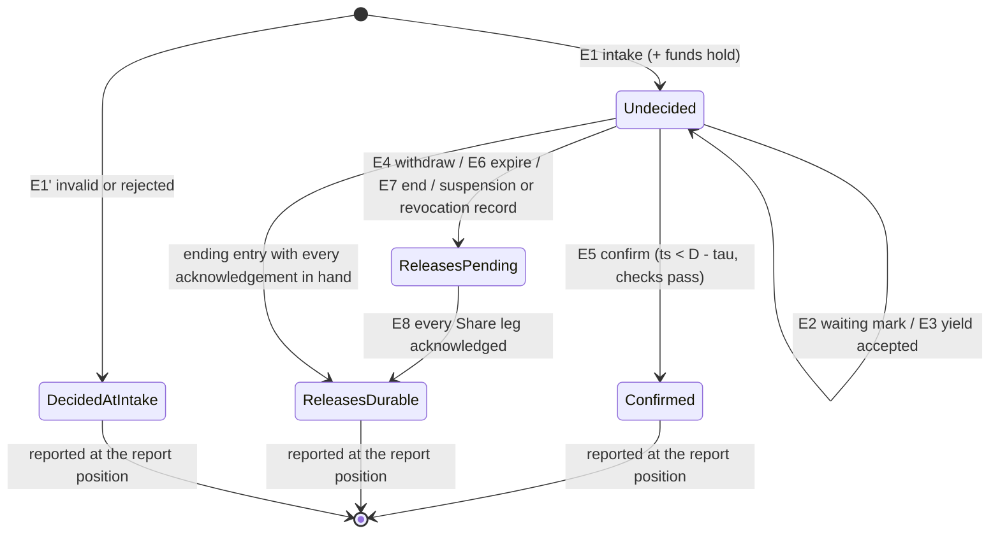
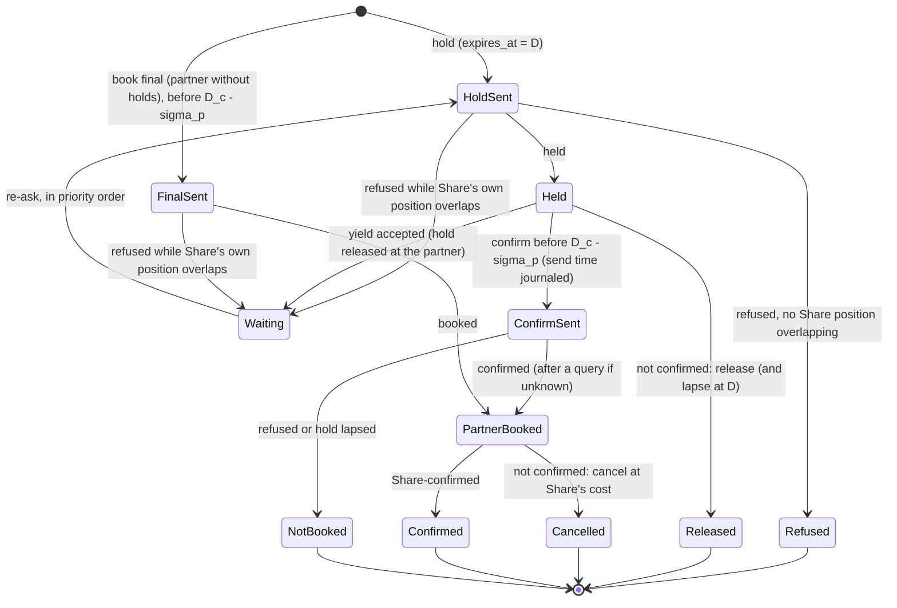

# RFC-002. Account owner and booking coordination: one decision log per account, request-scoped holds, and partner adapters that stand in for a schedule owner

| | |
|---|---|
| Status | **Draft, revision 5.** Revision 5 resolves RFC-002's side of the joint items JI-1 … JI-7 of [review 26](../reviews/26-rfc-001-review.md) (decisions D4, D5 in force, with D3's minute-piece cut targets) against RFC-001 revision 4, rebases on `requirements-v1.9` ([record 28](../reviews/28-requirements-amendments-from-c3-round-2.md)) and on [RFC-000](RFC-000-architecture.md) revision 4.3 ("Revision 4.3 errata", RFC-002 row: AI-26-1 … AI-26-3, AI-27-1, AI-27-2, AI4-11, B-AI-11, B-AI-12), and matches RFC-006 revision 4's runtime (slot map, events and notifications, fences); see "Revision 5 resolution" at the end. Revision 4 applies the findings of the joint [review 18](../reviews/18-rfc-002-004-joint-review.md) that RFC-002 owns or shares (J-01 … J-08, J-10, J-12 … J-15, J-17 … J-19; decisions D-1 … D-6), and rebases on `requirements-v1.8` ([record 22](../reviews/22-requirements-amendments-from-c3-reviews.md)) and on [RFC-000](RFC-000-architecture.md) revision 4.2 ("Revision 4.2 errata"); see "Revision 4 resolution" at the end. Revision 3 rebased revision 2 on `requirements-v1.7` and RFC-000 revision 4.1; revision 2 rebased revision 1 on `requirements-v1.6` and RFC-000 revision 4 (the distributed SQL substrate). To be reviewed and approved **together with RFC-004 Part A** (the funds-and-standing module of the same account owner, RFC-000 §7); §2.4 is the interface both must accept |
| Satisfies | P2-S01 … P2-S117 (all 117 P2 scenarios; the traceability table at the end maps each to its section). Also the booking side of P1-S07, P1-S08, P1-S11, P1-S12, P1-S14, P1-S77, P1-S34, P1-S41, P1-S42, P1-S54, P1-S62, P1-S63, P1-S78, P1-S70, P1-S73 and of the equivalent-path scenarios P1-S31 … P1-S61 (reservation-level offers, moves, revocations); the account-owner side of P4-S20, P4-S23, P4-S66, P4-S97, P4-S101, P4-S108 (the price-change entries), X1-S05 … X1-S09, X1-S36 (the termination entry), X2-S03, X2-S05, X2-S06, X2-S15, X2-S21, X2-S27 (probe accounts are ordinary accounts here); the "fee shown, who ended" input of P3-S11, P3-S43, P3-S44, P3-S60, P3-S63, P3-S74 |
| Policies | POL-01, POL-02, POL-03, POL-04, POL-05, POL-06, POL-07, POL-08, POL-09, POL-10, POL-15, POL-16, POL-18, POL-23, POL-25, POL-26, POL-27, POL-28, POL-29, POL-30, POL-31, POL-32, POL-33 |
| Prior decisions | History log D13, D14, D16, D17, D21, D22 (carried forward or rejected in Competition) |
| Builds on | The requirements at tag `requirements-v1.9` (v1.9 changes POL-06, POL-07, POL-32 and P1-N8 as record 28 states, none of which changes an entry kind or port here; v1.6 decides this RFC's B-RQ-1 … B-RQ-8, [review 11](../reviews/11-requirements-amendments-from-detailed-rfcs.md); v1.7 decides B-RQ-9, [review 12](../reviews/12-requirements-amendments-from-rfc-revision-2.md); v1.8 decides B-RQ-10 and review 18's Q-1 … Q-3, [record 22](../reviews/22-requirements-amendments-from-c3-reviews.md)) and [RFC-000](RFC-000-architecture.md) revision 4.3 (4.2 resolves B-AI-7 … B-AI-10 and review 18's A-1 … A-4; 4.3 resolves B-AI-11, B-AI-12 and adopts AI-26-1 … AI-26-3): its principles A1 … A11, the account owner and partner adapters of §2, the protocols of §3 and §4, the substrate of §5.5 (CockroachDB at 2 + 2 + 1, NestJS owners with epoch-fenced owner leases, insert-only log tables, commit timestamps, closed timestamps and changefeeds, Kafka through a transactional outbox, status readers per Kenyan facility) and the contracts of §8, which resolve B-AI-1 … B-AI-6 |
| Supersedes | Revision 1 (written on RFC-000 revision 3.2's custom Raft platform and `requirements-v1.5`); the pre-baseline draft "Route reservation: a saga over held capacity" (both kept in git history) |

**Revision 5 in one paragraph.** The design stands; the link-facing contracts are
reconciled with RFC-001 revision 4 and review 26. The account owner **never numbers an
attempt**: it records the attempt `HELD`, `WAITING`, `GRANTED` and `DISPLACED` carry, a
grant keeping the waiter's attempt, and sends it back on `convert`, `yield_accept` and
`displacement_accept` (JI-1, JI-2; §4.3, §5). A POL-07 **cut target is a step function of
the minute**, covering the parts the link accounted for; targets are composed by `min` per
minute, oldest Mbps kept first, and every leg receives each part's resulting rate as
**absolute minute pieces** naming the (link, reduction) pairs applied (AI-26-2, AI-26-3,
JI-5; §9.7). An **equivalent-path move is final only once every new leg is booked**, and
only then are `offer_accept` and the old legs' `end_leg` sent; a failed partner booking at
acceptance leaves the reservation on its path, cut only by the target (D4, JI-3, P1-S61,
P1-S52; §9.6). A target for **offer parts binds only the move** (D5, JI-4). Commands to and
from the owner follow RFC-006 revision 4's runtime: slots from placement's map with its
version, `Moved` and `Moving` answers, (generation, epoch) on every command, feed events
apart from point-to-point notifications (§2.5); readers fence moved partitions and lapsed
renewals (AI-27-1, AI-27-2; §8.2).

**Revision 4 in one paragraph.** The design stands; what changes is where the two modules
of the account owner meet, where time enters, and the substrate's sizing. Funds verdicts
and every time-dependent figure of a batch are evaluated **inside the batch transaction at
its commit timestamp**, the projected state only ordering submissions (J-03; §2.1, §2.5). A
queued change is funded for the worst case of the changes ahead of it, the excess released
at its decision (J-01, D-1; §9.2). Every part records the key that added it, so key
spending follows the parts a key booked or added (POL-25 as amended in v1.8, P2-S117; J-02,
D-2; §9.1). Causes whose effective minute is known in advance (a move, a price change) are
recorded before that minute; POL-07 cuts arrive as per-link **target rates**, composed by
`min` (J-07, D-3, RFC-000 AI-17-3; §9.4). The registry gains F11 (one per account and price
version, with its E11 in the same entry) and F7's five variants; F5 and F6 arrive on the **invoice-status feed** and the **credit-limit command**,
gated on the ledger position they were computed from (J-04, J-05, J-13; §2.3, §7.3). The
owner pulls identity **catch-up** and confirms only within 45 s of identity freshness
(RFC-000 AI-R5-4; §5.6). A Share reduction leaves queued changes queued (J-15), a partner
confirm is sent only on the projected standing (J-12, D-6), and a marker read that meets a
lock defers one confirm, not the batch (J-14). Sizing moves to about 16,384 account slots
with the batching wait `W_a` in the latency budget (J-08, J-19; §14). The slot map is now
placement's (RFC-000 B-AI-10), and the link hold carries `wait`, kind, receipt minute and
policy version, the link deciding `wait = false` itself (AI-17-1).

**Revision 3 in one paragraph.** The design of revision 2 stands. Four rules of
`requirements-v1.7` are applied. Whether a displaced request **had begun committing** is
now judged exactly by whether its confirm transaction (E5) sees the reduction's
displacement marker (POL-07, P1-S78; B-RQ-9 decided): the revision-2 exception for a
request whose partner confirm was journaled before the marker is dropped, so such a
request is decided against the reduced capacity and its partner bookings are cancelled at
Share's cost if it ends (§5.1, §5.6, §12.2 C18 and C19; B-AI-9 asks RFC-000 to drop the same
exception). Checks at a link are in the order the `hold` commands **reach its schedule
owner** (POL-05, P1-S14, P1-S77; §5.1). Every account slot holds at least one probe
account (POL-06, X2-S27; §2.5, §14). A termination notice is withheld only by a flag in the
termination's own envelope, recorded in its E11 (POL-30, X1-S36; §9.4).

**Revision 2 in one paragraph.** The logic of revision 1 stands: one conditional deciding
entry per request in the account log, request-scoped holds with tombstones, the "releases
durable" gate, waiting and yields, partner adapters with journals and waiter queues. What
changes is what it runs on and four rules from `requirements-v1.6`. The account log is an
insert-only table in the database, appended by the NestJS instance holding the account
slot's **owner lease** in one batch transaction at a time, each conditional on the lease's
**epoch** and the partition's head row; an entry's timestamp is its **commit timestamp**,
and the confirm fence is checked against it (§2.5). Status replicas answer by RFC-000
§4.6's rule, now with RQ-13's "pending or the decided outcome, never contrary" (§8.2).
The v1.6 rules applied: checks of concurrent requests in arrival order (P2-S112); a
displaced request that **had begun committing** may complete and becomes affected
(P1-S63); change-request sameness (P2-S113); a decrease forbidden by a partner's shown
terms is rejected (P2-S115); the last-`ack_budget` unavailability exception (P2-S114);
`retry_after` as the latest remaining deadline (P2-S116). The entry kind E10 is retired
(§5.7) and the crash points are re-checked on the substrate (§12.2).

Terms are used in the sense of the [glossary](../02-specs/glossary.md); "reserved rate" is
capacity and "traffic" is bytes. Every latency, rate, size and count in this RFC is an
**estimate** (marked "est.") to be replaced by the R1 spike's measurements (RFC-000 R1),
unless it is a requirement's own figure or a policy default.

## Need

RFC-000 decided the shape: every booking request of an account is decided by that
account's **account owner**, a single-writer state machine over an insert-only log table
whose every commit is durable in two regions (RFC-000 §5.5); every Share link's capacity is decided by its **link schedule owner**; every partner
link is represented by a **partner adapter** that stands in for a schedule owner for
Share's own position there. RFC-000 left to this RFC the parts that make that shape
buildable (RFC-000 §7, "The RFC split"):

1. **The account owner's state machine**: the exact log entry kinds, which module of the
   account owner (booking, or funds and standing) owns each piece of state and each entry,
   the in-process interface between the two modules, and the state machine of a request
   and of a reservation.
2. **The booking workflow** that runs in the owner: intake and idempotency (P2-N6,
   POL-29), holds, waiting and yields (P2-N4, POL-02, POL-05), the decision entry (P2-N1,
   P2-N8, POL-04), the confirm fence and expiry (P2-N3, POL-26), releases and the
   "releases durable" record (RQ-6, RQ-8), withdrawal, revocation and suspension of
   undecided requests, and recovery from every crash point (P2-N5, POL-03).
3. **Reporting**: the edge's synchronous answer, the status replica rule, the outcome feed
   and webhooks (P2-N2, POL-04).
4. **Reservations and their changes** as one unit (P2-N9, POL-08), and the reservation-level
   side of revocations, equivalent-path offers and moves, release after grace and
   termination (P1-N8, POL-07, POL-16, POL-30).
5. **Partner adapters**: their log and call journal, the partner port, answer
   classification, fences, Share's waiter queue at each partner link, yields of Share's own
   partner holds, and reconciliation (P2-N7, POL-26, POL-28).
6. **The contention guarantee on every path** (POL-02): waiting, `wait = false`, short
   deadlines, crossings and cycles, and partner refusals caused by Share.

The hard parts, which every section below has to keep true at once:

- **One decision point per request** (POL-04, A7) that suspension, key revocation,
  withdrawal and the deadline are all judged against, while a partner leg, which cannot
  prepare in Share's sense, must be confirmed *before* that decision (P2-N7) and a
  confirmation must be decided before `D` (POL-26).
- **No hold ends except on the account owner's word** (A9), yet capacity is free by the
  deadline, or within `release_grace` when the decision record or a link's schedule owner
  is unavailable (POL-26), and no non-confirmed outcome is reported while a Share-link
  release it needs is not durable (RQ-6, RQ-8).
- **The process deciding can die at any point** (C12), on the Share side, at a link owner,
  at a partner adapter, or at the partner, without a route ever ending part-booked
  (P2-N1, P2-N5) and without a reported outcome ever changing (P2-S10, P2-S108).
- **Contention must not make every waiting competitor lose** across Share links and
  partner links alike, without a global component (POL-02, RFC-000 §2 "Merges and
  splits").
- **The design load is ×50** (POL-06): 25,000 booking requests/s, an account at
  `account_rate_limit` (200/s), status polls sized at 100,000/s.

## Approach

### 1. Scope, boundaries and notation

#### 1.1 What this RFC specifies, and what it relies on

| Specified here | Relied on (owner) |
|---|---|
| The account owner's log, entry kinds, apply rules, its tables and batch transactions on the substrate, takeover and recovery queries (§2, §12) | The substrate conventions (RFC-006, RFC-000 §5.5): the database at 2 + 2 + 1, owner leases and epochs, epoch-conditional batch transactions, commit timestamps, closed timestamps and changefeeds, the transactional outbox and Kafka topics, status readers, read leases and report positions, placement and region-wide failover, the **account slot map** (RFC-006 placement, RFC-000 B-AI-10), `ε` (the database's maximum clock offset, 100 ms) and the configured `δ_x` with the monitored quantities (AI-1); payload encryption, pseudonymous principals, the identity status push and catch-up, the operator check and read grants (RFC-005, A11) |
| The booking module: requests, reservations, change queues, the workflow (§3 … §9) | The funds-and-standing module: hold sizing, headroom, key headroom, capacity in flight, rate limits, standing transitions, resume amount (RFC-004 Part A), called through §2.4 |
| The status replica rule, the edge's answer gate, the request outcome feed, the reservation lifecycle feed, the booking API's semantics (§8, §13) | Authentication, principals, key scope, webhook signing (RFC-005); delivery of webhooks and notices (RFC-006 notifier) |
| The outcome and expiry port, the reservation command port, the partner port, the partner reconciliation feed (§13) | The link hold port, link waiting port, link availability query and link schedule feed (RFC-001) |
| Partner adapters (§10) | Partner terms and classification inputs in the catalogue (RFC-003; link registry RFC-001); equivalent paths from routing (out of scope) |

#### 1.2 Which module owns what

The account owner is **one writer process per account** with two modules (RFC-000 §2). The
modules never write each other's state; both write only through log entries of the one
log, applied by the one owner in one serial order.

| State | Module | Notes |
|---|---|---|
| Booking requests: idempotency key, fingerprint, principal, kind (book or change), legs and their kinds, window, rate, product, `wait`, `D`, `request_age`, commit fence `D_c`, locked prices and partner terms shown, waiting marks, yielded legs, withdrawal, the deciding entry and its reason, the "releases durable" record | Booking (RFC-002) | §2.2, §4 |
| The idempotency index (account, key) → request, for `idempotency_retention` | Booking | §3.3 |
| Reservations as route-level units: legs, parts (each with rate, effective minutes, locked price, age, the request that added it and the **principal and key that added it**, J-02), the reservation's price steps (price changes recorded ahead of their effective minute), the POL-07 cut targets in force per (link, reduction), each as minute pieces with the parts it covers (§9.7), offer-scoped targets kept against their offer until the move (D5, §9.6), each part's current rate per leg as last sent, partner terms shown at booking (minimum term, cancellation fee, whether the leg's rate can be decreased, whether the booked window ends inside a minimum term and the fee then shown), lifecycle and end cause, partner-leg affected status, equivalent-path offers and move holds | Booking | §9 |
| Per-reservation change queue | Booking | §9.2 |
| The slot's identity-freshness watermark `iam_fresh` (RFC-004 JR-11, AI4-11) | Booking, **owner memory**, per account slot: advanced, in owner memory, by every identity push heartbeat's resolved timestamp and every catch-up's read timestamp, whether or not it carries an event for any account; an event-free heartbeat writes no entry; after a takeover it starts **unset (stale)** until the first heartbeat or catch-up (AI4-11, coordinator's decision) | §1.3, §5.6 |
| Workflow progress per leg (held, waiting, refused, confirm sent, …), with the **attempt the link last reported** for each Share leg (§4.3; never numbered by the owner) | Booking, **owner memory only**; rebuilt on takeover by querying participants, whose own logs are durable (§12.1) | Not in the log, by design (Competition) |
| Funds holds and credit holds (per request and per reservation), capacity in flight per key and account, key spending per `key_spend_period` (over the parts each key booked or added), key status and KYB status as applied (F4; identity and access stays their writer; booking reads revocation from it, AI4-3), the identity-freshness inputs each F4 brings (resolved or read timestamps; the slot-level watermark `iam_fresh` is booking's, below), headroom inputs as applied feed positions (ledger position, rating position, the invoice-status events waiting for their ledger position), credit limit, open invoices, standing, its cause, grace start, resume amount, low-balance warning state | Funds and standing (RFC-004 Part A) | §2.3 |
| Booking-rate counters per key and account | Funds and standing (rule); kept in **owner memory**, rebuilt by a new owner from the last second's intakes; for one second after an owner change a key or account can be admitted up to twice its limit (RFC-000 §2, B-AI-4) | Not in the log: a submission over a limit "creates nothing" (D5) |

#### 1.3 Notation and parameters

| Symbol | Meaning | Value |
|---|---|---|
| owner | The NestJS instance holding the account slot's **owner lease**, which alone appends to the account's log ("leader" in revision 1); its **epoch** is the term of RFC-000 A2 | RFC-000 §5.2 |
| `ts` | An entry's **commit timestamp**: its batch transaction's commit timestamp in the database's hybrid-logical clock, read inside the transaction | RFC-000 §4.3 |
| `D` | The request's deadline: intake `ts` + the requested deadline (or `route_deadline_default`) | POL-26 |
| `request_age` | The intake entry's `ts`; ties broken by request identity (account partition, sequence) | POL-02 (`priority_rule = request_age`) |
| `D_c` | Commit fence, written in E1 and carried by every hold: `D − commit_margin` with a partner leg, `D − τ` without; the request may not begin committing after it ("`F`" in revision 1) | POL-26, RFC-000 §4.3 |
| `τ` | Confirm fence offset: a confirm entry is appended only if its `ts` is before `D − τ`; `τ = max(ack_budget, ε + δ_x_cfg)` | about 420 ms, cap about 450 ms; about 335 ms if deadline entries ride the second lane (est., RFC-000 §4.3 rev. 4.2) |
| `ε` | Clock bound: the database's configured maximum clock offset | 100 ms (RFC-000 coordinator decision) |
| `δ_x` | Time for the expiry's wait for its slot's lane (`W_a`), its commit, the release notice, the release's wait (`W_l`) and its commit at a link; configured at p99.9 as `δ_x_cfg` (AI-1, AI6-3) | about 105 ms steady, 300 ms worst degraded (p99); `δ_x_cfg` about 320 ms (est., RFC-000 §4.3 rev. 4.2) |
| `W_a` | Batching wait at the account slot's lane: the remainder of the batch in flight that an entry may wait for (RFC-000 §3 rev. 4.2) | 20 ms p99 steady, 65 to 70 ms after a region loss; 5 ms steady with the second lane (est.) |
| `iam_fresh` | The slot's **identity-freshness watermark**, kept by the booking module per account slot (RFC-004 JR-11): advanced, in owner memory, by every identity push heartbeat's resolved timestamp and every catch-up's read timestamp, whether or not it carries an event for any account; an event-free heartbeat writes no entry; after a takeover it starts **unset (stale)** until the first heartbeat or catch-up (AI4-11, coordinator's decision) | — |
| `iam_fresh_max` | A confirm commits only if its `ts` ≤ `iam_fresh` + `iam_fresh_max` (RFC-000 AI-R5-4) | 45 s |
| `σ_p` | Partner-skew budget of partner link p: `ε` plus the adapter's commit-to-send bound `h_s` plus the measured bound on the partner's clock offset; part of `commit_margin` | design parameter per partner, default 250 ms (est.) |
| `T_x` | Expiry time by the owner's clock: `D − ε − δ_x` | — |
| `release_grace` | Bound on releases and late-known confirmations when a record or a schedule owner is unavailable | 1 min (POL-26) |
| `nb(t)` | The **next minute boundary after** `t`: the least minute boundary strictly greater than `t` (so `nb(09:31:00.000)` = 09:32). Every "next boundary after `ts`" in this RFC, and the earliest `move_at` the link accepts for a decision at `ts`, is `nb(ts)` (JI-7) | — |
| `read_lease` | A status replica's read lease; it ends inside the granting owner's lease, and a new owner reports nothing until `read_lease` + `ε` after its acquisition (RFC-000 AI-R6-2) | about 400 ms (est., RFC-000 §4.6) |

Every entry's `ts` is its commit timestamp, so it is exact for the entry as committed and
replayed identically. Entries committed in one batch transaction share its `ts` and are
ordered by sequence. Timestamps are monotone within a partition across owner changes,
because each batch transaction reads its predecessor's head row (RFC-000 §4.3), and they
are within `ε` of true time. **Every figure that depends on time is computed at that `ts`,
inside the transaction** (J-03): the funds verdicts and outcomes (`admit`, `apply`), `D`,
`D_c`, `request_age`, the key spending period and fee-term ends they read, and every check
against `D − τ`, `D` (E8, §6.5), an F7 instant, `iam_fresh` + `iam_fresh_max`, and an E11's
effective minute. A transaction pushed to a later timestamp re-evaluates all of them and
retries (§2.5). The owner's own clock only schedules: when to propose an expiry, whether a
confirm is still worth proposing (A8), and the rate limits (§3.1).

### 2. The account owner's log

#### 2.1 Entries, apply and conditional effects

- **Envelope.** Every entry is a row of the account log table (§2.5) carrying (account
  partition, sequence), the owner's epoch, `ts`, its kind, the audit fields of RFC-005
  (pseudonymous principal; for an operator, role, reason and approver; A11), and an
  encrypted payload of one or more **records**, each owned by one module: booking records
  (`B:` below) and funds records (`F:`). An entry is applied by applying its records in the
  order written.
- **Effects are computed at the commit timestamp and logged** (revision 4, J-03; RFC-004 A
  §A10 "Time"). The owner composes each submission **provisionally** against its projected
  state (everything it has committed, plus the batch in flight), which fixes only the
  serial order and what is worth proposing. The figures are fixed inside the batch
  transaction: having read its commit timestamp `ts`, the transaction evaluates, entry by
  entry in sequence order, the intake rules, `admit`, `apply`, `D = ts + deadline`, `D_c`,
  the deciding checks and the endings a funds outcome requires (§2.5 step 3), and writes the
  results into the entries: verdicts, amounts, the requests a suspension ends. Each entry is
  evaluated on the state its predecessors in the batch leave, so the serial order is the
  composition order. A provisional verdict that differs at `ts` (an intake pushed across
  00:00 UTC into a new key spending period, across a fee-term end, or past a posting) is
  replaced: an E1 may become E1′ and the reverse; nothing was sent on the provisional one.
  Booking records are applied as written; the funds module's outcomes are re-computed from
  the recorded inputs and rules version by every replay of the log (a new owner's rebuild,
  a standby tailing it, history's rebuild) at the recorded `ts` and compared (RFC-004 A
  §A4), so a replay never differs from the commit. Every figure a buyer was shown can be
  rebuilt exactly (P4-N16, P4-S72, A0-21).
- **Deciding records are conditional.** A record that decides a request (*confirm*,
  *expire*, *end*, *withdraw*) is composed only if the request is undecided in the
  projected state. The database enforces it again: each deciding record also inserts the
  request's **decision row**, whose primary key is the request, so a second deciding record
  for one request cannot commit (RFC-000 §5.5). A batch that meets that key (only a bug can
  compose one) aborts as a whole; the owner reloads and recomposes it without the losing
  record. The first deciding record in log order is therefore the only one (A7).
- **One owner, projected state, one batch in flight per partition.** The owner keeps a
  projected copy of the state that includes the batch transaction in flight, so two
  concurrent submissions with one key, a yield request and a grant, or a suspension and a
  confirm are ordered the moment they are composed; the projection of an in-flight batch is
  replaced by its committed result when it commits. Nothing is sent to a participant, and no answer given, on the
  strength of an entry that has not committed (§2.2 states, per kind, what is sent after
  commit). If the batch fails or its result is ambiguous, the owner reloads its state from
  the log before deciding again (RFC-000 §5.2) and recomposes, against the reloaded state,
  every entry that did not commit; submissions waiting on the failed batch are processed
  again.

#### 2.2 Booking entry kinds

| # | Entry | Booking records | Funds records it also carries (computed by §2.4) | Deciding? | Sent to participants only after commit |
|---|---|---|---|---|---|
| E1 | **Intake** | Request record: id = (account partition, sequence), idempotency key, fingerprint (§3.1, §9.2), principal and key, kind (`book` or `change` with reservation id and change kind), legs (link, kind: Share, partner with holds, partner without holds), window, rate, product, `wait`, `D`, `request_age` (= `ts`), `D_c`, the receipt minute for window rules (POL-09) and the link-rules policy version, locked prices with the catalogue price version and position they were read at (J-17) and any announced price change shown, the partner terms shown (minimum term, cancellation fee, whether a decrease is allowed, each shown fee's kind (plain, or minimum-term with the term's end), and a due-at-window-end flag when the booked window ends inside a minimum term, with the fee then shown, POL-08 as amended in v1.8); for a change, the changes ahead of it in the queue (§9.2) | `admit`'s inputs and verdict: funds hold or credit hold for the request (for a queued change, sized for the worst case of the changes ahead, J-01); capacity in flight +rate on key and account | No, unless the request is refused at intake (E1′) | Holds (§5.1) |
| E1′ | **Intake, decided** | As E1 plus the outcome: *invalid* (with the rule), or *rejected* (insufficient funds with the two amounts; a limit with its name; account suspended with the resume amount itemised, POL-16 as amended in v1.8; more than one partner without holds; a change to part of a route; a decrease over a partner leg whose shown terms do not allow one, stating that the reservation may be cancelled instead, B-RQ-8) | For a refusal by `admit`: its inputs, the refusal reason and amounts, so a replay recomputes it (J-13); otherwise none. Nothing held | Yes; "releases durable" is implied (no hold was sent) | Nothing; the outcome is reportable at once |
| E2 | **Waiting mark** | Request, and per waiting leg the deadline of the request ahead (from the waiting notice; the latest among several blockers), or "ahead resolved" | — | No | Waiting hints to every participant where the request holds (§5.2) |
| E3 | **Yield or displacement accepted** | Request, leg, the attempt the participant's yield request or `DISPLACED` carries (the attempt given up), the participant's yield request or displacement notice; the leg is marked yielded (it becomes a waiter at the request's age) | — | No | `yield_accept` or `displacement_accept` to that participant (§5.3, §5.2) |
| E4 | **Withdraw** | Request, principal; if undecided: outcome failed, "withdrawn" | Release of the funds hold; capacity in flight −rate | Yes, if undecided | Request-scoped releases; partner cancellations at Share's cost (§7.1) |
| E5 | **Confirm** | Request; for each leg the hold attempt confirmed or the partner booking reference; `ts` (appended only if its commit timestamp is before `D − τ`, with the `τ` used, and at most `iam_fresh_max` after `iam_fresh`, with the `iam_fresh` used, §2.5); the check results (standing, key, withdrawal); for `book`, the new reservation record; for a change, the new part with the principal and key that added it | Bind: the funds hold becomes the reservation's coverage hold (or grows it, for a change, releasing any excess of a worst-case hold, J-01); capacity in flight −rate | Yes, if undecided and in time | Conversions (§5.7); partner outcome notices |
| E6 | **Expire** | Request; reason: "deadline passed", "deadline passed while waiting" with `retry_after`, or "interrupted by an internal failure" (§6.2) | Release of the funds hold; capacity in flight −rate | Yes, if undecided | Request-scoped releases; partner releases or cancellations (§6) |
| E7 | **End** | Request; outcome and reason: rejected for no fit (blocking link, counter-offer, or, for `wait = false`, the link's `IN_FLIGHT` refusal with `retry_after` and the counter-offer); rejected by a partner's definite refusal (partner link); failed: partner fault (leg); failed: "reservation ended" (a change whose reservation ended); failed: "reservation changed by Share" (a change in progress whose legs a move removed, §9.4); and the suspension and key-revocation endings when carried by a funds entry (§7.2) | Release of the funds hold; capacity in flight −rate | Yes, if undecided | Request-scoped releases; partner cancellations at Share's cost |
| E8 | **Releases durable** | A batch of (request, the Share legs whose release acknowledgement is in hand); complete for a request when every Share leg of its intake is acknowledged. For an expired request it is committed only with a `ts` at or after `D` (§6.5) | — | No (it gates reporting, A10) | Nothing |
| E9 | **Takeover** | New epoch, holder identity; the first entry of each epoch in the partition (§2.5) | — | No | Resume queries (§12.1) |
| E10 | *Retired in revision 2* | Not used; the number is not reused. Conversions still pending are found by recovery query instead (§5.7, §2.5) | — | — | — |
| E11 | **Reservation change** | Reservation; cause (the change request, or a Share cause: a POL-07 cut target per (link, reduction) with its minute pieces and covered parts, or the note that it is not applied and why (§9.7), a move to an equivalent path with its catalogue route ID and shown price, made only once the move is final (§9.6), release after grace under POL-16, termination under POL-30 with its envelope, a price change under POL-27 recorded at its announcement); effective minute, **never before `nb(ts)`** except a POL-07 cut, effective at its `T_eff` (§9.4, RFC-000 §4.5); the parts removed or added, and each changed part's rate per leg as minute pieces (§9.7); the new end, rate or price step; for an ending change, the changes it fails ("reservation ended"); whether a shown fee becomes due and who pays it (POL-08 as amended in v1.8: a cancellation, a shorten whose new end falls inside a partner's minimum term, §9.5); for a cause reached late, the delay (alerted) | Hold resize or release (POL-15); a fee now due (RFC-004 A's fee-incurred state, J-09) | Decides its change request if it is one (§9) | Leg changes (`end_leg`, `reduce_parts`, each with change id, cause, decision time and, for cause POL-07, the (link, reduction) pairs applied; for a final move, `offer_accept(offer, move_at)` to the new path's Share legs and `end_leg` from `move_at` to the old ones) to every Share leg concerned; partner change or cancel (§9.3); the cut target's answer (§9.7) |
| E12 | **Leg changes durable** | As E8, for an E11: every Share leg has acknowledged its leg change | — | No (it gates reporting of changes that free capacity, §9.3) | Nothing |
| E13 | **Offer** | Equivalent-path offer (§9.6): *prepared* (the path chosen, with an offer id, and the offer parts with their original ages), *made* (every offer hold acknowledged; `offer_window` end), *accepted* (the holder's answer and requested move minute; with a partner leg, the partner booking started), *final* (every new leg booked; written with the move's E11 in the same entry), *declined*, *lapsed*, *failed* (the partner booking at acceptance failed: as declined); an **offer-scoped cut target** received for its parts (D5, §9.7) | — | No | After *prepared*: `offer_hold` on every Share leg of the path, idempotent by offer; after *made*: the notice to the holder; after *accepted* with a partner leg: the partner booking through its adapter; after *final*: `offer_accept` and the old legs' `end_leg` (the E11's); after *declined*, *lapsed* or *failed*: `offer_release`; each with the decision time |
| E14 | **Partner leg affected** | Reservation, partner leg, from minute, source (reconciliation) | — | No | Notice through the notifier (POL-07, POL-28) |

There is no entry for a capacity hold acknowledgement, a grant to a waiter, or a partner
confirm being sent. Those facts are durable in the participant's own log, and a new owner
learns them by query (§12.1). The workflow's entries per request are therefore the two
RFC-000 §6 counts (intake, deciding entry), plus waiting marks when contended, a yield
acceptance only in a crossing or cycle, and an E8 for a request ended after its holds were
taken. Each is a row in a batch transaction; a single-link booking costs two transactions
at the account owner, each preceded by up to one batching wait `W_a`, as RFC-000 §3
revision 4.2 budgets.

#### 2.3 Funds-and-standing entry kinds (owned by RFC-004 Part A)

RFC-004 Part A defines these kinds, their payloads and apply rules (its §A4); this RFC
registers them in the account log's closed registry beside E1 … E14. Each is appended by
the owner from a feed event or a timer, and its recorded **outcomes** can require booking
records, which the booking module writes **in the same entry** (§2.4 rule 5).

| Kind (RFC-004 A) | What it applies | Booking records its outcomes can require |
|---|---|---|
| F1 Ledger applied | Ledger balance and posted-through minutes through a ledger position | A suspension: ending records for every undecided request **that adds** of the account (a booking, an extension, an increase: rejected, "account suspended", the resume amount itemised); undecided reductions continue (POL-08, P2-S69, P2-S77; J-13) |
| F2 Usage applied | Unposted usage through a rating position, applied only once F1 has reached its ledger position X (AI3-3) | As F1 |
| F3 Exposure parameters | Inputs of the lateness bound | As F1 |
| F4 Identity status | An actual key or identity status change (key revocation, key limits, KYB status) from the identity status push (Kafka) or a **catch-up** answer (RFC-005 C3), applied within 60 s, recording its `id_ts`; written only for such a change, never for a heartbeat or a catch-up answer without events; `id_ts` serves only to drop an event seen both on the push and in a catch-up (D6, AI4-2, AI4-3, AI-R5-4, AI4-11; RFC-004 revision 5) | A revocation: ending records (failed, "key revoked") for the key's undecided requests; its reservations are untouched (P2-S72) |
| F5 Credit limit | Credit limit set or removed: from the **credit-limit command** (finance envelope), or *credit limit removed* on the invoice-status feed, applied only once F1 has reached the ledger position the event carries (KYB status travels in F4; RFC-000 A-1) | As F1 |
| F6 Invoice status | Invoice **overdue**, **paid** or **written off**, from the invoice-status feed, each applied only once F1 has reached the ledger position it carries (RFC-000 A-1; J-05, J-06) | As F1 |
| F7 Funds tick | Five variants (RFC-004 JR-9): fee term ended; grace ended; enforcement check; **price effective** (a recorded price step reaching its minute: the hold re-priced, P4-S101); **exposure step**; each committed only with `ts` at or after its instant, deferred otherwise (J-10, J-13) | Grace ended with `release_due`: E11 records, **in the F7 entry itself**, ending every listed reservation, cause "released" (POL-16), buyer pays a shown fee (P4-S23; JR-2); price effective with a suspension: the endings of §7.2 |
| F8 Enforcement acknowledgement | Network operations' acknowledgement of a standing change | None |
| F9 Probe designation | The account is a probe account (POL-06) | None |
| F10 Rules version | The funds rules version in force from this position | None |
| F11 Price notice | A price change announced for the account's open-ended reservations on a route, `price_notice` ahead (POL-27): price version, route, new price, effective minute, catalogue reference; **one per (account, price version)**, idempotent by it (J-04, RFC-004 JR-4) | **In the same entry**, one E11 cause "price change" per (account, price version), listing every affected open-ended reservation and recording their price step (§9.4) |

#### 2.4 The in-process interface between booking and funds

RFC-004 Part A provides the funds-and-standing module as a library linked into the
account owner, with no I/O, no clock and no randomness (its §A10). The booking module calls
it only at the owner: provisionally while composing (to order and to decide what to
propose), and **decisively inside the batch transaction at its commit timestamp**, on the
state the entry's predecessors leave (§2.1, J-03); the entry records the module's inputs and
outcomes as evaluated at `ts`; every replay of the log re-runs the module on the
recorded inputs with the recorded rules version (F10) and compares (RFC-004 A §A4). The calls, in RFC-004 A's
signatures, and where this RFC makes them:

| Call (RFC-004 A §A10) | Booking passes | Booking uses the result | Where |
|---|---|---|---|
| `rate_check(soft, now, principal)` | The submitting key or user; `now` is the owner's clock (J-13) | `NotAccepted{retry_after}` → not accepted, nothing logged; `NotAccepted{revoked}` for a key revoked as applied by F4 → not accepted, as an unauthenticated submission (JR-1) | §3.1, before anything else; polls never reach it |
| `admit(S, ctx, ask)` | `Ask`: request id, principal and key, kind (`New`, `Increase`, `Extend`), the reservation's schedule after (and before, for a change) with its locked prices and price steps per Mbps-minute, the shown partner fee terms, the rate in flight (once, whatever the number of legs); the change's interval (for an extension, `[old end, new end)`; for an increase, `[next boundary, end)` and the added Mbps) with its **adding key**; for a change with changes ahead in its queue, **`ahead`**: those changes in order, each with its kind, new end or rate and adding key, from which the module sizes the hold for the worst case (§9.2; J-01, D-1; RFC-004 JR-5, JR-6) | `Admit{hold, hold_kind, mbps}` → E1 with it as the funds payload; `Refuse{reason}` → E1′ rejected with that reason and amounts. Called in the owner's serial order of intakes (arrival order), each call counting the holds and capacity in flight of every request then undecided, the earlier entries of the same batch included (POL-25, B-RQ-1, P2-S112); decisive only inside the batch transaction, with `ctx.ts` its commit timestamp (J-03) | §3.2, §9.3 |
| `standing(S)` | — | Must be active for a request that adds something to be confirmed; checked before a partner confirm is sent, **on the projected state** (D-6, J-12, §5.5), and in E5 at `ts` | §5.5, §5.6 |
| (none: the watermark is booking's) | — | `iam_fresh` per slot, advanced, in owner memory, by every identity push heartbeat's resolved timestamp and every catch-up's read timestamp, whether or not it carries an event for any account; an event-free heartbeat writes no entry; after a takeover it starts **unset (stale)** until the first heartbeat or catch-up (AI4-11, coordinator's decision); E5 commits only if `ts` ≤ `iam_fresh` + `iam_fresh_max`, never while it is unset (RFC-000 AI-R5-4, RFC-005 C3, RFC-004 JR-11) | §2.5, §5.6 |
| `apply(S, ctx, Intake{…})`, `apply(S, ctx, Decided{Confirmed{reservation, schedule} \| NotConfirmed})`, `apply(S, ctx, ReservationChanged{reservation, schedule, end?{cause, fee_due}, fee_due?})` (`fee_due?` for a shorten whose new end falls inside a partner's minimum term, POL-08 as amended in v1.8), `apply(S, ctx, PriceTookEffect{reservation, price version, effective minute})` (recorded at the announcement, effective minute in the future, §9.4) | The booking entry's own content, as an `Input`; every `schedule` lists the parts with the **principal and key that added each** (J-02) | The outcomes (hold changes, the release of a worst-case hold's excess at a change's decision, any standing transition) recorded in that entry | E1, E4 … E7, E11 |
| `apply(S, ctx, F1 … F11)` | — (the owner builds the funds entry from the feed, command or timer) | Outcomes `standing` (to suspended), `release_due`, and a key revoked as applied (F4) → booking records in the same entry (§2.3) | §7.2, §7.3, §9.4 |
| `due(S)` | — | Instants for the five F7 ticks (fee term end, grace end, enforcement check, price effective, exposure step); the owner arms them with the booking timers (§6.1) and commits each only with `ts` at or after its instant | §6.1 |
| `answer(S, ctx, principal)` | Account or key | The itemised headroom at a stated position; its insufficient-funds amounts are those `admit` returned; a resume amount itemised as written-off amount, each overdue invoice and the headroom still needed (POL-16 as amended in v1.8, RFC-004 A, D-5) | Rejection texts; status replicas serve the headroom query (RFC-004 A §A9) |

What the booking module provides to the funds module, and nothing else: the `Ask` and
`Input` values above, built from the request and reservation records (rate, parts and
their schedule with the principal and key that added each part, locked prices and price
steps, the partner fee and minimum term shown at booking, whether the booked window ends
inside a minimum term, the end cause and who pays a shown fee under POL-08, §9.5), and the
queue ahead of a change.

Rules both modules keep:

1. **One entry, both effects.** An intake records the request and its funds hold in one
   entry, before any capacity hold is sent (POL-25, A0-03). A deciding entry records the
   outcome and the funds release or binding in one entry. A request is never decided with
   its funds not, or the reverse.
2. **No I/O in the funds module.** Its inputs arrive only as entries; the booking module
   never computes an amount.
3. **Order inside an entry.** For a booking entry, the booking record first, then the funds
   payload; for a funds entry, the funds payload first, then the booking records its
   outcomes require. Apply follows the written order.
4. **Determinism.** Only the owner calls `admit`, `rate_check` and `standing` to decide;
   what they return is logged, as evaluated at the entry's `ts`. A rules change takes
   effect at an F10 boundary and never alters a logged figure (P4-N16).
5. **Who ends what.** Only the booking module ends a request or a reservation. A funds
   outcome that requires an ending (suspension, a key revoked as applied by F4,
   `release_due`) is turned into booking records in the **same entry**, so the funds event
   and the endings it causes have one log position: the decision point of each request it
   ends (POL-04). The entry is one row of one batch transaction, so it commits or does not;
   there is no state with the cause and not its endings.

**Alignment items with RFC-004 Part A, resolved in revision 2** as RFC-000 revision 4
directs:

| # | Item | Resolution |
|---|---|---|
| JR-1 | Key revocation as applied | RFC-000 rev. 4 (AI4-3): key status as applied is a funds kind (F4), identity and access stays its writer, and the booking module reads revocation from it. The interface stays as agreed: the read is through `rate_check` (`NotAccepted{revoked}` at intake, §3.1) and through F4's `apply` outcome (the key's undecided requests, ended in the same entry, §7.2). If RFC-004 A prefers a plain read of `S` for the same fact, booking uses it at the same two points and nothing else changes |
| JR-2 | Release after grace | Kept: the release records are written in the F7 entry itself (rule 5); RFC-000 §8 names release after grace "internal to the account owner, rule from RFC-004". RFC-004 A reads "appends" so |
| JR-3 | Rate counts after an owner change | RFC-000 rev. 4 (B-AI-4) adopts owner-memory counters with the bound "up to twice the limit for one second after an owner change" (§1.2, §3.1) |
| JR-4 | Price changes (POL-27) for open-ended reservations | Revised in revision 4 (J-04, J-07, D-3; RFC-004 JR-4): on the catalogue's announcement the owner appends **one entry per (account, price version)**: F11 (the notice) with, in the same entry, **one** E11 cause "price change" listing every affected open-ended reservation of the account and recording their price step with its **future** effective minute, carrying `PriceTookEffect` per reservation. The step applies to every part from that minute, parts added after the announcement included (RQ3-5, §9.4); F7 *price effective* re-prices the hold at that minute. One row per account, not per reservation, keeps a product-wide change to about one entry per account (RFC-004 R4-A6) |

**Interface points RFC-004 Part A must match** (all inside the agreed calls and kinds;
revision 4 adds 8 … 15):

1. `admit` is called once per intake in the account log's serial order and counts the
   holds and capacity in flight of every request then undecided, the earlier entries of its
   batch included; it is decisive inside the batch transaction at `ts`; nothing is
   re-checked at the decision; a refusal caused by a hold later released stands (POL-25,
   P2-S70, P2-S112, P4-S66).
2. `rate_check` returns `NotAccepted{revoked}` for a key revoked as applied by F4; F4's
   `apply` outcome names the revoked key, and booking writes the endings in the F4 entry.
3. F7's `release_due` outcome is answered by E11 records in the same F7 entry.
4. `ReservationChanged` carries `fee_due` for a shorten whose new end falls inside a
   partner's minimum term (P3-S63 rows 1 and 2), never for a shorten under a plain
   cancellation fee (P3-S63 row 3), as well as for an ending; booking names the payer
   (§9.5). A fee that becomes due is recorded once, so the fee part of the hold stops then
   (J-09).
5. `PriceTookEffect{reservation, price version, effective minute}`, one per affected
   reservation, is carried by the single price-change E11 of its (account, price version),
   written in the F11 entry at the announcement, with the effective minute at least
   `price_notice` later; it re-prices every part from the effective minute, parts added
   later included (RQ3-5); the hold's growth and any suspension happen at F7 *price
   effective* (RFC-004 A; RQ4-8, P4-S101, P4-S108). F11's outcome is the notice.
6. There are no followers on the substrate: RFC-004 A §A4's "followers re-compute and
   compare" is read as every replay of the log (a new owner's rebuild, a standby, history).
7. Every entry is committed in a batch transaction of one or more entries sharing one
   commit timestamp (§2.5); the module's apply must not assume distinct timestamps per
   entry, only distinct sequences.
8. **Queued changes** (J-01, D-1; RFC-004 JR-5, JR-6): for a change with changes ahead,
   `admit` sizes the hold from `ahead` for the worst case, and `apply(Decided{Confirmed})` at its E5 sets the hold from the
   reservation as actually left (`R(after) − R(before)` at that position) and releases the
   excess of `h_q` in the same entry; the failed-roll-forward path is kept only for posting
   drift between intake and decision.
9. **Key spending per part** (J-02, D-2, POL-25 as amended in v1.8, P2-S117): a key's
   spending counts the posted charges and the holds of the parts it booked or added, never
   another principal's; booking supplies the principal and key on every part.
10. **Time** (J-03): `ctx.ts` is the commit timestamp of the batch transaction; `admit` and
    `apply` are called inside it, in sequence order, and a pushed transaction re-evaluates.
11. **Registry** (J-04, J-13; RFC-004 JR-4, JR-9): F7 has five variants (fee term ended,
    grace ended, enforcement check, price effective, exposure step); F11 is registered, one
    per (account, price version), with its E11 in the same entry; F6 has three variants (overdue, paid, written
    off); F5 comes from the credit-limit command or the invoice-status feed.
12. **Position gate** (J-05, RFC-000 A-1): an F5 or F6 from the invoice-status feed is
    composed only once the applied ledger position has reached the position it carries,
    as F2 is gated on X; booking holds the event until then.
13. **F7 instants** (J-10): booking commits an F7 only with `ts` at or after its instant,
    deferring it otherwise, as for E8 ≥ `D`.
14. **Identity freshness** (AI-R5-4; RFC-004 JR-11, AI4-11): F4 applies push events and
    catch-up answers alike, writing an F4 (with `id_ts`) only for an actual status change;
    the slot-level watermark `iam_fresh` is booking's, in owner memory, advanced by every
    heartbeat's resolved timestamp and every catch-up's read timestamp, event or not, and
    unset after a takeover until the first of them (AI4-11).
15. **E1′ funds payload** (J-13): a refusal by `admit` records its inputs, reason and
    amounts.

#### 2.5 The account log on the substrate

RFC-000 §5.5 maps the logical design onto CockroachDB, NestJS and Kafka. For the account
owner it is concrete as follows.

**Tables** (all in the account database, 2 + 2 + 1, leaseholders preferred in R1, plus one
non-voting replica per Kenyan facility for the status readers; RFC-000 §5.1):

| Table | Primary key | Written by | Content |
|---|---|---|---|
| `account_log` | (account, sequence) | Insert only | Every entry of §2.2 and §2.3: kind, epoch, `ts`, pseudonymous audit fields, encrypted payload (RFC-005, AI5-3) |
| `account_head` | (account) | Updated by each batch | Last sequence and last `ts`; the predecessor every batch reads (contiguous sequence, monotone `ts`) |
| `request` | (account, request) | Projection, in the same transaction | Undecided, decided, reported-gate state; partial indexes on *undecided*, *releases pending* (decided not confirmed without a complete E8), *conversions pending* (confirmed, `D` + `release_grace` not yet passed) and *leg changes pending* (E11 without E12) |
| `decision` | (account, request) | Insert only, by the deciding record | One row per decided request; the database backstop for A7 (§2.1) |
| `idempotency` | (account, idempotency key) | Projection | Request, fingerprint digest, principal, expiry; removed by row-level TTL after `idempotency_retention` (§3.3) |
| `reservation`, `change_queue` | (account, reservation [, position]) | Projection | Reservation records and their queues (§9) |
| `funds_*` | RFC-004 A | Projection, by the funds module | Funds and standing state (§2.3) |
| `outbox` | (account, sequence, feed) | Insert only, in the same transaction | Feed rows: request outcome feed, reservation lifecycle feed, usage-applied acknowledgement, standing feed, notices (§8.3, §13) |

Projection rows are derived from the log and rebuilt from it (A4); no role may update or
delete a log, decision or outbox row.

**Batch transactions.** The owner commits **per account slot** (RFC-000 §3 rev. 4.2,
AI3-11, AI-17-5): one batch transaction in flight per slot's **lane**, carrying the pending
entries of every account partition of the slot; entries composed while one is in flight
form the next, so an entry waits at most the remainder of one commit (`W_a`, about 20 ms at
p99 steady at the occupancy target, est.). If the spike shows the account step's p99 above
50 ms at the design load, RFC-006 turns on a **second lane** per slot, carrying only
partitions not in the batch in flight (RFC-000 R19, R23); nothing below depends on which
lane carries a batch. There is therefore at most one transaction in flight per partition,
and each partition keeps its own contiguous sequence, per-stream sequences and head row
(keyed by partition, RFC-000 AI-R6-3). For E-ordering this means: an account's serial order
is still its own sequence, and nothing orders entries of two accounts against each other;
the entries of one batch, of every account in it, share one commit timestamp `ts`, so every
figure and check below is evaluated per entry at that `ts`; a busy account delays its
slot-mates by at most one commit of batching wait; and when one entry's check fails, only
that entry is dropped or deferred. Each transaction:

1. reads the slot's owner-lease epoch and, for each partition it appends to, its head row
   and generation, and aborts unless they are the owner's own;
2. reads its own commit timestamp, which fixes `ts` for every entry in it;
3. evaluates the entries in sequence order, each on the state its predecessors leave
   (§2.1, J-03): intake validation, `admit` and E1 or E1′, `D` and `D_c`; every `apply` and
   the endings a funds outcome requires; and the checks: each confirm against
   `ts < D − τ` and `ts ≤ iam_fresh + iam_fresh_max` (RFC-000 AI-R5-4), each completing E8
   of an expired request against `ts ≥ D`, each F7 against `ts` ≥ its instant (J-10), each
   E11 against its effective minute ≥ `nb(ts)` (except a POL-07
   cut at its `T_eff`, §9.4; a cause reached late takes the next boundary and records the
   delay, J-07), and, for each confirm, one point read per Share leg of the link's
   displacement marker (`link_displacement(link, request)`, RFC-001 §11.1; a read of the
   link owner's rows, never a write, RFC-000 A1, AI-R1-11). **Each marker read runs under a
   savepoint with a short lock timeout** (10 ms, est.): if it meets an intent of a link
   owner's in-flight reduction and times out, the transaction rolls back to the savepoint
   and defers only that confirm to the next batch (J-14). If a check fails, or a marker is
   present for the leg's held attempt (§5.6; whatever the request's phase, POL-07 as
   amended in v1.7), that entry is dropped or deferred and the later entries of the batch
   are re-evaluated without it (a confirm dropped for the fence is followed by the expiry,
   §6; one dropped for a marker is handled as displaced, §5.1; one dropped for freshness
   waits for catch-up, §5.6);
4. inserts the entries, their projection rows and their outbox rows, and updates the head
   rows;
5. commits.

A transaction the database pushes to a later timestamp restarts and re-evaluates from (2)
(RFC-000 §4.3). Owner sessions run with an idle-in-transaction timeout below the owner-lease margin, and
the runtime abandons any batch not at `COMMIT` within that margin; `COMMIT` itself is never
timed out, so a commit waits for a range-lease move instead of becoming ambiguous (RFC-000
AI6-6, RFC-006 revision 4). The in-transaction evaluation is
in memory, about 0.1 ms per entry (est.). Nothing is sent to a participant, and no edge
answer given, before commit. An ambiguous commit result is treated as a failed batch
(§2.1). **Report-position marker-only transactions do not take the lane**: they write only
the slot's marker row and read the epoch, beside a batch (§8.3, RFC-000 §3).

**Lease, slot and takeover.** Accounts map to account slots (about 16,384, est., RFC-000 §3
rev. 4.2, so each lane is about 0.11 occupied at the design load); a slot is the unit of the
owner lease, renewed per process, not per slot (RFC-000 §5.2). An owner stops composing,
granting read leases and sending commands at its lease's expiry less `ε` by its own clock,
and gives up its leases if its host clock leaves 50 ms of the database's (RFC-000 R4). A
successor takes the lease only after its expiry by the database's clock, revoking the
expired holder's session and incrementing the epoch (RFC-000 AI-R6-1), so its first read of
any partition in the slot sees every entry the old owner will ever commit; its takeover
reads run at high priority and push a pending batch of the deposed holder, whose commit
then fails (AI-17-4). **Before deciding anything it pulls identity catch-up** for the slot
and applies the answer as one F4 entry per account concerned (RFC-005 C3, AI-R5-4). Its
first entry in each partition it acts on is E9, written in that partition's first batch of
the new epoch; partitions found by the recovery queries below get it at once, others when
they next have an entry. E9's `ts` is the takeover time that §6.2's "interrupted" reason
compares with `D`. **A lapsed renewal or a re-home is an acquisition for reporting**
(RFC-000 AI-27-1): an owner whose session lapsed and is renewed without revocation, or
that re-homes its slots under a new session, resolves every in-flight batch of every slot
of the session (outcome known, or by batch identity as for an ambiguous commit), grants no
read lease and reports nothing below the renewal's (or re-home's) commit timestamp. A partition moved to another slot carries an incremented **generation**
in every row, header and command (RFC-000 AI-R6-3).

**The account slot map and probe accounts** (POL-06 and X2-S27 as amended in v1.8; RFC-000
B-AI-10). The account → slot mapping, overrides included (an account at the limit given a
slot of its own, RB-4), is **placement's account slot map** (RFC-006 §7.1, §12.7):
`slotOf(account) → { slot, mapVersion }` from the placement feed's cache (a point query on
a miss). The owner, the edge and the probes route only through the runtime's `route`, which
reads it; none keeps a mapping of its own. Every command routed to the owner carries the
slot, generation, epoch and map version it was routed with, and the owner answers
`StaleEpoch(current, holder hint)` for a stale epoch, `Moved(slot, generation)` for an
account its current map version places in another slot (the partition has been moved, or
the command carries an older map version), and `Moving` (retry, about 100 ms, est.) between
a partition's `moved` and its `adopt`; each refreshes the sender's cache and the sender
re-routes with the **same identity**, so a command applied before the move is answered
with its result (§3.1). The owner itself routes to link owners and adapters the same way.
A **re-slotting** is a partition move (RFC-006 §4.5): the old slot's owner appends
`moved(to slot, g + 1)` and answers `Moved` from then on; the new slot's owner appends
`adopt(g + 1)` only after the old slot's report position has passed `moved`, continues the
partition's sequences, runs the recovery queries below for that partition, and reports
nothing for it until `read_lease` + `ε` after `adopt` (RFC-000 AI-27-2, §8.2). Placement
provisions **one probe account per account slot** and refuses a re-slotting that would
leave a slot without one; each slot is probed at least 3 times a minute from at least two
locations (X2-S27). A probe account is an ordinary account to the booking workflow (same
intake, holds, decision and reporting paths, F9 designation for the funds module), so a
probe that succeeds shows that its slot's owner, lanes, log partitions and status readers
served it. At about 16,384 slots that is about 820 probe bookings a second per serving
region, about 1,640 in all (est.), each with its status read, on the designated probe links;
§14 counts them.

**Recovery queries** (on taking a slot; one indexed query per kind over the slot's
partitions, then §12.1 per request):

| Query | Over | Finds |
|---|---|---|
| Undecided requests | `request`, partial index *undecided* | Requests to resume or expire (§12.1 step 5) |
| Releases pending | partial index *releases pending* | Ending entries without a complete E8: re-send request-scoped releases (step 3) |
| Conversions pending | partial index *conversions pending* | Confirmed requests whose `D` + `release_grace` has not passed: re-send `convert` (step 4) |
| Leg changes pending | partial index *leg changes pending* | E11 without E12: re-send leg changes (step 4) |
| Open offers | `reservation`, offers prepared or made and not answered | Re-send offer holds; re-arm `offer_window` (step 4) |
| Timers | `request.D`, `funds_*` via `due(S)`, open offers, accepted moves | Re-arm the timer wheel (§6.1) |
| Held invoice-status events | `funds_*`: events received but not yet applied, waiting for their ledger position | Re-arm the position gate (§7.3) |
| Identity freshness | — | Pull catch-up before deciding (above) |

The owner then loads its in-memory state for the slot (the projection rows, which equal a
replay of the log) and starts deciding; it starts **reporting** only `read_lease` + `ε`
(about 500 ms) after its acquisition commit, so every read lease its predecessor granted has
ended (RFC-000 AI-R6-2, §8).

**Feeds.** Outbound feeds are outbox rows committed with their facts: the owner publishes
them to Kafka after commit, and a changefeed relays the same rows as the guaranteed path;
each feed stream has its own contiguous per-partition sequence, kept in the head row, and
consumers drop the duplicates by (partition, stream, stream sequence) with the writer's
(generation, epoch) (RFC-000 §4.4, AI-17-2). Inbound feeds (ledger positions, unposted usage,
identity status, invoice status, enforcement acknowledgements, catalogue prices and price
announcements) are consumed from Kafka and applied as F1 … F11 entries (catalogue prices
also feed the owner's price cache, §3.2); the feed position each applies is recorded in the
entry, so a new owner resumes each consumer from its last applied position and a
redelivered event is a no-op. **Events, notifications and commands** (RFC-006 §5.5, §12.2, §12.5). The owner publishes
only through the runtime's `append(partition, entries, projections, events,
notifications)`: **events** are feed rows by stream (request outcome, reservation
lifecycle, usage-applied, standing), given their `stream_seq` by the runtime and published
after `Committed`; **notifications** are point-to-point state messages the owner sends to
one participant (an expiry answer, a `yield_accept`, a `displacement_accept`, a cut target's
answer), identified by (request or reservation, attempt, kind), also sent only after
`Committed`. Notifications it receives (`WAITING_NOTICE`, `GRANTED`, `YIELD_REQUEST`,
`DISPLACED`, `WAITER_REFUSED`, release acknowledged, expire requested) arrive through
`onNotification`, deduplicated by identity with no order and **no high-water rule**: one
whose identity is new is applied however late. Where the effect is an entry (E2, E3, E7)
the identity is recorded in that entry; where the effect is owner memory only (a leg held
or granted at an attempt) it is idempotent by construction, and a new owner re-learns it by
`query` (§12.1). **Commands** (`hold`, `convert`, `release`, leg changes, offer commands,
partner commands, `mark_waiting`) are gRPC calls sent after the entry that decides them
commits, each carrying the sending partition's (generation, epoch) from the runtime's
`epoch()` and `generation(partition)`, and the routing slot, generation, epoch and map
version of the receiver; a receiver refuses one below the highest (generation, epoch) it
has recorded for the partition (RFC-000 §5.2, AI-R6-3). Commands the owner receives are
checked with `admitCommand` likewise. Any closed-time or resolved marker the owner's feeds
carry is the runtime's, emitted by RFC-006's relay as the **minimum over every changefeed
partition that can feed the destination, only after every such row is published** (RFC-000
AI-27-3); the owner emits none of its own.

### 3. Intake and idempotency (POL-29, POL-25)

#### 3.1 From the edge to the owner

1. The edge authenticates, applies its advisory counters and forwards the submission once,
   by gRPC, to the account owner (the holder of its slot's owner lease, routed through placement's slot map with the
   slot, generation, epoch and map version; `StaleEpoch`, `Moved` or `Moving` re-routes it
   with the same identity, §2.5, RFC-000 §5.2). Status polls go
   to status replicas (§8.2), never to the owner.
2. The owner refuses a submission whose principal context names a tenant other than the
   partition's account, or a key that is neither in its applied key list (F4) nor carried by
   an identity-signed key record naming the account, whose limits then govern that request
   provisionally (RFC-005 §4.3, C1, C3). It then calls `rate_check` with its own clock as
   `now`. A key revoked as applied in the log (F4) gives
   `NotAccepted{revoked}`: not accepted, as an unauthenticated submission (X1-S06; the edge
   refuses it too within 31 s; JR-1). Over `key_rate_limit` or `account_rate_limit` (a
   sliding second), the submission is **not accepted** with `retry_after`; nothing is
   logged, the key is not consumed (P2-S41). Retries count, polls do not (P2-S68). The
   counts are owner memory; a new owner rebuilds the last second from its intake entries,
   so for one second after an owner change a key or account can be admitted up to twice its
   limit (the retries its predecessor answered from state are not in the log; RFC-000 §2,
   B-AI-4).
3. The owner looks the key up in the idempotency index of its **projected** state:
   - **New key**: go to 4.
   - **Same principal, same fingerprint** (for a booking: route legs in order, window,
     rate, product, `wait`; for a change: reservation, kind of change, new end or new rate,
     `wait`, §9.2; the deadline is not part of either, P2-S63, P2-S113): the submission is that request; the
     answer is its current status under the reporting rules of §8.1 (pending, or its
     reported outcome) (P2-S24, P2-S25, P2-S27). No entry.
   - **Same principal, different fingerprint**, or **a different principal of the
     account**: not accepted, as a key reuse; the answer contains nothing of the first
     request (P2-S26, P2-S64, P2-S113). No entry.
4. Validation (§3.2), then `admit`, provisionally, then the owner composes the intake into
   the next batch, whose transaction fixes it as E1 or E1′ at its commit timestamp (§2.1,
   §2.5 step 3; J-03). Intakes are composed one at a time in the order the owner receives
   them, which is the account's **arrival order** for POL-25, and the transaction evaluates
   them in that order: each `admit` counts the holds of every request then undecided,
   including those committed by the batch before and those earlier in its own batch, and
   nothing is re-checked later, so a request refused because of a concurrent request's hold
   stays refused even if that request then fails (P2-S70, P2-S112; B-RQ-1). The key is in
   the projected index from composition on, so a second identical submission arriving
   before the commit joins the same request (P2-S24).
5. The answer is sent by the rule of §8.1: final if reported in time, otherwise `pending`
   once E1 has committed. If E1 cannot commit in time (its batch fails, or the owner is
   losing its lease), no answer is given within `ack_budget`; that is unavailability, counted against
   the 99.99% target, and the client retries with the same key. `pending` is never sent for
   an intake that is not durable (A3).

#### 3.2 Validation and refusals at intake

Checks, in order, all made by the owner before proposing; each failure is an E1′ with the
outcome named (so a retry with the key returns the same outcome even after the selling
horizon has rolled):

| Check | Outcome | Scenarios |
|---|---|---|
| Window and rate validity, per leg, by the link registry's rules (P1-S19, P1-S20; POL-09, POL-31), "now" being the minute boundary at or before the request's receipt by the owner, recorded in E1 (POL-09, P1-S74); extension beyond the horizon | invalid | P1-S19, P2-S84 |
| Deadline within `route_deadline_min` … `route_deadline_max`, plus `commit_margin` with a partner leg | invalid | P2-S12, P2-S86 |
| At most one partner leg without holds, using the adapters' POL-26 classification (§10.2) | rejected, "a route may include at most one leg without holds" | P2-S34, P2-S36, P2-S102 |
| A change to part of a route | rejected, "a route is changed or cancelled as one unit" | P2-S49 |
| A decrease over a partner leg whose terms shown at booking (recorded in the reservation) do not allow one | rejected, stating that the partner's terms shown at booking do not allow it and that the reservation may be cancelled instead; the reservation is unchanged (POL-08, B-RQ-8) | P2-S115 |
| `admit` (standing for a request that adds, key and account in-flight limits, funds or credit hold, key headroom, in RFC-004 A §A5.1's order), in arrival order | rejected with the reason and amounts the module returns | P2-S38 … P2-S40, P2-S42, P2-S54, P2-S66, P2-S70, P2-S92, P2-S98, P2-S112 |

Every rejection at intake for a rule (more than one leg without holds, a change to part of
a route, a decrease the partner's terms forbid) is *rejected* in the glossary's sense, and
states the rule (B-RQ-3).

The price per Mbps-minute for the route and every partner leg's shown terms are read from
the catalogue's cache at the owner before `admit` and locked in E1 (POL-27, POL-08); the
same figures are those shown to the buyer, with whether each partner leg's rate can be
decreased (P2-S50), whether the booked window ends inside a partner leg's minimum term and
the fee then due (shown on the offer before booking, POL-08 as amended in v1.8, P3-S74),
and, for an open-ended booking, any price change already announced for the route with its
effective minute, which the reservation then carries as a price step (§9.4).

**Price freshness** (J-17). E1 records the catalogue price version and the cache's
position. The catalogue publishes each price version at least one minute before its
effective minute (B-AI-11), and the cache follows the catalogue feed's resolved timestamp;
the transaction composes an intake only if that resolved timestamp is within 60 s of its
`ts`, so the cache holds every version in force at `ts`. Otherwise the submission is not
accepted (no entry; the client retries with the key) and the owner alerts: unavailability,
counted against the 99.99% target, rather than a stale locked price.

#### 3.3 The idempotency index

- Keyed by (account, idempotency key); value: request id, fingerprint digest (of a
  booking's or a change's sameness fields, POL-29), principal, and expiry = intake `ts` +
  `idempotency_retention` (24 h). It is the `idempotency` projection table (§2.5), written
  in the intake's batch transaction; the owner keeps the keys of the last
  `idempotency_retention` in memory with a filter, backed by the table; status readers read
  it by follower read.
- Rows are removed by row-level TTL only after their expiry; a key then identifies a new
  request (P2-S65). Scoping by account is structural: the key's primary key starts with the
  account, so two accounts using one key never meet (X1-S08, X1-S09).
- A request's record (outcome, reason, counter-offer) is kept in the `request` table for
  status reads as long as its key, then removed by the same TTL; the log rows themselves are
  sealed into history's segments and truncated from the database only after sealing (RFC-000
  §5.5).

### 4. The request state machine

#### 4.1 Durable states

A request's durable state is a function of its entries. "Reported" is not an entry: it is
the moment the entries that make the outcome final are at or below the report position
(§8).

| State | Entered by | Left by | Holds and funds |
|---|---|---|---|
| **Undecided** (sub-flags: waiting, legs yielded) | E1 | E5, E6, E7, E4 or a funds entry's ending record | Funds hold from E1; capacity holds as acknowledged by participants |
| **Decided invalid / rejected at intake** | E1′ | — (final) | None ever taken |
| **Confirmed** | E5 (`ts < D − τ`, request undecided) | — (final; the reservation then has its own lifecycle, §9.1) | Funds hold bound to the reservation; holds converted |
| **Decided not confirmed, releases pending** | E4, E6, E7, or an ending record (suspension, revocation) | E8 completing it | Funds released in the deciding entry; capacity holds being released |
| **Decided not confirmed, releases durable** | E8 (or the deciding entry itself, when every acknowledgement was already in hand: a refusal that recorded a tombstone, or nothing sent) | — (final) | Nothing on any Share leg |



#### 4.2 Workflow phases in the owner

The owner drives each undecided request through phases kept in memory, derived from the
durable state and the participants' answers:

| Phase | Meaning | Allowed next | Yields? |
|---|---|---|---|
| **Holding** | Hold commands sent; some answers outstanding | Waiting, Ready, ending | No yield requests arrive for legs not yet held |
| **Waiting** | At least one leg is a registered waiter (Share link) or a contention waiter (partner adapter); none refused definitively | Holding (grant), Ready, ending | Yes: a yield request for any held leg is accepted (E3) |
| **Ready** | Every Share leg and every partner-with-holds leg is held; funds held | Committing (partner route) or Deciding (no partner leg); ending | No: refused |
| **Committing** | The first partner confirm or final booking has been sent (journaled by the adapter, §10.4) | Deciding (all partners confirmed), Waiting (a Share leg displaced that still fits on committed capacity, §5.1; partner bookings kept, and when the leg is granted again before its `D_c` the request goes straight to Deciding), ending (any partner refusal, unknown past `D − τ`, a displaced leg that no longer fits, or a Share-side event) | No |
| **Deciding** | E5 composed (its batch transaction in flight) | Confirmed, or, if the batch fails or the fence check drops the confirm, back to Ready or to the expiry | No |

A request is "waiting" for POL-02 exactly in the Waiting phase. Ready, Committing and
Deciding are "not waiting": such a holder is never pre-empted.

#### 4.3 Per-leg progress

**Attempts are the link's** (RFC-001 §4.3; RFC-000 AI-26-1; review 26 JI-1, JI-2). An
attempt numbers a request's current claim on one link. The link sets it to 1 at the first
hold or waiter registration and changes it **only** when the claim is given up while the
request goes on: an accepted yield or an accepted displacement registers the request as a
waiter at the next attempt. **A grant keeps the waiter's attempt.** The account owner never
numbers an attempt: it records, per Share leg, the attempt carried by the last of `HELD`,
`WAITING`, `GRANTED`, `DISPLACED`, `WAITER_REFUSED`, the acknowledgement of `yield_accept` or
`displacement_accept` (which names the new waiter attempt) and `query`'s answer, and it
sends that attempt back on `convert`, `yield_accept`, `yield_refuse` and
`displacement_accept`. A message for an attempt lower than the one recorded is stale and
changes nothing; one for the recorded attempt or a higher one is applied (no high-water
rule across kinds, §2.5).

| Share leg state (attempt as recorded) | From the link | Next |
|---|---|---|
| requested (no attempt yet) | — | held (a), waiting (a), refused (no fit, `IN_FLIGHT`, past `D`, tombstoned, invalid) |
| held (a) | `HELD(a)` once durable, or `GRANTED(a)` | yielded (E3, gives up a), displaced (`DISPLACED(a)`), converted (after E5, `convert` with a), released (after an outcome) |
| waiting (a) | `WAITING(a, ahead deadline)`; `WAITING_NOTICE(a, …)` | held (a) by `GRANTED(a)`: **the same attempt**; refused (`WAITER_REFUSED(a)`) |
| yielded / displacement accepted (gave up a) | Hold released by acceptance; waiter registration kept at the request's age at attempt a′ > a, as the acknowledgement or the next message names it | held (a′) by `GRANTED(a′)`, refused |
| converted / released | Acknowledged once durable | — |

So a hold granted at attempt n and then displaced is displaced **at n**, its marker carries
n, and the confirm transaction, comparing the marker's attempt with the recorded n, sees it
(P1-S78 row 2 after a grant); and a `convert` after a grant carries n, the hold's attempt,
which the link accepts (P1-S11, P2-S16).

Partner leg states are in §10.3.

### 5. The workflow

#### 5.1 Taking holds

After E1 commits, the owner sends, **in parallel**:

- to each Share leg's link owner, `hold(request, account, leg, kind, rate, window, D,
  D_c, request_age, wait, receipt minute, policy version)` on the link hold port, with the
  sender's (generation, epoch) and the link's routing fields (RFC-001 §11.1; RFC-000
  AI-17-1); it carries **no attempt**: the link assigns it and answers `HELD(attempt)`,
  `WAITING(attempt, ahead deadline)` or `REFUSED(reason, counter-offer?, retry_after?)`; `kind` is `booking`, or `change` with
  its reservation; the receipt minute and the link-rules policy version are those recorded
  in E1, against which the link re-checks validity; with `wait = false` the link itself
  refuses a request blocked only by capacity in flight, with a tombstone and no waiter;
- to each partner-with-holds leg's adapter, `hold(request, leg, rate, window, expires_at =
  D, request_age, D_c, generation, epoch)` on the partner port (§10).

A partner leg **without holds** is not touched now (§5.5).

**Order at a link** (POL-05 as amended in v1.7; P1-S14, P1-S77). The account owner imposes
no order on checks at a link: a link checks requests in the order their `hold` commands
**reach its schedule owner**, a re-sent command (same request and leg; the hold is idempotent by request) taking the
place of its first applied copy. Within one account, holds are sent in the account's serial
order, so they usually reach the link in it, but nothing depends on that: the account's
own arrival order binds only its funds, key-headroom and capacity-in-flight checks (§3.1
step 4, POL-25). Requests of two accounts may therefore be checked at a link in the reverse
of the order their accounts received them (P1-S77); each is then answered by the link's
outcome (held, waiting with `retry_after`, refused) as below.

Answers and what the owner does:

| Answer | Action |
|---|---|
| held (`HELD(a)`) | Leg held at attempt a, recorded. If every Share and partner-with-holds leg is held, the request is Ready |
| waiting (Share link: blocked only by capacity in flight, `wait = true`; partner adapter: refused while Share's own position overlaps), with the deadline of the request ahead | E2 waiting mark, then waiting hints (§5.2). For a partner adapter's waiting answer to a request with `wait = false`, E7 rejected at once with `retry_after` and the counter-offer, as the next row |
| refused `IN_FLIGHT` (`REFUSED(IN_FLIGHT, retry_after)`: Share link, `wait = false`, blocked only by capacity in flight; the refusal records a tombstone and counts as that leg's release acknowledgement, RFC-000 AI-17-1) | E7 rejected at once, with `retry_after` = the latest remaining deadline among the requests in flight that block it (the link's, and on several legs the latest of theirs, B-RQ-4) and the counter-offer computed beside the capacity in flight (§5.8; P2-S18, P2-S59) |
| refused, no fit on committed capacity (Share link: `REFUSED(NO_FIT)` to the hold, or `WAITER_REFUSED(a, NO_FIT)` to a waiter; the refusal records a tombstone and counts as that leg's release acknowledgement) | E7 rejected, naming the link, with the route counter-offer computed beside committed and held capacity (§5.8) (P2-S02, P2-S17) |
| refused definitively by the partner, with no Share position overlapping (§10.5) | E7 rejected, naming the partner link (P2-S31) |
| partner transient refusal | The adapter retries within the request's commit fence; nothing changes at the account owner (P2-S30) |
| partner fault: transient or unknown results persisting to the leg's fence, or an answer the driver cannot classify (§10.2) | E7 failed, partner fault, naming the leg (P2-S62) |
| displaced (`DISPLACED(a, reduction, record time, fits?, counter-offer)`, a being the attempt the marker carries, which equals the recorded attempt for a current hold, and may be a granted one: a capacity reduction recorded at the link means the held leg no longer fits beside committed capacity and older holds; RFC-001 §5.1) | Whether the request **had begun committing** when the reduction was recorded is judged exactly by whether its E5 transaction sees the reduction's displacement marker (POL-07 as amended in v1.7, P1-S78; B-RQ-9). The notice is sent only after the marker commits, so any E5 transaction begun after the notice arrives sees it. In the owner's serial order: **E5 committed** (Decided): E5 did not see the marker, so the request had begun committing; nothing to do, the `convert` already sent answers the notice and the link flags the reservation affected and alerts network operations (P1-S63). **E5 in flight** (Deciding): the owner waits for its batch's result; committed is the case above; dropped for the marker is the next case; an ambiguous result is re-read as in §2.1 (C10, C19). **No E5 committed or in flight** (Holding, Waiting, Ready, and Committing, even with partner confirms already sent or answered): the request had not begun committing and is decided against the reduced capacity: if the leg does not fit on committed capacity, E7 rejected for no fit with the counter-offer (P1-S41, P1-S78), and every partner booking already made for it is cancelled at Share's cost (§5.5 step 6, POL-28); if it still fits, E3 displacement accepted, `displacement_accept(request, a)` sent, and the leg becomes a waiter at the attempt the link names (P1-S42 for what follows), any partner booking kept until the request's outcome. A Committing request sends no further partner confirm once the notice is applied |
| no answer, `UNAVAILABLE`, `NOT_OWNER`, `StaleEpoch`, `Moved` or `Moving` (link or adapter owner lease or partition moving) | Re-send with the same identity (idempotent) with backoff, re-routed through the refreshed placement cache, until an answer or the expiry (§6) (RFC-000 §5.2, RFC-006 §12.7) |
| `STALE_SENDER` (the link has recorded a higher (generation, epoch) for this partition) | This owner is deposed: it stops serving the slot (as `StaleEpoch`, §12.2 S1) |
| `MISMATCH` (same identity, different content) | A protocol defect: alerted; the request is handled as if the leg answered nothing until the expiry |

Answers and notifications from a link owner are **state messages** (RFC-000 AI-17-2,
RFC-001 §11.1): each names (request, attempt, kind) and is applied idempotently by that
identity, whenever it arrives; there is no high-water rule across identities (a `GRANTED`
lost on gRPC and relayed later through Kafka is still applied), and within one identity
(only `WAITING_NOTICE` is re-sent with new content) the one reflecting the highest link
sequence wins. A message for an attempt below the recorded one is stale (§4.3). The owner
**reconciles** every request it has in the Holding or Waiting phase by `query(request)` to
each such leg every 5 s (est.), which returns the request's state, attempt and latest
blocker deadline there, so a lost grant, waiting notice or `DISPLACED` is found without a
re-notification.

Hold commands are retried with the same identity (request, leg); the link's request
record deduplicates them for the life of the request plus 24 h (RFC-001 §4.4, RFC-000
§4.4). A hold is never sent before E1 commits, so no capacity is
ever held without its funds hold (P2-S92, P2-S33).

#### 5.2 Waiting

- **The mark.** On the first waiting answer, and whenever a waiting notice changes the
  deadline of the request ahead or reports it resolved, the owner proposes E2. The mark
  carries, per waiting leg, the latest deadline among that leg's blockers, which is what an
  expiry needs for its reason and `retry_after` (§6.2, P2-S116).
- **Hints.** After E2 commits, the owner sends `mark_waiting(request, waiting, position)`
  (on the link waiting port and the partner port, §13) to every participant where the
  request holds a leg, `position` being the account-log sequence it reflects, so a
  participant applies only a hint newer than the last it applied; on leaving Waiting it
  sends "not waiting". Hints only tell a link owner or adapter which younger holders are
  worth asking to yield; correctness rests on the acceptance check of §5.3, so a stale hint
  costs at most one refused yield request.
- **Grants.** When capacity is released on a link, the link owner grants it to its waiters
  by the priority rule and notifies the account owner, `GRANTED(request, a)`. The grant
  **keeps the waiter's attempt** a (RFC-001 §4.3, RFC-000 AI-26-1): the owner marks the leg
  held at the attempt the message carries, which is the attempt it recorded for the waiter;
  it never numbers one itself (JI-1). The grant needs no entry: it is durable at the link,
  and a new owner learns it by `query`.
- **A waiter that no longer fits** (the request ahead was confirmed, or the link's capacity
  fell, P1-S42) is refused by the link with a tombstone, `WAITER_REFUSED(request, a,
  NO_FIT, counter-offer)`; the owner appends E7 rejected for
  no fit with the counter-offer (P2-S52).

#### 5.3 Yields: crossings and cycles

A link owner (or a partner adapter, §10.5) whose waiter O is blocked by the hold of a
**younger** request Y that it believes waiting asks Y's account owner to yield the leg. Y's
owner, in its serial order:

1. If Y is in the Waiting phase (some leg still waiting, none refused, not withdrawn, not
   decided): propose E3 *yield accepted*, mark the leg yielded in the projected state at
   once (so no confirm can be proposed on the strength of that leg), and after E3 commits
   send `yield_accept(Y, a)` with the attempt a the yield request named. The participant
   releases that attempt's hold and registers Y as a waiter at the next attempt, at Y's own
   `request_age`, so Y keeps its place (P2-S97); the acknowledgement names the new attempt,
   which the owner records (§4.3). A yield request for an attempt below the recorded one is
   stale and answered `yield_refuse(Y, a)`.
2. Otherwise (Holding with no waiting leg, Ready, Committing, Deciding, decided): refuse.
   A holder that is not waiting is never pre-empted (P2-S58).

The participant re-sends an unanswered yield request until it is answered or the
waiter's state changes, and asks again after a refusal when a waiting hint for Y arrives
(Y may refuse while Holding and become waiting a moment later); the acceptance carries Y's partition (generation, epoch), and §5.2 of RFC-000 makes the
participant ignore a command from an older pair than it has applied for Y's partition. Why every cycle
breaks without being detected is shown in §11.

#### 5.4 Committing a request without a partner leg

When Ready and the owner's clock is before `D − τ`, the owner checks `standing(S)` is active
and the request is not withdrawn on the projected state, then composes E5 into the next
batch, whose transaction makes the checks of §5.6 at its `ts`. "Begin committing"
for such a request is starting that batch transaction, whose commit timestamp the
transaction checks against `D − τ` (§2.5), so it is never later than `D − τ` ≤
`D − ack_budget` (POL-26, P2-S110). If the clock is at or past `D − τ`, nothing is composed;
if the commit timestamp would be, the confirm is dropped; either way the expiry follows
(§6).

#### 5.5 Committing a request with partner legs

When Ready:

1. **Share's checks** on the **projected** state, which includes the batch in flight, in
   the serial order, with no log entry (A0R-14; revision 4, J-12, D-6): `standing(S)` active
   and the key not revoked, both on the projected state; not withdrawn; undecided; identity
   freshness leaving the partner window (the owner's clock + `commit_margin` ≤ `iam_fresh` +
   `iam_fresh_max`, so the E5 that follows can pass the freshness check, §5.6); and the
   owner's clock before `D_c − σ_p − h` (h: one hop to the adapter, est. 5 ms). If standing
   or the key fails on the projected state only (a suspending or revoking entry in flight),
   no confirm is sent and the checks are re-run once that batch resolves: its commit ends
   the request (§7.2), its failure lets the confirm go. If freshness fails, the confirm waits
   for catch-up (pulled after 20 s of silence) while the fence allows. If the request is
   decided or its fence has passed, it ends (E7 or the expiry) and every partner hold is
   released.
2. **Partner without holds, if any (at most one, POL-28)**: send `book_final` to its
   adapter. It is booked last: after every other leg is held, after the funds hold and after
   Share's checks (P2-S33). Its answer:
   - booked → step 3;
   - refused definitively → E7 rejected naming the link (or waiting, if Share's own position
     overlaps there, §10.5, P2-S96);
   - unknown → the adapter reconciles at once (§10.6); a booking found later for a request
     that has ended is cancelled at Share's cost (P2-S35).
3. **Partners with holds**: send `confirm` to each, in parallel. If the remaining time to
   `D_c − σ_p` is below the partner's expected answer time (from its terms) when step 2
   starts, steps 2 and 3 are sent together instead, accepting that a refusal at the partner
   without holds then leaves the held partners' confirmations to cancel at Share's cost.
4. **Each adapter journals the send in its own log before calling the partner** (J2 or
   J3 intent, whose commit timestamp is the recorded send time, §10.4). The first journaled
   send is the request's "begin committing" time; the adapter journals it only before
   `D_c − σ_p` and sends only within `h_s` of the journal's commit, so the call leaves
   before `D_c` in true time (P2-S109, P2-S55).
5. **When every partner leg has confirmed**: re-run the checks and compose E5 if the clock
   is before `D − τ`. The partner confirm therefore has at least `commit_margin − τ` (about
   9.6 s, est.) for its answer (RFC-000 §4.3 rev. 4.2).
6. **If any partner leg refuses, answers unknown and is still unknown at `D − τ`, or a
   Share-side event ends the request** (suspension, revocation, withdrawal, expiry): the
   deciding entry is the ending one, and every partner booking already made for the request
   is cancelled at once at Share's cost (POL-28, RQ-2; P2-S105, P2-S57). Share never
   confirms a leg the partner has not confirmed (P2-S29, P2-S03).

Two partners with holds of different lengths are handled alike: each hold expires at `D`
(set by Share), each is confirmed before E5, and any one confirmed for a request that is not
confirmed is cancelled (P2-S37).

#### 5.6 The decision entry

E5 is the single POL-04 decision point of a confirmed request. It is composed only if these
hold, in this order, at its place in the serial order, evaluated by the batch transaction at
its `ts` (§2.1, §2.5 step 3), the database enforcing the first and third again: the request
is undecided (its decision row is new); `ts < D − τ` with the recorded `τ`, `ts` being the
batch's commit timestamp; **`ts` ≤ `iam_fresh` + `iam_fresh_max`** (45 s), with the
`iam_fresh` recorded; an unset watermark fails the check (RFC-000 AI-R5-4, RFC-005 C3: a revocation committed at identity before
`ts − 45 s` is therefore already applied, so a revoked key's request is never confirmed
past X1-S06's bound; a stale slot confirms nothing and pulls catch-up); **no displacement
marker** for the held attempt at any Share leg, read in the same serialisable transaction
(one point read per leg under a savepoint with a short lock timeout, about 1 to 2 ms, est.;
a timeout defers this E5 to the next batch, J-14; RFC-000 §8 link displacement read,
AI-R1-11). There is **no exception** for a request whose partner confirm
or final booking was journaled before the marker (POL-07 as amended in v1.7: a confirmation
that sees the displacement record is decided against the reduced capacity, P1-S78;
B-RQ-9). A marker present **for the attempt recorded for the leg** (the attempt `HELD` or
`GRANTED` carried; a grant keeps the waiter's attempt, §4.3) means the reduction committed
before this confirm: no E5 is written and the request is handled as `DISPLACED` with no E5
(§5.1); a marker for an earlier attempt, already answered by `displacement_accept`, is
ignored. Absent, and E5
commits: the request had begun committing before any reduction that displaces it later,
and the link flags the reservation affected on `convert` (P1-S63); no withdrawal applied; the account is active (`standing(S)`, recorded in the entry; a
key revoked earlier in the log has already ended the request, §7.2); every Share leg is held at a
recorded attempt that has not been yielded; every partner leg has a recorded partner booking.
If any check fails, no E5 is written and the owner composes the ending entry with the
corresponding reason. A suspension, revocation or withdrawal **after** E5 in the log changes
nothing (P2-S103), even while a status read still shows `pending`.

#### 5.7 After the decision

- **Confirmed.** The owner sends `convert(request, attempt, reservation, part, T_dec)` to
  every Share leg, the attempt being the one recorded for the leg (the hold's, which a
  grant does not change; RFC-000 AI-26-1, RFC-001 §4.4: another attempt is refused
  `MISMATCH`), `T_dec` the decision timestamp (asynchronous, idempotent; the hold keeps counting until
  converted, RFC-000 §4.2), and a "Share-confirmed" outcome notice to every partner adapter.
  Acknowledgements are collected in memory and retried until in hand. No entry records
  them (E10 is retired): a new owner re-sends `convert` for every confirmed request whose
  `D` + `release_grace` has not passed (the *conversions pending* query, §2.5), and a link
  that has seen no outcome by `D` asks for it and is answered "confirmed" (§6.3), so a
  conversion lost with its owner is still made. This saves one transaction per confirmed
  request, which on the substrate is not shared with other accounts.
- **Not confirmed.** The owner sends a **request-scoped release** (no attempt number) to
  every Share leg **in the intake**, not only those it believes held, and to every partner
  adapter (which releases the partner hold, or cancels a partner booking at Share's cost).
  Each link owner records a tombstone in the release entry and acknowledges once durable.
  The owner batches acknowledgements into E8, in the partition's next batch transaction; when every
  acknowledgement is already in hand at the deciding entry (a single-leg refusal, or nothing
  sent), the deciding entry records it itself (RFC-000 §4.3). The partner release does not
  gate the report; the partner hold lapses at `D` in any case (P2-S14, P2-S101).
- **Reporting** follows §8: the outcome is reported once E5, or the deciding entry and its
  complete E8, are at the report position.

#### 5.8 Counter-offers (P2-N11, POL-10)

On a rejection for no fit, and on a `wait = false` rejection, the owner computes the route
counter-offer before proposing E7, so the counter-offer is part of the recorded outcome:

1. It calls the **link availability query** (RFC-001) on every Share leg for the window
   and, forward from the requested start, the free-capacity profile up to the selling
   horizon, beside committed capacity **and** the capacity held for requests in flight, for
   every rejection (a `wait = false` rejection and a rejection for no fit alike): what the
   buyer can have now, without waiting (POL-10 as amended in v1.6, RQ-R1-9; P1-S73).
2. **Largest rate** that fits the window on every leg = min over legs of (capacity − peak
   over the window).
3. **Earliest window** of the requested length, starting at or after the requested start,
   that fits the requested rate on every leg: a sweep over the minute boundaries where any
   leg's profile changes, keeping the earliest start whose window fits on all legs, within
   the horizon.
4. **Blocking link**: the first leg in route order that refused (P2-S73).
5. **`retry_after`** (a `wait = false` rejection): the latest remaining deadline among the
   requests in flight that block it, on one link or several legs, from the waiting answers
   (POL-05, B-RQ-4; P2-S18, P1-S70).

Partner legs' availability is not computable; the counter-offer covers the Share legs and
says so. Nothing about other buyers is disclosed (POL-10). The queries add one parallel
round trip (est. 5 to 10 ms) to a rejection.

### 6. Deadlines, the fence and expiry

#### 6.1 The timers

For each undecided request the owner keeps, in a timer wheel:

| Time (owner clock) | Effect |
|---|---|
| `D_c − σ_p − h` | No partner confirm or final booking is sent from now on (the adapter refuses them past `D_c − σ_p` anyway) |
| `D − τ` | No E5 is composed from now on; an E5 whose batch would commit with `ts ≥ D − τ` is dropped (§2.5) |
| `T_x = D − ε − δ_x` | Compose E6 *expire if undecided* |
| `D` | The earliest commit timestamp for the E8 that completes an expired request (§6.5) |

`τ`, `ε` and `δ_x` are the configured values (RFC-006, RFC-000 §4.3: `ε` = 100 ms, `δ_x`
per topology state at p99.9), read at the moment of use; the confirm guard is checked
against the commit timestamp and so fails safe whatever the owner's clock (RFC-000 R4).
Since `τ ≥ ε + δ_x`, under one owner every appended confirm precedes the expiry in the log,
and the expiry has `δ_x` to make every Share-link release durable by `D` (P2-S93). RFC-006
counts every release durable after `D`; the owner classifies each one whose expiry did
not commit by `T_x` plus its commit budget, so that a late release caused by the decision
record's unavailability (§6.4) is alerted as such rather than counted as a P2-S93 breach.

#### 6.2 The expiry entry, its reason and `retry_after`

E6 is conditional (*if undecided*). Its reason is that of the first row that applies:

| Condition at the expiry | Reason | `retry_after` |
|---|---|---|
| A takeover entry (E9) follows the request's last progress, and its `ts` is at or after `D` (the booking process did not restart before the deadline) | "interrupted by an internal failure" (P2-S23) | — |
| The request is in the Waiting phase (from memory; after a takeover, from the last E2 and the resume queries) | "deadline passed while waiting" | The latest remaining deadline, at this moment, among the requests ahead on all its waiting legs (from E2, which records per leg the latest deadline among that leg's blockers), 0 for each that has had its outcome (POL-02 as amended, B-RQ-4; P2-S61, P2-S95, P2-S116) |
| Otherwise | "deadline passed" (P2-S13, P2-S55, P2-S110) | — |

The first row refines RFC-000 §4.3's wording ("could not be resumed in time") so that a
request resumed before `D` but after its commit fence fails with "deadline passed", as
P2-S110 requires, while one whose process stayed down past `D` is "interrupted" (P2-S23;
B-AI-5).

#### 6.3 Expiry requests from participants

A link owner or partner adapter that has seen no outcome for a hold it keeps by `D` (by its
clock) sends `expire_if_undecided(request)` on the outcome and expiry port, keeps the hold,
and raises an alert. The owner proposes E6 if the request is undecided; in either case it
answers **with the committed outcome**: confirmed with its decision timestamp (the link
converts) or not confirmed (the link releases and acknowledges) (RFC-000 §4.3). The answer is
sent only after the entry deciding it is committed.

#### 6.4 When the decision record is unavailable at the deadline

The decision record is **unavailable** when no instance holds the account slot's owner
lease, or the account's ranges have no leaseholder (a range-lease move after a node loss)
or no quorum (RFC-000 §4.3). Under v1.6 it counts as **unavailable at the deadline** if it
is unavailable at `D` **or at any time in the last `ack_budget` before it** (POL-26, B-RQ-6;
P2-S114): an owner that can commit again at `D − 20 ms` cannot make the releases durable
by `D`, and need not.

In either case no participant can learn the outcome in time, so every Share-link hold is
kept (safe) and the participants alert at `D` (P2-S104, P2-S53). The owner, once it can
commit (the same owner after a range-lease move, or a new one after its E9), appends E6 for
every undecided request past `T_x` (reason by §6.2), and releases follow within
`release_grace` after `D` (P2-S101, P2-S104, P2-S114, P1-S54); a lease or range move takes
seconds (est.), well inside it. The owner raises the operational alert itself for each such
request (its E6 committed after `T_x` plus its commit budget, §6.1), with the request and
its legs (P2-S114). The partner hold lapsed at `D` by itself. A confirm transaction that
committed with a `ts` before `D − τ` while its owner was failing (the database resolves an
in-flight transaction when the next reader meets it) is found by the new owner's recovery
read and kept: the request is confirmed by a decision in time that becomes known after `D`,
at most `release_grace` after it, and status reads report `pending` or `confirmed`
meanwhile, never failed (P2-S106 as amended, RQ-5, RQ-13).

#### 6.5 Expiry outcomes are reported no earlier than `D`

E6 is committed about `ε + δ_x` (est. 205 to 400 ms) before `D`. So that "failed as of its
deadline" is never reported before the deadline, the E8 that completes an expired request
is committed only with a `ts` at or after `D` (§2.5): the owner composes it once its clock
reaches `D`, and the transaction re-checks its commit timestamp. The releases themselves
are durable by `D`; only the report waits, by at most one batch transaction plus the
report delay (est. 40 ms steady at p99).

### 7. Withdrawal, revocation and suspension of undecided requests, and the inputs that suspend

#### 7.1 Withdrawal (POL-08)

`withdraw(idempotency key)` reaches the owner, which proposes E4, conditional. RFC-000 §3
describes a withdrawing mark followed by "the next deciding entry (normally at once)"; this
RFC writes both in one conditional entry, which has the same order and one write fewer:

- undecided → failed, "withdrawn"; funds released; request-scoped releases; any partner
  booking already confirmed or final is cancelled at once at Share's cost (P2-S56, P2-S57,
  P2-S105); the buyer is not charged;
- already decided → no-op; the answer is the decided outcome (P2-S103).

The answer to the withdrawal is the request's status by §8.1. A withdrawal of a change
request withdraws only that change.

#### 7.2 Key revocation and suspension

These arrive as funds entries (§2.3): a key revocation as F4, from the identity status push
or a catch-up answer (RFC-005 C3, applied by the funds module, read by booking; AI4-3,
AI-R5-4), a suspension as the outcome of F1, F2, F3, F5, F6 or F7 (*price effective*, P4-S101;
*exposure step*). In the **same entry**, the booking module writes an ending record
for every undecided request concerned: key revoked → failed, "key revoked", for the key's
undecided requests (P2-S72, X1-S06); suspended → rejected, "account suspended" with the
resume amount itemised (POL-16 as amended in v1.8), for every undecided request **that
adds**: a booking, an extension, an increase (P2-S69). Undecided reductions and queued
reductions are unaffected and continue (POL-08, P2-S77; J-13). Each ending is that request's decision point; releases, partner cancellations and
reporting follow §5.7. Confirmed reservations are unaffected (P2-S72); a request whose E5 is
earlier in the log stays confirmed (P2-S103).

#### 7.3 Invoice status and the credit limit (RFC-000 A-1; J-05, J-06)

Two inputs change standing without a ledger movement of their own; both are applied in the
account log, so their effects have one position like every other (POL-04).

- **Invoice-status feed** (RFC-004 receivables → account owner, Kafka, keyed by account):
  *overdue* (invoice, unpaid amount), *paid* (invoice), *written off* (invoice, amount) and
  *credit limit removed*, each carrying the **buyer partition's ledger position** `P_e`
  receivables had applied, and its own (partition, stream sequence). The owner applies
  events in stream order. An event whose `P_e` is above the account's applied ledger
  position (the last F1's) is **held**, in memory and in the `funds_*` held-events row so a
  new owner finds it, and composed as F6 (or F5 for *credit limit removed*) in the batch
  that follows the F1 reaching `P_e`; an event at or below it is composed at once. So a
  write-off's F6 never precedes the F1 that carries its `W`, and `OD`, `W` and `CL` change
  in log order with the movements they were computed from (the trace of review 18 J-05). A
  standing transition it causes ends undecided additions in the same entry (§7.2).
- **Credit-limit command** (operator console → account owner, gRPC; semantics RFC-004 A):
  `set_credit_limit(account, amount)` or `remove_credit_limit(account)` under a finance
  operator's envelope, idempotent by `action_id` (by (`action_id`, account) for a
  set-scoped action). The owner verifies the envelope as for
  every operator command (RFC-005 §7.4: the digest, the WebAuthn assertions, identity's
  **operator check** C15 at apply time, its own `ts` ≤ `not_after − ε`, the target version
  still current), then composes F5. **A set-scoped action** (RFC-004 and RFC-005 revision 5) arrives as one
  envelope per member account under one `action_id`, each with a `member` field outside the
  signed digest; the signature covers the set "designated probe accounts at slot-map
  version v". The owner verifies the signed envelope as above, then checks that `member` is
  its own account and that the account is a designated probe account (applied F9); it
  applies the action once per (`action_id`, account). Refusals are recorded and change
  nothing: `out_of_scope` (`member` not this account, or the account not a designated probe
  account), checked after `kyb_not_vetted` (a set while the applied KYB status is not
  vetted, P4-S82), and the failed envelope check otherwise. The answer (applied, refused with
  the failed check, or refused by the funds rule) is sent after the entry commits; a retry
  with the same `action_id` gets the recorded answer.

### 8. Reporting: the edge's answer, status replicas, the outcome feed and webhooks

An outcome is **reported** by any of four channels, and every channel obeys one gate
(A10, RFC-000 §4.6): a confirmed outcome once its E5 is at or below the report position; a
non-confirmed outcome once its deciding entry **and** its completing E8 are; an outcome at
intake (E1′) once E1′ is. The **report position** is the owner's, per account slot: the
highest commit timestamp P such that every entry of the slot at or below P is committed
**and** every status reader holding a read lease has acknowledged applying it (the owner
pushes each committed batch to the leased readers; about 10 ms steady, est.). A read lease
is granted or renewed only if it ends, by the owner's clock, before the owner's own lease
does, and a handing-off owner stops granting at the handoff; a new owner reports nothing
until `read_lease` + `ε` (about 500 ms) after its acquisition commit, so every read lease its
predecessor granted has ended (RFC-000 §4.6, AI-R6-2). Its first report position covers every
entry it read on taking the slot, and it grants a read lease only to a reader that has
applied through it (§8.2, the basis of RQ-13's "never pending again").

#### 8.1 The edge's synchronous answer

The owner keeps the forwarded submission open until the earlier of:

- the outcome is reportable (gate above): the answer is final (P2-S07);
- `ack_budget` less the edge's own share (est. 20 ms) after the edge received it, provided
  E1 has committed: the answer is `pending` (P2-S08, P1-S34).

`pending` is not a report and is not delayed by the report gate (RFC-000 §3), but it is
only ever sent for a committed intake (§3.1). The same rule answers a retry with the key, a
withdrawal and a change submission. A single-link booking with no capacity in flight is
reportable within about 176 ms at p99 from R1, 186 ms from R2 and 196 ms as the R2 probe
measures it, batching waits `W_a` and `W_l` included (est., RFC-000 §3 rev. 4.2; about 146,
156 and 166 ms with the second account lane), so it gets its final answer (P2-S07, X2-S15),
with the thin margin RFC-000 R23 tracks (RB-16); a route gets `pending` within about 65 ms
(est.) and its outcome by its deadline (X2-S06).

#### 8.2 The status replica rule

Status reads (polls, and retries answered by replicas) are served by **status readers**
(RFC-000 §4.6, AI-4): one NestJS status-reader instance per Kenyan facility, four in all.
For every account slot each holds (a) the batches the owner has pushed to it since its read
lease began, and (b) **bounded-staleness follower reads** of the `request`, `decision` and
`idempotency` tables through the database replicas in its own facility (the Kenyan voting
replicas other than the leaseholder's, and one non-voting replica per Kenyan facility), for
anything older. A read lease lasts at most `read_lease`, timed from the reader's own
request and treated as expired `ε` early. A reader answers a status read for request q by
RFC-000 §4.6's rule:

1. **A committed outcome** it has applied (pushed, or found by follower read), with, for a
   non-confirmed one, its completing E8: that outcome, however stale the reader is
   (P2-S10).
2. **Live read lease**: otherwise, if it holds a live read lease **and has not applied the
   partition's `moved` entry** (RFC-000 AI-27-2), `pending` (P2-S99,
   P2-S03, P2-S107: an ending entry whose E8 is incomplete reads `pending`). The lease
   guarantees it has applied every reported position.
3. **No owner holds the lease**: otherwise, if a consistent read of the owner-lease row
   shows that no instance holds the slot's owner lease, it reads q's rows at the present
   timestamp, which sees every committed entry, and answers as in rule 1 if it finds a
   committed outcome, otherwise `pending`. While the account's ranges are moving their range
   lease, the read waits for the new leaseholder (seconds, est.) rather than answer.
4. **Otherwise** (an owner holds the lease but this reader has no read lease, the reader
   has applied the partition's `moved` entry, or the database cannot be reached): refuse
   with a retry; the client's retry reaches another reader, or, after a re-slotting, the
   new slot's readers once they serve it (from reads at or after its `adopt`, and with
   reports only `read_lease` + `ε` after `adopt`, RFC-000 AI-27-2).

**Why it meets POL-04 as amended in v1.6** (RQ-13, B-RQ-7; P2-S111, P2-S106, P2-S108):

- *Never a contrary outcome.* A reader answers an outcome only from a committed deciding
  entry, and a request has at most one (its decision row, §2.1); a non-confirmed one only
  with its complete E8. While the record is unavailable it therefore answers `pending` or
  the decided outcome, never another, and never "failed" for a confirmation decided in time
  (P2-S106).
- *Never `pending` after a report.* A reported outcome was applied by every leased reader
  before it was reported (rule 1 answers it); rule 2 answers only under a live lease; rule
  3 reads at the present timestamp and finds it (P2-S108, RQ-10).
- *Once any read has answered the decided outcome, every later read does* (P2-S111's
  second Then). An unreported outcome is answered only by rule 1 or rule 3, from a committed
  row. Rule 3 runs only when no owner lease is held, so every read lease has ended (each lies
  within the owner lease, and readers expire theirs `ε` early); the next owner's first read
  of the slot sees the row, its first report position covers it, and it grants no read lease
  before a reader has applied it, so every later rule-1 or rule-2 answer is the outcome. A
  rule-1 answer from a reader that saw the row before the outage is covered the same way,
  since the row is committed.
- *Owner changes that are not takeovers* (RFC-000 AI-27-1, AI-27-2). A lapsed renewal or a
  re-home resolves every in-flight batch and grants no read lease, and reports nothing,
  below its commit timestamp, so the argument above holds for it as for an acquisition by
  expiry. A re-slotted partition's old readers stop answering `pending` from the moment they
  apply `moved` (rule 4); `adopt` commits only after the old slot's report position has
  passed `moved`, so every outcome reported by the old slot is committed below `adopt`, and
  the new slot's readers, reading at or after `adopt`, find it (rule 1); the new slot
  reports nothing for the partition until `read_lease` + `ε` after `adopt`, by when every
  old read lease covering it has ended.
- *Bounded.* The record is available again once an owner holds the lease and the ranges
  have leaseholders: seconds (est.), within admission's 1 min RTO before the deadline and
  within `release_grace` at it (RQ-12; P2-S111's last Then).

Three additions this RFC makes to the rule:

- **Unknown key.** A reader answers "no such request" only after a consistent read at the
  present timestamp (served by the leaseholder) shows the `idempotency` row absent, so an
  intake that committed before the read began, whose `pending` was just sent, is never
  reported missing by a lagging reader. It costs one Nairobi round trip from R2 (est.
  10 ms).
- **Headroom reads** are served the same way, at a recorded position (RFC-004 A §A9).
- **Operator reads** (a support operator reading an account's requests and reservations,
  POL-32, X1-S27) carry a **read grant** (RFC-005 §7.6, C4): the reader verifies it by the
  C4 rules and identity's operator check (C15, once per grant, then every 60 s), answers
  only within the grant's one target account, and appends the read to audit (RFC-005 C5)
  before answering; a grant that fails any check is refused and the refusal recorded.
  Buyer principals never reach this path.

The poll limit (`key_poll_limit`, P2-S67) is enforced exactly by the edge's key-sharded
poll counters (RFC-000 §2, AI4-6), not by the readers; for one window after a shard moves
a key can be answered up to twice its limit.

#### 8.3 The request outcome feed and webhooks

- **Events.** One event per reported outcome, derived from the log: request id, account,
  idempotency key, pseudonymous principal, outcome, reason, decision timestamp (`ts` of the
  deciding entry), for a rejection the counter-offer, the blocking link and the amounts, for
  a confirmation the reservation id. For an expiry the stated time is `D`.
- **Outbox and identity.** The event is an outbox row written in the transaction of the
  entry that makes it reportable (E5, E1′, the ending entry that already records its
  releases, or the completing E8). Its identity is (account partition, epoch, sequence) of
  that entry with the outcome stream's own sequence and the writer's (generation, epoch),
  the same on the owner's direct publish and on the changefeed relay, so every duplicate is
  dropped by the consumer (RFC-000 §4.4, §5.5, AI-17-2). The topic is keyed by account
  slot; order is per account partition within it.
- **Report-position markers.** Committed is not yet reported, so the owner also writes
  **markers** (slot, epoch, report position P) into the same topic: carried in the next
  batch transaction of any partition of the slot, or in a marker-only transaction when none
  comes within 20 ms (est.) of the report position passing an unmarked event; a marker-only
  transaction writes only the slot's marker row and reads the epoch, so it runs beside the
  lane's batch, not in it (RFC-000 §3 rev. 4.2). Every consumer treats an event as reported
  only at or below a marker of its slot (RFC-000 §4.6).
- **Consumers.** The notifier (signed buyer webhooks retried for `webhook_retry`, P2-S09;
  the buyer is *told* once the notice is recorded and its first delivery attempted, or,
  for a notice carried with others in one delivery, once that delivery is first attempted,
  POL-04 as amended in v1.8, P1-S75), alerting, and the operator console's view of failed requests with reason and leg
  (P2-S51).

### 9. Reservations and their changes (POL-08)

#### 9.1 The reservation record and its lifecycle

A reservation is created by its booking's E5: id, account, the key or user that booked it,
route legs in order (with each partner leg's booking reference and shown terms), and a list
of **parts**, each with rate, effective window, locked price, age (the `request_age` of the
admission that added it), the admission's request id, and **the principal and key that
added it** (the booking's for the first part; the extension's or increase's for each later
one; revision 4, J-02, D-2). Each part has its **own rate** (as booked, less any decrease) and, at
each minute, a **current rate**: its own rate after the POL-07 cut targets in force that
cover it, composed by `min` per minute, oldest Mbps kept first (§9.7). The reservation's
rate at a minute is the sum of its parts' current rates then. The price of a part at
a minute is its locked price, replaced from each **price step** of the reservation (§9.4)
whose effective minute has been reached, whenever the part was added (RQ3-5).

**Key spending follows the parts** (POL-25 as amended in v1.8, P2-N8; P2-S117). The funds
module counts toward a key's spending the posted charges and holds of the parts that key
added, never another principal's (RFC-004 A, interface point 9). With P2-S117's figures:
key K books an open-ended reservation whose part holds 0.288000 USD, and an administrator
then increases it, adding a part holding 0.144000 USD: K's spending is 0.288000 USD, not
0.432000; the reverse (the administrator books, K increases) gives K 0.144000 USD. A part's
key never changes: a move keeps each part's key with its age (§9.4).

| State | Entered by | Left by |
|---|---|---|
| **Active** | E5 of its booking | E11 that ends it |
| **Active, change in progress** | Head of its change queue admitted as a request | That request's outcome |
| **Active, offer open** | E13 offer made (POL-07) | E13 accepted, declined, lapsed |
| **Ended** (cause: cancelled, revoked, released, terminated, or "ended at its window's end") | E11 with an ending cause, or the window's end, which the lifecycle feed publishes as an end event at that minute with any minimum-term fee due (§9.5) | — |

```mermaid
stateDiagram-v2
    [*] --> Active: E5 confirm of the booking
    Active --> Changing: change at the head of the queue admitted (E1 kind=change)
    Changing --> Active: its outcome (E5 adds a part, or E4/E6/E7)
    Active --> Active: E11 decrease / shorten (not ending) / cut target (POL-07) / move / price step
    Active --> OfferOpen: E13 offer made
    OfferOpen --> Active: E13 accepted with E11 move (future minute) / declined / lapsed
    Active --> Ended: E11 cancel / revoke / release / terminate, or window end
    Changing --> Ended: E11 ending; the pending change fails "reservation ended"
    OfferOpen --> Ended: E11 ending
    Ended --> [*]
```

The **reservation lifecycle feed** (§13) carries every transition with its effective
minute, so rating accrues exactly what was sold (P3-N1) and history can answer "as known at
T" (P1-S33 is RFC-001's for a link; the route-level history is this feed's).

#### 9.2 The change queue

Each reservation has one FIFO **change queue** in the booking module's state:

- A change submission is a booking request (it carries an idempotency key, a deadline and a
  `wait` setting). Its fingerprint under POL-29 as amended in v1.6 is the reservation, the
  kind of change (cancel, shorten, extend, increase, decrease), the new end or new rate,
  and `wait`, from the same principal; the deadline is not part of it (B-RQ-5). A resend
  with the same key and fingerprint is the same change and is applied once; one that
  differs in any of these (another end, another kind, another reservation) is not
  accepted, as a reuse of the key, and the first change is unaffected (P2-S113). A
  withdrawal names the request's own key, so its retries are the same withdrawal (§7.1).
  It is validated at intake (§3.2); a change to part of a route is rejected (P2-S49), a
  decrease the partner's shown terms forbid is rejected (P2-S115), an extension past the
  horizon is invalid (P2-S84).
- **Ending changes are never queued**: a cancellation, or a shortening whose new end is at
  or before the next minute boundary (including an end already past), is decided at once by
  one E11 that ends the reservation from the next minute boundary and, in the same entry,
  ends every queued change and the change in progress with failed, "reservation ended"
  (their holds released, funds released) (P2-S43, P2-S81, P2-S94 first row, P2-S84).
- **Every other change** (extension, renewal, making open-ended, rate increase, rate
  decrease, a shortening that does not end it) is appended to the queue in arrival order (the
  order of its E1 in the log) and processed only when it reaches the head; each is decided
  against the reservation as the change before it left it (P2-S79, P2-S94 second row). Its
  legs, holds and added part are those of the reservation when it reaches the head.
- **Funding a queued addition** (revision 4, J-01, D-1). An extension or increase is
  admitted at its intake (POL-25: funds before capacity, in arrival order), but what it adds
  depends on the changes ahead, which may each be confirmed or not. Its E1 therefore records
  `ahead` (the queued changes in front of it, each with its adding key) and its own interval
  and adding key; the funds module sizes the hold on the **envelope**: per minute, the
  largest rate the change could add over every outcome of the changes ahead, taking each
  ahead change as confirmed or not independently (RFC-004 JR-5, JR-6). For an increase of Δ Mbps the envelope is Δ from the next
  boundary to the latest end any outcome leaves; for an extension to `E` it is, from the
  earliest end any outcome leaves to `E`, the largest rate any outcome leaves. `admit` sizes
  the hold on it (interface point 8). At the change's E5 the added part is fixed
  from the reservation as actually left, the funds module binds `R(after) − R(before)` and
  releases the rest of the hold in the same entry. Examples: an extension queued behind an
  increase is held at the increased rate, and released down to the old rate if the
  increase fails (review 18's trace, P2-S70, P4-S66); an extension to 20:00 queued behind a
  shorten to 14:00 is held for [14:00, 20:00) and keeps [18:00, 20:00)'s worth if the
  shorten fails. So no queued addition is ever suspended into, or refused at its head, for
  funds it was admitted with (POL-16 "never by surprise"). The cost is funds tied up for at
  most the change's deadline (60 s), which POL-25 already accepts.
- A suspended account may cancel, shorten or decrease, not extend or increase: the funds
  module's `admit` refuses additions when suspended (rejected, with the resume amount),
  reductions are not checked and are allowed while suspended (RFC-004 A §A5.1; P2-S77,
  P2-S78).

#### 9.3 Each kind of change

| Change | Admission | Entries | At the legs |
|---|---|---|---|
| Cancel; shorten to or before the next boundary (P2-S43, P2-S84) | None (not checked; allowed while suspended) | One E11 (ending), then E12 | `end_leg` at the next boundary on every Share leg; partner cancel per the terms shown (cancellation fee charged to the payer of POL-08) |
| Shorten to a later end (P2-S44) | None | E11 when at the head, then E12 | `end_leg` at the new end; a new end inside a partner's minimum term incurs its shown minimum-term fee, paid as for a cancellation, recorded as `fee_due` (§9.5); a plain cancellation fee (no minimum term) is never due on such a shorten (POL-08 as amended in v1.8, P3-S63 row 3) |
| Decrease (P2-S48) | None; rejected at intake over a partner leg whose shown terms forbid a decrease (P2-S115) | E11 when at the head (Mbps removed last in, first out, from `nb(ts)`, counted on the parts' current rates: the newest part with a current rate above 0 first, §9.7), then E12 | `reduce_parts` on every Share leg with each changed part's rate from `nb(ts)` (§9.7's absolute form, cause decrease); partner change per its shown terms |
| Extend, renew, make open-ended (P2-S45, P2-S46, P2-S84) | A new admission of the difference: `admit` for the added part's coverage | E1 (kind change), holds for `[old end, new end)` at the reservation's rate on every leg, then E5 adding a part, or an ending entry leaving the reservation as it was | Hold, then convert with the new part's id; a partner leg gets a hold and confirm for the added part (§10) |
| Increase (P2-S47, P2-S74) | As extension, for `[next boundary, end)` at the difference in rate | As extension | As extension |

- The added part is priced at the price in force when the change is made, and from any
  recorded price step on (RQ3-5); existing parts keep theirs (POL-27); the funds hold grows
  by the added coverage (P2-S75, P2-S76 are the funds module's refusals), counted to the key
  that added the part (§9.1).
- A change that adds is a request in its own right: it waits, yields, commits and expires
  exactly as a booking, with its own deadline and age (P1-S46: each added part has its own
  age). A rejected or failed addition leaves the reservation unchanged (P2-S46, P2-S74,
  P2-S83).
- **Changes that free capacity are reported once their leg changes are durable** (E12),
  as non-confirmed outcomes are (RQ-6 applied to changes), so a buyer who reads the
  cancellation finds the capacity free from the stated minute on every Share leg (P2-S43,
  P2-S48).
- **A cancellation over a partner leg takes effect for the buyer whatever the partner
  answers** (P2-S82): E11 ends the reservation and its charges at the next boundary; the
  adapter keeps cancelling until the partner confirms and reconciles its record.

#### 9.4 Share-initiated ends and changes

These come through the **reservation command port** (§13), the catalogue feed, or a funds
effect. Each is one E11 (or E13), decided at once in the account owner's order. Effect on
the change queue (revision 4, J-15; POL-08: changes are decided against the reservation as
left):

- an E11 that **ends** the reservation fails the change in progress and every queued
  change with "reservation ended", in the same entry (P2-S80);
- a **cut** (POL-07) or a **price step** fails nothing: the change in progress continues
  (its holds are on legs the reservation keeps) and queued changes stay queued, each
  decided at the head against the reservation as then left (an increase, for example, is
  then sized and checked on the reduced rate);
- a **move** fails only a change in progress whose holds are on legs the move removes
  ("reservation changed by Share", its holds and funds released as for any non-confirmed
  outcome, §5.7); queued changes stay queued and take the new path's legs at the head.

**When the entry is written** (revision 4, J-07, D-3; RFC-000 §4.5, AI-17-3). A cause whose
effective minute is known in advance (a move at its chosen minute once final, a price step)
is recorded **when it becomes known**, with that future effective minute; the lifecycle feed's
effective-time closure (§13.1) then holds, since no entry carries an effective minute
before its `ts`. If the owner reaches such a cause late (it was unavailable, or a move became final after
its chosen minute), it uses `nb(ts)`, records the delay in the E11 and alerts. The one exception
is a POL-07 cut, which the link decides at or after `T_eff` and which is effective at
`T_eff`; rating holds the reservation's closure at `T_eff` while the reduction is open
(RFC-000 §4.5 (2), RFC-003).

| Cause | Source | What the account owner does |
|---|---|---|
| Revocation or reduction (POL-07): a **cut target** | RFC-001 through the reservation command port: `cut_target(link, reduction, reservation, [(from, r)…] \| none, parts, offer?)` (RFC-000 §8 rev. 4.3, AI-26-2): the reservation's rate on the link after the link's per-part cuts, as minute pieces from `T_eff` (each piece from its minute until the next; r = 0 from a minute revokes from it), `none` for no cut; `parts` the parts that rate accounts for; `offer` when the cut is of an open offer's parts on the link (D5). One per (link, reduction, reservation), a later lower one possible (JI-5) | §9.7: E11 cause "cut" naming (link, reduction), effective `T_eff`, recording the pieces; composed with every other target in force by `min` per minute, oldest Mbps kept first; each changed part's rate sent to **every** leg as absolute minute pieces naming the (link, reduction) pairs applied; a target from a link the reservation left by `T_eff` is recorded and not applied; an offer-scoped target is kept against the offer and applied only if the move becomes final (§9.6); the answer tells the link whether and by which change it was applied. A `none` target removes nothing; its E11 is still written, so the lifecycle feed carries it and rating can close the reservation's minutes past `T_eff` (RFC-000 §4.5 (2)). Holder told, and told it may cancel without fee if its rate was cut (POL-08); Share pays any shown fee (P2-S05) |
| Equivalent-path offer and move (POL-07, RQ-4) | The reduction's affected set on the link schedule feed (`REDUCTION_AFFECTED`: a newly affected holder is offered a path at once, RFC-001 §5.4); equivalent paths from routing, each a **catalogue route with split weights** (all-Share paths first; RFC-002 is the source's only consumer, AI-R1-5, AI-19-2); a candidate that is not a catalogue route with split weights at the catalogue's current version is **refused** (not offered, alerted), and the next candidate is tried | §9.6: E13 *prepared*, `offer_hold` with the offer parts and their original ages on every new Share leg, E13 *made* once every offer hold is acknowledged, then the offer to the holder (P1-S31, P1-S55, P1-S58, P1-S59). **Accept**: E13 *accepted*; on an all-Share path the move is final at once; with a partner leg it is final only once the partner leg is booked (D4, P1-S60). **Only when final**: E13 *final* and, in the same entry, E11 move (catalogue route ID and shown price, `move_at` ≥ `nb(ts)`, each part keeping its age and key, P1-S35, P1-S53, P1-S71), then `offer_accept(offer, move_at)` on the new Share legs and `end_leg` from `move_at`, cause move, on the old ones. **Partner booking fails**: E13 *failed*, as declined: `offer_release` at once, the old legs untouched (the cut target then removes only the affected Mbps, P1-S52's decline row), any other path offered (P1-S61). **Decline or lapse**: `offer_release` at once (P1-S57). Every offer command carries the decision time (AI-R1-7) |
| Release after grace (POL-16) | F7 funds tick, grace ended, with `release_due` (§2.3) | E11 ending every reservation of the account, cause "released"; the buyer pays a shown fee (P4-S23, P4-S97) |
| Termination (POL-30) | Operator console envelope (role, reason, approver; for a legal-order termination by compliance, optionally `withhold_notice` with the order's reference, approved with the termination, X1-S36), verified by the owner as every operator command (RFC-005 §7.4: digest, WebAuthn assertions, identity's **operator check** C15 at apply time, `ts` ≤ `not_after − ε`, the reservation's `target_version` = the sequence of its last change still current) | E11 ending the reservation, cause "terminated", at the next boundary; audit fields in the entry, including `withhold_notice` and the order reference when present; the buyer pays a shown fee. The holder is told within `affected_notice_time` (the reservation lifecycle feed carries the E11 to the notifier) unless the E11 records `withhold_notice`. Withholding exists only in that envelope: the reservation command port has no later "withhold" command, so a later request to withhold is refused at the console (RFC-005) and the holder is told; in an envelope from any role but compliance, or for a reason other than a legal order, `withhold_notice` is refused while the termination itself takes effect: the E11 records the refusal and the holder is told (X1-S36 first row; RFC-005 checks the role and approval, the E11 re-checks role and reason). An envelope failing any other check is refused and changes nothing; the console records the refusal |
| Partner leg affected (POL-28) | Partner reconciliation feed: Share reservation the partner lacks | E14, treated as an unplanned outage on that leg (POL-07); holder told (P2-S91) |
| Price change (POL-27) | Catalogue: a new price for an open-ended reservation's route, announced `price_notice` before it takes effect; the catalogue's price-change event (Kafka) names the route, price version and effective minute | **At the announcement** (revision 4, J-04, J-07, D-3; RFC-004 JR-4), **one entry per (account, price version)**: F11 (the notice: new price, the hold each reservation will need and, if headroom would not cover it, the top-up that would, P4-S108) and, in the same entry, **one** E11 cause "price change" listing every affected open-ended reservation of the account and recording their **price step** (version, effective minute), carrying `PriceTookEffect` per reservation; idempotent by (account, price version), so a redelivered event is a no-op. A product-wide change therefore writes about one entry per account, not per reservation (RFC-004 R4-A6). The step re-prices **every part** from that minute, parts added after the announcement included (RQ3-5, P3-S64); at the effective minute the funds module's F7 *price effective* grows the hold, and suspends the account as for a failed roll-forward if headroom cannot cover it (P4-S101). An open-ended booking made after the announcement shows the announced change and records the step in its E1 and E5 (§3.2). Fixed-end reservations keep their locked prices |

#### 9.5 Fees shown and who ended

Every E11 records its cause and, under POL-08 as amended in v1.8, whether a shown fee
becomes due and who pays it. A **plain cancellation fee** is due only on a cancellation
(including a shorten to or before the next boundary, which is one); a **minimum-term fee**
is due on a cancellation inside the term, on a shorten whose new end falls inside it
(P3-S63), and when the reservation ends at its booked window's end, as last changed, inside
the term (the fee shown on the offer before booking, P3-S74; the reservation record carries
it from E1 and E5 as the fee's kind and its due-at-window-end flag, and the lifecycle feed's
end event, cause "ended at its window's end", names it). The buyer pays on its
own cancellation or shorten, on a booked window ending inside the term, on release after
grace and on termination; Share pays on revocation, on a cancellation after a POL-07 cut,
for a fee not shown, and on any partner booking left without Share's confirmation. A fee is
due at most once per reservation and leg: an extension past the term avoids the window-end
fee, and a shorten into the term is charged instead of it, never twice. The entry that makes
a fee due records it, so the funds module stops holding the fee part from then (RFC-004 A,
J-09). The reservation lifecycle feed carries cause, fee and payer, so rating charges a shown
fee once, as its own line, and only if shown (P3-S11, P3-S43, P3-S44, P3-S60, P3-S63,
P3-S74 are RFC-003's). If a partner nonetheless charges Share for a shorten its shown terms
do not make a fee, Share bears it as a cost line (POL-23). A partner booking cancelled
at Share's cost because its request was withdrawn or failed is published on the same feed
as a **POL-28 residue event** (RFC-000 §8, AI3-4).

#### 9.6 Equivalent-path offers and moves (POL-07 steps 3 to 7; D4, D5, JI-3, JI-4, JI-7)

An offer is the account owner's: it chooses the path, takes the offer holds, asks the
holder, books any partner leg at acceptance, and decides the move. The links hold, accept
and release the offer parts on its word (RFC-001 §5.6).

| State (E13) | Entered by | Sent after commit | Next |
|---|---|---|---|
| **Prepared** | `REDUCTION_AFFECTED` names the reservation (or a failed or released offer leaves it affected) and routing gives a candidate that is a catalogue route with split weights | `offer_hold(offer, reservation, account, offer parts, from, lapse_at, decision time)` on every Share leg of the path that is **not** already a leg of the reservation; the offer parts are the reservation's parts `[(part, current rate at from, original age, end)]` (§9.7), so the offer is for the whole reservation at its rate (POL-07 step 3) | Made; or Refused (an offer hold `REFUSED(NO_FIT \| IN_FLIGHT)`: `offer_release` to the legs that held, next candidate) |
| **Made** | Every offer hold acknowledged | The offer to the holder: route, shown price (the lower of the original and the path's), `offer_window` end, and, with a partner leg, that it is confirmed only at acceptance (P1-S59) | Accepted, Declined, Lapsed |
| **Accepted** | The holder's acceptance (requested move minute `m_req`: the notice end `T_eff` of the reduction that caused the offer, or an earlier boundary it chose) | With a partner leg: the partner booking (below). Nothing to any Share link | Final, Failed |
| **Final** | All-Share path: in the acceptance's own entry. Partner leg: the partner's booking confirmed | **In the same entry**, E11 move, `move_at = max(m_req, nb(ts))` (a later minute than `m_req` recorded as a delay and the holder told); then `offer_accept(offer, move_at)` to every new Share leg, `end_leg(reservation, leg, change, from move_at, cause move)` to every old Share leg the new path does not keep, and the partner cancellation of any old partner leg per its shown terms at Share's cost | — (an earlier boundary chosen later: a further E11, `offer_move_at(offer, T)` and `end_leg` from `T`, `T ≥ nb(ts)`) |
| **Failed** | The partner booking at acceptance refused, faulted, or not confirmed by its deadline; or the reservation ended while Accepted | `offer_release(offer)` at once on every new Share leg; partner hold released, or a partner booking made cancelled at Share's cost (POL-28 residue, §9.5); the holder told; any other equivalent path still available offered as a new offer (P1-S61) | — |
| **Declined**, **Lapsed** | The holder's answer; `offer_window` passing (a timer, §6.1) | `offer_release(offer)` at once (P1-S57) | — |



```mermaid
stateDiagram-v2
    [*] --> Prepared: affected (REDUCTION_AFFECTED), candidate path
    Prepared --> Made: every offer_hold acknowledged
    Prepared --> [*]: an offer_hold refused: offer_release, next candidate
    Made --> Accepted: holder accepts (m_req)
    Made --> Declined: holder declines
    Made --> Lapsed: offer_window ends
    Accepted --> Final: all-Share path, same entry
    Accepted --> Final: partner leg booked (E13 final + E11 move)
    Accepted --> Failed: partner booking fails, or reservation ended
    Final --> [*]: offer_accept on new legs, end_leg on old legs from move_at
    Failed --> [*]: offer_release; next path offered
    Declined --> [*]: offer_release
    Lapsed --> [*]: offer_release
```

**The move is final only once every new leg is booked** (review 26 D4, JI-3). The Share legs
of the path are already firm (the offer holds count as committed, P1-S55, P1-S56); a partner
leg is booked at acceptance. Until the move is final the old legs are not touched, so a
failed partner booking leaves the reservation exactly where it was: the reduction's cut
target then removes only the affected Mbps, as for a declined offer (P1-S61; with P1-S52's
partial cut, B keeps 2 Mbps on the link). No link command ever has to undo an `end_leg`.

**The partner booking at acceptance** goes through the partner port as a request of its
own, identified by (reservation, offer) (partner keys §10.7): `request_age` the
reservation's oldest part's age (Share's waiter queue at the partner, §10.5), `D` = the
acceptance's `ts` + `move_deadline` (a design parameter, default 60 s = `route_deadline_max`,
est.), `D_c = D − commit_margin`; a partner with holds is held then confirmed (§5.5 steps 3
and 4: journaled before the call, only before `D_c − σ_p`), a partner without holds booked
final. No funds hold is taken: the buyer pays no more than the original price (POL-07 step
4). Confirmed → Final; refused, partner fault or past its fence → Failed; a booking found
later for a Failed offer is cancelled at Share's cost (§10.4). While Accepted, the holder
may still cancel the reservation (the E11 ending it moves the offer to Failed, a partner
booking already made being cancelled at Share's cost) or choose an earlier move minute
(recorded in E13 and used at Final).

**`move_at` and the link's check** (JI-7). The account owner never decides a move before
`nb(ts)` of the entry that makes it final, and every offer command carries that decision
time. Interface point for RFC-001: the link checks `move_at ≥ nb(decision time)` (and for
`offer_move_at`, `nb(decision time) ≤ T < move_at`) against the carried decision time, not
its own apply time, and applies an `offer_accept` or `offer_move_at` that reaches it after
`move_at` (it was failing over) as decided, as §4.5 of RFC-001 does for leg changes: the net
occupancy of the offer parts is unchanged by an acceptance, so nothing is sold twice, and
known-at history dates it by its decision time.

**Cuts and the move** (D5, JI-4). A cut target for an **offer's parts** on a path link M
(an offer-scoped target, §9.7) binds only the move: it is recorded in E13 against the
offer and the holder is told what the path will carry from M's `T_eff`; on Final it is
applied in the move's E11 to the moved parts from `max(T_eff, move_at)`, naming (M,
reduction); on Declined, Lapsed or Failed it is dropped (the link's `offer_release` ends
the offer parts and their cut). A cut target from a link the reservation **left by its
`T_eff`** (a Final move with `move_at ≤ T_eff`) is recorded and not applied (§9.7). A move
that becomes Final **after** a reduction's `T_eff` on the old link (an offer made in the last
`offer_window` of the notice, or accepted after the notice ended) finds that reduction's
target already applied: the targets applied before the move keep binding the parts they
cover, so the reservation moves at its current rate, and the move's E11 also sends the new
Share legs `reduce_parts` bringing the offer parts down to those rates from `move_at`,
naming the binding (link, reduction) pairs (a plain change on links that did not decide
them). This is the reading adopted for a gap in POL-07 (B-RQ-11).

#### 9.7 Cut targets: recording, composition and leg changes (POL-07; AI-26-2, AI-26-3; D3, D5, JI-4, JI-5)

**Input.** `cut_target(link, reduction, reservation, pieces | none, parts, offer?)`, where
`pieces = [(from_1, r_1), …]` with `from_1 = T_eff`, each `r_i` the Mbps the reservation keeps
on that link over `[from_i, from_{i+1})` (the last to the reservation's end), `parts` the
parts of the reservation the link's rate accounts for (those it held at its deciding
entry), and `offer` present when the parts are an open offer's on the link. Carried with
the link's (generation, epoch); idempotent by (link, reduction, reservation). The
**covered parts** are an interface point beyond RFC-000's signature (B-AI-13): without
them a part converted at the link after its deciding entry, admitted against the reduced
capacity and so never needing a cut, would be capped by a rate that did not count it.

**Recording** (one E11 cause "cut" per target received, effective `T_eff`):

| Case | E11 records | Answer to the link (the command's answer, given once the E11 commits) |
|---|---|---|
| First target for the key, the reservation on the link at `T_eff` | The pieces and parts; the composition below; the leg changes it sends | `APPLIED(change ids)`, or `APPLIED(none)` when it changes no part's rate (a `none` target, or one the other targets already bound) |
| A repeat with the same content | Nothing (no entry) | The recorded answer again |
| A later target for the same key (RFC-001's `REDUCTION_SET_EXTENDED`, JI-5) | The recorded pieces become the per-minute `min` of the old and new; a new piece **above** the recorded one at any minute is ignored there and alerted (a final step never cuts less than it decided) | As for a first target |
| The reservation ended at or before `T_eff` | The target, "not applied: ended" | `NOT_APPLIED(ended)`: the link withdraws its decided removal (RFC-001 R26-01 (i)) |
| The reservation **left the link by `T_eff`** (a Final move with `move_at ≤ T_eff` and the link not on the new path) | The target, "not applied: left the link" | `NOT_APPLIED(left_link)` |
| Offer-scoped (`offer` set), the offer not yet Final | Recorded in E13 against the offer (§9.6); the holder told | `KEPT_FOR_OFFER(offer)`; later the move's leg changes name (link, reduction), or `offer_release` ends it |
| Unknown reservation | Nothing | `NOT_APPLIED(unknown)`, alerted |

A reservation that ends after `T_eff` is cut for `[T_eff, end)`; one moved after `T_eff`
keeps the cut (§9.6).

**Composition** (deterministic function of the set of targets in force, so independent of
the order they arrive in; review 26 D3, RFC-000 AI-26-2). The targets in force are the
applied ones; each binds only its covered parts.

```
compose(reservation):
  K = targets in force: (cap_k(t) from pieces, ∞ before T_eff_k; covered parts P_k)
  B = sorted union of every piece start, every T_eff_k, every part's start and end
  for each interval [b_i, b_{i+1}) of B:
      used_k = 0 for every k
      for each part p in force at b_i, oldest first (age, then part id):
          room = min over k with p ∈ P_k of (cap_k(b_i) − used_k)   (∞ if none)
          cur_p = max(0, min(own_p, room))
          for each k with p ∈ P_k: used_k += cur_p
  return, per part, cur_p as minute pieces (adjacent equal pieces merged)
```

- *Exact for one target*: when one link's target covers every part, the sum of `cur_p` at
  each minute is the link's rate there, minute by minute; nothing more is removed than the
  link decided (P1-N8: "never beyond what the reduced capacity requires", review 26 R26-04).
  Which part carries a removed Mbps follows newest-first per minute (POL-07 step 2).
- *Min per minute* across links and reductions (RQ-17-1: capacity in force is the least of
  every level; a route has one rate on every leg).
- *Monotone*: adding a target, or lowering one, never raises any `cur_p`, so the leg changes
  only ever lower occupancy and no link has to give capacity back.
- *Decreases and additions*: a buyer's decrease lowers own rates last in, first out,
  counted on current rates (the newest part with a current rate above 0 first, §9.3); a part
  added after a target (an increase admitted against the reduced capacity) is not covered
  by it and not capped by it.
- *Cost*: `O(|B| × parts × targets)` per reservation, typically a few pieces, a few parts
  and one target: microseconds, in the batch transaction (est.).

**Leg changes** (RFC-000 AI-26-3; interface point B-AI-13). For every part whose
current-rate pieces changed, from the earliest changed minute `m0` (`T_eff` of the target,
or `nb(ts)` for a decrease), the E11 sends to **every** Share leg of the reservation's path
at those minutes, the link that sent the target included:

- `reduce_parts(reservation, leg, change id, cause, [(part, [(from, rate)…])], decision
  time, applies)`: each named part's **rate** on the leg as absolute minute pieces from
  `m0`, superseding, from `m0` on, any rate earlier sent for it; `cause` POL-07 (or
  decrease); `applies` = every (link, reduction) whose target the composition includes at
  those minutes. The link withdraws its decided-but-unapplied removal for each of its own
  (link, reduction) pairs named, and sets the parts' rates; a pair of another link is a
  plain change for it.
- `end_leg(reservation, leg, change id, from m, cause POL-07 (RFC-001's "revoke"),
  applies)` when every part's current rate is 0 from a minute `m` to the reservation's end.
- **Ordering and idempotency.** The change id is the E11's (account partition, sequence);
  commands are idempotent by it, and a link applies a `reduce_parts` for a (reservation,
  leg) only if its change id is above the last applied there, acknowledging an older one
  without effect. Because the rates are absolute, a lost, repeated or reordered command
  never leaves a leg at a rate the composition did not give. E12 records every leg's
  acknowledgement; a cut is not a buyer's request, so E12 gates nothing reportable, and the
  link keeps counting its decided removal until the matching change arrives, so a slow
  leg change never oversells.

**Feeds.** The E11's lifecycle event `cut` carries (link, reduction), the target as minute
pieces or `none`, whether it was applied (and why not), and the resulting part rates as
minute pieces (RFC-003 revision 5), so rating can close the reservation's minutes past
`T_eff` once it has it (RFC-000 §4.5 (2)).

**Sizing** (est.). A deep reduction on the hottest link (RFC-001 §9: up to about 10 M parts)
may cut about 1 M reservations; RFC-001 decides them in steps over about a minute, so about
17,000 cut E11s a second spread over the 16,384 account slots (about one per slot a second,
well inside the lane), and about 25,000 leg commands a second (about 1.5 Share legs per
reservation), some 17,000 of them to the reduced link. The owner coalesces leg commands per
destination link and owner process into one gRPC call of up to 500 commands (est.), each
keeping its own change id, and paces them by the link's acknowledgements, so the link
applies them at its own batch rate (minutes for the whole set, est.); nothing waits on
them but E12 (Risk RB-21).

### 10. Partner adapters

#### 10.1 State and log

One adapter **per partner link**, a single-writer state machine whose log is the partner
link's partition of the insert-only adapter log table (2 + 2 + 1), appended by the NestJS
instance holding the adapter slot's owner lease in epoch-conditional batch transactions,
exactly as §2.5 for the account log (RFC-000 §5.2, §5.5), with a per-partner **driver**
that speaks the partner's API. Its state, all in its log:

| State | Content |
|---|---|
| Classification | From the catalogue's partner terms and an onboarding test: *with holds* only if holds last at least `route_deadline_max` + `commit_margin` **and** the partner accepts an absolute expiry set by Share; otherwise *without holds* (POL-26, P2-S36, P2-S102). Re-evaluated when terms change; a change applies to new requests only |
| Per request (outstanding) | Request id (or, for a partner booking at an offer's acceptance, (reservation, offer), §9.6), account partition, highest account-owner (generation, epoch) recorded, leg window and rate, `D`, `request_age`, `D_c`, attempt, partner keys, status (§10.3), the partner's booking reference, and the time each confirm or final booking was sent |
| Waiter queue | Share requests refused because of Share's own position, by `priority_rule`, each with its `D`, `D_c`, the blocking requests and their windows |
| Tombstones | One per request released, refused or cancelled, kept until `D` + `release_grace` (as a link owner's, A9) |
| Call journal | Every partner call: intent (operation, partner key, account-owner epoch, send time) before the call, and result after it |
| Reconciliation | Per-call reconciliation results; daily runs and their mismatches |

Journal entry kinds:

| Entry | Written | Notes |
|---|---|---|
| J1 hold intent / result | Before / after the partner hold call | Result: held (with the partner's expiry, which must equal `D`), definite refusal, transient, unknown |
| J2 confirm intent / result | Before / after the confirm call | The intent's commit timestamp is the recorded send time, the request's "begin committing" time (POL-26); the call is made only after the intent commits (§10.4) |
| J3 final booking intent / result | Before / after the final booking (partner without holds) | As J2 |
| J4 release intent / result | On a not-confirmed outcome for a held leg, or an accepted yield | |
| J5 cancel intent / result | A partner booking for a request left without Share's confirmation (Share's cost), or a reservation's cancellation (fee per terms) | Retried until the partner confirms (P2-S82) |
| J6 query intent / result | Reconciliation of an unknown result, by the same partner key (P2-S90) | |
| J7 resume query | A new account owner asks for the request's journal; records its partition's (generation, epoch) | After J7, the adapter refuses any confirm, final booking or yield acceptance carrying a lower pair |
| J8 outcome notice | Share-confirmed, or not confirmed (with the tombstone) | |
| J9 waiter registered / removed; yield requested / accepted | Share's own waiter queue at the partner (§10.5) | |
| J10 reconciliation run | Daily, per partner link | Mismatches feed the partner reconciliation feed |

#### 10.2 The driver and answer classification

Each driver maps the partner's API to five operations (hold with expiry, confirm, book
final, release or cancel, query by partner key) and a daily listing, and classifies every
answer into one of four classes:

| Class | Examples | Adapter action |
|---|---|---|
| held / confirmed / booked | Success | Journal the result; notify the account owner |
| definite refusal | "does not fit", "unknown hold" on a confirm | Journal; for a hold, decide contention or rejection (§10.5); for a confirm, not confirmed |
| transient | "busy", rate limited, 5xx before the work | Retry with the same partner key, exponential backoff with jitter, until the leg's fence (`D_c − σ_p` for a confirm or final booking; `D_c` for a hold); never ends the request before then (P2-S30); still failing at the fence, it is reported as a partner fault |
| unknown | Timeout, connection lost after sending | Query at once by the same key (J6) and follow the partner's answer (P2-S90) |

A partner call is never retried with a new key: retries are idempotent at the partner
(P2 C7), so partner retries never book twice (P2-S28).

#### 10.3 The partner leg state machine

| State | On | Next |
|---|---|---|
| none | hold command from the account owner (epoch e) | hold-sent (J1 intent) |
| hold-sent | held, expiry `D` | held |
| hold-sent | definite refusal, Share position overlapping | waiting (J9), account owner told "waiting" |
| hold-sent | definite refusal, no Share position overlapping | refused (tombstone), account owner told "rejected" |
| hold-sent | unknown | querying → held or refused |
| held | confirm command, adapter clock before `D_c − σ_p`, epoch ≥ highest, not tombstoned | confirm-sent (J2 intent, send time) |
| held | yield accepted | releasing → waiting |
| held | not-confirmed outcome | releasing (J4) → released (tombstone) |
| confirm-sent | confirmed | partner-booked |
| confirm-sent | unknown | querying → partner-booked or not |
| confirm-sent | definite refusal ("unknown hold": the partner's clock passed `D`) | not booked; account owner told |
| partner-booked | Share-confirmed outcome | confirmed (the reservation's leg) |
| partner-booked | not-confirmed outcome, or found for a tombstoned request | cancelling (J5, Share's cost) → cancelled |
| none / held | final booking command (partner without holds), clock before `D_c − σ_p` | final-sent (J3) → partner-booked, refused or waiting |



#### 10.4 Fences, epochs and tombstones (RFC-000 V-03)

The adapter refuses, journals as refused and never sends:

- a confirm or final booking whose J2 or J3 intent would commit with a `ts` at or past
  `D_c − σ_p` (checked against the commit timestamp inside the transaction, as the confirm
  fence is, §2.5), or whose send would leave more than `h_s` (est. 20 ms) after that commit
  by the adapter's clock (it is then journaled as not sent). Since `ts` is within `ε` of
  true time and `σ_p ≥ ε + h_s`, the call leaves before `D_c` in true time: "begin
  committing" is never late (P2-S55, P2-S109);
- a confirm, final booking or yield acceptance carrying an account-owner (generation,
  epoch) lower than the highest recorded for the request (J7; RFC-000 AI-R6-3);
- any hold, confirm or final booking for a tombstoned request, or a hold past `D`.

A command from the account owner sent by a deposed owner, or by the old slot of a moved
partition, carries its old (generation, epoch) and is refused here, as at a link owner (RFC-000 §5.2). A partner booking the adapter finds for a
tombstoned request, by a late answer, a query or reconciliation, is cancelled at once at
Share's cost (POL-28). **Partner clock skew** is budgeted inside `commit_margin`: the call
reaches a partner whose clock is off by at most `σ_p − ε − h_s` when the partner's own
clock reads no later than `D − commit_margin`, so about `commit_margin` before the
partner's hold expires; Share's E5 must then commit before `D − τ`, which leaves the partner
at least `commit_margin − τ` (about 9.6 s, est.) to answer. A confirm the partner
nonetheless answers "unknown" or "hold lapsed" after its own `D` is reconciled by query; if
the partner booked it, it is a partner booking for a request that is not confirmed and is
cancelled at Share's cost (R17).

#### 10.5 Share's waiter queue at a partner link, and yields

- **Contention or rejection.** On a definite refusal of request W's hold (or final booking),
  the adapter checks its own state for another Share request with a hold, or a partner
  booking for a request not yet decided, overlapping W's window. If there is one, W is
  **waiting**: registered in the waiter queue by `priority_rule`, with those requests as its
  blockers, and its account owner is told "waiting" with the latest deadline among the
  blockers (P2-S89, P2-S96). Otherwise W is rejected naming the partner link (P2-S31).
- **Yields of Share's own partner holds.** If waiter W is older than a blocker Y whose
  partner hold the adapter believes waiting (by Y's hint), the adapter asks Y's account
  owner to yield; on acceptance it releases Y's hold at the partner, waits for the partner's
  answer to the release, and registers Y as a waiter at its own age. A partner booking (a
  confirmed held leg, or a final-only booking) is never yielded: its request is committing.
- **Re-asks, strictly in priority order.** When a blocker resolves (its outcome notice
  arrives, and, if not confirmed, Share's cancellation or release at the partner is
  answered), the adapter re-asks the partner for its waiters in priority order: a waiter's
  re-ask may start once no older waiter **with an overlapping window** has a re-ask
  outstanding, so re-asks are serialised per pair of conflicting windows, not along a chain
  of overlapping windows (A0R-08). It skips a waiter past its fence (`D_c − σ_p` by its clock,
  less the hold time it would need) or already ended by its account owner, because a re-ask
  is a hold that would block the next waiter (P2-S95). A re-ask refused again while a Share
  blocker still overlaps keeps the waiter; refused with none left, it is rejected.

#### 10.6 Unknown results and reconciliation (POL-28)

- **Per call, at once.** Any unknown result is queried by its partner key immediately and
  the record follows the partner's answer (P2-S90). A confirm still unknown at the account
  owner's `D − τ` means the request is not confirmed; the adapter keeps querying, and a
  booking found later is cancelled at Share's cost.
- **Daily.** For each partner link, by 12:00 UTC on D + 1, the adapter lists the partner's
  bookings for day D and compares them with its records (P2-S32). Each mismatch alerts
  operations and is published on the partner reconciliation feed: a partner booking with no
  Share reservation behind it is cancelled at Share's cost (POL-23); a Share reservation the
  partner lacks is recorded by its account owner as an affected partner leg (E14) and its
  holder told (P2-S91). Share's record and the partner's then match (P2-S28).

#### 10.7 Partner keys and references

- Partner key = a digest of (request id, leg, operation, attempt); a confirm uses the
  attempt of the hold it confirms; a cancel uses the partner's booking reference. Kept with
  the partner booking record for 7 years (RFC-000 §4.4).
- The partner sees only an opaque reservation reference, never the buyer's identity
  (POL-33).

### 11. The contention guarantee, path by path (POL-02, POL-05)

**The claim.** Among waiting requests (`wait` = true) whose `D_c` outlasts the outcome of the
requests ahead of them, contention alone never makes every competitor lose, on Share links
and on partner links where Share's own position causes the refusal; no set of two or more
waiting requests stays blocked on each other's holds; a holder that is not waiting is never
pre-empted; every excluded path leaves nothing held and gives a reason.

**Why it holds.** Holds are locks taken before the decision and kept until it (strict
two-phase locking, RFC-000 §4.1); the priority rule is the conflict policy.

1. *A non-waiting holder always resolves.* A request in Ready, Committing or Deciding needs
   nothing more from anyone; it is decided (confirmed or not) by its deadline (§6), and its
   holds are then converted or released. It is never asked to give anything up.
2. *The oldest waiting request is blocked only by requests that resolve.* Let O be the
   oldest request in the Waiting phase among those contending for some capacity. Every hold
   blocking O belongs either to a non-waiting holder (which resolves by 1) or to a younger
   waiting request Y. The participant where O waits asks Y to yield (§5.3, §10.5), and Y's
   account owner accepts, because Y is waiting. No hold blocking O can belong to an older
   waiting request, since O is the oldest.
3. *Released capacity goes to the oldest waiter.* A link owner grants released capacity to
   its waiters by `priority_rule`, and an adapter re-asks in priority order (§10.5), so a
   yielding request cannot take back what it yielded ahead of O, and keeps its own place
   (P2-S97).
4. *Cycles break without detection.* In a cycle of waits every member holds something and
   waits for something, so every member is waiting; by 2 the oldest member's blocker yields.
   This holds for any length (P2-S19, P2-S87) and across Share links and partner links, since
   both apply the same rule.
5. *So the oldest waiting request is confirmed or rejected on committed capacity before
   its fence*, unless its fence passes first, which is the excluded case. Hence among the
   covered requests at least one wins while the capacity remains.

| Path | What happens | Inside the guarantee? | Scenarios |
|---|---|---|---|
| Contended, `wait` default, single link or route | Waits at the link (E2); granted when the holder ahead releases; rejected for no fit only on committed capacity | Yes, if `D_c` outlasts the outcome ahead | P2-S15, P2-S16, P2-S17, P2-S20, P2-S52, P1-S07, P1-S11 |
| A holder that is not waiting meets an older request | The holder keeps its hold; the older one waits | Yes | P2-S58 |
| `wait = false` | Rejected at once with `retry_after` (the latest remaining deadline among the requests in flight that block it) and the counter-offer beside capacity in flight; no hold kept | Excluded; told why | P2-S18, P2-S59, P1-S12 |
| Deadline shorter than the outcome ahead | Fails at `D` "deadline passed while waiting", `retry_after` from the waiting mark | Excluded; nothing held | P2-S61 |
| Partner route whose `D_c` passes before the outcome ahead | Skipped by the link owner (with B-AI-3) and the adapter; fails at `D` "deadline passed while waiting", `retry_after` 0 if the request ahead has had its outcome | Excluded | P2-S95 |
| Crossing (two requests) | The younger, waiting, yields its conflicting hold and waits; the older is confirmed; the younger then rejected, or confirmed if the older ends without confirmation | Yes | P2-S19, P2-S60, P2-S97 |
| Cycle of three or more | Every younger waiting member holding what an older one needs yields; the oldest is confirmed; then the next oldest if it fails | Yes | P2-S87, P2-S88 |
| Partner refusal while another Share request holds there | The refused request waits in the adapter's queue; re-asked in priority order when the hold resolves | Yes | P2-S89 |
| Partner refusal while another Share request has booked there, undecided (final-only or a confirmed held leg) | Waits until that request's outcome and, if not confirmed, Share's cancellation; then re-asked | Yes | P2-S96 |
| Cross-domain cycle (O holds L1 and waits at P; Y holds at P and waits for L1) | The adapter sees O older than Y, Y waiting: Y yields its partner hold | Yes | P2-S89 with §10.5 |
| A partner refusal not caused by Share, a partner fault, a deadline after a fault | Rejected or failed; nothing held; reason given | Excluded (failure, not contention) | P2-S31, P2-S62 |
| Funds | No capacity hold before the funds hold, so a request that cannot fund never blocks one that can | — | P2-S92 |
| The priority rule changed | Only waiting requests are ordered by it; an uncontended request's outcome is the same | — | P2-S21 |

### 12. Crash points and recovery (POL-03)

#### 12.1 The account owner's takeover

1. A new owner takes the account slot's owner lease, which it can do only after the old
   lease has expired by the database's clock (so every read lease it granted has expired
   too), incrementing the epoch (§2.5, RFC-000 §5.2). Its first read of each partition sees
   every entry the old owner will ever commit; a batch the old owner left in flight is
   resolved, committed or aborted, by that read.
2. It runs the recovery queries of §2.5 and loads its in-memory state for the slot from the
   projection rows: requests, reservations, change queues, the idempotency keys of the
   retention period, the funds state, held invoice-status events, and its timers. It pulls
   identity catch-up for the slot and applies it before deciding anything (RFC-005 C3). It
   writes E9 in each partition the queries name, in that partition's first batch of the new
   epoch.
3. For every request **decided not confirmed without a complete E8**: re-send
   request-scoped releases to every Share leg of the intake, and releases or cancellations
   to every partner adapter; acknowledgements return at once where the tombstone already
   exists.
4. For every **confirmed request whose `D` + `release_grace` has not passed**, and every
   **E11 without its E12**: re-send conversions (with the recorded attempt, learned again
   by `query` where memory was lost) or leg changes (idempotent by change id, absolute
   rates, §9.7). Offers (§9.6): *prepared* or *made*, re-send offer holds and re-arm
   `offer_window`; *accepted* with a partner leg, `resume_query` the partner booking
   (identity (reservation, offer)) and continue to Final or Failed; *failed*, *declined* or
   *lapsed* without every `offer_release` acknowledged, re-send them.
5. For every **undecided request**:
   - if past `T_x`: compose E6 with the reason of §6.2;
   - otherwise **resume**: send `query(request)` to every Share leg and
     `resume_query(request, generation, epoch)` (J7) to every partner adapter. The answers
     give each leg's state and the attempt to record (held at attempt n, waiting with the deadline ahead, refused, tombstoned,
     displaced), whether a partner confirm or final booking was sent and when, and its
     result. The request then re-enters the phase they imply and continues (§5). A confirm
     already sent is never re-sent under the new epoch if the adapter is past `D_c − σ_p`;
     the adapter finishes it and reports the result to the new epoch.
6. Re-send waiting hints and accepted yields and displacements (every E3 of an undecided
   request; the participant drops a duplicate).
7. Start reporting (§8) once `read_lease` + `ε` has passed since its acquisition commit
   (RFC-000 AI-R6-2): push to the status readers, grant read leases to readers that have
   applied through the first report position, write markers. Outbound feed rows need
   no re-emission: the changefeed relays every committed outbox row (§2.5). Inbound
   consumers resume from the positions recorded in the last F entries.

A request that can still finish by its deadline less its margin reaches its outcome as if
there had been no crash (P2-S22); one that cannot fails as of its deadline, releases
everything and says why (P2-S23), with Share-link holds gone within `release_grace` after
`D` and partner holds lapsed at `D`. An owner-lease takeover takes seconds (est.: the
lease's remaining time plus, after a node loss, a range-lease move in parallel), within
admission's 1 min RTO (RFC-000 §5.4).

#### 12.2 Every crash point, rechecked on the substrate

"In flight" means the batch transaction was sent and its result not received; it is then
committed or aborted as a whole, decided by the database, and the next reader learns
which (RFC-000 §5.5). Rows C1 … EG1 are revision 1's crash points restated; S1 … S8 are the
substrate's own; S9 … S14 are revision 4's; S15 … S19 are revision 5's.

| # | Crash or fault, and when | Durable at that moment | Recovery | Outcome |
|---|---|---|---|---|
| C1 | Account owner, before E1 commits (or with its batch in flight) | E1 if its batch committed, else nothing | No answer was sent (§3.1); the client retries with the key; the next owner finds E1 if it committed | One request on retry |
| C2 | After E1 commits, before holds are sent or before `pending` is answered | E1 (and the funds hold) | Resume (§12.1 step 5): holds sent; a retry gets `pending` | As if no crash |
| C3 | After some holds were sent, before their acknowledgements | E1; holds at the links | `query` finds them with their attempts (a re-sent `hold` is idempotent by request) | As if no crash |
| C4 | While waiting (E2 committed) | E1, E2; waiter registrations at the links | Query; a grant notified to the dead owner is learned by query or re-notified | As if no crash |
| C5 | A yield or displacement received, E3 in flight | E1, E2; E3 if its batch committed | If committed, step 6 re-sends the acceptance; if not, the participant re-sends its request and the new owner decides again | Accepted once, or refused if no longer waiting |
| C6 | E3 committed, acceptance not yet delivered | E3 | Re-sent (step 6); the participant releases once | As if no crash |
| C7 | Ready, before any partner confirm is sent | E1; holds | `resume_query` (J7) shows nothing sent; checks re-run; confirm sent if before `D_c − σ_p` | As if no crash, or expiry |
| C8 | A partner confirm sent (J2 intent committed), answer not received | E1; J2 at the adapter | `resume_query` returns "sent at t, outstanding"; the adapter delivers the result to the new epoch; a re-send under a lower epoch is refused | Confirmed if the partner confirms and E5 commits in time; otherwise not confirmed and the partner booking cancelled at Share's cost |
| C9 | Every partner confirmed, E5 not yet composed | E1; partner bookings journaled | Resume: E5 if before `D − τ` and checks pass; else ending entry and cancellations | As if no crash, or failed with partner bookings cancelled at Share's cost (P2-S105) |
| C10 | E5 in flight | E5 if its batch committed (its `ts` was checked before `D − τ` in the transaction) | Resolved by the new owner's first read: committed → confirmed, possibly known after `D` within `release_grace` (P2-S106); aborted → re-composed if before `D − τ`, else E6 | One outcome; a confirmation only if its commit timestamp is before `D − τ` |
| C11 | E5 committed, conversions not sent or partly acknowledged | E5 | Step 4 re-sends (the request is in *conversions pending*); holds keep counting until converted; a link with no outcome by `D` asks and is answered "confirmed" (§6.3) | Confirmed |
| C12 | E5 committed, not yet at the report position | E5 | Readers with a live old read lease answer `pending`; once the lease has expired, rule 3 may answer `confirmed`; the new owner reports after taking the lease (§8.2) | Confirmed; reads report `pending` or `confirmed`, never `pending` again once `confirmed` was read (P2-S111 as amended) |
| C13 | Ending entry committed, releases not sent | Ending entry | Step 3 re-sends releases | Not confirmed, reported once E8 completes |
| C14 | Releases acknowledged, E8 not committed | Ending entry; tombstones at the links | Step 3: re-sent releases are acknowledged at once; E8 committed (at or after `D` for an expiry) | As if no crash |
| C15 | Owner down across `T_x` and `D`, or unable to commit in the last `ack_budget` before `D` | Whatever was committed | Participants keep holds and alert at `D`; once an owner can commit, E9 (if a takeover) then E6 ("interrupted" by §6.2 if E9's `ts` ≥ `D`); releases within `release_grace` after `D`; the owner alerts; partner holds lapsed at `D` | Failed as of `D` (P2-S23, P2-S101, P2-S104, P2-S114) |
| C16 | A withdrawal, change or cancellation received, its entry in flight or not composed | Its entry if committed | No answer was sent; the client retries with the key and gets the committed result or a new entry | One change |
| C17 | A change at the head of the queue in progress | Its E1; holds | As a booking request (C2 … C14); the queue is rebuilt from the projection rows | As if no crash |
| C18 | `DISPLACED` arrives for an undecided request (any phase, partner confirms possibly sent), then the owner fails | E1 (E2, E3 if committed); the notice and marker in the link's log; partner journals | The link re-sends the notice; the new owner resolves any E5 in flight (C10), then applies §5.1's rule: E5 committed → nothing; otherwise decided against the reduced capacity, and any partner booking of a request so ended is cancelled at Share's cost (§12.1 step 5) | Confirmed and affected (P1-S63) only if E5 committed without seeing the marker; otherwise rejected or waiting, with its releases and partner cancellations (P1-S78) |
| C19 | A reduction commits at a link while E5 for a request holding there is in flight | The reduction and its displacement marker; E5 if its batch committed | Serialisable isolation orders the two: E5 either read the marker (the reduction is earlier) and was dropped, the request then decided against the reduced capacity whatever its partner legs (§5.1, P1-S78), or committed first (it had begun committing before the record); a reduction meeting a confirm that already read its key is pushed later and re-decided at the link (RFC-001 §5.1); an ambiguous E5 is resolved as in C10 and re-composed with a fresh read | Displaced and decided against the reduced capacity, or confirmed and affected (P1-S63), never confirmed unseen after the record |
| L1 | A link owner's lease moves while a hold command is outstanding | Hold, if it was committed there | The account owner re-sends with the same identity until an answer or `T_x` | Held, or the request expires |
| L2 | A link owner's lease moves while a release is outstanding | Ending entry | E8 waits; the outcome is reported within `release_grace` of the decision (P2-S107, P1-S62) | Not confirmed, reported late, never wrongly |
| L3 | A link owner's lease is moving at `D` | E6 | Release durable once the link has an owner again, within `release_grace` after `D` (POL-26) | Failed as of `D` |
| L4 | A grant notification is lost, or relayed late after a later message | The grant at the link | Re-notified, relayed through Kafka, or learned by the owner's periodic `query`; applied whenever it arrives (no high-water rule), at the waiter's attempt | Granted at the recorded attempt; `convert` carries it (JI-1, JI-2) |
| A1 | Adapter owner's lease moves with a J1 or J2 intent committed and no result | The intent | The new adapter owner queries the partner by the same key (J6) and journals the result | As if no crash |
| A2 | Adapter down at `D` | Partner hold with expiry `D` | The hold lapses at the partner by itself (P2-S101); the adapter releases and reconciles on return | Nothing held at the partner after `D` |
| A3 | Adapter down while a cancellation at Share's cost is due | The outcome notice, or a tombstone | J5 resumed on return, retried until the partner confirms; reconciled | Cancelled, at Share's cost |
| A4 | Adapter owner dies between J2's commit and the call | J2 intent | The new adapter owner queries by the key (J6); the partner has nothing; past `h_s` it journals "not sent" and never sends (§10.4) | As a refusal at the fence, or as if no crash if before it |
| PF1 | Partner fails before doing the work | J intent | Transient: retried with the same key; or definite | As the partner's answer |
| PF2 | Partner does the work and the answer is lost | J intent; the partner's record | Unknown → query by the key; the record follows the partner (P2-S90) | Booked once (P2-S28) |
| PF3 | Partner is slow | J intent | The deadline bounds it (§6); a late booking for a tombstoned request is cancelled at Share's cost | No partial route (P2-S04) |
| EG1 | Edge crashes with an answer in flight | Whatever the owner committed | The client retries with the key | Same request and outcome |
| S1 | A deposed owner is paused past its lease, then resumes | Whatever it committed before | Its batch fails the epoch condition; it reloads, finds the lease gone and stops; its commands carry the old epoch and are refused by link owners and adapters (RFC-000 §5.2) | No second writer; nothing it says after deposition takes effect |
| S2 | A batch's commit result is ambiguous (connection lost at commit) | The batch, or not | The owner reloads from the log (§2.1) and recomposes what did not commit; waiting submissions processed again | As if the batch had simply committed or failed |
| S3 | A batch is pushed to a later timestamp (contention, closed timestamp) | Nothing new | The transaction restarts and re-evaluates every entry at the new `ts` (§2.1, §2.5): a confirm now at or past `D − τ`, an expiry E8 before `D` or an F7 before its instant is dropped or deferred; an intake whose verdict changes at the new `ts` (a key spending period starting at 00:00 UTC, a fee-term end, a posting) becomes E1′ or E1 accordingly; `D` and `D_c` are recomputed | The fence holds; the request expires instead; every recorded figure is the one a replay computes (P4-S72) |
| S4 | A database node is lost; the account's ranges move their leases | Everything committed | Batches wait seconds (est.) for the new leaseholder; requests near their fence may expire; status rule 3 waits (§8.2) | Bounded by admission's 1 min RTO; releases within `release_grace` if this spans `D` (P2-S114) |
| S5 | Owner dies between commit and its direct Kafka publish | The batch and its outbox rows | The changefeed relays the rows; the notifier delivers only at or below a marker (§8.3) | Nothing lost, nothing published that did not commit |
| S6 | An owner host's clock leaves 50 ms of the database's | Whatever was committed | It gives up its owner leases; a standby takes them (RFC-000 R4); the fence never depended on its clock | As a takeover (C rows) |
| S7 | A status reader dies or is cut off | — (soft state) | Its read lease lapses; the owner stops waiting for it after the lease; clients retry another reader; on restart it catches up by follower reads before taking a lease | A slow reader delays a report by at most its lease |
| S8 | Kafka or the changefeed lags | Every fact (in the database) | Outbound feeds lag, never lose. Inbound F1 … F6 apply late. Revocations: the owner pulls identity catch-up after 20 s of silence, and confirms nothing beyond `iam_fresh` + 45 s (S9). Unposted usage (F2): while it lags, `U` is stale and headroom can be overstated beyond the lateness bound; POL-14 as amended in v1.8 adds admission's 60 s recovery time to the bound (Q-1), and RFC-006 alarms when the F2 apply lag exceeds `attribution_lag_max` (J-18). F5 and F6 wait for their ledger position (§7.3) | No booking decision depends on Kafka; ledger, identity and invoice inputs are applied late, never wrongly; usage exposure may be understated for a lag beyond the bound, alarmed and reported as a breach (POL-14) |
| S9 | The identity push is silent and identity is unreachable | Whatever was committed | `iam_fresh` stops advancing; catch-up is pulled every 5 s; from `iam_fresh` + 45 s no E5 of the slot passes §5.6's check, and requests wait or expire; RFC-006 alarms at 30 s of staleness (RFC-005 RK-17) | No revoked key's request confirmed past X1-S06's 60 s; confirmations resume once catch-up answers |
| S10 | E5's marker read meets the intent of a link owner's in-flight reduction (a link owner paused or dead mid-transaction) | The other entries of the batch | The read times out under its savepoint; only that E5 is deferred to the next batch, the batch commits; the reduction's transaction resolves (committed or aborted by its own timeouts, AI-17-4) and the deferred E5 reads the marker's final state (J-14) | One confirm delayed by one batch, or displaced; the slot never stalls |
| S11 | An invoice-status event arrives before the F1 that reaches its ledger position (a write-off before its `W`), then the owner fails | The F1s committed; the held event in `funds_*` if its row committed, else in Kafka from the last applied position | The new owner re-arms the gate from the held rows and resumes the consumer; the event is composed after the F1 reaching its position (§7.3) | Standing never resumed or suspended ahead of the movements behind it (review 18 J-05 trace) |
| S12 | The owner is down across a known-in-advance effective minute (a move, a price step) | The E13 acceptance or the catalogue event (in Kafka) | Normally nothing: the E11 was written when the cause became known (§9.4). If the cause itself reached the owner late, the E11 takes the next boundary after `ts`, records the delay and alerts (J-07) | No lifecycle entry effective before its `ts`; rating's closure holds (RFC-000 §4.5) |
| S13 | A cut target arrives at or after `T_eff` (the link stepped its reduction late), possibly after the owner's failover | The link's `ReductionStep` and its target in the link's log | The link re-sends until acknowledged; E11 idempotent by (link, reduction, reservation), effective `T_eff`; rating holds the reservation's closure at `T_eff` until this E11 is on the lifecycle feed (RFC-000 §4.5 (2), R25) | The buyer is never charged for revoked capacity (POL-07) |
| S14 | A suspending entry is in flight when a route is Ready to send its partner confirm | The suspending batch, or not | No confirm is sent on the projected state; if the batch commits the request ends with it (§7.2) and no partner booking exists to cancel; if it fails, the confirm goes (§5.5, J-12) | No avoidable partner cancellation at Share's cost |
| S15 | A cut target arrives for a reservation the holder cancelled after the link's deciding step, or that left the link by `T_eff`, or for an offer released since | The ending E11 or the move; the target in the link's log | E11 "not applied" with the reason; the answer `NOT_APPLIED(ended \| left_link)` lets the link withdraw its decided removal (§9.7) | No cut on a reservation that is not there; the link's committed rate not left understated (review 26 R26-01) |
| S16 | Two cut targets for one reservation arrive in either order (two links, or two reductions with different `T_eff`), or a lower re-target for one key (JI-5); the owner fails between them | Each committed E11 | Each E11 recomposes from the set in force and sends absolute rates from its earliest changed minute; the link applies a `reduce_parts` only if newer than the last applied | The same part rates whatever the order; never more removed than the least target needs (T15) |
| S17 | The owner fails while an offer is Accepted and its partner booking is outstanding | E13 *accepted*; the adapter's J1 to J3 | `resume_query` for (reservation, offer); the booking continues to Final (E13 *final* with E11 move, then `offer_accept` and `end_leg`) or Failed (`offer_release`, any partner booking cancelled at Share's cost) | The old legs never ended unless the move is final (D4, P1-S61) |
| S18 | E13 *final* and E11 move committed, `offer_accept` or the old legs' `end_leg` not yet sent or acknowledged | E13, E11 | Leg changes pending: re-sent (idempotent by offer and change id); the link applies a late `offer_accept` as decided (JI-7) | The move takes effect at `move_at` on every leg |
| S19 | `DISPLACED` for a hold that was granted (attempt kept) arrives while E5 is in flight | The marker with the granted attempt | E5's marker read compares the marker's attempt with the recorded one, which `GRANTED` carried: equal, so E5 is dropped (C19), and the request is decided against the reduced capacity | P1-S78 row 2 after a grant holds (JI-1) |

### 13. Contracts this RFC provides and consumes

RFC-000 §8 names the contracts; their semantics are fixed here for those RFC-002 owns, and
the assumptions stated for those it consumes. Wire formats belong to the delivery phase.
The rows below match RFC-000 §8 revision 4.3 and RFC-001 revision 4 §11, with the
interface points listed under Architecture issues. Synchronous
commands are gRPC between NestJS services, routed by slot; asynchronous feeds are Kafka
topics fed by the transactional outbox (§2.5).

#### 13.1 Provided

| Contract | Operations and messages | Delivery and idempotency | Guarantees |
|---|---|---|---|
| **Booking API** (to buyers through RFC-005's edge) | `book(route, window, rate, product, wait?, deadline?, idempotency key)`; `change(reservation, kind, end or rate, wait?, deadline?, idempotency key)`; `cancel(reservation, idempotency key)`; `withdraw(idempotency key)`; `status(idempotency key)` | Synchronous; one answer within `ack_budget` (final, `pending`, or not accepted); idempotent by (account, key) for `idempotency_retention`, sameness for bookings and for changes as POL-29 defines (§3.1, §9.2) | One outcome per request, fixed at its deciding entry; reported only by the gate of §8; a reported outcome never changes (P2-S10); while the decision record is unavailable a status read gives `pending` or the decided outcome, never another (RQ-13); rejections carry the counter-offer and amounts (POL-10), the resume amount itemised (POL-16 as amended in v1.8), or the rule (B-RQ-3); the offer shows the price, any announced price change, each partner leg's terms and any fee a booked window ending inside a minimum term incurs (POL-08, POL-27); nothing of another principal's or account's request is revealed |
| **Outcome and expiry port** (to link owners, RFC-001; to partner adapters) | Outcome notice (confirmed with decision time, reservation and part → `convert`; not confirmed → request-scoped `release` with `D`); `expire_if_undecided(request)` answered with the committed outcome, confirmed (with its decision timestamp) or not; `yield_accept` or `yield_refuse` by (request, attempt), the attempt the yield request named; `displacement_accept(request, attempt)`, the attempt `DISPLACED` named, or the request-scoped release in answer to `DISPLACED`, or, for a request that had begun committing, its outcome (`convert` or release) once decided. (The account owner's `mark_waiting`, "waiting" or "not waiting", is sent on RFC-001's link waiting port and on the partner port, RFC-000 §8) | Commands and notifications carry (account partition, generation, epoch, sequence), are retried until acknowledged, and are idempotent by (request, attempt, kind); a participant ignores a command whose (generation, epoch) is lower than it has applied for the partition (RFC-000 §5.2, AI-R6-3); a release carries no attempt number | A participant releases only on a committed non-confirmed outcome, an accepted yield or an accepted displacement (A9); an expiry request's answer is sent only after the deciding entry is committed; a request confirmed after `DISPLACED` (it had begun committing, or was decided) stays confirmed and the link flags it affected and alerts (v1.6, AI-R1-4); `mark_waiting` is advisory everywhere |
| **Reservation command port** (from RFC-001, the operator console; release after grace internal) | `cut_target(link, reduction, reservation, [(from, r)…] \| none, parts, offer?)` (RFC-000 AI-26-2; `parts` and `offer` are B-AI-13's additions, D5); offer and move to an equivalent path (RQ-4), whose holds go through the link hold port's offer commands (§9.6); terminate (operator envelope, with `withhold_notice` and the order reference only as part of a compliance legal-order termination, POL-30; no separate withhold command); release after grace (internal, rule from RFC-004 A, written in the F7 entry, JR-2) | Synchronous command with the sender's (generation, epoch); a cut target idempotent by (link, reduction, reservation), a later one for the key taken as the per-minute `min` with the recorded one (JI-5); answered once its E11 or E13 is committed: `APPLIED(change ids \| none)`, `NOT_APPLIED(ended \| left_link \| unknown)`, `KEPT_FOR_OFFER(offer)`; a termination by `action_id`; an operator envelope verified by RFC-005 §7.4's checks, its refusal answered with the failed check | Applied in the account owner's order; cut targets composed by `min` per minute, oldest Mbps kept first, each binding its covered parts; a target from a link left by `T_eff` not applied; offer-scoped targets bind only the move; each changed part's rate sent to every leg as absolute minute pieces naming the (link, reduction) pairs applied (§9.7); a cut or a price step fails no change, a move fails only a change in progress on removed legs, an ending fails every pending change (P2-S80, J-15); the route is changed as one unit on every leg |
| **Request outcome feed**, with report-position markers (to the notifier, alerting, the operator console) | One event per reported outcome; markers (slot, epoch, report position) (§8.3) | Kafka, at least once, ordered per account partition (topic keyed by slot), identity (partition, epoch, sequence) | Every consumer treats an event as reported only at or below a marker; same identity on both publish paths and across owner changes |
| **Reservation lifecycle feed** (to rating RFC-003, the catalogue's locked-price read model AI3-7, history RFC-006, reporting) | Confirmed (legs, parts with the principal and key that added each, locked prices, price steps, partner terms shown with each shown fee's **kind** (plain, or minimum-term with the term's end) and a **due-at-window-end** flag, effective minutes, decision `ts`); part added; rate decreased (parts, minute); **cut** (link, reduction, the target as minute pieces `[(from, r)…]` or `none`, `T_eff`, applied or not and why, and the resulting part rates as minute pieces; §9.7, RFC-003 revision 5); shortened (fee due if inside a minimum term); **moved** (the path's catalogue route ID and shown price, minute; AI-19-2); price step (price version, minute, recorded at the announcement); ended (cause, among them **"ended at its window's end"**, minute, fee due and payer, including a booked window ending inside a minimum term; for a termination, whether the notice is withheld, which the notifier honours); partner leg affected; **POL-28 residue events** (AI3-4) | Kafka, at least once, ordered per account partition by the feed's own stream sequence, identity (partition, stream, sequence) with (generation, epoch); a row is written with the entry, and for changes that free capacity published as effective only once E12 is committed | **Effective-time closure** (AI3-2, RFC-000 §4.5 rev. 4.3): the feed's closed time for a destination partition is the relay's resolved marker, the minimum of the resolved timestamps of every changefeed partition that can feed it, emitted only after every such row is published (AI-27-3); every entry's effective minute is at or after its `ts`, causes known in advance being recorded before their minute (A-3, §9.4), except a cut, effective at its `T_eff`, for which rating holds the reservation's closure at `T_eff` while the reduction is open; every other effective minute is on a minute boundary not before the next one after the change (P2-N9); fees shown, due and who pays are present for every end (P3-N12) |
| **Usage-applied acknowledgement** (to rating, RFC-003; AI3-3) | Through which rating position the account owner has applied unposted usage (F2) | Kafka, at least once, per account partition | Emitted from the F2 entry's outbox row |
| **Standing feed** (to network operations; semantics RFC-004) | Standing changes with per-account sequence | Kafka, from the outbox of the entry that changes standing | As RFC-004 A |
| **Partner port** (account owner → adapter, uniform for every partner) | `classify()` (POL-26 test); `hold(request, leg, rate, window, expires_at = D, age, D_c)`; `confirm(request, leg, attempt)` (journaled with its send time); `book_final(request, leg, rate, window, age, D_c)`; `release(request)`; `cancel(request or reservation leg, reason, cost bearer)`; `resume_query(request)` (an adapter log entry recording the account owner's partition (generation, epoch)); each command with the sender's (generation, epoch); `request` is a booking request or, at an offer's acceptance, (reservation, offer) (§9.6); `change(reservation leg, added part)` for additions over a partner leg | Synchronous to the workflow, asynchronous to the buyer; idempotent by partner key (§10.7); answers: held, confirmed or booked, waiting (with the latest deadline among blockers), refused (definite), failed (partner fault) | §10.4's refusals (at or past `D_c − σ_p`, lower epoch, tombstoned) are journaled and never sent; any partner booking found for a tombstoned request is cancelled at once at Share's cost; partner holds always expire at `D`; partner skew budgeted inside `commit_margin` and the reconcile-then-cancel path for a confirm answered "unknown" after the partner's `D` (§10.4, R17) |
| **Partner reconciliation feed** (to the operator console, the notifier, the account owner) | Per mismatch: partner link, day, partner booking or Share reservation, kind, action taken | Kafka, at least once, identity (partner link, day, booking reference) | Every mismatch published by 12:00 UTC on D + 1 (P2-S32); a Share reservation the partner lacks is recorded by its account owner as E14 |
| **History semantics: requests and reservations as known at T** (storage RFC-006) | A request's entries and a reservation's E5, E11, E13, E14 with their `ts` | — | "As known at T" = the entries with `ts ≤ T` in the account log (A4) |
| **Target summary** (to the operator console's signing client; RFC-005 C4, AI-R5-1) | `target_summary(account or reservation)` → a summary signed by the owner: the account's standing and reservations, or the reservation's legs, parts, end and `target_version` (the sequence of its last change) | Synchronous query, relayed by the console with a read grant or envelope request | The version the owner checks again when it applies the envelope (§9.4) |
| **Credit-limit command** (receiver; semantics RFC-004 A; RFC-000 A-1) | `set_credit_limit(account, amount)`, `remove_credit_limit(account)` under a finance envelope; a set-scoped action as one envelope per member account, `member` outside the signed digest | Synchronous, idempotent by `action_id`, by (`action_id`, account) for a set-scoped action; answered after the F5 entry commits | §7.3: envelope verified by RFC-005 §7.4; refusals `kyb_not_vetted` (P4-S82) and `out_of_scope` (`member` not this account or not a designated probe account, F9), with the failed envelope check otherwise (RFC-004 revision 5) |

#### 13.2 Consumed

| Contract (owner) | What this RFC relies on |
|---|---|
| Link hold port (RFC-001 §11.1) | `hold(request, account, leg, kind, rate, window, D, D_c, request_age, wait, receipt minute, policy version)`, no attempt in, answered `HELD(attempt)`, `WAITING(attempt, ahead deadline)` or `REFUSED(NO_FIT \| IN_FLIGHT \| DEADLINE_PASSED \| TOMBSTONED \| INVALID(rule), counter-offer?, retry_after?)`, the link deciding `wait = false` itself (`IN_FLIGHT` with a tombstone, no waiter; RFC-000 AI-17-1); `convert(request, attempt, reservation, part, T_dec)`, `MISMATCH` for another attempt than the hold's (RFC-000 AI-26-1); request-scoped `release(request, D, reason, decision time)` with `D` bounding its tombstone, acknowledged once durable; `end_leg(reservation, leg, change id, from, cause, decision time, applies?)` and `reduce_parts(reservation, leg, change id, cause, [(part, [(from, rate)…])], decision time, applies?)` in §9.7's absolute form, `applies` the (link, reduction) pairs for cause POL-07 (RFC-000 AI-26-3; the piece form is B-AI-13), acknowledged once durable, idempotent by change id, a `reduce_parts` older than the last applied for the (reservation, leg) without effect; `offer_hold(offer, reservation, account, [(part, rate, original age, end)], from, lapse_at, decision time)`; `offer_accept(offer, move_at, decision time)`, sent only once the move is final (D4); `offer_move_at(offer, T, decision time)`; `offer_release(offer, reason, decision time)`; `move_at` and `T` checked against `nb(decision time)` and a late arrival applied as decided (JI-7); `query(request)` → state, attempt, latest blocker deadline. Errors: `NOT_OWNER`, `STALE_EPOCH`, `STALE_SENDER`, `UNAVAILABLE`, `MISMATCH` (§5.1). Invariants: a release ends every hold, waiter registration and grant of the request, whatever the attempt; a tombstone until `D` + `release_grace` refuses later holds and grants; no hold or grant past `D`; a waiter past `D_c` is skipped when granting; a refusal records a tombstone and counts as the release acknowledgement; **`convert` is accepted for a held leg after `DISPLACED`**, the leg then flagged affected and network operations alerted (P1-S63) |
| Link hold-order (RFC-001; POL-05 as amended in v1.7) | Checks at a link in the order `hold` commands reach its schedule owner, a re-sent copy counted at its first applied arrival (P1-S14, P1-S77) |
| Link waiting port (RFC-001 §11.1) | Notifications `WAITING_NOTICE(request, attempt, latest blocker deadline)` (**the latest among several blockers**, POL-05, P1-S70), `GRANTED(request, attempt)` at **the waiter's attempt** (a grant keeps it; RFC-000 AI-26-1), `YIELD_REQUEST(request, attempt, older request)`, re-sent until answered, `DISPLACED(request, attempt, reduction, record time, fits?, counter-offer)`, sent only after the reduction and its markers commit, the hold kept until the account owner answers, `WAITER_REFUSED(request, attempt, NO_FIT, counter-offer)`; commands `mark_waiting(request, waiting, account-log position)`, `yield_accept` / `yield_refuse` / `displacement_accept(request, attempt)`, whose acknowledgement names the new waiter attempt. Notifications are idempotent state messages identified by (request, attempt, kind) with the link's (generation, epoch), at least once (gRPC push, Kafka relay), applied whenever new, with no high-water rule; the owner records the attempt they carry and never numbers one (JI-1) and reconciles every Holding or Waiting request by `query` on a timer (RFC-000 AI-17-2) |
| Link displacement read (RFC-001 §11.1; RFC-000 §8 rev. 4.1, AI-R1-11) | A point read of `link_displacement(link, request)` per Share leg inside E5's serialisable batch transaction (§2.5, §5.6): present **for the leg's held attempt** means a reduction committed earlier displaced the hold (with its record timestamp), and E5 is not written, whatever the request's phase (POL-07 as amended in v1.7, P1-S78); a marker for an earlier attempt is ignored; absent means none before the confirm's `ts`. Interface points for RFC-001: the marker carries the displaced attempt, and a later displacement of a re-granted attempt replaces it; markers are removed with the hold's end as today. Read-only: the link owner writes the markers in the reduction's own transaction and is their only writer (RFC-000 A1); this RFC's role is granted select on that table only |
| Link availability query (RFC-001) | Peak and free-capacity profile over a window and forward to the horizon, beside committed and held capacity (POL-10 as amended) |
| Link schedule feed (RFC-001, Kafka) | Affected flags (`AFFECTED_CHANGED`, `OFFER_AFFECTED`) and, per reduction, the projection during the notice (`REDUCTION_AFFECTED`), the affected set fixed at `T_eff` (`REDUCTION_EFFECTIVE`) and its final step (`REDUCTION_FINAL`), each with the link's own `feed_seq` and the per-destination `CLOSED` markers (RFC-000 AI-17-3, AI-27-3); a newly affected holder is offered a path (§9.6). Cut targets themselves arrive on the reservation command port |
| Funds-and-standing module (RFC-004 Part A) | §2.4, including the interface points listed there |
| Identity status push and catch-up (RFC-005 C3) | Key revocations, limit changes and KYB status, keyed by account, with resolved timestamps, applied by the funds module as F4; `catch_up(account slot, since) → (events, read timestamp)` pulled on taking a lease before deciding and whenever `iam_fresh` is 20 s old (every 5 s until fresh), applied as F4; every event applied within 60 s while Kafka or identity is reachable; the booking module reads revocation from F4 and confirms only within 45 s of `iam_fresh` (AI4-3, AI-R5-4, X1-S06) |
| Standing enforcement acknowledgement (RFC-004 semantics; network operations) | Applied as F8 |
| Unposted-usage feed (RFC-003) and ledger movement feed (RFC-004) | Applied as F2 and F1 by the funds module, F2 only once the applied ledger position has reached its X (AI3-3) |
| Invoice-status feed (RFC-004 receivables; RFC-000 A-1) | Per account: invoice overdue, paid, written off, credit limit removed, each with the buyer partition's ledger position receivables had applied and a per-stream sequence; applied as F6 (F5 for the credit limit) only once the applied ledger position has reached it (§7.3) |
| Catalogue (RFC-003; link registry RFC-001) | Route price per Mbps-minute in force, by price version, **each version published at least 1 min before its effective minute** with the feed's resolved timestamp (B-AI-11, §3.2); price-change announcements for open-ended reservations with route, version and effective minute, `price_notice` ahead; partner terms (minimum term, cancellation fee, whether a decrease is allowed, hold length, accepts expiry set by Share); link validity rules and their policy version; probe designations (F9) |
| Account slot map and routing (RFC-006 §7.1, §12.7; RFC-000 B-AI-10) | `slotOf(account) → { slot, mapVersion }` and `route(kind, key) → { slot, generation, holderHint, epoch, readers, mapVersion }` from the placement cache; one probe account per slot, provisioned by placement, which refuses a re-slotting leaving a slot without one or with two; re-slotting as partition moves (`moved`, `adopt` after the old report position passes `moved`); answers `StaleEpoch`, `Moved(slot, generation)`, `Moving` refresh the cache; the owner, the edge's routing and probes route only through it (§2.5, X2-S27) |
| Equivalent-path source (routing, out of scope) | Candidate equivalent paths for a reservation, all-Share first, each a catalogue route with split weights registered before it is offered (RFC-000 AI-19-2, RFC-003); a candidate that is not is refused and alerted (§9.4); RFC-002 is its only consumer (AI-R1-5) |
| Substrate conventions (RFC-006 revision 4) | The runtime API (§12: `append` with entries, projections, events and notifications, its results `Committed`, `ConditionFailed`, `Retry`, `StaleEpoch`, `Moved`, `Ambiguous`, `Overloaded`; `leaseValid`, `epoch`, `generation`, `admitCommand`; `onNotification`; `subscribe`; timers; `replicaRule3Check`, `leasedRead`); no `COMMIT` timeout and abandonment of a batch not at `COMMIT` within the lease margin (AI6-6); lapsed renewals and re-homes as acquisitions for reporting (AI-27-1); moves fencing readers (AI-27-2); per-destination closure markers (AI-27-3); the database topology and zone configurations, log-table schema, owner leases (session revocation on acquisition, AI-R6-1) and epoch-conditional batches, per-partition generations and partition-keyed head rows (AI-R6-3), per-stream sequences (AI-17-2), session timeouts and high-priority takeover reads (AI-17-4), slot counts by the occupancy target (about 16,384 account slots), marker-only transactions outside the lane and the second account-slot lane as fallback (AI-17-5), commit timestamps, closed timestamps and changefeeds, the outbox and Kafka topics, status readers, read leases ending inside the owner lease and the `read_lease` + `ε` reporting wait after any acquisition (AI-R6-2), placement and region-wide failover, `ε`, `δ_x_cfg` with batching waits and the `τ` cap, with the monitored quantities (AI-1, AI6-3) |
| Principal, operator envelope, operator check, read grants, audit append, column encryption (RFC-005) | Authenticated pseudonymous principal on every submission, with the tenant and key checks of RFC-005 §4.3; the operator envelope and its verification (§7.4), with identity's `operator_check` (C15) called at apply time for terminations and credit-limit commands; read grants on status readers' operator reads, with the reader's audit append (C5) before answering (§8.2); owner-side encryption of every application column (AI5-3, AI-R5-2); no personal data in any entry or feed (A11) |
| Operational alert feed (RFC-006, Kafka) | Alerts this RFC raises: a request undecided at `D` (participants, and the account owner at takeover, with how long it has been pending, P2-S53); decision record unavailable at `D` or in the last `ack_budget` before it (P2-S104, P2-S106, P2-S114); a partner result unknown past `D − τ`; a cancellation at Share's cost outstanding; every reconciliation mismatch; identity freshness older than 30 s; a catalogue cache older than 60 s; an E11 written after its known effective minute; an F2 apply lag beyond `attribution_lag_max` (J-18); a cut re-target above the recorded one, a cut target for an unknown reservation, a link `MISMATCH` (§5.1, §9.7) |

### 14. Sizing at ×50 (POL-06; estimates)

Assumptions beyond POL-06's: 70% of route requests have a partner leg (C14), about 50
partner links with the hottest taking 25% of partner traffic, 100,000 active buyer accounts
(RFC-000 §6), 5% of requests contended enough to wait, changes at 10% of the booking rate,
probes at 3 a minute per account slot per serving region (X2-S27). Revision 4 recomputes the
transaction counts with slot batching and the funds entries the account owner also writes
(J-08).

| Quantity | Estimate | Note |
|---|---|---|
| Booking requests | 25,000/s: 20,000 single-link, 5,000 routes, 3,500 with a partner leg; plus probes, about 1,640/s over both serving regions (16,384 slots × 3 a minute × 2 regions, est.) | POL-06 mix; probes book only designated probe links |
| Account-log entries | Booking: intake 25,000/s + deciding 25,000/s + waiting marks about 1,250/s + yields (crossings, ≪ 1%) + E8 for requests ended after their holds (about 1,500/s) + changes about 5,000/s ≈ 58,000/s (E10 retired, §5.7). Funds (RFC-004 A §A11): F2 up to about 50,000/s, F1 about 2,700/s, F4 … F11 under 500/s. Probes about 3,800/s. Total about 112,000 entries/s system-wide (est.; RFC-000 §3 rev. 4.2 uses about 110,000) | About 400 B each: about 45 MB/s of new log; × 9 replicas of the account tables (5 voters, 4 non-voting). Coalescing F2 to the `attribution_lag_max` budget would remove most of 50,000/s (RFC-004 A; RFC-000 §3) |
| Account-log transactions | One lane per slot: at about 6.8 entries/s per slot and a lane about 0.11 occupied, most entries ride a transaction of their own: about 105,000 batch transactions/s (est.), plus report-position marker-only transactions, bounded by the outcome rate, up to about 20,000/s (est.), outside the lane (§8.3). Revision 3's "about 55,000/s" omitted the funds entries and was not reachable with one batch in flight per slot at 1,024 slots (review 18 J-08) | Each a two-region commit, about 30 ms p99 steady (RFC-000 §3); database capacity is RFC-006's (RFC-000 §6) |
| Account slots | About **16,384 slots** (est., RFC-000 §3 rev. 4.2: the occupancy target of about 0.15 per lane), the unit of the owner lease, renewed per process; about 6 accounts and 6.8 entries/s per slot on average; `W_a` about 20 ms p99 steady; one probe account per slot (placement, X2-S27) | Slots spread over the owner processes in the leader region (RFC-000 §3, AI-3); read-lease heartbeats per process; at 64 processes (est.) about 256 slots each. The second lane per slot is the fallback if the spike's account step exceeds 50 ms p99 (RFC-000 R23) |
| Hottest account | `account_rate_limit` 200/s → at most about 450 booking entries/s plus its F2; given a slot of its own (RB-4), one batch in flight, about 14 entries per batch at 30 ms commits | Its own entries fill its lane: + up to 10 ms per entry over `W_a` (RFC-000 §3), its wait only |
| Requests in flight | Single-link about 0.1 s × 20,000 = 2,000; routes about 2 s × 5,000 = 10,000; waiters up to their `D` | Tens of thousands of timer entries system-wide |
| Idempotency index | 25,000/s × 24 h ≈ 2.2 × 10⁹ rows system-wide, about 100 B each with index overhead ≈ 220 GB per replica; the hottest account 17 M keys | Row-level TTL; the owner keeps an in-memory filter per slot |
| Request records for status reads | About 2.2 × 10⁹ × 200 B ≈ 430 GB per replica, 24 h | Removed by TTL after `idempotency_retention`; log rows sealed to history (RFC-006) |
| Active reservations | About 63 M (RFC-000 §6) × 650 B (parts now carry their principal and key) ≈ 41 GB in owner memory system-wide, about 2.5 MB per slot, about 640 MB per owner process at 64 processes (est.) | Projection rows in the database besides |
| Status polls | Sized at 100,000/s (RFC-000 §6), over the four status readers, about 25,000/s each (est.) | Recent requests from the pushed batches in memory; older ones by follower reads on the facility's replicas |
| Outcome feed | 25,000 events/s plus markers; webhooks up to about 10,000/s (pending routes and contended requests) | Notifier sized by RFC-006 (RFC-000 R10) |
| Partner calls | Hottest partner link about 875 requests/s → about 1,750 calls/s (hold and confirm) | Partner API capacity is a risk (RB-1) |
| Adapter log | About 5 journal entries per request → about 4,400 entries/s on the hottest partner link, about 130 per batch at 30 ms commits | The same order as the hottest Share link (RFC-000 §6); batching wait as R19 |
| Partner holds and tombstones | About 1,750 outstanding holds; about 260 releases/s × 120 s ≈ 31,500 tombstones on the hottest partner link | A few MB |
| Takeover and freshness | A takeover pulls one catch-up per slot (about 6 accounts' events, est. well under 1 KB normally); a region-wide failover staggers about 16,384 slot acquisitions by owner class (RFC-000 §3), so identity answers about 16,384 small consistent reads within the 1 min RTO; steady-state pulls only on a silent push | Identity's catch-up index by (account slot, commit timestamp), RFC-005 C3 |
| A deep reduction's cut targets | About 1 M targets over about a minute on the hottest link (est., RFC-001 §9): about 17,000 cut E11s/s over all slots (about one per slot a second), about 25,000 leg commands/s, about 17,000/s to the reduced link, coalesced up to 500 per call and paced by its acknowledgements; composition microseconds per reservation | §9.7; nothing reportable waits on the leg changes; Risk RB-21 |
| Offers and moves | At most one open offer per affected reservation; offer holds and partner bookings at acceptance on the scale of the affected set, spread over `offer_window` (est. well under 100/s system-wide) | §9.6 |
| Worst-case funding of queued changes | At 5,000 changes/s with about 10% queued behind another (est.), the extra hold is the envelope over the ahead change, held at most the change's deadline (≤ 60 s) | Released at the decision (J-01) |
| Latency | Single-link final answer about 176 ms p99 from R1, 186 ms from R2, 196 ms as the R2 probe measures it (146, 156, 166 ms with the second lane); the hottest link + 10 ms; route `pending` about 65 ms (160 ms after a region loss); route report about 115 ms after its ending entry (305 ms after a region loss); single-link after a region loss about 425 to 455 ms (RFC-000 R13); `+5` to 10 ms for a rejection's counter-offer queries | RFC-000 §3 rev. 4.2 budgets with `W_a` and `W_l`, est.; thin X2-S15 margin (RB-16) |

### 15. Design-level acceptance tests

Each test cites the scenarios it serves; RFC-006 runs them in the R1 spike environment.

| # | Test | Scenarios |
|---|---|---|
| T1 | A model (TLA+ or equivalent) of one account owner, two link owners and one adapter on the owner-lease protocol (epoch-conditional batches, lease expiry and takeover, ambiguous commits, a deposed owner resuming), with message loss and reordering, checking: no partial route; no E5 whose commit timestamp is at or past `D − τ`; no hold released before a committed non-confirmed outcome, an accepted yield or an accepted displacement; no non-confirmed outcome reported before its E8; a reported outcome never changes; every request decided by `D` while its record is available | P2-S04, P2-S05, P2-S10, P2-S14, P2-S93, P2-S99, P2-S103 … P2-S111, P2-S114 |
| T2 | Deterministic simulation of crossings and cycles of 2 … 6 requests over Share and partner links with random arrival, checking the oldest is confirmed before any deadline, no waiting set stays blocked, and `retry_after` is the latest remaining deadline ahead | P2-S15, P2-S16, P2-S19, P2-S60, P2-S87, P2-S88, P2-S89, P2-S96, P2-S97, P2-S116 |
| T3 | Fault injection on every crash point of §12.2 (S1 … S14 included: paused owner, ambiguous commit, pushed timestamp, range-lease move, lost publish, clock drift, reader loss, Kafka lag, silent identity push, a marker read meeting a pending reduction, an invoice event ahead of its ledger position, an owner down across a known effective minute, a late cut target, a suspension in flight at a partner confirm), each checked for its stated outcome; and a batch **pushed across 00:00 UTC** and across a fee-term end, checking that every recorded verdict equals a replay at the committed `ts` (J-03) | P2-S22, P2-S23, P2-S25, P2-S101, P2-S104, P2-S114, P4-S66 |
| T4 | A fake partner with failures, timeouts after the work, slowness and clock skew up to `σ_p`, checking reconciliation equality and no double booking | P2-S28, P2-S30, P2-S90, P2-S91, P2-S105 |
| T5 | Concurrent submissions with one key, different principals, different fingerprints (bookings and changes), and after retention | P2-S24, P2-S26, P2-S27, P2-S63 … P2-S65, P2-S113 |
| T6 | Concurrent changes to one reservation, with cancellations racing them; a decrease over a partner leg that forbids one; an extension queued behind an increase and behind a shorten, each ahead change confirmed or failed, checking the hold at intake covers the envelope, the excess is released at the decision and no queued addition suspends the account (J-01); a cut target and a move arriving with changes queued, checking only a change in progress on removed legs fails (J-15) | P2-S79, P2-S81, P2-S94, P2-S115, P2-S70, P4-S66 |
| T7 | Status readers under owner-lease failover, range-lease moves and reader lag, checking the replica rule and RQ-13's three properties (§8.2) | P2-S99, P2-S106, P2-S108, P2-S111 |
| T8 | Load at 25,000 requests/s plus probes and funds entries (about 112,000 entries/s), 200/s on one account, 100,000 polls/s, with about 16,384 account slots, measuring `W_a`, the account step's p99 (exit criterion 50 ms, RFC-000 R23) and latency per §14, with and without the second lane | X2-S03, X2-S05, X2-S15, X2-S06 |
| T9 | Concurrent requests of one account and key under random funds, limits and `wait = false` contention, checking every outcome against the arrival-order sequence of checks; key K books and another key or an administrator increases, and the reverse, checking each key's spending counts only the parts it added (J-02) | P2-S70, P2-S71, P2-S112, P4-S66, P2-S117 |
| T10 | Capacity reductions racing requests in every phase (Committing with partner confirms sent, answered and unknown included), checking §5.1's displacement rule: a request is confirmed after the reduction only if its E5 committed without seeing the marker, and then flagged affected and alerted; every other is decided against the reduced capacity with its partner bookings cancelled if it ends | P1-S41, P1-S42, P1-S63, P1-S78 |
| T11 | Holds of two accounts' requests delivered to one link in the reverse of their accounts' receipt order, with `wait = false`, and re-sent copies, checking every outcome against the link's order of first applied arrival | P1-S14, P1-S77 |
| T12 | A termination with and without `withhold_notice`, from compliance and from another role, and a later withhold request, checking the E11's record and whether the holder is told | X1-S36 |
| T13 | Identity push blocked, identity reachable and unreachable, with a key revoked at `t0`: the revocation applied by catch-up within 60 s; with both unreachable, no E5 of the slot after `iam_fresh` + 45 s; a takeover pulls catch-up before its first decision | X1-S06, P2-S72, P2-S103 |
| T14 | Invoice-status events (overdue, paid, written off, credit limit removed) delivered before, with and after the F1 reaching their ledger position, across owner failover, checking standing changes only in ledger order; credit-limit commands with valid, expired, cancelled and wrong-role envelopes | P2-S42, P2-S69, P4-S82 |
| T15 | Moves and price changes whose cause arrives early, on time and after an owner outage spanning the effective minute; cut targets as minute pieces from two links and two reductions with different `T_eff`, delivered in every order, repeated, lowered (JI-5) and `none`, on reservations with parts of different windows, an increase added after the link's decision, a cancellation before the target, a move off the link before `T_eff`; checking the `min` per minute composition (equal to the link's rate per minute for one target), the absolute leg rates whatever the delivery order of `reduce_parts`, the `NOT_APPLIED` answers, and that no lifecycle entry is effective before its `ts` except a cut at `T_eff` | P1-S31, P1-S47, P1-S65, P1-S71, P4-S101, P4-S108 |
| T16 | Equivalent-path offers end to end: all-Share and partner paths; acceptance with the partner booking confirmed, refused, faulted and outstanding across an owner failover; an earlier move minute; an offer-scoped target from a reduction on the path then accepted, declined and lapsed; a move final after `T_eff`; `offer_accept` reaching a failing-over link after `move_at`; checking the old legs are ended only once the move is final, that a failed partner booking leaves only the affected Mbps removed (P1-S52 decline row), and that the next path is offered | P1-S35, P1-S52, P1-S53, P1-S57, P1-S60, P1-S61, P1-S64 |
| T17 | Attempts: a waiter granted then displaced, yielded then re-granted, and a `GRANTED` relayed after a later `query`; checking the recorded attempt equals the link's, `convert` after a grant is accepted, and a marker for the granted attempt drops E5 | P1-S11, P1-S78, P2-S16, P2-S97 |

## Benefits

Figures marked "est." are estimates from RFC-000 §3 and §6 and §14 above, to be replaced by
the R1 spike's measurements.

| Target or policy | How this design meets it |
|---|---|
| All or nothing, partners included (P2-N1, P2-N7) | One conditional decision entry per request in an insert-only log whose every commit is two-region durable, its decision row unique per request; every partner leg confirmed before it; every partner booking left without it cancelled at Share's cost; every crash point of §12.2 ends confirmed on every leg or holding nothing |
| One decision point (POL-04) | The first deciding record in the account log; suspension, revocation, withdrawal and expiry are all records in the same order (§5.6, §7) |
| `ack_budget` (POL-04, X2-N3) | Two two-region transactions at the account owner and one at the link on the single-link path, each with its batching wait: about 176 ms p99 from R1, 186 ms from R2, 196 ms as the R2 probe measures it (est., RFC-000 §3 rev. 4.2; 146 to 166 ms with the second account lane); `pending` for a route in about 65 ms (est.); no step of the workflow leaves the owner's region (RFC-000 §2) |
| Deadline (POL-26) | Confirm fence `D − τ` (about 420 ms before `D`, capped at about 450 ms, est.), checked against the commit timestamp; expiry at `D − ε − δ_x` with `δ_x` (batching waits included) to make releases durable by `D`; the last-`ack_budget` exception alerted (P2-S114); partner holds expire at `D`; adapters journal partner commits only before `D_c − σ_p`; partner confirms keep about 9.6 s (est.) of `commit_margin` |
| Capacity free once reported (RQ-6, RQ-8) | Request-scoped releases with tombstones; E8 gates every report; expiry outcomes reported no earlier than `D`; changes that free capacity gated by E12 |
| Contention (POL-02) | Waiters ordered by age at every link and adapter; yields accepted only from waiting holders, so every cycle breaks; partner refusals caused by Share's own holds and undecided bookings are queued and re-asked in priority order (§11) |
| Recovery (POL-03) | Nothing to rebuild beyond the log: the takeover runs indexed recovery queries, queries participants, whose logs are durable, and resumes every request (§12.1); admission's RTO of 1 min is the lease wait plus any range-lease move, seconds (est.) |
| Status reads (POL-04 as amended, RQ-13) | `pending` or the decided outcome while the record is unavailable, never another, never `pending` once the outcome was read or reported (§8.2) |
| Arrival-order checks (POL-25, POL-05 as amended) | Intakes composed one at a time in the owner's serial order and evaluated in it inside the batch transaction at its commit timestamp, each `admit` counting the holds then in place; nothing re-checked later (§3.1, P2-S112); every recorded figure equals a replay at that timestamp (J-03) |
| Agent spending caps (POL-25 as amended in v1.8) | Each part records the key that added it, so a key's spending is exactly the parts it booked or added; no key can spend through another's reservation (§9.1, P2-S117) |
| No suspension by surprise (POL-16) | A queued addition is funded at intake for the worst case of the changes ahead; a partner confirm is never sent into a suspension in flight; F5 and F6 apply in ledger order (§9.2, §5.5, §7.3) |
| Revocation within 60 s without Kafka (X1-N3) | Catch-up pulled after 20 s of silence; no confirm beyond 45 s of identity freshness (§5.6) |
| Retries (POL-29) | Dedupe in the intake entry's serial order, on projected state, so even simultaneous duplicates join one request; zero duplicate bookings by construction |
| Write cost | About 2.3 account-log entries per request on average (est., §14), and two transactions for a single-link booking (E10 retired), against 3 to 4 in RFC-000 revision 2 (a committing mark) and 2 + 1 per leg if every hold acknowledgement were logged (Competition) |
| Loss of supply (POL-07, P1-N8) | Cut targets composed by `min` per minute, exact for one link's decision, so no reservation loses more than the reduced capacity requires; a move is final only once every new leg is booked, so a failed partner booking never costs the holder more than a decline; attempts recorded as the link reports them, so a displaced granted hold is never confirmed unseen (§4.3, §9.6, §9.7) |
| Policy changes without mechanism changes | `priority_rule`, deadlines, `commit_margin`, `release_grace`, limits and partner terms are data read at the owner; the funds rules are a separate module behind §2.4 |

## Competition

| Alternative | Why it loses |
|---|---|
| **Saga with compensation, wound-wait and pinned holds** (the pre-baseline draft; history D13, D17, D21, D22) | Wound-wait lets an older request pre-empt any younger unpinned hold, which POL-02 forbids for a holder that is not waiting; its single coordinator process was a single point of failure; recovery failed in-flight sagas rather than resuming them (POL-03); holds expired by TTL, so a hold could lapse under a decision in flight. Kept: the commit point (D21), now the decision entry; holds that count against capacity (D14); waiting by default (D16) |
| **Partner legs first, in a fixed order** (D22) | Needed only because the partner ignored Share's priorities. With Share's own waiter queue and yields at each adapter (§10.5) the order is unnecessary, and taking every hold in parallel saves a partner round trip before Share's legs are held |
| **A durable workflow engine (Temporal, Cadence) as the coordinator** | Its history is a second log and a second writer beside the account log, giving each request two decision points again (RFC-000 A0-02); each activity costs a scheduling round trip on the 200 ms path; its persistence is not two-region-acknowledged by construction |
| **Logging every hold acknowledgement and partner send in the account log** | Makes takeover a pure replay, but adds one two-region write per leg per request (at 25,000/s, about 30,000 more entries/s, est.) and duplicates facts the link owners and adapters already hold durably; querying them on takeover costs one round trip per leg, only after a failure |
| **A separate withdrawing mark and deciding entry** (RFC-000 §3 as described) | Two writes where one conditional entry gives the same order (§7.1) |
| **Explicit deadlock detection** (a wait-for graph across links) | Needs a global view of holds and waits across link owners and accounts, a component RFC-000 rejects (§2, "Merges and splits"); POL-02's yield rule breaks every cycle locally, at the cost of some yields outside cycles (RB-3) |
| **Hold leases at the link** (holds expire by TTL unless renewed) | A lease can lapse under a confirmation in flight: a partly booked route or an oversell (A9). Expiry is a decision in the account log instead (RFC-000 A0-01) |
| **Re-checking headroom at the decision** | Would let a request that held funds at intake be rejected later for funds, and breaks POL-25's "funds before capacity" ordering argument; the hold taken at intake is bound instead (§2.4) |
| **Answering `pending` before the intake is durable** | A buyer told `pending` could lose the request in a failover and poll for ever; under A3 nothing is acknowledged before two-region durability |
| **Stateless invalid answers** (not recording invalid requests) | The selling horizon rolls, so a retry of an invalid request could later be accepted and booked, changing a reported outcome (P2-S10) |
| **Optimistic concurrency on reservations** (reject a change whose version is stale) | POL-08 requires changes applied one at a time in arrival order, each against the reservation as the previous left it; rejecting a concurrent change is not that |
| **Polling a busy partner** (the draft's 5 to 20 ms loop) | Costs partner calls and is first come, first served at the partner; re-asking on the resolution of Share's own blocking position, in priority order, is both cheaper and fair (POL-02) |
| **Sending partner confirms and the final-only booking always in parallel** | Faster by one partner round trip, but every refusal at the partner without holds then costs cancellations of confirmed held legs at Share's cost; used only when time to the fence is short (§5.5) |
| **Strict report-position knowledge** (a report only once a durable record of the report position itself is committed) | Would let replica rule 3 answer `pending` for every unreported outcome during a failover, as v1.5's P2-S111 read, at one more two-region commit on every report (about 30 ms steady, 70 to 75 ms degraded, est.). Not needed: v1.6 allows the decided outcome (RQ-13, B-RQ-7) |
| **Keeping E10 ("conversions done")** (revision 1) | On the substrate it is one more transaction per confirmed request for an idle account (about 25,000/s), only to bound what a new owner re-sends; the *conversions pending* query bounded by `D` + `release_grace`, and the link's own expiry request at `D`, give the same safety (§5.7) |
| **The database's serialisable transactions as the account's admission control** (many writers, conflicts retried) | Replaces the single writer with contention: concurrent requests of one account would conflict on its funds rows and retry, losing arrival order (POL-25), and every retry costs a two-region round trip. The database is the substrate under one writer, not the arbiter (RFC-000 Competition) |
| **Report-position markers per account** | One more transaction per outcome on an idle account; markers per slot in the next batch of any of its partitions cost about a sixth of that (§8.3, §14) |
| **Completing a displaced request whose partner confirm was journaled before the marker** (revision 2; RFC-000 rev. 4.1 §3) | Saves a partner cancellation at Share's cost when a reduction lands between a route's first partner confirm and its E5 (about 0.1 to 2 s per route, est.), but v1.7 decides that a confirmation seeing the displacement record is decided against the reduced capacity (POL-07, P1-S78). It also needed a second notion of "begun" (the adapter's journal time) compared across two owners' timestamps; the visibility rule is one read in one transaction. Cost of the rule: one partner cancellation per such race, at most one per reduction per displaced route (POL-28 bounded) |
| **Try-confirm-cancel with partners as the commit protocol** | This is what the design does for partners with holds; it cannot be the whole protocol, because Share's own legs and funds need a single decision point that partners cannot share |
| **Computing funds verdicts at composition, on the projected state** (revision 3) | Saves nothing measurable (the evaluation is in memory either way) but a batch pushed across 00:00 UTC, a fee-term end or a posting commits figures computed for another instant, which a replay at the commit timestamp then contradicts (review 18 J-03); RFC-004's in-transaction rule makes the log self-consistent |
| **Re-admitting a queued change at the head of its queue** instead of worst-case funding at intake (J-01) | Funds would be exact, but an agent would get no definite funding answer at intake, and a change could be refused for funds minutes later; POL-25 orders funds before capacity at intake. Worst-case holds tie up funds for at most 60 s (D-1) |
| **Attributing key spending per reservation** (revision 3) | One field fewer per part, but a key can spend without limit by increasing another key's reservation, which breaks POL-25's cap (J-02, P2-S117) |
| **Failing queued changes on any Share reduction or move** (revision 3) | Simpler, but POL-08 fails pending changes only when the reservation ends; buyers would have to resubmit changes a cut never touched (J-15) |
| **Coalescing applied unposted usage (F2) instead of more slots** (J-08 option c) | Would roughly halve the account entries; it is RFC-004's lever and compatible with this design, but more slots alone meet the budget and keep F2's freshness (RFC-000 §3) |
| **A second in-flight batch per account slot from the start** (J-08 option b) | Cuts `W_a` to about 5 ms but adds runtime sequence assignment and complexity; kept as the fallback the spike decides (RFC-000 R23) |
| **Waiting for the whole batch on a pending displacement intent** (revision 3) | Stalls every account of the slot for up to a link owner's lease when that owner dies mid-reduction; a savepoint with a lock timeout defers one confirm instead (J-14) |
| **Identity calling the account owner to force freshness** | A new identity → account owner path; the owner's own pull and 45 s gate fail safe without it (RFC-005 Competition) |
| **Per-part cut targets** (RFC-001's AI-R1-13) | Exact too, but a message per part and a second composition rule; RFC-000 rev. 4.3 chose minute pieces (AI-26-2), which compose by `min` per minute with the parts they cover (§9.7) |
| **Decrement leg changes for cuts** (revision 4: "reduce part p by x from T") | Two targets with different `T_eff` arriving out of order would stack decrements from the earlier minute on, over-cutting the later minutes, and no command can give back; absolute rates per part, ordered by change id, cost the same and are safe under any order (§9.7) |
| **Ending the old legs at acceptance** (revision 4) | Saves nothing, and a failed partner booking then leaves the reservation ended on its old link with no command to undo it (review 26 JI-3, P1-S61); ending them only once the move is final costs at most the partner booking's seconds (§9.6) |
| **The account owner numbering attempts** (revision 4: a grant as n + 1) | The link's attempt is the one its marker carries; an owner-side count disagrees after a grant, so a displaced granted hold would be confirmed unseen (review 26 JI-1, P1-S78) and every `convert` after a grant refused (JI-2) |
| **Restoring the full rate when a move becomes final after a cut** | Would need the cut Mbps back on legs the new path shares with the old one, a new admission that can fail half-way through a move; the reservation moves at its current rate instead, and the holder may book an increase (§9.6, B-RQ-11) |

## Risks and open issues

| # | Risk or issue | Mitigation or next step |
|---|---|---|
| RB-1 | **Partner API capacity at ×50.** The hottest partner link may need about 1,750 calls/s (est.), more than many operators' APIs allow. | Measure per partner at onboarding; the adapter rate-limits per partner and treats overload as transient (retried within the fence); commercial negotiation (POL-28). Batch APIs where partners offer them |
| RB-2 | **Partner clock skew and short deadlines.** With `σ_p` = 250 ms (est., now including `ε` = 100 ms and the commit-to-send bound), a route at the minimum 11 s deadline has about 750 ms from intake to its commit fence to get every hold; a slow partner hold call makes such routes fail with "deadline passed". | Measure `σ_p` and partner hold latency per partner; publish them in the catalogue's partner terms; RFC-006 alarms if `σ_p` exceeds its budget |
| RB-3 | **Yield churn.** Every waiting younger holder yields to an older waiter, even outside a cycle (the cost POL-02 accepts); on a hot link this adds yield entries, releases and re-grants. | The link asks only waiting holders whose release would let the older waiter fit (RFC-001); measured in T2 and on the hottest link |
| RB-4 | **Large accounts.** At 200/s for 24 h an account keeps about 17 M idempotency keys and request records (est.), and may hold many reservations. | Row-level TTL on the index and request rows (§3.3); an account at the limit gets a slot of its own; reservations can be sub-partitioned under the account's log without a second writer (RFC-000 R6) |
| RB-5 | **Co-dependency with RFC-004 Part A.** §2.4 is the interface; a change on either side changes both. | Approved together (RFC-000 §7); T1 models both modules' records |
| RB-6 | **Dependencies on RFC-001 interface points** beyond RFC-000 §8 revision 4.3: the covered parts and the offer flag in `cut_target`, the absolute piece form and change-id order of POL-07 `reduce_parts`, the `NOT_APPLIED` and `KEPT_FOR_OFFER` answers, `move_at` checked against the decision time, the new waiter attempt in the acknowledgement of `yield_accept` and `displacement_accept` (B-AI-13, JI-7). | Raised as B-AI-13 and listed in §13.2; RFC-001 revises in parallel. Until matched, RFC-002 can still apply rev. 4's single-rate target as one piece covering every part, and a decrement form for a single target |
| RB-7 | **Partner unknown past the deadline.** A confirm whose result is still unknown at `D − τ` leaves a possible partner booking that Share pays to cancel. | Query at once (P2-S90); daily reconciliation; alerts; the cost is bounded by POL-28 |
| RB-8 | **Priority across accounts relies on clocks.** `request_age` is the intake entry's commit timestamp at different account owners, so "oldest wins" is exact only to within `ε` (100 ms) across accounts. Safety does not depend on it; ties and near-ties are resolved by request identity, deterministically. | `ε` monitored (RFC-006); the R1 spike measures it |
| RB-9 | *(Closed in revision 2.)* Poll limits per region. | RFC-000 rev. 4 moves `key_poll_limit` to the edge's key-sharded counters, exact except for one window after a shard move (AI4-6, §8.2) |
| RB-10 | **Counter-offer cost.** A rejection queries every Share leg's profile to the horizon (12 months at minute resolution) and sweeps them; for long or open-ended windows the sweep is large. | RFC-001's profile is run-length encoded (change points only); the sweep is over change points; bounded by `ack_budget` and "as far as computable" (POL-10) |
| RB-11 | **Complexity.** The account owner is a large state machine with two modules and many entry kinds. | T1 model checking before build; the entry catalogue of §2.2 is closed (no other kinds); every entry's apply is pure |
| RB-12 | **A confirm near its fence lost to a slow commit.** The fence is checked against the commit timestamp, so a batch committing slowly (a busy partition, a range-lease move, a pushed timestamp) drops a confirm that would have been in time by the owner's clock; the request then expires. | Safe by construction; the owner composes no confirm within one p99.9 commit of `D − τ` only if measurement shows this loses many; counted as "deadline passed" in RFC-006's metrics |
| RB-13 | **Inbound feeds on Kafka.** Key revocations (F4) reach the account owner through Kafka; a Kafka outage would delay ending a revoked key's undecided requests. | Revision 4: the owner pulls identity catch-up after 20 s of silence and confirms nothing beyond 45 s of identity freshness (RFC-005 C3, RFC-000 AI-R5-4), so X1-S06 holds without Kafka; RFC-006 alarms on feed lag |
| RB-14 | **Status reads during a range-lease move** wait for the new leaseholder under rule 3 (seconds, est.), and a reader without a lease refuses meanwhile. | Within P2-S111's 1 min bound; the R1 spike measures range-lease takeover (RFC-000 "Not resolved here") |
| RB-15 | **Partner cancellations on displaced routes.** Under v1.7 a route displaced after its partner confirms were sent but before its E5 is decided against the reduced capacity; if it then ends, Share pays to cancel its partner bookings. | Rare (a reduction meeting a route inside its commit window); counted as POL-28 residue events (§9.5) and in T10; a Committing request stops sending further partner confirms once the notice is applied (§5.1) |
| RB-16 | **Thin X2-S15 margin** (RFC-000 R23): about 196 ms at p99 as the R2 probe measures a single-link booking, with `W_a` included; drift, a facility lost in R2 or a path cut take it over 200 ms while they last. | Spike exit criterion: the account step's p99, batching wait included, at most 50 ms at the design load; otherwise the second lane is turned on before go-live (about 166 ms); T8 measures |
| RB-17 | **The 45 s confirm gate** stops every confirmation in a slot when both Kafka and identity are unreachable from it. | That combination already stops edges authenticating within 31 s; alarmed at 30 s of staleness; catch-up pulled every 5 s (RFC-005 RK-17) |
| RB-18 | **In-transaction evaluation lengthens batches** (about 0.1 ms per entry, est.) and a pushed transaction re-evaluates its whole batch, so contention on a slot's rows can churn. | Batches are small at 16,384 slots (about one entry each); pushes are rare off the hot rows; measured in T3 and T8 |
| RB-19 | **Catalogue freshness gate**: if the catalogue feed's resolved timestamp lags 60 s, intakes are not accepted (unavailability) rather than locking a stale price. | Depends on B-AI-11 (versions published ≥ 1 min ahead); RFC-006 alarms on catalogue lag; the cache is fed by Kafka in both Kenyan regions |
| RB-20 | **Probe load and noise at 16,384 slots**: about 1,640 probe bookings/s over both regions, and a minute is unavailable when one slot's measured probes all fail (POL-06 as amended in v1.8). | Probe accounts are ordinary accounts on designated probe links; placement provisions them; RFC-000 R24's lever (fewer slots and the second lane) if probe noise spends more than a tenth of the budget |

| RB-21 | **Fan-out of a deep reduction**: about 1 M cut targets on the hottest link give about 17,000 leg commands a second back to that link for about a minute (est.), beside its ordinary load. | Coalesced per destination and paced by acknowledgements; the link counts its decided removal until matched, so the lag never oversells and nothing reportable waits; T8 adds a reduction to half on the hottest link at design load |
| RB-22 | **A move final after a cut keeps the cut** (B-RQ-11): a holder that accepts an offer made late in the notice, or whose partner booking completes after `T_eff`, moves at the cut rate. | Rare (an offer made in the last `offer_window` of a 30-day notice, est.); the holder is told at acceptance and may book an increase; resolved by the requirements' decision on B-RQ-11 |

## Requirements issues

**Resolved in `requirements-v1.6`** ([review 11](../reviews/11-requirements-amendments-from-detailed-rfcs.md)).
Each issue revision 1 raised against `requirements-v1.5`, and where revision 2 applies the
decision:

| # | Issue (revision 1) | Decision in v1.6 | Applied in |
|---|---|---|---|
| B-RQ-1 | "Some one-at-a-time order" cannot cover a request refused for funds held by a concurrent request that later fails | Coordinator: funds, key-headroom, capacity-in-flight and link checks run one at a time in arrival order, each counting the holds then in place; outcomes need only match that sequence (POL-25, POL-05; P2-S70, P1-S14, P4-S66 amended, **P2-S112**) | §2.4 (interface point 1), §3.1 step 4, §3.2; T9 |
| B-RQ-2 | A pending request that no longer fits after an outage, already being decided | Coordinator, with RQ-R1-1: a request that **had begun committing** when the reduction was recorded may complete; its reservation is affected like any other and network operations is alerted; every other request is decided against the reduced capacity (POL-07; P1-S41 amended, **P1-S63**). The "within `status_staleness`" bound was not adopted | §5.1 (displaced row), §13.1, §13.2; T10; see B-RQ-9 |
| B-RQ-3 | Rule-based refusals called "rejected" | *Rejected* includes a request a booking rule of POL-08 or POL-28 does not allow; the rejection states the rule (glossary *Outcome*) | §3.2 |
| B-RQ-4 | `retry_after` with several blockers | The latest of their remaining deadlines, 0 for each already decided (POL-05, POL-02, POL-10; **P2-S116**, P1-S70) | §5.1, §5.8 step 5, §6.2; T2 |
| B-RQ-5 | Sameness of a change request | Same reservation, kind of change, new end or new rate, and `wait`, from the same principal (POL-29; **P2-S113**) | §3.1 step 3, §9.2; T5 |
| B-RQ-6 | A record available again just before the deadline | "Unavailable at the deadline" includes any time in the last `ack_budget` before it; releases within `release_grace`, alerted (POL-26; **P2-S114**) | §6.1, §6.4, §12.2 (C15, S4); T1, T3 |
| B-RQ-7 (with RFC-000 RQ-13) | During a failover a replica cannot tell a reported outcome from an unreported committed one | Coordinator: while the record is unavailable a status read of an unreported outcome may report `pending` or the decided outcome, never another, and never `pending` once reported or once the decided outcome was read (POL-04; P2-S111 retitled, P2-S106) | §8.2 (the three properties), §12.2 (C12); T7 |
| B-RQ-8 | A decrease over a partner leg whose terms do not allow one | Rejected, stating the rule; the buyer may cancel instead. Revision 1's proposal (Share keeps paying the partner) not adopted (POL-08; **P2-S115**, P2-S50 amended) | §2.2 (E1′, E1 terms shown), §3.2, §9.2, §9.3; T6 |

Also applied from v1.6, though raised by other RFCs: RQ-R1-8 (window "now", §3.2), RQ-R1-9
(counter-offers beside held capacity, §5.8), RQ-R1-11 (a moved part keeps its age, §9.4),
RQ3-4 (a shortening into a minimum term pays the shown fee, §9.3, §9.5), RQ3-5 (a price
change re-prices every part, §9.4), RQ-E ("told", §8.3).

**Resolved in `requirements-v1.7`** ([review 12](../reviews/12-requirements-amendments-from-rfc-revision-2.md)).

| # | Issue (revision 2) | Decision in v1.7 | Applied in |
|---|---|---|---|
| B-RQ-9 | "Had begun committing when the reduction was recorded" cannot be judged at the instant of the record | Coordinator: judged exactly, with no window, by whether the reduction's displacement record is visible to the transaction confirming the request; one that sees it is decided against the reduced capacity (POL-07 *When it is judged*; P1-N1; **P1-S78**; glossary *Affected reservation*). Revision 2's bounded-window reading was not adopted | §2.5 step (3), §4.2, §5.1 (displaced row), §5.6, §12.2 (C18, C19), §13.2; T10; RB-15 |

Also applied from v1.7, though raised by other RFCs: RQ-R1-14 (checks at a link in the order
requests reach its schedule owner; P1-S14, **P1-S77**; §5.1, §13.2, T11), RQ6-2 (every
account slot probed each minute; X2-S27; §2.5, §13.1, §14), RQ5-12 (withholding a
termination notice only within the termination; X1-S36; §9.4, §13.1, T12). The other v1.7
amendments touching this RFC's policies (POL-15 top-up order, POL-23 superseding records,
POL-32 erasure by compliance, POL-07 rises in capacity at the first boundary at or after
their record) change rules owned by RFC-004 Part A, RFC-003, RFC-005 and RFC-001; this RFC
consumes their results unchanged (no entry kind, port or check of this RFC depends on them).

**Resolved in `requirements-v1.8`** ([record 22](../reviews/22-requirements-amendments-from-c3-reviews.md)).

| # | Issue | Decision in v1.8 | Applied in |
|---|---|---|---|
| B-RQ-10 (= review 18 Q-4) | Two senses of "begun committing" in POL-07 and POL-26 | Coordinator: POL-07's "had begun committing" is judged only by whether the confirming transaction sees the displacement record ("judged as below"); POL-26's sense governs only the commit fence; a partner route whose confirmation sees the record is decided against the reduced capacity, its partner booking cancelled at Share's cost if it fails (POL-07, POL-26; P1-N1; P1-S63, P1-S78; glossary *Affected reservation*) | Unchanged from revision 3's reading: §5.1, §5.6, §12.2 (C18, C19), RB-15 |
| Review 18 Q-2 (raised from J-02) | POL-25's "the key's reservations" when another principal adds to one | Key spending counts the charges and holds of the parts the key booked or added (POL-25, P2-N8, **P2-S117**; glossary *Key spending*) | §9.1, §2.4 (interface point 9), T9 |
| Review 18 Q-1 (raised from J-18) | The lateness bound omitted admission's recovery time | POL-14's bound adds admission's 60 s (430 s at the defaults); a record counted later than `attribution_lag_max` is still a breach | §12.2 S8, §13.2 (alert) |
| Review 18 Q-3 (raised from J-20) | "Resume amount" versus "overdue amount plus the resume amount" | The resume amount is the least top-up that resumes, quoted itemised (POL-16, P4-S114) | §2.2 (E1′), §2.4 (`answer`), §7.2 |

Also applied from v1.8, though raised by other RFCs: RQ-19-1 and RQ-19-2 (a shorten to a
later end pays only a minimum-term fee its new end falls inside; a booked window ending
inside a minimum term pays the fee shown on the offer; P3-N12, P3-S63, P3-S74; §3.2, §9.3,
§9.5, §13.1), RQ-R6-1 and the amender's decision 1 (each account slot probed at least 3
times a minute from two locations; X2-S27; §2.5, §14), RQ-R6-2 (one delivery may carry many
notices; POL-04, P1-N8; §8.3), RQ-17-1 (capacity in force as the least of the announced
capacity and every open outage; P1-N1, P1-N8: the link's rule, which this RFC meets by
`min`-composed cut targets, §9.4). The other v1.8 amendments touching this RFC's policies
(POL-06 disaster evidence, POL-23 dearer-path and supplier-error rules, POL-32 account
recovery and workforce administration) change rules owned by RFC-006, RFC-003 and RFC-005;
no entry kind, port or check of this RFC depends on them.

**New in revision 4.** None (business points decided in the text: worst-case funding of
queued changes, §9.2; an open-ended booking after a price announcement carrying the
announced step, §3.2; a partner charge for a shorten its shown terms do not make a fee
borne by Share, §9.5; unavailability rather than a stale locked price, §3.2).

**Applied from `requirements-v1.9`** ([record 28](../reviews/28-requirements-amendments-from-c3-round-2.md)).
The amended P1-N8 and POL-07 (maintenance outside the committed rate, never a reason to
cut a reservation, itself cut at a reduction's effect; from a notice's end the committed
rate counts each reservation at the rate the reduction leaves it) are the link's rules
(RFC-001); this RFC meets the reservation side unchanged: it applies only the cut targets
the link sends, exactly (§9.7, "never beyond what the reduced capacity requires"), and a
maintenance cut is told to the supplier by RFC-001 and the notifier, not through the
account owner. POL-06's `slot_probe_limit` (1 s) changes RFC-006's measure, not the probe
accounts (§2.5). POL-32's held recovery rights are RFC-005's; the account owner takes
principals and rights from RFC-005 as before, so a held right is not presented to it. No
entry kind, port or check changes.

**New in revision 5.**

| # | Issue | Policy or scenario | Reading adopted meanwhile | Proposed amendment |
|---|---|---|---|---|
| B-RQ-11 | **A move that becomes final after the reduction's cut.** POL-07 offers the path "for the whole reservation at its full rate" and moves it "when the notice ends", but an offer made in the last `offer_window` of the notice (an affected set grown late, P1-S64's recomputation) stays open after the notice ends, and a partner booking at acceptance can complete after `T_eff`; by then the cut has been applied. Nothing says whether the move restores the cut Mbps | POL-07 steps 3, 6, 7; P1-N8 | The reservation moves at its current (cut) rate; the holder is told at acceptance that a cut already applied is kept, and may book an increase on the path; an offer accepted before `T_eff` whose move is final by `T_eff` moves at the full rate (§9.6). Trade-off: restoring the rate would need the cut Mbps re-admitted on legs the paths share, which can fail mid-move | Add to POL-07 step 6: "A move that takes effect after the notice has ended moves the reservation at the rate the reduction left it." Add a scenario: an offer accepted after the notice's end moves B at its reduced rate |

## Architecture issues

**Resolved in RFC-000 revision 4** (its "Revision 4 resolution").

| # | Issue (revision 1) | Resolution | Applied in |
|---|---|---|---|
| B-AI-1 | No link hold port command for a confirmed leg | `end_leg` and `reduce_parts` with change id and decision time; `convert` carries reservation and part (AI-R1-1) | §2.2 (E11), §9.3, §9.4, §13.2 |
| B-AI-2 | No notice for a held request that no longer fits | `DISPLACED` on the waiting port; `displacement_accept` or the release on the outcome and expiry port; an already decided confirmation stays confirmed, affected and alerted (AI-R1-3, AI-R1-4) | §5.1, §13.1, §13.2 |
| B-AI-3 | The hold lacked the commit fence | The hold carries `D_c`; granting skips waiters past it (AI-R1-9) | §1.3, §5.1, §11, §13.2 |
| B-AI-4 | Booking-rate counters cannot be log entries | Owner memory, rebuilt from the last second's intakes; up to twice the limit for one second after an owner change | §1.2, §3.1 |
| B-AI-5 | The "interrupted" reason | Erratum adopted: "interrupted" only for a takeover at or after `D` | §6.2 |
| B-AI-6 | "Found" in replica rule 3 | Committed in the database, read at the present timestamp; the decided outcome allowed by RQ-13 | §8.2 |

**Resolved in RFC-000 revision 4.1** (its "Revision 4.1 errata").

| # | Issue (revision 2) | Resolution | Applied in |
|---|---|---|---|
| B-AI-7 | The capacity-reduction path ended a displaced request rejected even if it had begun committing | Erratum: ended rejected only if it has not begun committing; one that had begun goes on to its outcome, which answers `DISPLACED` (RFC-000 §3, §8). Its "partner confirm journaled" example of begun is overtaken by v1.7 (B-AI-9) | §5.1, §13.2 |
| B-AI-8 | Report-position markers need a batch to ride in | Markers per account slot, carried by any batch in the slot or a marker-only transaction within about 20 ms (est.); outcome topic keyed by slot (RFC-000 §4.6, §6, §8) | §8.3, §13.1, §14 |

**Resolved in RFC-000 revision 4.2** (its "Revision 4.2 errata"), with review 18's architecture issues.

| # | Issue | Resolution | Applied in |
|---|---|---|---|
| B-AI-9 (= review 18 A-4) | RFC-000 kept the partner-confirm exception the requirements removed | AI-17-6: begun only if the confirm transaction committed without seeing the marker; a partner booking of a displaced request is cancelled at Share's cost | §5.1, §5.6, §13.1 (outcome and expiry port) |
| B-AI-10 | One probe account, but every slot must be probed | One probe account per account slot; placement (RFC-006) owns the account slot map, which this RFC reads and keeps no copy of | §2.5, §13.1 (slot-map row removed), §13.2 |
| Review 18 A-1 (from J-05) | No invoice-status feed or credit-limit command | Invoice-status feed with ledger positions, applied once the applied ledger position reaches them; credit-limit command under a finance envelope | §2.3 (F5, F6), §7.3, §13.1, §13.2 |
| Review 18 A-2 (from J-08) | Batching waits missing from the budget | `W_a` and `W_l` budgeted; about 16,384 account slots; marker-only transactions outside the lane; the second lane as fallback | §1.3, §2.5, §8.1, §14, Benefits, RB-16 |
| Review 18 A-3 (from J-07) | Timer-driven E11s broke the closure | Causes known in advance recorded before their minute; cuts effective at `T_eff` under the open-reduction closure rule | §2.2 (E11), §2.5 step 3, §9.4, §13.1 |

**Resolved in RFC-000 revision 4.3** (its "Revision 4.3 errata").

| # | Issue | Resolution | Applied in |
|---|---|---|---|
| B-AI-11 (revision 4) | No freshness rule for the catalogue's prices | Price versions published at least 1 min ahead with resolved timestamps; consumers locking prices gate on freshness within 60 s | §3.2, §13.2 (catalogue), RB-19 |
| B-AI-12 (revision 4) | Probe frequency in RFC-000 trailed v1.8 | 3 a minute from two locations, about 820 a second per region | §2.5, §14 |
| AI-26-1 (review 26 JI-1, JI-2) | `convert` without the attempt; grants numbered by the owner | `convert` with the attempt; `HELD`, `GRANTED`, `DISPLACED` carry the attempt the owner records, a grant keeping it | §4.3, §5.1, §5.2, §5.6, §5.7, §13.2 |
| AI-26-2 (review 26 R26-04, D3) | Single-rate targets over-cut | Minute-piece targets composed by `min` per minute | §9.4, §9.7, §13.1 |
| AI-26-3 (review 26 R26-01) | POL-07 leg changes could not be matched to their cut | `reduce_parts`/`end_leg` carry (link, reduction) for cause POL-07 | §9.7, §13.2 |
| AI-27-1, AI-27-2 (review 27) | Lapsed renewals and moved partitions not fenced for readers | Acquisitions for reporting; readers answer a moved partition by rule 4; `adopt` after the old report position passes `moved` | §2.5, §8.2 |
| AI4-11 (RFC-004 rev. 4) | Identity freshness in F4 | Slot watermark in owner memory; F4 only for status changes | Already in revision 4: §1.3, §2.3, §2.4 |

**New in revision 5** (RFC-000 is not changed here):

| # | Issue | RFC-000 reference | What this RFC assumes | Proposed resolution |
|---|---|---|---|---|
| B-AI-13 | **The cut-target and POL-07 leg-change signatures are not enough to apply targets exactly and safely.** (a) A target's rate counts only the parts the link held at its deciding entry; a part converted there later (admitted against the reduced capacity, needing no cut) would be capped by a rate that did not count it. (b) An offer-part target must be told from a target on the reservation's own path (D5). (c) With minute-piece targets from several links and reductions, decrement leg changes ("reduce part p by x from T") stack wrongly when two targets with different `T_eff` arrive out of order and cannot be given back; absolute rates are order-safe. (d) The link cannot withdraw a decided removal for a target that the account owner does not apply (reservation ended, or left the link) unless the answer says so (review 26 R26-01) | §8 reservation command port, link hold port | `cut_target(link, reduction, reservation, [(from, r)…] \| none, parts, offer?)`; answers `APPLIED(change ids \| none)`, `NOT_APPLIED(ended \| left_link \| unknown)`, `KEPT_FOR_OFFER(offer)`; `reduce_parts(…, [(part, [(from, rate)…])], …, applies)` with absolute rates, ordered by change id per (reservation, leg) (§9.7) | Amend §8's reservation command port and link hold port as assumed; RFC-001 to match. JI-7 (the `move_at` check against the decision time) needs no RFC-000 change: §8's offer commands already carry the decision time |

## Revision 5 resolution

What changed from revision 4, and why. Joint items JI-1 … JI-7 are review 26's (RFC-001
revision 4 against RFC-002 revision 4); JI-6 is RFC-006's.

| Finding or issue | Change | Sections |
|---|---|---|
| JI-1 (Major); RFC-000 AI-26-1 | The owner records the attempt `HELD`, `WAITING`, `GRANTED`, `DISPLACED`, `WAITER_REFUSED` and the yield and displacement acknowledgements carry, never numbering one; a grant keeps the waiter's attempt; the marker check compares the marker's attempt with the recorded one | §1.2, §4.3, §5.1, §5.2, §5.3, §5.6, §12.2 (L4, S19), §13.2; T17 |
| JI-2 (Major); AI-26-1 | `convert(request, attempt, reservation, part, T_dec)` with the recorded attempt, re-sent on takeover with the attempt learned by `query`; `hold` carries no attempt | §5.1, §5.7, §12.1, §13.2 |
| JI-3 (Major); review 26 D4 | The move is final only once every new leg is booked; only then `offer_accept` and the old legs' `end_leg`; a failed partner booking is a decline with the old legs untouched; offer state machine | §2.2 (E11, E13), §9.4, §9.6, §12.1, §12.2 (S17, S18); T16 |
| JI-4; review 26 D5 | Offer-scoped targets kept against the offer, applied only on a final move, dropped otherwise; `offer` flag asked of RFC-001 | §9.6, §9.7, B-AI-13 |
| JI-5 | A later target for the same key taken as the per-minute `min` with the recorded one; a higher piece ignored and alerted | §9.7, §12.2 (S16), §13.1 |
| JI-7 | `nb(ts)` defined; `move_at ≥ nb(ts)` of the final entry; the link to check against the carried decision time and apply a late acceptance as decided (interface point) | §1.3, §9.6 |
| Review 26 D3; RFC-000 AI-26-2 | Cut targets as minute pieces with covered parts; composition by `min` per minute, oldest Mbps kept first; exact for one link | §1.2, §9.1, §9.4, §9.7, §13.1; T15 |
| RFC-000 AI-26-3; review 26 R26-01 | POL-07 `reduce_parts`/`end_leg` name the (link, reduction) pairs applied; absolute part rates ordered by change id; `NOT_APPLIED` answers so the link withdraws decided removals for ended or departed reservations | §9.7, §12.2 (S15), §13.2, B-AI-13 |
| Review 26 R26-16 | The link's moving mark is not relied on: a target from a link left by `T_eff` is not applied here | §9.7 |
| RFC-000 4.3: AI-27-1, AI-27-2 | Lapsed renewal and re-home as acquisitions for reporting; replica rules 2 and 4 for moved partitions; re-slotting as partition moves | §2.5, §8.2 |
| RFC-000 4.3: AI6-6 | No `COMMIT` timeout; batches not at `COMMIT` abandoned within the lease margin | §2.5 |
| RFC-000 4.3: AI-27-3; RFC-003 rev. 5 | Closure markers are the relay's per-destination minima; the lifecycle `cut` event carries (link, reduction), the pieces or `none`, and the resulting part rates | §2.5, §9.7, §13.1 |
| RFC-000 4.3: B-AI-11, B-AI-12, AI4-11 | Resolved; moved to the resolved table | Architecture issues |
| RFC-006 rev. 4 | Slot map via `slotOf` with map version; `StaleEpoch`, `Moved`, `Moving`, `STALE_SENDER` handled by re-routing with the same identity; events and notifications through `append`, notifications via `onNotification`; (generation, epoch) on every command, partner port included | §2.5, §3.1, §5.1, §10.1, §10.4, §13.1, §13.2 |
| RFC-004 rev. 5, RFC-005 rev. 5 | F4 never for a heartbeat or catch-up without events, `id_ts` only for dedup; set-scoped credit-limit actions: one envelope per member, `member` outside the signed digest, checked against the own account and F9, `out_of_scope` and `kyb_not_vetted` refusals, once per (`action_id`, account) | §2.3, §7.3, §13.1 |
| `requirements-v1.9` (P1-N08, POL-06, POL-07, POL-32) | Reviewed: no mechanism change here | Requirements issues |
| New issues | B-RQ-11 (move after a cut), B-AI-13 (target and leg-change signatures) | Requirements issues, Architecture issues, RB-6, RB-21, RB-22 |

## Revision 4 resolution

What changed from revision 3, and why. Review 18's findings owned by RFC-004 alone (J-06's
rules, J-09's state, J-11, J-16, J-20) are RFC-004's; this RFC supplies only the inputs named.

| Finding or issue | Change | Sections |
|---|---|---|
| J-01 (Major), D-1 | A queued addition records `ahead` and its interval; funded for the worst case of the changes ahead; the excess released at its E5; a change's legs taken at the head | §2.2 (E1, E5), §2.4 (`admit`, point 8), §9.2; T6 |
| J-02 (Major), D-2; v1.8 POL-25, P2-S117 | Every part records the principal and key that added it; key spending counts the parts a key added | §1.2, §2.4 (point 9), §9.1, §13.1 (lifecycle feed); T9 |
| J-03 (Major) | Funds verdicts, `D`, `D_c` and every time check evaluated inside the batch transaction at `ts`; the projected state only orders; a push re-evaluates the batch (RFC-004 JR-7) | §1.3, §2.1, §2.4, §2.5 step 3, §3.1 step 4, §12.2 S3; T3 |
| J-04 (Major); RFC-004 JR-4 | F11 registered, one per (account, price version), with one price-change E11 in the same entry | §2.3, §2.4 (JR-4, point 5), §9.4; T15 |
| J-05 (Major); RFC-000 A-1 | Invoice-status feed consumed with the ledger-position gate; credit-limit command accepted with envelope verification | §2.3, §7.3, §12.2 S11, §13.1, §13.2; T14 |
| J-06 (Major, RFC-004's) | F6 *written off* registered and gated with the rest | §2.3, §7.3 |
| J-07 (Major), D-3; RFC-000 A-3, AI-17-3 | Moves and price steps recorded when known, with future effective minutes; late causes take the next boundary and alert; cuts as target rates effective `T_eff`, composed by `min` | §2.2 (E11), §2.5 step 3, §9.4, §12.2 S12, S13, §13.1; T15 |
| J-08 (Major), J-19; RFC-000 A-2, AI-17-5 | About 16,384 slots, `W_a` budgeted, transactions recounted with funds entries, marker-only transactions outside the lane, the second lane as fallback; latency claims restated (176 / 186 / 196 ms) | §1.3, §2.5, §8.1, §8.3, §14, Benefits, RB-16; T8 |
| J-09 (Minor, RFC-004's) | E11 records when a shown fee becomes due | §2.2 (E11), §9.5 |
| J-10 (Minor); RFC-004 JR-9 | F7 committed only at or after its instant; five F7 variants registered | §2.3, §2.4, §2.5 step 3 |
| J-12 (Minor), D-6; RFC-004 JR-10 | Standing and key status checked on the projected state before a partner confirm; re-checked when the batch resolves | §2.4, §5.5 step 1, §12.2 S14 |
| J-13 (Minor) | Three-variant (now five-variant) F7; `rate_check(…, now, …)`; E1′ records `admit`'s inputs and verdict; a suspension ends only undecided additions | §2.2, §2.3, §2.4, §7.2 |
| J-14 (Minor) | Marker reads under a savepoint with a lock timeout; a timeout defers one E5 | §2.5 step 3, §5.6, §12.2 S10; Competition |
| J-15 (Minor) | A cut or price step fails no change; a move fails only a change in progress on removed legs; queued changes stay queued | §9.4; T6 |
| J-17 (Minor) | E1 records the catalogue price version and position; intakes composed only while the cache is fresh; raised as B-AI-11 | §2.2, §3.2, RB-19 |
| J-18 (Minor); v1.8 Q-1 | S8 states the F2 lag gap; alert on F2 apply lag | §12.2 S8, §13.2 |
| D-5; v1.8 Q-3 | Resume amount itemised in rejections | §2.2 (E1′), §2.4, §7.2, §13.1 |
| B-RQ-10 resolved in v1.8 | Moved to the resolved table; reading unchanged | Requirements issues |
| RFC-000 4.2: AI-17-1 | Hold carries kind, `wait`, receipt minute, policy version; `wait = false` decided at the link (`IN_FLIGHT` refusal with tombstone) | §5.1, §13.2 |
| RFC-000 4.2: AI-17-2 | Link notifications as state messages deduplicated by identity; reconcile `query` on a timer; per-stream sequences on feeds | §2.5 (feeds), §5.1, §8.3, §13.2 |
| RFC-000 4.2: AI-R5-4 (RFC-005 C3); RFC-004 JR-11 | Catch-up pulled on takeover and after 20 s of silence; E5 only within 45 s of the slot's identity-freshness watermark, kept by booking | §1.2, §1.3, §2.5, §5.5, §5.6, §12.2 S9; T13; RB-13, RB-17 |
| AI4-11 (coordinator's binding decision) | `iam_fresh` advances in owner memory on every push heartbeat's resolved timestamp and every catch-up's read timestamp, event or not; F4 (with `id_ts`) written only for actual status changes, none for an event-free heartbeat; unset (stale) after a takeover until the first heartbeat or catch-up | §1.2, §1.3, §2.3 (F4), §2.4 (watermark row, point 14), §5.6 |
| RFC-000 4.2: AI-R5-1 (RFC-005) | Operator check for envelopes; read grants and audit append on status readers' operator reads; target summaries served | §7.3, §8.2, §9.4, §13.1, §13.2 |
| RFC-000 4.2: AI-R6-1 … AI-R6-3, AI-17-4 | Session revocation on acquisition; reporting only after `read_lease` + `ε`; generations in rows and commands; session timeouts and high-priority takeover reads | §1.3, §2.5, §8, §12.1, §13.1, §13.2 |
| RFC-000 4.2: B-AI-10 | Slot map read from placement; RFC-002's slot-map contract removed | §2.5, §13.1, §13.2 |
| RFC-000 4.2: AI-19-2; RFC-003 rev. 4 | Moves carry the catalogue route ID and shown price; offered paths that are not catalogue routes with split weights refused; shown fees carry their kind and a due-at-window-end flag; end cause "ended at its window's end" | §2.2, §9.1, §9.4, §9.5, §13.1, §13.2 |
| v1.8: RQ-19-1, RQ-19-2 (P3-S63, P3-S74) | Fee rules: plain fee only on a cancellation; minimum-term fee on a shorten into the term or a booked window ending inside it, shown on the offer | §3.2, §9.3, §9.5, §13.1 |
| v1.8: RQ-R6-1, decision 1 (X2-S27); RQ-R6-2 | Probes at 3 a minute per slot from two locations, sized; told on a shared delivery's first attempt | §2.5, §8.3, §14 |
| `τ`, `δ_x`, partner window per RFC-000 §4.3 rev. 4.2 | `τ` about 420 ms (cap 450), `δ_x` 105 to 300 ms, partner window about 9.6 s | §1.3, §5.5, §6.5, §10.4, Benefits |
| New issues | B-AI-11 (catalogue price lead time), B-AI-12 (probe frequency in RFC-000) | Architecture issues |
| P2-S117, P3-S74, P4-S101, P4-S108 | Traceability rows added; header updated | Traceability |

## Revision 3 resolution

What changed from revision 2, and why.

| Finding or issue | Change | Sections |
|---|---|---|
| B-RQ-9, decided in v1.7 (review 12): begun committing judged by visibility of the displacement record | The partner-confirm exception removed; begun only if E5 committed without seeing the marker; a displaced route with partner confirms sent is decided against the reduced capacity, its partner bookings cancelled at Share's cost if it ends; Committing may go back to Waiting; marker checked per held attempt | §2.5, §4.2, §5.1, §5.6, §12.2 (C18, C19), §13.2; T10; RB-15; Competition |
| RQ-R1-14 in v1.7: checks in the order requests reach the link's schedule owner (P1-S14 retitled, P1-S77) | Order at a link stated: first applied arrival of `hold`, no cross-account order imposed; hold-order consumed contract | §5.1, §13.2; T11 |
| RQ6-2 in v1.7: every account slot probed each minute (X2-S27) | Slot map with `slot_of`, published to RFC-006; at least one probe account per slot, kept across re-slotting; sizing | §2.5, §13.1, §13.2, §14 |
| RQ5-12 in v1.7: withholding decided with the termination (X1-S36) | `withhold_notice` only in the termination envelope, recorded in E11 and carried on the lifecycle feed; refused from other roles while the termination takes effect; no later withhold command | §9.4, §13.1; T12 |
| B-AI-7, B-AI-8 resolved in RFC-000 rev. 4.1 | Moved to the resolved table; RB-6 updated | Architecture issues, Risks |
| Conflict between RFC-000 rev. 4.1 and v1.7 on the partner-confirm exception | Raised as B-AI-9; the requirements' reading adopted | Architecture issues |
| "The designated probe account" vs one per slot | Raised as B-AI-10 | Architecture issues |
| POL-07's two senses of "begun committing" | Raised as B-RQ-10; the *When it is judged* rule adopted for POL-07, POL-26's for the fence | Requirements issues |
| v1.7 amendments with no effect here (POL-15 top-up order, POL-23 superseding records, POL-32 erasure, rises in capacity from the first boundary at or after their record, P1-S40 and P1-N8 retitled) | Reviewed; no change: their owners are RFC-004 Part A, RFC-003, RFC-005 and RFC-001 | Requirements issues |
| P1-S14, P1-S63 traceability; P1-S77, P1-S78, X1-S36, X2-S27 added | Traceability rows | Traceability |

## Revision 2 resolution

What changed from revision 1, and why.

| Change | Cause | Sections |
|---|---|---|
| Substrate mapping: tables, epoch-conditional batch transactions, commit timestamps and the fence checked against them, the decision row, lease takeover and recovery queries, outbox feeds; "leader" → owner, "term" → epoch, "log index" → sequence | RFC-000 rev. 4 (RK10, §5.5) | §1.3, §2.1, §2.5, §12, §13 |
| `τ` about 260 ms, `ε` 100 ms, `δ_x` configured at p99.9, `read_lease` about 400 ms; latency figures re-derived (115 / 125 ms single-link, 45 ms `pending`) | RFC-000 rev. 4 coordinator decision (1), AI-1 | §1.3, §5.5, §6, §8.1, §10.4, §14, Benefits |
| Commit fence renamed `D_c` and set to `D − τ` without a partner leg | RFC-000 §4.3, AI-R1-9 | §1.3 and throughout |
| Status readers per Kenyan facility with follower reads; rule 3 on the owner-lease row; RQ-13's three properties; poll limit moved to the edge | RFC-000 rev. 4 (AI-4, B-AI-6, AI4-6), v1.6 (RQ-13) | §8.2, RB-9, RB-14 |
| Report-position markers per slot | Raised as B-AI-8 | §8.3 |
| E10 retired; conversions re-sent from a recovery query | Substrate cost | §2.2, §5.7, §12.1 |
| Displaced requests decided by "had begun committing" | v1.6 (B-RQ-2, RQ-R1-1); B-AI-7, B-RQ-9 | §5.1, §13 |
| Arrival-order checks stated; `admit` order an interface point | v1.6 (B-RQ-1) | §2.4, §3.1, §3.2 |
| Change sameness, decreases forbidden by partner terms, last-`ack_budget` exception, `retry_after` | v1.6 (B-RQ-5, B-RQ-8, B-RQ-6, B-RQ-4) | §3, §6, §9 |
| Counter-offers beside held capacity; window "now"; minimum-term fee on a shortening; price change on every part; offer-hold commands; POL-28 residue events; effective-time closure; usage-applied acknowledgement | v1.6 (RQ-R1-8, RQ-R1-9, RQ3-4, RQ3-5), RFC-000 §8 rev. 4 (AI-R1-2, AI3-2, AI3-3, AI3-4) | §3.2, §5.8, §9.3 … §9.5, §13 |
| JR-1 … JR-4 resolved; interface points for RFC-004 Part A listed | RFC-000 rev. 4 (AI4-3, B-AI-4) | §2.4 |
| Crash points rechecked; C18, A4 and S1 … S8 added | Substrate | §12.2, T3 |
| Tests T9, T10 added; T1 models the owner-lease protocol | v1.6, substrate | §15 |

## Traceability

Every P2 scenario, and every scenario of another spec with a part allocated to the
account owner's booking module or to partner adapters (RFC-000 §7), mapped to the
section that satisfies it. "RFC-004 A" marks rules the funds-and-standing module supplies
through §2.4; "RFC-001" and others mark the primary owner where this RFC supplies only the
booking side.

| Scenario | Title | Satisfied by |
|---|---|---|
| P2-S01 | A route whose every leg fits is confirmed on every leg | §5.1, §5.6, §5.7 |
| P2-S02 | A route with a leg that does not fit is rejected, naming that leg, and holds nothing | §5.1, §5.7, §5.8 |
| P2-S03 | Confirmed is never reported before every leg, the partner's included, is secured | §5.5, §8.2 |
| P2-S04 | Whatever fails, a route never ends booked on some legs only | §5.5, §12.2 |
| P2-S05 | A confirmed route ends only at its account's request or by Share's decision under the supply-loss, suspension and termination policies | §9.1, §9.4 |
| P2-S06 | Every booking request gets a response within ack_budget | §3.1, §8.1 |
| P2-S07 | A request whose outcome is known within ack_budget gets its final outcome | §8.1 |
| P2-S08 | A request whose outcome is not yet known is pending, and the outcome can be polled with its idempotency key | §8.1, §8.2 |
| P2-S09 | A buyer who registered a webhook is sent the outcome | §8.3 |
| P2-S10 | An outcome never changes once reported | §8, §8.2 |
| P2-S11 | A request without a deadline gets the default deadline | §1.3, §3.2 |
| P2-S12 | A deadline outside its bounds is invalid | §3.2 |
| P2-S13 | A request whose partner never answers has failed by its deadline and holds nothing | §6.1, §6.2, §5.7 |
| P2-S14 | Capacity held for a request that is not confirmed is free on Share links once the outcome is reported, and at a partner by the deadline | §5.7, §8 |
| P2-S15 | Competing requests that wait do not all lose | §11 |
| P2-S16 | Under the request_age rule, the oldest waiting request gets capacity that is released | §5.2, §4.3, §11 |
| P2-S17 | A request that waits is rejected for no fit only if it does not fit on committed capacity | §5.1, §5.2, §11 |
| P2-S18 | A request that asks not to wait is rejected at once with retry_after when capacity it needs is in flight | §5.1, §5.8 (steps 1, 5), §11 |
| P2-S19 | In a crossing, the older request keeps its holds and the younger releases its conflicting holds and waits | §5.3, §11 |
| P2-S20 | A contended request waits, pending, and is confirmed if the capacity in flight is released within its deadline | §5.2, §11 |
| P2-S21 | Changing the priority rule does not change the outcome of uncontended requests | §11 |
| P2-S22 | An interrupted request that can still finish within its deadline is resumed | §12.1 |
| P2-S23 | An interrupted request that cannot finish within its deadline fails, releases everything and says why | §6.2, §12.1, §12.2 (C15) |
| P2-S24 | The same request sent twice at once is booked once | §3.1 |
| P2-S25 | A retry after the outcome returns the original outcome, even after a restart | §3.1, §3.3, §12.1 |
| P2-S26 | A different request under a key already used is not accepted | §3.1 |
| P2-S27 | A retry while the request is pending returns its current status | §3.1 |
| P2-S28 | Retried partner calls never book the partner twice | §10.2, §10.6 |
| P2-S29 | Share never confirms a leg the partner has not confirmed | §5.5, §5.6 |
| P2-S30 | A transient partner refusal does not end the request before its deadline | §10.2 |
| P2-S31 | A definite partner refusal rejects the route, naming the partner link, when no other Share request holds capacity there | §5.1, §10.5 |
| P2-S32 | Every partner is fully reconciled daily, and each mismatch alerts operations | §10.6 |
| P2-S33 | A partner without holds is booked only after every other leg and the funds are secured | §5.1, §5.5 |
| P2-S34 | A route with two legs on partners without holds is rejected before anything is held | §3.2 |
| P2-S35 | A failure after the partner without holds was booked cancels it at Share's cost | §5.5, §10.4 |
| P2-S36 | A partner whose holds are too short counts as a partner without holds | §3.2, §10.1 |
| P2-S37 | A route over two partners with holds of different lengths is all or nothing | §5.5 |
| P2-S38 | A booking the account cannot fund is rejected, stating the payment needed | §2.4, §3.2 (amounts: RFC-004 A) |
| P2-S39 | A booking beyond an agent key's spending limit is rejected; key spending is counted over the period | §2.4 (key spending rule: RFC-004 A) |
| P2-S40 | A booking beyond a limit on capacity in flight is rejected | §2.4, §3.2 (in-flight rule: RFC-004 A) |
| P2-S41 | Booking requests above a rate limit are not accepted, and the key may be used again | §3.1 |
| P2-S42 | A suspended account cannot book, and is told the amount that would resume it | §2.4, §3.2 (resume amount: RFC-004 A) |
| P2-S43 | A cancellation takes effect at the next minute boundary on every leg | §9.2, §9.3 |
| P2-S44 | Shortening cancels the remaining part | §9.3 |
| P2-S45 | An extension is decided against capacity for the added period only | §9.3 |
| P2-S46 | A rejected extension leaves the reservation as it was | §9.3 |
| P2-S47 | A rate increase is decided against capacity for the difference only, from the next minute boundary to the end | §9.3 |
| P2-S48 | A rate decrease takes effect at the next minute boundary | §9.3 |
| P2-S49 | A change to part of a route is rejected | §3.2, §9.2 |
| P2-S50 | A partner leg's minimum term and cancellation fee are shown at booking | §2.2 (E1: terms shown, decrease allowed), §3.2, §9.5 |
| P2-S51 | A failed request is visible to operations with its reason | §8.3 |
| P2-S52 | A waiting request whose capacity is then confirmed to the request ahead of it is rejected with a counter-offer | §5.2 |
| P2-S53 | A request still pending at its deadline raises an operational alert | §6.3, §13.2 |
| P2-S54 | A new account can have capacity in flight up to account_inflight_floor | §2.4 (in-flight floor: RFC-004 A) |
| P2-S55 | A request with a partner leg does not begin committing later than its deadline less commit_margin | §5.5, §6.2, §10.4 |
| P2-S56 | A buyer may withdraw a pending request | §7.1 |
| P2-S57 | Withdrawing a request after its partner leg without holds was booked cancels that leg at Share's cost | §7.1, §5.5 |
| P2-S58 | A request already holding capacity is not pre-empted by an older one | §5.3, §11 |
| P2-S59 | A request that asked not to wait is outside the contention guarantee | §5.1, §11 |
| P2-S60 | The younger request of a crossing is confirmed if the older then ends without confirmation | §11 |
| P2-S61 | A request whose deadline is shorter than the outcome it waits on is outside the contention guarantee | §6.2, §11 |
| P2-S62 | Losses caused by failures leave nothing held and tell each buyer why | §5.1, §11 |
| P2-S63 | A retry that differs only in its deadline is the same request | §3.1 |
| P2-S64 | A key reused by another principal of the same account is not accepted, and learns nothing | §3.1 |
| P2-S65 | After idempotency_retention a key identifies a new request | §3.3 |
| P2-S66 | Capacity in flight is counted once per request, at its reserved rate, whatever the number of legs | §2.4 (in-flight count: RFC-004 A) |
| P2-S67 | Status polls above key_poll_limit are not accepted | §8.2 (enforced at the edge, RFC-000 §2) |
| P2-S68 | Status polls do not count toward booking rate limits; retries do | §3.1 |
| P2-S69 | A request not yet decided when its account is suspended is not confirmed | §7.2 |
| P2-S70 | Concurrent bookings by one account are funded as if their funds checks were made one at a time, in the order received | §2.4 (interface point 1), §3.1 step 4, §3.2 (rules: RFC-004 A) |
| P2-S71 | Concurrent bookings by one agent key never together exceed its limits | §2.4 (key limits: RFC-004 A) |
| P2-S72 | Revoking an agent key fails its pending requests and leaves its reservations with the account | §7.2 |
| P2-S73 | A route counter-offer fits every leg, not only the blocking one | §5.8 |
| P2-S74 | A rejected rate increase leaves the reservation as it was | §9.3 |
| P2-S75 | An extension the account cannot fund is rejected, stating the payment needed, and the reservation is unchanged | §9.3, §2.4 |
| P2-S76 | A change beyond the agent key's headroom is rejected and the reservation is unchanged | §9.3, §2.4 |
| P2-S77 | A suspended account can still reduce what it has | §9.2 |
| P2-S78 | A suspended account cannot add to a reservation | §9.2 |
| P2-S79 | Concurrent changes to one reservation are applied one at a time, in arrival order | §9.2 |
| P2-S80 | A change still pending when its reservation is ended by Share is not confirmed | §9.4 |
| P2-S81 | A cancellation is never delayed by a pending change, which then fails | §9.2 |
| P2-S82 | A cancellation over a partner leg takes effect for the buyer whatever the partner answers | §9.3, §10.1 (J5) |
| P2-S83 | An extension or increase over a partner leg is confirmed on every leg or leaves the reservation unchanged | §9.3 |
| P2-S84 | Renewals, short shortenings and extensions past the horizon follow the change rules | §3.2, §9.2, §9.3 |
| P2-S85 | An open-ended reservation can be given an end, or cancelled before it starts | §9.3 |
| P2-S86 | A deadline at the edge of its bounds is valid | §3.2 |
| P2-S87 | A cycle of three waiting requests is broken, and the oldest is confirmed before any deadline | §11 |
| P2-S88 | In a broken cycle, the next oldest is confirmed if the oldest then ends without confirmation | §11 |
| P2-S89 | A partner refusal while Share's own request holds overlapping capacity at that partner is contention: the refused request waits and asks again | §10.5, §11 |
| P2-S90 | A partner call whose result is unknown is reconciled for that booking at once | §10.6 |
| P2-S91 | A mismatch found in reconciliation is resolved without charging the buyer for it | §9.4, §10.6 |
| P2-S92 | A request holds no capacity until its funds hold is taken | §5.1, §11 |
| P2-S93 | Share releases every hold of a request at its deadline, a partner hold included | §6.1 |
| P2-S94 | A shortening to the next minute boundary is a cancellation; any other shortening waits its turn | §9.2 |
| P2-S95 | A waiter with a partner leg whose deadline, less commit_margin, has passed when the request ahead fails is outside the contention guarantee | §6.2, §10.5, §11 |
| P2-S96 | A partner refusal caused by Share's own booking for an undecided request is contention: the refused request waits and asks again | §10.5, §11 |
| P2-S97 | A request that yields in a crossing keeps its place among waiters | §5.3, §11 |
| P2-S98 | The account's limit on capacity in flight grows with its largest confirmed reservation | §2.4 (in-flight limit: RFC-004 A) |
| P2-S99 | A status read never contradicts the decided outcome, and reflects it within status_staleness | §8.2 |
| P2-S100 | Share sets a partner hold to expire at the request's deadline | §5.1, §10.3 |
| P2-S101 | Capacity held at a partner lapses at the deadline even when Share is unavailable then | §6.4, §12.2 (A2) |
| P2-S102 | A partner that does not accept a hold expiry set by Share counts as a partner without holds | §3.2, §10.1 |
| P2-S103 | An event after a request's decision does not change its outcome, even while its status still reads pending | §5.6, §7 |
| P2-S104 | A request whose decision record is unavailable at its deadline is never confirmed, and its Share-link holds are released within release_grace | §6.4, §12.2 (C15) |
| P2-S105 | A partner booking left without Share's confirmation is cancelled at once, at Share's cost, whatever the partner | §5.5, §7.1 |
| P2-S106 | A confirmation decided in time may become known after the deadline, within release_grace, if the decision record was unavailable | §6.4, §8.2 (never contrary), §12.2 (C10) |
| P2-S107 | An outcome other than confirmed is reported once its Share-link releases are durable, within release_grace while a link's schedule owner is failing over | §5.7, §8.2, §12.2 (L2) |
| P2-S108 | A reported outcome is reported by every later status read, even while the decision record is unavailable at the deadline | §8.2 |
| P2-S109 | A request with a partner leg that begins committing by its deadline less commit_margin is confirmed by a decision before its deadline | §5.5, §10.4 |
| P2-S110 | A request without a partner leg does not begin committing later than its deadline less ack_budget | §5.4, §6.2 |
| P2-S111 | While a request's decision record fails over before its deadline, a status read of an outcome not yet reported reads pending or the decided outcome, never a wrong outcome | §8.2 (the three properties), §12.2 (C12, S4) |
| P2-S112 | Two concurrent requests may both be refused where checking one after the other's outcome would have confirmed one | §3.1 step 4, §2.4 (interface point 1), §5.1 (`wait = false`) |
| P2-S113 | A change sent again under the same key is the same change only if its reservation, kind, new end or rate and wait setting match | §3.1 step 3, §9.2 |
| P2-S114 | A decision record unavailable within ack_budget before the deadline counts as unavailable at the deadline | §6.4, §6.1, §12.2 (C15, S4) |
| P2-S115 | A decrease over a partner leg whose shown terms do not allow one is rejected, stating the rule | §3.2, §9.2, §9.3 |
| P2-S116 | A waiter blocked on several legs is given the latest of the remaining deadlines ahead of it when its own deadline passes | §5.2, §6.2 |
| P2-S117 | Key spending counts only the parts the key booked or added | §9.1 (the key on every part), §2.4 (interface point 9; the spending rule: RFC-004 A); T9 |
| P1-S07 | Capacity held for a pending request is not sold; the next booking waits | §5.2, §11 (RFC-001: the hold) |
| P1-S08 | Capacity of a request ended without confirmation is free again at once | §5.7, §8 (RFC-001: the release) |
| P1-S11 | A single-link booking blocked by capacity in flight waits | §5.2, §4.3 (`convert` with the granted attempt), §11; T17 (RFC-001) |
| P1-S12 | A single-link booking with wait = false is rejected at once with retry_after | §5.1, §5.8 (RFC-001: the profile) |
| P1-S14 | Concurrent decisions are those of checking the bookings one at a time in the order they reach the link's schedule owner | §5.1 (order at a link), §13.2 (RFC-001: the link's order) |
| P1-S77 | Requests from different accounts are checked in the order they reach the link's schedule owner, not the order their accounts received them | §5.1 (order at a link), §5.8 step 5 (`retry_after`); T11 (RFC-001: the check) |
| P1-S34 | A single-link booking still waiting after ack_budget is answered pending | §8.1 |
| P1-S41 | A pending request that has not begun committing and no longer fits the reduced capacity is rejected, not confirmed | §5.1 (displaced, not begun) (RFC-001: `DISPLACED`) |
| P1-S42 | A waiting request is decided against the reduced capacity | §5.2 (RFC-001) |
| P1-S46 | Each added part of a reservation has its own age | §9.1, §9.3, §9.4 |
| P1-S47 | Only just enough Mbps are taken from the newest part | §9.4, §9.7 (exact composition) (RFC-001: which Mbps) |
| P1-S31, S32, S35, S36, S43, S44, S45, S52, S53, S55 … S61 | Permanent reduction: offers, firm move holds, moves, revocations | §9.4, §9.6 (offers and moves; a move final only once every new leg is booked: S52, S60, S61), §9.7 (cut targets); T15, T16 (RFC-001: link side, move holds) |
| P1-S54 | A request failed at its deadline while its decision record is unavailable frees its capacity within release_grace | §6.4 |
| P1-S62 | A request ended while the link's schedule owner fails over frees its capacity once reported | §5.7, §12.2 (L2) |
| P1-S63 | A confirmation already being decided when an outage is recorded may complete, and its reservation is then affected | §5.1 (displaced row, E5 committed), §5.6, §12.2 (C18, C19) (RFC-001: the flag and the alert) |
| P1-S78 | Whether a confirmation had begun committing when a reduction was recorded is judged by whether it sees the reduction's displacement record | §2.5 step (3), §4.3 (the granted attempt), §5.1 (displaced row), §5.6, §12.2 (C19, S19); T10, T17 (RFC-001: the marker) |
| P1-S70 | A booking that asks not to wait, blocked by several requests in flight, gets the latest of their remaining deadlines as retry_after | §5.8 step 5 (RFC-001: the waiting answer) |
| P1-S71 | A reservation moved to an equivalent path keeps its original age there | §9.4 (move) (RFC-001: `offer_move_at`) |
| P1-S73 | A rejection for no fit offers what fits beside the capacity held for requests in flight too | §5.8 step 1 (RFC-001: the profile) |
| P1-S74 | The selling horizon is measured in calendar months, in UTC, from the minute the request was received in | §3.2 (receipt minute in E1) (RFC-001: the rule) |
| P3-S11, S43, S44, S60, S63, S74 | Partner cancellation fees: shown at booking, who pays, charged once; a shorten to a later end pays only a minimum-term fee its new end falls inside; a booked window ending inside a minimum term pays the fee shown on the offer | §3.2, §9.3, §9.5, §13.1 (RFC-003: the charge) |
| P4-S20 | A suspended account's reservations keep their capacity during the grace | §9.4 (nothing ends before grace expired; RFC-004 A) |
| P4-S23 | At the end of the grace the reservations are released and the buyer told | §9.4 (RFC-004 A: the timer) |
| P4-S66 | Holds for concurrent bookings never together exceed what headroom allowed | §2.4 (interface point 1), §3.1 step 4 (RFC-004 A) |
| P4-S97 | At release, a shown cancellation fee is charged against what is left of the hold | §9.4, §9.5 (RFC-004) |
| P4-S101 | A price change whose larger hold the headroom cannot cover still takes effect, and the account is suspended as for a failed roll-forward | §9.4 (price step recorded at the announcement), §7.2 (endings) (RFC-004 A: F7 *price effective*, the suspension) |
| P4-S108 | A price notice that the account's headroom would not cover states the top-up that would | §2.3 (F11), §9.4 (one entry per account and price version) (RFC-004 A: the notice's figures) |
| X1-S05 | An agent key acts only for the account that issued it | §3.1 (RFC-005: scope) |
| X1-S06 | A revoked agent key is refused within 60 s | §7.2 (RFC-005: the edge) |
| X1-S07 | An operation by an agent key records the key | §2.1 (audit fields; RFC-005) |
| X1-S08, X1-S09 | Idempotency keys scoped to the account; reveal nothing | §3.1, §3.3 (RFC-005) |
| X2-S03 | Admission sustains the design load | §14 (RFC-006) |
| X2-S05, X2-S15 | A single-link booking answered within ack_budget; final when no capacity in flight | §8.1, §14 (RFC-006) |
| X2-S06 | A route booking acknowledged within ack_budget, outcome by its deadline | §6, §8.1 (RFC-006) |
| X2-S21 | Funds holds and headroom checks held to admission's targets | §1.2, §2.4 (one account owner; RFC-006) |
| X1-S36 | A termination notice is withheld only by compliance, under a legal order that forbids it, as part of the termination and approved with it | §9.4 (termination row), §13.1; T12 (RFC-005: roles and approval; RFC-006: the notifier) |
| X2-S27 | Enough probe accounts are designated that every account slot of admission and the wallet is probed | §2.5 (probe accounts are ordinary accounts; the slot map is placement's), §13.2, §14 (RFC-006: the slot map, the probe accounts, 3 probes a minute from two locations, the measure) |
