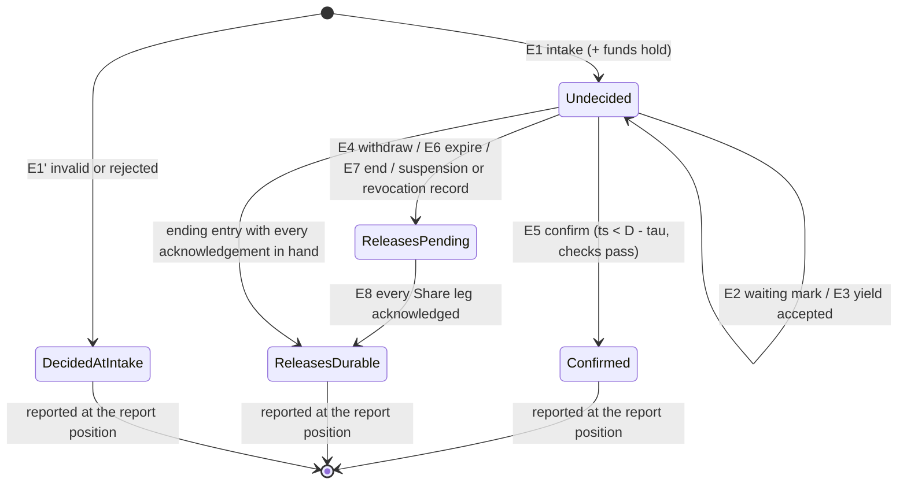
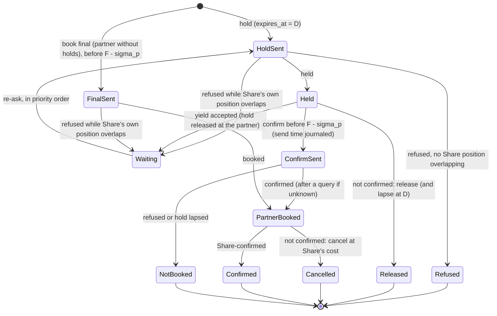

# RFC-002. Account owner and booking coordination: one decision log per account, request-scoped holds, and partner adapters that stand in for a schedule owner

| | |
|---|---|
| Status | **Draft**, revision 1. To be reviewed and approved **together with RFC-004 Part A** (the funds-and-standing module of the same account owner, RFC-000 §7); §2.4 is the interface both must accept |
| Satisfies | P2-S01 … P2-S111 (all 111 P2 scenarios; the traceability table at the end maps each to its section). Also the booking side of P1-S07, P1-S08, P1-S11, P1-S12, P1-S34, P1-S41, P1-S42, P1-S54, P1-S62 and of the equivalent-path scenarios P1-S31 … P1-S61 (reservation-level offers, moves, revocations); the account-owner side of P4-S20, P4-S23, P4-S66, P4-S97, X1-S05 … X1-S09, X2-S03, X2-S05, X2-S06, X2-S15, X2-S21; the "fee shown, who ended" input of P3-S11, P3-S43, P3-S44, P3-S60 |
| Policies | POL-01, POL-02, POL-03, POL-04, POL-05, POL-06, POL-07, POL-08, POL-09, POL-10, POL-15, POL-16, POL-18, POL-23, POL-25, POL-26, POL-27, POL-28, POL-29, POL-30, POL-31, POL-32, POL-33 |
| Prior decisions | History log D13, D14, D16, D17, D21, D22 (carried forward or rejected in Competition) |
| Builds on | The requirements at tag `requirements-v1.5` and the accepted architecture [RFC-000](RFC-000-architecture.md) at tag `rfc-000-accepted` (revision 3.2): its principles A1 … A10, the account owner and partner adapters of §2, the protocols of §3 and §4, the topology of §5 and the contracts of §8 |
| Supersedes | The pre-baseline draft "Route reservation: a saga over held capacity" (this file's previous content, kept in git history) |

Terms are used in the sense of the [glossary](../02-specs/glossary.md); "reserved rate" is
capacity and "traffic" is bytes. Every latency, rate, size and count in this RFC is an
**estimate** (marked "est.") to be replaced by the R1 spike's measurements (RFC-000 R1),
unless it is a requirement's own figure or a policy default.

## Need

RFC-000 decided the shape: every booking request of an account is decided by that
account's **account owner**, a single-leader state machine over a five-voter, two-region
log; every Share link's capacity is decided by its **link schedule owner**; every partner
link is represented by a **partner adapter** that stands in for a schedule owner for
Share's own position there. RFC-000 left to this RFC the parts that make that shape
buildable (RFC-000 §7, "The RFC split"):

1. **The account owner's state machine**: the exact log entry kinds, which module of the
   account owner (booking, or funds and standing) owns each piece of state and each entry,
   the in-process interface between the two modules, and the state machine of a request
   and of a reservation.
2. **The booking workflow** that runs in the leader: intake and idempotency (P2-N6,
   POL-29), holds, waiting and yields (P2-N4, POL-02, POL-05), the decision entry (P2-N1,
   P2-N8, POL-04), the confirm fence and expiry (P2-N3, POL-26), releases and the
   "releases durable" record (RQ-6, RQ-8), withdrawal, revocation and suspension of
   undecided requests, and recovery from every crash point (P2-N5, POL-03).
3. **Reporting**: the edge's synchronous answer, the status replica rule, the outcome feed
   and webhooks (P2-N2, POL-04).
4. **Reservations and their changes** as one unit (P2-N9, POL-08), and the reservation-level
   side of revocations, equivalent-path offers and moves, release after grace and
   termination (P1-N8, POL-07, POL-16, POL-30).
5. **Partner adapters**: their log and call journal, the partner port, answer
   classification, fences, Share's waiter queue at each partner link, yields of Share's own
   partner holds, and reconciliation (P2-N7, POL-26, POL-28).
6. **The contention guarantee on every path** (POL-02): waiting, `wait = false`, short
   deadlines, crossings and cycles, and partner refusals caused by Share.

The hard parts, which every section below has to keep true at once:

- **One decision point per request** (POL-04, A7) that suspension, key revocation,
  withdrawal and the deadline are all judged against, while a partner leg, which cannot
  prepare in Share's sense, must be confirmed *before* that decision (P2-N7) and a
  confirmation must be decided before `D` (POL-26).
- **No hold ends except on the account owner's word** (A9), yet capacity is free by the
  deadline, or within `release_grace` when the decision record or a link's schedule owner
  is unavailable (POL-26), and no non-confirmed outcome is reported while a Share-link
  release it needs is not durable (RQ-6, RQ-8).
- **The process deciding can die at any point** (C12), on the Share side, at a link owner,
  at a partner adapter, or at the partner, without a route ever ending part-booked
  (P2-N1, P2-N5) and without a reported outcome ever changing (P2-S10, P2-S108).
- **Contention must not make every waiting competitor lose** across Share links and
  partner links alike, without a global component (POL-02, RFC-000 §2 "Merges and
  splits").
- **The design load is ×50** (POL-06): 25,000 booking requests/s, an account at
  `account_rate_limit` (200/s), status polls sized at 100,000/s.

## Approach

### 1. Scope, boundaries and notation

#### 1.1 What this RFC specifies, and what it relies on

| Specified here | Relied on (owner) |
|---|---|
| The account owner's log, entry kinds, apply rules and takeover (§2, §12) | The replicated log, terms, leases, closed and report positions, placement, region-wide failover, `ε` and the invariant `ack_budget ≥ τ > ε + δ_x` (RFC-006) |
| The booking module: requests, reservations, change queues, the workflow (§3 … §9) | The funds-and-standing module: hold sizing, headroom, key headroom, capacity in flight, rate limits, standing transitions, resume amount (RFC-004 Part A), called through §2.4 |
| The status replica rule, the edge's answer gate, the request outcome feed, the reservation lifecycle feed, the booking API's semantics (§8, §13) | Authentication, principals, key scope, webhook signing (RFC-005); delivery of webhooks and notices (RFC-006 notifier) |
| The outcome and expiry port, the reservation command port, the partner port, the partner reconciliation feed (§13) | The link hold port, link waiting port, link availability query and link schedule feed (RFC-001) |
| Partner adapters (§10) | Partner terms and classification inputs in the catalogue (RFC-003; link registry RFC-001); equivalent paths from routing (out of scope) |

#### 1.2 Which module owns what

The account owner is **one writer process per account** with two modules (RFC-000 §2). The
modules never write each other's state; both write only through log entries of the one
log, applied by the one leader in one serial order.

| State | Module | Notes |
|---|---|---|
| Booking requests: idempotency key, fingerprint, principal, kind (book or change), legs and their kinds, window, rate, product, `wait`, `D`, `request_age`, commit fence `F`, locked prices and partner terms shown, waiting marks, yielded legs, withdrawal, the deciding entry and its reason, the "releases durable" record | Booking (RFC-002) | §2.2, §4 |
| The idempotency index (account, key) → request, for `idempotency_retention` | Booking | §3.3 |
| Reservations as route-level units: legs, parts (each with rate, effective minutes, locked price, age), partner terms shown at booking (minimum term, cancellation fee), lifecycle and end cause, partner-leg affected status, equivalent-path offers and move holds | Booking | §9 |
| Per-reservation change queue | Booking | §9.2 |
| Workflow progress per leg (held, waiting, refused, confirm sent, …) | Booking, **leader memory only**; rebuilt on takeover by querying participants, whose own logs are durable (§12.1) | Not in the log, by design (Competition) |
| Funds holds and credit holds (per request and per reservation), capacity in flight per key and account, key spending per `key_spend_period`, key status as applied (revoked, limits), headroom inputs as applied feed positions (ledger position, rating position), credit limit, standing, its cause, grace start, resume amount, low-balance warning state | Funds and standing (RFC-004 Part A) | §2.3 |
| Booking-rate counters per key and account | Funds and standing (rule); kept in **leader memory**, rebuilt by a new leader from the last second's intakes (§3.1, B-AI-4) | Not in the log: a submission over a limit "creates nothing" (D5) |

#### 1.3 Notation and parameters

| Symbol | Meaning | Value |
|---|---|---|
| `D` | The request's deadline: intake timestamp + the requested deadline (or `route_deadline_default`) | POL-26 |
| `request_age` | The intake entry's timestamp; ties broken by request identity (account partition, log index) | POL-02 (`priority_rule = request_age`) |
| `m` | Completion margin: `commit_margin` with a partner leg, `ack_budget` otherwise | POL-02, POL-26 |
| `F` | Commit fence, `D − m`: the request may not begin committing after it | POL-26 |
| `τ` | Confirm fence offset: a confirm entry counts only if its timestamp is before `D − τ`; `τ = max(ack_budget, ε + δ_x)` | 200 ms (est., RFC-000 §4.3) |
| `ε` | Clock-uncertainty bound published by the platform | at most about 40 ms (est., RFC-006) |
| `δ_x` | Time for the expiry's commit, the release notice and the release's commit at a link | about 60 ms steady, 150 ms worst degraded (est.) |
| `σ_p` | Partner-skew budget of partner link p: `ε` plus the measured bound on the partner's clock offset; part of `commit_margin` | design parameter per partner, default 200 ms (est.) |
| `T_x` | Expiry time by the leader's clock: `D − ε − δ_x` | — |
| `release_grace` | Bound on releases and late-known confirmations when a record or a schedule owner is unavailable | 1 min (POL-26) |
| `read_lease` | A status replica's read lease | about 500 ms (est., RFC-000 §4.6) |

All timestamps an entry carries are the leader's clock at append, made monotone within the
log (`ts = max(clock, previous entry's ts)`), so a slower clock after a leader change never
moves a timestamp back. Every check against `D − τ` uses the timestamp written in the entry,
so it is replayed identically.

### 2. The account owner's log

#### 2.1 Entries, apply and conditional effects

- **Envelope.** Every entry carries (account partition, term, index), `ts`, its kind, the
  audit fields of RFC-005 (principal; for an operator, role, reason and approver), and one
  or more **records**, each owned by one module: booking records (`B:` below) and funds
  records (`F:`). An entry is applied by applying its records in the order written.
- **Effects are computed at proposal and logged.** The leader evaluates every rule, the
  funds rules included, against its projected state (everything it has proposed, committed
  or not) and writes the results into the entry: verdicts, amounts, the requests a
  suspension ends. Booking records are applied as written (their conditions re-checked,
  below); the funds module's outcomes are re-computed by followers from the recorded inputs
  and rules version and compared (RFC-004 A §A4). Every figure a buyer was shown can be
  rebuilt exactly (P4-N16, A0-21).
- **Deciding records are conditional.** A record that decides a request (*confirm*,
  *expire*, *end*, *withdraw*) applies only if the request is undecided at that point of
  the log; otherwise it is a no-op that records the attempt. The leader never proposes a
  conflicting one knowingly, but a new leader may carry an entry its predecessor proposed;
  the condition makes the first deciding record in log order win in every case (A7).
- **One leader, projected state.** The leader keeps a projected copy of the state that
  includes its proposed but uncommitted entries, so two concurrent submissions with one key,
  a yield request and a grant, or a suspension and a confirm are ordered by the leader the
  moment they are proposed. If the leader loses its term, its uncommitted tail is either
  committed by the next leader or lost; nothing was sent to a participant on the strength of
  an uncommitted entry (§2.2 states, per kind, what is sent only after commit).

#### 2.2 Booking entry kinds

| # | Entry | Booking records | Funds records it also carries (computed by §2.4) | Deciding? | Sent to participants only after commit |
|---|---|---|---|---|---|
| E1 | **Intake** | Request record: id = (account partition, log index), idempotency key, fingerprint, principal, kind (`book` or `change` with reservation id and change kind), legs (link, kind: Share, partner with holds, partner without holds), window, rate, product, `wait`, `D`, `request_age` (= `ts`), `F`, locked prices and the partner terms shown (minimum term, cancellation fee) | Funds hold or credit hold for the request; capacity in flight +rate on key and account | No, unless the request is refused at intake (E1′) | Holds (§5.1) |
| E1′ | **Intake, decided** | As E1 plus the outcome: *invalid* (with the rule), or *rejected* (insufficient funds with the two amounts; a limit with its name; account suspended with the resume amount; more than one partner without holds; a change to part of a route) | None (nothing held) | Yes; "releases durable" is implied (no hold was sent) | Nothing; the outcome is reportable at once |
| E2 | **Waiting mark** | Request, and per waiting leg the deadline of the request ahead (from the waiting notice), or "ahead resolved" | — | No | Waiting hints to every participant where the request holds (§5.2) |
| E3 | **Yield or displacement accepted** | Request, leg, attempt, the participant's yield request or displacement notice; the leg is marked yielded (it becomes a waiter at the request's age) | — | No | `yield_accept` or `displacement_accept` to that participant (§5.3, §5.2) |
| E4 | **Withdraw** | Request, principal; if undecided: outcome failed, "withdrawn" | Release of the funds hold; capacity in flight −rate | Yes, if undecided | Request-scoped releases; partner cancellations at Share's cost (§7.1) |
| E5 | **Confirm** | Request; for each leg the hold attempt confirmed or the partner booking reference; `ts` (accepted only if `ts < D − τ`, with the `τ` used); the check results (standing, key, withdrawal); for `book`, the new reservation record; for a change, the new part | Bind: the funds hold becomes the reservation's coverage hold (or grows it, for a change); capacity in flight −rate | Yes, if undecided and in time | Conversions (§5.7); partner outcome notices |
| E6 | **Expire** | Request; reason: "deadline passed", "deadline passed while waiting" with `retry_after`, or "interrupted by an internal failure" (§6.2) | Release of the funds hold; capacity in flight −rate | Yes, if undecided | Request-scoped releases; partner releases or cancellations (§6) |
| E7 | **End** | Request; outcome and reason: rejected for no fit (blocking link, counter-offer, or `retry_after` for `wait = false`); rejected by a partner's definite refusal (partner link); failed: partner fault (leg); failed: "reservation ended" (a change whose reservation ended); and the suspension and key-revocation endings when carried by a funds entry (§7.2) | Release of the funds hold; capacity in flight −rate | Yes, if undecided | Request-scoped releases; partner cancellations at Share's cost |
| E8 | **Releases durable** | A batch of (request, the Share legs whose release acknowledgement is in hand); complete for a request when every Share leg of its intake is acknowledged. For an expired request it is appended no earlier than `D` by the leader's clock (§6.5) | — | No (it gates reporting, A10) | Nothing |
| E9 | **Takeover** | New term, leader identity | — | No | Resume queries (§12.1) |
| E10 | **Conversions done** | A batch of confirmed requests (and applied reservation changes) whose every Share-leg command is acknowledged | — | No | Nothing; bounds what a new leader re-sends |
| E11 | **Reservation change** | Reservation; cause (the change request, or a Share cause: revocation or reduction under POL-07, move, release after grace under POL-16, termination under POL-30, a price change taking effect under POL-27); effective minute; the parts removed or added; the new end or rate; for an ending change, the changes it fails ("reservation ended"); the fee payer for any cancellation fee shown (POL-08) | Hold resize or release (POL-15) | Decides its change request if it is one (§9) | Leg changes to every Share leg; partner change or cancel (§9.3) |
| E12 | **Leg changes durable** | As E8, for an E11: every Share leg has acknowledged its leg change | — | No (it gates reporting of changes that free capacity, §9.3) | Nothing |
| E13 | **Offer** | Equivalent-path offer prepared (the path chosen, with an offer id), made (every move hold acknowledged; `offer_window` end), answered (accepted, declined, lapsed), partner leg booked or failed at acceptance | — | No | After *prepared*: move-hold commands, idempotent by (reservation, offer id); after *made*: the notice to the holder; after *declined* or *lapsed*: move-hold releases |
| E14 | **Partner leg affected** | Reservation, partner leg, from minute, source (reconciliation) | — | No | Notice through the notifier (POL-07, POL-28) |

There is no entry for a capacity hold acknowledgement, a grant to a waiter, or a partner
confirm being sent. Those facts are durable in the participant's own log, and a new leader
learns them by query (§12.1). The workflow's entries per request are therefore the two
RFC-000 §6 counts (intake, deciding entry), plus waiting marks when contended, a yield
acceptance only in a crossing or cycle, and a share of batched E8 and E10 entries.

#### 2.3 Funds-and-standing entry kinds (owned by RFC-004 Part A)

RFC-004 Part A defines these kinds, their payloads and apply rules (its §A4); this RFC
registers them in the account log's closed registry beside E1 … E14. Each is appended by
the leader from a feed event or a timer, and its recorded **outcomes** can require booking
records, which the booking module writes **in the same entry** (§2.4 rule 5).

| Kind (RFC-004 A) | What it applies | Booking records its outcomes can require |
|---|---|---|
| F1 Ledger applied | Ledger balance and posted-through minutes through a ledger position | A suspension: ending records for every undecided request and every undecided addition of the account (rejected, "account suspended", resume amount) (P2-S69) |
| F2 Usage applied | Unposted usage through a rating position | As F1 |
| F3 Exposure parameters | Inputs of the lateness bound | As F1 |
| F4 Key status | Key revocation and key limits pushed by identity and access, within 60 s (D6) | A revocation: ending records (failed, "key revoked") for the key's undecided requests; its reservations are untouched (P2-S72) |
| F5 Credit and vetting | Credit limit set or removed, KYB status | As F1 |
| F6 Invoice status | Invoice overdue or paid | As F1 |
| F7 Funds tick | Fee term ended; grace ended | Grace ended with `release_due`: E11 records ending every listed reservation, cause "released" (POL-16), buyer pays a shown fee (P4-S23) |
| F8 Enforcement acknowledgement | Network operations' acknowledgement of a standing change | None |
| F9 Probe designation | The account is a probe account (POL-06) | None |
| F10 Rules version | The funds rules version in force from this position | None |

#### 2.4 The in-process interface between booking and funds

RFC-004 Part A provides the funds-and-standing module as a library linked into the
account owner, with no I/O, no clock and no randomness (its §A10). The booking module calls
it only at the leader, while composing an entry, against the projected state; the entry
records the module's inputs and outcomes; followers re-run the module on the recorded inputs
with the recorded rules version (F10) and compare (RFC-004 A §A4). The calls, in RFC-004 A's
signatures, and where this RFC makes them:

| Call (RFC-004 A §A10) | Booking passes | Booking uses the result | Where |
|---|---|---|---|
| `rate_check(soft, ts, principal)` | The submitting key or user | `NotAccepted{retry_after}` → not accepted, nothing logged | §3.1, before anything else; polls never reach it |
| `admit(S, ctx, ask)` | `Ask`: request id, principal and key, kind (`New`, `Increase`, `Extend`), the reservation's schedule after (and before, for a change) with its locked price per Mbps-minute, the shown partner fee terms, the rate in flight (once, whatever the number of legs) | `Admit{hold, hold_kind, mbps}` → E1 with it as the funds payload; `Refuse{reason}` → E1′ rejected with that reason and amounts | §3.2, §9.3 |
| `standing(S)` | — | Must be active for a request that adds something to be confirmed; checked before a partner confirm is sent (from the applied state, §5.5) and in E5 | §5.5, §5.6 |
| `apply(S, ctx, Intake{…})`, `apply(S, ctx, Decided{Confirmed{reservation, schedule} \| NotConfirmed})`, `apply(S, ctx, ReservationChanged{reservation, schedule, end?{cause, fee_due}})`, `apply(S, ctx, PriceTookEffect{…})` | The booking entry's own content, as an `Input` | The outcomes (hold changes, any standing transition) recorded in that entry | E1, E4 … E7, E11 |
| `apply(S, ctx, F1 … F10)` | — (the leader builds the funds entry from the feed or timer) | Outcomes `standing` (to suspended), `release_due`, and key status as applied (F4) → booking records in the same entry (§2.3) | §7.2, §9.4 |
| `due(S)` | — | Instants for F7 ticks (fee term end, grace end); the leader arms them with the booking timers (§6.1) | §6.1 |
| `answer(S, ctx, principal)` | Account or key | The itemised headroom at a stated position; its insufficient-funds amounts are those `admit` returned | Rejection texts; status replicas serve the headroom query (RFC-004 A §A9) |

What the booking module provides to the funds module, and nothing else: the `Ask` and
`Input` values above, built from the request and reservation records (rate, parts and
their schedule, locked prices, the partner fee and minimum term shown at booking, the key
that booked it, the end cause and who pays a shown fee under POL-08, §9.5).

Rules both modules keep:

1. **One entry, both effects.** An intake records the request and its funds hold in one
   entry, before any capacity hold is sent (POL-25, A0-03). A deciding entry records the
   outcome and the funds release or binding in one entry. A request is never decided with
   its funds not, or the reverse.
2. **No I/O in the funds module.** Its inputs arrive only as entries; the booking module
   never computes an amount.
3. **Order inside an entry.** For a booking entry, the booking record first, then the funds
   payload; for a funds entry, the funds payload first, then the booking records its
   outcomes require. Apply follows the written order.
4. **Determinism.** Only the leader calls `admit`, `rate_check` and `standing` to decide;
   what they return is logged. A rules change takes effect at an F10 boundary and never
   alters a logged figure (P4-N16).
5. **Who ends what.** Only the booking module ends a request or a reservation. A funds
   outcome that requires an ending (suspension, a key revoked as applied by F4,
   `release_due`) is turned into booking records in the **same entry**, so the funds event
   and the endings it causes have one log position: the decision point of each request it
   ends (POL-04). If a leader fails between proposing and committing such an entry, the
   whole entry is either committed or lost; there is no state with the cause and not its
   endings.

**Alignment items for the joint review with RFC-004 Part A** (neither changes RFC-000):

| # | Item | This RFC's position |
|---|---|---|
| JR-1 | Key revocation. RFC-004 A has no call for a key's status as applied; it says the booking module "reads `status_k`" | Add `key_status(S, key)` to §A10, used (a) when composing F4, to end the key's undecided requests, and (b) at intake, where a key revoked as applied makes the submission not accepted, as an unauthenticated one (X1-S06) |
| JR-2 | Release after grace. RFC-004 A §A7 says the booking module "appends" the release when F7's outcome is `release_due` | The release records are written in the F7 entry itself (rule 5); RFC-004 A's wording to be read so |
| JR-3 | Rate counts after a leader change. RFC-004 A §A5.4 rebuilds the last second from intake entries, low by the retries of that second | Adopted (§3.1); recorded against RFC-000's "exact" as B-AI-4 |
| JR-4 | Price changes (POL-27) for open-ended reservations | Booking appends E11 with cause "price change" when the catalogue's new price takes effect, carrying `PriceTookEffect` to the funds module |

### 3. Intake and idempotency (POL-29, POL-25)

#### 3.1 From the edge to the leader

1. The edge authenticates, applies its advisory counters and forwards the submission once,
   to the account owner's leader (RFC-000 §3). Status polls go to status replicas (§8.2),
   never to the leader.
2. A submission by a key that is revoked as applied in the log (F4) is not accepted, as
   an unauthenticated one (X1-S06; the edge refuses it too within 60 s). The leader then
   calls `rate_check`. Over `key_rate_limit` or `account_rate_limit` (a sliding second),
   the submission is **not accepted** with `retry_after`; nothing is logged, the key is not
   consumed (P2-S41). Retries count, polls do not (P2-S68). The counts are leader memory;
   a new leader rebuilds the last second from its intake entries, so for one second after a
   leader change they can be low by the retries answered in that second (RFC-004 A §A5.4;
   B-AI-4).
3. The leader looks the key up in the idempotency index of its **projected** state:
   - **New key**: go to 4.
   - **Same principal, same fingerprint** (route legs in order, window, rate, product,
     `wait`; the deadline is not part of it, P2-S63): the submission is that request; the
     answer is its current status under the reporting rules of §8.1 (pending, or its
     reported outcome) (P2-S24, P2-S25, P2-S27). No entry.
   - **Same principal, different fingerprint**, or **a different principal of the
     account**: not accepted, as a key reuse; the answer contains nothing of the first
     request (P2-S26, P2-S64). No entry.
4. Validation (§3.2), then `admit`, then the leader proposes E1 (or E1′). The key is in the
   projected index from the proposal on, so a second identical submission arriving before
   the commit joins the same request (P2-S24).
5. The answer is sent by the rule of §8.1: final if reported in time, otherwise `pending`
   once E1 is durable. If E1 cannot be made durable in time (the leader is losing its
   term), no answer is given within `ack_budget`; that is unavailability, counted against
   the 99.99% target, and the client retries with the same key. `pending` is never sent for
   an intake that is not durable (A3).

#### 3.2 Validation and refusals at intake

Checks, in order, all made by the leader before proposing; each failure is an E1′ with the
outcome named (so a retry with the key returns the same outcome even after the selling
horizon has rolled):

| Check | Outcome | Scenarios |
|---|---|---|
| Window and rate validity, per leg, by the link registry's rules (P1-S19, P1-S20; POL-09, POL-31); extension beyond the horizon | invalid | P1-S19, P2-S84 |
| Deadline within `route_deadline_min` … `route_deadline_max`, plus `commit_margin` with a partner leg | invalid | P2-S12, P2-S86 |
| At most one partner leg without holds, using the adapters' POL-26 classification (§10.2) | rejected, "a route may include at most one leg without holds" | P2-S34, P2-S36, P2-S102 |
| A change to part of a route | rejected, "a route is changed or cancelled as one unit" | P2-S49 |
| `admit` (standing for a request that adds, key and account in-flight limits, funds or credit hold, key headroom, in RFC-004 A §A5.1's order) | rejected with the reason and amounts the module returns | P2-S38 … P2-S40, P2-S42, P2-S54, P2-S66, P2-S92, P2-S98 |

The price per Mbps-minute for the route and every partner leg's shown terms are read from
the catalogue's cache at the leader before `admit` and locked in E1 (POL-27, POL-08); the
same figures are those shown to the buyer (P2-S50).

#### 3.3 The idempotency index

- Keyed by (account, idempotency key); value: request id, fingerprint digest, principal,
  and expiry = intake `ts` + `idempotency_retention` (24 h). Kept in the partition's state
  store (an LSM on local SSD with an in-memory filter), rebuilt from snapshot and log, on
  the leader and on every status replica.
- Entries are removed only after their expiry; a key then identifies a new request
  (P2-S65). Scoping by account is structural: the index lives in the account's partition,
  so two accounts using one key never meet (X1-S08, X1-S09).
- A request's record (outcome, reason, counter-offer) is kept for status reads as long as
  its key, then archived to history.

### 4. The request state machine

#### 4.1 Durable states

A request's durable state is a function of its entries. "Reported" is not an entry: it is
the moment the entries that make the outcome final are at or below the report position
(§8).

| State | Entered by | Left by | Holds and funds |
|---|---|---|---|
| **Undecided** (sub-flags: waiting, legs yielded) | E1 | E5, E6, E7, E4 or a funds entry's ending record | Funds hold from E1; capacity holds as acknowledged by participants |
| **Decided invalid / rejected at intake** | E1′ | — (final) | None ever taken |
| **Confirmed** | E5 (`ts < D − τ`, request undecided) | — (final; the reservation then has its own lifecycle, §9.1) | Funds hold bound to the reservation; holds converted |
| **Decided not confirmed, releases pending** | E4, E6, E7, or an ending record (suspension, revocation) | E8 completing it | Funds released in the deciding entry; capacity holds being released |
| **Decided not confirmed, releases durable** | E8 (or the deciding entry itself, when every acknowledgement was already in hand: a refusal that recorded a tombstone, or nothing sent) | — (final) | Nothing on any Share leg |



#### 4.2 Workflow phases in the leader

The leader drives each undecided request through phases kept in memory, derived from the
durable state and the participants' answers:

| Phase | Meaning | Allowed next | Yields? |
|---|---|---|---|
| **Holding** | Hold commands sent; some answers outstanding | Waiting, Ready, ending | No yield requests arrive for legs not yet held |
| **Waiting** | At least one leg is a registered waiter (Share link) or a contention waiter (partner adapter); none refused definitively | Holding (grant), Ready, ending | Yes: a yield request for any held leg is accepted (E3) |
| **Ready** | Every Share leg and every partner-with-holds leg is held; funds held | Committing (partner route) or Deciding (no partner leg); ending | No: refused |
| **Committing** | The first partner confirm or final booking has been sent (journaled by the adapter, §10.4) | Deciding (all partners confirmed), ending (any partner refusal, unknown past `D − τ`, or a Share-side event) | No |
| **Deciding** | E5 proposed | Confirmed or (if a prior deciding entry wins) the other outcome | No |

A request is "waiting" for POL-02 exactly in the Waiting phase. Ready, Committing and
Deciding are "not waiting": such a holder is never pre-empted.

#### 4.3 Per-leg progress

| Share leg state | From the link hold port | Next |
|---|---|---|
| requested (attempt n) | — | held, waiting, refused (no fit), refused (past `D` or tombstoned) |
| held (attempt n) | Hold acknowledged once durable | yielded (E3), converted (after E5), released (after an outcome) |
| waiting | Registered as a waiter, with the deadline of the request ahead | held (attempt n + 1, a grant), refused (no fit on committed capacity) |
| yielded | Hold released by acceptance; waiter registration kept at the request's age | held (attempt n + 1), refused |
| converted / released | Acknowledged once durable | — |

Partner leg states are in §10.3.

### 5. The workflow

#### 5.1 Taking holds

After E1 commits, the leader sends, **in parallel**:

- to each Share leg's link owner, `hold(account, request, leg, rate, window, D, request_age,
  F, attempt = 1, term)` on the link hold port (RFC-001);
- to each partner-with-holds leg's adapter, `hold(request, leg, rate, window, expires_at =
  D, request_age, F, term)` on the partner port (§10).

A partner leg **without holds** is not touched now (§5.5).

Answers and what the leader does:

| Answer | Action |
|---|---|
| held | Leg held. If every Share and partner-with-holds leg is held, the request is Ready |
| waiting (Share link: blocked only by capacity in flight; partner adapter: refused while Share's own position overlaps), with the deadline of the request ahead | If `wait = false`: E7 rejected at once, with `retry_after` = the latest remaining deadline among the requests in flight that block it (B-RQ-4) and the counter-offer computed beside the capacity in flight (§5.8; P2-S18, P2-S59). Otherwise: E2 waiting mark, then waiting hints (§5.2) |
| refused, no fit on committed capacity (Share link; the refusal records a tombstone and counts as that leg's release acknowledgement) | E7 rejected, naming the link, with the route counter-offer (§5.8) (P2-S02, P2-S17) |
| refused definitively by the partner, with no Share position overlapping (§10.5) | E7 rejected, naming the partner link (P2-S31) |
| partner transient refusal | The adapter retries within the request's commit fence; nothing changes at the account owner (P2-S30) |
| partner fault: transient or unknown results persisting to the leg's fence, or an answer the driver cannot classify (§10.2) | E7 failed, partner fault, naming the leg (P2-S62) |
| displaced (`DISPLACED`: a capacity reduction recorded at the link means the held leg no longer fits beside committed capacity and older holds; RFC-001 §5.1) | If undecided and it does not fit on committed capacity: E7 rejected for no fit with the counter-offer (P1-S41). If it still fits on committed capacity and the request is not Committing or Deciding: E3 displacement accepted; the leg becomes a waiter (P1-S42 for what follows). If Committing: E7 rejected for no fit, and the partner booking is cancelled at Share's cost. If E5 is already in the log: nothing; the link records the part and flags it affected (B-RQ-2) |
| no answer (link failing over, adapter failing over) | Re-send with the same identity (idempotent) with backoff until an answer or the expiry (§6) |

Hold commands are retried with the same `(request, leg, attempt)`; the participant's log
deduplicates them (RFC-000 §4.4). A hold is never sent before E1 commits, so no capacity is
ever held without its funds hold (P2-S92, P2-S33).

#### 5.2 Waiting

- **The mark.** On the first waiting answer, and whenever a waiting notice changes the
  deadline of the request ahead or reports it resolved, the leader proposes E2. The mark
  carries what an expiry needs for its reason and `retry_after` (§6.2).
- **Hints.** After E2 commits, the leader sends a *waiting hint* (on the outcome and expiry
  port, §13) to every participant where the request holds a leg; on leaving Waiting it
  sends "not waiting". Hints only tell a link owner or adapter which younger holders are
  worth asking to yield; correctness rests on the acceptance check of §5.3, so a stale hint
  costs at most one refused yield request.
- **Grants.** When capacity is released on a link, the link owner grants it to its waiters
  by the priority rule and notifies the account owner ("capacity released to a waiter",
  with the new attempt). The leader marks the leg held (attempt n + 1). The grant needs no
  entry: it is durable at the link, and a new leader learns it by query.
- **A waiter that no longer fits** (the request ahead was confirmed, or the link's capacity
  fell, P1-S42) is refused by the link with a tombstone; the leader appends E7 rejected for
  no fit with the counter-offer (P2-S52).

#### 5.3 Yields: crossings and cycles

A link owner (or a partner adapter, §10.5) whose waiter O is blocked by the hold of a
**younger** request Y that it believes waiting asks Y's account owner to yield the leg. Y's
leader, in its serial order:

1. If Y is in the Waiting phase (some leg still waiting, none refused, not withdrawn, not
   decided): propose E3 *yield accepted*, mark the leg yielded in the projected state at
   once (so no confirm can be proposed on the strength of that leg), and after E3 commits
   send the acceptance. The participant releases the hold and keeps Y's waiter registration
   at Y's own `request_age`, so Y keeps its place (P2-S97).
2. Otherwise (Holding with no waiting leg, Ready, Committing, Deciding, decided): refuse.
   A holder that is not waiting is never pre-empted (P2-S58).

The participant re-sends an unanswered yield request until it is answered or the
waiter's state changes, and asks again after a refusal when a waiting hint for Y arrives
(Y may refuse while Holding and become waiting a moment later); the acceptance carries Y's term, and §5.2 of RFC-000 makes the
participant ignore a command from an older term than it has applied for Y. Why every cycle
breaks without being detected is shown in §11.

#### 5.4 Committing a request without a partner leg

When Ready and the leader's clock is before `D − τ`, the leader checks `standing(S)` is active
and the request is not withdrawn, then proposes E5. "Begin committing" for such a request
is this proposal, so it is never later than `D − τ` ≤ `D − ack_budget` (POL-26, P2-S110).
If the clock is at or past `D − τ`, nothing is proposed; the expiry follows (§6).

#### 5.5 Committing a request with partner legs

When Ready:

1. **Share's checks** from the applied state, in the serial order, with no log entry
   (A0R-14): `standing(S)` active, not withdrawn, undecided, and the leader's clock before
   `F − σ_p − h` (h: one hop to the adapter, est. 5 ms). If they fail, the request ends (E7
   or the expiry) and every partner hold is released.
2. **Partner without holds, if any (at most one, POL-28)**: send `book_final` to its
   adapter. It is booked last: after every other leg is held, after the funds hold and after
   Share's checks (P2-S33). Its answer:
   - booked → step 3;
   - refused definitively → E7 rejected naming the link (or waiting, if Share's own position
     overlaps there, §10.5, P2-S96);
   - unknown → the adapter reconciles at once (§10.6); a booking found later for a request
     that has ended is cancelled at Share's cost (P2-S35).
3. **Partners with holds**: send `confirm` to each, in parallel. If the remaining time to
   `F − σ_p` is below the partner's expected answer time (from its terms) when step 2
   starts, steps 2 and 3 are sent together instead, accepting that a refusal at the partner
   without holds then leaves the held partners' confirmations to cancel at Share's cost.
4. **Each adapter journals the send, with its time, in its two-region log before calling
   the partner** (§10.4). The first journaled send is the request's "begin committing"
   time; the adapter refuses any confirm or final booking past `F − σ_p` by its clock, so
   that time is never after `F` in true time (σ_p ≥ ε; P2-S109, P2-S55).
5. **When every partner leg has confirmed**: re-run the checks and propose E5 if the clock
   is before `D − τ`. The partner confirm therefore has `commit_margin + σ_p − τ` (about
   10 s, est.) for its answer (RFC-000 §4.3).
6. **If any partner leg refuses, answers unknown and is still unknown at `D − τ`, or a
   Share-side event ends the request** (suspension, revocation, withdrawal, expiry): the
   deciding entry is the ending one, and every partner booking already made for the request
   is cancelled at once at Share's cost (POL-28, RQ-2; P2-S105, P2-S57). Share never
   confirms a leg the partner has not confirmed (P2-S29, P2-S03).

Two partners with holds of different lengths are handled alike: each hold expires at `D`
(set by Share), each is confirmed before E5, and any one confirmed for a request that is not
confirmed is cancelled (P2-S37).

#### 5.6 The decision entry

E5 is the single POL-04 decision point of a confirmed request. Its apply checks, in this
order, all from the state at its log position: the request is undecided; `ts < D − τ` with
the recorded `τ`; no withdrawal applied; the account is active (`standing(S)`, recorded in the entry; a
key revoked earlier in the log has already ended the request, §7.2); every Share leg is held at a
recorded attempt that has not been yielded; every partner leg has a recorded partner booking.
If any check fails the record is a no-op and the leader proposes the ending entry with the
corresponding reason. A suspension, revocation or withdrawal **after** E5 in the log changes
nothing (P2-S103), even while a status read still shows `pending`.

#### 5.7 After the decision

- **Confirmed.** The leader sends `convert(request, leg, attempt, decision ts, reservation,
  part)` to every Share leg (asynchronous, idempotent; the hold keeps counting until
  converted, RFC-000 §4.2), and a "Share-confirmed" outcome notice to every partner adapter.
  Acknowledgements are collected in memory and checkpointed by E10.
- **Not confirmed.** The leader sends a **request-scoped release** (no attempt number) to
  every Share leg **in the intake**, not only those it believes held, and to every partner
  adapter (which releases the partner hold, or cancels a partner booking at Share's cost).
  Each link owner records a tombstone in the release entry and acknowledges once durable.
  The leader batches acknowledgements into E8, folded into the next group commit; when every
  acknowledgement is already in hand at the deciding entry (a single-leg refusal, or nothing
  sent), the deciding entry records it itself (RFC-000 §4.3). The partner release does not
  gate the report; the partner hold lapses at `D` in any case (P2-S14, P2-S101).
- **Reporting** follows §8: the outcome is reported once E5, or the deciding entry and its
  complete E8, are at the report position.

#### 5.8 Counter-offers (P2-N11, POL-10)

On a rejection for no fit, and on a `wait = false` rejection, the leader computes the route
counter-offer before proposing E7, so the counter-offer is part of the recorded outcome:

1. It calls the **link availability query** (RFC-001) on every Share leg for the window
   and, forward from the requested start, the free-capacity profile up to the selling
   horizon, beside committed capacity only (a waiting request rejected for no fit) or beside
   committed capacity and holds (`wait = false`).
2. **Largest rate** that fits the window on every leg = min over legs of (capacity − peak
   over the window).
3. **Earliest window** of the requested length, starting at or after the requested start,
   that fits the requested rate on every leg: a sweep over the minute boundaries where any
   leg's profile changes, keeping the earliest start whose window fits on all legs, within
   the horizon.
4. **Blocking link**: the first leg in route order that refused (P2-S73).

Partner legs' availability is not computable; the counter-offer covers the Share legs and
says so. Nothing about other buyers is disclosed (POL-10). The queries add one parallel
round trip (est. 5 to 10 ms) to a rejection.

### 6. Deadlines, the fence and expiry

#### 6.1 The timers

For each undecided request the leader keeps, in a timer wheel:

| Time (leader clock) | Effect |
|---|---|
| `F − σ_p − h` | No partner confirm or final booking is sent from now on (the adapter refuses them past `F − σ_p` anyway) |
| `D − τ` | No E5 is proposed from now on; an E5 with `ts ≥ D − τ` is a no-op at apply |
| `T_x = D − ε − δ_x` | Propose E6 *expire if undecided* |
| `D` | The earliest time E8 for an expired request may be appended (§6.5) |

`τ`, `ε` and `δ_x` are read from the platform's published values at the moment of use;
the confirm guard fails safe (no confirm) when the uncertainty is unknown (RFC-000 R4). Since
`τ ≥ ε + δ_x`, under one leader every accepted confirm precedes the expiry in the log, and
the expiry has `δ_x` to make every Share-link release durable by `D` (P2-S93).

#### 6.2 The expiry entry, its reason and `retry_after`

E6 is conditional (*if undecided*). Its reason is that of the first row that applies:

| Condition at the expiry | Reason | `retry_after` |
|---|---|---|
| A takeover entry follows the request's last progress, and that takeover is at or after `D` (the booking process did not restart before the deadline) | "interrupted by an internal failure" (P2-S23) | — |
| The request is in the Waiting phase (from memory; after a takeover, from the last E2 and the resume queries) | "deadline passed while waiting" | The latest remaining deadline, at this moment, of the requests ahead on its waiting legs (from E2); 0 if each has had its outcome (P2-S61, P2-S95) |
| Otherwise | "deadline passed" (P2-S13, P2-S55, P2-S110) | — |

The first row refines RFC-000 §4.3's wording ("could not be resumed in time") so that a
request resumed before `D` but after its commit fence fails with "deadline passed", as
P2-S110 requires, while one whose process stayed down past `D` is "interrupted" (P2-S23;
B-AI-5).

#### 6.3 Expiry requests from participants

A link owner or partner adapter that has seen no outcome for a hold it keeps by `D` (by its
clock) sends `expire_if_undecided(request)` on the outcome and expiry port, keeps the hold,
and raises an alert. The leader proposes E6 if the request is undecided; in either case it
answers **with the committed outcome**: confirmed with its decision timestamp (the link
converts) or not confirmed (the link releases and acknowledges) (RFC-000 §4.3). The answer is
sent only after the entry deciding it is committed.

#### 6.4 When the decision record is unavailable at the deadline

If the account partition has no leader at `D`, no participant can learn the outcome, so
every Share-link hold is kept (safe) and the participants alert (P2-S104, P2-S53). The new
leader's first entry is E9; it then appends E6 for every undecided request past `T_x`
(reason by §6.2), and releases follow: within `release_grace` after `D` (P2-S101, P2-S104,
P1-S54). The partner hold lapsed at `D` by itself. A confirm appended before `D − τ` that
the new leader carries is committed with the leader's first entries and is kept: the request
is confirmed by a decision in time that becomes known after `D`, at most `release_grace`
after it, and status reads report `pending` meanwhile (P2-S106, RQ-5).

#### 6.5 Expiry outcomes are reported no earlier than `D`

E6 is appended about `ε + δ_x` (est. 100 to 190 ms) before `D`. So that "failed as of its
deadline" is never reported before the deadline, the leader appends the completing E8 of an
expired request no earlier than `D` by its clock (it is batched with whatever group commit
follows `D`). The releases themselves are durable by `D`; only the report waits, by at most
one group commit plus the report delay (est. 15 to 20 ms steady).

### 7. Withdrawal, revocation and suspension of undecided requests

#### 7.1 Withdrawal (POL-08)

`withdraw(idempotency key)` reaches the leader, which proposes E4, conditional. RFC-000 §3
describes a withdrawing mark followed by "the next deciding entry (normally at once)"; this
RFC writes both in one conditional entry, which has the same order and one write fewer:

- undecided → failed, "withdrawn"; funds released; request-scoped releases; any partner
  booking already confirmed or final is cancelled at once at Share's cost (P2-S56, P2-S57,
  P2-S105); the buyer is not charged;
- already decided → no-op; the answer is the decided outcome (P2-S103).

The answer to the withdrawal is the request's status by §8.1. A withdrawal of a change
request withdraws only that change.

#### 7.2 Key revocation and suspension

These arrive as funds entries (§2.3). In the **same entry**, the booking module writes an
ending record for every undecided request concerned: key revoked → failed, "key revoked",
for the key's undecided requests (P2-S72, X1-S06); suspended → rejected, "account
suspended" with the resume amount, for every undecided request and every undecided
extension or increase of the account (P2-S69). Reductions in flight are unaffected
(POL-08). Each ending is that request's decision point; releases, partner cancellations and
reporting follow §5.7. Confirmed reservations are unaffected (P2-S72); a request whose E5 is
earlier in the log stays confirmed (P2-S103).

### 8. Reporting: the edge's answer, status replicas, the outcome feed and webhooks

An outcome is **reported** by any of four channels, and every channel obeys one gate
(A10, RFC-000 §4.6): a confirmed outcome once its E5 is at or below the report position; a
non-confirmed outcome once its deciding entry **and** its completing E8 are; an outcome at
intake (E1′) once E1′ is. The report position is advanced by the leader only once a majority
of voters knows it committed and every replica with a live read lease has applied it
(RFC-006 publishes it on heartbeats).

#### 8.1 The edge's synchronous answer

The leader keeps the forwarded submission open until the earlier of:

- the outcome is reportable (gate above): the answer is final (P2-S07);
- `ack_budget` less the edge's own share (est. 20 ms) after the edge received it, provided
  E1 is durable: the answer is `pending` (P2-S08, P1-S34).

`pending` is not a report and is not delayed by the report gate (RFC-000 §3), but it is
only ever sent for a durable intake (§3.1). The same rule answers a retry with the key, a
withdrawal and a change submission. A single-link booking with no capacity in flight is
reportable within about 105 ms at p99 from R1 (est., RFC-000 §3), so it gets its final
answer (P2-S07, X2-S15); a route gets `pending` within about 45 ms (est.) and its outcome by
its deadline (X2-S06).

#### 8.2 The status replica rule

Status reads (polls, and retries answered by replicas) are served by **status replicas** of
the account log: the Kenyan voters and non-voting learners in R1 and R2, each applying the
log, holding a read lease from the leader (at most `read_lease`, timed from the replica's own
request and treated as expired `ε` early), and keeping the request index of §3.3. A replica
answers a status read for request q by the rule of RFC-000 §4.6, made concrete:

1. **A reported outcome**: if the replica has applied q's outcome entries and they are at or
   below the report position it knows, it answers that outcome, however stale it is
   (P2-S10).
2. **Live read lease**: otherwise, if it holds a live read lease, it answers `pending`
   (P2-S99, P2-S03, P2-S107: an ending entry whose E8 is incomplete reads `pending`).
3. **No leader holds the lease**: otherwise it asks a majority of voters whether a leader
   holds the leadership lease. If none does, it reads their highest known-committed
   positions, fetches and applies the log through the highest, and answers q's outcome if
   q's outcome entries (and, for a non-confirmed outcome, the completing E8) are within
   it, otherwise `pending`. An outcome that was reported was known committed by a majority
   before it was reported, so every later majority holds a voter that knows it: it is
   always found here (P2-S108). Before the deadline this answers `pending` while the record
   is unavailable (P2-S111; see B-RQ-7 for the corner where the decided outcome is answered
   instead); at the deadline, likewise until the new leader's entries (P2-S106).
4. **Otherwise** (no majority reachable, or a leader holds the lease but this replica has no
   read lease): refuse with a retry; the client's retry reaches another replica.

Two additions this RFC makes to the rule:

- **Unknown key.** A replica answers "no such request" only after a read-index check
  against the leader (or, under rule 3, a majority read) shows the key absent at a position
  at or after the commit position when the read began. A durable intake whose `pending` was
  just sent is therefore never reported missing by a lagging replica.
- **Poll limit** (`key_poll_limit`, P2-S67). The edge routes a key's polls within a region
  to one replica by consistent hashing over the partition's replicas; that replica counts
  them exactly and answers "not accepted" with `retry_after` over the limit. A replica
  failover restarts its count, and the two serving regions count apart, so a key can exceed
  the limit by at most one window per failover or region (Risk RB-9).

#### 8.3 The request outcome feed and webhooks

- **Events.** One event per reported outcome, derived from the log: request id, account,
  idempotency key, principal, outcome, reason, decision timestamp (`ts` of the deciding
  entry), for a rejection the counter-offer, the blocking link and the amounts, for a
  confirmation the reservation id. For an expiry the stated time is `D`.
- **Identity and order.** The event's identity is (account partition, log index of the
  entry that made it reportable); it is the same whichever leader emits it, so redelivery
  after a leader change is idempotent at every consumer. Order is per account partition.
- **Emission.** The leader emits an event only once the report gate passes, and re-emits
  from its last acknowledged feed position after a takeover. At least once.
- **Consumers.** The notifier (signed buyer webhooks retried for `webhook_retry`, P2-S09),
  alerting, and the operator console's view of failed requests with reason and leg
  (P2-S51).

### 9. Reservations and their changes (POL-08)

#### 9.1 The reservation record and its lifecycle

A reservation is created by its booking's E5: id, account, the key or user that booked it,
route legs in order (with each partner leg's booking reference and shown terms), and a list
of **parts**, each with rate, effective window, locked price, age (the `request_age` of the
admission that added it) and the admission's request id. The rate at a minute is the sum of
the parts effective then.

| State | Entered by | Left by |
|---|---|---|
| **Active** | E5 of its booking | E11 that ends it |
| **Active, change in progress** | Head of its change queue admitted as a request | That request's outcome |
| **Active, offer open** | E13 offer made (POL-07) | E13 accepted, declined, lapsed |
| **Ended** (cause: cancelled, revoked, released, terminated, or window end) | E11 with an ending cause, or the window's end | — |

```mermaid
stateDiagram-v2
    [*] --> Active: E5 confirm of the booking
    Active --> Changing: change at the head of the queue admitted (E1 kind=change)
    Changing --> Active: its outcome (E5 adds a part, or E4/E6/E7)
    Active --> Active: E11 decrease / shorten (not ending) / reduce (POL-07) / move
    Active --> OfferOpen: E13 offer made
    OfferOpen --> Active: E13 accepted (move at the notice end) / declined / lapsed
    Active --> Ended: E11 cancel / revoke / release / terminate, or window end
    Changing --> Ended: E11 ending; the pending change fails "reservation ended"
    OfferOpen --> Ended: E11 ending
    Ended --> [*]
```

The **reservation lifecycle feed** (§13) carries every transition with its effective
minute, so rating accrues exactly what was sold (P3-N1) and history can answer "as known at
T" (P1-S33 is RFC-001's for a link; the route-level history is this feed's).

#### 9.2 The change queue

Each reservation has one FIFO **change queue** in the booking module's state:

- A change submission is a booking request (it carries an idempotency key, a deadline and a
  `wait` setting; sameness under POL-29 is reservation, change kind, target end or rate,
  and `wait`, B-RQ-5). It is validated at intake (§3.2); a change to part of a route is
  rejected (P2-S49), an extension past the horizon is invalid (P2-S84).
- **Ending changes are never queued**: a cancellation, or a shortening whose new end is at
  or before the next minute boundary (including an end already past), is decided at once by
  one E11 that ends the reservation from the next minute boundary and, in the same entry,
  ends every queued change and the change in progress with failed, "reservation ended"
  (their holds released, funds released) (P2-S43, P2-S81, P2-S94 first row, P2-S84).
- **Every other change** (extension, renewal, making open-ended, rate increase, rate
  decrease, a shortening that does not end it) is appended to the queue in arrival order (the
  order of its E1 in the log) and processed only when it reaches the head; each is decided
  against the reservation as the change before it left it (P2-S79, P2-S94 second row).
- A suspended account may cancel, shorten or decrease, not extend or increase: the funds
  module's `admit` refuses additions when suspended (rejected, with the resume amount),
  reductions are not checked and are allowed while suspended (RFC-004 A §A5.1; P2-S77,
  P2-S78).

#### 9.3 Each kind of change

| Change | Admission | Entries | At the legs |
|---|---|---|---|
| Cancel; shorten to or before the next boundary (P2-S43, P2-S84) | None (not checked; allowed while suspended) | One E11 (ending), then E12 | Leg change "end at the next boundary" on every Share leg; partner cancel per the terms shown (cancellation fee charged to the payer of POL-08) |
| Shorten to a later end (P2-S44) | None | E11 when at the head, then E12 | Leg change "end at the new end" |
| Decrease (P2-S48) | None | E11 when at the head (parts removed last in, first out, from the next boundary), then E12 | Leg change "remove parts from the next boundary"; partner leg per terms (B-RQ-8) |
| Extend, renew, make open-ended (P2-S45, P2-S46, P2-S84) | A new admission of the difference: `admit` for the added part's coverage | E1 (kind change), holds for `[old end, new end)` at the reservation's rate on every leg, then E5 adding a part, or an ending entry leaving the reservation as it was | Hold, then convert with the new part's id; a partner leg gets a hold and confirm for the added part (§10) |
| Increase (P2-S47, P2-S74) | As extension, for `[next boundary, end)` at the difference in rate | As extension | As extension |

- The added part is priced at the price in force when the change is made; existing parts
  keep theirs (POL-27); the funds hold grows by the added coverage (P2-S75, P2-S76 are the
  funds module's refusals).
- A change that adds is a request in its own right: it waits, yields, commits and expires
  exactly as a booking, with its own deadline and age (P1-S46: each added part has its own
  age). A rejected or failed addition leaves the reservation unchanged (P2-S46, P2-S74,
  P2-S83).
- **Changes that free capacity are reported once their leg changes are durable** (E12),
  as non-confirmed outcomes are (RQ-6 applied to changes), so a buyer who reads the
  cancellation finds the capacity free from the stated minute on every Share leg (P2-S43,
  P2-S48).
- **A cancellation over a partner leg takes effect for the buyer whatever the partner
  answers** (P2-S82): E11 ends the reservation and its charges at the next boundary; the
  adapter keeps cancelling until the partner confirms and reconciles its record.

#### 9.4 Share-initiated ends and changes

These come through the **reservation command port** (§13) or a funds effect. Each is one
E11 (or E13), decided at once in the account owner's order. A change in progress, and
every queued change, fails with "reservation ended" if the E11 ends the reservation
(P2-S80), or "reservation changed by Share" if it reduces or moves it, in the same entry,
with its holds and funds released as for any non-confirmed outcome (§5.7).

| Cause | Source | What the account owner does |
|---|---|---|
| Revocation or reduction (POL-07) | RFC-001's "revocation due" for (reservation, Mbps, effective at the notice end), newest parts first, per link | At the effective minute, E11 reduces the reservation's rate by the Mbps due (parts last in, first out, each part's age being its own, P1-S46, P1-S47) **on every leg**, or ends it (revoked) at 0; holder told, and told it may cancel without fee if its rate was cut (POL-08); Share pays any shown fee (P2-S05) |
| Equivalent-path offer (POL-07, RQ-4) | The same revocation notice; equivalent paths from routing (all-Share paths first) | E13 *prepared*, then move holds on every Share leg of the path (the link owner's own hold, full rate, from the offer to the reservation's end, no funds hold), then E13 *made* once every move hold is acknowledged, and only then the offer to the holder; open for `offer_window` (P1-S31, P1-S55, P1-S58, P1-S59). Accept: E13 accepted; a partner leg on the path is booked now through its adapter (hold and confirm, or final) (P1-S60); on failure, as declined, the move holds released at once, and any other path offered (P1-S61). Move: at the notice end, or earlier from a boundary the holder chooses, E11 move ends the old legs and converts the move holds into the new legs at the lower price (P1-S35, P1-S53). Decline or lapse: move holds released at once (P1-S57); the affected Mbps removed at the notice end (P1-S36, P1-S45, P1-S52) |
| Release after grace (POL-16) | F7 funds tick, grace ended, with `release_due` (§2.3) | E11 ending every reservation of the account, cause "released"; the buyer pays a shown fee (P4-S23, P4-S97) |
| Termination (POL-30) | Operator console envelope (role, reason, approver) | E11 ending the reservation, cause "terminated", at the next boundary; audit fields in the entry; the buyer pays a shown fee |
| Partner leg affected (POL-28) | Partner reconciliation feed: Share reservation the partner lacks | E14, treated as an unplanned outage on that leg (POL-07); holder told (P2-S91) |
| Price change (POL-27) | Catalogue: a new price for an open-ended reservation's route takes effect after `price_notice` | E11 cause "price change" at the minute it takes effect, carrying `PriceTookEffect` to the funds module (which may suspend, P4-S101); existing parts of fixed-end reservations keep their locked price |

#### 9.5 Fees shown and who ended

Every E11 records its cause and the fee payer under POL-08 (the buyer on its own
cancellation, on release after grace and on termination; Share on revocation, on a
cancellation after a POL-07 cut, and on any partner booking left without Share's
confirmation). The reservation lifecycle feed carries both, so rating charges a shown fee
once, as its own line, and only if shown (P3-S11, P3-S43, P3-S44, P3-S60 are RFC-003's).

### 10. Partner adapters

#### 10.1 State and log

One adapter **per partner link**, a single-leader state machine on its own five-voter
two-region log (RFC-000 §2), with a per-partner **driver** that speaks the partner's API.
Its state, all in its log:

| State | Content |
|---|---|
| Classification | From the catalogue's partner terms and an onboarding test: *with holds* only if holds last at least `route_deadline_max` + `commit_margin` **and** the partner accepts an absolute expiry set by Share; otherwise *without holds* (POL-26, P2-S36, P2-S102). Re-evaluated when terms change; a change applies to new requests only |
| Per request (outstanding) | Request id, account partition, highest account-owner term recorded, leg window and rate, `D`, `request_age`, `F`, attempt, partner keys, status (§10.3), the partner's booking reference, and the time each confirm or final booking was sent |
| Waiter queue | Share requests refused because of Share's own position, by `priority_rule`, each with its `D`, `F`, the blocking requests and their windows |
| Tombstones | One per request released, refused or cancelled, kept until `D` + `release_grace` (as a link owner's, A9) |
| Call journal | Every partner call: intent (operation, partner key, account-owner term, send time) before the call, and result after it |
| Reconciliation | Per-call reconciliation results; daily runs and their mismatches |

Journal entry kinds:

| Entry | Written | Notes |
|---|---|---|
| J1 hold intent / result | Before / after the partner hold call | Result: held (with the partner's expiry, which must equal `D`), definite refusal, transient, unknown |
| J2 confirm intent / result | Before / after the confirm call | The intent's send time is the request's "begin committing" time (POL-26) |
| J3 final booking intent / result | Before / after the final booking (partner without holds) | As J2 |
| J4 release intent / result | On a not-confirmed outcome for a held leg, or an accepted yield | |
| J5 cancel intent / result | A partner booking for a request left without Share's confirmation (Share's cost), or a reservation's cancellation (fee per terms) | Retried until the partner confirms (P2-S82) |
| J6 query intent / result | Reconciliation of an unknown result, by the same partner key (P2-S90) | |
| J7 resume query | A new account-owner leader asks for the request's journal; records its term | After J7, the adapter refuses any confirm, final booking or yield acceptance carrying a lower term |
| J8 outcome notice | Share-confirmed, or not confirmed (with the tombstone) | |
| J9 waiter registered / removed; yield requested / accepted | Share's own waiter queue at the partner (§10.5) | |
| J10 reconciliation run | Daily, per partner link | Mismatches feed the partner reconciliation feed |

#### 10.2 The driver and answer classification

Each driver maps the partner's API to five operations (hold with expiry, confirm, book
final, release or cancel, query by partner key) and a daily listing, and classifies every
answer into one of four classes:

| Class | Examples | Adapter action |
|---|---|---|
| held / confirmed / booked | Success | Journal the result; notify the account owner |
| definite refusal | "does not fit", "unknown hold" on a confirm | Journal; for a hold, decide contention or rejection (§10.5); for a confirm, not confirmed |
| transient | "busy", rate limited, 5xx before the work | Retry with the same partner key, exponential backoff with jitter, until the leg's fence (`F − σ_p` for a confirm or final booking; `F` for a hold); never ends the request before then (P2-S30); still failing at the fence, it is reported as a partner fault |
| unknown | Timeout, connection lost after sending | Query at once by the same key (J6) and follow the partner's answer (P2-S90) |

A partner call is never retried with a new key: retries are idempotent at the partner
(P2 C7), so partner retries never book twice (P2-S28).

#### 10.3 The partner leg state machine

| State | On | Next |
|---|---|---|
| none | hold command from the account owner (term t) | hold-sent (J1 intent) |
| hold-sent | held, expiry `D` | held |
| hold-sent | definite refusal, Share position overlapping | waiting (J9), account owner told "waiting" |
| hold-sent | definite refusal, no Share position overlapping | refused (tombstone), account owner told "rejected" |
| hold-sent | unknown | querying → held or refused |
| held | confirm command, adapter clock before `F − σ_p`, term ≥ highest, not tombstoned | confirm-sent (J2 intent, send time) |
| held | yield accepted | releasing → waiting |
| held | not-confirmed outcome | releasing (J4) → released (tombstone) |
| confirm-sent | confirmed | partner-booked |
| confirm-sent | unknown | querying → partner-booked or not |
| confirm-sent | definite refusal ("unknown hold": the partner's clock passed `D`) | not booked; account owner told |
| partner-booked | Share-confirmed outcome | confirmed (the reservation's leg) |
| partner-booked | not-confirmed outcome, or found for a tombstoned request | cancelling (J5, Share's cost) → cancelled |
| none / held | final booking command (partner without holds), clock before `F − σ_p` | final-sent (J3) → partner-booked, refused or waiting |



#### 10.4 Fences, terms and tombstones (RFC-000 V-03)

The adapter refuses, journals as refused and never sends:

- a confirm or final booking when its clock is past `F − σ_p` (`σ_p ≥ ε`, so the send is
  before `F` in true time: "begin committing" is never late, P2-S55, P2-S109);
- a confirm, final booking or yield acceptance carrying an account-owner term lower than the
  highest recorded for the request (J7);
- any hold, confirm or final booking for a tombstoned request, or a hold past `D`.

A partner booking it finds for a tombstoned request, by a late answer, a query or
reconciliation, is cancelled at once at Share's cost (POL-28). **Partner clock skew** is
budgeted inside `commit_margin`: a confirm sent by `F − σ_p` by the adapter's clock is sent
by `F` in true time, and reaches a partner whose clock is off by at most `σ_p − ε` when the
partner's own clock reads no later than `D − commit_margin` plus the transit time, so about
`commit_margin` before the partner's hold expires; Share's E5 must then follow before `D − τ`,
which leaves the partner about `commit_margin + σ_p − τ − ε` (est. 9.9 s) to answer. A confirm the partner nonetheless answers "unknown" or "hold lapsed" after
its own `D` is reconciled by query; if the partner booked it, it is a partner booking for a
request that is not confirmed and is cancelled at Share's cost (R17).

#### 10.5 Share's waiter queue at a partner link, and yields

- **Contention or rejection.** On a definite refusal of request W's hold (or final booking),
  the adapter checks its own state for another Share request with a hold, or a partner
  booking for a request not yet decided, overlapping W's window. If there is one, W is
  **waiting**: registered in the waiter queue by `priority_rule`, with those requests as its
  blockers, and its account owner is told "waiting" with the latest deadline among the
  blockers (P2-S89, P2-S96). Otherwise W is rejected naming the partner link (P2-S31).
- **Yields of Share's own partner holds.** If waiter W is older than a blocker Y whose
  partner hold the adapter believes waiting (by Y's hint), the adapter asks Y's account
  owner to yield; on acceptance it releases Y's hold at the partner, waits for the partner's
  answer to the release, and registers Y as a waiter at its own age. A partner booking (a
  confirmed held leg, or a final-only booking) is never yielded: its request is committing.
- **Re-asks, strictly in priority order.** When a blocker resolves (its outcome notice
  arrives, and, if not confirmed, Share's cancellation or release at the partner is
  answered), the adapter re-asks the partner for its waiters in priority order: a waiter's
  re-ask may start once no older waiter **with an overlapping window** has a re-ask
  outstanding, so re-asks are serialised per pair of conflicting windows, not along a chain
  of overlapping windows (A0R-08). It skips a waiter past its fence (`F − σ_p` by its clock,
  less the hold time it would need) or already ended by its account owner, because a re-ask
  is a hold that would block the next waiter (P2-S95). A re-ask refused again while a Share
  blocker still overlaps keeps the waiter; refused with none left, it is rejected.

#### 10.6 Unknown results and reconciliation (POL-28)

- **Per call, at once.** Any unknown result is queried by its partner key immediately and
  the record follows the partner's answer (P2-S90). A confirm still unknown at the account
  owner's `D − τ` means the request is not confirmed; the adapter keeps querying, and a
  booking found later is cancelled at Share's cost.
- **Daily.** For each partner link, by 12:00 UTC on D + 1, the adapter lists the partner's
  bookings for day D and compares them with its records (P2-S32). Each mismatch alerts
  operations and is published on the partner reconciliation feed: a partner booking with no
  Share reservation behind it is cancelled at Share's cost (POL-23); a Share reservation the
  partner lacks is recorded by its account owner as an affected partner leg (E14) and its
  holder told (P2-S91). Share's record and the partner's then match (P2-S28).

#### 10.7 Partner keys and references

- Partner key = a digest of (request id, leg, operation, attempt); a confirm uses the
  attempt of the hold it confirms; a cancel uses the partner's booking reference. Kept with
  the partner booking record for 7 years (RFC-000 §4.4).
- The partner sees only an opaque reservation reference, never the buyer's identity
  (POL-33).

### 11. The contention guarantee, path by path (POL-02, POL-05)

**The claim.** Among waiting requests (`wait` = true) whose `F` outlasts the outcome of the
requests ahead of them, contention alone never makes every competitor lose, on Share links
and on partner links where Share's own position causes the refusal; no set of two or more
waiting requests stays blocked on each other's holds; a holder that is not waiting is never
pre-empted; every excluded path leaves nothing held and gives a reason.

**Why it holds.** Holds are locks taken before the decision and kept until it (strict
two-phase locking, RFC-000 §4.1); the priority rule is the conflict policy.

1. *A non-waiting holder always resolves.* A request in Ready, Committing or Deciding needs
   nothing more from anyone; it is decided (confirmed or not) by its deadline (§6), and its
   holds are then converted or released. It is never asked to give anything up.
2. *The oldest waiting request is blocked only by requests that resolve.* Let O be the
   oldest request in the Waiting phase among those contending for some capacity. Every hold
   blocking O belongs either to a non-waiting holder (which resolves by 1) or to a younger
   waiting request Y. The participant where O waits asks Y to yield (§5.3, §10.5), and Y's
   account owner accepts, because Y is waiting. No hold blocking O can belong to an older
   waiting request, since O is the oldest.
3. *Released capacity goes to the oldest waiter.* A link owner grants released capacity to
   its waiters by `priority_rule`, and an adapter re-asks in priority order (§10.5), so a
   yielding request cannot take back what it yielded ahead of O, and keeps its own place
   (P2-S97).
4. *Cycles break without detection.* In a cycle of waits every member holds something and
   waits for something, so every member is waiting; by 2 the oldest member's blocker yields.
   This holds for any length (P2-S19, P2-S87) and across Share links and partner links, since
   both apply the same rule.
5. *So the oldest waiting request is confirmed or rejected on committed capacity before
   its fence*, unless its fence passes first, which is the excluded case. Hence among the
   covered requests at least one wins while the capacity remains.

| Path | What happens | Inside the guarantee? | Scenarios |
|---|---|---|---|
| Contended, `wait` default, single link or route | Waits at the link (E2); granted when the holder ahead releases; rejected for no fit only on committed capacity | Yes, if `F` outlasts the outcome ahead | P2-S15, P2-S16, P2-S17, P2-S20, P2-S52, P1-S07, P1-S11 |
| A holder that is not waiting meets an older request | The holder keeps its hold; the older one waits | Yes | P2-S58 |
| `wait = false` | Rejected at once with `retry_after` (the latest remaining deadline among the requests in flight that block it) and the counter-offer beside capacity in flight; no hold kept | Excluded; told why | P2-S18, P2-S59, P1-S12 |
| Deadline shorter than the outcome ahead | Fails at `D` "deadline passed while waiting", `retry_after` from the waiting mark | Excluded; nothing held | P2-S61 |
| Partner route whose `F` passes before the outcome ahead | Skipped by the link owner (with B-AI-3) and the adapter; fails at `D` "deadline passed while waiting", `retry_after` 0 if the request ahead has had its outcome | Excluded | P2-S95 |
| Crossing (two requests) | The younger, waiting, yields its conflicting hold and waits; the older is confirmed; the younger then rejected, or confirmed if the older ends without confirmation | Yes | P2-S19, P2-S60, P2-S97 |
| Cycle of three or more | Every younger waiting member holding what an older one needs yields; the oldest is confirmed; then the next oldest if it fails | Yes | P2-S87, P2-S88 |
| Partner refusal while another Share request holds there | The refused request waits in the adapter's queue; re-asked in priority order when the hold resolves | Yes | P2-S89 |
| Partner refusal while another Share request has booked there, undecided (final-only or a confirmed held leg) | Waits until that request's outcome and, if not confirmed, Share's cancellation; then re-asked | Yes | P2-S96 |
| Cross-domain cycle (O holds L1 and waits at P; Y holds at P and waits for L1) | The adapter sees O older than Y, Y waiting: Y yields its partner hold | Yes | P2-S89 with §10.5 |
| A partner refusal not caused by Share, a partner fault, a deadline after a fault | Rejected or failed; nothing held; reason given | Excluded (failure, not contention) | P2-S31, P2-S62 |
| Funds | No capacity hold before the funds hold, so a request that cannot fund never blocks one that can | — | P2-S92 |
| The priority rule changed | Only waiting requests are ordered by it; an uncontended request's outcome is the same | — | P2-S21 |

### 12. Crash points and recovery (POL-03)

#### 12.1 The account owner's takeover

1. A new leader is elected; it starts deciding only after the old leadership lease (and
   every read lease it granted) has expired (RFC-000 §4.6, §5.2), and its first entry is E9.
   Every entry its predecessor proposed that it carries is committed with E9.
2. It rebuilds its projected state from the snapshot and the log: requests, reservations,
   change queues, the idempotency index, and the funds state.
3. For every request **decided not confirmed without a complete E8**: re-send
   request-scoped releases to every Share leg of the intake, and releases or cancellations
   to every partner adapter; acknowledgements return at once where the tombstone already
   exists.
4. For every **confirmed request or applied E11 without E10**: re-send conversions or leg
   changes (idempotent).
5. For every **undecided request**:
   - if past `T_x`: propose E6 with the reason of §6.2;
   - otherwise **resume**: send `query_hold(request, term)` to every Share leg and
     `resume_query(request, term)` (J7) to every partner adapter. The answers give each
     leg's state (held at attempt n, waiting with the deadline ahead, refused, tombstoned),
     whether a partner confirm or final booking was sent and when, and its result. The
     request then re-enters the phase they imply and continues (§5). A confirm already
     sent is never re-sent under the new term if the adapter is past `F − σ_p`; the adapter
     finishes it and reports the result to the new term.
6. Re-send waiting hints and accepted yields (E3 without the participant's acknowledgement).
7. Resume the outcome feed from its last acknowledged position.

A request that can still finish by its deadline less its margin reaches its outcome as if
there had been no crash (P2-S22); one that cannot fails as of its deadline, releases
everything and says why (P2-S23), with Share-link holds gone within `release_grace` after
`D` and partner holds lapsed at `D`.

#### 12.2 Every crash point

| # | Crash or fault, and when | Durable at that moment | Recovery | Outcome |
|---|---|---|---|---|
| C1 | Account leader, before E1 commits | Nothing | None; no answer was sent (§3.1); the client retries with the key | One request on retry |
| C2 | After E1 commits, before holds are sent or before `pending` is answered | E1 (and the funds hold) | Resume (§12.1 5): holds sent; a retry gets `pending` | As if no crash |
| C3 | After some holds were sent, before their acknowledgements | E1; holds at the links | `query_hold` finds them (the same `(request, leg, attempt)` is idempotent) | As if no crash |
| C4 | While waiting (E2 committed) | E1, E2; waiter registrations at the links | Query; a grant notified to the dead leader is learned by query or re-notified | As if no crash |
| C5 | A yield request received, E3 proposed, not committed | E1, E2 | E3 lost; the participant re-sends its yield request; the new leader decides again | Yield accepted once, or refused if no longer waiting |
| C6 | E3 committed, acceptance not yet delivered | E3 | Re-sent (step 6); the participant releases once | As if no crash |
| C7 | Ready, before any partner confirm is sent | E1; holds | `resume_query` (J7) shows nothing sent; checks re-run; confirm sent if before `F − σ_p` | As if no crash, or expiry |
| C8 | A partner confirm sent (J2 intent journaled), answer not received | E1; J2 at the adapter | `resume_query` returns "sent at t, outstanding"; the adapter delivers the result to the new term; a re-send under a lower term is refused | Confirmed if the partner confirms and E5 is in time; otherwise not confirmed and the partner booking cancelled at Share's cost |
| C9 | Every partner confirmed, E5 not yet proposed | E1; partner bookings journaled | Resume: E5 if before `D − τ` and checks pass; else ending entry and cancellations | As if no crash, or failed with partner bookings cancelled at Share's cost (P2-S105) |
| C10 | E5 proposed, not committed | Possibly E5 on some voters | Carried by the new leader → committed (possibly known after `D`, within `release_grace`, P2-S106); or lost → re-proposed if before `D − τ`, else E6 | One outcome; a confirmation only if timestamped before `D − τ` |
| C11 | E5 committed, conversions not sent or partly acknowledged | E5 | Step 4 re-sends; holds keep counting until converted | Confirmed |
| C12 | E5 committed, not yet at the report position | E5 | The new leader reports after the old lease expires; replicas read `pending` until then (rule 3 during the election) | Confirmed, reported within the election time (P2-S111) |
| C13 | Ending entry committed, releases not sent | Ending entry | Step 3 re-sends releases | Not confirmed, reported once E8 completes |
| C14 | Releases acknowledged, E8 not appended | Ending entry; tombstones at the links | Step 3: re-sent releases are acknowledged at once; E8 appended | As if no crash |
| C15 | Leader down across `T_x` and `D` | Whatever was committed | Participants keep holds and alert at `D`; the new leader's E9 then E6 ("interrupted" by §6.2); releases within `release_grace` after `D`; partner holds lapsed at `D` | Failed as of `D` (P2-S23, P2-S101, P2-S104) |
| C16 | A withdrawal, change or cancellation received, entry not committed | Nothing new | No answer; the client retries | As if not sent |
| C17 | A change at the head of the queue in progress | Its E1; holds | As a booking request (C2 … C14); the queue is rebuilt from the log | As if no crash |
| L1 | A link owner fails over while a hold command is outstanding | Hold, if it was committed there | The account owner re-sends with the same identity until an answer or `T_x` | Held, or the request expires |
| L2 | A link owner fails over while a release is outstanding | Ending entry | E8 waits; the outcome is reported within `release_grace` of the decision (P2-S107, P1-S62) | Not confirmed, reported late, never wrongly |
| L3 | A link owner is failing over at `D` | E6 | Release durable once the link has a leader again, within `release_grace` after `D` (POL-26) | Failed as of `D` |
| L4 | A grant notification is lost | The grant at the link | Re-notified, or learned by the leader's periodic query of waiting legs | Granted |
| A1 | Adapter leader fails over with a J1 or J2 intent journaled and no result | The intent | The new adapter leader queries the partner by the same key (J6) and journals the result | As if no crash |
| A2 | Adapter down at `D` | Partner hold with expiry `D` | The hold lapses at the partner by itself (P2-S101); the adapter releases and reconciles on return | Nothing held at the partner after `D` |
| A3 | Adapter down while a cancellation at Share's cost is due | The outcome notice, or a tombstone | J5 resumed on return, retried until the partner confirms; reconciled | Cancelled, at Share's cost |
| PF1 | Partner fails before doing the work | J intent | Transient: retried with the same key; or definite | As the partner's answer |
| PF2 | Partner does the work and the answer is lost | J intent; the partner's record | Unknown → query by the key; the record follows the partner (P2-S90) | Booked once (P2-S28) |
| PF3 | Partner is slow | J intent | The deadline bounds it (§6); a late booking for a tombstoned request is cancelled at Share's cost | No partial route (P2-S04) |
| EG1 | Edge crashes with an answer in flight | Whatever the leader committed | The client retries with the key | Same request and outcome |

### 13. Contracts this RFC provides and consumes

RFC-000 §8 names the contracts; their semantics are fixed here for those RFC-002 owns, and
the assumptions stated for those it consumes. Wire formats belong to the delivery phase.

#### 13.1 Provided

| Contract | Operations and messages | Delivery and idempotency | Guarantees |
|---|---|---|---|
| **Booking API** (to buyers through RFC-005's edge) | `book(route, window, rate, product, wait?, deadline?, idempotency key)`; `change(reservation, kind, end or rate, wait?, deadline?, idempotency key)`; `cancel(reservation, idempotency key)`; `withdraw(idempotency key)`; `status(idempotency key)` | Synchronous; one answer within `ack_budget` (final, `pending`, or not accepted); idempotent by (account, key) for `idempotency_retention` (POL-29, §3) | One outcome per request, fixed at its deciding entry; reported only by the gate of §8; a reported outcome never changes (P2-S10); rejections carry the counter-offer and amounts (POL-10); nothing of another principal's or account's request is revealed |
| **Outcome and expiry port** (to link owners, RFC-001; to partner adapters) | Outcome notice (confirmed with decision `ts`, reservation and part → `convert`; not confirmed → request-scoped `release`); `expire_if_undecided(request)` answered with the committed outcome; `yield_accept` or `yield_refuse` and `displacement_accept` by (request, attempt); waiting hint (`mark_waiting`: "waiting" or "not waiting") | Commands carry (account partition, term, sequence), are retried until acknowledged, and are idempotent by (request, step); a participant ignores a command from a term lower than it has applied for the request (RFC-000 §5.2); a release carries no attempt number | A participant releases only on a committed non-confirmed outcome or an accepted yield (A9); an expiry request's answer is sent only after the deciding entry is committed; a waiting hint is advisory |
| **Reservation command port** (from RFC-001, the operator console, the funds module) | Revocation or reduction due (reservation, Mbps, effective minute); equivalent-path offer inputs and move holds; terminate (operator envelope); release after grace (internal) | Synchronous command, idempotent by (reservation, cause, effective minute); acknowledged once the E11 or E13 is committed | Applied in the account owner's order; fails a change in progress that it ends (P2-S80); the route is changed as one unit on every leg |
| **Request outcome feed** (to the notifier, alerting, the operator console) | One event per reported outcome (§8.3) | At least once, ordered per account partition, identity (partition, log index) | Emitted only once reported; same identity across leader changes |
| **Reservation lifecycle feed** (to rating RFC-003, history RFC-006, reporting) | Confirmed (legs, parts, locked prices, partner terms shown, effective minutes, decision `ts`); part added; rate decreased (parts, minute); shortened; moved (path, price); ended (cause, minute, fee payer); partner leg affected | At least once, ordered per account partition, identity (partition, log index); emitted once the entry is committed (and, for changes that free capacity, once E12 is) | Every effective minute is on a minute boundary not before the next one after the change (P2-N9); fees shown at booking and who ended are present for every end (P3-N12) |
| **Partner port** (account owner → adapter, uniform for every partner) | `classify()`; `hold(request, leg, rate, window, expires_at = D, age, F, term)`; `confirm(request, leg, attempt, term)`; `book_final(request, leg, rate, window, age, F, term)`; `release(request)`; `cancel(request or reservation leg, reason, cost bearer)`; `resume_query(request, term)`; `change(reservation leg, added part)` for additions over a partner leg | Synchronous to the workflow, asynchronous to the buyer; idempotent by partner key (§10.7); answers: held, confirmed or booked, waiting (with the latest deadline among blockers), refused (definite), failed (partner fault) | §10.4's refusals (past `F − σ_p`, lower term, tombstoned) are journaled and never sent; any partner booking found for a tombstoned request is cancelled at once at Share's cost; partner holds always expire at `D` |
| **Partner reconciliation feed** (to the operator console, the notifier, the account owner) | Per mismatch: partner link, day, partner booking or Share reservation, kind, action taken | At least once, identity (partner link, day, booking reference) | Every mismatch published by 12:00 UTC on D + 1 (P2-S32) |
| **History semantics: requests and reservations as known at T** (storage RFC-006) | A request's entries and a reservation's E5, E11, E13, E14 with their `ts` | — | "As known at T" = the entries with `ts ≤ T` in the account log (A4) |

#### 13.2 Consumed

| Contract (owner) | What this RFC relies on |
|---|---|
| Link hold port (RFC-001) | hold with (account, request, rate, window, `D`, age), and `F` (B-AI-3); convert with the decision `ts` and the part; request-scoped release acknowledged once durable; `query_hold`; a refusal records a tombstone and counts as the release acknowledgement; no hold or grant past `D` or for a tombstoned request; **leg change** commands for confirmed legs, `end_leg` and `reduce_parts` in RFC-001's draft (B-AI-1); the `DISPLACED` notice (B-AI-2) |
| Link waiting port (RFC-001) | Waiter registration at the request's age; waiting notice with the deadline of the request ahead (and "ahead resolved"); capacity released to a waiter (a grant, attempt n + 1); yield request, re-sent until answered; grants in priority order |
| Link availability query (RFC-001) | Peak and free-capacity profile over a window and forward to the horizon, beside committed capacity, or committed plus holds |
| Link schedule feed (RFC-001) | Revocations due and affected flags (reservation-level views) |
| Funds-and-standing module (RFC-004 Part A) | §2.4 |
| Key-status push (RFC-005) | Revocations and limit changes, applied as an entry within 60 s (X1-S06) |
| Catalogue (RFC-003; link registry RFC-001) | Route price per Mbps-minute in force; partner terms (minimum term, cancellation fee, hold length, accepts expiry set by Share); link validity rules |
| Equivalent-path source (routing, out of scope) | Candidate equivalent paths for a reservation, all-Share first |
| Replicated log and platform (RFC-006) | Terms, leases, closed and report positions, read leases, `ε`, `δ_x`, `τ` published and monitored; placement and region-wide failover |
| Principal and operator envelope (RFC-005) | Authenticated principal on every submission; role, reason and approver on every operator action |
| Operational alert feed (RFC-006) | Alerts this RFC raises: a request undecided at `D` (participants, and the account owner at takeover, with how long it has been pending, P2-S53); decision record unavailable at `D` (P2-S104, P2-S106); a partner result unknown past `D − τ`; a cancellation at Share's cost outstanding; every reconciliation mismatch |

### 14. Sizing at ×50 (POL-06; estimates)

Assumptions beyond POL-06's: 70% of route requests have a partner leg (C14), about 50
partner links with the hottest taking 25% of partner traffic, 100,000 active buyer accounts
(RFC-000 §6), 5% of requests contended enough to wait, changes at 10% of the booking rate.

| Quantity | Estimate | Note |
|---|---|---|
| Booking requests | 25,000/s: 20,000 single-link, 5,000 routes, 3,500 with a partner leg | POL-06 mix |
| Account-log entries | Intake 25,000/s + deciding 25,000/s + waiting marks about 1,250/s + yields (crossings, ≪ 1%) + batched E8 and E10 (one each per group commit) + changes about 5,000/s ≈ 57,000 entries/s system-wide | About 400 B each: about 23 MB/s of new log, × 5 voters |
| Hottest account | `account_rate_limit` 200/s → at most about 450 entries/s | A group of its own if needed (RFC-000 R6) |
| Account log groups | Accounts multiplexed onto about 1,000 groups (est.), about 57 entries/s each on average, group commit every 5 ms | Each partition keeps its own state machine within the group |
| Requests in flight | Single-link about 0.1 s × 20,000 = 2,000; routes about 2 s × 5,000 = 10,000; waiters up to their `D` | Tens of thousands of timer entries system-wide |
| Idempotency index | 25,000/s × 24 h ≈ 2.2 × 10⁹ keys system-wide, about 48 B each in the LSM ≈ 105 GB per copy; the hottest account 17 M keys ≈ 0.8 GB | On SSD with in-memory filters, on the leader and each replica |
| Request records for status reads | About 2.2 × 10⁹ × 200 B ≈ 430 GB per copy, 24 h | Compacted after the outcome; archived to history |
| Active reservations | About 63 M (RFC-000 §6) × 600 B ≈ 38 GB per copy, about 38 MB per group | In memory |
| Status polls | Sized at 100,000/s (RFC-000 §6), served by voters and learners under read leases | About 20,000 reads/s per replica from memory (est.): at least 3 learners' worth per serving region, spread over groups |
| Outcome feed | 25,000 events/s; webhooks up to about 10,000/s (pending routes and contended requests) | Notifier sized by RFC-006 (RFC-000 R10) |
| Partner calls | Hottest partner link about 875 requests/s → about 1,750 calls/s (hold and confirm) | Partner API capacity is a risk (RB-1) |
| Adapter log | About 5 journal entries per request → about 4,400 entries/s on the hottest partner link, about 25 per group commit | The same order as the hottest Share link (RFC-000 §6) |
| Partner holds and tombstones | About 1,750 outstanding holds; about 260 releases/s × 120 s ≈ 31,500 tombstones on the hottest partner link | A few MB |
| Latency | Single-link final answer about 105 ms p99 from R1, 115 ms from R2; route `pending` about 45 ms; route report about 70 ms after its decision; `+5` to 10 ms for a rejection's counter-offer queries | RFC-000 §3 budgets, est. |

### 15. Design-level acceptance tests

Each test cites the scenarios it serves; RFC-006 runs them in the R1 spike environment.

| # | Test | Scenarios |
|---|---|---|
| T1 | A model (TLA+ or equivalent) of one account owner, two link owners and one adapter with crashes, leader changes, message loss and reordering, checking: no partial route; no E5 with `ts ≥ D − τ` accepted; no hold released before a committed non-confirmed outcome or an accepted yield; no non-confirmed outcome reported before its E8; a reported outcome never changes; every request decided by `D` while its record is available | P2-S04, P2-S05, P2-S10, P2-S14, P2-S93, P2-S99, P2-S103 … P2-S111 |
| T2 | Deterministic simulation of crossings and cycles of 2 … 6 requests over Share and partner links with random arrival, checking the oldest is confirmed before any deadline and no waiting set stays blocked | P2-S15, P2-S16, P2-S19, P2-S60, P2-S87, P2-S88, P2-S89, P2-S96, P2-S97 |
| T3 | Fault injection on every crash point of §12.2, each checked for its stated outcome | P2-S22, P2-S23, P2-S25, P2-S101, P2-S104 |
| T4 | A fake partner with failures, timeouts after the work, slowness and clock skew up to `σ_p`, checking reconciliation equality and no double booking | P2-S28, P2-S30, P2-S90, P2-S91, P2-S105 |
| T5 | Concurrent submissions with one key, different principals, different fingerprints, and after retention | P2-S24, P2-S26, P2-S27, P2-S63 … P2-S65 |
| T6 | Concurrent changes to one reservation, with cancellations racing them | P2-S79, P2-S81, P2-S94 |
| T7 | Status replicas under leader failover and replica lag, checking the replica rule | P2-S99, P2-S106, P2-S108, P2-S111 |
| T8 | Load at 25,000 requests/s, 200/s on one account, 100,000 polls/s, with latency per §14 | X2-S03, X2-S05, X2-S15, X2-S06 |

## Benefits

Figures marked "est." are estimates from RFC-000 §3 and §6 and §14 above, to be replaced by
the R1 spike's measurements.

| Target or policy | How this design meets it |
|---|---|
| All or nothing, partners included (P2-N1, P2-N7) | One conditional decision entry per request in a two-region log; every partner leg confirmed before it; every partner booking left without it cancelled at Share's cost; every crash point of §12.2 ends confirmed on every leg or holding nothing |
| One decision point (POL-04) | The first deciding record in the account log; suspension, revocation, withdrawal and expiry are all records in the same order (§5.6, §7) |
| `ack_budget` (POL-04, X2-N3) | Two two-region writes and one link write on the single-link path: about 105 ms p99 from R1, 115 ms from R2 (est.); `pending` for a route in about 45 ms (est.); no step of the workflow leaves the leader's region (RFC-000 §2) |
| Deadline (POL-26) | Confirm fence `D − τ` (200 ms before `D`, est.); expiry at `D − ε − δ_x` with `δ_x` to make releases durable by `D`; partner holds expire at `D`; adapters refuse partner commits past `F − σ_p`; partner confirms keep about 10 s (est.) of `commit_margin` |
| Capacity free once reported (RQ-6, RQ-8) | Request-scoped releases with tombstones; E8 gates every report; expiry outcomes reported no earlier than `D`; changes that free capacity gated by E12 |
| Contention (POL-02) | Waiters ordered by age at every link and adapter; yields accepted only from waiting holders, so every cycle breaks; partner refusals caused by Share's own holds and undecided bookings are queued and re-asked in priority order (§11) |
| Recovery (POL-03) | Nothing to rebuild beyond the log: the takeover queries participants, whose logs are durable, and resumes every request (§12.1); admission's RTO of 1 min is the election time plus the lease wait |
| Retries (POL-29) | Dedupe in the intake entry's serial order, on projected state, so even simultaneous duplicates join one request; zero duplicate bookings by construction |
| Write cost | About 2.3 account-log entries per request on average (est., §14), against 3 to 4 in RFC-000 revision 2 (a committing mark) and 2 + 1 per leg if every hold acknowledgement were logged (Competition) |
| Policy changes without mechanism changes | `priority_rule`, deadlines, `commit_margin`, `release_grace`, limits and partner terms are data read at the leader; the funds rules are a separate module behind §2.4 |

## Competition

| Alternative | Why it loses |
|---|---|
| **Saga with compensation, wound-wait and pinned holds** (the pre-baseline draft; history D13, D17, D21, D22) | Wound-wait lets an older request pre-empt any younger unpinned hold, which POL-02 forbids for a holder that is not waiting; its single coordinator process was a single point of failure; recovery failed in-flight sagas rather than resuming them (POL-03); holds expired by TTL, so a hold could lapse under a decision in flight. Kept: the commit point (D21), now the decision entry; holds that count against capacity (D14); waiting by default (D16) |
| **Partner legs first, in a fixed order** (D22) | Needed only because the partner ignored Share's priorities. With Share's own waiter queue and yields at each adapter (§10.5) the order is unnecessary, and taking every hold in parallel saves a partner round trip before Share's legs are held |
| **A durable workflow engine (Temporal, Cadence) as the coordinator** | Its history is a second log and a second writer beside the account log, giving each request two decision points again (RFC-000 A0-02); each activity costs a scheduling round trip on the 200 ms path; its persistence is not two-region-acknowledged by construction |
| **Logging every hold acknowledgement and partner send in the account log** | Makes takeover a pure replay, but adds one two-region write per leg per request (at 25,000/s, about 30,000 more entries/s, est.) and duplicates facts the link owners and adapters already hold durably; querying them on takeover costs one round trip per leg, only after a failure |
| **A separate withdrawing mark and deciding entry** (RFC-000 §3 as described) | Two writes where one conditional entry gives the same order (§7.1) |
| **Explicit deadlock detection** (a wait-for graph across links) | Needs a global view of holds and waits across link owners and accounts, a component RFC-000 rejects (§2, "Merges and splits"); POL-02's yield rule breaks every cycle locally, at the cost of some yields outside cycles (RB-3) |
| **Hold leases at the link** (holds expire by TTL unless renewed) | A lease can lapse under a confirmation in flight: a partly booked route or an oversell (A9). Expiry is a decision in the account log instead (RFC-000 A0-01) |
| **Re-checking headroom at the decision** | Would let a request that held funds at intake be rejected later for funds, and breaks POL-25's "funds before capacity" ordering argument; the hold taken at intake is bound instead (§2.4) |
| **Answering `pending` before the intake is durable** | A buyer told `pending` could lose the request in a failover and poll for ever; under A3 nothing is acknowledged before two-region durability |
| **Stateless invalid answers** (not recording invalid requests) | The selling horizon rolls, so a retry of an invalid request could later be accepted and booked, changing a reported outcome (P2-S10) |
| **Optimistic concurrency on reservations** (reject a change whose version is stale) | POL-08 requires changes applied one at a time in arrival order, each against the reservation as the previous left it; rejecting a concurrent change is not that |
| **Polling a busy partner** (the draft's 5 to 20 ms loop) | Costs partner calls and is first come, first served at the partner; re-asking on the resolution of Share's own blocking position, in priority order, is both cheaper and fair (POL-02) |
| **Sending partner confirms and the final-only booking always in parallel** | Faster by one partner round trip, but every refusal at the partner without holds then costs cancellations of confirmed held legs at Share's cost; used only when time to the fence is short (§5.5) |
| **Strict report-position knowledge** (a report only once a majority of voters has recorded the report position itself) | Makes replica rule 3 answer `pending` for every unreported outcome during a failover, exactly as P2-S111 reads, but costs one more majority round trip on every report (about 10 ms steady, 65 to 70 ms degraded, est.). Raised as B-RQ-7 instead |
| **Try-confirm-cancel with partners as the commit protocol** | This is what the design does for partners with holds; it cannot be the whole protocol, because Share's own legs and funds need a single decision point that partners cannot share |

## Risks and open issues

| # | Risk or issue | Mitigation or next step |
|---|---|---|
| RB-1 | **Partner API capacity at ×50.** The hottest partner link may need about 1,750 calls/s (est.), more than many operators' APIs allow. | Measure per partner at onboarding; the adapter rate-limits per partner and treats overload as transient (retried within the fence); commercial negotiation (POL-28). Batch APIs where partners offer them |
| RB-2 | **Partner clock skew and short deadlines.** With `σ_p` = 200 ms (est.), a route at the minimum 11 s deadline has about 800 ms from intake to its commit fence to get every hold; a slow partner hold call makes such routes fail with "deadline passed". | Measure `σ_p` and partner hold latency per partner; publish them in the catalogue's partner terms; RFC-006 alarms if `σ_p` exceeds its budget |
| RB-3 | **Yield churn.** Every waiting younger holder yields to an older waiter, even outside a cycle (the cost POL-02 accepts); on a hot link this adds yield entries, releases and re-grants. | The link asks only waiting holders whose release would let the older waiter fit (RFC-001); measured in T2 and on the hottest link |
| RB-4 | **Large accounts.** At 200/s for 24 h an account keeps about 17 M idempotency keys and request records (est.), and may hold many reservations. | LSM-backed index (§3.3); an account at the limit gets a log group of its own; reservations can be sub-partitioned under the account's log without a second writer (RFC-000 R6) |
| RB-5 | **Co-dependency with RFC-004 Part A.** §2.4 is the interface; a change on either side changes both. | Approved together (RFC-000 §7); T1 models both modules' records |
| RB-6 | **Dependencies on RFC-001 port additions** (B-AI-1 … B-AI-3). | Raised now so RFC-001 includes them; without B-AI-1 no change or cancellation can reach a link |
| RB-7 | **Partner unknown past the deadline.** A confirm whose result is still unknown at `D − τ` leaves a possible partner booking that Share pays to cancel. | Query at once (P2-S90); daily reconciliation; alerts; the cost is bounded by POL-28 |
| RB-8 | **Priority across accounts relies on clocks.** `request_age` is the intake timestamp at different leaders, so "oldest wins" is exact only to within `ε` (est. 40 ms) across accounts. Safety does not depend on it; ties and near-ties are resolved by request identity, deterministically. | `ε` monitored (RFC-006); the R1 spike measures it |
| RB-9 | **Poll limits per region.** `key_poll_limit` is exact per replica and region (§8.2); a key polling both regions can reach twice the limit. | Accept as a known bound, or route all polls of a key to one region; RFC-005 decides |
| RB-10 | **Counter-offer cost.** A rejection queries every Share leg's profile to the horizon (12 months at minute resolution) and sweeps them; for long or open-ended windows the sweep is large. | RFC-001's profile is run-length encoded (change points only); the sweep is over change points; bounded by `ack_budget` and "as far as computable" (POL-10) |
| RB-11 | **Complexity.** The account owner is a large state machine with two modules and many entry kinds. | T1 model checking before build; the entry catalogue of §2.2 is closed (no other kinds); every entry's apply is pure |

## Requirements issues

Defects or ambiguities found in the requirements at `requirements-v1.5`. The requirements
are not changed here; each proposes a resolution for the requirements owner.

| # | Issue | Where | What this design does meanwhile | Proposed resolution |
|---|---|---|---|---|
| B-RQ-1 | **"Some one-at-a-time order" cannot cover a request rejected for funds held by a concurrent request that later fails.** With funds held at intake (POL-25), request R2 can be rejected for insufficient funds because R1's hold is in place; if R1 then fails, no one-at-a-time order of R1 and R2 gives R2 "rejected" (in either order R2 would fit). The same holds for capacity with `wait = false` (P1-S14). | P2-S70 (second Then), P1-S14; POL-25 | Holds are serialised by intake order: the holds of the confirmed requests are those of a one-at-a-time order (P2-S70 first Then, P4-S66); a request refused because of a concurrent request's hold is rejected | Amend P2-S70 to require the one-at-a-time equivalence for the holds of the requests confirmed, as P4-S66 does, or to count each request's funds hold from its receipt to its outcome in the order |
| B-RQ-2 | **A pending request that no longer fits after an outage is "rejected, not confirmed"**, but its account owner may have decided it confirmed before learning of the outage (the outage is recorded at the link; the decision at the account owner). Only a lock at every link on every decision could prevent it. | P1-S41; POL-07, POL-04 | The link notifies the account owner (B-AI-2), which ends the request rejected if still undecided; if its confirmation was already decided, it is a confirmed reservation flagged affected (POL-07), like any other at those minutes | Amend P1-S41: "is rejected, unless its confirmation was decided before the reduction reached it, within `status_staleness` of the record; such a reservation is affected" |
| B-RQ-3 | **Rule-based refusals are called "rejected"**, but the glossary's *rejected* covers only "does not fit, or funds, limits or standing do not allow it". | P2-S34, P2-S36, P2-S102 (more than one leg without holds), P2-S49 (a change to part of a route); glossary *Outcome* | Follows the scenarios: rejected, with the rule stated | Add "or a booking rule of POL-08 or POL-28 does not allow it" to the glossary's *rejected* |
| B-RQ-4 | **`retry_after` names one request in flight, or one request ahead**, but a request can be blocked by several (on one link, or on several legs). | POL-02, POL-05, glossary *`retry_after`*; P2-S18, P2-S61 | The latest remaining deadline among them (the time by which each has had its outcome) | State it so in POL-05 and POL-02 |
| B-RQ-5 | **Idempotency sameness is defined only for bookings** (route, window, rate, product, `wait`). A change request's sameness is undefined. | POL-29; P2-N6 | Sameness of a change = reservation, change kind, the new end or rate, and `wait`, plus the principal | Add to POL-29 |
| B-RQ-6 | **A decision record that becomes available again just before the deadline** cannot release by the deadline: POL-26 allows `release_grace` only if it is unavailable *at* the deadline. A record back at `D − 20 ms` leaves less than `δ_x` (est. 60 ms) for the release. | POL-26; P2-S93, P2-S110 | Releases follow at once; they may be durable up to `δ_x` after `D` | Extend POL-26's exception to a record unavailable at any time in the last `ack_budget` before the deadline |
| B-RQ-7 | **During a failover a replica cannot tell an outcome reported a moment before the failure from one committed but not yet reported.** RFC-000's rule 3 therefore answers any outcome known committed by a majority; P2-S111 says every status read reports `pending` while the record is unavailable, for an outcome not yet reported. Answering the decided outcome is never wrong, but it is not what P2-S111 says. Making it exact costs one more majority round trip on every report (Competition). | POL-04 exception (decision record unavailable); P2-S111 | RFC-000's rule 3: the decided outcome when a majority knows it committed, otherwise `pending` (§8.2) | Amend POL-04 and P2-S111 to "reports pending or the decided outcome, never another" for an outcome not yet reported while the record is unavailable |
| B-RQ-8 | **A decrease over a partner leg whose terms do not allow a decrease.** POL-08 allows a decrease "any time", and also makes partner legs "follow the partner's terms shown at booking". | POL-08; P2-N9 | The decrease takes effect for the buyer on every leg; at a partner that cannot decrease, Share keeps the partner booking at its original rate at Share's cost, as a cancellation over a partner leg takes effect whatever the partner answers (P2-S82) | State in POL-08 who bears a partner leg's unchangeable part |

## Architecture issues

Defects or gaps found in the accepted RFC-000. RFC-000 is not changed here; each needs an
erratum or a decision by its owner.

| # | Issue | RFC-000 reference | What this RFC assumes | Proposed resolution |
|---|---|---|---|---|
| B-AI-1 | **The link hold port has no command for a confirmed leg.** Cancel, shorten, decrease (by parts, last in first out), revoke or reduce, release, terminate and move must all end or reduce a confirmed reservation leg from a minute; extensions and increases need a converted hold to become a *part* of an existing leg. §8 lists only hold, convert, release and query. | §8 (link hold port), §4.1 (one change to one reservation) | A **leg change** command (reservation, leg, change id, kind, effective minute, parts, decision time) acknowledged once durable and idempotent by change id; `convert` carries the reservation and part | Add leg change to the link hold port; RFC-001's draft specifies it as `end_leg` and `reduce_parts` (its AI-R1-1) |
| B-AI-2 | **No link → account owner notice for a held request that no longer fits** after a capacity reduction (P1-S41), or a waiter that no longer fits (P1-S42). A9 forbids the link from releasing on its own, and §3's list of link notifications lacks it. | §3 (interaction table), §8 (link waiting port) | A "no longer fits" notice (`DISPLACED` in RFC-001's draft, its AI-R1-3), answered by the account owner's release or `displacement_accept` (§5.1); the link keeps the hold until then; a waiter is refused with a tombstone | Add the notice and its acceptance to the link waiting port and the outcome and expiry port (see also B-RQ-2, which RFC-001's draft raises as RQ-R1-1) |
| B-AI-3 | **The hold does not carry the request's commit fence `F`.** The adapter skips waiters past their fence (A0R-08), but a link owner cannot, so it grants released capacity to a waiter that can no longer commit, which then blocks the next waiter until its `D`. | §2 (link owner state), §8 (link hold port) | `F` is sent in the hold; the link skips such waiters when granting | Add `F` to the hold's fields; RFC-001's draft carries it as `D_c` and applies the skip |
| B-AI-4 | **Booking-rate counters are listed as account-owner state "in one serial order on one two-region log"**, but a submission over a limit "creates nothing" (D5), so the counters cannot be log entries without logging every submission. | §2 (account owner, funds module), D5 | Counters in leader memory, rebuilt by a new leader from the last second's intake entries; for one second after a leader change they can be low by the retries answered from state (RFC-004 A §A5.4) | Record in RFC-000 §2 that rate counters are leader memory and exact except for that second, or decide that retries must be logged (one more entry per retry) |
| B-AI-5 | **The "interrupted" reason** ("a takeover after its last progress and it could not be resumed in time") gives "interrupted" for P2-S110, which requires "deadline passed": the request there is resumed before its deadline but after its commit fence. | §4.3 (Reasons) | "Interrupted" only when the takeover is at or after `D` (§6.2) | Erratum to §4.3's wording |
| B-AI-6 | **Replica rule 3 says "finds a reported outcome"** but a replica cannot know the report position a failed leader reached; the guarantee it states rests on positions a majority knows committed. | §4.6 (rule 3) | "Found" = within the highest position a majority of voters knows committed (§8.2); see B-RQ-7 | Erratum stating this operational meaning |

## Traceability

Every P2 scenario, and every scenario of another spec with a part allocated to the
account owner's booking module or to partner adapters (RFC-000 §7), mapped to the
section that satisfies it. "RFC-004 A" marks rules the funds-and-standing module supplies
through §2.4; "RFC-001" and others mark the primary owner where this RFC supplies only the
booking side.

| Scenario | Title | Satisfied by |
|---|---|---|
| P2-S01 | A route whose every leg fits is confirmed on every leg | §5.1, §5.6, §5.7 |
| P2-S02 | A route with a leg that does not fit is rejected, naming that leg, and holds nothing | §5.1, §5.7, §5.8 |
| P2-S03 | Confirmed is never reported before every leg, the partner's included, is secured | §5.5, §8.2 |
| P2-S04 | Whatever fails, a route never ends booked on some legs only | §5.5, §12.2 |
| P2-S05 | A confirmed route ends only at its account's request or by Share's decision under the supply-loss, suspension and termination policies | §9.1, §9.4 |
| P2-S06 | Every booking request gets a response within ack_budget | §3.1, §8.1 |
| P2-S07 | A request whose outcome is known within ack_budget gets its final outcome | §8.1 |
| P2-S08 | A request whose outcome is not yet known is pending, and the outcome can be polled with its idempotency key | §8.1, §8.2 |
| P2-S09 | A buyer who registered a webhook is sent the outcome | §8.3 |
| P2-S10 | An outcome never changes once reported | §8, §8.2 |
| P2-S11 | A request without a deadline gets the default deadline | §1.3, §3.2 |
| P2-S12 | A deadline outside its bounds is invalid | §3.2 |
| P2-S13 | A request whose partner never answers has failed by its deadline and holds nothing | §6.1, §6.2, §5.7 |
| P2-S14 | Capacity held for a request that is not confirmed is free on Share links once the outcome is reported, and at a partner by the deadline | §5.7, §8 |
| P2-S15 | Competing requests that wait do not all lose | §11 |
| P2-S16 | Under the request_age rule, the oldest waiting request gets capacity that is released | §5.2, §11 |
| P2-S17 | A request that waits is rejected for no fit only if it does not fit on committed capacity | §5.1, §5.2, §11 |
| P2-S18 | A request that asks not to wait is rejected at once with retry_after when capacity it needs is in flight | §5.1, §5.8, §11 |
| P2-S19 | In a crossing, the older request keeps its holds and the younger releases its conflicting holds and waits | §5.3, §11 |
| P2-S20 | A contended request waits, pending, and is confirmed if the capacity in flight is released within its deadline | §5.2, §11 |
| P2-S21 | Changing the priority rule does not change the outcome of uncontended requests | §11 |
| P2-S22 | An interrupted request that can still finish within its deadline is resumed | §12.1 |
| P2-S23 | An interrupted request that cannot finish within its deadline fails, releases everything and says why | §6.2, §12.1, §12.2 (C15) |
| P2-S24 | The same request sent twice at once is booked once | §3.1 |
| P2-S25 | A retry after the outcome returns the original outcome, even after a restart | §3.1, §3.3, §12.1 |
| P2-S26 | A different request under a key already used is not accepted | §3.1 |
| P2-S27 | A retry while the request is pending returns its current status | §3.1 |
| P2-S28 | Retried partner calls never book the partner twice | §10.2, §10.6 |
| P2-S29 | Share never confirms a leg the partner has not confirmed | §5.5, §5.6 |
| P2-S30 | A transient partner refusal does not end the request before its deadline | §10.2 |
| P2-S31 | A definite partner refusal rejects the route, naming the partner link, when no other Share request holds capacity there | §5.1, §10.5 |
| P2-S32 | Every partner is fully reconciled daily, and each mismatch alerts operations | §10.6 |
| P2-S33 | A partner without holds is booked only after every other leg and the funds are secured | §5.1, §5.5 |
| P2-S34 | A route with two legs on partners without holds is rejected before anything is held | §3.2 |
| P2-S35 | A failure after the partner without holds was booked cancels it at Share's cost | §5.5, §10.4 |
| P2-S36 | A partner whose holds are too short counts as a partner without holds | §3.2, §10.1 |
| P2-S37 | A route over two partners with holds of different lengths is all or nothing | §5.5 |
| P2-S38 | A booking the account cannot fund is rejected, stating the payment needed | §2.4, §3.2 (amounts: RFC-004 A) |
| P2-S39 | A booking beyond an agent key's spending limit is rejected; key spending is counted over the period | §2.4 (key spending rule: RFC-004 A) |
| P2-S40 | A booking beyond a limit on capacity in flight is rejected | §2.4, §3.2 (in-flight rule: RFC-004 A) |
| P2-S41 | Booking requests above a rate limit are not accepted, and the key may be used again | §3.1 |
| P2-S42 | A suspended account cannot book, and is told the amount that would resume it | §2.4, §3.2 (resume amount: RFC-004 A) |
| P2-S43 | A cancellation takes effect at the next minute boundary on every leg | §9.2, §9.3 |
| P2-S44 | Shortening cancels the remaining part | §9.3 |
| P2-S45 | An extension is decided against capacity for the added period only | §9.3 |
| P2-S46 | A rejected extension leaves the reservation as it was | §9.3 |
| P2-S47 | A rate increase is decided against capacity for the difference only, from the next minute boundary to the end | §9.3 |
| P2-S48 | A rate decrease takes effect at the next minute boundary | §9.3 |
| P2-S49 | A change to part of a route is rejected | §3.2, §9.2 |
| P2-S50 | A partner leg's minimum term and cancellation fee are shown at booking | §3.2, §9.5 |
| P2-S51 | A failed request is visible to operations with its reason | §8.3 |
| P2-S52 | A waiting request whose capacity is then confirmed to the request ahead of it is rejected with a counter-offer | §5.2 |
| P2-S53 | A request still pending at its deadline raises an operational alert | §6.3, §13.2 |
| P2-S54 | A new account can have capacity in flight up to account_inflight_floor | §2.4 (in-flight floor: RFC-004 A) |
| P2-S55 | A request with a partner leg does not begin committing later than its deadline less commit_margin | §5.5, §6.2, §10.4 |
| P2-S56 | A buyer may withdraw a pending request | §7.1 |
| P2-S57 | Withdrawing a request after its partner leg without holds was booked cancels that leg at Share's cost | §7.1, §5.5 |
| P2-S58 | A request already holding capacity is not pre-empted by an older one | §5.3, §11 |
| P2-S59 | A request that asked not to wait is outside the contention guarantee | §5.1, §11 |
| P2-S60 | The younger request of a crossing is confirmed if the older then ends without confirmation | §11 |
| P2-S61 | A request whose deadline is shorter than the outcome it waits on is outside the contention guarantee | §6.2, §11 |
| P2-S62 | Losses caused by failures leave nothing held and tell each buyer why | §5.1, §11 |
| P2-S63 | A retry that differs only in its deadline is the same request | §3.1 |
| P2-S64 | A key reused by another principal of the same account is not accepted, and learns nothing | §3.1 |
| P2-S65 | After idempotency_retention a key identifies a new request | §3.3 |
| P2-S66 | Capacity in flight is counted once per request, at its reserved rate, whatever the number of legs | §2.4 (in-flight count: RFC-004 A) |
| P2-S67 | Status polls above key_poll_limit are not accepted | §8.2 |
| P2-S68 | Status polls do not count toward booking rate limits; retries do | §3.1 |
| P2-S69 | A request not yet decided when its account is suspended is not confirmed | §7.2 |
| P2-S70 | Concurrent bookings by one account are funded as if decided one at a time | §2.4 (see B-RQ-1) |
| P2-S71 | Concurrent bookings by one agent key never together exceed its limits | §2.4 (key limits: RFC-004 A) |
| P2-S72 | Revoking an agent key fails its pending requests and leaves its reservations with the account | §7.2 |
| P2-S73 | A route counter-offer fits every leg, not only the blocking one | §5.8 |
| P2-S74 | A rejected rate increase leaves the reservation as it was | §9.3 |
| P2-S75 | An extension the account cannot fund is rejected, stating the payment needed, and the reservation is unchanged | §9.3, §2.4 |
| P2-S76 | A change beyond the agent key's headroom is rejected and the reservation is unchanged | §9.3, §2.4 |
| P2-S77 | A suspended account can still reduce what it has | §9.2 |
| P2-S78 | A suspended account cannot add to a reservation | §9.2 |
| P2-S79 | Concurrent changes to one reservation are applied one at a time, in arrival order | §9.2 |
| P2-S80 | A change still pending when its reservation is ended by Share is not confirmed | §9.4 |
| P2-S81 | A cancellation is never delayed by a pending change, which then fails | §9.2 |
| P2-S82 | A cancellation over a partner leg takes effect for the buyer whatever the partner answers | §9.3, §10.1 (J5) |
| P2-S83 | An extension or increase over a partner leg is confirmed on every leg or leaves the reservation unchanged | §9.3 |
| P2-S84 | Renewals, short shortenings and extensions past the horizon follow the change rules | §3.2, §9.2, §9.3 |
| P2-S85 | An open-ended reservation can be given an end, or cancelled before it starts | §9.3 |
| P2-S86 | A deadline at the edge of its bounds is valid | §3.2 |
| P2-S87 | A cycle of three waiting requests is broken, and the oldest is confirmed before any deadline | §11 |
| P2-S88 | In a broken cycle, the next oldest is confirmed if the oldest then ends without confirmation | §11 |
| P2-S89 | A partner refusal while Share's own request holds overlapping capacity at that partner is contention: the refused request waits and asks again | §10.5, §11 |
| P2-S90 | A partner call whose result is unknown is reconciled for that booking at once | §10.6 |
| P2-S91 | A mismatch found in reconciliation is resolved without charging the buyer for it | §9.4, §10.6 |
| P2-S92 | A request holds no capacity until its funds hold is taken | §5.1, §11 |
| P2-S93 | Share releases every hold of a request at its deadline, a partner hold included | §6.1 |
| P2-S94 | A shortening to the next minute boundary is a cancellation; any other shortening waits its turn | §9.2 |
| P2-S95 | A waiter with a partner leg whose deadline, less commit_margin, has passed when the request ahead fails is outside the contention guarantee | §6.2, §10.5, §11 |
| P2-S96 | A partner refusal caused by Share's own booking for an undecided request is contention: the refused request waits and asks again | §10.5, §11 |
| P2-S97 | A request that yields in a crossing keeps its place among waiters | §5.3, §11 |
| P2-S98 | The account's limit on capacity in flight grows with its largest confirmed reservation | §2.4 (in-flight limit: RFC-004 A) |
| P2-S99 | A status read never contradicts the decided outcome, and reflects it within status_staleness | §8.2 |
| P2-S100 | Share sets a partner hold to expire at the request's deadline | §5.1, §10.3 |
| P2-S101 | Capacity held at a partner lapses at the deadline even when Share is unavailable then | §6.4, §12.2 (A2) |
| P2-S102 | A partner that does not accept a hold expiry set by Share counts as a partner without holds | §3.2, §10.1 |
| P2-S103 | An event after a request's decision does not change its outcome, even while its status still reads pending | §5.6, §7 |
| P2-S104 | A request whose decision record is unavailable at its deadline is never confirmed, and its Share-link holds are released within release_grace | §6.4 |
| P2-S105 | A partner booking left without Share's confirmation is cancelled at once, at Share's cost, whatever the partner | §5.5, §7.1 |
| P2-S106 | A confirmation decided in time may become known after the deadline, within release_grace, if the decision record was unavailable | §6.4, §8.2 |
| P2-S107 | An outcome other than confirmed is reported once its Share-link releases are durable, within release_grace while a link's schedule owner is failing over | §5.7, §8.2, §12.2 (L2) |
| P2-S108 | A reported outcome is reported by every later status read, even while the decision record is unavailable at the deadline | §8.2 |
| P2-S109 | A request with a partner leg that begins committing by its deadline less commit_margin is confirmed by a decision before its deadline | §5.5, §10.4 |
| P2-S110 | A request without a partner leg does not begin committing later than its deadline less ack_budget | §5.4, §6.2 |
| P2-S111 | While a request's decision record fails over before its deadline, a status read of an outcome not yet reported reads pending, never a wrong outcome | §8.2, §12.2 (C12) |
| P1-S07 | Capacity held for a pending request is not sold; the next booking waits | §5.2, §11 (RFC-001: the hold) |
| P1-S08 | Capacity of a request ended without confirmation is free again at once | §5.7, §8 (RFC-001: the release) |
| P1-S11 | A single-link booking blocked by capacity in flight waits | §5.2, §11 (RFC-001) |
| P1-S12 | A single-link booking with wait = false is rejected at once with retry_after | §5.1, §5.8 (RFC-001: the profile) |
| P1-S34 | A single-link booking still waiting after ack_budget is answered pending | §8.1 |
| P1-S41 | A pending request that no longer fits the reduced capacity is rejected | §5.1 (displaced), B-AI-2, B-RQ-2 (RFC-001 §5.1) |
| P1-S42 | A waiting request is decided against the reduced capacity | §5.2 (RFC-001) |
| P1-S46 | Each added part of a reservation has its own age | §9.1, §9.3, §9.4 |
| P1-S47 | Only just enough Mbps are taken from the newest part | §9.4 (RFC-001: which Mbps) |
| P1-S31, S32, S35, S36, S43, S44, S45, S52, S53, S55 … S61 | Permanent reduction: offers, firm move holds, moves, revocations | §9.4 (RFC-001: link side, move holds) |
| P1-S54 | A request failed at its deadline while its decision record is unavailable frees its capacity within release_grace | §6.4 |
| P1-S62 | A request ended while the link's schedule owner fails over frees its capacity once reported | §5.7, §12.2 (L2) |
| P3-S11, S43, S44, S60 | Partner cancellation fees: shown at booking, who pays, charged once | §9.5 (RFC-003) |
| P4-S20 | A suspended account's reservations keep their capacity during the grace | §9.4 (nothing ends before grace expired; RFC-004 A) |
| P4-S23 | At the end of the grace the reservations are released and the buyer told | §9.4 (RFC-004 A: the timer) |
| P4-S66 | Holds for concurrent bookings never together exceed headroom | §2.4 (RFC-004 A) |
| P4-S97 | At release, a shown cancellation fee is charged against what is left of the hold | §9.4, §9.5 (RFC-004) |
| X1-S05 | An agent key acts only for the account that issued it | §3.1 (RFC-005: scope) |
| X1-S06 | A revoked agent key is refused within 60 s | §7.2 (RFC-005: the edge) |
| X1-S07 | An operation by an agent key records the key | §2.1 (audit fields; RFC-005) |
| X1-S08, X1-S09 | Idempotency keys scoped to the account; reveal nothing | §3.1, §3.3 (RFC-005) |
| X2-S03 | Admission sustains the design load | §14 (RFC-006) |
| X2-S05, X2-S15 | A single-link booking answered within ack_budget; final when no capacity in flight | §8.1, §14 (RFC-006) |
| X2-S06 | A route booking acknowledged within ack_budget, outcome by its deadline | §6, §8.1 (RFC-006) |
| X2-S21 | Funds holds and headroom checks held to admission's targets | §1.2, §2.4 (one account owner; RFC-006) |
