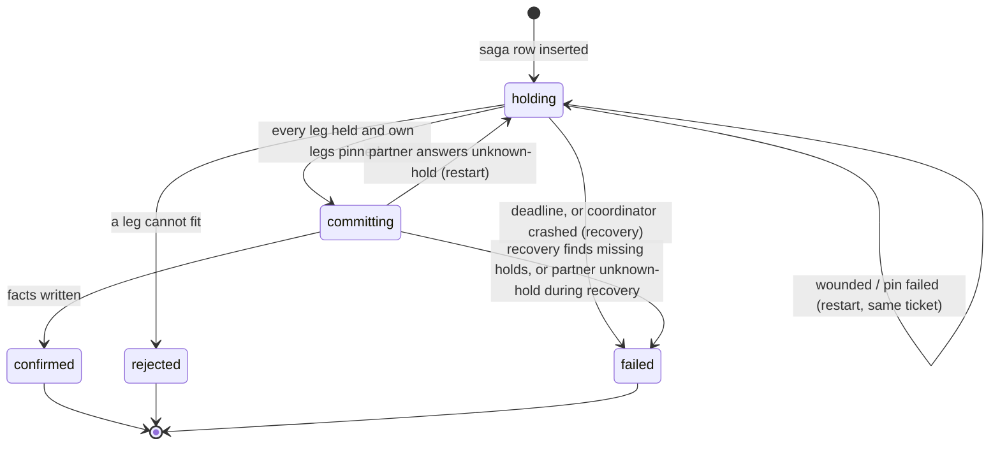

# RFC-002. Route reservation: a saga over held capacity, with priority tickets and a commit point

| | |
|---|---|
| **Status** | Implemented (prototype) |
| **Satisfies** | P2-S01, P2-S02, P2-S03, P2-S04, P2-S05, P2-S06, P2-S07, P2-S08, P2-S10, P2-S11, P2-S12, P2-S13, P2-S14, P2-S15, P2-S16, P2-S17, P2-S18, P2-S19, P2-S20, P2-S21, P2-S22, P2-S23, P2-S24, P2-S25, P2-S26, P2-S27, P2-S28, P2-S29, P2-S30, P2-S31, P2-S32. Built but not yet verified by a test (`@unverified` in the spec): P2-S10, P2-S12, P2-S17, P2-S19, P2-S20, P2-S26, P2-S27, P2-S31. Designed but not built: P2-S09 (the quick "pending" answer and its webhook). |
| **Decisions** | D4, D10, D13, D14, D15, D16, D17, D21, D22, D23, D30 |

Problem: [P2](../01-discovery/P2-route-reservation.md) · Spec:
[P2-route-reservation.feature](../02-specs/P2-route-reservation.feature) · Builds on
[RFC-001](RFC-001-link-admission.md) (the per-link usage tree with its `peak` and `conflicts`
queries, the window check, and the `reservations` facts table) · Code: `src/links.ts`,
`src/routes.ts`, `src/partner.ts`, `schema-routes.sql`; tests in `test/links.test.ts` and
`test/routes.test.ts`.

## Need

A buyer asks for one window and one rate on every link of a route, for example
Nairobi → Mombasa → Djibouti → Marseille, and must get the whole route or nothing. The links
belong to different providers. At least one is managed in a partner's system that cannot
join our transactions, does not understand our priorities, and fails, times out and is slow.

RFC-001 decides one link at a time in 200 ms. P2 needs, on top of that:

- capacity taken by an unfinished route request must count against the link, so nothing is
  sold twice, but must come back if the request fails or its coordinator dies;
- when buyers compete, at least one of them must end with a reservation while the capacity
  remains (P2-S13); "reject with retry after" does not meet this;
- crossed requests must not wait on each other until both time out (P2-S16);
- a crash at any point must leave every route fully booked or not booked (P2-S22 to S27);
- client and partner retries must never book twice (P2-S18, S28 to S30).

The latency budget for a whole route is about a minute, so the design may be eventually
consistent (D13). What happens when a request fits only if someone else's unfinished request
fails is a business policy, not an engineering choice (D15); the design provides the
mechanism and a default policy.

## Approach

### Components

| Component | Responsibility |
|---|---|
| `LinkBook` (one per link we own, in memory) | The link's schedule: confirmed reservations, holds, priority rules, waiters |
| `PartnerLink` (adapter to one partner) | `hold`, `confirm`, `release` calls to the partner; all idempotent by key (a repeated `hold` key is not checked against its parameters; see Idempotency) |
| `Coordinator` (one process) | Runs one saga per route request, owns the `LinkBook`s, writes the saga log and the facts |
| Postgres | `reservations` (the facts, from RFC-001), `sagas` and `holds` (the saga log) |

The prototype has one coordinator, one partner and a horizon of `n` minutes per link.

### LinkBook: two trees per link (D14)

Each link keeps two usage trees of the RFC-001 kind over the same horizon:

| Tree | Counts |
|---|---|
| `confirmed` | Confirmed reservations only |
| `total` | Confirmed reservations plus every live hold |

and a map of holds keyed by hold key:

```ts
type Ticket = readonly [startedAtMs: number, sagaId: number];
type Hold = { key; sagaId; ticket: Ticket; s; e: number | null; mbps; expiresAt; pinned: boolean };
```

Operations:

| Operation | Effect |
|---|---|
| `tryHold(req, ttlMs)` | See below. Returns `held`, `reject {peak, conflicts}` or `wait {blockers}` |
| `pin(key)` | Marks the hold pinned: it never expires and is never wounded. Returns `false` if the hold is gone |
| `confirm(key)` | Removes the hold and adds it to `confirmed`; `total` is unchanged. Wakes waiters |
| `release(key)` | Removes the hold from `total`. A no-op if the hold is already gone (released, expired, wounded or confirmed). Wakes waiters |
| `expire()` | Drops every unpinned hold with `expiresAt ≤ now`; wakes waiters if any were dropped. Called at the start of `tryHold`, `has` and `pin` |
| `changed()` | A promise that resolves at the next release, expiry, wound or confirm. Waiters are woken in the order they started waiting |
| `nextExpiry()` | The earliest expiry among unpinned holds, so a waiter knows when to look again |
| `addConfirmed`, `restoreHold` | Load facts and saga-log holds during recovery |

`tryHold(r, ttl)`, in order:

1. Check the window against the horizon (`0 ≤ s < n`, and `s < e ≤ n` or `e = null`); a bad
   window throws `RangeError`, a caller error rather than a rejection (D30).
2. `expire()`.
3. If a hold with key `r.key` exists, return `held` (idempotent by key). The request's `s`,
   `e` and `mbps` are **not** compared with the existing hold, so the same key with different
   parameters also returns `held`, for the old hold. See Idempotency.
4. If `confirmed.peak(s, e) + mbps > capacity`, return
   `reject { peak, conflicts: confirmed.conflicts(s, e, capacity − mbps) }`. This is definite:
   confirmed reservations are never revoked, so the request cannot fit later.
5. If `total.peak(s, e) + mbps > capacity` and wound-wait is on, **wound** every saga that has
   an unpinned hold here overlapping `[s, e)` with a younger ticket than `r` (see below).
6. If `total.peak(s, e) + mbps ≤ capacity`, store the hold with `expiresAt = now + ttl`, add it
   to `total`, return `held`.
7. Otherwise return `wait { blockers }`, the saga ids of the overlapping holds.

The three outcomes are the mechanism of D14 and D15. **Wait** is the default policy (D16):
the request waits on our side, it is not turned away.

### Priority tickets and wound-wait (D17)

A saga's ticket is `[startedAtMs, sagaId]`, fixed when the saga row is first inserted.
`older(a, b)` compares the start time and breaks ties by saga id. A restart keeps the
ticket, so every request eventually becomes the oldest competitor and wins (no starvation,
D4).

- An **older** request that needs held capacity wounds the younger, unpinned holds in its
  way: those holds are dropped and the owning saga is told (`onWound`), so it restarts.
- A **younger** request waits.
- **Pinned** holds are never wounded, by anyone.

Waits therefore only point from younger to older sagas and cannot form a cycle on our
links. Every collision has exactly one winner without the sagas coordinating, which is
what the D16 guarantee needs.

The partner runs its own book first come, first served (`woundWait: false`) and cannot be
wounded. That is the reason for the ordering rule below.

### The saga, step by step (D13, D21, D22)

`Coordinator.reserve(req)` with `req = { idemKey, links, s, e, mbps }`:

0. **Validate.** Every link must be known and the window valid on it; otherwise reject with
   `RangeError` before any saga row exists.
1. **Idempotency** (see below), then insert the saga row with status `holding` and
   `ticket_ms = now`.
2. **Attempt.** Each attempt uses fresh hold keys `${sagaId}.${attempt}.${linkId}` and clears
   the wounded flag. If the saga's deadline has passed, release everything and finish
   `failed` with reason `deadline`.
3. **Hold every leg, in this order:**
   1. **The partner leg first** (D22). Call `partner.hold(key, s, e, mbps, ttl)` with retries.
      `held` → record the hold; `nofit` → reject the route naming the partner link;
      `busy` → sleep 5–20 ms (random) and ask again, because the partner cannot queue us or
      call back.
   2. **Then our own links, busiest first**: sorted by `total.peak(s, e) / capacity`,
      descending, so the leg most likely to fail is tried early (D13, as narrowed by D22).
      For each, loop on `tryHold`: `held` → record the hold; `reject` → reject the route;
      `wait` → wait for the first of `book.changed()`, a wound of this saga, or
      `min(book.nextExpiry(), deadline)`, then try again. A wound or the deadline ends the
      attempt with `restart`.

   Ordering the partner first matters. D17 originally allowed any order, but that is only
   deadlock-free if every participant honours tickets. If an older saga could wait on a
   younger saga's partner hold while the younger waits on the older's hold on our link,
   neither can be wounded and only hold expiry breaks the cycle. With the partner always
   first, a saga only ever waits at the partner while holding nothing of ours. With several
   partners, they need one fixed order among themselves.
4. **On reject:** release every hold of this attempt and finish `rejected` with the link id
   and the conflicting minutes.
5. **On restart** (wounded, or a pin failed): `restart()` (below) and go to step 2 with the
   same ticket.
6. **Pin our holds.** Synchronously check that every own-link hold of this attempt still
   exists, then pin them all. Because the check and the pins run without yielding, no hold
   can expire or be wounded in between. If any hold is gone, restart.
7. **Commit point.** `UPDATE sagas SET status = 'committing'`. From here the saga rolls
   forward, never back (D21).
8. **Confirm the partner leg**, retrying with the same key until a definite answer. The
   partner is the one participant we cannot pin, so its confirmation is the saga's real
   commit point, applied last, like the last participant in a commit (D22).
   - `confirmed` → continue. A retried confirm that already succeeded returns `confirmed`.
   - `unknown-hold` (the partner's hold lapsed first) → `restart()` and go to step 2.
9. **Write the facts** (below), then `confirm` each hold in its `LinkBook`, which wakes the
   waiters on that link. Return `confirmed` with the restart count.

`restart(saga)` increments `restarts`, sets the status back to `holding` **before** releasing
anything, then releases every hold. If the status stayed `committing`, a crash while
re-holding would make recovery roll forward a saga whose new attempt holds only some of its
legs, writing facts for links that were never held: an oversell (D30).

**Compensation.** `releaseAll` releases each leg (partner calls retried; local releases are
idempotent) and marks the saga's `held` rows `released`. If the coordinator dies before it
compensates, hold expiry is the backstop.

**Partner retries.** Partner calls are idempotent by key, so any `PartnerError` (error or
timeout) is retried as-is after `min(50, 2^attempt) × random()` ms.

**Hold lifetime.** Our holds and the partner's are taken with `holdTtlMs`. D22 requires the
partner's hold to outlive our commit window; the prototype uses the same TTL for both and
handles a lapsed partner hold by restarting (step 8). See Risks.

### Writing the facts

`writeFacts(saga)` refuses to run unless the saga has a hold key for every link of the route.
Then, in one `READ COMMITTED` transaction:

1. insert one `reservations` row per link: `(link_id, start_time, end_time, reserved_mbps)`;
2. `UPDATE holds SET status = 'confirmed'` for this attempt's keys;
3. `UPDATE sagas SET status = 'confirmed', result = {status, sagaId, restarts}`;
4. commit (any error rolls back and leaves the saga `committing`).

The facts are the same table RFC-001 reads, so a confirmed route is indistinguishable from
single-link reservations once written.

### The saga log (`schema-routes.sql`)

```sql
CREATE TABLE sagas (
  id         bigint GENERATED ALWAYS AS IDENTITY PRIMARY KEY,
  idem_key   text NOT NULL UNIQUE,     -- client retries map to the same saga
  ticket_ms  bigint NOT NULL,          -- priority ticket: start time, then id
  links      bigint[] NOT NULL,
  start_min  integer NOT NULL,
  end_min    integer,                  -- NULL = open-ended
  mbps       integer NOT NULL CHECK (mbps > 0),
  status     text NOT NULL CHECK (status IN ('holding','committing','confirmed','rejected','failed')),
  result     jsonb,
  restarts   integer NOT NULL DEFAULT 0
);

CREATE TABLE holds (
  key        text PRIMARY KEY,           -- `${sagaId}.${attempt}.${linkId}`
  saga_id    bigint NOT NULL REFERENCES sagas,
  link_id    bigint NOT NULL REFERENCES links,
  start_min  integer NOT NULL,
  end_min    integer,
  mbps       integer NOT NULL,
  expires_at bigint NOT NULL,            -- epoch ms
  status     text NOT NULL CHECK (status IN ('held','confirmed','released'))
);
CREATE INDEX holds_saga ON holds (saga_id);
```

A hold row is inserted (`ON CONFLICT (key) DO NOTHING`) after the hold succeeds, with its
expiry: the book's `expiresAt` for our links, `now + ttl` for the partner.

### Saga status machine



| From | To | Trigger | Holds |
|---|---|---|---|
| — | `holding` | Saga row inserted | none yet |
| `holding` | `holding` | Wounded, or a hold vanished before pinning | all released; new attempt, same ticket |
| `holding` | `rejected` | `reject` from a link or `nofit` from the partner | all released |
| `holding` | `failed` | Deadline passed | all released |
| `holding` | `failed` | Coordinator crashed; set by recovery | left to expire |
| `holding` | `committing` | Every leg held, own legs pinned | own legs pinned |
| `committing` | `holding` | Partner answers `unknown-hold` | status reset first, then all released |
| `committing` | `confirmed` | Facts transaction committed | rows → `confirmed`; books confirm |
| `committing` | `failed` | Recovery: holds missing, or partner `unknown-hold` | all released |

Hold rows go `held → confirmed` (in the facts transaction) or `held → released`.

### Idempotency

- **In flight, same coordinator.** `reserve` keeps a map from idempotency key to
  `{req, result promise}`. The same key with the same parameters (links in the same order,
  `s`, `e`, `mbps`) returns the same promise. Different parameters reject with
  "idempotency key … reused for a different request".
- **Across coordinators and restarts.** The saga insert is `ON CONFLICT (idem_key) DO
  NOTHING`. If the key exists, the stored parameters are compared the same way: a mismatch
  is the same error; a match returns the stored `result`, or `pending` if the saga has none
  yet.
- **Partner.** Every partner call carries the hold key, so retries of `hold`, `confirm` and
  `release` are safe; a repeated `confirm` of a confirmed key returns `confirmed`.
- **Hold keys are not checked against parameters.** `LinkBook.tryHold` and the partner's
  `hold` return `held` for any key that already has a hold, without comparing `s`, `e` or
  `mbps`. A key reused for a different request would be told `held` for capacity it does
  not have. This is safe today only because the coordinator generates every key
  (`<sagaId>.<attempt>.<linkId>`) and never reuses one; any other caller must keep that
  rule. See [C02](../04-delivery/contracts.md#c02-linkbook-api) and
  [C08](../04-delivery/contracts.md#c08-partner-wire-protocol), which proposes the check
  for the real partner protocol.

### Recovery

`recover(db, partner, n, opts)` builds a new coordinator from durable state:

1. Create a `LinkBook` per own link and load every `reservations` fact into both trees.
2. Load every `held` hold row of a `holding` or `committing` saga into its book with its
   original expiry and ticket. Holds of `committing` sagas are restored **pinned**. Partner
   holds are skipped: they live in the partner's system.
3. Mark every `holding` saga `failed` with reason `coordinator crashed`. These sagas made no
   commit decision. They are **not resumed**; their restored holds lapse at their original
   expiry, and their partner holds lapse at the partner.
4. **Roll forward** every `committing` saga:
   - If it lacks a hold for any link of its route, the log is inconsistent: log an error,
     release the holds it has (including the partner's), and finish `failed` with a reason
     naming the missing links. Never write partial facts (D30).
   - Confirm the partner leg with the same key. `unknown-hold` → release and finish `failed`
     ("partner hold expired before recovery").
   - Write the facts and confirm the holds in the books.

### Policy hook

The mechanism always computes the three outcomes. The prototype's policy is fixed: route
legs **wait** on held capacity, bounded by the saga deadline. The intended client contract
(D16, P2-S09) is a "pending" answer within 200 ms, with the result delivered by webhook or
by polling with the idempotency key; in the prototype, `reserve` resolves only when the saga
finishes, and `pending` is returned only for a key whose saga has no result yet. Other
policies (reject with retry after, value-based priority) would change only what the
coordinator does with `wait`, not `LinkBook`.

### Parameters

| Parameter | Prototype value | Notes |
|---|---|---|
| `holdTtlMs` | 1,500 ms in tests (300 ms and 1,000 ms in specific tests) | Production: within the ~1 minute route budget |
| `deadlineMs` | 20,000 ms in tests | Production: the route promise, about a minute |
| Partner retry backoff | `min(50, 2^attempt) × random()` ms | Unbounded retries until the coordinator dies |
| Busy partner poll | 5–20 ms, random | |

## Benefits

Measured on the prototype (D23), local, 60 concurrent routes over 6 links, with a partner
that fails 10% of calls and times out on another 10%:

| Measure | Result |
|---|---|
| Tests | 27 pass (32 after the D30 review fixes) |
| Overselling | Never, checked in memory and from the Postgres facts |
| Competing requests never all lose (D16) | Holds: no request was rejected while its capacity was free |
| Definite answers | Every saga finished with a definite answer |
| Saga latency | p50 35–80 ms, p99 120–160 ms, well within the one-minute route promise |
| Crossed sagas | About 20 ms with priority tickets, against the full 1,000 ms hold expiry without them |
| Policy regressions are caught | Switching "wait" to "reject with retry" fails the D16 test on 2 of 3 seeds |

The repository README adds, for the same runs: 60 of 60 sagas finish per seed, and at most
4–7 restarts per saga. Numbers vary between runs because timing affects interleaving; a
rerun of the three seeds while writing this RFC gave p50 50–88 ms and p99 137–175 ms, with at
most 3–5 restarts, and crossed sagas resolved in 17 ms with one wound.

Qualitatively:

- All or nothing is enforced at the one place it is observable: the facts are written in a
  single transaction, and only when every leg is held.
- Rejections are definite and accurate (link and conflicting minutes), because they are
  decided on confirmed capacity only.
- No coordination between sagas is needed to break deadlocks on our links.
- The policy for the "fits only if holds release" case can change without touching the
  per-link mechanism.

## Competition

| Alternative | Why it lost |
|---|---|
| **One Postgres transaction over the whole route**, locking link rows in id order (the README's and the log's original open question 2) | Works only if every link is in our database. Partner links are not, and with an in-memory owner per link (RFC-001) there is no single transaction to join. |
| **Global atomicity: two-phase commit or distributed locks with partners** (D13) | Partners do not offer it, and it does not fit even a one-minute budget across unreliable APIs. |
| **Holds that do not count against capacity** (D14) | The same capacity can be sold twice while a saga runs. |
| **Reject on conflict with a hold** (D14) | If the holder then fails, the rejected request was turned away for nothing. |
| **Reject with "retry after"** as the default (D16) | Nothing guarantees the client retries; if the hold is released, the capacity goes unsold. Breaks the "competitors never all lose" requirement; the tests catch it on 2 of 3 seeds (D23). Remains available as a business policy (D15). |
| **Plain waiting, no priority** (first come, first served at each link) | Crossed sagas wait on each other until their holds expire: about 1,000 ms in the test instead of about 20 ms, and if both expire both lose (D17, D23). |
| **One global link order for every saga** (D17) | Also deadlock-free, and was judged equally acceptable: the choice between it and age priority is a coin flip, not a requirement. Age priority was picked because it allows the order to follow failure likelihood (busiest first) and gives no-starvation through kept tickets. D22 later fixed the partner leg first, so ordering is now partly fixed anyway. |
| **Any order, including the partner leg anywhere** (D17 as first written) | Deadlocks between an older saga waiting at the partner and a younger saga waiting on our link, because the partner ignores tickets; only expiry breaks it (D22). |
| **Other priority rules**, e.g. random or by value of the request (D15) | A random draw per collision still gives one winner, but loses no-starvation unless the draw is kept across restarts. Value-based priority is a legitimate business policy; it can replace start time in the ticket provided it stays a total order that a restarting request keeps. |
| **Compensate after the commit decision** (pre-D21) | A crash or a wound between confirming two links leaves a route partly booked. Hence pinning and roll-forward. |

## Risks and open issues

1. **Wounding is broader than needed** (D23, D30). An older request wounds every overlapping
   younger, unpinned hold on the link, even when dropping one of them would make room. This
   causes extra restarts; it does not affect correctness. Fix: wound the fewest, youngest
   holds that free enough capacity.
2. **Recovery fails `holding` sagas instead of resuming them** (D23). A buyer whose request
   was in flight during a crash gets `failed` (and their capacity returns only when the
   holds lapse), although the request could have been retried with its original ticket.
3. **A busy partner can only be polled** (D23). The server-side wait of D16 becomes a polling
   loop for the partner leg, which costs partner calls and adds latency, and the partner
   serves first come, first served, so our tickets do not apply there.
4. **No fencing between the P1 SQL path and the coordinator** (D30). RFC-001's SQL path writes
   facts under the link-row lock; the coordinator writes facts under its in-memory
   `LinkBook`. Run side by side on the same link, each can admit against a schedule the
   other has changed. They need a single owner per link with a fencing check, such as
   D10's per-link `seq`, before they can coexist.
5. **Partner hold lifetime.** D22 requires the partner's hold to outlive our commit window.
   The prototype takes the partner hold first with the same TTL as ours, so it is the
   earliest to lapse; a lapse is handled by an `unknown-hold` restart, at the cost of a full
   new attempt. A real partner integration should ask for a longer partner hold.
6. **Several partners on one route.** The prototype has one partner. Several need a fixed
   order among themselves, and only one of them can be the last-confirmed participant; a
   second partner's confirmation after the commit point has no pin to protect it.
7. **The client contract is not built** (P2-S09). No "pending" answer within 200 ms and no
   webhook; `reserve` blocks until the saga finishes.
8. **Single-link requests meeting a route's hold** (D14, D15). What a 200 ms single-link
   request does when it fits only if a route's holds release is still a policy question for
   the business.
9. **Crash points covered by reasoning only** (D30): after pinning but before `committing` is
   written; during the facts transaction (P2-S27); after `unknown-hold` but before the status
   reset.
10. **One coordinator, wall-clock tickets.** Tickets use the coordinator's clock. With several
    coordinators, clock skew would distort priority (still a total order, so still
    deadlock-free on our links, but no longer "oldest wins" in real time).
11. **Unbounded memory.** The in-flight idempotency map is never pruned, and partner retries
    have no cap; both need bounds in production.
