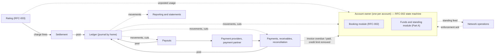
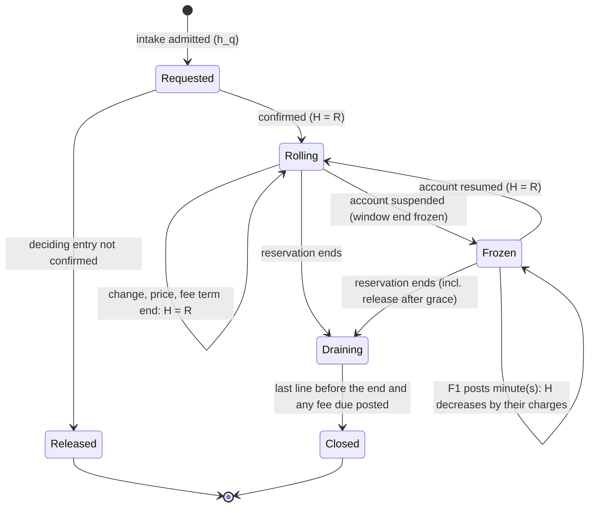
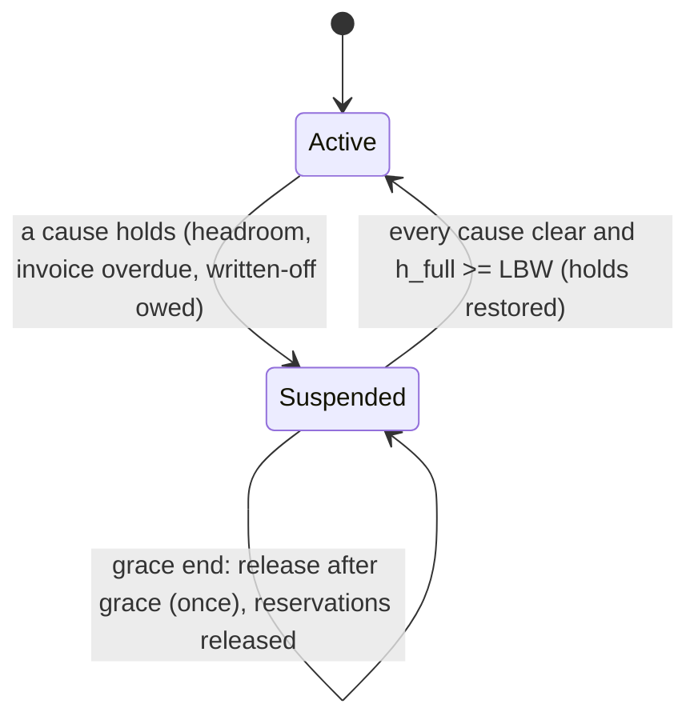
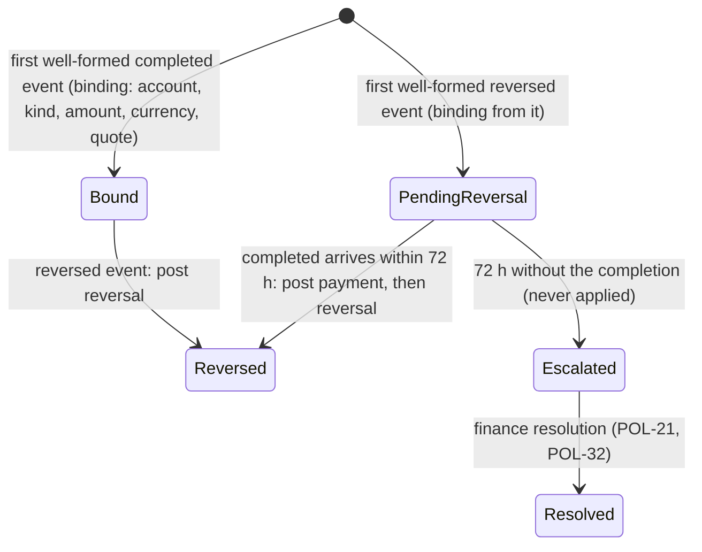

# RFC-004. Wallet, ledger and settlement

| | |
|---|---|
| Status | **Draft**, revision 1: rewritten on the accepted architecture. Part A is reviewed and approved together with RFC-002 (RFC-000 §7, R11) |
| Satisfies | **All of P4**: P4-S01 … P4-S104 (104 scenarios; traceability at the end). **Jointly with RFC-002** (RFC-002 owns the account owner's state machine, this RFC the funds rules its entries apply): P2-S38, P2-S39, P2-S40, P2-S41, P2-S42, P2-S54, P2-S66, P2-S68, P2-S69, P2-S70, P2-S71, P2-S75, P2-S76, P2-S77, P2-S78, P2-S92, P2-S98. **Contributes to** (primary RFC named in the traceability table): P3-S09, P3-S12, P3-S13, P3-S17, P3-S27, P3-S41, P3-S44, P3-S60, P3-S61, X1-S04, X1-S10, X1-S12, X1-S14, X2-S07, X2-S08, X2-S13, X2-S14, X2-S17, X2-S18, X2-S19, X2-S20, X2-S21, X2-S24 |
| Policies | POL-01, POL-04, POL-06, POL-07, POL-08, POL-10, POL-11, POL-12, POL-14, POL-15, POL-16, POL-17, POL-18, POL-19, POL-20, POL-21, POL-22, POL-23, POL-24, POL-25, POL-27, POL-28, POL-29, POL-30, POL-32, POL-33 |
| Prior decisions | History log D19, D20, D24, D25, D29 (carried forward in Competition) |
| Builds on | The requirements at tag `requirements-v1.5`; the architecture [RFC-000](RFC-000-architecture.md) at tag `rfc-000-accepted` (revision 3.2), whose components, ownership, principles A1 … A10, contracts (§8) and allocation (§7) bind this RFC |
| Supersedes | The pre-baseline draft of this file, written from the prototype in `billing/` |

Terms are used in the sense of the [glossary](../02-specs/glossary.md). Every latency,
volume and size marked "est." is an estimate, to be replaced by measurement (RFC-000 R1).
Requirements and the architecture are not changed here; where this RFC found a defect in
either, it is recorded under [Requirements issues](#requirements-issues) or
[Architecture issues](#architecture-issues).

## Need

P4's needs (P4-N1 … P4-N17) fall to two groups of components that RFC-000 deliberately
keeps apart (§2, "Funds holds are split from the ledger"):

1. **Account funds and standing** (Part A), inside the account owner, on admission's
   targets (99.99%, RTO 1 min; POL-06, X2-S21). Every booking and change needs a funds or
   credit hold sized exactly (P4-N3), checked with key headroom, capacity in flight and
   rate limits as if one at a time (P4-N3, POL-25), against one headroom figure that
   itemises and adds up (P4-N4); and the account's standing must move by rule, never by
   surprise: suspension on a stated cause, a funded grace, automatic resumption at a
   quoted amount, a warning per crossing, release after the grace (P4-N5), announced to
   network operations reliably (P4-N6). Any figure shown must be rebuildable exactly
   (P4-N16). RFC-000 makes this a deterministic module with no writer of its own,
   evaluated by entries of the account owner's log, which RFC-002 specifies.
2. **Money** (Part B): a double-entry journal that is conserved, immutable and
   once-only for 7 years (P4-N7, P4-N15, P4-N16), at about 1 M charge lines/s (est.,
   RFC-000 §6); a split that is exact, monotone and deterministic (P4-N8, P4-N9); supplier
   earnings that are final except for the supplier's own error (P4-N11); payments taken
   exactly once whatever the provider's delivery order (P4-N1, P4-N2); reversals, invoices
   and bad debt by rule (P4-N13, P4-N17); payouts weekly, exact and never instructed
   twice (P4-N12); statements anyone can check (P4-N10); and a daily proof, by 12:00 UTC,
   that the books equal the money (P4-N14).

The hard parts are where the two meet and where time intervenes: holds must track charges
that are posted up to minutes after they accrue; suspension must be decided at one point
in the account's serial order (POL-04); a ledger partitioned by home account must still
give one consistent cut for reconciliation and payouts; and payouts and payments stay in
flight across that cut.

## Approach

### 0. Overview



Part A (§A1 … §A11) is the funds-and-standing module of the account owner. Part B (§B1 …
§B13) is the ledger, settlement, payments and receivables, reconciliation, payouts and
statements. Notation used throughout:

| Symbol | Meaning |
|---|---|
| µ | micro-USD; every amount is a signed 64-bit integer of µ, tagged with its currency (POL-11, POL-20); intermediate products are 128-bit; nothing is floating point |
| `CW`, `SG`, `LBW` | `coverage_window` (24 h), `suspension_grace` (= `CW`), `low_balance_warning` |
| `a_r(m)` | the reservation charge line of reservation `r` for minute `m`: the exact sum over its parts active at `m` of rate × price, rounded down once to the µ (POL-11) |
| `cov_r(x, y)` | Σ `a_r(m)` over minutes `m` in `[x, y) ∩ [start_r, end_r)`; minutes before the evaluation time at the price they had, minutes from it on at the reservation's **current** price (a scheduled price change counts only once it takes effect, POL-27) |
| `p_r` | the first minute of `r` not yet posted (posted-through + 1 min), from the ledger feed; `start_r` until its first line is posted |

## Part A — Account funds and standing

### A1. Scope, and the division with RFC-002

The account owner is **one component, one log, one leader per account** (RFC-000 §2).
RFC-002 owns the state machine: the log envelope, the registry of entry kinds, the
intake and deciding entries, marks, "releases durable", takeover, the workflow, snapshots
and the status replicas. This Part owns the **funds-and-standing module**: the state
listed in §A2, the formulas of §A3, the payload and apply rule of every funds entry kind
(§A4), and the admission, hold, standing and query rules (§A5 … §A9). The module is a pure
function of the log (§A10); it never writes, sends or reads a clock.

| State or entry | Module | Who appends it |
|---|---|---|
| Booking requests, their marks, deciding entries, "releases durable", takeover; reservations, parts, locked prices, legs, partner terms shown at booking, lifecycle and end cause; change queue | Booking (RFC-002) | The leader's workflow |
| The **funds payload** inside the intake, deciding and reservation-change entries (hold taken, converted, resized or released; capacity in flight; rate count) | Funds (this Part), carried in booking entries | Computed by this module when the leader builds the booking entry |
| Funds entry kinds F1 … F10 (§A4): ledger, usage, exposure parameters, key status and limits, credit limit and vetting, invoice status, funds ticks, enforcement acknowledgements, probe designation, rules version | Funds (this Part); registered as kinds of the account log in RFC-002's registry | The leader, from a feed or a timer |
| Derived outcomes (standing change and its sequence number, warning, notices, release due, alerts) | Funds | Never appended on their own: recorded in the outcome field of the entry that caused them (§A4) |

RFC-002 must list F1 … F10 in its entry registry, embed the funds payload of §A4 in its
intake, deciding and reservation-change entries, and call the interface of §A10 at the
points named there. That is the whole coupling; nothing else in either module reads the
other's state except through §A10.

### A2. State per account

| State | Meaning | Changed by |
|---|---|---|
| `Bal`, `ledger_pos` | Ledger balance of the account, through ledger position `ledger_pos` (partition, epoch, sequence) of its one home partition (RFC-000 §2) | F1 |
| `W` | Written-off amount still owed (POL-21): written off less repaid, as derived by the ledger (§B2, M18, M19, M1) | F1 |
| Per reservation `r`: `p_r`, `H_r`, `hold_state_r`, `Wend_r`, `fee_r`, `fee_end_r`, `key_r` | First unposted minute; actual hold (µ); state of the hold machine (§A6); frozen window end while suspended; shown partner fee and the end of the partner's minimum term (from the booking module's reservation record); the key that booked it | Booking entries' funds payload, F1, F7 |
| Per pending request `q`: `h_q`, `mbps_q`, `key_q` | Intake hold, capacity in flight, key | Intake, deciding entry |
| `U[product]`, `rating_pos` | Unposted usage per product (POL-18), through rating position | F2 |
| `LB[product]` inputs | `usage_rate_cap`, `max_lateness`, `attribution_lag_max`, highest `usage_price` on any route, per product the account is onboarded for | F3 |
| `CL`, `kyb`, `mode` | Credit limit (0 if none), know-your-business status as recorded by identity and access, and prepaid or credit-limit mode | F5 |
| Per key `k`: `status_k`, `ksl_k`, `kif_k`, `krl_k` | Key status (D6), `key_spend_limit`, `key_inflight_limit`, `key_rate_limit` | F4 |
| `overdue` | Set of invoices overdue (from receivables) | F6 |
| `standing`, `causes`, `since`, `grace_end`, `released`, `std_seq` | Standing machine (§A7) | Any entry, as a derived outcome |
| `warn_armed` | Whether a low-balance warning may be sent on the next crossing (§A7) | Any entry, derived |
| `enforced[std_seq]` | Enforcement acknowledgement from network operations | F8 |
| `excluded` | The account is a designated probe account, excluded from rating (POL-06) | F9 |
| `rules` | The rules version in force from a log position | F10 |
| Rate windows | Leader-memory submission timestamps per key and account in the last second (§A5.4) | Not logged (soft, rebuilt from intakes) |

### A3. The quantities

Every quantity below is a function of the module state at one log position and the
timestamp of the entry or answer that evaluates it (§A10), so each is exactly
reproducible (P4-N16, P4-S72).

| Quantity | Definition | Source |
|---|---|---|
| Coverage of `r` | `C_r = cov_r(p_r, p_r + CW)`; the window is clipped to the reservation, so a reservation shorter than `CW` is covered whole; a future one is covered from its start | POL-15, P4-N3 |
| Fee part of `r` | `fee_r` while the evaluation time is before `fee_end_r` and the fee would be the buyer's to pay (POL-08); otherwise 0 | POL-15, POL-08 |
| Required hold | `R_r = max(C_r, fee part)` | POL-15 |
| Funds held | `F = Σ_r H_r + Σ_q h_q` (credit holds included: a credit hold is the same amount labelled by `mode`, P4-S13) | POL-18 |
| Usage exposure | `X = Σ U[product] + Σ LB[product]`, with `LB = ceil(usage_rate_cap × (max_lateness + attribution_lag_max + 60 s) × highest usage_price)` per product | POL-14, POL-18 |
| Headroom | `h = Bal − F − X + CL` | POL-18 |
| Headroom with full holds | `h_full = Bal − Σ_r R_r(active window) − Σ_q h_q − X + CL`, every reservation's hold computed as if the account were active | POL-16 (resume) |
| Accrued, not yet posted | `A = Σ_r cov_r(p_r, m_now)`, `m_now` the evaluation time's minute boundary; shown for information, already inside `F` (§A6) | POL-18, P4-S16 |
| Key spending | `KS_k = Σ_{r of k} cov_r(max(P_k, start_r), p_r) + Σ_{r of k} H_r + Σ_{q of k} h_q`, with `P_k` the start of the current `key_spend_period` (UTC day): charges posted in the period, plus what is held for everything after them, so each minute is counted once, and ended reservations keep counting | POL-25, P4-S68 |
| Key headroom | `kh_k = min(h, ksl_k − KS_k)`; `h` if the key has no limit | POL-25 |
| Capacity in flight | `IF_k = Σ_{q of k} mbps_q`, `IF_a = Σ_q mbps_q`; `account_inflight_limit = max(account_inflight_floor, 10 × the largest peak reserved rate among the account's reservations not ended)` | POL-25 |
| One window's charges | `CWC = Σ_r C_r` (coverage only, no fee part) | POL-16 |
| Warning threshold | `LBW = max(ceil(CWC / 4), 1,000,000 µ)` | POL-16 |
| Resume amount | `RA = W + max(0, LBW − h_full)`; an account with an overdue invoice is told to pay every overdue invoice as well (the amount alone never resumes it) | POL-16, POL-21 |
| Warning quote | `WQ = LBW + CWC − h` | POL-16, P4-S24 |
| Insufficient-funds amounts | For a request needing hold `x` with headroom `h < x`: `x − h`, and `x − h + LBW` | POL-10 |

Why the hold is anchored at `p_r`, the first unposted minute, and not at the clock: POL-18
requires that "charges accrued but not yet posted stay within funds held". With the window
starting at `p_r`, the minutes between the last posting and now are inside it; when a
minute is posted, the balance falls by its charge and the window slides one minute, so the
hold stays the coverage of the next `CW` (P4-S10) and nothing is counted twice or missed.

**Probe accounts** (`excluded`, POL-06) are never rated, so nothing is ever posted for
them. For them `p_r` is taken to advance with the clock (every minute counts as posted at
its end, with a charge of 0): their credit holds roll forward and end exactly as anyone's
(X2-S24), their balance never moves, and they are never invoiced (§B5).

### A4. Entry kinds and their funds payload

**Funds payload in booking entries** (RFC-002 kinds; this Part defines the payload).

| Booking entry (RFC-002) | Funds payload | Apply rule |
|---|---|---|
| Intake (entry 1), admitted | `h_q`, hold kind, `mbps_q`, key, the headroom and key headroom it was checked against, with the position | Adds the request hold and the capacity in flight (§A5) |
| Intake, ended at intake (rejected for standing, limits or funds) | The refusal reason and amounts | Nothing held |
| Deciding entry, confirmed | Request `q` → reservation `r`; new `H_r` | Removes `h_q`, `mbps_q`; sets `H_r = R_r` (new reservation) or the resized hold (change) (§A6) |
| Deciding entry, not confirmed (rejected, failed, withdrawn, key revoked, suspended, expired) | Request `q` released | Removes `h_q` and `mbps_q` (P4-S12) |
| Reservation change applied (decrease or shorten effective, cancellation effective, revocation, cut under POL-07, move to an equivalent path, termination, release after grace, a price change taking effect) | The reservation's new schedule, end cause, fee due from the buyer | Resizes or ends the hold (§A6) |

**Funds entry kinds** (this Part defines them; RFC-002 registers them).

| Kind | Payload | Appended when | Apply rule |
|---|---|---|---|
| **F1 Ledger applied** | Ledger position; movements for the account since the last F1 (kind, amount, source reference); new `Bal`; per reservation the new posted-through minute; change of `W`; posted accrual per key in the period | The leader has received ledger feed events for the account (one per movement; batched in group commits) | Updates `Bal`, `W`, `p_r`; rolls or consumes holds (§A6); evaluates standing (§A7) |
| **F2 Usage applied** | Per product unposted usage `U`, rating position, and the ledger position the report assumes | A rating report has arrived **and** the account has applied F1 through the ledger position it assumes (so a usage charge leaves `U` only once it is in `Bal`, never before) | Replaces `U[product]`; evaluates standing |
| **F3 Exposure parameters** | Per product `usage_rate_cap`, `max_lateness`, `attribution_lag_max`, highest `usage_price` | Catalogue or onboarding change (RFC-003) | Recomputes `LB`; evaluates standing |
| **F4 Key status** | Per key status (active, revoked), `key_spend_limit`, `key_inflight_limit`, `key_rate_limit` | Key-status push from identity and access (RFC-005), within 60 s (D6) | Updates keys; the booking module reads `status_k` for revocation (P2-S72) |
| **F5 Credit and vetting** | One of: KYB status recorded; credit limit set (amount, finance operator, reason); credit limit removed (operator and reason, or "invoice written off" with the invoice) | Identity push (KYB); operator console command (finance role, POL-32); receivables feed (write-off) | Set is **refused, recorded, and changes nothing** unless `kyb` is passed (P4-S82); sets `CL`, `mode`; relabels holds; evaluates standing |
| **F6 Invoice status** | Invoice overdue (invoice, amount) or invoice paid (invoice) | Receivables feed (§B5) | Updates `overdue`; evaluates standing (P4-S18 row 5, P4-S93) |
| **F7 Funds tick** | One of: fee term ended (`r`); grace ended (re-check, see §A7) | The leader's timer reaches the instant (from the entry's own state, A8) | Applies the time-driven change (§A6, §A7) |
| **F8 Enforcement acknowledgement** | `std_seq`, enforced-at time | Network operations acknowledges a standing change (§A8) | Records it; a late or missing acknowledgement raises the late-enforcement report (P4-S27) |
| **F9 Probe designation** | `excluded` on or off | Catalogue and identity designation (RFC-006, POL-06) | As §A3 |
| **F10 Rules version** | The version of this module's rules in force from this position | Deployment of a new rules version | Later entries are evaluated with it; replay uses the version recorded |

**Inputs and outcomes in one entry.** For every entry the leader computes the module's
outcomes (§A10) and records them in the entry beside its inputs: hold changes, any
standing transition with its new `std_seq`, a warning, notices, a release due, alerts.
Followers recompute the outcomes from the inputs and compare; a mismatch stops that
follower applying and raises an alert (it signals a non-deterministic rule or a version
skew). Recording outcomes makes the standing feed, notices and audit read straight from
the log, and makes every decision visible at the position it was taken (POL-04).

### A5. Admission rules

#### A5.1 What an intake is checked against

The booking module calls `admit` (§A10) when it builds an intake entry, in the account's
serial order, so concurrent bookings and changes by one account or key are checked one at
a time against the holds already taken (P4-S66, P2-S70, P2-S71). The checks, in order,
with the reason each refusal states:

| # | Check | Refused with (POL-10 wording) |
|---|---|---|
| 1 | The request adds something (a booking, an extension or an increase) and the account is suspended | "account suspended", the resume amount `RA` and, if any, the overdue invoices (P2-S42, P2-S78) |
| 2 | `IF_k + mbps_q > kif_k` (if the key has a limit) | key's limit on capacity in flight reached (P2-S40) |
| 3 | `IF_a + mbps_q > account_inflight_limit` | account's limit on capacity in flight reached (P2-S40, P2-S54, P2-S66, P2-S98) |
| 4 | `h < x`, where `x` is the hold the request needs (§A5.2) | insufficient funds, with `x − h` and `x − h + LBW` (P2-S38, P2-S75) |
| 5 | `kh_k < x` | the key's spending limit would be exceeded (P2-S39, P2-S76, P4-S98) |

Otherwise it is admitted: `h_q = x` is held and `mbps_q` is in flight from the intake
entry, before any capacity hold (POL-25, P2-S92). Check 5 uses the headroom left after
check 4, so a negative key headroom blocks only that key (P4-S98): it never ends,
suspends or reduces anything, and other keys are unaffected.

A change that only reduces (a decrease, a shorten, a cancellation) needs no funds and is
not checked; it is allowed while suspended (POL-08, P2-S77).

#### A5.2 The hold a request needs

| Request | `x` | `mbps_q` |
|---|---|---|
| New reservation | `R_r` of the requested reservation, as if confirmed now: `max(cov(start, start + CW), fee part)` | its reserved rate, once, whatever the number of legs (P2-S66) |
| Increase or extension of `r` | `R_r(after) − R_r(before)`, both at this position: the coverage of the added part within the reservation's current window | the added Mbps (increase) or the reservation's rate (extension) |

#### A5.3 At the decision

The deciding entry (RFC-002) is the POL-04 decision point. For a request that adds
something, it is **confirmed only if the account is active at that position** (P2-S69):
a suspension applied earlier in the log ends it not confirmed with the resume amount. The
funds check itself is not repeated: the request already holds `h_q`, and headroom can
fall below zero only through an entry that suspends the account. On confirmation `h_q`
becomes the reservation's hold: `H_r = R_r` for a new reservation; for a change,
`H_r = R_r(after)` at the deciding entry. A change's hold can differ from
`H_r(before) + h_q` by at most the added part's accrual over the minutes posted between
intake and decision (at most one minute, since the deadline is at most 60 s); if headroom
cannot cover that difference it is a failed roll-forward (§A7), and the confirmation
stands. Every other outcome releases `h_q` in the deciding entry itself (P4-S12); its
reporting follows RFC-002's "releases durable" rule.

#### A5.4 Rate limits

`key_rate_limit` and `account_rate_limit` are exact counts of booking submissions (new
requests and retries with their key; never status polls, P2-S68) in the **sliding second**
ending at the leader's timestamp. The leader evaluates them before proposing anything:
a submission over a limit is **not accepted** and creates nothing (P2-S41), with
`retry_after` the time until the oldest submission in the window leaves it. Accepted
submissions are counted in leader memory and rebuilt by a new leader from the intake
entries of the last second (retries answered from state are not logged, so for one second
after a leader change the count can be low by the retries of that second; nothing else
depends on it). `key_poll_limit` is not applied here: polls never reach the leader
(RFC-000 §4.6; see AI4-6).

### A6. The hold of a reservation



| Event | Rolling (account active) | Frozen (account suspended) |
|---|---|---|
| Confirmed (new) | `H_r = R_r`; a future reservation holds `cov(start, start + CW)` (or the fee, if larger) from the decision until it starts (P4-S59) | Not possible (§A5.3) |
| F1: minutes `[p, p')` of `r` posted | `p_r = p'`; `H_r = R_r`, the window `[p_r, p_r + CW)` having slid (P4-S10). If headroom cannot cover the minutes the window gains, the hold cannot roll forward: §A7 | `p_r = p'`; `H_r = max(0, H_r − cov(p, p'))`: charges are taken from the hold, which does not roll (P4-S64); charges beyond it reduce `Bal` (P4-S70, P4-S101) |
| Change applied: decrease (newest part first), shorten, cut under POL-07, move to a cheaper or equal equivalent path | `H_r = R_r` from the new schedule (P4-S60) | `H_r = min(H_r, cov(p_r, Wend_r))` at the new schedule |
| Confirmed increase or extension | §A5.3 | Not possible |
| Price change takes effect (POL-27) | `H_r = R_r` at the new price; if the growth cannot be covered, §A7 (P4-S62, P4-S101) | `H_r` unchanged; the higher charges are taken from it |
| F7 fee term ended | `R_r` drops to the coverage alone (P4-S96) | `H_r = min(H_r, cov(p_r, Wend_r))` |
| Reservation ends (cancelled, shortened to an end, revoked, released, terminated, P4-S11, P4-S61) | **Draining**: `H_r = min(H_r, cov(p_r, end_r) + fee_due)`, where `fee_due` is the shown fee if the buyer pays it (own cancellation within the minimum term, release after grace, termination; not on revocation or a cut, POL-08); no funds are held for any minute after the end | Same |
| F1 in Draining | `H_r` falls by what is posted, to 0 (**Closed**) | Same |

The Draining rule keeps POL-18's invariant at the end too: a charge accrued before the end
but not yet posted, and a fee due, stay within funds held until posted, instead of
vanishing from headroom for the up to 2 minutes rating takes (RQ4-2 records the reading).

**Invariant A-1.** While the account is active, `H_r = R_r` for every reservation after
every entry; so `Σ H_r` is the coverage still required (P4-N3). While suspended, `H_r`
never grows (it is only consumed), except as §A7 grows it once at suspension.

**Invariant A-2.** No entry admits a request whose hold would take headroom or key
headroom below zero (§A5.1); headroom falls below zero only by an entry that also
suspends the account (§A7). So the holds of confirmed bookings never together exceeded
what headroom allowed at each intake (P4-S66).

**Worked examples** (2 µ per Mbps-minute; posting assumed caught up to "now" unless
stated, so `p_r` is the current minute).

| Scenario | Computation | Result |
|---|---|---|
| P4-S08 | open-ended 100 Mbps: `C = 100 × 2 × 1,440` | `H = 288,000 µ`; `Bal` unchanged |
| P4-S09 | 100 Mbps for 2 h: window clipped to 120 min | `24,000 µ` |
| P4-S59 | starts in 30 days: `cov(start, start + 24 h)` held from the decision | `288,000` / `24,000 µ` |
| P4-S10 | minute posted: `Bal −200`; window slides: `−a(p) + a(p + 1,440) = −200 + 200` | `H` still `288,000`: covers the next 24 h |
| P4-S60 row 1 | `288,000 + 50 × 3 × 1,440` | `504,000 µ` |
| P4-S60 row 2 | `50 × 2 × 1,440` | `144,000 µ` |
| P4-S60 row 3 | newest part (50 @ 3) removed, then 20 of 100 @ 2: `80 × 2 × 1,440` | `230,400 µ` |
| P4-S60 row 4 | `[12:00, 22:00)` at 09:00 shortened to 14:00: `100 × 2 × 120` | `24,000 µ` |
| P4-S60 row 5 | cut to 50 Mbps: `50 × 2 × 1,440` | `144,000 µ` |
| P4-S62 | price 3 µ takes effect: `100 × 3 × 1,440` | `432,000 µ` |
| P4-S63 | `max(288,000, 500,000)`; `max(288,000, 100,000)` | `500,000` / `288,000 µ` |
| P4-S96 | F7 fee term ended: `R = C` | `288,000 µ` |
| P4-S13 | credit-limit account: `h = 0 − 288,000 − 0 + 1,000,000` | credit hold `288,000`; headroom `712,000 µ` |
| P4-S64 | suspended 09:00 with `288,000`; 360 minutes posted at 200 | `H = 216,000`; `72,000` taken from it |
| P4-S11, P4-S61 | ends at minute `e`: Draining holds only unposted minutes before `e` (0 once posted) | no funds held for any minute from `e` |
| P4-S12 | not confirmed: deciding entry releases `h_q` | nothing held |

### A7. Standing



**Causes.**

| Cause | Holds when | Clears when |
|---|---|---|
| `headroom` | In the active state, applying an entry would leave `h < 0` with every hold at `R_r`: a hold cannot roll forward (F1), a price change needs more (POL-27), usage exposure grows (F2, F3), a reversal (F1), a lower credit limit (F5) (P4-S18 rows 1 to 4, P4-S51) | Only through resumption (below) |
| `invoice` | `overdue` is not empty (F6; P4-S18 row 5) | Every overdue invoice is paid (P4-S93) |
| `written_off` | `W > 0` (POL-21) | `W = 0` (P4-S94) |

**Suspending.** When a cause first holds in the active state, the entry that caused it
records the transition, a new `std_seq`, `since` = the entry's timestamp,
`grace_end = since + SG`. If the cause is `headroom` because holds had to grow (roll-forward
or price change), the holds grow by whatever headroom remains, `max(0, h)` before the
growth, given to the reservations in age order (oldest first), so headroom is then exactly
0 or as negative as it already was (POL-16, P4-S101); every reservation's window end is
frozen (`Wend_r = p_r + CW`, or as grown). The entry's outcome carries: the suspension
notice to the buyer, quoting `RA` (and any overdue invoices), and the standing event for
network operations (§A8). A suspension applied before a request's deciding entry ends that
request not confirmed (P2-S69); one after it changes nothing (P2-S103).

**While suspended.** No booking, extension or increase is admitted (§A5.1); reductions
are (P2-S77). Reservations keep their capacity (P4-S20) and accrue against their holds,
which are consumed and not rolled (§A6), even if the hold is unfunded after a reversal
(P4-S70). The `headroom` cause is not re-evaluated; new causes are added to `causes`
without a new `std_seq` (network operations only needs active or suspended).

**Resuming.** After every entry, a suspended account resumes when `causes ∖ {headroom}`
is empty (no overdue invoice, `W = 0`) **and** `h_full ≥ LBW`. Resumption records a new
`std_seq`, restores every hold to `R_r` (unfreezing windows), re-arms the warning if
`h ≥ LBW`, and emits the unblock event (P4-S22, P4-S93). It needs no request from the
buyer. Because top-ups, charges and reversals of one account all reach it through the
one ledger partition of its home, in ledger order (F1), a top-up racing a suspension is
applied before or after it, and both orders end in the standing the final headroom implies
(P4-S65).

**Release after grace.** At `grace_end`, if still suspended and not yet released, the
leader appends F7 *grace ended*; its outcome is **release due**, and the booking module
appends the release of every reservation (RFC-002, reservation command port, "release after
grace"; RFC-000 §8), with the buyer told which and why (P4-S23). Each released reservation
goes to Draining with its shown fee due (§A6): the fee is charged against what is left of
the hold and any shortfall becomes a negative balance (P4-S97). The account stays
suspended until it resumes.

**Warnings.** After every entry in the active state: if `warn_armed` and `h < LBW`, the
outcome is a warning quoting `WQ`, and `warn_armed` becomes false; whenever `h ≥ LBW`,
`warn_armed` becomes true. So one warning per crossing (P4-S69). A crossing that coincides
with a suspension sends the warning, then the suspension notice.

**Worked examples.**

| Scenario | Computation | Result |
|---|---|---|
| P4-S15 | `1,000,000 − 288,000 − 33,250` (`U` 2,000 + `LB` 31,250, as in P4-S16) | headline `678,750 µ` |
| P4-S16 | `LB`: 100 Mbps × (180 + 10 + 60) s = 25,000 Mb = 3.125 GB, × an illustrative highest `usage_price` of 10,000 µ/GB = 31,250; `U` = 2,000; `A` = 2 unposted minutes × 200 = 400 | items add up to `678,750`; `400` shown inside funds held |
| P4-S55 | `min(10.00, 5.00 − 1.00)`; `min(3.00, 4.00)` | `4.00` / `3.00 USD` |
| P4-S68 | `KS = posted in period + H`; `kh = min(10, 1 − KS)` | `0.288/0.712`, `0.360/0.640`, `0.360/0.640` (previous period not counted), `0.788/0.212`, `1.088/−0.088` |
| P2-S39 | admit iff `x = 288,000 ≤ kh` | rows 1 to 3 confirmed; row 4 (`kh` 0.212) refused, check 5 |
| P2-S38 | `h = 488,000 − 288,000 = 200,000`; credit: `−500,000 − 300,000 + 1,000,000 = 200,000`; `x = 288,000` | refused, check 4: `88,000` and `1,088,000 µ` |
| P4-S22 | `h_full = 216,000 − 288,000 = −72,000`; `LBW = max(72,000, 1,000,000)`; `RA = 1,072,000` | top-up 1.072000 → `h_full = 1,000,000 ≥ LBW`, active, unblock; top-up 0.500000 → `h_full = 428,000`, still suspended, `572,000` more |
| P4-S24 | `WQ = LBW + CWC − h` | `1 + 0.288 − 0.9 = 0.388`; `7.2 + 28.8 − 7.0 = 29.0`; `1 + 0 − 0.5 = 0.5` USD |
| P4-S70 | reversal F1: `Bal 300,000 − 5,000,000`; suspended; `H` frozen 288,000 and consumed over the grace | `Bal −4,700,000`; capacity kept for `SG`; Share's further loss at most `288,000` |
| P4-S97 | suspended; grace consumes `288,000` of `H = 500,000`; release: Draining `min(212,000, 0 + 500,000)`; fee posted | `H` 212,000 then 0; `Bal 212,000 − 500,000 = −288,000`; loss ≤ min(fee, coverage) |
| P4-S101 | price takes effect: `R = 432,000`, growth 144,000 > `h` 100,000; hold grows by 100,000 | suspended, `H = 388,000`; grace charges 432,000: `Bal 388,000 − 432,000 = −44,000` if not resumed |
| P4-S92 | `h = −1,000,000 − 288,000 + 5,000,000 = 3,712,000`; cause `invoice` | a posted minute changes nothing: still suspended |
| P4-S93 | invoice of 1.000000 paid: `Bal 0`, `overdue` empty, `h_full = 4,712,000 ≥ LBW` | active; unblock |
| P4-S94 | `W = 4.7`, top-up repays first (§B2 M1); `RA = W + max(0, 1 − 0)` = 5.7 | 4.0 → `W 0.7`, `Bal 0`, suspended; 5.7 → `W 0`, `Bal 1.0`, active; `e1`: 11.0 → `W 0`, `Bal 1.0`, active prepaid (`CL` removed at the write-off, F5) |

**P4-S19, the exposure argument.** At every position, the money owed for usage-priced
traffic carried but not yet in `Bal` is at most `U + LB`: `U` counts every accepted
record until its charge is in `Bal` (F2 is applied only after the F1 that posts it), and
`LB` covers what has been carried but not yet counted: records not yet arrived
(`max_lateness`), accepted but not yet counted (`attribution_lag_max`), and traffic between
the suspension decision and its enforcement (60 s), all at `usage_rate_cap` and the
highest price (POL-14). Since an F2 or F3 that would take `h` below zero suspends in the
same entry, the account is suspended no later than the moment its headroom net of exposure
would fall below zero, and what it can still carry is inside `LB`.

### A8. Standing feed and query (to network operations)

| Element | Semantics |
|---|---|
| Standing event | `(account, std_seq, standing, since, decision position)`, emitted from the outcome field of the committed entry that changed standing. Delivered at least once, in `std_seq` order per account; a consumer applies an event only if its `std_seq` is higher than the last it applied, so repeats change nothing (P4-S25) |
| Timing | The account owner's outbox relay sends it within about 100 ms of the commit (est.), inside `standing_notice_time` (10 s, POL-06; X2-S17), and resends until acknowledged |
| Query | Served by account-owner replicas: current standing, `since`, `std_seq`, at a stated position (P4-S26) |
| Enforcement acknowledgement | Network operations returns `(account, std_seq, enforced_at)` once it has blocked or unblocked usage-priced traffic; it is appended as F8. At `since + 60 s` (X2-S08) the leader's timer checks: no F8 for that `std_seq`, or one with `enforced_at` later than the target, raises the late-enforcement report to operations and finance through the alert feed (P4-S27) |

Standing events carry no cause: network operations only blocks and unblocks (P4 Out of
scope). Usage-priced traffic is blocked at suspension (P4-S21) and unblocked at resumption.

### A9. Headroom and balance query

Served by account-owner status replicas from their applied state (RFC-000 §4.6), never by
the leader's write path; one answer within 200 ms (POL-06's wallet probe, X2-S18).

| Field | Content |
|---|---|
| Position | Account-log position and timestamp at which the answer is evaluated; the ledger position of `Bal`; the rating position of `U` |
| Headline | `h`; for an agent key, `kh_k` instead, with `KS_k` and `ksl_k` (P4-S55) |
| Items | `Bal`; funds held `F` (credit holds marked as such); usage exposure `X` as `U` and `LB` per product; charges accrued not yet posted `A`, marked "within funds held"; `CL` (P4-S16) |
| Standing | Active or suspended, causes, `RA` and overdue invoices if suspended; `LBW` |

`Bal` is the ledger's balance at the stated ledger position, the exact sum of the
account's entries there (P4-S17), because every movement touching the buyer is in its one
home partition. An answer that gates a decision is not this query: the decision is taken
inside the deciding entry (§A5). P4-S72 (rebuild any past figure): load the account log
snapshot at or before the position an answer carried, replay to the position with the
rules version recorded (F10), and evaluate `answer` at that entry's timestamp; the figures
are equal by determinism (§A10). History (RFC-006) keeps the account log for 7 years.

### A10. The in-process interface

The module is a library linked into the account owner, with no I/O, no clock and no
randomness. Language-neutral signatures (wire formats belong to `04-delivery/contracts.md`):

```
Ctx      = { pos: LogPosition, ts: Timestamp /* the entry's leader timestamp */, rules: RulesVersion }
Ask      = { request, principal, key?, kind: New | Increase | Extend,
             schedule_after: Schedule, schedule_before?: Schedule, fee_terms?: FeeTerms, mbps }
Verdict  = Admit { hold: Micros, hold_kind: Funds | Credit, mbps }
         | Refuse { reason: Suspended{ra, overdue} | KeyInflight | AccountInflight
                           | InsufficientFunds{min, min_plus_lbw} | KeySpendLimit }
Input    = Intake{request, verdict} | Decided{request, Confirmed{reservation, schedule} | NotConfirmed}
         | ReservationChanged{reservation, schedule, end?: {cause, fee_due}}
         | PriceTookEffect{reservation, schedule} | F1 … F10 payloads (§A4)
Outcomes = { hold_changes, standing?: {from, to, std_seq, causes, ra}, warning?: {wq},
             notices[], release_due?: [reservation], alerts[] }

rate_check(soft: RateWindows, ts, principal) -> Accept | NotAccepted{retry_after}   // leader memory only
admit(S, ctx, ask)           -> Verdict
apply(S, ctx, input)         -> (S', Outcomes)        // the only state transition
due(S)                       -> [(instant, F7 payload)] // timers the leader must arm: fee term ends, grace end, enforcement checks
answer(S, ctx, principal)    -> HeadroomAnswer        // §A9
standing(S)                  -> {standing, since, std_seq}
```

| Call site (RFC-002) | Call |
|---|---|
| A booking submission arrives at the leader | `rate_check`; if accepted, `admit`, whose verdict goes into the intake entry's funds payload; the booking module ends the request at intake on `Refuse` |
| Building the deciding entry | `standing(S)` must be active for a request that adds something; then `apply(Decided)` |
| Applying any booking entry with a funds payload | `apply` with the corresponding `Input` |
| A feed event or timer | The leader builds F1 … F10 and calls `apply`; the outcomes go into the entry |
| `release_due` in outcomes | The booking module appends the release after grace for the listed reservations |
| Status replicas | `answer`, `standing` |

**Determinism rules.** Integer arithmetic only; iteration over reservations in
`(start_r, id)` order and over keys in id order; time only from `ctx.ts`; every
parameter (POL values, prices, limits) from state applied by an entry; the rules version
from F10. The leader records outcomes and followers check them (§A4).

### A11. Sizing and recovery (Part A)

| Item | Estimate |
|---|---|
| State | About 60 B per reservation (`p_r`, `H_r`, window, fee, key, state) and 40 B per pending request: about 4 GB for 63 M active reservations across every account group (est.) |
| F1 entries | One per posted movement touching the account: about 1,700 a second for reservation charges at 100,000 active accounts (one movement per account and minute, RFC-000 §6), plus payments (1,000/s peak). Each carries posted-through minutes compactly: "every reservation of the movement's lines through minute m", with exceptions listed |
| F2 entries | Rating coalesces each account's unposted-usage changes to at most one report every 2 s (est.), within `attribution_lag_max` (10 s) end to end: at most about 50,000 entries/s across all groups (est.), each about 50 B |
| Cost per F1 | O(reservations in the movement): slide or consume each window by one minute (one subtraction and one addition) |
| Admission cost | `admit` is O(parts of the requested reservation) plus O(1) for the totals, which are maintained incrementally; within entry 1's budget (RFC-000 §3) |
| Recovery | Everything is in the two-region account log (RFC-000 §5.3); a new leader replays from the latest snapshot and arms `due(S)` timers; nothing is rebuilt from other components. Feeds are consumed idempotently by position: an F1 or F2 for a position already applied changes nothing. Admission's targets apply, since the module runs in the account owner (POL-06, X2-S21) |

## Part B — Ledger, settlement, payments, payouts, statements

### B1. The ledger

#### B1.1 Accounts

| Class | Ledger accounts | Sign | Lives in |
|---|---|---|---|
| Buyer | `B:<account>` (prepaid or credit-limit) | positive = money Share holds for the buyer; negative = a receivable Share funds | Only the buyer's home partition |
| Supplier | `S:<supplier>:earn` (shares, Share-paid costs, payouts), `S:<supplier>:debt` (supplier debts, marked `fault` or `duplicate payout`, and their repayments) | positive = owed to the supplier; the supplier balance is `earn + debt`, signed | Any partition (aggregated at cuts) |
| Share's own | `SH:<category>` with categories commission, costs borne, corrections borne, write-offs, repayments, FX, treasury | positive = Share's own money at the partner | Any partition (aggregated at cuts) |
| External | `X:<partner>:<provider>` (clearing, one per payment provider through the partner) | negative = money that has come in | Any partition |

A partner (supplier with a partner link) is a supplier. By construction
`Σ buyer + Σ supplier + Σ Share = −Σ external` at every position, because every movement
sums to zero.

#### B1.2 The movement record

| Field | Content |
|---|---|
| `movement_id` | (home partition, sequence) |
| `kind` | One of M1 … M22 (§B2) |
| `source_ref` | The input's source reference (§B9); the home is a function of it alone (RFC-000 §2) |
| `principal`, audit | Posting principal (settlement, payments, payouts, receivables, or an operator through the console with role and reason, X1-S14) |
| `cause` | Reference to the causing fact: charge line, notification, invoice, instruction or confirmation, operator action with reason (P4-S71); for a correction, the movement it corrects (P4-S30) |
| `currency` | One currency; every entry carries it (P4-S31) |
| `lines[]` | Each line `(line_ref?, split_ref?, entries[(account, amount)])`, summing to zero on its own; a charge or amendment line names its line key and the weights version and split mode it was split with |
| `party_totals[]` | Per account, the sum over lines (what balances and statements read) |
| `posting_time` | `max(leader clock, previous posting time, last cut + 1 µs)` (RFC-000 §4.5) |
| `digest`, `prev` | Content digest; hash of the previous movement in the partition (a tamper-evident chain) |

**Validation at append** (an invalid movement is refused, recorded, and moves nothing):
one currency and every amount tagged; every line sums to zero; amounts are non-zero
integers; each account's class is allowed for the kind (for example, only M15 and M16 debit
`S:*` against external); the principal may post that kind; the partition is the home of
`source_ref`; dedup per §B9.

**Immutability (P4-S29).** The posting port (§B12) is append-only; there is no command
that alters or removes a movement, for any principal. A request to alter one is refused by
the console (RFC-005) and audited. Segments are hash-chained and sealed segments are
content-addressed in two-region object storage (RFC-000 §5.3). A correction is a new
movement whose `cause` is the original (P4-S30).

#### B1.3 Partitioning and positions

Movements are homed by RFC-000 §2's rule, and homes are mapped to **128 ledger groups**
(est.) by a hash of the home, with **16 Share sub-partitions** (est.) for Share-only
movements. A buyer's balance is therefore local to one partition; supplier, Share and
external balances are sums over partitions.

**Cuts.** The ledger defines **cut instants**: every UTC day boundary (reconciliation)
and every weekly payout boundary. Posting time is monotone in log order, so the movements
with posting time ≤ T are a prefix of each partition's log. When a partition's state
machine applies the first entry with posting time > T, it first emits **`Cut(T)`**: the
log position of the prefix and its aggregates (Σ buyer balances signed, Σ of negative
buyer balances, per supplier `earn` and `debt`, per Share category, per external account,
counts and digests of external-kind movements). If no entry arrives, the leader appends a
`Close(T)` entry at its clock `T + ε` with posting time `T + 1 µs`, so every partition
reaches every cut within about a second (est.). Readers (reconciliation, payouts) wait for
`Cut(T)` from all 128 partitions; the sum is a consistent cut because a movement never spans
partitions (RFC-000 §4.1, §4.5).

#### B1.4 Deduplication state

Per partition, for 7 years (POL-29; sizes in §B10):

| Source kind | Structure |
|---|---|
| Reservation lines | Watermark per reservation "posted through minute m" plus an exception set of out-of-order minutes (RFC-000 §4.4) |
| Usage lines | Watermark per (account, product, route) plus exceptions |
| Amendments | Per line key, the highest amendment sequence posted (amendments arrive in sequence per line, RFC-000 §4.5) |
| Fee lines | Exception set per reservation |
| Every other source reference | A 7-year index (LSM) keyed by the reference's digest → (movement, principal, content digest) |

Content comparison for a redelivered line uses a recent-lines cache (the last 15 minutes
of lines, est.) and otherwise the sealed segment, read by reservation and minute.

### B2. Posting rules

`split(n, ws)` is the Webster split of §B3.2; `home` is RFC-000 §2's rule.

| # | Movement | Entries (signed µ) | Home | Source reference | Posted by, when |
|---|---|---|---|---|---|
| M1 | Top-up | `X:p −x`; `B +(x − r)`; `SH:repayments +r`, with `r = min(x, W)` evaluated **at append** in the buyer's partition | buyer | (provider, txn, completed) | Payments, on the binding event |
| M2 | Invoice payment | As M1 (repayment first, then the balance); receivables applies it to invoices (§B5) | buyer | (provider, txn, completed) | Payments |
| M3 | Reversal | `B −x`; `X:p +x` (receivables reopens an invoice payment's invoice) | buyer | (provider, txn, reversed) | Payments, once its payment is applied |
| M4 | Reservation charge lines, one movement per account and charge minute | per line: `B −a`; each supplier party `S:earn +s_i`; `SH:commission +s_c`, with `(s_i, s_c) = split(a, weights of the line's route at its minute)` | buyer | per line (reservation, minute, 0) | Settlement |
| M5 | Usage charge lines | as M4 for (account, product, route, minute) lines | buyer | per line (account, product, route, minute, 0) | Settlement |
| M6 | Amendment, normal mode (late traffic; a price correction upward) | `B −Δ`; each party `+[split(T_new) − split(T_old)]_i`, all ≥ 0 by monotonicity | buyer | (line key, minute, seq) | Settlement |
| M7 | Amendment, own mode (any later amendment of a line after a borne correction) | `B −Δ`; each party `+split(Δ)_i` | buyer | (line key, minute, seq) | Settlement |
| M8 | Downward correction, cause Share or "other" | `B +Δ`; `SH:corrections −Δ`; the line enters own mode | buyer | (line key, minute, seq), carrying the correction's reference | Settlement |
| M9 | Downward correction, cause supplier `f` | `B +Δ`; `S:f:debt −d` (`fault`, reason), `d = max(0, posted_f − split(T_new)_f)`; `SH:corrections −(Δ − d)`; line enters own mode | buyer | as M8 | Settlement |
| M10 | Cancellation fee charged to the buyer | `B −fee`; partner `S:earn +fee`; not split | buyer | (reservation, fee) | Settlement |
| M11 | Cost Share bears to a partner: partner booking left without Share's confirmation (POL-28), fee on revocation or after a cut (POL-07, POL-08), fee not shown | `SH:costs −fee`; partner `S:earn +fee`, with reason | the causing buyer | (reservation or request, fee, reason) | Settlement |
| M12 | Carried excess | `SH:costs −Σ s_i`; each supplier `S:earn +s_i`, `s = split(v, route weights)` of the charge `v` the traffic would have made at `usage_price`; the commission share is not posted; `B` untouched | the causing buyer | (excess line key, minute) | Settlement |
| M13 | Dearer equivalent path | as M12, `v` the minute's price difference, split among the new path's parties | the causing buyer | (reservation, minute, path difference) | Settlement |
| M14 | FX difference on a top-up | `SH:fx +d`; `X:p −d`, `d = partner USD − credited` | the buyer | (provider, txn, fx) | Payments, when the partner reports the USD amount |
| M15 | Payout confirmed | `S:earn −P`; `X:p +P` (P = the USD debited, §B7.5) | supplier | (instruction ref, confirmed) | Payouts |
| M16 | Duplicate payout | `S:debt −P_lot` (`duplicate payout`); `X:p +P_lot` | supplier | (instruction ref, confirmed) | Payouts |
| M17 | FX difference on a payout | `SH:fx −d`; `X:p +d` (`d` = partner USD debited − USD debited) | Share sub-partition | (instruction ref, fx) | Payouts |
| M18 | Write-off of a negative balance | `B +w`; `SH:write-offs −w`, `w = max(0, −Bal)` **at append**; `W += w` | buyer | (account, negative episode start) | Receivables, 90 days after the episode began |
| M19 | Write-off of an invoice | `B +w`; `SH:write-offs −w`, `w` = the invoice's unpaid remainder; `W += w` | buyer | (invoice, write-off) | Receivables, 90 days after the due date |
| M20 | Supplier-debt payment | `X:p −x`; `S:debt +x` | supplier | (provider, txn, completed) | Payments |
| M21 | Share's own funds: deposit or withdrawal | deposit `X:p −x`, `SH:treasury +x`; withdrawal the reverse | Share sub-partition | (partner, partner transaction ref) | Treasury through the console (POL-24: recorded before its day's reconciliation) |
| M22 | Resolution of a money escalation, or a correction of a posted movement | explicit entries chosen by the finance operator (for example `X:p −P`, `S:earn +P` when a confirmation proves false), referring to the movement or escalation | by its `source_ref` | (resolution ref) | Finance through the console (POL-32) |

`W` (written-off owed) is derived in the buyer's partition as Σ M18, M19 amounts less Σ
repayments `r` of M1 and M2, and published in F1. M1 and M18 are the two **templates the
ledger evaluates at append**: their amounts depend on the partition's state at that
position, so two top-ups never both repay the same written-off amount and a write-off
never exceeds the negative balance (AI4-8).

**Worked examples.**

| Scenario | Postings | Result |
|---|---|---|
| P4-S01 | MP1 completed: M1 `+5`; MP2 completed: M1 `+3`; MP2 reversed: M3 `−3`; every redelivery a duplicate (§B4) | `Bal = 5.000000` in any order |
| P4-S41 | 100.00 line posted (commission 15.00); correction cause Share −40.00: M8 `B +40`, `SH:corrections −40` | buyer credited 40.00; Share bears all of it; suppliers unchanged |
| P4-S42 | weights 3000/3333/2167/1500 of 10,000: `split(100,000,000)` = 30,000,000 / 33,330,000 / 21,670,000 / 15,000,000; `split(60,000,000)` = 18,000,000 / 19,998,000 / 13,002,000 / 9,000,000. M9: `B +40,000,000`; `S:A:debt −12,000,000` (fault); `SH:corrections −28,000,000` (B's 13,332,000 + C's 8,668,000 + commission's 6,000,000) | A owes 12.000000 with its reason; B and C unchanged |
| P4-S56 | `split(10,000)` = 3,000 / 3,333 / 2,167 / 1,500; M12 posts `S:A +3,000`, `S:B +3,333`, `S:C +2,167`, `SH:costs −8,500`; the 1,500 is not posted | b1 not debited |
| P4-S75 | posted `split(31)` = 6/13/12; amendment to 32: `split(32)` = 6/14/12; M6 `B −1`, b `+1` | 0, 1, 0 |
| P4-S85 | `split(4)` among 3:1 = 3/1; M8 −2 (Share); line in own mode; M7 +1: `split(1)` = 1/0 | s 1, commission 0; no amount falls |
| P4-S89 | M10 `B −500,000`, partner P `+500,000` | nobody else receives any of it |
| P4-S77 | rows 1, 3, 4, 5: M11 to the partner; row 2: M13 to each supplier of the path, Webster shares, no commission share | the buyer's charges unchanged; each on the supplier's statement |
| P4-S06 | `ceil(1,000 × 0.0077 × 10⁶)` = 7,700,000; `ceil(1,234 × 0.0077123 × 10⁶)` = `ceil(9,516,978.2)` = 9,516,979 | credited with the rate recorded |
| P4-S103 | partner reports 9.520000: M14 `SH:fx +3,021`, `X −3,021`; reports 9.510000: `SH:fx −6,979`, `X +6,979` | the external account equals the partner's USD; reconciliation exact (§B6) |
| P4-S52 | `Bal −2,000,000`, not written off (`W = 0`): M1 `+5,000,000`, `r = 0` | `Bal 3,000,000` |
| P4-S53 | 90 days after the reversal, M18 `w = −Bal` | written off at Share's cost; `W = w` stays owed; no supplier changes |
| P4-S94 | `W = 4,700,000`: M1 of 4,000,000 → `r = 4,000,000`, `B +0`; M1 of 5,700,000 → `r = 4,700,000`, `B +1,000,000` | as §A7's example |
| P4-S97 | M10 fee 500,000 at release | `Bal −288,000`, collected by the next M1 or written off by M18 |

### B3. Settlement

#### B3.1 Composition and posting

Settlement is partitioned by buyer account, consuming rating's charge-line feed (RFC-003),
which is partitioned the same way.

- **Reservation lines.** Rating emits every reservation line of an account for minute `m`
  together; settlement splits each line and posts **one M4 movement per (account, `m`)**
  (RFC-000 §6), synchronously, idempotent per line. At about 600 lines per movement
  (1 M lines/s over 1,700 movements/s, est.), and rating emitting within about 30 s of the
  minute's end, the movement is acknowledged two-region durable within about 1 min of
  the minute's end (est.), inside the 2 min target (X2-S13).
- **Usage lines, amendments, fees and Share-borne lines** are batched per account per
  arrival minute into one movement of mixed kinds (each line keeps its own source
  reference and kind).
- **Restarts.** Settlement checkpoints its feed position after each acknowledged post. A
  restarted or standby instance re-composes batches from the checkpoint; the ledger drops
  lines already posted with the same contents and reports any whose contents differ
  (RFC-000 §4.4, A0R-10), so a re-composed batch is neither refused nor double-posted.
  The hot standby (RFC-000 §2) takes over in about 30 s (est.).
- **State per line** is only what cannot be derived: a line in normal mode has posted
  shares `split(T_posted)` (the ledger has `T_posted`); a line in **own mode** keeps its
  explicit posted shares per party (rare: only lines with a borne correction).

**Input contract** (from the charge-line feed, RFC-003): each line carries its kind
(reservation, usage, fee, amendment, correction with cause, excess carried, path
difference, Share-paid fee with reason), its line key, minute, amendment sequence, new
exact total rounded once and the amount charged before (for amendments), route and
weights version, payer (buyer or Share) and reason (AI4-7).

#### B3.2 The Webster split

Parties of a line's route: one per supplier (legs' weights summed), in **tie order**
first leg first by each supplier's first leg, then **Share's commission last** (POL-12);
weights are positive integers, `W = Σ w_i`.

```
split(n, parties):                       # n ≥ 0 µ; parties in tie order
  s_i := floor((2·n·w_i + W) / (2·W))     # round(n·w_i/W), halves up: a Webster state for its own sum M
  while Σ s < n:                          # add the next units in sequential order
    give 1 to the i with the largest w_i/(2·s_i + 1); ties: earliest in tie order
  while Σ s > n:                          # take back the last units given
    take 1 from the i with s_i > 0 and the smallest w_i/(2·s_i − 1); ties: latest in tie order
  return s
```

Comparisons are made without division (`w_a·(2s_b+1)` against `w_b·(2s_a+1)` in 128-bit
integers). The rounding state is the sequential Sainte-Laguë state for its own total
(every party with the same priority receives its unit together), and each adjustment moves
along the sequential order, so the result equals giving units one at a time to the
largest `w_i/(2s_i+1)`. At most `n_parties` adjustments: O(n log n) per line, about 100 ns
(est.), 0.1 core-second per second at 1 M lines/s.

| Property (POL-12) | Why it holds |
|---|---|
| Exact (P4-S32) | The loop ends at `Σ s = n` |
| Monotone (P4-S33, P4-S39) | Sequential: `split(n + 1)` is `split(n)` plus one unit |
| Deterministic (P4-S34) | A function of `n`, the weights and the tie order only |
| Ties (P4-S36, P4-S73, P4-S102) | Order as published; commission last |
| Per route (P4-S74) | A usage line is for one route (POL-11) |

| Scenario | Rounding state, adjustment | Shares |
|---|---|---|
| P4-S35, 31 | 5/13/12 (30); add: a 31/11 > b 76/27 > c 70/25 | 6, 13, 12 |
| P4-S35, 32 | 6/14/13 (33); take: smallest c 70/25 | 6, 14, 12 |
| P4-S36 | 1/1 (2); take: equal, latest = commission | 1, 0 |
| P4-S73, 1 / 2 / 3 | 0/0/0 add s2; 1/1/1 take commission; 1/1/1 | 1/0/0, 1/1/0, 1/1/1 |
| P4-S102, 1 / 2 / 3 / 4 | 0/0/0 add s (leg 1); 1/1/0; 1/1/1; 2/2/1 (5) take: s 2/3 = t 2/3 < 1/1, latest of s, t is t | 1/0/0, 1/1/0, 1/1/1, 2/1/1 |

#### B3.3 Amendments and order independence

Normal mode: an amendment from `T_old` to `T_new` posts `split(T_new) − split(T_old)`, so
after any sequence of late-traffic amendments each party holds `split(final total)`, the
buyer is debited the final total, and no party is ever debited (P4-S38, P4-S39). Own mode
starts at a borne correction (M8, M9) and splits each later amendment on its own (POL-12,
P4-S85); the deviation this causes is reported, not hidden (§B3.5).

#### B3.4 Corrections and costs Share bears

Price corrections are amendments that rating produces (RFC-003; P3-S34, P3-S55); their
cause decides M8 or M9 (P4-S41, P4-S42, P4-S84). Share-borne costs are M11 to M13, each
its own movement with its reason, homed by its causing buyer (P4-S77, P4-S56). A
quarantine attribution within `dispute_window` reaches settlement as usage lines carrying
the attribution's reference (P3-S27); the supplier is paid by the normal split.

#### B3.5 Deviation report

For each line split by Webster (M4 … M7, M9's recomputation, M12, M13), each party's
deviation is `s_i − n·w_i/W`. Settlement's buyer partitions accumulate, per (party, payout
period, weights version), the exact integer `Σ (s_i·W − n·w_i)` and send period totals to
settlement's **supplier partition**, which reports per party per period the signed sum
`Σ_versions total/W` in µ with its fraction (P4-S37). Duplicate-payout debts are not
split, so never counted (POL-22, P4-S95).

### B4. Payments

#### B4.1 Ingress

| Step | Rule |
|---|---|
| Authenticity | Verified per provider by RFC-005's scheme before anything else; an unproven notification is refused, moves nothing, and is recorded for investigation (X1-S10) |
| Routing | To the payments partition of (provider, transaction reference) (RFC-000 §2) |
| Well-formedness | Known type (completed top-up, completed invoice payment, completed supplier-debt payment, reversed); amount > 0; amount a whole number of the currency's smallest unit; a provider reference; an account reference. A malformed notification is recorded **without creating a binding**, rejected as malformed (a permanent refusal, so the provider does not retry it), and moves nothing (P4-S05) |
| Acknowledgement | Only once the event entry is durable in two regions (X2-S14) |

#### B4.2 One provider transaction's state machine



- **Binding** (A0R-04, V-05): the first authenticated and well-formed event binds the
  reference to (account, kind, amount, currency, quote), in the same entry that records it.
- **Later events**: one with the same contents is a duplicate and changes nothing (P4-S01,
  P4-S57); one whose account, amount or currency differ moves nothing, is recorded as a
  **mismatch** and reported for reconciliation (P4-S04); a different provider principal is
  refused (POL-29). Bindings are kept 7 years, so a redelivery after 400 days is still a
  duplicate (P4-S100).
- **Orphan reversal** (P4-S02, P4-S03): held pending; if its completion arrives within
  72 h, both are posted in order (M1 then M3: net 0); otherwise at 72 h the partition
  escalates it to operations for reconciliation with the payment partner, resolved by
  finance (M22 if money must move); it is never applied on its own.
- **Posting**: each event's movement (M1, M2, M3, M20) is sent to the ledger from the
  partition's outbox with its source reference until acknowledged; idempotent there too.
- **Latency** (X2-S07): event commit (about 25 ms) + ledger post (about 30 ms) + ledger
  feed to the account owner and F1 commit (about 100 ms) ≈ 0.2 s at p99 (est.), against
  10 s; 1,000 notifications/s spread evenly over partitions by construction.

#### B4.3 Conversion

| Case | Rule |
|---|---|
| USD | `µ = amount × 10⁶` exactly (P4-S07: 12.34 → 12,340,000) |
| Other currency, quote valid | The top-up flow records a **quote** (account, currency, rate, issued, expires = issued + `fx_quote_validity`) before the buyer confirms; the provider transaction carries its reference. If the notification is received before expiry: `µ = ceil(amount × rate × 10⁶)` in exact decimal arithmetic (P4-S06) |
| Quote expired or absent | The partner's rate in force at the notification's receipt, from the recorded rate history (P4-S58: 0.0076 → 7,600,000); the statement shows that rate and that the quote had expired |
| Recorded | Rate, its source (quote or partner at notification) and the original amount are in the event and in the movement's cause |
| FX difference | When the partner reports the USD it received for the transaction, M14 posts the difference (P4-S103) |

### B5. Receivables: invoices and write-offs

Partitioned by account (V-04), fed by the ledger feed (filtered to the account) and by the
payments partitions (invoice payments, by their reference).

| Item | Rule |
|---|---|
| Issue | At each calendar month end (UTC) for an account with a credit limit: amount = Σ of the account's posted M4 … M10 (charges, amendments, corrections, fees) with posting time in the month, read at the month-end position of its one ledger partition; due `invoice_terms` (30 days) after issue (P4-S14). Never for a probe account (X2-S24) |
| Payment | An invoice payment (M2) is applied to the invoice it names, else to the oldest open invoice; any excess stays in the balance. A top-up (M1) is not an invoice payment (RQ4-6) |
| Overdue | Still unpaid at its due date (issue + `invoice_terms`) → F6 *overdue* to the account owner (P4-S18 row 5) |
| Paid | Paid in full → F6 *paid* (P4-S93) |
| Write-off | 90 days after the due date, unpaid → M19 for the unpaid remainder, and F5 *credit limit removed (invoice written off)* to the account owner (P4-S83): it books prepaid until a finance operator sets a limit again (POL-21, POL-32) |
| Negative-balance write-off | A negative episode starts when the buyer's balance goes below zero (for a reversal, at the reversal) and ends when it returns to zero or above; 90 days after it starts, M18 writes off the then-negative balance (P4-S53; RQ4-3 for episodes not started by a reversal) |
| Supplier debts | Invoiced by payouts (§B7.6); their payments arrive as M20 |

### B6. Reconciliation

Partitioned by day (V-04). Run for day D after every ledger partition's `Cut(T_D)`,
`T_D` = D + 1 00:00:00 UTC, and the inputs for D have arrived: the payment partner's
statement (funds held at end of D in USD, and every transaction with its reference, kind,
USD amount and time), each provider's settlement report and each bank statement. Each
input file is recorded idempotently by (source, report id, version).

#### B6.1 The signed invariant (P4-N14 (1))

```
Funds_at_partner(T_D) = Σ buyer + Σ supplier (earn + debt) + Σ Share  (all signed, from the cuts)
                        − E + Rcv
E   = Σ over partner debits for payouts with time ≤ T_D:  partner USD − USD the ledger posted for that instruction at or before the cut
Rcv = Σ over partner credits (top-ups, invoice payments, supplier-debt payments) with time ≤ T_D:
                                                    partner USD − USD the ledger posted for that transaction at or before the cut
```

Each term of `E` and `Rcv` is matched to its partner debit or credit by reference. A
transaction not posted at all contributes its whole partner amount; one posted but whose
FX difference is posted after the cut contributes the difference (RQ4-4). The ledger's own
identity `Σ buyer + Σ supplier + Σ Share = −Σ external` is checked at the same cut.

| Scenario (P4-S90) | Funds | Buyers | Suppliers | Share | E | Rcv | Check |
|---|---|---|---|---|---|---|---|
| reversed spent top-up | 4.25 | −5.00 | 4.25 | 5.00 | 0 | 0 | 4.25 = 4.25 |
| credit-limit mid-cycle | 8.50 | −10.00 | 8.50 | 10.00 | 0 | 0 | 8.50 = 8.50 |
| payout executed, not confirmed | 0 | 0 | 120.00 | 0 | 120.00 | 0 | 0 = 0 |
| supplier debt covered | 100.00 | 50.00 | 35.00 (50 and −15) | 15.00 | 0 | 0 | 100 = 100 |
| top-up just before the cut | 25.00 | 0 | 0 | 0 | 0 | 25.00 | 25 = 25 |
| both in flight | 95.00 | 50.00 | 120.00 | 0 | 100.00 | 25.00 | 95 = 95 |

#### B6.2 The safeguarding rule (P4-N14 (2))

`Σ Share ≥ 0` and `Σ Share ≥ Σ_buyers max(0, −balance) + Σ_suppliers max(0, −(earn + debt))`
(the receivables Share funds; RQ4-5 records the per-supplier net reading). With the
invariant this gives funds at the partner ≥ every positive buyer and supplier balance
− E + Rcv. A breach is an operational alert; nothing in the system refuses or delays a
movement because of it, and the system never cures it (POL-24). P4-S91:
`0 = −5.00 + 4.25 + 0.75`, invariant holds, but Share 0.75 < receivable 5.00: alert, and
no movement is affected.

#### B6.3 Matching (P4-N14 (3))

Every partner transaction of D is matched to exactly one ledger movement of kind M1, M2,
M3, M15 (or M16), M20 or M21 by (provider or partner, reference, kind), and every such
movement with posting time in D to exactly one partner transaction, a payment received
before the cut and posted after it being matched once posted (in the next day's run).
Provider settlement reports and bank statements are matched by the same rule
(P4-S80). Alerts (P4-S54): the invariant differs; an `Rcv` term matching no partner
credit; a partner transaction matching no movement; a movement matching no partner
transaction; a transaction matching more than one movement. P4-S104's four kinds each
match one movement and raise nothing.

#### B6.4 Timing and recovery

Inputs are expected by about 06:00 UTC (assumed, R4-B3); the run takes minutes (§B10). At
12:00 UTC on D + 1, an incomplete run (inputs missing, a partition's cut missing, or the
run not finished) raises an alert to finance (P4-S81). A run is a deterministic function
of its inputs and the cuts, recorded with its result and differences; a late input
produces a new version of the run for D.

### B7. Payouts

Partitioned by supplier. All amounts USD µ except the provider amount.

#### B7.1 Lots and instructions

An amount is paid as a **lot**: created by the run that first instructs it, with an id and
USD amount, and carried unchanged by any re-instruction. An instruction carries one or more
lots, has a reference `(supplier, run, n)` unique for 7 years, and is sent to the payout
provider with that reference as the provider's idempotency key.

```mermaid
stateDiagram-v2
  [*] --> Instructed: run entry (durable), then sent
  Instructed --> Confirmed: confirmation: M15 (or M16 for lots already paid)
  Instructed --> FailedFinal: final failure: lots become payable again
  Instructed --> TimedOut: no answer in payout_confirmation_timeout: escalated
  FailedFinal --> ConfirmedAfterFailure: confirmation arrives: escalated; M15/M16 as below
  TimedOut --> Confirmed: confirmation arrives (escalation closed)
  TimedOut --> Resolved: finance resolution
```



**Confirmations and failures** are routed by instruction reference to the supplier's
partition, recorded with the provider's reference, deduplicated there (V-04): a repeat
has no further effect (P4-S79). For a confirmation, each lot of the instruction is
**paid** if it is the first confirmation of that lot (M15: earnings debited), and a
**duplicate payout** otherwise (M16: a supplier debt marked "duplicate payout", P4-S95).
A non-final failure leaves the instruction in flight.

#### B7.2 The run

Weekly, at the payout cut `T_w`. The run entry for (supplier, week) is written once; a
repeated or retried run finds it and pays nothing again (P4-S46). For each supplier:

```
N   = Σ over ledger partitions of (earn + debt) at Cut(T_w), plus the open invoiced debt items (§B7.6)
F   = Σ lots not available to pay: instructed and not FailedFinal (in flight or timed out),
      under an open escalation, or confirmed by a movement posted after T_w
pay = N − F;  if pay ≥ payout_minimum: instruct round_down(pay) as a new lot plus every FailedFinal lot not escalated
```

Lots failed finally before the run executes are paid in this run under a new reference
(P4-S86); amounts in flight are in no other payout (P4-S78); a debt posted at the cut is
in this run's `N` if its posting time is ≤ `T_w`, otherwise in the next, never both
(P4-S67).

#### B7.3 Escalations

A confirmation after a reported failure (P4-S87), a timeout (P4-S88), and any
confirmation of an unknown reference are escalated to finance; escalated lots are in no
new payout while open, and nothing is re-instructed automatically. A confirmation after a
failure is still posted (M15 or M16), because the money left; if finance finds it false,
M22 reverses it and the lot becomes payable.

#### B7.4 Examples

| Scenario | Computation | Result |
|---|---|---|
| P4-S43 | `N` 120.000000 ≥ 50 | 120.00 USD |
| P4-S44 | 30.000000 < 50 | nothing; still owed 30.000000 |
| P4-S45 | not confirmed: no M15 | still owed 120.000000 |
| P4-S78 | `N` 190, `F` 120 (lot in flight) | 70.00 USD |
| P4-S79 | three confirmations, one lot | one M15 of 120.000000 |
| P4-S86 | lot failed finally | re-instructed in the next run under a new reference |
| P4-S87 | confirmation after failure | escalated; M15; the lot is in no new payout |
| P4-S88 | 7 days, no answer | escalated, not re-instructed |
| P4-S95 | lot L failed, re-instructed and confirmed (M15); original confirmation: L already paid | escalated; M16 120.000000 "duplicate payout"; earnings unchanged |
| P4-S47 | `pay` 120.004567 to a cent provider | 120.00; residue 0.004567 carried |
| P4-S48 | `N = 80 − 15` | 65.00 USD |
| P4-S50 | §B7.5 | 15,540 KES; residue 0.004567 USD |

#### B7.5 Conversion at payout

For a provider in another currency, at the rate `ρ` shown for the payout (recorded):
provider amount `K = floor_minor(pay × ρ)`; USD debited `P = floor_µ(K / ρ)`; residue
`pay − P` carried in USD (POL-11, POL-20). P4-S50: `120.004567 × 129.5 = 15,540.5914…`
→ 15,540 KES; `15,540 / 129.5 = 120.000000`; residue 0.004567 USD. When the partner
reports the USD it debited, M17 posts the FX difference to Share.

#### B7.6 Supplier debts

Payouts keeps the **debt register** per supplier from the ledger feed (M9 and M16 items,
and M20 repayments): each item's amount, reason and age. Netting is implicit in `N`
(debts reduce it); the run records which items its earnings netted, oldest first. An item
still open more than 90 days is **invoiced** to the supplier and from then excluded from
netting (added back to `N`) until paid by M20 or resolved, so it is never recovered twice
(P4-S49).

### B8. Statements

Reporting owns read models only (RFC-000 §2), built from the ledger feed, settlement's
split references and deviation, payouts and payments.

| Statement | Content | Source |
|---|---|---|
| Supplier (P4-S40) | Per reservation reference on its links (opaque, POL-33): each line's charge, the weights version, the rule and tie order, its share; payouts with references and FX rates; debts with reasons (duplicate payouts marked so); residue carried; every Share-paid amount (M11 … M13) with its reason; deviation per period | Lines are recomputable from what is shown (`split` is published) |
| Buyer (P4-S76) | Charges and amendments with reasons (P3-S35), fees, top-ups with conversion rates and whether the quote had expired, reversals, write-offs and `W`, repayments | Ledger feed, payments |

Pre-aggregated per account and day, so one day's statement is served within 2 s
(POL-06); line-level drill-down reads the sealed segments by reservation and minute. Only
the account's own principals see it (RFC-005, X1-S04).

### B9. Idempotency per input type (POL-29, P4-S57)

| Input | Identity | Checked where | On a repeat with different contents | Different principal |
|---|---|---|---|---|
| Payment notification (top-up, invoice payment, supplier-debt payment, reversal) | (provider, transaction reference, event kind) | Payments partition of (provider, reference); the ledger again by the movement's reference | Mismatch recorded and reported; no money (P4-S04) | Refused |
| Posting of a charge, amendment or fee line | (line key, minute, amendment sequence); fee (reservation, fee) | Ledger partition, per line (§B1.4) | Line excluded and reported; the rest of the movement posted | Refused |
| Settlement of a cancellation fee; cost Share bears; supplier debt | Their references in §B2 (M10, M11 … M13, M9) | Ledger partition | Reported, no money | Refused |
| Operator price correction; quarantine attribution | The operator's reference (P4-S99's "C1") | The receiving owner: catalogue for corrections, attribution for attributions (RFC-003, 7 years); each movement they cause carries a derived reference checked by the ledger (AI4-1) | Reported | Refused, the first unaffected (P4-S99) |
| Payout instruction | (supplier, run, n) | Payouts partition; the provider, by the same reference | — (generated) | — |
| Payout run | (supplier, week) | Payouts partition | — | — |
| Transfer confirmation or failure report | Instruction reference, with the provider's reference recorded | Payouts partition (V-04) | Escalated | Refused |
| Write-off | (account, episode) or (invoice, write-off) | Receivables partition, then the ledger | — | — |
| Resolution of a money escalation | Resolution reference | The escalation's owner (payments or payouts), then the ledger | Reported | Refused |
| Movement of Share's own funds | Partner transaction reference | Ledger, Share sub-partition | Reported | Refused |
| Ledger feed events into the account owner | (ledger partition, epoch, sequence) | Account owner (F1 applies each position once) | — | — |
| Reconciliation input file | (source, report id, version) | Reconciliation partition | New version of the run | — |

Retention of every money identity is 7 years (P4-S100).

### B10. Sizing and storage

| Item | Estimate (est.) |
|---|---|
| Ledger groups | 128, each about 8,000 lines/s and 15 movements/s of charges, plus payments; group commit every 5 ms |
| Live log | A line in the live log is about 36 B (line key 16, amount 8, shares as needed); 1 M lines/s is about 36 MB/s across all groups, five voters each (RFC-000 §5.1); the tail is kept on voters about 1 h, then sealed |
| Sealed segments | Hourly per partition, re-sorted by (reservation, minute): line key dictionary, minute delta (mostly +1), amount and split reference run-length encoded (a reservation's amount is constant between changes), shares not stored where derivable (normal mode), stored for own-mode lines. Target ≤ 10 B a line as RFC-000 §6 assumes: **at most 2.2 PB per copy over 7 years, 4.4 PB in two regions**; with run-length encoding expected 1 to 3 B a line (0.2 to 0.7 PB per copy), to be confirmed by the spike on real reservation-length distributions (R4-B1) |
| Movement records | About 3.7×10¹¹ over 7 years at about 200 B with party totals: about 75 TB per copy |
| Dedup | About 63 M live watermarks (about 2 GB); the reference index about 2×10¹¹ entries at 32 B, about 7 TB per copy |
| Cuts | Per partition per cut: about 1,000 suppliers × 16 B plus class totals: about 20 KB |
| Reconciliation | About 20 M partner transactions a day (est.): a hash join by reference, minutes |
| Payouts | One run per supplier per week; thousands of instructions |

Access paths: P4-N16 and P3-N9 (trace, rebuild, reproduce a charge) read segments by
reservation and minute; statements read daily aggregates; reconciliation and payouts read
cuts and the external-kind movement lists.

### B11. Recovery

| Failure | Behaviour |
|---|---|
| Ledger partition leader | New leader in seconds; posting time stays monotone (RFC-000 §4.5); callers retry posts, deduplicated per line or reference |
| Settlement instance | Hot standby resumes from the checkpoint; re-composed batches deduplicated per line (§B3.1) |
| Payments partition | Events are acknowledged only once durable; the outbox resends postings until acknowledged |
| Payouts | Instructions are facts written before sending; a restarted run resumes by reference and never re-instructs (RFC-000 §5.4); the provider deduplicates by reference |
| Reconciliation | Re-run for any day from its inputs and the cuts |
| Reporting | Rebuilt from feeds and history within its 30 min RTO |
| Region | Every log is two-region durable; nothing is rebuilt (RFC-000 §5.3) |

### B12. Contracts

**Owned by this RFC** (RFC-000 §8), with their semantics; schemas belong to
`04-delivery/contracts.md`.

| Contract | Semantics |
|---|---|
| Funds-and-standing module (in-process) | §A10: pure, deterministic; the verdicts and outcomes defined in §A4 … §A7 |
| Headroom and balance query | §A9: served by account-owner replicas at a stated position; read-only; any number of retries |
| Standing feed and query | §A8: at least once, ordered by `std_seq` per account, latest wins; acknowledgement of enforcement back (AI4-5) |
| Ledger posting port | `post(movement) → {movement_id, posting_time, position, per line: posted / duplicate(of) / conflict(of)} \| refused(invalid, wrong home, principal)`. Synchronous; acknowledged only once durable in two regions (X2-S14); idempotent by source reference per line and per movement; callers retry until acknowledged; only the principals named in §B2 may post each kind |
| Ledger movement feed and cuts | Per partition, in log order, at least once, idempotent by (partition, epoch, sequence): `MovementPosted` (with party totals and posted-through summaries), `Cut(T)`; filtered views per buyer (account owner, receivables), per supplier (payouts, settlement), per external kind (reconciliation), and the full feed (reporting, history, audit) |
| Payment notification ingress | §B4.1: an answer per notification: accepted, duplicate, mismatch recorded (all acknowledged, so the provider stops), malformed (permanent refusal), unauthentic (refused); acknowledged only once durable in two regions |
| Payout instruction and confirmation | Instruction with reference (provider idempotency key), amount in the provider's currency and minor unit, the rate; confirmations and failures (final or not) keyed by the instruction reference, at least once |

**Consumed**, and what this RFC needs of each.

| Contract (owner) | Needed |
|---|---|
| Charge-line feed (RFC-003) | The line content of §B3.1, by buyer account, at least once, ordered per line |
| Unposted-usage feed (RFC-003) | Per account and product `U` through a rating position, with the ledger position it assumes; coalesced (§A11) |
| Catalogue (RFC-003; link registry RFC-001) | Weights per route and party with versions on minute boundaries; supplier and leg order; partner terms; `usage_rate_cap`, `max_lateness`, `attribution_lag_max`, highest `usage_price`; probe designations |
| Reservation lifecycle (RFC-002, in process) | Through §A10 |
| Key-status push (RFC-005) | Revocations and limit changes, and KYB status (AI4-2) |
| Principal and authorisation; operator action envelope; audit record (RFC-005) | Finance role for credit limits, corrections, escalations; audit fields in every entry and movement |
| Platform (RFC-006) | Logs, fencing, closed positions, `ε`; history for 7 years; alert feed; notifier for buyer notices |

### B13. Design-level acceptance tests

| Test | Serves |
|---|---|
| Webster property test: for random weights and amounts, exact sum, `split(n+1) ≥ split(n)` per party, equality with the one-unit-at-a-time reference, published tie order | P4-S32 … P4-S36, P4-S73, P4-S102 |
| Order independence: random flow-record arrival with duplicates and lateness gives identical balances | P4-S38, P4-S39 |
| Per-line dedup: re-composed batches after injected crashes post every line once; a changed line is excluded and reported | P4-S57, P3-S12, P3-S13 |
| Funds replay determinism: every account log replayed on the current and previous rules version reproduces every recorded outcome and every answer | P4-S72, §A4 |
| Hold invariant A-1 checked after every entry in a randomized simulation of bookings, changes, postings with lag, price changes and suspensions | P4-S66, P4-N3 |
| Cut consistency: the sum over partitions at `Cut(T)` equals a single-threaded replay of the movements with posting time ≤ T | P4-S90 |
| Payout lots: injected provider behaviours (duplicate confirmations, false final failures, late confirmations, timeouts) never instruct a lot twice and always raise M16 for a second execution | P4-S46, P4-S79, P4-S95 |
| Payments in any order: every permutation and triplication of a notification set gives the same bindings and postings | P4-S01, P4-S02 |

### Traceability

Every P4 scenario, and every other scenario this RFC serves, mapped to the section that
satisfies it. "Primary" names the RFC that owns the scenario where it is not this one.

| Scenario | Section |
|---|---|
| P4-S01 | §B4.2, §B2 (M1, M3; example) |
| P4-S02 | §B4.2 (orphan reversal matched) |
| P4-S03 | §B4.2 (escalated at 72 h, never applied) |
| P4-S04 | §B4.2 (mismatch), §B9 |
| P4-S05 | §B4.1 (malformed: no binding) |
| P4-S06 | §B4.3; §B2 example |
| P4-S07 | §B4.3 |
| P4-S08, P4-S09, P4-S59 | §A3, §A6 (examples) |
| P4-S10 | §A3 (anchored at `p_r`), §A6 |
| P4-S11, P4-S61 | §A6 (Draining; RQ4-2) |
| P4-S12 | §A4, §A5.3, §A6 |
| P4-S13 | §A3, §A6 (credit hold) |
| P4-S14 | §B5 (issue) |
| P4-S15, P4-S16 | §A3, §A7 (examples), §A9 |
| P4-S17 | §A9 |
| P4-S18 | §A7 (causes); §B5 (overdue) |
| P4-S19 | §A7 (exposure argument) |
| P4-S20 | §A7 (while suspended) |
| P4-S21 | §A8 |
| P4-S22 | §A7 (resuming; example) |
| P4-S23 | §A7 (release after grace); RFC-002 executes the release |
| P4-S24 | §A3 (`WQ`), §A7 (example) |
| P4-S25, P4-S26, P4-S27 | §A8 |
| P4-S28, P4-S31 | §B1.1, §B1.2 (validation) |
| P4-S29, P4-S30 | §B1.2 (immutability; corrections), §B2 (M22) |
| P4-S32, P4-S33, P4-S34, P4-S35, P4-S36 | §B3.2 |
| P4-S37 | §B3.5 |
| P4-S38, P4-S39 | §B3.3 |
| P4-S40 | §B8 |
| P4-S41, P4-S84 | §B2 (M8; example), §B3.4 |
| P4-S42 | §B2 (M9; example) |
| P4-S43, P4-S44, P4-S45 | §B7.2, §B7.4 |
| P4-S46 | §B7.2 (run entry once) |
| P4-S47 | §B7.4, §B7.5 |
| P4-S48 | §B7.4, §B7.6 |
| P4-S49 | §B7.6 |
| P4-S50 | §B7.5 |
| P4-S51 | §A7 (cause `headroom`), §B2 (M3) |
| P4-S52 | §B2 (M1; example) |
| P4-S53 | §B5 (negative-balance write-off), §B2 (M18) |
| P4-S54 | §B6.3 (alerts) |
| P4-S55 | §A3, §A7 (example), §A9 |
| P4-S56 | §B2 (M12; example), §B3.4 |
| P4-S57 | §B9 (one row per input) |
| P4-S58 | §B4.3 |
| P4-S60, P4-S62, P4-S63 | §A6 (examples) |
| P4-S64 | §A6 (Frozen; example) |
| P4-S65 | §A7 (one ledger order) |
| P4-S66 | §A5.1, §A6 (invariant A-2); RQ4-1 |
| P4-S67 | §B7.2 (cut) |
| P4-S68 | §A3 (key spending), §A7 (example); RQ4-9 |
| P4-S69 | §A7 (warnings) |
| P4-S70 | §A6, §A7 (example) |
| P4-S71 | §B1.2 (`cause`) |
| P4-S72 | §A9 (rebuild), §A10 (determinism), §B13 |
| P4-S73, P4-S102 | §B3.2 (ties) |
| P4-S74 | §B3.2 (per route) |
| P4-S75 | §B2 (M6; example), §B3.3 |
| P4-S76 | §B8 |
| P4-S77 | §B2 (M11, M13; example) |
| P4-S78, P4-S79 | §B7.1, §B7.2, §B7.4 |
| P4-S80, P4-S104 | §B6.3 |
| P4-S81 | §B6.4 |
| P4-S82 | §A4 (F5 refused without KYB) |
| P4-S83 | §B5 (invoice write-off, credit limit removed) |
| P4-S85 | §B2 (M7, M8; example), §B3.3 |
| P4-S86, P4-S87, P4-S88 | §B7.1, §B7.2, §B7.3 |
| P4-S89 | §B2 (M10; example) |
| P4-S90 | §B6.1 (table) |
| P4-S91 | §B6.2 |
| P4-S92, P4-S93 | §A7 (examples); §B5 |
| P4-S94 | §A7 (example), §B2 (M1 repayment) |
| P4-S95 | §B7.1 (lots), §B7.4; §B3.5 (not in the deviation) |
| P4-S96 | §A4 (F7), §A6 |
| P4-S97 | §A6 (Draining), §A7 (example), §B2 (M10) |
| P4-S98 | §A5.1 (check 5) |
| P4-S99 | §B9 (AI4-1) |
| P4-S100 | §B4.2, §B9 |
| P4-S101 | §A6, §A7 (example) |
| P4-S103 | §B2 (M14; example), §B6.1 (RQ4-4) |
| P2-S38, P2-S75 | Primary RFC-002; rule §A5.1 check 4, §A5.2; example §A7 |
| P2-S39, P2-S76 | Primary RFC-002; §A3 (key spending), §A5.1 check 5; example §A7 |
| P2-S40, P2-S54, P2-S66, P2-S98 | Primary RFC-002; §A3 (capacity in flight), §A5.1 checks 2, 3, §A5.2 |
| P2-S41, P2-S68 | Primary RFC-002; §A5.4 |
| P2-S42, P2-S78 | Primary RFC-002; §A5.1 check 1 (`RA`) |
| P2-S69 | Primary RFC-002; §A5.3, §A7 |
| P2-S70, P2-S71 | Primary RFC-002; §A5.1 (serial intake); RQ4-1 |
| P2-S77 | Primary RFC-002; §A5.1 (reductions not checked) |
| P2-S92 | Primary RFC-002; §A5.1 (hold in the intake, before any capacity hold) |
| P3-S09 | Primary RFC-003; §A7 (accrues during the grace), §A6 (Draining after release) |
| P3-S12, P3-S13, P3-S17 | Primary RFC-003; ledger side §B1.4, §B3.1 |
| P3-S27 | Primary RFC-003; §B3.4 |
| P3-S41 | Primary RFC-003; §B2 (M12) |
| P3-S44, P3-S60 | Primary RFC-003; §B2 (M10, M11) |
| P3-S61 | Primary RFC-003; §A4 (F2) |
| X1-S04 | Primary RFC-005; §B8 |
| X1-S10 | Primary RFC-005; §B4.1 |
| X1-S12 | Primary RFC-005; money effects §A4 (F5), §B2 (M8, M9, M22), §B3.4 |
| X1-S14 | Primary RFC-005; audit fields §A4, §B1.2 |
| X2-S07 | Primary RFC-006; §B4.2 (latency) |
| X2-S08, X2-S17 | Primary RFC-006; §A8 |
| X2-S13, X2-S19 | Primary RFC-006; §B3.1, §B11 |
| X2-S14 | Primary RFC-006; §B4.1, §B12 (posting port) |
| X2-S18 | Primary RFC-006; §A9 |
| X2-S20 | Primary RFC-006; §A3 (probe accounts); probes are never rated, so nothing reaches settlement or statements |
| X2-S21 | Primary RFC-006; §A11 (Part A runs in the account owner) |
| X2-S24 | Primary RFC-006; §A3 (credit holds), §B5 (never invoiced) |

## Benefits

Figures marked "est." are estimates (§A11, §B10).

| Target or policy | How this design meets it |
|---|---|
| Holds equal the coverage still required (P4-N3) | Invariant A-1, checked after every entry; the window anchored at the first unposted minute keeps accrued-but-unposted charges inside funds held (POL-18) without a second deduction |
| One headroom, reproducible (P4-N4, P4-N16) | Every input is an account-log entry; `answer` is a pure function of a position and a timestamp; a rebuild is a replay with the recorded rules version |
| Suspension at one point, never by surprise (P4-N5, POL-04) | Causes are evaluated in the entry that creates them, recorded with a sequence number; a decision before it stands, one after it sees it |
| Funds checks on admission's path | No extra write: the hold is in entry 1, the conversion in entry 2 (RFC-000 §3); `admit` is O(parts) in memory |
| Standing to network operations within 10 s (POL-06) | About 100 ms from the deciding entry's commit (est.); latest-wins by `std_seq`; lateness of enforcement reported from acknowledgements |
| Top-up to headroom within 10 s at p99 (X2-S07) | About 0.2 s (est.): one payments commit, one ledger commit, one account-log commit |
| Conservation and immutability (P4-N7) | Every line balanced on its own, every movement in one partition and one currency, append-only with a hash chain; no alter command exists |
| Exactly once for 7 years (P4-N15) | Watermarks and per-line exceptions (about 63 M watermarks, about 2 GB, est.) instead of 2×10¹⁴ line references; a 7-year reference index (about 7 TB per copy, est.) for everything else |
| Exact, monotone split (P4-N8, P4-N9) | Webster with an exact integer algorithm in O(parties); amendments as differences of totals, so balances depend only on final totals |
| Supplier earnings final (P4-N11) | Share-borne corrections and costs debit only `SH:*`; a supplier's own fault debits only its debt account, with its reason |
| Payouts never instructed twice (P4-N12) | Lots and instruction references; a second execution is always recovered as a duplicate-payout debt, never an earnings reduction |
| Reconciliation exact to the micro (P4-N14) | Consistent cuts across 128 partitions; in-flight terms per transaction; FX differences posted to Share |
| Ledger write rate independent of reservation length (RFC-000 R15) | One movement per account and minute: about 1,700 movements/s for about 1 M lines/s (est.) |
| Storage (RFC-000 A0R-11) | At most about 2.2 PB per copy over 7 years at the 10 B a line RFC-000 assumed; 0.2 to 0.7 PB expected with run-length encoding (est.) |

## Competition

| Alternative | Why it loses |
|---|---|
| **Funds and standing as their own component** (pre-baseline; RFC-000's previous draft) | Two decision points and two serial orders per account; rejected by RFC-000 (A0-02). Part A is a module of the one account owner |
| **Hold window anchored at the clock** (`[now, now + CW)`) | Accrued-but-unposted charges fall outside funds held, so headroom is overstated by up to the rating lag, or must be deducted separately as a third item, against POL-18's "within funds held". Anchoring at `p_r` keeps one rule |
| **Headroom computed by reading the ledger and rating at decision time** | A synchronous cross-component read on the 200 ms path, and a figure that cannot be rebuilt (P4-S72). Feeds applied as entries make the inputs part of the account's order (RFC-000 A0-21) |
| **Suspension by a periodic sweep** | Decides at a clock instant outside the account's order, so whether a request was "still pending when suspended" (POL-04) has no answer; entry-driven causes do |
| **Re-checking headroom in the deciding entry** | Redundant (the hold is already taken) and it would make a request fail for funds after intake for reasons the buyer was not told at intake |
| **D'Hondt** (pre-baseline draft, history D24) | Monotone, but systematically favours the largest weight, often Share's commission; POL-12 chose Webster. The prototype's lesson stands: no largest-remainder (Alabama paradox) |
| **Splitting each amendment on its own** (history D25) | Balances would depend on arrival order. Kept only after a borne correction, where POL-12 requires it, and reported as deviation |
| **Storing every line's shares** | About 4 M share entries/s and four times the storage, for values derivable from the amount and the weights version; stored only for own-mode lines |
| **One movement per charge line** | About 1 M movements/s and per-movement overhead (RFC-000 A0-08); one movement per account and minute with per-line dedup keeps the line as the unit of idempotency |
| **Debiting a supplier at payout instruction** | Makes an unconfirmed payout look complete, against POL-22, and forces a reversal on every failure; debiting at confirmation, with lots excluded while in flight, matches "complete only when confirmed" and the reconciliation's "executed, not yet confirmed" term |
| **Re-instructing a failed payout under the same lot identity without tracking lots** | A late confirmation of the first execution could not be told from a payment of new earnings; lots make the duplicate-payout debt exact |
| **Payments computing the written-off repayment** | The written-off amount is derived in the buyer's ledger partition; computing it elsewhere races two top-ups. The ledger evaluates it at append (AI4-8) |
| **A memorandum account for written-off amounts** | Works, but adds an off-balance class that reconciliation must exclude; deriving `W` from movement kinds in the same partition needs nothing new |
| **Distributed SQL for the journal** (RFC-000 allows it as a store) | A good store, but the journal's unit of atomicity is already one partition's log entry, and the deduplication, cut and template rules are partition-local state machine logic; a consensus log per partition plus columnar segments matches the access paths (append, scan by reservation, cut aggregates) at lower cost |
| **Reconciliation from live balance reads** | Balances spread over 128 partitions read at different instants never form a consistent cut; cuts at posting time do (RFC-000 §4.5) |
| **A ledger with two-phase "pending transfers" for holds** (for example TigerBeetle's) | Prior art for fast double entry; but a hold is not a movement (glossary, POL-18), changes on every booking at admission's availability, and would put the ledger on the 200 ms path. Its ideas we keep: fixed-size integer amounts, idempotency by identifier, immutable append |
| **Published ledger designs (Stripe's and Square's books, Modern Treasury)** | Prior art for immutable double entry, per-transaction idempotency keys, and reconciliation against external statements with in-transit accounts; this design follows them and adds what the requirements need beyond them: home partitions without hot rows, exact divisor-method splits, and a safeguarding check that never gates a movement |

## Risks and open issues

| # | Risk or issue | Mitigation or next step |
|---|---|---|
| R4-A1 | **Rating lag moves the hold window.** While rating is late (up to 7 min after a zone loss, about 1 h after a declared region disaster), `p_r` lags and the window covers fewer future minutes than `CW` | Headroom stays correct (the lagged minutes are inside funds held); after a disaster the future cover is shorter by at most the lag. Accepted; RFC-006 monitors `now − p_r` per account |
| R4-A2 | **Non-determinism in the funds module** (a rule depending on map order, a version skew) | Outcomes recorded and checked by followers (§A4); replay tests on every rules version (§B13); F10 pins the version per position |
| R4-A3 | **Feed volume into account logs** (F2 at up to about 50,000 entries/s, est.) | Coalescing in rating; RFC-006 measures; the interval can lengthen to the `attribution_lag_max` budget |
| R4-A4 | **Very large accounts.** An account with very many reservations makes F1 entries and one ledger partition hot | `account_rate_limit` bounds new bookings; F1 summaries are compact; RFC-000 R6's sub-partitioning applies if needed |
| R4-B1 | **Segment encoding unconfirmed** (2.2 PB per copy upper bound) | The R1 spike measures with a reservation-length distribution from RFC-003 |
| R4-B2 | **Cuts wait for every partition.** One unavailable ledger partition delays reconciliation and payouts | Bounded by its RTO (5 min); `Close(T)` heartbeats; alerted |
| R4-B3 | **Partner and provider report formats and times are unknown** | Assumed by 06:00 UTC; the 12:00 deadline alert covers lateness; formats belong to the delivery contracts |
| R4-B4 | **Payout providers without idempotency by reference** | Lots still make every second execution a duplicate-payout debt; listing condition for providers |
| R4-B5 | **Safeguarding depends on Share's treasury** | A breach alerts within a day (POL-24); nothing is gated |
| R4-B6 | **Quote linkage**: a provider transaction must carry the quote reference | Assumed in the top-up flow; without it the partner's rate at notification applies, which the statement shows |
| R4-B7 | **Supplier statement volume** (a large supplier sees millions of lines a day) | Daily aggregates per reservation reference; line drill-down from segments, paginated |

## Requirements issues

None of these blocks the design; each states the reading this RFC adopts, for the
requirements owner to confirm or amend.

| # | Issue | Reading adopted, and proposal |
|---|---|---|
| RQ4-1 | **"Some one-at-a-time order" cannot always exist with funds held for requests in flight** (P2-S70, P4-S66 second Then; POL-25). Request A's intake hold makes B's intake fail for insufficient funds; A then fails on capacity and releases. No serial order of whole decisions gives both outcomes: decided first, B would have been funded | The funds checks are made one at a time in intake order, each counting the holds of requests then in flight (§A5.1); the first Then of both scenarios holds strictly. Proposal: reword the second Then to "as if their funds checks were made one at a time, in the order received, each counting the holds of requests then in flight". RFC-002 may raise the same issue |
| RQ4-2 | **Hold at a reservation's end** (P4-S11, P4-S61 "from the minute it ends no funds are held for it") against POL-18 ("charges accrued but not yet posted stay within funds held") | No funds are held for any minute from the end; charges for minutes before the end not yet posted, and a fee due, stay held until posted (Draining, §A6). Proposal: add "for its charges from then on" to both Thens |
| RQ4-3 | **Write-off clock for a negative balance not caused by a reversal** (P4-S97, P4-S101: fee or price-change shortfall "written off under POL-21"; POL-21 counts 90 days "of the reversal") | 90 days after the balance became negative (for a reversal, the reversal) (§B5). Proposal: state it in POL-21 |
| RQ4-4 | **FX differences reported after the cut** (P4-N14 (1), P4-S103) | The "received and not yet posted" and "executed and not yet confirmed" terms are counted per transaction as the partner's USD amount less what the ledger posted for it at the cut, FX difference included (§B6.1). Proposal: say so in POL-24 |
| RQ4-5 | **"Supplier debts" as receivables in the safeguarding rule** (POL-24): a supplier owing a debt may still have a positive net balance | The receivable is each supplier's net negative balance, which is what makes the rule imply "funds cover every positive balance" (§B6.2; P4-S90 row 4 agrees). Proposal: "negative supplier balances (net of supplier debts)" |
| RQ4-6 | **Do top-ups pay a credit-limit account's invoices?** (POL-15, POL-16 are silent) | No: only an invoice payment pays an invoice; a top-up raises the balance (and headroom) but leaves an overdue invoice overdue, so the account stays suspended (§B5). Proposal: decide, since a buyer topping up to resume will be surprised |
| RQ4-7 | **Payments notified before the partner holds the funds.** P4-N14 has a term for payments the partner received and the ledger has not posted, but none for the reverse; a provider that notifies before settling to the partner (cards settle days later) makes every day show a difference | Assumed: the partner receives every payment by the time it is notified (X2's provider constraints do not say). Proposal: either require it of providers, or add the symmetric "posted, not yet received by the partner" term to POL-24 |
| RQ4-8 | **"After the usual low-balance warning"** (POL-27) | Read as the order of notices: the warning per crossing is sent, then the suspension notice, possibly in the same entry (§A7); no warning is projected at the price announcement. Proposal: confirm, or require a projected warning `price_notice` ahead |
| RQ4-9 | **"Charges accrued in the period", each minute once** (P4-S68, POL-25) with posting lag | Key spending counts charges posted in the period plus the current holds, which contain the accrued-but-unposted minutes, so each minute is counted once (§A3); while suspended, minutes beyond the hold count once posted. Proposal: confirm |

## Architecture issues

Each is a gap or ambiguity in RFC-000 met by this RFC without changing a component, an
owner or a principle; each needs RFC-000's owner to confirm or amend.

| # | Issue | Resolution proposed here |
|---|---|---|
| AI4-1 | §4.4 checks an operator correction's or attribution's source reference "in the ledger partition of the movement's home", but one price correction fans out to many lines in many buyer partitions | Checked by the owner that receives it (catalogue, attribution; RFC-003) for principal and contents, 7 years; each movement it causes carries a derived reference checked by the ledger (§B9) |
| AI4-2 | KYB status must reach the account owner (F5 refuses a credit limit on an unvetted account), but §8 has no contract carrying it | Carry it on the key-status push from identity and access (RFC-005) |
| AI4-3 | §2 lists key status among the funds module's state, while §8's key-status push names RFC-002 as consumer | F4 is a funds kind (limits feed key headroom); the booking module reads revocation from it (§A4). RFC-002 to confirm |
| AI4-4 | §2 gives settlement a supplier partition "(debts)"; debts are raised in buyer partitions (M9, homed by the causing buyer) or by payouts (M16), and netting and invoicing are payout rules (POL-22) | The debt register is payout state (§B7.6); settlement's supplier partition aggregates the deviation report (§B3.5) |
| AI4-5 | §8's standing feed is one-way, but P4-S27 needs to know when enforcement happened | An enforcement acknowledgement from network operations, applied as F8 (§A8) |
| AI4-6 | `key_poll_limit` has no exact enforcer: polls never reach the account leader (§4.6) and edge counters are advisory (D5) | Outside this RFC; for RFC-002 and RFC-005 (for example, polls of one key routed to one edge region) |
| AI4-7 | §8's charge-line feed names "charges and amendments", but settlement also needs Share-borne lines (carried excess, path differences, Share-paid fees), each line's payer, weights version and reason | The input contract of §B3.1, for RFC-003 to provide |
| AI4-8 | §2 makes the ledger "validate, deduplicate, append"; M1's repayment and M18's write-off amount are computed at append from the partition's state | Proposed as within the ledger's responsibility: deterministic, partition-local, needed to avoid races; no other writer is involved |
| AI4-9 | §2 lists settlement's per-line state as "shares already posted per party" | Derived from the posted total for normal-mode lines; stored only for own-mode lines (§B3.1), a refinement of the same state |
