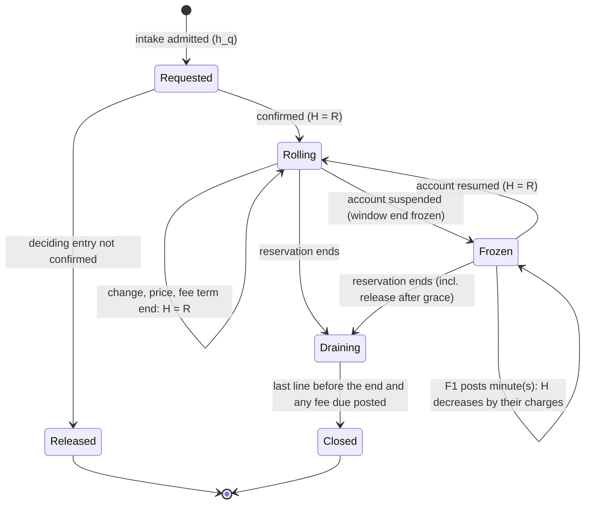
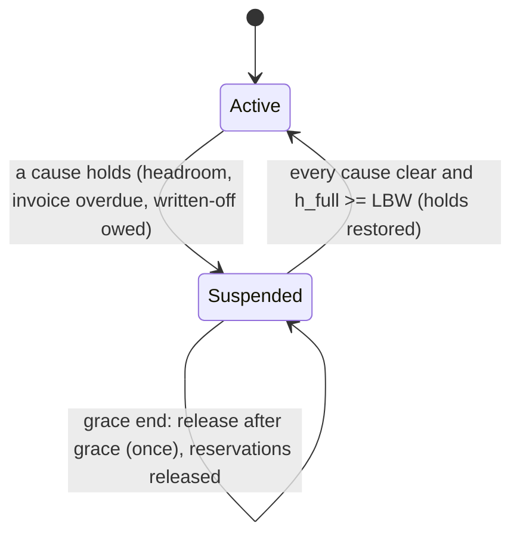
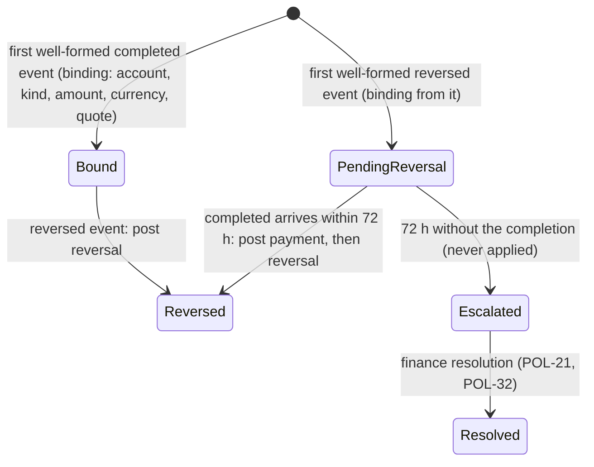

# RFC-004. Wallet, ledger and settlement

| | |
|---|---|
| Status | **Draft, revision 4**: revised per the joint [review 18](../reviews/18-rfc-002-004-joint-review.md) (J-01 … J-20, D-1 … D-6) and the RFC-004 points of [review 19](../reviews/19-rfc-003-review.md) (F3-01, F3-02, F3-04, F3-07, F3-08; D-19-3, D-19-4, D-19-6), rebased on `requirements-v1.8` ([review 22](../reviews/22-requirements-amendments-from-c3-reviews.md)) and RFC-000 revision 4.2 (see [Revision 4](#revision-4) below; revision 3 rebased on `requirements-v1.7` and RFC-000 revision 4.1). Part A is reviewed and approved together with RFC-002 (RFC-000 §7, R11) |
| Satisfies | **All of P4**: P4-S01 … P4-S116 (116 scenarios; traceability at the end). **Jointly with RFC-002** (RFC-002 owns the account owner's state machine, this RFC the funds rules its entries apply): P2-S38, P2-S39, P2-S40, P2-S41, P2-S42, P2-S54, P2-S66, P2-S68, P2-S69, P2-S70, P2-S71, P2-S75, P2-S76, P2-S77, P2-S78, P2-S92, P2-S98, P2-S112, P2-S117. **Contributes to** (primary RFC named in the traceability table): P3-S09, P3-S12, P3-S13, P3-S17, P3-S27, P3-S37, P3-S41, P3-S44, P3-S59, P3-S60, P3-S61, P3-S63, P3-S74, P3-S65, P3-S66, X1-S04, X1-S10, X1-S12, X1-S14, X1-S28, X1-S37, X2-S07, X2-S08, X2-S13, X2-S14, X2-S17, X2-S18, X2-S19, X2-S20, X2-S21, X2-S24, X2-S27 |
| Policies | POL-01, POL-04, POL-06, POL-07, POL-08, POL-10, POL-11, POL-12, POL-13, POL-14, POL-15, POL-16, POL-17, POL-18, POL-19, POL-20, POL-21, POL-22, POL-23, POL-24, POL-25, POL-27, POL-28, POL-29, POL-30, POL-32, POL-33 |
| Prior decisions | History log D19, D20, D24, D25, D29 (carried forward in Competition) |
| Builds on | The requirements at tag `requirements-v1.8` (decisions in [review 22](../reviews/22-requirements-amendments-from-c3-reviews.md), after reviews [12](../reviews/12-requirements-amendments-from-rfc-revision-2.md) and [11](../reviews/11-requirements-amendments-from-detailed-rfcs.md)); the architecture [RFC-000](RFC-000-architecture.md) revision 4.2 (revision 4 with its 4.1 and 4.2 errata): its components, ownership, principles A1 … A11, the substrate of §5.5 (CockroachDB at 2 + 2 + 1, NestJS owner services with epoch-fenced owner leases, insert-only log tables, commit timestamps, closed timestamps, Kafka through a transactional outbox), contracts (§8) and allocation (§7) bind this RFC |
| Supersedes | Revision 3 (on RFC-000 revision 4.1 and `requirements-v1.7`), revision 2 (on RFC-000 revision 4 and `requirements-v1.6`) and revision 1 (on RFC-000 revision 3.2 and `requirements-v1.5`) of this RFC, kept in git history; the pre-baseline draft written from the prototype in `billing/` |

### Revision 4

What changed from revision 3 (the full mapping is in [Revision 4 resolution](#revision-4-resolution)):

1. **Queued changes funded for the worst case of the changes ahead** (J-01, D-1): `admit`
   sizes a change's hold against the per-minute envelope of every outcome of the changes
   ahead of it in the reservation's queue, with minutes after a recorded price step priced
   at the stepped price (V-3), and the deciding entry releases the excess; the
   failed-roll-forward path is kept only for posting drift (§A5.2, §A5.3, §A10 `Ask`).
2. **Key spending per segment** (J-02, D-2; POL-25 and P2-N8 as amended by Q-2,
   P2-S117): every part and every extension interval records the key that added it; `KS_k`
   counts only those (§A2, §A3).
3. **Lateness bound 430 s and its price span** (Q-1, RQ-19-5; F3-08, D-19-6): `LB` adds
   admission's 60 s recovery time and takes the highest `usage_price` in force over
   `[now − 370 s, now + 60 s]`; F3 carries the price schedule and F7 *exposure step* ticks
   apply each change of `LB` as an entry; this RFC is the one definition of `LB`
   (§A3, §A4, §A7; P4-S15, P4-S16, P3-S37 recomputed).
4. **Resume amount itemised** (Q-3, J-20, D-5; P4-S114): written-off amount, each
   overdue invoice, headroom still needed (§A3, §A7).
5. **Invoice-status feed and credit-limit command** (RFC-000 4.2 A-1; J-05, J-06, D-4):
   owned here, each event carrying the buyer partition's ledger position and applied only
   once F1 has reached it; F6 gains *written off*; a written-off invoice is closed: it
   leaves `OD` (in the F1 that applies its M19), takes no allocation and leaves `I` (§A4,
   §B5, §B12). An invoice payment applies `x − r` (J-16).
6. **Future-effective changes** (RFC-000 4.2 A-3, AI-17-3; J-07, D-3): E11s for
   revocation, move and price change are recorded before their effective minute; the funds
   effect of a price change comes at its minute by an F7 *price effective* tick; F11 (the
   notice) and one price-change E11 carrying `PriceTookEffect` (which records the step)
   are appended together per (account, price version) at the announcement (J-04). Every F7 applies only once `ctx.ts` has reached its instant (J-10) (§A4, §A6,
   §A10).
7. **Batch kinds** (RFC-000 4.2 AI-19-1; F3-04): reservation batches post as one M4
   each, not gated by unposted usage; usage batches (at most the 5,000-line movement
   limit) post whole in one movement and are never split; `whole` is defined over usage
   batches only (§B1.2, §B3.1, §B12). The unposted-usage publish interval is 2 s (R4-A3
   closed).
8. **Cost-line amendments** (F3-01, D-19-4; POL-23 as amended by RQ-19-4, P4-S116) and
   **the dearer-path difference against the buyer's charge as booked** (F3-02, D-19-3;
   RQ-19-3, P4-S115): new M23; a downward cost-line amendment for cause Share or "other"
   posts nothing; for cause supplier it is that supplier's own reduction as a `fault`
   debt (§B2, §B3.4). Lines after a move are split by the route they carry (F3-07,
   AI-19-2; §B3.1).
9. **Fees** (POL-08 as amended by RQ-19-1, RQ-19-2; P3-S63, P3-S74): a plain cancellation
   fee only on a cancellation; the shown minimum-term fee when a booked window ends inside
   the term; a `fee_state` per reservation so a charged fee is never held again (J-09)
   (§A2, §A3, §A6, §B2).
10. **Probe accounts** (X2-S27 and POL-06 as amended; RFC-000 4.2 B-AI-10; J-11): one per
    account slot on placement's map, about 16,384; their holds re-evaluated at every entry
    and closed at their end without postings; provisioned with KYB passed (§A3, §A11).
11. **Identity freshness** (RFC-000 4.2 AI-R5-4): F4 carries the resolved timestamp its
    events are complete through, for RFC-002's 45 s confirm gate (§A4; AI4-11).

### Revision 3

What changed from revision 2 (the full mapping is in [Revision 3 resolution](#revision-3-resolution)):

1. **Lateness bound recomputed** (POL-14 as amended by RQ3-13): `LB` now spans
   `max_lateness` + `flow_active_timeout` + 60 s of minute granularity +
   `attribution_lag_max` + the 60 s enforcement target, 370 s at the defaults (was 250 s);
   F3 carries `flow_active_timeout`; P4-S15 and P4-S16 recomputed (§A2, §A3, §A4, §A7,
   §B12).
2. **Exact pairing of unposted usage** (RFC-000 revision 4.1, AI3-10): the ledger movement
   feed states per movement the charge-line batch it posted and whether whole; F1 carries
   it; F2 applies rating's in-flight reduction; settlement never splits a usage batch across
   movements unless it must, and then marks it not whole (§A4, §A10, §B1.2, §B3.1, §B12).
3. **Requirements issues RQ4-10 … RQ4-12 resolved** by review 12 exactly as this RFC read
   them; the new scenarios P4-S111 (repayment order), P4-S112 (uncovered negative balance)
   and P4-S113 (posted-then-reversed payment) have worked examples (§B2, §B5, §B6.3). M1's
   overdue-first allocation now applies to any account with an overdue invoice, including
   one whose credit limit an invoice write-off has removed (P4-S111).
4. **Architecture issue AI4-10 resolved** by RFC-000 revision 4.1's errata.
5. **Probe accounts per account slot** (X2-S27 as amended by RQ6-2): at least one probe
   account in every account slot (§A3, §A11).

### Revision 2

What changed from revision 1, in one list (each item points to where it now lives):

1. **Substrate.** Every log of this RFC (account log, ledger partitions, payments,
   receivables, payouts, reconciliation) is an insert-only table of its owner kind, with
   epoch-conditional batch transactions by the owner-lease holder; positions are
   (partition, sequence) with the commit timestamp as the entry's time; feeds go through
   the transactional outbox to Kafka (§A10, §A11, §B1.3, §B11). "Leader" now means the
   owner-lease holder.
2. **Cuts at one database timestamp.** Revision 1's per-partition `Cut(T)` markers and
   `Close(T)` heartbeats are gone: reconciliation and payout runs read every ledger
   partition at one database timestamp `T`, once the closed timestamp has passed it, and
   invoice issue uses the feed's resolved timestamp (§B1.3, §B5, RFC-000 §4.5).
3. **Contracts aligned with RFC-000 §8 revision 4**: identity status push with KYB (F4
   now carries KYB; F5 only the credit limit), key revocation as applied read through
   `rate_check`'s `NotAccepted{revoked}` and F4's `revoked_keys` outcome (JR-1, RFC-000
   rev. 4.1), standing feed and enforcement acknowledgement on Kafka, posting and
   usage-applied acknowledgements, supplier-debt register in payouts, authenticity of
   notifications, confirmations and partner reports by RFC-005's verifier, investigation
   stream (§A4, §A10, §B3.1, §B4.1, §B7.1, §B12).
4. **`requirements-v1.6` applied**: arrival-order checks (§A5.1); release of an ended
   reservation's hold after posting (§A6); the 90-day clock for every negative balance
   (§B5, M18); the third in-flight term with `settlement_lag_max` and in-flight terms at
   the partner's amount (§B6); a top-up pays overdue invoices first (§A3 `RA`, §B5); the
   price notice's hold and top-up quote (F11, §A7); the dearer-path difference (M13);
   reversed attributions, superseding records and the shorten fee (§B3.4, §A6);
   supplier statements by opaque charge-line reference, pseudonymous principals (§B8,
   §B1.2); several probe accounts and a probe supplier (§A3, §B7.2).
5. **Joint items with RFC-002** JR-1 … JR-4 resolved as RFC-000 revision 4 directs
   (§A10, "Interface with RFC-002").
6. **New scenarios** P4-S105 … P4-S110 and amended P4-S11, P4-S54, P4-S61, P4-S66 covered
   (traceability); issues raised by revision 1 marked resolved; new issues RQ4-10 …
   RQ4-12 and AI4-10.

Terms are used in the sense of the [glossary](../02-specs/glossary.md). Every latency,
volume and size marked "est." is an estimate, to be replaced by measurement (RFC-000 R1).
Requirements and the architecture are not changed here; where this RFC found a defect in
either, it is recorded under [Requirements issues](#requirements-issues) or
[Architecture issues](#architecture-issues).

## Need

P4's needs (P4-N1 … P4-N17) fall to two groups of components that RFC-000 deliberately
keeps apart (§2, "Funds holds are split from the ledger"):

1. **Account funds and standing** (Part A), inside the account owner, on admission's
   targets (99.99%, RTO 1 min; POL-06, X2-S21). Every booking and change needs a funds or
   credit hold sized exactly (P4-N3), checked with key headroom, capacity in flight and
   rate limits one at a time in the order received, each counting the holds then in
   place (P4-N3, POL-25), against one headroom figure that
   itemises and adds up (P4-N4); and the account's standing must move by rule, never by
   surprise: suspension on a stated cause, a funded grace, automatic resumption at a
   quoted amount, a warning per crossing, release after the grace (P4-N5), announced to
   network operations reliably (P4-N6). Any figure shown must be rebuildable exactly
   (P4-N16). RFC-000 makes this a deterministic module with no writer of its own,
   evaluated by entries of the account owner's log (an insert-only table, RFC-000 §5.5),
   which RFC-002 specifies.
2. **Money** (Part B): a double-entry journal that is conserved, immutable and
   once-only for 7 years (P4-N7, P4-N15, P4-N16), at about 1 M charge lines/s (est.,
   RFC-000 §6); a split that is exact, monotone and deterministic (P4-N8, P4-N9); supplier
   earnings that are final except for the supplier's own error (P4-N11); payments taken
   exactly once whatever the provider's delivery order (P4-N1, P4-N2); reversals, invoices
   and bad debt by rule (P4-N13, P4-N17); payouts weekly, exact and never instructed
   twice (P4-N12); statements anyone can check (P4-N10); and a daily proof, by 12:00 UTC,
   that the books equal the money (P4-N14), with payouts and payments in flight in both
   directions, each counted at the partner's USD amount.

The hard parts are where the two meet and where time intervenes: holds must track charges
that are posted up to minutes after they accrue; suspension must be decided at one point
in the account's serial order (POL-04); a ledger partitioned by home account must still
give one consistent cut for reconciliation and payouts (on the substrate, one database
timestamp, RFC-000 §4.5); and payouts and payments stay in flight across that cut.

## Approach

### 0. Overview

```mermaid
flowchart LR
  subgraph AO["Account owner (one per account) — RFC-002 state machine"]
    BK["Booking module (RFC-002)"]
    FM["Funds and standing module (Part A)"]
  end
  RA["Rating (RFC-003)"] -->|"charge lines: reservation batches, usage batches (Kafka)"| ST["Settlement"]
  ST -.->|"posting ack (Kafka)"| RA
  RA -.->|"unposted usage (Kafka)"| AO
  AO -.->|"usage-applied ack (Kafka)"| RA
  ID["Identity and access (RFC-005)"] -.->|"identity status push: keys, limits, KYB"| AO
  CAT["Catalogue (RFC-003)"] -.->|"prices, weights, exposure terms, price notices"| AO
  ST -->|"post (gRPC)"| LE["Ledger (log tables by home)"]
  PR["Payments, receivables, reconciliation"] -->|post| LE
  PO["Payouts"] -->|post| LE
  LE -.->|"movements (outbox, Kafka)"| AO
  LE -.->|movements| PR
  LE -.->|movements| PO
  LE -.->|movements| RP["Reporting and statements"]
  LE ==>|"cut: read at one database timestamp T"| PR
  LE ==>|"cut: read at one database timestamp T"| PO
  PR -.->|"invoice-status feed: overdue, paid, written off, credit limit removed (with ledger position)"| AO
  CON["Operator console (RFC-005)"] -->|"credit-limit command (finance envelope)"| AO
  PAY["Payment providers, payment partner"] -->|"authenticated by the RFC-005 verifier"| PR
  PO --> PAY
  AO -.->|"standing feed (Kafka)"| NET["Network operations"]
  NET -.->|"enforcement ack (Kafka)"| AO
```



Part A (§A1 … §A11) is the funds-and-standing module of the account owner. Part B (§B1 …
§B13) is the ledger, settlement, payments and receivables, reconciliation, payouts and
statements. Every component of Part B is a NestJS owner service over its own insert-only
log tables in the database (RFC-000 §5.5); the ledger, payments, receivables, payouts and
reconciliation are owner kinds with epoch-fenced owner leases per slot (RFC-000 §5.2), settlement is
a consumer with a hot standby, and reporting holds read models only. Notation used
throughout:

| Symbol | Meaning |
|---|---|
| µ | micro-USD; every amount is a signed 64-bit integer of µ, tagged with its currency (POL-11, POL-20); intermediate products are 128-bit; nothing is floating point |
| `CW`, `SG`, `LBW` | `coverage_window` (24 h), `suspension_grace` (= `CW`), `low_balance_warning` |
| `a_r(m)` | the reservation charge line of reservation `r` for minute `m`: the exact sum over its parts active at `m` of rate × price, rounded down once to the µ (POL-11) |
| `cov_r(x, y)` | Σ `a_r(m)` over minutes `m` in `[x, y) ∩ [start_r, end_r)`; minutes before the evaluation time at the price they had, minutes from it on at the reservation's **current** price (a scheduled price change counts only once it takes effect, POL-27) |
| `p_r` | the first minute of `r` not yet posted (posted-through + 1 min), from the ledger feed; `start_r` until its first line is posted |
| Position | (partition, sequence) of an owner's log table; its **commit timestamp** is the entry's time (RFC-000 §4.3). "Owner" is the owner-lease holder of the partition, writing only in transactions conditional on its epoch |
| `OD` | the overdue invoices of an account (from receivables, F6), oldest first; `ΣOD` their unpaid total |

## Part A — Account funds and standing

### A1. Scope, and the division with RFC-002

The account owner is **one component, one log, one owner-lease holder per account**
(RFC-000 §2): a NestJS owner service whose account log is an insert-only table keyed by
(account partition, sequence), written in batch transactions conditional on its owner
epoch, with projection rows of the current state written in the same transactions
(RFC-000 §5.5). RFC-002 owns the state machine: the log envelope, the registry of entry
kinds, the intake and deciding entries, marks, "releases durable", takeover, the workflow,
the projection rows and the status replicas. This Part owns the **funds-and-standing
module**: the state listed in §A2, the formulas of §A3, the payload and apply rule of every
funds entry kind (§A4), and the admission, hold, standing and query rules (§A5 … §A9). The
module is a pure function of the log (§A10); it never writes, sends or reads a clock.

| State or entry | Module | Who appends it |
|---|---|---|
| Booking requests, their marks, deciding entries, "releases durable", takeover; reservations, parts, locked prices, legs, partner terms shown at booking, lifecycle and end cause; change queue | Booking (RFC-002) | The owner's workflow |
| The **funds payload** inside the intake (E1, E1′), deciding (E4 … E7) and reservation-change (E11) entries (hold taken, converted, resized or released; capacity in flight) | Funds (this Part), carried in booking entries | Computed by this module when the owner builds the booking entry |
| Funds entry kinds F1 … F11 (§A4): ledger, usage, exposure parameters, identity status (keys, key limits, KYB), credit limit, invoice status, funds ticks, enforcement acknowledgements, probe designation, rules version, price notices | Funds (this Part); registered as kinds of the account log in RFC-002's registry | The owner, from a feed or a timer |
| Derived outcomes (standing change and its sequence number, warning, notices, release due, keys revoked as applied, alerts) | Funds | Never appended on their own: recorded in the outcome field of the entry that caused them (§A4); the booking records an outcome requires are written in the same entry (§A10) |

RFC-002 must list F1 … F11 in its entry registry, embed the funds payload of §A4 in its
intake, deciding and reservation-change entries, and call the interface of §A10 at the
points named there. That is the whole coupling; nothing else in either module reads the
other's state except through §A10.

### A2. State per account

| State | Meaning | Changed by |
|---|---|---|
| `Bal`, `ledger_pos` | Ledger balance of the account, through ledger position `ledger_pos` (ledger partition, sequence; its commit timestamp) of its one home partition (RFC-000 §2) | F1 |
| `W` | Written-off amount still owed (POL-21): written off less repaid, as derived by the ledger (§B2, M18, M19, M1) | F1 |
| Per reservation `r`: `p_r`, `H_r`, `hold_state_r`, `Wend_r`, `fee_r`, `fee_end_r`, `fee_state_r`, `key_r`, `sched_price_r` | First unposted minute; actual hold (µ); state of the hold machine (§A6); frozen window end while suspended; shown partner fee and the end of its term (the partner's minimum term, or the window's end for a plain cancellation fee), from the booking module's reservation record; `open`, `due` (an entry made it due) or `charged` (an F1 posted it) (J-09); the key that booked it; announced price changes not yet in effect (price version, new price, effective minute), recorded by the E11's `PriceTookEffect` | Booking entries' funds payload, F1, F7 |
| Per **segment** of `r`: (part, interval, `key`) | Who added each piece of the schedule (POL-25 as amended by Q-2, D-2): a booking creates one segment per part over the window, keyed by the booking key; an increase adds its part over its interval, keyed by the increasing key; an extension adds, for every part active at the old end, a segment over `[old end, new end)`, keyed by the extending key. A decrease or shorten trims segments as it trims parts (newest first). Recorded by RFC-002 in the reservation's schedule (J-02) | Booking entries' funds payload |
| Per pending request `q`: `h_q`, `mbps_q`, `key_q` | Intake hold, capacity in flight, key | Intake, deciding entry |
| Per key `k`: `KP_k` | Charges posted in the current `key_spend_period` for the segments `k` added, computed by the module as `p_r` advances (§A3) and reset at the period boundary | F1 |
| `U[product]`, `rating_pos`, `assumed_ledger_pos` | Unposted usage per product (POL-18), through a rating position, with the ledger position X it was computed against (RFC-000 §8, AI3-3) | F2 |
| `LB[product]` inputs | `usage_rate_cap` (account-product terms, set by finance, POL-32), `max_lateness`, `flow_active_timeout` (POL-13), `attribution_lag_max`, admission's recovery time `rto_adm` (POL-06, 60 s), and the **schedule** of the highest `usage_price` on any route, `hp[product]`: the value in force and every announced change with its effective instant (set by commercial, changed only with `price_notice`, POL-27), per product the account is onboarded for | F3 |
| `kyb` | Know-your-business status as recorded by identity and access | F4 (identity status push, AI4-2) |
| `id_ts` | The resolved timestamp of the identity status push or catch-up that the account's applied F4 events are complete through (AI-R5-4); RFC-002's 45 s confirm gate reads it together with the slot's freshness watermark (§A4 F4, AI4-11) | F4 |
| `CL`, `mode` | Credit limit (0 if none) and prepaid or credit-limit mode | F5 |
| Per key `k`: `status_k`, `ksl_k`, `kif_k`, `krl_k` | Key status **as applied** (D6; identity and access is its writer, this module holds the applied copy, AI4-3), `key_spend_limit`, `key_inflight_limit`, `key_rate_limit` | F4 |
| `OD` | Invoices overdue, with unpaid amounts, oldest first (from receivables); a written-off invoice leaves it (D-4) | F6; F1 (the M19 of a written-off invoice, §A4) |
| `rcv_pos` | The receivables position of the last invoice-status event applied (idempotency and order of F5, F6) | F5 (feed variant), F6 |
| `standing`, `causes`, `since`, `grace_end`, `released`, `std_seq` | Standing machine (§A7) | Any entry, as a derived outcome |
| `warn_armed` | Whether a low-balance warning may be sent on the next crossing (§A7) | Any entry, derived |
| `enforced[std_seq]` | Enforcement acknowledgement from network operations | F8 |
| `excluded` | The account is a designated probe account, excluded from rating (POL-06; one per account slot, X2-S27, RFC-000 B-AI-10) | F9 |
| `rules` | The rules version in force from a log position | F10 |
| Rate windows | Owner-memory submission timestamps per key and account in the last second (§A5.4) | Not logged (soft, rebuilt from intakes) |

The state is held as projection rows of the account owner (RFC-002), written in the same
transaction as the entry that changes it, and in the owner's memory; both are derived from
the log (RFC-000 A4) and rebuilt from it.

### A3. The quantities

Every quantity below is a function of the module state at one log position and the
timestamp of the entry or answer that evaluates it (§A10: an entry's commit timestamp, or
the read timestamp of an answer), so each is exactly reproducible (P4-N16, P4-S72).

| Quantity | Definition | Source |
|---|---|---|
| Coverage of `r` | `C_r = cov_r(p_r, p_r + CW)`; the window is clipped to the reservation, so a reservation shorter than `CW` is covered whole; a future one is covered from its start | POL-15, P4-N3 |
| Fee part of `r` | `fee_r` while `fee_state_r = open`, the evaluation time is before `fee_end_r` and the fee would be the buyer's to pay (POL-08: on its own cancellation; on a shorten whose new end falls inside a minimum term; when the window it booked ends inside a minimum term, RQ-19-2; on release after grace or termination); otherwise 0. Once an entry makes the fee due it is held as `fee_due` in the Draining or shorten rule (§A6), and once an F1 posts it (`charged`) it is never held again (J-09) | POL-15, POL-08 |
| Required hold | `R_r = max(C_r, fee part)` | POL-15 |
| Funds held | `F = Σ_r H_r + Σ_q h_q` (credit holds included: a credit hold is the same amount labelled by `mode`, P4-S13) | POL-18 |
| Usage exposure | `X = Σ U[product] + Σ LB[product]`, with, per product, `LB = ceil(usage_rate_cap × Λ × hp*)` where `Λ = max_lateness + flow_active_timeout + 60 s + attribution_lag_max + rto_adm + 60 s` (the first 60 s is minute granularity: lateness counts from the end of a record's last minute, and a record of at most `flow_active_timeout` can straddle a minute boundary; `rto_adm` is admission's recovery time, while the part of admission that counts usage fails over; the last 60 s is the suspension-to-enforcement target), **430 s** at the defaults (180 + 60 + 60 + 10 + 60 + 60), and `hp*` the highest value of `hp[product]` in force at any instant of the **span** `[ts − (Λ − 60 s), ts + 60 s]`: the last 370 s (the oldest traffic not yet counted) and the next 60 s (traffic still to be carried before enforcement) at the defaults. `LB` is a step function of `ts` whose steps are known in advance (an announced increase enters the span 60 s before it takes effect; a decrease leaves it `Λ − 60 s` after); each step is applied by an F7 *exposure step* entry (§A4), so headroom changes only by an entry. This is the one definition of the lateness bound; rating no longer publishes one (RFC-003 rev. 4 §5.9; F3-08). `U` is rating's figure less its in-flight reduction where §A4 (F2) applies it | POL-14 (as amended by Q-1, RQ-19-5), POL-18, P3-N10 |
| Headroom | `h = Bal − F − X + CL` | POL-18 |
| Headroom with full holds | `h_full = Bal − Σ_r R_r(active window) − Σ_q h_q − X + CL`, every reservation's hold computed as if the account were active | POL-16 (resume) |
| Accrued, not yet posted | `A = Σ_r cov_r(p_r, m_now)`, `m_now` the evaluation time's minute boundary; shown for information, already inside `F` (§A6) | POL-18, P4-S16 |
| Key spending | `KS_k = KP_k + Σ_r H_{r,k} + Σ_{q of k} h_q`, counting only the **segments `k` added** (§A2; POL-25 as amended by Q-2, D-2). Posted part: `KP_k = Σ_r Σ_m a_{r,k}(m)` over the minutes `m` of `r` posted in the current `key_spend_period` (UTC day starting `P_k`), with `a_{r,k}(m) = min(a_r(m), ceil(e_{r,k}(m)))` and `e_{r,k}(m)` the exact (unrounded) rate × price of `k`'s segments active at `m`; ended reservations keep counting. Held part: `H_{r,k} = ceil(H_r × R_{r,k} / R_r)` (0 if `R_r = 0`), where `R_{r,k}` is `Σ a_{r,k}(m)` over the hold window if `C_r` ≥ the fee part, else the fee part for the key that booked `r` and 0 for every other key (the fee belongs to the booking). So each minute is counted once per key, and the rounding is upward: the keys' figures may together exceed a reservation's by under 1 µ per key and minute, never fall short of it, since POL-25 is a hard cap. A part another principal added never counts toward `k` | POL-25, P4-S68, P2-S117 |
| Key headroom | `kh_k = min(h, ksl_k − KS_k)`; `h` if the key has no limit | POL-25 |
| Capacity in flight | `IF_k = Σ_{q of k} mbps_q`, `IF_a = Σ_q mbps_q`; `account_inflight_limit = max(account_inflight_floor, 10 × the largest peak reserved rate among the account's reservations not ended)` | POL-25 |
| One window's charges | `CWC = Σ_r C_r` (coverage only, no fee part) | POL-16 |
| Warning threshold | `LBW = max(ceil(CWC / 4), 1,000,000 µ)` | POL-16 |
| Resume amount | `RA = W + ΣOD + RH`, with the headroom part `RH = max(0, LBW − (h_full + ΣOD))`, so `RA = W + max(ΣOD, LBW − h_full)`. A top-up first repays `W` (M1, §B2), then pays the overdue invoices oldest first (§B5), and every µ of it beyond `W` raises `Bal` and so `h_full` (an invoice payment raises `Bal` too, the invoice's charges being already in it); so `RA` is the least single top-up after which `W = 0`, no invoice is overdue and `h_full ≥ LBW` (POL-16 as amended by Q-3). It is **quoted itemised** (D-5, J-20): `W` if any; each overdue invoice with its unpaid amount, oldest first; and `RH`, the headroom still needed after them, with every reservation's full coverage hold restored, to reach `LBW` | POL-15, POL-16, POL-21; P4-S114 |
| Warning quote | `WQ = LBW + CWC − h` | POL-16, P4-S24 |
| Insufficient-funds amounts | For a request needing hold `x` with headroom `h < x`: `x − h`, and `x − h + LBW` | POL-10 |
| Price-notice amounts | For an announced price change of open-ended reservations: per reservation `r` the hold it will need `R'_r` (`R_r` recomputed at the new price), the growth `g = Σ_r (R'_r − R_r)` over the account's affected reservations, and, if `h < g`, the top-up `g − h` that would cover it | POL-27, P4-S108 |

Why the hold is anchored at `p_r`, the first unposted minute, and not at the clock: POL-18
requires that "charges accrued but not yet posted stay within funds held". With the window
starting at `p_r`, the minutes between the last posting and now are inside it; when a
minute is posted, the balance falls by its charge and the window slides one minute, so the
hold stays the coverage of the next `CW` (P4-S10) and nothing is counted twice or missed.

**Probe accounts** (`excluded`, POL-06) are never rated, so nothing is ever posted for
them. For them `p_r` is taken to advance with the clock: every minute counts as posted at
its end with a charge of 0, so `p_r` is the minute of the evaluating timestamp, and **every
`apply` to a probe account re-evaluates each `H_r` at `ctx.ts`** (`H_r = R_r`, or `0`
and **Closed** once `ctx.ts ≥ end_r`, since no line will ever be posted to drain it)
(J-11). Their credit holds therefore roll forward and end exactly as anyone's (X2-S24),
without Draining holds piling up under per-minute probe bookings; their balance never
moves, and they are never invoiced (§B5). Under `requirements-v1.8` every account slot of
admission and the wallet is probed at least 3 times a minute from at least two locations
(X2-S27, POL-06), and under RFC-000 revision 4.2 (B-AI-10) placement (RFC-006) owns the
**account slot map** and designates **one probe account per account slot**, refusing a
re-slotting that would leave a slot without one: about **16,384** probe accounts at the
design load (est.). RFC-006 provisions each before use with KYB passed (an F4 from identity
and access) and then a credit limit (F5), since F5 is refused without KYB (J-11). A probe
account's funds state is a few rows; X2-S27 asks for 3 probes per slot per minute in each serving
region, so the probes add about 820 probe bookings a second per serving region, 1,640 in
all, about 3,800 account-log entries a second (est., RFC-002 §14), nothing to settlement, receivables or statements. There is also a
designated **probe supplier** owning the probe links (§B7.2); each probe account is
flagged by its own F9, and none is a buyer's account. Which slots exist and the probing
itself are RFC-006's (X2-S27 primary).

### A4. Entry kinds and their funds payload

**Funds payload in booking entries** (RFC-002 kinds E1 … E14; this Part defines the payload).

| Booking entry (RFC-002) | Funds payload | Apply rule |
|---|---|---|
| E1 Intake, admitted | `h_q`, hold kind, `mbps_q`, key, the `Ask` (with the changes ahead it was sized against, §A5.2), the headroom and key headroom it was checked against, with the position | Adds the request hold and the capacity in flight (§A5) |
| E1′ Intake, decided at intake (rejected for standing, limits or funds) | The `Ask`, the verdict (`Refuse` with its reason and amounts: `RA` itemised, the limit reached, `x − h` and `x − h + LBW`), and the headroom and key headroom it was checked against (J-13: what replay needs) | Nothing held |
| E5 Confirm | Request `q` → reservation `r`; new `H_r`; the segments added, with their key (§A2) | Removes `h_q`, `mbps_q`; sets `H_r = R_r` (new reservation) or the change's hold, releasing any excess of `h_q` (§A5.3, §A6) |
| E4 Withdraw, E6 Expire, E7 End (rejected, failed, withdrawn, key revoked, suspended, expired) | Request `q` released | Removes `h_q` and `mbps_q` (P4-S12) |
| E11 Reservation change (decrease or shorten effective, cancellation effective, revocation, cut under POL-07, move to an equivalent path, termination, release after grace, price change) | The reservation's new schedule with its segments and **effective minute**, which may be in the future (RFC-000 §8 lifecycle feed, A-3: a move at the offer's move time, a price change on its announcement; never before the entry's `ts`, except a POL-07 cut or revocation, effective at its `T_eff`, RFC-000 §8 (2), whose minutes rating has not closed), end cause, fee due from the buyer (`fee_state_r → due`). A price-change E11 is **one per (account, price version)**, written in the F11 entry at the announcement (below), and carries `PriceTookEffect` for each affected reservation | Resizes or ends the hold (§A6); a future end or cheaper schedule lowers `R_r` at once, since `cov_r` follows the recorded schedule; a price increase counts only from its effective minute (§A6). `PriceTookEffect` records the step in `sched_price_r` when the E11 commits; the hold grows only at F7 *price effective* |

**Funds entry kinds** (this Part defines them; RFC-002 registers them). Feed events arrive
through Kafka from the producer's outbox (RFC-000 §5.5) and are applied once, by the
producer's (partition, epoch, sequence) (§B9).

| Kind | Payload | Appended when | Apply rule |
|---|---|---|---|
| **F1 Ledger applied** | Ledger position (partition, sequence, commit timestamp); movements for the account since the last F1 (kind, amount, source reference, cause; for a movement carrying a charge-line batch, the batch's identity, kind and, for a usage batch, whether it posted it whole, AI3-10, AI-19-1); new `Bal`; per reservation the new posted-through minute and any fee posted; change of `W` | The owner has received ledger movement-feed events for the account (one per movement; several in one batch transaction) | Updates `Bal`, `W`, `p_r`; rolls or consumes holds (§A6); adds the newly posted minutes' `a_{r,k}(m)` in the current period to `KP_k` (§A3); sets `fee_state_r = charged` for a posted fee; **removes from `OD` any invoice named as the cause of an applied M19** (a written-off invoice is closed, D-4, J-06), so `W` and `OD` change in the same entry; evaluates standing (§A7) |
| **F2 Usage applied** | Per product unposted usage `U(X)`, rating position, the ledger position X the figure was computed against, and the in-flight **usage batch** `b` with its usage reduction `Δ_b` (if any) | A rating report has arrived **and** the account has applied F1 through X (RFC-000 §8, AI3-3), so a usage charge leaves `U` only once it is in `Bal`, never before. Rating publishes at most one figure per account every **2 s** (`exposure_publish_interval`, decided for this revision; R4-A3 closed); the owner applies the latest per account in each batch. The module sets `U[product] = U(X) − Δ_b` if an applied F1 at or below its position reports `b` posted whole, else `U(X)`; an F1 that later reports `b` posted whole re-applies the reduction to the current figure if it still names `b` (RFC-003 §5.9, AI3-10). `whole` and `Δ_b` concern usage batches only; reservation batches never enter `U` (AI-19-1). So a usage posting between X and the applied position is never counted twice; a batch posted with an excluded line is not reduced, overstating exposure (so never overstating headroom) until the next figure | Replaces `U[product]`; evaluates standing. Its commit puts a **usage-applied acknowledgement** (rating position applied) in the outbox, for rating (RFC-000 §8; emitted by RFC-002's owner) |
| **F3 Exposure parameters** | Per product `usage_rate_cap`, `max_lateness`, `flow_active_timeout`, `attribution_lag_max`, `rto_adm`, and the highest-`usage_price` schedule `hp[product]` (the value in force and each announced change with its effective instant) | Catalogue change (RFC-003; account-product terms, AI3-6): a parameter change at the minute it takes effect; a `usage_price` change **when announced**, `price_notice` ahead of its effect (POL-27) | Recomputes `LB` at `ctx.ts` (§A3); `due(S)` arms the *exposure step* ticks of the new schedule; evaluates standing |
| **F4 Identity status** | Per key: status (active, revoked), `key_spend_limit`, `key_inflight_limit`, `key_rate_limit`; the account's KYB status; and the **resolved timestamp** (push) or **read timestamp** (catch-up) the events are complete through | The **identity status push** from identity and access (RFC-005, Kafka), within 60 s (D6, AI4-2, AI4-3); or a **catch-up** read for the account slot, applied in one entry (AI-R5-4) | Updates keys, `kyb` and `id_ts`. Outcome `revoked`: the keys whose status became revoked as applied; the booking module writes, in the same entry, the endings ("key revoked") of their undecided requests (P2-S72, JR-1). The slot-wide freshness watermark `iam_fresh` is RFC-002's, kept in owner memory and advanced by each F4's recorded timestamp (RFC-002 §2.4 item 14; AI4-11) |
| **F5 Credit limit** | Variant *set* (amount, finance operator's pseudonymous principal, reason, `action_id`) or *removed by operator* (principal, reason, `action_id`), from the **credit-limit command** (§B12); or variant *removed: invoice written off* (invoice, receivables position, buyer ledger position) from the **invoice-status feed** | The command: synchronously, the owner appends the entry and answers after commit. The feed: once F1 has reached the event's ledger position (gate, below) | *Set* is **refused, recorded, and changes nothing** unless `kyb` (from F4) is passed (P4-S82, AI4-2); otherwise sets `CL`, `mode`; relabels holds; evaluates standing (a lower limit can suspend, P4-S18). A repeated `action_id` returns the first outcome |
| **F6 Invoice status** | Invoice *overdue* (invoice, unpaid amount, due date), *paid* (invoice), or *written off* (invoice, amount); each with the receivables position and the buyer partition's ledger position receivables had applied | The invoice-status feed (§B5), once F1 has reached the event's ledger position (gate, below) | *Overdue* adds the invoice to `OD`; *paid* and *written off* remove it (a no-op if the M19's F1 already did); evaluates standing (P4-S18 row 5, P4-S93, P4-S105, P4-S94) |
| **F7 Funds tick** | One of: *fee term ended* (`r`); *grace ended*; *enforcement check* (`std_seq`); *price effective* (price version, its reservations); *exposure step* (product, instant) | The owner's timer reaches the instant (from `due(S)`, §A10), and the entry's `ctx.ts` is at or after it: an F7 whose transaction would commit before its instant is **deferred** to the next batch (as an E8 before `D`, J-10) | Applies the time-driven change (§A6, §A7, §A8, §A3). *Grace ended*'s outcome `release_due` lists the reservations to release; the booking module writes their E11 release records **in this same entry** (JR-2). *Price effective* re-prices each listed `r` from its effective minute (`H_r = R_r` at the new price, §A6). *Exposure step* recomputes `LB` |
| **F8 Enforcement acknowledgement** | `std_seq`, enforced-at time | Network operations' **standing enforcement acknowledgement** (Kafka, RFC-000 §8) | Records it; an acknowledgement later than `since + 60 s` raises the late-enforcement report (P4-S27) |
| **F9 Probe designation** | `excluded` on or off | Probe designation (placement's account slot map, RFC-006, POL-06; RFC-000 B-AI-10) | As §A3 |
| **F10 Rules version** | The version of this module's rules in force from this position | Deployment of a new rules version | Later entries are evaluated with it; replay uses the version recorded |
| **F11 Price notice** | Price version, new price per Mbps-minute, effective minute, catalogue reference, and the account's affected open-ended reservations | The catalogue announces a price change affecting open-ended reservations of the account, `price_notice` ahead (POL-27); RFC-002 appends it on the announcement, **idempotent by (account, price version)**, and so by (reservation, price version) for each listed reservation (J-04) | No state change (the step is recorded by the E11's `PriceTookEffect`, applied after F11 in the same entry, rule 3 of RFC-002 §2.4; `due(S)` then arms the F7 *price effective*). Outcome: the **notice** to the buyer stating, per reservation, the new price and the hold it will need and, if headroom would not cover the total growth, that it would not and the top-up that would (§A3, §A7; P4-S108, RQ4-8). RFC-002 writes **one** price-change E11 for the account and price version, listing the reservations with their `PriceTookEffect` (future effective minute, A-3), **in this same entry** |

**The ledger-position gate** (RFC-000 §8 invoice-status feed, A-1; J-05). Every
invoice-status event (F5 *removed: invoice written off*, F6) carries the buyer
partition's ledger position receivables had applied when it decided it. The owner holds
an event, in arrival order per account, until its applied `ledger_pos` has reached that
position, exactly as F2 is held until F1 reaches X (AI3-3); the Kafka offset is committed
only once the entry commits, so a held event survives an owner change. So a standing or
credit change is never applied ahead of the movements it was computed from: a write-off's
F5 and F6 never precede the F1 that carries its M19 and `W`, which is what made the
transient wrong resume of review 18's trace impossible. Events are applied in receivables'
sequence order per account (`rcv_pos`); a repeat changes nothing.

**Inputs and outcomes in one entry.** For every entry the owner computes the module's
outcomes (§A10) inside the batch transaction that appends it and records them in the
entry beside its inputs: hold changes, any standing transition with its new `std_seq`, a
warning, notices, a release due, keys revoked as applied, alerts. The owner's hot standby,
which tails the log table (RFC-000 §5.5), and the replay tests (§B13) recompute the
outcomes from the inputs with the recorded rules version and compare; a mismatch raises
an alert (it signals a non-deterministic rule or a version skew). Recording outcomes makes the standing feed, notices and audit read straight from
the log (their outbox rows are written in the same transaction), and makes every decision
visible at the position it was taken (POL-04).

### A5. Admission rules

#### A5.1 What an intake is checked against

The booking module calls `admit` (§A10) when it builds an intake entry, in the account's
serial order, which is the order the owner received the submissions. Concurrent bookings
and changes by one account or key are therefore checked **one at a time, in the order
received, each counting the holds and capacity in flight of the requests then undecided**
(POL-25 as amended by B-RQ-1 and RQ4-1; P4-S66, P2-S70, P2-S71). Outcomes need only match
that sequence of checks: a request refused because of a hold that a request in flight
holds stays refused even if that request later fails and releases it, so two concurrent
requests may both fail where a strictly serial run would have let one succeed (P2-S112).
No check waits for another request's outcome. The checks, in order, with the reason each
refusal states:

| # | Check | Refused with (POL-10 wording) |
|---|---|---|
| 0 | The key is revoked as applied (F4) | Not a check of `admit`: `rate_check` answers `NotAccepted{revoked}` before anything else, and the booking module treats the submission as unauthenticated, not accepted (X1-S06, JR-1); the key's undecided requests were already ended in the F4 entry that listed it in `revoked_keys` |
| 1 | The request adds something (a booking, an extension or an increase) and the account is suspended | "account suspended", the resume amount `RA`, itemised (§A3: `W`, each overdue invoice, the headroom part) (P2-S42, P2-S78, P4-S114) |
| 2 | `IF_k + mbps_q > kif_k` (if the key has a limit) | key's limit on capacity in flight reached (P2-S40) |
| 3 | `IF_a + mbps_q > account_inflight_limit` | account's limit on capacity in flight reached (P2-S40, P2-S54, P2-S66, P2-S98) |
| 4 | `h < x`, where `x` is the hold the request needs (§A5.2) | insufficient funds, with `x − h` and `x − h + LBW` (P2-S38, P2-S75) |
| 5 | `kh_k < x` | the key's spending limit would be exceeded (P2-S39, P2-S76, P4-S98) |

Otherwise it is admitted: `h_q = x` is held and `mbps_q` is in flight from the intake
entry, before any capacity hold (POL-25, P2-S92). Check 5 uses the headroom left after
check 4, so a negative key headroom blocks only that key (P4-S98): it never ends,
suspends or reduces anything, and other keys are unaffected.

A change that only reduces (a decrease, a shorten, a cancellation) needs no funds and is
not checked; it is allowed while suspended (POL-08, P2-S77).

#### A5.2 The hold a request needs

| Request | `x` | `mbps_q` |
|---|---|---|
| New reservation | `R_r` of the requested reservation, as if confirmed now: `max(cov(start, start + CW), fee part)` | its reserved rate, once, whatever the number of legs (P2-S66) |
| Increase or extension of `r`, nothing ahead of it in `r`'s change queue | `R_r(after) − R_r(before)`, both at this position: the coverage of the added segments within the reservation's current window | the added Mbps (increase) or the reservation's rate (extension) |
| Increase or extension of `r` **queued behind undecided changes** (POL-08: decided against the reservation as the previous one leaves it) | The **envelope** (below), at this position (D-1, J-01) | as above, at the envelope's highest rate for an extension |

**The envelope of the changes ahead.** POL-08 decides a queued change against the
reservation as the changes ahead of it leave it, but at intake none of them is decided.
Funding the change against the current schedule fails (review 18, J-01: an extension
queued behind an increase is held at the old rate, and one behind a shorten for too few
minutes). So `admit` sizes `x` for the **worst outcome of the changes ahead**, each of
which may be confirmed or fail:

1. `ρ⁺(m)`, for every minute `m`, is the charge rate of `r` at `m` with every **addition**
   ahead (increases, extensions) taken as confirmed and every **reduction** ahead
   (decreases, shortens) taken as failed: the highest rate any outcome can give `m`, since
   additions only add segments and reductions only remove them.
2. `e⁻` is the earliest end any outcome can give `r` (every shorten ahead confirmed, every
   extension failed), and `e⁺` the latest (every extension confirmed, every shorten
   failed). A cancellation ahead is ignored: if it is confirmed, this change fails and its
   hold is released.
3. For an **increase** by `Δ` Mbps at locked price `π` over its interval `I`, the added
   charge at `m` is at most `Δ·π` for `m ∈ I ∩ [start_r, e⁺)`. For an **extension** to
   `E`, it is at most `ρ̂ = max ρ⁺` over `[e⁻ − 1 min, e⁺)` (the highest rate any outcome
   can carry past its end, since an extension continues every part active at the end)
   for every `m ∈ [e⁻, E)` (V-1).
   In both, and in the first two rows of the table above, a minute at or after the
   effective minute of a **recorded price step** (`sched_price_r`, recorded by a
   `PriceTookEffect`) is priced at the stepped price when that is higher (V-3): so a step
   whose F7 *price effective* commits between intake and decision is already funded.
4. `x` is the coverage of that per-minute bound over the hold window `[p_r, p_r + CW)`,
   rounded as `cov` is (POL-11), plus any fee part the change adds.

Because each factor is maximised separately, `x` is at least the true added hold under
every outcome. With nothing ahead, `ρ⁺` is the current rate and `e⁻ = e⁺ = end_r`, and
`x` is the first row's figure. The cost is O(changes ahead × parts). A change queue is
short (each change is decided within `D`), so this is cheap. The excess is held for at
most the time to the decision (60 s at most), which POL-25 already accepts.

#### A5.3 At the decision

The deciding entry (RFC-002) is the POL-04 decision point. For a request that adds
something, it is **confirmed only if the account is active at that position** (P2-S69):
a suspension applied earlier in the log ends it, not confirmed, quoting the resume amount.
The funds check itself is not repeated: the request already holds `h_q`, and headroom can
fall below zero only through an entry that suspends the account. On confirmation `h_q`
becomes the reservation's hold. For a new reservation, `H_r = R_r`. For a change,
`H_r = R_r(after)` at the deciding entry, against the schedule the changes ahead actually
left. The deciding entry **releases `h_q − (R_r(after) − R_r(before))` when positive**:
the excess of the envelope over what this outcome needs (D-1).

A shortfall, where `R_r(after) − R_r(before)` exceeds `h_q`, can now come only from
**posting drift**: a recorded price step taking effect between intake and decision is
already funded, since `admit` prices the minutes after it at the stepped price (§A5.2,
V-3), and the excess is released here. As minutes are posted between intake and decision, the hold window
slides and the added segments gain minutes at its far end. That is one or two minutes at
the usual posting lag, since the deadline is at most 60 s, and more only while rating
catches up. If headroom cannot cover that difference, it is a failed roll-forward (§A7)
and the confirmation stands, exactly as for any posted minute. A change is therefore never
refused or suspended at its decision because of its own queue (P2-S70, P4-S66, invariant
A-2). Every other outcome releases `h_q` in the deciding entry itself (P4-S12); its
reporting follows RFC-002's "releases durable" rule.

**Example (J-01's trace).** `r`: 100 Mbps at 2 µ over `[10:00, 12:00)`, `H_r = 24,000`.
An increase by 50 Mbps at 2 µ over the window is queued (`h = 12,000`). Behind it, an
extension to 14:00 is submitted at 10:00:

| Quantity | Value |
|---|---|
| `ρ⁺` | 150 Mbps × 2 µ = 300 µ/min |
| `x` (envelope) | `[12:00, 14:00)`: 120 × 300 = 36,000 µ |
| `x` if the increase is ignored (revision 3) | 120 × 200 = 24,000 µ |
| Increase confirmed, at the extension's decision | `R(after) − R(before)` = 36,000: nothing released |
| Increase failed, at the extension's decision | 24,000: 12,000 released |
| Revision 3's figure, if the increase confirmed | 12,000 short: a "failed roll-forward" that suspended the account |

#### A5.4 Rate limits

`key_rate_limit` and `account_rate_limit` are counts of booking submissions (new
requests and retries with their key; never status polls, P2-S68) in the **sliding second**
ending at the owner's clock reading when the submission arrives. The owner evaluates them
before proposing anything: a submission over a limit is **not accepted** and creates
nothing (P2-S41), with `retry_after` the time until the oldest submission in the window
leaves it. Accepted submissions are counted in owner memory and rebuilt by a new owner
from the intake entries of the last second (by their commit timestamps). Retries answered
from state are not logged, so the count is exact except for **one second after an owner
change, when a key or account can be admitted up to twice its limit** (RFC-000 §2, B-AI-4;
JR-3 adopted). Nothing else depends on the count: the funds, key-headroom and in-flight
checks of §A5.1 are exact regardless. `key_poll_limit` is not applied here: polls never
reach the owner; the edge enforces it exactly with key-sharded counters (RFC-000 §2,
AI4-6).

### A6. The hold of a reservation



| Event | Rolling (account active) | Frozen (account suspended) |
|---|---|---|
| Confirmed (new) | `H_r = R_r`; a future reservation holds `cov(start, start + CW)` (or the fee, if larger) from the decision until it starts (P4-S59) | Not possible (§A5.3) |
| F1: minutes `[p, p')` of `r` posted | `p_r = p'`; `H_r = R_r`, the window `[p_r, p_r + CW)` having slid (P4-S10). If headroom cannot cover the minutes the window gains, the hold cannot roll forward: §A7 | `p_r = p'`; `H_r = max(0, H_r − cov(p, p'))`: charges are taken from the hold, which does not roll (P4-S64); charges beyond it reduce `Bal` (P4-S70, P4-S101) |
| Change applied: decrease (newest part first), shorten, cut under POL-07, move to a cheaper or equal equivalent path | `H_r = R_r` from the new schedule (P4-S60) | `H_r = min(H_r, cov(p_r, Wend_r))` at the new schedule |
| Confirmed increase or extension | §A5.3 | Not possible |
| Price change takes effect (POL-27): the F7 *price effective* tick at the effective minute of a step recorded by the price-change E11's `PriceTookEffect` (written in the F11 entry at the announcement, A-3); the new price applies to every part, parts added later included (P3-S64). Until the tick, `cov_r` prices every minute at the current price (an increase counts only once in effect) | `H_r = R_r` at the new price; if the growth cannot be covered, §A7 (P4-S62, P4-S101); the buyer had the F11 notice with its top-up quote `price_notice` earlier (P4-S108) | `H_r` unchanged; the higher charges are taken from it |
| F7 fee term ended | `R_r` drops to the coverage alone (P4-S96) | `H_r = min(H_r, cov(p_r, Wend_r))` |
| Reservation ends (cancelled, shortened to an end, revoked, released, terminated, or at its window's end; P4-S11, P4-S61). An end recorded ahead of its minute (a move or a future shorten, A-3) lowers `R_r` at once, the window being clipped to the recorded end | **Draining**: `H_r = min(H_r, cov(p_r, end_r) + fee_due)`, where `fee_due` is the shown fee if the buyer pays it (own cancellation within the minimum term, a booked window ending inside the minimum term (RQ-19-2, P3-S74), release after grace, termination; not on revocation or a cut, POL-08) and `fee_state_r` is not `charged`; no funds are held for its charges from the minute it ends. A reservation is Draining from `end_r` without an entry of its own, because its `R_r` already equals this | Same |
| Shortened to a later end `end'` (POL-08 as amended by RQ-19-1) | A **plain cancellation fee** (no minimum term) is not incurred: `H_r = R_r` from the new schedule, the fee part kept until `end'` (it is still due on a cancellation). A shorten to or before the next minute boundary is a cancellation (above) (P3-S63 row 3) | `H_r = min(H_r, cov(p_r, min(Wend_r, end')) + fee part)` |
| Shortened, the new end `end'` inside a partner leg's minimum term (POL-08 as amended by RQ3-4, RQ-19-1) | The shown fee is due as for a cancellation (`fee_state_r → due`) and posted as M10 at the change's effective minute (P3-S63 row 1): `H_r = min(H_r, C'_r + fee_due)` with `C'_r` the coverage to `end'`, so the hold never grows at a shorten; the F1 that posts the fee takes it from the hold and sets `charged`, then `H_r = R_r` from the new schedule, with no fee part, as for any posted minute (J-09) | `H_r = min(H_r, cov(p_r, min(Wend_r, end')) + fee_due)`; the fee is taken from it when posted |
| F1 in Draining | `H_r` falls by what is posted, to 0 (**Closed**) | Same |

The Draining rule keeps POL-18's invariant at the end too: a charge accrued before the end
but not yet posted, and a fee due, stay within funds held until posted, instead of
vanishing from headroom for the up to 2 minutes rating takes. `requirements-v1.6` adopted
this reading (RQ4-2, POL-15 "When a reservation ends"; P4-S11 and P4-S61 as amended): the
rest of the hold is released as each remaining line is posted, and at the latest when
the last line before the end and the fee are posted (**Closed**).

**Invariant A-1.** While the account is active, `H_r = R_r` for every reservation after
every entry; so `Σ H_r` is the coverage still required (P4-N3). `R_r` changes between
entries only at instants `due(S)` arms as F7 ticks (fee term end, price effective), or by
falling (a recorded end or a cheaper recorded schedule, which `cov_r` already applies),
so the invariant needs no entry it does not have. While suspended, `H_r`
never grows (it is only consumed), except as §A7 grows it once at suspension.

**Invariant A-2.** No entry admits a request whose hold would take headroom or key
headroom below zero (§A5.1); headroom falls below zero only by an entry that also
suspends the account (§A7). So the holds of confirmed bookings never together exceeded
what headroom allowed at each intake (P4-S66).

**Worked examples** (2 µ per Mbps-minute; posting assumed caught up to "now" unless
stated, so `p_r` is the current minute).

| Scenario | Computation | Result |
|---|---|---|
| P4-S08 | open-ended 100 Mbps: `C = 100 × 2 × 1,440` | `H = 288,000 µ`; `Bal` unchanged |
| P4-S09 | 100 Mbps for 2 h: window clipped to 120 min | `24,000 µ` |
| P4-S59 | starts in 30 days: `cov(start, start + 24 h)` held from the decision | `288,000` / `24,000 µ` |
| P4-S10 | minute posted: `Bal −200`; window slides: `−a(p) + a(p + 1,440) = −200 + 200` | `H` still `288,000`: covers the next 24 h |
| P4-S60 row 1 | `288,000 + 50 × 3 × 1,440` | `504,000 µ` |
| P4-S60 row 2 | `50 × 2 × 1,440` | `144,000 µ` |
| P4-S60 row 3 | newest part (50 @ 3) removed, then 20 of 100 @ 2: `80 × 2 × 1,440` | `230,400 µ` |
| P4-S60 row 4 | `[12:00, 22:00)` at 09:00 shortened to 14:00: `100 × 2 × 120` | `24,000 µ` |
| P4-S60 row 5 | cut to 50 Mbps: `50 × 2 × 1,440` | `144,000 µ` |
| P4-S62 | price 3 µ takes effect: `100 × 3 × 1,440` | `432,000 µ` |
| P4-S63 | `max(288,000, 500,000)`; `max(288,000, 100,000)` | `500,000` / `288,000 µ` |
| P4-S96 | F7 fee term ended: `R = C` | `288,000 µ` |
| P4-S13 | credit-limit account: `h = 0 − 288,000 − 0 + 1,000,000` | credit hold `288,000`; headroom `712,000 µ` |
| P4-S64 | suspended 09:00 with `288,000`; 360 minutes posted at 200 | `H = 216,000`; `72,000` taken from it |
| P4-S11, P4-S61 | ends at minute `e`: Draining holds only unposted minutes before `e` (0 once posted) | no funds held for any minute from `e` |
| P4-S12 | not confirmed: deciding entry releases `h_q` | nothing held |

### A7. Standing



**Causes.**

| Cause | Holds when | Clears when |
|---|---|---|
| `headroom` | In the active state, applying an entry would leave `h < 0` with every hold at `R_r`: a hold cannot roll forward (F1), a price change needs more (POL-27), usage exposure grows (F2, F3), a reversal (F1), a lower credit limit (F5) (P4-S18 rows 1 to 4, P4-S51) | Only through resumption (below) |
| `invoice` | `OD` is not empty (F6; P4-S18 row 5) | Every overdue invoice is paid (P4-S93), by an invoice payment or by a top-up, which pays overdue invoices first (§B5; P4-S105) |
| `written_off` | `W > 0` (POL-21) | `W = 0` (P4-S94) |

**Suspending.** When a cause first holds in the active state, the entry that caused it
records the transition, a new `std_seq`, `since` = the entry's commit timestamp,
`grace_end = since + SG`. If the cause is `headroom` because holds had to grow (roll-forward
or price change), the holds grow by whatever headroom remains, `max(0, h)` before the
growth, given to the reservations in age order (oldest first), so headroom is then exactly
0 or as negative as it already was (POL-16, P4-S101); every reservation's window end is
frozen (`Wend_r = p_r + CW`, or as grown). The entry's outcome carries: the suspension
notice to the buyer, quoting `RA` (and any overdue invoices, which `RA` includes), and the
standing event for network operations (§A8). Both leave through the outbox rows written in
the same transaction; the buyer has been **told** once the notice is in the account's
notice list and the first attempt of a delivery carrying it has been made (the notifier,
RFC-006, may carry many notices in one delivery; POL-04 as amended by RQ-E and RQ-R6-2).
The notice quotes `RA` itemised (§A3). A suspension applied before a request's deciding entry ends that
request not confirmed (P2-S69); one after it changes nothing (P2-S103).

**While suspended.** No booking, extension or increase is admitted (§A5.1); reductions
are (P2-S77). Reservations keep their capacity (P4-S20) and accrue against their holds,
which are consumed and not rolled (§A6), even if the hold is unfunded after a reversal
(P4-S70). The `headroom` cause is not re-evaluated; new causes are added to `causes`
without a new `std_seq` (network operations only needs active or suspended).

**Resuming.** After every entry, a suspended account resumes when `causes ∖ {headroom}`
is empty (no overdue invoice, `W = 0`) **and** `h_full ≥ LBW`. Resumption records a new
`std_seq`, restores every hold to `R_r` (unfreezing windows), re-arms the warning if
`h ≥ LBW`, and emits the unblock event (P4-S22, P4-S93). It needs no request from the
buyer. Because top-ups, charges and reversals of one account all reach it through the
one ledger partition of its home, in ledger order (F1), a top-up racing a suspension is
applied before or after it, and both orders end in the standing the final headroom implies
(P4-S65). A top-up to an account with an overdue invoice resumes it in two steps of the
same order: its F1 raises `Bal`; receivables applies it to the overdue invoices oldest
first (§B5) and sends F6 *paid* for each invoice it clears, carrying the ledger position
of that M1, so the owner applies it only after the F1 (the gate, §A4); the F6 that empties
`OD` resumes the account if `h_full ≥ LBW` (P4-S105). An invoice write-off is applied the
other way round and in one entry: the F1 carrying its M19 raises `W` and removes the
invoice from `OD` together, so the `written_off` cause replaces the `invoice` cause
without a gap (D-4); the F5 that removes the limit then follows behind the same gate. Both arrive within the 10 s of X2-S07
(about 0.3 s, est., §B4.2).

**Release after grace.** At `grace_end`, if still suspended and not yet released, the
owner appends F7 *grace ended*; its outcome is **release due** with the list of
reservations, and the booking module writes the release of every listed reservation (E11
records, cause "released", POL-16; RFC-000 §8 reservation command port, "release after
grace") **in the same F7 entry** (RFC-002 rule 5, JR-2), so the release has the grace tick's
position and there is no state with the tick and not its releases. The buyer is told which
and why (P4-S23). Each released reservation
goes to Draining with its shown fee due (§A6): the fee is charged against what is left of
the hold and any shortfall becomes a negative balance (P4-S97). The account stays
suspended until it resumes.

**Warnings.** After every entry in the active state: if `warn_armed` and `h < LBW`, the
outcome is a warning quoting `WQ`, and `warn_armed` becomes false; whenever `h ≥ LBW`,
`warn_armed` becomes true. So one warning per crossing (P4-S69). A crossing that coincides
with a suspension sends the warning, then the suspension notice, from the same entry: this
is how a price change that cannot be covered at its effective minute warns "before or with"
the suspension notice (POL-27 as amended by RQ4-8).

**Price notices** (F11; POL-27 as amended by RQ4-8). When the catalogue announces a new
price for an open-ended reservation, `price_notice` ahead, the owner appends F11 with the
price-change E11 in the same entry (A-3), whose `PriceTookEffect` records the step, and
F11's outcome is the notice: the new price, the hold `R'_r` it will need, and, if headroom at the
announcement would not cover the growth `g = R'_r − R_r`, that it would not and the top-up
`g − h` that would (§A3). The buyer, or its agent, thus has the whole notice period to
act. At the effective minute the F7 *price effective* tick resizes the hold as in §A6,
with the warning and suspension rules above.

**Worked examples.**

| Scenario | Computation | Result |
|---|---|---|
| P4-S15 | `1,000,000 − 288,000 − 55,750` (`U` 2,000 + `LB` 53,750, as in P4-S16) | headline `656,250 µ` |
| P4-S16, P3-S37 | `LB`: 100 Mbps × (180 + 60 + 60 + 10 + 60 + 60) s = 100 × 430 = 43,000 Mb = 5.375 GB, × an illustrative highest `usage_price` of 10,000 µ/GB in force over the span (no change in the last 370 s or the next 60 s) = 53,750; `U` = 2,000; `X` = 55,750; `A` = 2 unposted minutes × 200 = 400 | `1,000,000 − 288,000 − 55,750` = headline `656,250`; `400` shown inside funds held |
| `LB` span after a decrease | `hp` falls from 10,000 to 8,000 µ/GB at 12:00:00, announced `price_notice` earlier (F3 then) | `LB` = 53,750 until F7 *exposure step* at 12:06:10 (12:00:00 + 370 s), then 43,000; an increase at 12:00:00 would step at 11:59:00 |
| P4-S55 | `min(10.00, 5.00 − 1.00)`; `min(3.00, 4.00)` | `4.00` / `3.00 USD` |
| P4-S68 | `KS = KP + H` (every segment K's); `kh = min(10, 1 − KS)` | `0.288/0.712`, `0.360/0.640`, `0.360/0.640` (previous period not counted), `0.788/0.212`, `1.088/−0.088` |
| P2-S117 row 1 | K booked 100 Mbps at 2 µ; an administrator increased it by 50 Mbps at 2 µ. `R_r = 432,000`; `R_{r,K} = 200 × 1,440 = 288,000`; `H_{r,K} = ceil(432,000 × 288,000 / 432,000)`; `KP_K = 0` | K's spending `288,000 µ` = 0.288000 USD (the administrator's 144,000 never counts to K) |
| P2-S117 row 2 | The administrator booked 100 Mbps; K increased it by 50 Mbps. `R_{r,K} = 100 × 1,440 = 144,000`; `H_{r,K} = 144,000` | K's spending 0.144000 USD (J-02's escape closed: K's increase counts to K, whoever booked) |
| P2-S39 | admit iff `x = 288,000 ≤ kh` | rows 1 to 3 confirmed; row 4 (`kh` 0.212) refused, check 5 |
| P2-S38 | `h = 488,000 − 288,000 = 200,000`; credit: `−500,000 − 300,000 + 1,000,000 = 200,000`; `x = 288,000` | refused, check 4: `88,000` and `1,088,000 µ` |
| P4-S22 | `h_full = 216,000 − 288,000 = −72,000`; `LBW = max(72,000, 1,000,000)`; `RA = 1,072,000` | top-up 1.072000 → `h_full = 1,000,000 ≥ LBW`, active, unblock; top-up 0.500000 → `h_full = 428,000`, still suspended, `572,000` more |
| P4-S24 | `WQ = LBW + CWC − h` | `1 + 0.288 − 0.9 = 0.388`; `7.2 + 28.8 − 7.0 = 29.0`; `1 + 0 − 0.5 = 0.5` USD |
| P4-S70 | reversal F1: `Bal 300,000 − 5,000,000`; suspended; `H` frozen 288,000 and consumed over the grace | `Bal −4,700,000`; capacity kept for `SG`; Share's further loss at most `288,000` |
| P4-S97 | suspended; grace consumes `288,000` of `H = 500,000`; release: Draining `min(212,000, 0 + 500,000)`; fee posted | `H` 212,000 then 0; `Bal 212,000 − 500,000 = −288,000`; loss ≤ min(fee, coverage) |
| P4-S101 | price takes effect: `R = 432,000`, growth 144,000 > `h` 100,000; hold grows by 100,000 | suspended, `H = 388,000`; grace charges 432,000: `Bal 388,000 − 432,000 = −44,000` if not resumed |
| P4-S92 | `h = −1,000,000 − 288,000 + 5,000,000 = 3,712,000`; cause `invoice` | a posted minute changes nothing: still suspended |
| P4-S93 | invoice of 1.000000 paid: `Bal 0`, `OD` empty, `h_full = 4,712,000 ≥ LBW` | active; unblock |
| P4-S105 | as P4-S92: `ΣOD = 1,000,000`, `W = 0`, `h_full = 3,712,000`; `RA = 0 + max(0, 1,000,000, 1,000,000 − 3,712,000) = 1,000,000`. Top-up 1,500,000: M1 `r = 0`, `Bal −1,000,000 + 1,500,000 = 500,000` (F1, still suspended: cause `invoice`); receivables applies 1,000,000 to the invoice as an invoice payment and 500,000 stays in the balance; F6 *paid*: `OD` empty, `h_full = 500,000 − 288,000 + 5,000,000 = 5,212,000 ≥ LBW` | active, no request from the buyer; headroom `5,212,000 µ`; unblock |
| P4-S108 | `h = 100,000`, `H = R = 100 × 2 × 1,440 = 288,000`; F11 at 3 µ: `R' = 100 × 3 × 1,440 = 432,000`, `g = 144,000 > h` | notice: new price, hold 0.432000, headroom would not cover 0.144000 more, top-up `144,000 − 100,000 = 44,000 µ` |
| P4-S94 | `W = 4.7`, top-up repays first (§B2 M1); `RA = W + max(0, 1 − 0)` = 5.7 | 4.0 → `W 0.7`, `Bal 0`, suspended; 5.7 → `W 0`, `Bal 1.0`, active; `e1`: the written-off invoice left `OD` in the F1 of its M19 (D-4), so after 11.0 → `W 0`, no `invoice` cause, active prepaid (`CL` removed at the write-off, F5) |
| P4-S114 row 1 | As P4-S92: `W = 0`, `OD` = one invoice of 1,000,000, `h_full = 3,712,000`, `LBW = 1,000,000`; `RH = max(0, 1,000,000 − (3,712,000 + 1,000,000)) = 0` | `RA = 1,000,000` = 1.000000 USD, itemised: the overdue invoice 1.000000; headroom after it `4,712,000`; nothing more |
| P4-S114 row 2 | As P4-S111 before its top-up: `W = 1,000,000`; `OD` = I2 500,000 (I1 left `OD` at its M19); `Bal = −500,000`, no holds, `X = 0`, `CL = 0` (removed), so `h_full = −500,000`; `CWC = 0`, `LBW = 1,000,000`; `RH = max(0, 1,000,000 − (−500,000 + 500,000)) = 1,000,000` | `RA = 1,000,000 + 500,000 + 1,000,000 = 2,500,000` = 2.500000 USD, itemised: written off 1.000000; I2 0.500000; headroom 1.000000. P4-S111's 2.000000 leaves it suspended with `h = 500,000` |

**P4-S19, the exposure argument.** At every position, the money owed for usage-priced
traffic carried but not yet in `Bal` is at most `U + LB`. `U` counts every accepted record
until its charge is in `Bal`: F2 is applied only once F1 has reached its X, and its
in-flight reduction only once an F1 reports the usage batch posted whole. `LB` covers what
has been carried but not yet counted:

- records not yet arrived (`max_lateness`, counted from the end of a record's last minute,
  so a record still open at its exporter, up to `flow_active_timeout`, and one straddling
  a minute boundary, up to 60 s more, are inside the window);
- records accepted but not yet counted (`attribution_lag_max`, plus `rto_adm` while the
  account owner that applies F2 fails over, which is why Q-1 added it: review 18, J-18);
- traffic between the suspension decision and its enforcement (60 s).

All of it is taken at `usage_rate_cap` and at the highest price in force over the span
that traffic can have been or will be carried in (POL-14 as amended by Q-1 and RQ-19-5:
430 s, priced over the last 370 s and the next 60 s). An F2, F3 or F7 *exposure step* that
would take `h` below zero suspends in the same entry. So the account is suspended no later
than the moment its headroom net of exposure would fall below zero, and what it can still
carry is inside `LB`. The argument assumes F2 is applied within `attribution_lag_max` +
`rto_adm`. Beyond that (a Kafka outage, F1 lagging X), it is late, and RFC-006 alarms when
the F2 apply lag exceeds `attribution_lag_max` (J-18; every such delay is also a reported
breach, POL-14).

### A8. Standing feed and query (to network operations)

| Element | Semantics |
|---|---|
| Standing event | `(account, std_seq, standing, since, decision position)`, written as an outbox row in the transaction of the entry that changed standing (from its outcome field). Published to the Kafka standing topic, keyed by account, by the owner after commit and by the changefeed relay as the guaranteed path (RFC-000 §5.5): delivered at least once, in `std_seq` order per account; a consumer applies an event only if its `std_seq` is higher than the last it applied, so repeats, including the two publish paths' duplicates, change nothing (P4-S25) |
| Timing | The owner publishes within about 50 ms of the commit, the changefeed within about a second (est.), both inside `standing_notice_time` (10 s, POL-06; X2-S17) |
| Query | Served by the status replicas (RFC-000 §4.6): current standing, `since`, `std_seq`, at a stated position (P4-S26) |
| Enforcement acknowledgement | RFC-000 §8's **standing enforcement acknowledgement**: network operations publishes `(account, std_seq, enforced_at)` on Kafka once it has blocked or unblocked usage-priced traffic; the owner appends it as F8. `due(S)` arms an F7 *enforcement check* at `since + 60 s` (X2-S08): no F8 for that `std_seq` by then, or a later F8 with `enforced_at` after the target, raises the late-enforcement report to operations and finance through the operational alert feed (P4-S27). The check is an entry, so whether enforcement was late is decided in the log, not by a clock read |

Standing events carry no cause: network operations only blocks and unblocks (P4 Out of
scope). Usage-priced traffic is blocked at suspension (P4-S21) and unblocked at resumption.

### A9. Headroom and balance query

Served by the status replicas (RFC-000 §4.6), never by the owner's write path: from the
state the owner pushed to them under a read lease, or by a bounded-staleness follower read
of the account's projection rows through a Kenyan replica in their own facility; one
answer within 200 ms (POL-06's wallet probe, X2-S18). The replica evaluates `answer`
(§A10) on the state at one position, with the read timestamp as `ctx.ts`.

| Field | Content |
|---|---|
| Position | Account-log position and timestamp at which the answer is evaluated; the ledger position of `Bal`; the rating position of `U` |
| Headline | `h`; for an agent key, `kh_k` instead, with `KS_k` and `ksl_k` (P4-S55) |
| Items | `Bal`; funds held `F` (credit holds marked as such); usage exposure `X` as `U` and `LB` per product; charges accrued not yet posted `A`, marked "within funds held"; `CL` (P4-S16) |
| Standing | Active or suspended, causes, `RA` and overdue invoices if suspended; `LBW` |

`Bal` is the ledger's balance at the stated ledger position, the exact sum of the
account's entries there (P4-S17), because every movement touching the buyer is in its one
home partition. An answer that gates a decision is not this query: the decision is taken
inside the deciding entry (§A5). P4-S72 (rebuild any past figure): read the account log
up to the position an answer carried (the live table, or history's sealed segments of
it), replay it from an earlier snapshot of the projection with the rules version recorded
(F10), and evaluate `answer` at the timestamp the answer carried; the figures are equal by
determinism (§A10). History (RFC-006) keeps the account log for 7 years. Every principal
in an answer or entry is a pseudonymous identifier (RFC-000 A11, X1-S37).

### A10. The in-process interface

The module is a TypeScript library linked into the account owner's NestJS service, with
no I/O, no clock and no randomness (amounts are `bigint` µ; nothing is a JavaScript
`number`). Language-neutral signatures (wire formats belong to `04-delivery/contracts.md`):

```
Ctx      = { pos: LogPosition, ts: Timestamp /* the entry's commit timestamp, or an answer's read timestamp */,
             rules: RulesVersion }
Ask      = { request, principal, key?, kind: New | Increase | Extend,
             schedule_after: Schedule, schedule_before?: Schedule,
             change?: { interval, added_mbps?, adding_principal, adding_key? },
                        // extension [old end, new end); increase [next boundary, end) and the added Mbps
             ahead?: [QueuedChange{kind, new_end? | rate?, adding_key?}],
                        // the undecided changes ahead in r's queue, in order (J-01, §A5.2; RFC-002 §2.4 item 8)
             fee_terms?: FeeTerms, mbps }
Schedule = { parts: [Part{rate, locked_price, price_steps, interval}],
             segments: [Segment{part, interval, principal, key?}], end?, effective_minute? }
Verdict  = Admit { hold: Micros, hold_kind: Funds | Credit, mbps }
         | Refuse { reason: Suspended{ra: ResumeQuote} | KeyInflight | AccountInflight
                           | InsufficientFunds{min, min_plus_lbw} | KeySpendLimit }
ResumeQuote = { total: Micros, written_off: Micros, overdue: [(invoice, Micros)], headroom_part: Micros }  // §A3, D-5
Input    = Intake{request, ask, verdict} | Decided{request, Confirmed{reservation, schedule} | NotConfirmed}
         | ReservationChanged{reservation, schedule, effective_minute, end?: {cause, fee_due}, fee_due?}
             // effective_minute may be after ctx.ts (A-3); fee_due? for a shorten into a minimum term (RQ3-4)
         | PriceTookEffect{reservation, price_version, effective_minute}
             // one per affected reservation, carried by the single price-change E11 of its (account, price version),
             // written in the F11 entry at the announcement; records the step; F7 price_effective grows the hold
         | F1 … F11 payloads (§A4)
Outcomes = { hold_changes, standing?: {from, to, std_seq, causes, ra: ResumeQuote}, warning?: {wq},
             notices[], release_due?: [reservation], revoked_keys?: [key], alerts[], outbox[] }

rate_check(soft: RateWindows, now, principal) -> Accept | NotAccepted{retry_after} | NotAccepted{revoked}
                             // owner memory, and the key's status as applied by F4 (JR-1); logs nothing
admit(S, ctx, ask)           -> Verdict
apply(S, ctx, input)         -> (S', Outcomes)        // the only state transition; an F7 with ctx.ts < its instant -> Deferred
due(S)                       -> [(instant, F7 payload)] // fee term ends, grace end, enforcement checks,
                                                        // price effective, exposure steps
answer(S, ctx, principal)    -> HeadroomAnswer        // §A9
standing(S)                  -> {standing, since, std_seq}
```

**Time.** `ctx.ts` is the entry's **commit timestamp**, which RFC-000 §4.3 makes the
entry's time: the owner reads it inside the batch transaction (the database's
hybrid-logical clock) and only then evaluates `admit` and `apply` for the batch's entries
and writes them, so every recorded figure is computed at the timestamp the entry commits
at (J-03). Verdicts depend on `ts`: the key spending period (UTC day), the fee-term end,
the `LB` span, `m_now` in `A`, and the deadline `D` written in E1. So any composition
before the transaction, on RFC-002's projected state, is **provisional**: it only orders
the submissions. A transaction pushed to a later timestamp fails and is retried, and the
retry **re-evaluates the whole batch** in sequence order at the new timestamp, so an E1
may become an E1′, or the reverse (RFC-000 §5.5). The entries of one batch share one timestamp and are ordered
by sequence. `rate_check` alone uses the owner's clock (`now`), because it decides only
whether to propose anything, and logs nothing. Its `NotAccepted{revoked}` reads the key
status F4 last applied; there is no separate `key_status` call (JR-1, RFC-000 rev. 4.1).

| Call site (RFC-002) | Call |
|---|---|
| A booking submission arrives at the owner | `rate_check`: `NotAccepted{revoked}` → not accepted as unauthenticated (X1-S06); `NotAccepted{retry_after}` → not accepted, over a rate limit; if accepted, `admit` inside the batch transaction, whose verdict goes into E1's funds payload, or ends the request at intake (E1′) on `Refuse` |
| Building the deciding entry | `standing(S)` must be active for a request that adds something; then `apply(Decided)` |
| Before a partner confirm is sent | `standing(S)` and the key's status on the **projected** state, the batch in flight included: no send if suspended or revoked there; re-checked once that batch resolves (D-6, J-12) |
| Applying any booking entry with a funds payload | `apply` with the corresponding `Input` |
| A feed event or timer | The owner builds F1 … F11 and calls `apply`; the outcomes go into the entry |
| `standing` to suspended, `revoked_keys`, `release_due` in outcomes | The booking module writes, **in the same entry**, the endings of the account's undecided additions (suspension, P2-S69), of the revoked keys' undecided requests (P2-S72), or the E11 release of each listed reservation (P4-S23) (RFC-002 rule 5; JR-1, JR-2) |
| The catalogue announces a price change for open-ended reservations | The owner appends one F11 per affected account, idempotent by (account, price version), and writes one price-change E11 (its future effective minute, `PriceTookEffect` per reservation) in the same entry (JR-4, J-04, A-3) |
| An invoice-status event arrives | Held until the applied `ledger_pos` reaches its position, then appended as F5 or F6 (§A4 gate, A-1) |
| The credit-limit command arrives | Appended as F5 in the next batch; the answer (applied or refused, with the position) after commit; a repeated `action_id` answers from the first entry (§B12) |
| Status replicas | `answer`, `standing` |

**Determinism rules.** Integer arithmetic only; iteration over reservations in
`(start_r, id)` order and over keys in id order; time only from `ctx.ts`; every
parameter (POL values, prices, limits) from state applied by an entry; the rules version
from F10. The owner records outcomes; its hot standby and the replay tests check them
(§A4).

#### Interface with RFC-002 (the joint items)

RFC-002 (revision 1, §2.4) raised four alignment items (JR-1 … JR-4), RFC-000 revision 4
directs how each is closed, and review 18 added JR-5 … JR-11 (revision 4):

| # | Item | Resolution here | RFC-002 must |
|---|---|---|---|
| JR-1 | Key revocation as applied | **No `key_status` call** (coordinator's decision, RFC-000 rev. 4.1): `rate_check` returns `NotAccepted{revoked}` for a key revoked as applied by F4, and F4's outcome lists `revoked_keys` (RFC-000 §2, §8: the identity status push is applied by this module and read by booking; AI4-3) | Treat `NotAccepted{revoked}` at intake as unauthenticated (as RFC-002 §3.1 does); write the "key revoked" endings in the F4 entry |
| JR-2 | Release after grace | The release records are written in the F7 *grace ended* entry itself (§A7), not appended later | Write the E11 releases in the F7 entry, cause "released" |
| JR-3 | Rate counts after an owner change | Adopted with RFC-000's bound: up to twice the limit for one second after an owner change (§A5.4, B-AI-4) | State the same bound |
| JR-4 | Price changes of open-ended reservations | Revised in revision 4 (J-04, J-07, D-3): F11 gives the notice; one price-change E11 per (account, price version), in the F11 entry, carries `PriceTookEffect` per reservation and records the step when it commits; the hold grows at the F7 *price effective* tick, re-pricing every part (RQ3-5) | Register F11 and append it on the catalogue's announcement, idempotent by (account, price version); write the one E11 in that entry, never at the effective minute |
| JR-5 | Queued changes (J-01) | `Ask.change` (interval, added Mbps, adding key) and `Ask.ahead` (each change ahead with kind, new end or rate, adding key); `admit` funds the envelope; the deciding entry releases the excess (§A5.2, §A5.3) | Pass both (RFC-002 §2.4 item 8, §9.2) |
| JR-6 | Key per segment (J-02) | `Schedule.segments` with the adding key (§A2) | Record the adding key on every part and extension interval (RFC-002 §9.1) |
| JR-7 | Funds outcomes at the commit timestamp (J-03) | §A10 "Time" | Evaluate `admit`, `apply`, `D` and `D_c` inside the transaction at its timestamp; re-evaluate the whole batch on a push |
| JR-8 | Invoice-status feed and credit-limit command (A-1, J-05) | §A4 gate, F5, F6 *written off*; §B12 | Hold each event until F1 reaches its ledger position; accept the command as an F5 |
| JR-9 | F7 variants and deferral (J-10, J-13 a) | Five variants: *fee term ended*, *grace ended*, *enforcement check*, *price effective*, *exposure step*; deferred if `ctx.ts` is before the instant | Register the five; defer as for E8 before `D` |
| JR-10 | Alignments (J-13 b to d, J-12) | `rate_check(…, now, …)`; E1′ carries the `Ask` and the verdict; a suspension ends only undecided **additions**; standing checked on the projected state before a partner confirm | Same names and rules |
| JR-11 | Identity freshness (AI-R5-4) | F4 records the resolved (push) or read (catch-up) timestamp as `id_ts`; the slot watermark `iam_fresh` is RFC-002's (owner memory), advanced from F4's timestamps (AI4-11) | Gate E5 on `iam_fresh` (45 s) |

Further points RFC-002 must match: F4 carries KYB status and F5 only the credit limit
(RFC-000 §2, AI4-2); F7 has five variants, armed by `due(S)` (JR-9);
F2's transaction writes the usage-applied acknowledgement to the outbox (§A4); the funds
calls are evaluated inside the batch transaction at its commit timestamp, the entries of
one batch sharing it (§A10, "Time"); and RFC-002's "no followers" reading is this RFC's
(outcomes re-computed by the hot standby and every replay, §A4).

### A11. Sizing and recovery (Part A)

| Item | Estimate |
|---|---|
| State | About 60 B per reservation (`p_r`, `H_r`, window, fee, key, state) and 40 B per pending request: about 4 GB for 63 M active reservations across every account partition (est.), in owner memory and as projection rows |
| F1 entries | One per posted movement touching the account: about 1,700 a second for reservation batches at 100,000 active accounts (one per account and minute, RFC-000 §6), about as many again for usage batches (at most one per account per rating tick, est.), plus payments (1,000/s peak): about 4,400/s (est.). Each carries posted-through minutes compactly: "every reservation of the movement's lines through minute m", with exceptions listed. They ride the account slot's batch transactions with the booking entries (RFC-000 §3), so they add rows, not transactions. At about 16,384 account slots (RFC-000 4.2, AI-17-5) that is about 0.3 F1 rows per slot per second (est.) |
| F2 entries | Rating publishes each account's figure at most every 2 s (`exposure_publish_interval`, decided; R4-A3 closed), within `attribution_lag_max` (10 s) end to end: at most about 50,000 entries/s across all partitions (est.), each about 70 B with the in-flight usage batch and `Δ_b`; the owner applies only the latest figure per account in each batch |
| F3 and F7 *exposure step* | One F3 per account-product term change and per announced `usage_price` change; two steps per announced change (entering and leaving the span); rare |
| F11 and F7 *price effective* | One each **per (account, price version)**, listing the account's affected open-ended reservations, so a product-wide change costs one entry per affected account at announcement and one at the effective minute: at most about 100,000 entries within that minute, about 1,700/s (est.), plus one price-change E11 per (account, price version) in the F11 entry (RFC-002 JR-4), so a product-wide change is about one entry per affected account at the announcement and one F7 at the effective minute (R4-A6) |
| Probe accounts | One per account slot (X2-S27, B-AI-10): about 16,384 at design load, up to about 1,640 probe bookings/s (about 3,800 entries/s) in all (est.); never rated, invoiced or settled (§A3) |
| Admission envelope | `admit` for a queued change is O(changes ahead × parts) (§A5.2); queues are short |
| Cost per F1 | O(reservations in the movement): slide or consume each window by one minute (one subtraction and one addition) |
| Admission cost | `admit` is O(parts of the requested reservation) plus O(1) for the totals, which are maintained incrementally; within entry 1's budget (RFC-000 §3) |
| Recovery | Everything is in the account log table and its projection rows, committed at 2 + 2 + 1 (RFC-000 §5.3, §5.5). A new owner takes the owner lease after the old one expires, reads the projection rows and the log tail at its new epoch, arms the `due(S)` timers, and resumes; nothing is rebuilt from other components. The hot standby tails the log, so takeover is seconds (RFC-000 §5.4). Feeds are consumed idempotently by the producer's (partition, epoch, sequence): an F1 or F2 for a position already applied changes nothing, and a Kafka offset is committed only after the entry commits. Admission's targets apply, since the module runs in the account owner (POL-06, X2-S21) |

## Part B — Ledger, settlement, payments, payouts, statements

### B1. The ledger

#### B1.1 Accounts

| Class | Ledger accounts | Sign | Lives in |
|---|---|---|---|
| Buyer | `B:<account>` (prepaid or credit-limit) | positive = money Share holds for the buyer; negative = a receivable Share funds | Only the buyer's home partition |
| Supplier | `S:<supplier>:earn` (shares, Share-paid costs, payouts), `S:<supplier>:debt` (supplier debts, marked `fault` or `duplicate payout`, and their repayments) | positive = owed to the supplier; the supplier balance is `earn + debt`, signed | Any partition (summed over partitions at a cut, §B1.3) |
| Share's own | `SH:<category>` with categories commission, costs borne, corrections borne, write-offs, repayments, FX, treasury | positive = Share's own money at the partner | Any partition (summed over partitions at a cut) |
| External | `X:<partner>:<provider>` (clearing, one per payment provider through the partner) | negative = money that has come in | Any partition |

A partner (supplier with a partner link) is a supplier. By construction
`Σ buyer + Σ supplier + Σ Share = −Σ external` at every position, because every movement
sums to zero.

#### B1.2 The movement record

| Field | Content |
|---|---|
| `movement_id` | (home partition, sequence): the row's primary key in the partition's log table (§B1.3) |
| `kind` | One of M1 … M23 (§B2) |
| `source_ref` | The input's source reference (§B9); the home is a function of it alone (RFC-000 §2) |
| `principal`, audit | Posting principal (settlement, payments, payouts, receivables, reconciliation), or for an operator action relayed by one of them the operator's role, reason and approver from the operator action envelope (X1-S14); every principal is a **pseudonymous identifier**, never a name or contact detail (RFC-000 A11, POL-19; X1-S37) |
| `cause` | Reference to the causing fact: charge line, notification, invoice, instruction or confirmation, operator action with reason (P4-S71); for a correction, the movement it corrects (P4-S30) |
| `currency` | One currency; every entry carries it (P4-S31) |
| `lines[]` | Each line `(line_ref?, split_ref?, entries[(account, amount)])`, summing to zero on its own; a charge or amendment line names its line key and the weights version and split mode it was split with. A **nil line** (a line key and amendment sequence with no entries) records a cost-line amendment that moves no money (§B2, M23), so the line's amendment sequence advances and its usage batch stays whole |
| `batch` | For a movement carrying a rating charge-line batch: the batch identity, its **kind** (reservation or usage, AI-19-1) and, for a usage batch, `whole` (every line of the batch posted in this movement, nil lines included, none excluded as a conflict). Set by the ledger from the per-line outcome at append, published on the movement feed (RFC-000 §8, AI3-10). `whole` is not defined for a reservation batch, whose lines never enter unposted usage |
| `party_totals[]` | Per account, the sum over lines (what balances and statements read) |
| `posting_time` | The movement's commit timestamp (RFC-000 §4.3, §4.5) |
| `digest`, `prev` | Content digest; hash of the previous movement in the partition (a tamper-evident chain over the insert-only table, beside the database's grants; the sealed segments' Merkle roots are archived, RFC-000 AI5-3) |

**Validation at append** (an invalid movement is refused, recorded, and moves nothing):
one currency and every amount tagged; every line sums to zero; amounts are non-zero
integers (a nil line has no entries, and only M23 may carry one); each account's class is allowed for the kind (for example, only M15 and M16 debit
`S:*` against external); the principal may post that kind; the partition is the home of
`source_ref`; dedup per §B9.

**Immutability (P4-S29).** The posting port (§B12) is append-only; there is no command
that alters or removes a movement, for any principal. The movement table is insert-only:
no database role, the ledger's own included, is granted update or delete on it (RFC-000
§5.5). A request to alter one is refused by the console (RFC-005) and audited. History
seals the table into hash-chained, content-addressed segments in two-region object storage
and only then truncates the live tail (RFC-000 §5.3, §5.5). A correction is a new movement
whose `cause` is the original (P4-S30).

#### B1.3 Partitioning, tables and positions

Movements are homed by RFC-000 §2's rule, and homes are mapped to **128 ledger
partitions** (est.) by a hash of the home, with **16 Share sub-partitions** (est.) for
Share-only movements. Each partition has one owner-lease holder in the ledger service
(NestJS; RFC-000 §5.5). A buyer's balance is local to one partition; supplier, Share and
external balances are sums over partitions.

| Table (per ledger partition) | Rows | Written |
|---|---|---|
| `ledger_movement` | The **partition log**: one row per movement, primary key (partition, sequence), with kind, epoch, commit timestamp, source reference digest, audit fields (pseudonymous) and the encrypted payload (§B1.2). **Insert-only**: no role holds update or delete on it (RFC-000 §5.5) | One row per movement, in the posting transaction |
| `ledger_head` | The partition's last sequence, digest and owner epoch | Same transaction (the epoch condition) |
| `ledger_balance` | Projection: per (partition, ledger account) the balance through the head; for a buyer also `W`, its negative-episode start and its posted-through minutes per reservation | Same transaction |
| `ledger_dedup_*` | Watermarks, exception sets and the reference index (§B1.4) | Same transaction |
| `outbox` | The movement-feed event and the posting answer | Same transaction |

A post is **one database transaction** in the home partition, conditional on the owner's
epoch: it reads the head, the dedup rows of the movement's lines and the balances it
touches, evaluates the templates of §B2, and inserts the movement, the projections and the
outbox row. Movements arriving while a transaction is in flight form the next batch (one
batch transaction in flight per slot, carrying each partition of the slot with movements
pending under its own head row, RFC-000 §3 rev. 4.1, AI3-11). The movement's **posting time is
its commit timestamp**, monotone within the partition across owner changes (RFC-000
§4.3, §4.5), so revision 1's `max(leader clock, previous, last cut + 1 µs)` rule and the
cut fence it needed are gone.

**Cuts at one database timestamp.** A **cut** at `T` is every movement with posting time
≤ T, in every partition. The ledger defines cut instants: every UTC day boundary
(reconciliation) and every weekly payout boundary. Since no
transaction can commit at or below the database's **closed timestamp**, an in-flight one
included (RFC-000 §4.5), once the closed timestamp has passed `T` (seconds, est.) a read
of every partition **at the one database timestamp `T`** (a historical read, `AS OF SYSTEM
TIME T`) sees exactly the cut, consistently across partitions, with no marker in any log.
The ledger's **cut job** does that read once per cut instant and records the result,
with `T`, as the cut record:

| Cut record at `T` | Content |
|---|---|
| Class totals | Σ buyer balances signed; Σ of negative buyer balances; per supplier `earn` and `debt` (summed over partitions); per Share category; per external account |
| External movements | Every movement of kind M1, M2, M3, M14 … M17, M20, M21, M22 touching `X:*` with posting time in the period ending at `T`, with reference, kind and amount (for matching, §B6.3) |
| Check | `Σ buyer + Σ supplier + Σ Share + Σ external = 0` (§B1.1); a non-zero sum is an alert |

Reconciliation (§B6) and payout runs (§B7.2) read the cut record of their `T` and never
read live balances. Invoice issue needs one account only, so receivables uses the same
closure on the movement feed instead (its resolved timestamp, §B5). The cut job reads the projection rows (`ledger_balance`)
as of `T`, about 130 k rows (est.), and the movement rows in the period for the external
list; it decrypts payloads in the ledger service, never in SQL. The database's MVCC
garbage-collection window for the ledger tables must exceed the cut job's worst delay
(RFC-006 substrate conventions; R4-B2); the job runs within minutes of `T`, and records
its cut before the window could close.

#### B1.4 Deduplication state

Per partition, for 7 years (POL-29; sizes in §B10), as rows read and written in the
posting transaction (RFC-000 §5.5, "A ledger posting is retried after a crash"):

| Source kind | Structure |
|---|---|
| Reservation lines | Watermark row per reservation "posted through minute m" plus exception rows for out-of-order minutes (RFC-000 §4.4) |
| Usage lines | Watermark per (account, product, route) plus exceptions |
| Amendments | Per line key, the highest amendment sequence posted (amendments arrive in sequence per line, RFC-000 §4.5) |
| Fee lines | Exception rows per reservation |
| Every other source reference | A reference index keyed by the reference's digest → (movement, principal, content digest): rows for the last 18 months in the database (which covers P4-S100's 400 days), older entries in sealed index segments in two-region object storage with a per-segment filter, consulted by the owner before the transaction on a miss. The owner is the partition's single writer, so no second post of the same reference can race the cold check |

Content comparison for a redelivered line uses a recent-lines cache (the last 15 minutes
of lines, est.) and otherwise the sealed segment, read by reservation and minute.

### B2. Posting rules

`split(n, ws)` is the Webster split of §B3.2; `home` is RFC-000 §2's rule.

| # | Movement | Entries (signed µ) | Home | Source reference | Posted by, when |
|---|---|---|---|---|---|
| M1 | Top-up | `X:p −x`; `B +(x − r)`; `SH:repayments +r`, with `r = min(x, W)` evaluated **at append** in the buyer's partition. To an account with an overdue invoice (a credit-limit account, or one whose limit an invoice write-off removed while another invoice is still overdue, P4-S111), receivables then applies `x − r` to the overdue invoices oldest first, each such part recorded as an invoice payment (§B5, POL-15, POL-21); the ledger entries are the same | buyer | (provider, txn, completed) | Payments, on the binding event |
| M2 | Invoice payment | As M1 (repayment first, then the balance); receivables applies it to invoices (§B5) | buyer | (provider, txn, completed) | Payments |
| M3 | Reversal | `B −x`; `X:p +x` (receivables reopens an invoice payment's invoice) | buyer | (provider, txn, reversed) | Payments, once its payment is applied |
| M4 | Reservation charge lines, one movement per **reservation batch** (an account's lines of one charge minute, or a 5,000-line part of them for the rare account above the movement limit, AI-19-1) | per line: `B −a`; each supplier party `S:earn +s_i`; `SH:commission +s_c`, with `(s_i, s_c) = split(a, weights of the route the line carries at its minute)` (after a move, the path's catalogue route and weights version, AI-19-2) | buyer | per line (reservation, minute, 0) | Settlement |
| M5 | Usage charge lines | as M4 for (account, product, route, minute) lines | buyer | per line (account, product, route, minute, 0) | Settlement |
| M6 | Amendment, normal mode (late traffic; a price correction upward) | `B −Δ`; each party `+[split(T_new) − split(T_old)]_i`, all ≥ 0 by monotonicity | buyer | (line key, minute, seq) | Settlement |
| M7 | Amendment, own mode (any later amendment of a line after a borne correction) | `B −Δ`; each party `+split(Δ)_i` | buyer | (line key, minute, seq) | Settlement |
| M8 | Downward correction, cause Share or "other": a price correction with that cause; a **reversed attribution** (POL-17, P3-S65: the charge amended to zero, the supplier keeping its shares); a **superseding record** from Share's own exporter (POL-23, P3-S66) | `B +Δ`; `SH:corrections −Δ`; the line enters own mode | buyer | (line key, minute, seq), carrying the correction's derived reference (AI4-1) | Settlement |
| M9 | Downward correction, cause supplier `f`: a price correction with that cause, or a superseding record from `f`'s own exporter (P3-S66) | `B +Δ`; `S:f:debt −d` (`fault`, reason), `d = max(0, posted_f − split(T_new)_f)`; `SH:corrections −(Δ − d)`; line enters own mode | buyer | as M8 | Settlement |
| M10 | Cancellation fee charged to the buyer: own cancellation (a plain fee only on a cancellation, RQ-19-1), **shorten into the minimum term** (POL-08, RQ3-4, P3-S63), **a booked window ending inside the minimum term** (RQ-19-2, P3-S74), release after grace, termination | `B −fee`; partner `S:earn +fee`; not split | buyer | (reservation, fee) | Settlement |
| M11 | Cost Share bears to a partner: partner booking left without Share's confirmation (POL-28), including a displaced partner route whose confirmation saw the displacement record (POL-07 as amended by B-RQ-10), fee on revocation or after a cut (POL-07, POL-08), fee not shown | `SH:costs −fee`; partner `S:earn +fee`, with reason | the causing buyer | (reservation or request, fee, reason) | Settlement |
| M12 | Carried excess | `SH:costs −Σ s_i`; each supplier `S:earn +s_i`, `s = split(v, route weights)` of the charge `v` the traffic would have made at `usage_price`; the commission share is not posted; `B` untouched | the causing buyer | (excess line key, minute, amendment sequence 0) | Settlement |
| M13 | Dearer equivalent path | as M12, with `v = ⌊rate × path price⌋ − a`: the new path's charge for the minute computed exactly and rounded down once, less the buyer's charge `a` for it **as booked**, before any correction of the buyer's price (POL-07, POL-23 as amended by RQ3-8 and RQ-19-3; computed by rating as a cost line, D-19-3), split among the new path's parties (the route the cost line carries, AI-19-2), no commission share posted. A later correction of the buyer's price amends only the buyer's line (M8, M9); a correction of the path's price amends only the difference (M23) | the causing buyer | (reservation, minute, path difference, amendment sequence 0) | Settlement |
| M14 | FX difference on a top-up | `SH:fx +d`; `X:p −d`, `d = partner USD − credited` | the buyer | (provider, txn, fx) | Payments, when the partner reports the USD amount |
| M15 | Payout confirmed | `S:earn −P`; `X:p +P` (P = the USD debited, §B7.5) | supplier | (instruction ref, confirmed) | Payouts |
| M16 | Duplicate payout | `S:debt −P_lot` (`duplicate payout`); `X:p +P_lot` | supplier | (instruction ref, confirmed) | Payouts |
| M17 | FX difference on a payout | `SH:fx −d`; `X:p +d` (`d` = partner USD debited − USD debited) | Share sub-partition | (instruction ref, fx) | Payouts |
| M18 | Write-off of a negative balance (a reversal, a fee shortfall at release, accrual beyond a hold; POL-21 as amended by RQ4-3) | `B +w`; `SH:write-offs −w`; `W += w`. Receivables states `w` and the buyer-partition position it computed it at; the ledger posts only if no movement has touched `B` since that position (a conditional append in the posting transaction), else refuses it as stale and receivables recomputes (§B5). So `w` never exceeds the negative balance, and never includes what an invoice covers | buyer | (account, negative episode start) | Receivables, 90 days after the episode began |
| M19 | Write-off of an invoice | `B +w`; `SH:write-offs −w`, `w` = the invoice's unpaid remainder; `W += w` | buyer | (invoice, write-off) | Receivables, 90 days after the due date |
| M20 | Supplier-debt payment | `X:p −x`; `S:debt +x` | supplier | (provider, txn, completed) | Payments |
| M21 | Share's own funds: deposit or withdrawal | deposit `X:p −x`, `SH:treasury +x`; withdrawal the reverse | Share sub-partition | (partner, partner transaction ref) | Reconciliation, on a treasury operator action from the console (POL-24: recorded before its day's reconciliation) |
| M22 | Resolution of a money escalation, or a correction of a posted movement | explicit entries chosen by the finance operator (for example `X:p −P`, `S:earn +P` when a confirmation proves false), referring to the movement or escalation | by its `source_ref` | (resolution ref) | The escalation's owner (payments for a reversal, payouts for a payout), on the finance operator's action from the console (POL-32); the console never posts itself |
| M23 | **Cost-line amendment** (a carried excess, M12; a dearer-path difference, M13; a Share-borne fee, M11) from total `T_old` to `T_new`, with cause `c` (F3-01, D-19-4; POL-23 as amended by RQ-19-4) | For each supplier party `i` of the line, `δ_i = split(T_new)_i − paid_i`, where `paid_i` is what `i` holds from the line (`split(T_posted)_i` until a first downward amendment, then the explicit paid shares the line keeps). If `δ_i > 0`: `S:i:earn +δ_i`. If `δ_i < 0` and `c` is supplier `i` itself (a superseding record from its own exporter, RFC-003 rev. 4): `S:i:debt δ_i` (`fault`, reason). Otherwise nothing for `i`. The total is balanced by `SH:costs −Σ` of what was paid, `+Σ` of what was debited. The commission's share is never posted. If no party moves (a downward amendment for cause Share or "other"), it is a **nil line**: recorded, nothing moved (§B1.2) | the causing buyer | (cost line key, minute, amendment sequence) | Settlement |

`W` (written-off owed) is derived in the buyer's partition as Σ M18, M19 amounts less Σ
repayments `r` of M1 and M2, kept in the buyer's `ledger_balance` row and published in F1.
M1 and M18 are the two movements whose amounts **depend on the partition's state at
append** (AI4-8, adopted by RFC-000 revision 4): M1's `r` is evaluated in the posting
transaction from the `W` it reads, so two top-ups never both repay the same written-off
amount; M18 is conditional on the position its amount was computed at, so a write-off
never races a top-up. Both are partition-local and need no other writer.

**Worked examples.**

| Scenario | Postings | Result |
|---|---|---|
| P4-S01 | MP1 completed: M1 `+5`; MP2 completed: M1 `+3`; MP2 reversed: M3 `−3`; every redelivery a duplicate (§B4) | `Bal = 5.000000` in any order |
| P4-S41 | 100.00 line posted (commission 15.00); correction cause Share −40.00: M8 `B +40`, `SH:corrections −40` | buyer credited 40.00; Share bears all of it; suppliers unchanged |
| P4-S42 | weights 3000/3333/2167/1500 of 10,000: `split(100,000,000)` = 30,000,000 / 33,330,000 / 21,670,000 / 15,000,000; `split(60,000,000)` = 18,000,000 / 19,998,000 / 13,002,000 / 9,000,000. M9: `B +40,000,000`; `S:A:debt −12,000,000` (fault); `SH:corrections −28,000,000` (B's 13,332,000 + C's 8,668,000 + commission's 6,000,000) | A owes 12.000000 with its reason; B and C unchanged |
| P4-S56 | `split(10,000)` = 3,000 / 3,333 / 2,167 / 1,500; M12 posts `S:A +3,000`, `S:B +3,333`, `S:C +2,167`, `SH:costs −8,500`; the 1,500 is not posted | b1 not debited |
| P4-S111 | Invoice I1 written off: M19 `w = 1,000,000`, `W = 1,000,000`, F5 removes the limit; I2 `500,000` still overdue, so `Bal` includes its `−500,000`. Top-up 2,000,000: M1 `r = min(2,000,000, W) = 1,000,000` to `SH:repayments`, `B +1,000,000`; receivables applies `x − r = 1,000,000` to I2 first (500,000, an invoice payment), the remaining 500,000 is the top-up proper | `W = 0`; I2 paid (F6 *paid*); the balance beyond invoices rises by `500,000` (`Bal −500,000 → +500,000`, the first 500,000 extinguishing I2); standing then follows §A7 (headroom rule) |
| P4-S75 | posted `split(31)` = 6/13/12; amendment to 32: `split(32)` = 6/14/12; M6 `B −1`, b `+1` | 0, 1, 0 |
| P4-S85 | `split(4)` among 3:1 = 3/1; M8 −2 (Share); line in own mode; M7 +1: `split(1)` = 1/0 | s 1, commission 0; no amount falls |
| P4-S89 | M10 `B −500,000`, partner P `+500,000` | nobody else receives any of it |
| P4-S77 | rows 1, 3, 4, 5: M11 to the partner; row 2: M13 to each supplier of the path, Webster shares, no commission share | the buyer's charges unchanged; each on the supplier's statement |
| P4-S06 | `ceil(1,000 × 0.0077 × 10⁶)` = 7,700,000; `ceil(1,234 × 0.0077123 × 10⁶)` = `ceil(9,516,978.2)` = 9,516,979 | credited with the rate recorded |
| P4-S103 | partner reports 9.520000: M14 `SH:fx +3,021`, `X −3,021`; reports 9.510000: `SH:fx −6,979`, `X +6,979` | the external account equals the partner's USD; reconciliation exact (§B6) |
| P4-S52 | `Bal −2,000,000`, not written off (`W = 0`): M1 `+5,000,000`, `r = 0` | `Bal 3,000,000` |
| P4-S53 | 90 days after the reversal, M18 `w = −Bal` | written off at Share's cost; `W = w` stays owed; no supplier changes |
| P4-S107 | `Bal` became −288,000 on day D at the fee posting of P4-S97 (episode start D); no top-up; at D + 90 days receivables states `w = 288,000` at the buyer's position; nothing moved since: M18 `B +288,000`, `SH:write-offs −288,000` | `Bal 0`, `W = 288,000` owed; no supplier balance changes |
| P4-S115 | After P4-S110 (buyer `a = 4`, M13 `v = 4`), finance corrects the buyer's price to 1.0 µ, cause Share: buyer line `⌊3 × 1.0⌋ = 3`; M8 `B +1`, `SH:corrections −1`, line in own mode (its suppliers keep `split(4)`); rating emits no amendment of the difference, which stays `8 − 4 = 4` against the charge as booked | buyer charged 3 µ; Share bears 1 + 4; the path's suppliers hold `split(4) + split(4)` = the path's 8, not paid again |
| P4-S116 row 1 | M12 of P4-S56 paid A 3,000, B 3,333, C 2,167 for 10,000; Share's exporter supersedes it to 5,000: `split(5,000)` = 1,500 / 1,667 / 1,083 / 750, every `δ_i < 0`, cause Share | M23 nil line: nothing moves; A, B, C keep 3,000 / 3,333 / 2,167 |
| P4-S116 row 2 | Same, cause supplier A (its exporter erred): `δ_A = 1,500 − 3,000 = −1,500`; `δ_B`, `δ_C` < 0 but not their cause | M23: `S:A:debt −1,500` (`fault`), `SH:costs +1,500`; B and C keep theirs; A's paid share is now 1,500 |
| P4-S110 | 3 Mbps at 1.5 µ: buyer `a = ⌊4.5⌋ = 4`; path `⌊3 × 2.7⌋ = ⌊8.1⌋ = 8`; M13 `v = 8 − 4 = 4`, `split(4)` among the new path's parties; each supplier `S:earn +s_i`, `SH:costs −Σ s_i` (the commission's share, Share paying itself, is not posted) | buyer charged 4 µ; Share bears the 4 µ difference |
| P4-S105 | M1 of 1,500,000 to `e1` (`W = 0`): `X −1,500,000`, `B +1,500,000`; receivables records 1,000,000 of it as the payment of the overdue invoice | `Bal −1,000,000 → 500,000`; invoice paid |
| P4-S94 | `W = 4,700,000`: M1 of 4,000,000 → `r = 4,000,000`, `B +0`; M1 of 5,700,000 → `r = 4,700,000`, `B +1,000,000` | as §A7's example |
| P4-S97 | M10 fee 500,000 at release | `Bal −288,000`, collected by the next M1 or written off by M18 |

### B3. Settlement

#### B3.1 Composition and posting

Settlement is a NestJS consumer partitioned by buyer account, consuming rating's
charge-line feed (RFC-003; a Kafka topic keyed by account, RFC-000 §8), which is
partitioned the same way.

Rating's lines arrive in two batch streams (RFC-000 §8 rev. 4.2, AI-19-1; review 19,
F3-04), and settlement posts each batch as exactly one movement:

| Batch kind | Contents | Gated by | Movement | `whole` |
|---|---|---|---|---|
| **Reservation batch** | The reservation lines of one account for one charge minute `m`, at most the movement limit (5,000 lines, §B10); an account with more lines in a minute has several reservation batches for it (rating splits them; R4-A4) | Nothing: not gated by the unposted-usage figure, since reservation lines never enter `U`; up to 8 in flight per account (RFC-003 rev. 4), each posted independently, idempotent per line | One **M4** per batch, synchronously through the posting port, idempotent per line | Not defined |
| **Usage batch** | Usage lines, amendments (of any line), fee lines and cost lines (M10 … M13, M23), at most the movement limit | Rating's publish-before-emit (RFC-003 §5.8): one in flight per account, emitted only after the account owner has applied a figure naming it | One movement of mixed kinds (each line keeps its own source reference and kind), **never split** and never shared with another batch, named in `batch` (§B1.2) | True unless a line is excluded as a conflict; then exposure stays overstated until rating's next figure, never understated (AI3-10) |

A usage batch above the movement limit violates the contract: settlement posts none of
it, acknowledges every line **excluded** ("batch above the movement limit"), and alerts.
Rating re-emits it split. So `whole` is never false for a reason of size, and RFC-003's
exactness argument holds (F3-04).

- **Timing.** A reservation batch is posted as soon as rating emits it after closing the
  minute (RFC-003's figure). At about 600 lines per movement (1 M lines/s over 1,700
  movements/s, est.), the movement is acknowledged two-region durable well inside the
  2 min target (X2-S13), and no longer waits on the account owner's failover (F3-12).
- **Routes after a move.** Every line, cost lines included, carries the route ID and
  weights version it is split with. After a move, rating labels the reservation's lines
  and its dearer-path cost lines with the path's catalogue route (RFC-000 §8 lifecycle
  feed, AI-19-2; review 19, F3-07). Settlement never derives a route from the reservation,
  so the exiting supplier is never paid for the new path.
- **Posting acknowledgement** (RFC-000 §8, AI3-3; owned here). For every line, once its
  movement is acknowledged, settlement publishes on Kafka **posted** (with the ledger
  position: partition, sequence, commit timestamp) or **excluded** and why (a duplicate
  with different contents, a refused movement). Rating marks a line posted only on it,
  which is what lets rating's unposted-usage figure carry the ledger position X it was
  computed against (F2).
- **Restarts.** Settlement commits its Kafka offset only after each acknowledged post. A
  restarted or standby instance re-composes batches from the committed offset; the ledger
  drops lines already posted with the same contents and reports any whose contents differ
  (RFC-000 §4.4, A0R-10), so a re-composed batch is neither refused nor double-posted, and
  the posting acknowledgement is re-sent from the ledger's answer. The hot standby takes
  over in about 5 s at p99 (est.; RFC-000 §2, AI3-9).
- **State per line** is only what cannot be derived: a line in normal mode has posted
  shares `split(T_posted)` (the ledger has `T_posted`); a line in **own mode** keeps its
  explicit posted shares per party (rare: only lines with a borne correction).

**Input contract** (RFC-000 §8's charge-line feed, with cost lines, AI3-5 and AI4-7,
adopted; batch kinds, AI-19-1): each batch carries its identity and kind; each line carries
its kind (reservation, usage, fee, amendment, correction with cause, reversed attribution,
superseding record with the erring exporter's owner, excess carried, path difference,
Share-paid fee with reason, **cost-line amendment with cause**), its source reference, line
key, minute, amendment sequence (cost lines included, F3-01), new exact total rounded once
and the amount charged before (for amendments), route and weights version, payer (buyer or
Share) and reason.

#### B3.2 The Webster split

Parties of a line's route: one per supplier (legs' weights summed), in **tie order**
first leg first by each supplier's first leg, then **Share's commission last** (POL-12);
weights are positive integers, `W = Σ w_i`.

```
split(n, parties):                       # n ≥ 0 µ; parties in tie order
  s_i := floor((2·n·w_i + W) / (2·W))     # round(n·w_i/W), halves up: a Webster state for its own sum M
  while Σ s < n:                          # add the next units in sequential order
    give 1 to the i with the largest w_i/(2·s_i + 1); ties: earliest in tie order
  while Σ s > n:                          # take back the last units given
    take 1 from the i with s_i > 0 and the smallest w_i/(2·s_i − 1); ties: latest in tie order
  return s
```

Comparisons are made without division (`w_a·(2s_b+1)` against `w_b·(2s_a+1)` in 128-bit
integers). The rounding state is the sequential Sainte-Laguë state for its own total
(every party with the same priority receives its unit together), and each adjustment moves
along the sequential order, so the result equals giving units one at a time to the
largest `w_i/(2s_i+1)`. At most `n_parties` adjustments: O(n log n) per line, about 100 ns
(est.), 0.1 core-second per second at 1 M lines/s.

| Property (POL-12) | Why it holds |
|---|---|
| Exact (P4-S32) | The loop ends at `Σ s = n` |
| Monotone (P4-S33, P4-S39) | Sequential: `split(n + 1)` is `split(n)` plus one unit |
| Deterministic (P4-S34) | A function of `n`, the weights and the tie order only |
| Ties (P4-S36, P4-S73, P4-S102) | Order as published; commission last |
| Per route (P4-S74) | A usage line is for one route (POL-11) |

| Scenario | Rounding state, adjustment | Shares |
|---|---|---|
| P4-S35, 31 | 5/13/12 (30); add: a 31/11 > b 76/27 > c 70/25 | 6, 13, 12 |
| P4-S35, 32 | 6/14/13 (33); take: smallest c 70/25 | 6, 14, 12 |
| P4-S36 | 1/1 (2); take: equal, latest = commission | 1, 0 |
| P4-S73, 1 / 2 / 3 | 0/0/0 add s2; 1/1/1 take commission; 1/1/1 | 1/0/0, 1/1/0, 1/1/1 |
| P4-S102, 1 / 2 / 3 / 4 | 0/0/0 add s (leg 1); 1/1/0; 1/1/1; 2/2/1 (5) take: s 2/3 = t 2/3 < 1/1, latest of s, t is t | 1/0/0, 1/1/0, 1/1/1, 2/1/1 |

#### B3.3 Amendments and order independence

Normal mode: an amendment from `T_old` to `T_new` posts `split(T_new) − split(T_old)`, so
after any sequence of late-traffic amendments each party holds `split(final total)`, the
buyer is debited the final total, and no party is ever debited (P4-S38, P4-S39). Own mode
starts at a borne correction (M8, M9) and splits each later amendment on its own (POL-12,
P4-S85); the deviation this causes is reported, not hidden (§B3.5).

#### B3.4 Corrections and costs Share bears

Price corrections are amendments that rating produces (RFC-003; P3-S34, P3-S55); their
cause decides M8 or M9 (P4-S41, P4-S42, P4-S84). Share-borne costs are M11 to M13, each
its own line with its reason, homed by its causing buyer (P4-S77, P4-S56). Their
amendments are M23: a cost Share has paid a supplier is final, except that supplier's own
reduction when its exporter erred (POL-23 as amended by RQ-19-4; P4-S116). A correction
of the buyer's price on a moved reservation amends only the buyer's line, never the
dearer-path difference (RQ-19-3; P4-S115). A
quarantine attribution within `dispute_window` reaches settlement as usage lines carrying
the attribution's reference (P3-S27); the supplier is paid by the normal split.

`requirements-v1.6` added three kinds of downward amendment and `requirements-v1.8` two more
cases, all produced by rating:

| Case | Posted as | Effect |
|---|---|---|
| A finance operator **reverses a mistaken attribution** within `dispute_window` (POL-17 as amended by RQ3-3) | M8, cause Share, `Δ` = the charge (P3-S65: −10,000 µ) | The buyer's charge goes to zero; Share bears it in full; the supplier keeps its shares (earnings final, POL-23). That the traffic is never attributed again is attribution's rule (RFC-003) |
| An exporter's **superseding record** within `dispute_window` of the original's last minute (POL-23 as amended by RQ3-11) | M9 with cause the supplier whose exporter erred (its own reduction as a `fault` debt), or M8 when the exporter is Share's | P3-S66: −10,000 µ, the route's only supplier owing its reduction, or Share bearing it |
| A **shorten into a partner's minimum term** (RQ3-4, RQ-19-1) | M10, the shown fee, to the partner | As a cancellation (P3-S63 row 1). A shorten with a plain cancellation fee and no term posts nothing (row 3) |
| A **booked window ending inside a minimum term** (RQ-19-2) | M10, the fee shown on the offer, to the partner | Charged when the window ends as last changed (P3-S74) |
| A superseding record or correction that lowers a **cost line** (carried excess, dearer path) | M23 | Nil line for cause Share or "other"; the erring supplier's own reduction as a `fault` debt (P4-S116) |

Every `dispute_window` runs from the end of the minute of the traffic or charge (RQ3-6);
rating applies the window, settlement only posts what it receives.

#### B3.5 Deviation report

For each line split by Webster (M4 … M7, M9's recomputation, M12, M13, M23), each party's
deviation is `s_i − n·w_i/W`. Settlement's buyer partitions accumulate, per (party, payout
period, weights version), the exact integer `Σ (s_i·W − n·w_i)` and send period totals to
settlement's **supplier partition** (its only state, AI4-4), which reports per party per period the signed sum
`Σ_versions total/W` in µ with its fraction (P4-S37). Duplicate-payout debts are not
split, so never counted (POL-22, P4-S95).

### B4. Payments

#### B4.1 Ingress

| Step | Rule |
|---|---|
| Authenticity | Verified per provider by RFC-005's verifier before anything else (RFC-000 §8, AI5-2); an unproven notification is refused, moves nothing, and is recorded in the **investigation stream**, partitioned by provider, never creating a binding (X1-S10, AI5-5) |
| Routing | To the payments partition of (provider, transaction reference) (RFC-000 §2), at its owner-lease holder (gRPC routed by slot) |
| Well-formedness | Known type (completed top-up, completed invoice payment, completed supplier-debt payment, reversed); amount > 0; amount a whole number of the currency's smallest unit; a provider reference; an account reference. A malformed notification is recorded **without creating a binding**, rejected as malformed (a permanent refusal, so the provider does not retry it), and moves nothing (P4-S05) |
| Acknowledgement | Only once the event entry's transaction has committed (at 2 + 2 + 1, so durable in two regions; X2-S14) |

#### B4.2 One provider transaction's state machine



- **Tables.** Per payments partition: the event log (insert-only, primary key (partition,
  sequence)); a **binding** row whose primary key is (provider, transaction reference), so
  a second binding cannot commit even under a stale owner (the epoch condition and the key
  both refuse it, RFC-000 §5.5); pending-reversal rows with their 72 h deadline column; and
  the outbox.
- **Binding** (A0R-04, V-05): the first authenticated and well-formed event binds the
  reference to (account, kind, amount, currency, quote), in the same transaction that
  records it.
- **Later events**: one with the same contents is a duplicate and changes nothing (P4-S01,
  P4-S57); one whose account, amount or currency differ moves nothing, is recorded as a
  **mismatch** and reported for reconciliation (P4-S04); a different provider principal is
  refused (POL-29). Bindings are kept 7 years, so a redelivery after 400 days is still a
  duplicate (P4-S100).
- **Orphan reversal** (P4-S02, P4-S03): held pending; if its completion arrives within
  72 h, both are posted in order (M1 then M3: net 0); otherwise, when the owner's timer
  passes the deadline column, it appends the escalation to operations for reconciliation
  with the payment partner, resolved by finance (M22, posted by payments, if money must
  move); it is never applied on its own.
- **Posting**: each event's movement (M1, M2, M3, M20) is an outbox row written with the
  event; the owner sends it to the ledger's posting port after commit, and resends from the
  outbox (on restart, from every unacknowledged row) until acknowledged; idempotent there
  by source reference.
- **Notified before settled** (POL-24 as amended by RQ4-7). A provider that notifies a
  payment before settling it to the payment partner (cards) is credited on its
  notification like any other: the payment is posted, and reconciliation counts it in
  flight until the partner reports it received, alerting after `settlement_lag_max`
  (§B6.1). Payments itself does nothing different.
- **Latency** (X2-S07): event commit (about 30 ms) + ledger post (about 35 ms) + ledger
  outbox publish to Kafka and the account owner's F1 commit (about 50 to 150 ms) ≈ 0.2 to
  0.3 s at p99 (est.), against 10 s; 1,000 notifications/s spread evenly over partitions
  by construction.

#### B4.3 Conversion

| Case | Rule |
|---|---|
| USD | `µ = amount × 10⁶` exactly (P4-S07: 12.34 → 12,340,000) |
| Other currency, quote valid | The top-up flow records a **quote** (account, currency, rate, issued, expires = issued + `fx_quote_validity`) before the buyer confirms; the provider transaction carries its reference. If the notification is received before expiry: `µ = ceil(amount × rate × 10⁶)` in exact decimal arithmetic (P4-S06) |
| Quote expired or absent | The partner's rate in force at the notification's receipt, from the recorded rate history (P4-S58: 0.0076 → 7,600,000); the statement shows that rate and that the quote had expired |
| Recorded | Rate, its source (quote or partner at notification) and the original amount are in the event and in the movement's cause |
| FX difference | When the partner reports the USD it received for the transaction, M14 posts the difference (P4-S103) |

### B5. Receivables: invoices and write-offs

An owner kind partitioned by account (V-04), with its own insert-only log table, fed by
the ledger movement feed (filtered to the account, applied in ledger order, deduplicated
by (partition, epoch, sequence)) and by the payments partitions (invoice payments, by
their reference). It owns the **invoice-status feed** (RFC-000 §8, A-1): its overdue,
paid, written-off and credit-limit-removed events reach the account owner through its
outbox, in receivables' sequence order per account, each carrying **the buyer partition's
ledger position receivables had applied** when it decided the event; the owner applies
each, as F6 or F5, only once its own F1 has reached that position (§A4 gate; J-05).

| Item | Rule |
|---|---|
| Issue | At each calendar month end `T` (UTC) for an account with a credit limit, once the ledger feed's resolved timestamp for the account's partition has passed `T` (so every movement with posting time ≤ `T` has been applied): amount = Σ of the account's posted M4 … M10 (charges, amendments, corrections, fees) with posting time in the month; due `invoice_terms` (30 days) after issue (P4-S14). Never for a probe account (X2-S24) |
| Invoice payment | An invoice payment (M2) of `x` applies `x − r` (the part left after the written-off repayment, §B2; J-16) to the invoice it names, else to the oldest open invoice; any excess stays in the balance; the buyer statement shows `r` and the invoice payment (§B8) |
| **Top-up to an account with an overdue invoice** (POL-15 as amended by RQ4-6) | When receivables applies an M1 to an account with overdue invoices, it applies `x − r` (the part left after the written-off repayment, §B2; RQ4-10) to the overdue invoices, **oldest first**, recording each part as an **invoice payment** of that invoice, with the M1 as its movement (POL-24); only what is left is a top-up. Invoices not yet due, and written-off invoices, are never paid this way. Which invoices are overdue is decided in receivables' own order: an invoice becomes overdue by an entry at its due date, so a top-up applied before that entry pays nothing of it (P4-S105) |
| Overdue | Still unpaid at its due date (issue + `invoice_terms`) → F6 *overdue* to the account owner (P4-S18 row 5) |
| Paid | Paid in full, by an invoice payment or by a top-up's allocation → F6 *paid* (P4-S93, P4-S105) |
| Invoice write-off | 90 days after the due date, unpaid → M19 for the unpaid remainder (its `cause` names the invoice); once receivables has applied that M19 from the movement feed, F6 *written off* and F5 *credit limit removed (invoice written off)*, each carrying the M19's ledger position (P4-S83): the account books prepaid until a finance operator sets a limit again (POL-21, POL-32). A written-off invoice is **closed** (D-4, J-06): it is no longer overdue, takes no allocation of a top-up or invoice payment, and its remainder leaves `I`, having moved into `W`. The account owner removes it from `OD` in the F1 that applies the M19 (§A4) |
| **Negative-balance write-off** (POL-21 as amended by RQ4-3) | Every negative balance not covered by an invoice has a 90-day clock from when it arose: a reversal (P4-S53), a fee shortfall at release (P4-S97, P4-S107), accrual beyond a hold after a price change or a reversal (P4-S101). Receivables keeps, per account, the **uncovered negative** `N = max(0, −Bal − I)`, where `I` is what invoices cover: the unpaid remainder of issued invoices plus the M4 … M10 posted since the last issue (0 for a prepaid account; RQ4-11). A **negative episode** starts at the first ledger position where `N > 0` and ends where `N = 0`; 90 days after it starts, receivables posts M18 for the `N` at its current position, conditional on that position (§B2), and recomputes on a stale refusal. A top-up during the episode lowers `N` first, so only what is still owed is written off |
| Supplier debts | Invoiced by payouts (§B7.6); their payments arrive as M20 |

`N` is recomputed by receivables at every ledger movement it applies for the account and
at every invoice issue, payment and write-off; it is exactly POL-21's uncovered negative
balance (`requirements-v1.7`, RQ4-11 resolved), with `I` = the unpaid remainder of issued
invoices not written off + charges (M4 … M10) posted since the last issue (a written-off
remainder is in `W`, and M19 has already raised `Bal` by it, D-4). The episode's start is recorded with the position
where `N` first became positive, so the clock is reproducible from the ledger and
receivables' log alone.

**Worked examples.**

| Scenario | Computation | Result |
|---|---|---|
| P4-S112, row 1 | `Bal = −2,500,000`, `I = 1,000,000 + 1,500,000`; `N = max(0, 2,500,000 − 2,500,000) = 0` | no episode; nothing written off under POL-21 (the invoiced 1.000000 follows POL-15: M19 at 90 days after its due date) |
| P4-S112, row 2 | `Bal = −3,000,000`; `N = max(0, 3,000,000 − 2,500,000) = 500,000` since day D, unchanged | episode from D; at D + 90 days M18 `w = 500,000` (conditional on its position), `SH:write-offs −500,000`, `W += 500,000`: written off at Share's cost and still owed |
| P4-S111 | `x − r = 1,000,000` after the repayment (§B2); I1 is written off (closed: no allocation); I2 overdue `500,000` paid first, as an invoice payment with the M1 as its movement; F6 *paid* for I2 carries the M1's ledger position | 500,000 left as the top-up proper; `Bal` −500,000 → +500,000 |

### B6. Reconciliation

An owner kind partitioned by day (V-04). The run for day D starts once the ledger's cut
record at `T_D` = D + 1 00:00:00 UTC exists (every partition read at that one database
timestamp, §B1.3) and the inputs for D have arrived: the payment partner's statement
(funds held at end of D in USD, and every transaction with its reference, kind, USD amount
and time), each provider's settlement report and each bank statement. Every input is
authenticated by RFC-005's verifier (RFC-000 §8, AI5-2) and recorded idempotently by
(source, report id, version).

#### B6.1 The signed invariant (P4-N14 (1))

```
Funds_at_partner(T_D) = Σ buyer + Σ supplier (earn + debt) + Σ Share   (all signed, from the cut record at T_D)
                        − E + Rcv − Pnr
E   = Σ over partner debits for payouts with time ≤ T_D:
          partner USD − USD the ledger posted for that instruction at or before T_D
Rcv = Σ over partner credits (top-ups, invoice payments, supplier-debt payments) with time ≤ T_D:
          partner USD − USD the ledger posted for that transaction at or before T_D
Pnr = Σ over payment transactions (M1, M2, M20, with any M3 and M14 for them) posted at or before T_D
      for which the partner has reported no credit with time ≤ T_D:
          USD the ledger posted for that transaction at or before T_D, net
```

The three in-flight terms are POL-24's as amended by RQ4-4 and RQ4-7: payouts executed
and not yet confirmed (`E`), payments received and not yet posted (`Rcv`), and payments
posted and not yet received (`Pnr`, a provider that notifies before settling). Each is
counted **per transaction**, matched by reference to its partner debit or credit (or, for
`Pnr`, to its ledger movements): a payout or payment at the partner's USD amount less what
the ledger has posted for it, so a transaction not posted at all contributes its whole
partner amount and one whose FX difference (M14, M17) is posted after the cut contributes
only that difference, which is therefore not a difference of the run (P4-S109); a payment
posted and not received at what the ledger posted for it, net of its reversal. The
ledger's own identity is checked in the same cut record (§B1.3).

| Scenario | Funds | Buyers | Suppliers | Share | E | Rcv | Pnr | Check |
|---|---|---|---|---|---|---|---|---|
| P4-S90 reversed spent top-up | 4.25 | −5.00 | 4.25 | 5.00 | 0 | 0 | 0 | 4.25 = 4.25 |
| P4-S90 credit-limit mid-cycle | 8.50 | −10.00 | 8.50 | 10.00 | 0 | 0 | 0 | 8.50 = 8.50 |
| P4-S90 payout executed, not confirmed | 0 | 0 | 120.00 | 0 | 120.00 | 0 | 0 | 0 = 0 |
| P4-S90 supplier debt covered | 100.00 | 50.00 | 35.00 (50 and −15) | 15.00 | 0 | 0 | 0 | 100 = 100 |
| P4-S90 top-up just before the cut | 25.00 | 0 | 0 | 0 | 0 | 25.00 | 0 | 25 = 25 |
| P4-S90 both in flight | 95.00 | 50.00 | 120.00 | 0 | 100.00 | 25.00 | 0 | 95 = 95 |
| P4-S106 posted, not yet received | 80.00 | 100.00 | 0 | 0 | 0 | 0 | 20.00 | 80 = 100 − 20 |
| P4-S109 received before the cut, posted after it (that transaction alone) | 9.520000 | 0 | 0 | 0 | 0 | 9.520000 | 0 | 9.52 = 0 + 9.52: counted at the partner's amount, no alert |

**P4-S109 in detail.** At `T_D` the ledger has posted nothing for the 1,234 KES top-up, so
its `Rcv` term is 9.520000 − 0 = 9.520000 USD, the partner's amount. After the cut the
ledger credits 9.516979 (M1, §B4.3) and the FX difference +0.003021 (M14); the next day's
run matches the partner credit to the M1 (and its M14) and raises nothing. Had the cut
fallen between the M1 and the M14, the term would have been 9.520000 − 9.516979 =
0.003021 USD: still no difference.

#### B6.2 The safeguarding rule (P4-N14 (2))

`Σ Share ≥ 0` and `Σ Share ≥ Σ_buyers max(0, −balance) + Σ_suppliers max(0, −(earn + debt))`
(the receivables Share funds: negative buyer balances and negative supplier balances net
of supplier debts, POL-24 as amended by RQ4-5). With the invariant this gives funds at the
partner ≥ every positive buyer and supplier balance − E + Rcv − Pnr. A breach is an
operational alert; nothing in the system refuses or delays a movement because of it, and
the system never cures it (POL-24). P4-S91: `0 = −5.00 + 4.25 + 0.75`, invariant holds,
but Share 0.75 < receivable 5.00: alert, and no movement is affected.

#### B6.3 Matching (P4-N14 (3))

Every partner transaction of D is matched to exactly one ledger movement of kind M1, M2,
M3, M15 (or M16), M20 or M21 by (provider or partner, reference, kind), and every such
movement with posting time in D to exactly one partner transaction. A payment received
before the cut and posted after it is matched once posted (in the next day's run); a
payment posted before it is received is in `Pnr` and matched to its partner credit once
received. A top-up that paid overdue invoices (§B5) is one M1 matched to one partner
credit; its allocation is receivables' record, not a second movement. Provider settlement
reports and bank statements are matched by the same rule (P4-S80).

Alerts (P4-S54, as amended): the invariant differs; an `Rcv` term matching no partner
credit; a partner transaction matching no movement; a movement matching no partner
transaction, except a payment in `Pnr` posted less than `settlement_lag_max` (7 days)
before `T_D`; a payment in `Pnr` posted `settlement_lag_max` or more before `T_D`
(P4-S106: no alert at 2 days, an alert at 8 days), except a top-up and its full reversal
matched to each other (below); a transaction matching more than one movement. A payment and its reversal both posted with nothing at the partner net to zero
in `Pnr` and are matched to each other (RQ4-12). P4-S104's four kinds each match one
movement and raise nothing.

**A payment posted, not yet received, then reversed before receipt** (POL-24 and P4-N14
(3) as amended by RQ4-12; P4-S113). The M1 enters `Pnr` at `+x`; its M3 (the provider's
reversal, same provider transaction, so the same payments partition and binding) enters
`Pnr` at `−x`. Reconciliation pairs them by (provider, transaction reference): the pair is
**matched to each other**, listed in the run as such, contributes 0 to the invariant, and
is exempt from the `settlement_lag_max` alert in this and every later run, because neither
will ever have a partner transaction. If a partner credit for that reference does arrive
later, it matches no open movement and is alerted as any unmatched partner transaction.
A partial reversal (`|M3| < x`) is not such a pair: the remainder stays in `Pnr` and is
alerted after `settlement_lag_max` as usual.

| Scenario | Computation | Result |
|---|---|---|
| P4-S113 | `Pnr`: M1 `+20,000,000`, M3 `−20,000,000`, paired by (provider, txn) | net 0; matched to each other; no alert on day D, nor at D + 8 days or later |

#### B6.4 Timing and recovery

Inputs are expected by about 06:00 UTC (assumed, R4-B3); the run takes minutes (§B10). At
12:00 UTC on D + 1, an incomplete run (inputs missing, the cut record missing, or the run
not finished) raises an alert to finance (P4-S81). A run is a deterministic function of
its inputs and the cut record, recorded with its result, differences and `T_D`; a late
input produces a new version of the run for D. Earlier runs' `Pnr` items are carried by
reference, so the age of each is known to the day.

### B7. Payouts

An owner kind partitioned by supplier, with its own insert-only log table (runs, lots,
instructions, confirmations, escalations, the debt register) and an outbox. All amounts
USD µ except the provider amount.

#### B7.1 Lots and instructions

An amount is paid as a **lot**: created by the run that first instructs it, with an id and
USD amount, and carried unchanged by any re-instruction. An instruction carries one or more
lots, has a reference `(supplier, run, n)` unique for 7 years, and is sent to the payout
provider with that reference as the provider's idempotency key.

```mermaid
stateDiagram-v2
  [*] --> Instructed: run entry committed (instruction in the outbox), then sent
  Instructed --> Confirmed: confirmation: M15 (or M16 for lots already paid)
  Instructed --> FailedFinal: final failure: lots become payable again
  Instructed --> TimedOut: no answer in payout_confirmation_timeout: escalated
  FailedFinal --> ConfirmedAfterFailure: confirmation arrives: escalated; M15/M16 as below
  TimedOut --> Confirmed: confirmation arrives (escalation closed)
  TimedOut --> Resolved: finance resolution
```



**Confirmations and failures** are authenticated by RFC-005's verifier, the one that
verifies payment notifications (RFC-000 §8, AI5-2); an unproven one is refused, recorded in
the investigation stream and changes nothing. They are routed by instruction reference to
the supplier's partition, recorded with the provider's reference, deduplicated there
(V-04): a repeat has no further effect (P4-S79). For a confirmation, each lot of the instruction is
**paid** if it is the first confirmation of that lot (M15: earnings debited), and a
**duplicate payout** otherwise (M16: a supplier debt marked "duplicate payout", P4-S95).
A non-final failure leaves the instruction in flight.

#### B7.2 The run

Weekly, at the payout cut `T_w`, from the ledger's cut record at `T_w` (every partition
read at that one database timestamp, §B1.3). The run entry for (supplier, week) is written
once (its primary key); a repeated or retried run finds it and pays nothing again
(P4-S46). For each supplier:

```
N   = Σ over ledger partitions of (earn + debt) in the cut record at T_w, plus the open invoiced debt items (§B7.6)
F   = Σ lots not available to pay: instructed and not FailedFinal (in flight or timed out),
      under an open escalation, or confirmed by a movement posted after T_w
pay = N − F;  if pay ≥ payout_minimum: instruct round_down(pay) as a new lot plus every FailedFinal lot not escalated
```

Lots failed finally before the run executes are paid in this run under a new reference
(P4-S86); amounts in flight are in no other payout (P4-S78); a debt posted at the cut is
in this run's `N` if its posting time (commit timestamp) is ≤ `T_w`, otherwise in the
next, never both (P4-S67), because the cut is one timestamp for every partition.

The designated **probe supplier** (POL-06 as amended by RQ-C; X2-S27) owns the probe links
and is a supplier like any other for the payouts probe, which asks for its payout status.
Probe accounts are never rated, so nothing is ever posted to it: its `N` is 0, no run ever
instructs it, and probing has no money side effects.

#### B7.3 Escalations

A confirmation after a reported failure (P4-S87), a timeout (P4-S88), and any
confirmation of an unknown reference are escalated to finance; escalated lots are in no
new payout while open, and nothing is re-instructed automatically. A confirmation after a
failure is still posted (M15 or M16), because the money left; if finance finds it false,
M22 reverses it and the lot becomes payable.

#### B7.4 Examples

| Scenario | Computation | Result |
|---|---|---|
| P4-S43 | `N` 120.000000 ≥ 50 | 120.00 USD |
| P4-S44 | 30.000000 < 50 | nothing; still owed 30.000000 |
| P4-S45 | not confirmed: no M15 | still owed 120.000000 |
| P4-S78 | `N` 190, `F` 120 (lot in flight) | 70.00 USD |
| P4-S79 | three confirmations, one lot | one M15 of 120.000000 |
| P4-S86 | lot failed finally | re-instructed in the next run under a new reference |
| P4-S87 | confirmation after failure | escalated; M15; the lot is in no new payout |
| P4-S88 | 7 days, no answer | escalated, not re-instructed |
| P4-S95 | lot L failed, re-instructed and confirmed (M15); original confirmation: L already paid | escalated; M16 120.000000 "duplicate payout"; earnings unchanged |
| P4-S47 | `pay` 120.004567 to a cent provider | 120.00; residue 0.004567 carried |
| P4-S48 | `N = 80 − 15` | 65.00 USD |
| P4-S50 | §B7.5 | 15,540 KES; residue 0.004567 USD |

#### B7.5 Conversion at payout

For a provider in another currency, at the rate `ρ` shown for the payout (recorded):
provider amount `K = floor_minor(pay × ρ)`; USD debited `P = floor_µ(K / ρ)`; residue
`pay − P` carried in USD (POL-11, POL-20). P4-S50: `120.004567 × 129.5 = 15,540.5914…`
→ 15,540 KES; `15,540 / 129.5 = 120.000000`; residue 0.004567 USD. When the partner
reports the USD it debited, M17 posts the FX difference to Share.

#### B7.6 Supplier debts

Payouts keeps the **debt register** per supplier (RFC-000 §2, AI4-4 adopted: payout state,
not settlement's) from the ledger feed (M9 and M16 items, and M20 repayments): each item's amount, reason and age. Netting is implicit in `N`
(debts reduce it); the run records which items its earnings netted, oldest first. An item
still open more than 90 days is **invoiced** to the supplier and from then excluded from
netting (added back to `N`) until paid by M20 or resolved, so it is never recovered twice
(P4-S49).

### B8. Statements

Reporting owns read models only (RFC-000 §2), built from the Kafka feeds of the ledger,
settlement (split references, deviation), payouts and payments. Its records name every
principal by pseudonymous identifier; a name shown on a statement is resolved from the
personal-data store at view time and never stored (RFC-000 §8, A11; X1-S37).

| Statement | Content | Source |
|---|---|---|
| Supplier (P4-S40) | Per reservation reference on its links (opaque, POL-33), with the reservation's termination points on the supplier's own link, never the route's ends (POL-33 as amended by RQ5-1; X1-S28): each line's charge, the weights version, the rule and tie order, its share; **usage-priced shares by an opaque reference of their charge line**, used for no other line, never by the buyer's account (RQ5-1); payouts with references and FX rates; debts with reasons (duplicate payouts marked so); residue carried; every Share-paid amount (M11 … M13) with its reason; deviation per period | Lines are recomputable from what is shown (`split` is published) |
| Buyer (P4-S76) | Charges and amendments with reasons (P3-S35), fees, top-ups with conversion rates and whether the quote had expired, the part of a top-up that paid overdue invoices, shown as invoice payments (§B5), reversals, write-offs and `W`, repayments | Ledger feed, payments, receivables |

Pre-aggregated per account and day, so one day's statement is served within 2 s
(POL-06); line-level drill-down reads the sealed segments by reservation and minute. Only
the account's own principals see it (RFC-005, X1-S04).

### B9. Idempotency per input type (POL-29, P4-S57)

| Input | Identity | Checked where | On a repeat with different contents | Different principal |
|---|---|---|---|---|
| Payment notification (top-up, invoice payment, supplier-debt payment, reversal) | (provider, transaction reference, event kind) | Payments partition of (provider, reference); the ledger again by the movement's reference | Mismatch recorded and reported; no money (P4-S04) | Refused |
| Posting of a charge, amendment or fee line | (line key, minute, amendment sequence); fee (reservation, fee) | Ledger partition, per line (§B1.4) | Line excluded and reported; the rest of the movement posted | Refused |
| Settlement of a cancellation fee; cost Share bears; supplier debt | Their references in §B2 (M10, M11 … M13, M9) | Ledger partition | Reported, no money | Refused |
| Cost-line amendment (M23), nil lines included | (cost line key, minute, amendment sequence) | Ledger partition, per line, as any amendment (§B1.4) | Line excluded and reported | Refused |
| Invoice-status event into the account owner (F5 *removed: invoice written off*, F6) | (receivables partition, epoch, sequence) | The account owner (`rcv_pos`), after the ledger-position gate (§A4) | — | — |
| Credit-limit command (F5 *set*, *removed by operator*) | `action_id` from the operator action envelope | The account owner: a repeat answers the first entry's outcome | Refused as a conflict, recorded | Refused |
| F11 price notice | (account, price version) | The account owner | — | — |
| Operator price correction; quarantine attribution and its reversal (RQ3-3) | The operator's reference (P4-S99's "C1") | The receiving owner: catalogue for corrections, attribution for attributions and reversals (RFC-003, 7 years); each movement they cause carries a derived reference (source reference, line) checked by the ledger (AI4-1, adopted) | Reported | Refused, the first unaffected (P4-S99) |
| Superseding record (RQ3-11) | (exporter, epoch, sequence) of the corrected version | Ingestion (RFC-003); its amendment reaches settlement as a line with its amendment sequence | As a line | Refused (only the record's own exporter, RQ3-2) |
| Payout instruction | (supplier, run, n) | Payouts partition; the provider, by the same reference | — (generated) | — |
| Payout run | (supplier, week) | Payouts partition | — | — |
| Transfer confirmation or failure report | Instruction reference, with the provider's reference recorded | Payouts partition (V-04), after RFC-005's verifier | Escalated | Refused |
| Write-off | (account, episode) or (invoice, write-off) | Receivables partition, then the ledger (M18 also conditional on its position, §B2) | — | — |
| Allocation of a top-up to overdue invoices | The M1's movement reference and the invoice | Receivables partition | — (derived) | — |
| Resolution of a money escalation | Resolution reference | The escalation's owner (payments or payouts), then the ledger | Reported | Refused |
| Movement of Share's own funds | Partner transaction reference | Ledger, Share sub-partition | Reported | Refused |
| Ledger feed events into the account owner, receivables, payouts, reporting | (ledger partition, epoch, sequence) | Each consumer; the duplicates of the owner's direct publish and the changefeed relay are dropped here (RFC-000 §4.4, §5.5) | — | — |
| Posting acknowledgement to rating | (line key, minute, amendment sequence) | Rating (RFC-003) | — | — |
| Reconciliation input file | (source, report id, version) | Reconciliation partition | New version of the run | — |

Retention of every money identity is 7 years (P4-S100).

### B10. Sizing and storage

| Item | Estimate (est.) |
|---|---|
| Ledger partitions | 128, each about 8,000 lines/s and about 27 movements/s of charges (reservation and usage batches), plus payments; one batch transaction in flight per slot, so at most one per partition (RFC-000 §3 rev. 4.1, AI3-11), each carrying the movements that arrived meanwhile (about 1 to 3 at 15 to 30 ms a commit) |
| Transaction size | One reservation-charge movement of about 600 lines is about 21 KB of encrypted payload plus a few hundred dedup watermark and balance rows touched, well within one transaction. The **movement limit is 5,000 lines** (about 180 KB, est.): rating sizes every batch to it (a very large account's minute is several reservation batches; a usage batch never exceeds it, AI-19-1), and settlement refuses a usage batch above it (§B3.1). An R6-sized account with 1 M reservation lines a minute posts about 200 reservation batches a minute, up to 8 in flight, about 3.3 movements/s on its one partition (est.; F3-19) |
| Live log | A line in the live log is about 36 B (line key 16, amount 8, shares as needed); 1 M lines/s is about 36 MB/s into the database across all partitions, at five replicas each (2 + 2 + 1, RFC-000 §5.1); the live tail is kept about 1 h, then sealed by history and truncated (RFC-000 §5.5) |
| Sealed segments | Hourly per partition, re-sorted by (reservation, minute): line key dictionary, minute delta (mostly +1), amount and split reference run-length encoded (a reservation's amount is constant between changes), shares not stored where derivable (normal mode), stored for own-mode lines. Target ≤ 10 B a line as RFC-000 §6 assumes: **at most 2.2 PB per copy over 7 years, 4.4 PB in two regions**; with run-length encoding expected 1 to 3 B a line (0.2 to 0.7 PB per copy), to be confirmed by the spike on real reservation-length distributions (R4-B1). This is the layout RFC-004 asks of history's ledger segments |
| Movement records | About 3.7×10¹¹ over 7 years at about 200 B with party totals: about 75 TB per copy, in sealed segments |
| Dedup | About 63 M live watermark rows (about 2 GB, × 5 replicas); the reference index about 2×10¹¹ entries over 7 years at 32 B (about 7 TB per copy): the last 18 months, about 4.5×10¹⁰ entries, about 1.4 TB per replica, in the database, the rest in sealed index segments (§B1.4) |
| Balance projections | About 100,000 buyer rows plus, per partition, a row per supplier and Share category touched: about 130 k rows (est.) |
| Cut record | About 1,000 suppliers × 16 B plus class totals, about 20 KB, plus the day's external movements (about 20 M references) |
| Reconciliation | About 20 M partner transactions a day (est.): a hash join by reference, minutes |
| Payouts | One run per supplier per week; thousands of instructions |

Access paths: P4-N16 and P3-N9 (trace, rebuild, reproduce a charge) read segments by
reservation and minute; statements read daily aggregates; reconciliation and payouts read
cut records and the external-kind movement lists.

### B11. Recovery

| Failure | Behaviour |
|---|---|
| Ledger partition owner | The owner lease expires; the standby takes it at a new epoch and reads the head; a deposed owner's writes fail the epoch condition (RFC-000 §5.2, §5.5). A batch in flight committed or not, atomically; posting time stays monotone (commit timestamps, RFC-000 §4.5); callers retry posts, deduplicated per line or reference |
| Settlement instance | Hot standby resumes from the committed Kafka offset in about 5 s (AI3-9); re-composed batches deduplicated per line (§B3.1) |
| Payments partition | Events are acknowledged only once committed; the outbox resends postings until acknowledged |
| Payouts | Instructions are rows committed before sending (the outbox); a restarted run resumes by reference and never re-instructs (RFC-000 §5.4); the provider deduplicates by reference |
| Receivables | Resumes from its log and its feed offset; a stale M18 is refused and recomputed (§B5) |
| Reconciliation | Re-run for any day from its inputs and the cut record; a cut record is re-derivable from sealed segments if lost (the movements with posting time ≤ `T`) |
| Reporting | Rebuilt from feeds and history within its 30 min RTO |
| The owner dies between commit and Kafka publish | The changefeed relays the committed outbox rows; consumers drop duplicates by (partition, epoch, sequence) (RFC-000 §5.5) |
| Region | Every table is committed at 2 + 2 + 1; nothing is rebuilt (RFC-000 §5.3) |

### B12. Contracts

**Owned by this RFC** (RFC-000 §8 revision 4.2), with their semantics; schemas belong to
`04-delivery/contracts.md`.

| Contract (RFC-000 §8) | Kind | Semantics here |
|---|---|---|
| Funds-and-standing module | In-process | §A10: pure, deterministic; the verdicts and outcomes of §A4 … §A7; concurrent requests checked one at a time in arrival order (§A5.1); revocation through `rate_check`'s `NotAccepted{revoked}` and F4's `revoked_keys` (JR-1); F1 … F11 registered by RFC-002 |
| Headroom and balance query | Synchronous query, status replicas | §A9: at a stated position; read-only; any number of retries |
| Standing feed and query | Kafka (outbox) and query | §A8: at least once, ordered by `std_seq` per account, latest wins |
| Standing enforcement acknowledgement | Kafka, applied as F8 | §A8 (AI4-5): `(account, std_seq, enforced_at)`; the late-enforcement check is an F7 entry |
| Posting acknowledgement | Kafka | §B3.1 (AI3-3): per line, posted with the ledger position, or excluded and why |
| Ledger posting port | Synchronous command (gRPC to the partition's owner) | `post(movement) → {movement_id, posting_time (commit timestamp), position, per line: posted / duplicate(of) / conflict(of)} \| refused(invalid, wrong home, principal, stale, over limit)`. A reservation batch is one movement; a usage batch is one movement, whole (AI-19-1); at most 5,000 lines a movement. Acknowledged only once committed (two regions, X2-S14); idempotent by source reference per line and per movement; callers retry until acknowledged; only the principals named in §B2 may post each kind: settlement, payments, payouts, receivables and reconciliation, all within this RFC (finance's console actions reach the ledger only through the escalation's owner or reconciliation) |
| Ledger movement feed and closed positions | Kafka (outbox and changefeed) | Per partition, in sequence order, at least once, idempotent by (partition, epoch, sequence): `MovementPosted` (party totals, per line its posting outcome, amendment sequence and split mode (normal or own, with explicit shares for own-mode and cost lines after a downward amendment), which rating's cold re-rate reads (RFC-003 rev. 4, F3-13), posted-through summaries, fees posted, `cause` (an M19 names its invoice), commit timestamp, and `batch`: the charge-line batch it posted, its kind and, for a usage batch only, whether whole, AI3-10, AI-19-1); the changefeed's resolved timestamp as the feed's closure; filtered views per buyer (account owner, receivables), per supplier (payouts, settlement), per external kind (reconciliation), and the full feed (reporting, history, audit). **Cuts** are reads of every partition at one database timestamp below the closed timestamp, recorded as cut records with their `T` (§B1.3); there is no `Cut(T)` event |
| **Invoice-status feed** (A-1) | Kafka (receivables' outbox), applied by the account owner as F5 or F6 | Per account, in receivables' sequence order, at least once, idempotent by (receivables partition, epoch, sequence). Events: `InvoiceOverdue{invoice, unpaid, due_date}`, `InvoicePaid{invoice}`, `InvoiceWrittenOff{invoice, amount}`, `CreditLimitRemoved{reason: invoice written off, invoice}`; each with `ledger_pos`, the buyer partition's ledger position receivables had applied. Applied **only once the account's applied ledger position has reached `ledger_pos`** (§A4 gate); held, not dropped, until then. Consumer: RFC-002's account owner; rules: §A4, §A7 |
| **Credit-limit command** (A-1) | Synchronous command (operator console → account owner, under the finance operator envelope, POL-32) | `set_credit_limit(account, amount, reason, action_id)` and `remove_credit_limit(account, reason, action_id)` → `applied{position, standing}` \| `refused{kyb_not_vetted \| unauthorised \| invalid}`. Appended as an F5 entry; a refusal for KYB is itself recorded and changes nothing (P4-S82, AI4-2); idempotent by `action_id` (a repeat answers the first outcome); a lower or removed limit may suspend in the same entry (§A7). Answered after commit, within the console's budget (RFC-005) |
| Payment notification ingress | External API | §B4.1: per notification, accepted, duplicate, mismatch recorded (all acknowledged, so the provider stops), malformed (permanent refusal), unauthentic (refused, recorded in the investigation stream; authenticity by RFC-005, AI5-5); acknowledged only once committed |
| Payout instruction and transfer confirmation; payment partner's reports | External API | Instruction with reference (provider idempotency key), amount in the provider's currency and minor unit, the rate; confirmations and failures (final or not) keyed by the instruction reference, at least once; partner reports by (source, report id, version). All authenticated by RFC-005's verifier (AI5-2) |

**Consumed**, and what this RFC needs of each.

| Contract (owner) | Needed |
|---|---|
| Charge-line feed with cost lines (RFC-003, Kafka) | The line content of §B3.1, by buyer account, at least once, ordered per line, in **reservation batches and usage batches** of at most 5,000 lines (AI-19-1); cost lines with an amendment sequence and cause (F3-01); lines of a moved reservation labelled with the path's catalogue route and weights version (AI-19-2); the dearer-path difference against the buyer's charge as booked (D-19-3) |
| Unposted-usage feed (RFC-003, Kafka) | Per account and product `U(X)` through a rating position, with the ledger position X it was computed against and the in-flight **usage batch** with its usage reduction `Δ_b` (AI3-10, AI-19-1); applied as F2 only once F1 has reached X, reduced by `Δ_b` once the batch is posted whole (§A4); **at most one figure per account every 2 s** (`exposure_publish_interval`, as RFC-003 rev. 4 publishes it). The lateness bound is computed only here, in F3 (§A3: 430 s, priced over `[now − 370 s, now + 60 s]`); rating no longer publishes one (RFC-003 rev. 4 §5.9; F3-08) |
| Usage-applied acknowledgement (RFC-002, emitted by the account owner) | Written in F2's transaction (§A4); this RFC defines when it is due |
| Catalogue (RFC-003; link registry RFC-001) | Weights per route and party with versions on minute boundaries (set by commercial, POL-32), every offered path a catalogue route with weights (AI-19-2); supplier and leg order; partner terms; account-product terms with `usage_rate_cap` (AI3-6), `max_lateness`, `flow_active_timeout`, `attribution_lag_max`; the highest `usage_price` per product as a schedule with announced changes (F3); price changes with their announcement and effective minute (F11) |
| Reservation lifecycle (RFC-002, in process) | Through §A10; E11s with future effective minutes (A-3); the adding key per segment (JR-6) |
| Identity status push and catch-up (RFC-005, Kafka; gRPC catch-up) | Key revocations and limit changes, and KYB status, applied as F4 within 60 s with the resolved timestamp they are complete through (AI4-2, AI4-3, AI-R5-4) |
| Principal and authorisation; operator action envelope; audit record; payload encryption; personal-data store (RFC-005) | Pseudonymous principals; finance role for credit limits, corrections, attribution reversals, escalations; treasury actions; audit fields in every entry and movement; every payload encrypted owner-side; names resolved at view time only |
| Authenticity verifier (RFC-005) | One verifier for payment notifications, transfer confirmations and partner reports (AI5-2) |
| Substrate conventions (RFC-006) | Database topology, log-table schema, owner leases and epoch-conditional writes, closed timestamps and an MVCC window longer than the cut job's delay, outbox and changefeeds, Kafka topics; history for 7 years (and the ledger segment layout of §B10); operational alert feed (including the F2 apply-lag alarm, J-18); notifier for buyer notices; the account slot map with one probe account per slot, provisioned with KYB passed (B-AI-10, J-11) |

### B13. Design-level acceptance tests

| Test | Serves |
|---|---|
| Webster property test: for random weights and amounts, exact sum, `split(n+1) ≥ split(n)` per party, equality with the one-unit-at-a-time reference, published tie order | P4-S32 … P4-S36, P4-S73, P4-S102 |
| Order independence: random flow-record arrival with duplicates and lateness gives identical balances | P4-S38, P4-S39 |
| Per-line dedup: re-composed batches after injected crashes post every line once; a changed line is excluded and reported | P4-S57, P3-S12, P3-S13 |
| Funds replay determinism: every account log replayed on the current and previous rules version reproduces every recorded outcome and every answer | P4-S72, §A4 |
| Hold invariant A-1 checked after every entry in a randomized simulation of bookings, changes, postings with lag, price changes and suspensions; **queued changes behind increases, decreases, extensions and shortens**, each outcome of the changes ahead: never a shortfall at a decision beyond posting drift, including when a price step takes effect between intake and decision (V-3), never a suspension from a change's own queue (J-01) | P4-S66, P4-N3, P2-S70 |
| Key spending by segment: K1 books, K2 increases and extends, an administrator increases; `KS` per key equals the sum over its segments, rounding never understates a key (J-02) | P2-S117, P4-S68, P2-S71 |
| Commit-timestamp evaluation: a batch pushed across 00:00 UTC, across a fee-term end and across an `LB` step re-evaluates every entry; replay equals the record (J-03) | P4-S72 |
| `LB` span: random `usage_price` schedules; `LB(ts)` equals the brute-force maximum over `[ts − 370 s, ts + 60 s]` at every instant, and every step is an F7 entry (F3-08) | P4-S16, P4-S19 |
| Invoice-status gate: invoice-status events delivered before, with and after the F1s they were computed from, write-offs racing top-ups; standing never resumes transiently, `OD` never holds a written-off invoice, `RA` itemised equals the least resuming top-up found by search (J-05, J-06, J-20) | P4-S94, P4-S111, P4-S114 |
| Cost-line amendments: random sequences of upward and downward amendments with causes; no supplier's holding of a cost line ever falls except by its own fault, Share never pays a party twice for the same total (F3-01, F3-02) | P4-S115, P4-S116 |
| Batch kinds: usage batches always post whole unless a line conflicts; an oversized usage batch is refused whole; reservation batches post without the unposted-usage gate (F3-04) | P3-S61, X2-S13 |
| Cut consistency: the cut record at `T`, read at one database timestamp while posts commit concurrently in every partition, equals a single-threaded replay of the movements with posting time ≤ T, and its class totals sum to zero | P4-S90 |
| In-flight terms: generated partner reports with payments received before and posted after the cut, posted before received (up to and beyond `settlement_lag_max`), FX differences on either side of the cut, and reversals before settlement, give no difference and alert exactly on the overdue `Pnr` items | P4-S54, P4-S90, P4-S106, P4-S109 |
| Overdue-first allocation and write-off clocks: random top-ups, invoices falling due and negative episodes across credit-limit and prepaid accounts; every overdue invoice paid oldest first, nothing not yet due paid, every M18 at most the uncovered negative and refused when stale | P4-S105, P4-S107, P4-S53 |
| Owner change under load: kill and pause ledger, payments and account owners mid-batch; no movement lost or doubled, posting times monotone, no F-entry applied twice | P4-S57, P4-N15 |
| Payout lots: injected provider behaviours (duplicate confirmations, false final failures, late confirmations, timeouts) never instruct a lot twice and always raise M16 for a second execution | P4-S46, P4-S79, P4-S95 |
| Payments in any order: every permutation and triplication of a notification set gives the same bindings and postings | P4-S01, P4-S02 |

### Traceability

Every P4 scenario (116), and every other scenario this RFC serves, mapped to the section
that satisfies it. "Primary" names the RFC that owns the scenario where it is not this one.

| Scenario | Section |
|---|---|
| P4-S01 | §B4.2, §B2 (M1, M3; example) |
| P4-S02 | §B4.2 (orphan reversal matched) |
| P4-S03 | §B4.2 (escalated at 72 h, never applied) |
| P4-S04 | §B4.2 (mismatch), §B9 |
| P4-S05 | §B4.1 (malformed: no binding) |
| P4-S06 | §B4.3; §B2 example |
| P4-S07 | §B4.3 |
| P4-S08, P4-S09, P4-S59 | §A3, §A6 (examples) |
| P4-S10 | §A3 (anchored at `p_r`), §A6 |
| P4-S11, P4-S61 (amended in v1.6) | §A6 (Draining, with `fee_state`: nothing held for later charges; unposted earlier charges and any fee held until posted; RQ4-2 adopted) |
| P4-S12 | §A4, §A5.3, §A6 |
| P4-S13 | §A3, §A6 (credit hold) |
| P4-S14 | §B5 (issue at the feed's resolved timestamp) |
| P4-S15, P4-S16 (amended in v1.8) | §A3 (`LB`, 430 s, price span), §A7 (examples: 53,750 / 55,750 / 656,250 µ), §A9 |
| P4-S17 | §A9 |
| P4-S18 | §A7 (causes); §B5 (overdue) |
| P4-S19 | §A7 (exposure argument, with `rto_adm` and the price span) |
| P4-S20 | §A7 (while suspended) |
| P4-S21 | §A8 |
| P4-S22 | §A7 (resuming; example) |
| P4-S23 | §A7 (release after grace, written in the F7 entry; JR-2) |
| P4-S24 | §A3 (`WQ`), §A7 (example) |
| P4-S25, P4-S26, P4-S27 | §A8 |
| P4-S28, P4-S31 | §B1.1, §B1.2 (validation) |
| P4-S29, P4-S30 | §B1.2 (immutability; corrections), §B2 (M22) |
| P4-S32, P4-S33, P4-S34, P4-S35, P4-S36 | §B3.2 |
| P4-S37 | §B3.5 |
| P4-S38, P4-S39 | §B3.3 |
| P4-S40 | §B8 |
| P4-S41, P4-S84 | §B2 (M8; example), §B3.4 |
| P4-S42 | §B2 (M9; example) |
| P4-S43, P4-S44, P4-S45 | §B7.2, §B7.4 |
| P4-S46 | §B7.2 (run entry once) |
| P4-S47 | §B7.4, §B7.5 |
| P4-S48 | §B7.4, §B7.6 |
| P4-S49 | §B7.6 |
| P4-S50 | §B7.5 |
| P4-S51 | §A7 (cause `headroom`), §B2 (M3) |
| P4-S52 | §B2 (M1; example) |
| P4-S53 | §B5 (negative-balance write-off), §B2 (M18, conditional on its position) |
| P4-S54 (row 1 amended in v1.6) | §B6.1 (`Pnr` in the invariant), §B6.3 (alerts) |
| P4-S55 | §A3, §A7 (example), §A9 |
| P4-S56 | §B2 (M12; example), §B3.4 |
| P4-S57 | §B9 (one row per input) |
| P4-S58 | §B4.3 |
| P4-S60, P4-S62, P4-S63 | §A6 (examples) |
| P4-S64 | §A6 (Frozen; example) |
| P4-S65 | §A7 (one ledger order) |
| P4-S66 (amended in v1.6) | §A5.1 (one at a time in arrival order, each counting the holds then in flight), §A6 (invariant A-2); RQ4-1 adopted |
| P4-S67 | §B7.2 (cut) |
| P4-S68 | §A3 (key spending by segment), §A7 (example); RQ4-9 |
| P4-S69 | §A7 (warnings) |
| P4-S70 | §A6, §A7 (example) |
| P4-S71 | §B1.2 (`cause`) |
| P4-S72 | §A9 (rebuild), §A10 (determinism), §B13 |
| P4-S73, P4-S102 | §B3.2 (ties) |
| P4-S74 | §B3.2 (per route) |
| P4-S75 | §B2 (M6; example), §B3.3 |
| P4-S76 | §B8 |
| P4-S77 | §B2 (M11, M13; example) |
| P4-S78, P4-S79 | §B7.1, §B7.2, §B7.4 |
| P4-S80, P4-S104 | §B6.3 |
| P4-S81 | §B6.4 |
| P4-S82 | §A4 (F5 refused unless F4 recorded KYB passed) |
| P4-S83 | §B5 (invoice write-off, credit limit removed) |
| P4-S85 | §B2 (M7, M8; example), §B3.3 |
| P4-S86, P4-S87, P4-S88 | §B7.1, §B7.2, §B7.3 |
| P4-S89 | §B2 (M10; example) |
| P4-S90 | §B6.1 (table), §B1.3 (cut at one database timestamp) |
| P4-S91 | §B6.2 |
| P4-S92, P4-S93 | §A7 (examples); §B5 |
| P4-S94 | §A7 (example), §B2 (M1 repayment), §A4 (F1 removes the written-off invoice from `OD`), §B5 (written-off invoice closed) |
| P4-S95 | §B7.1 (lots), §B7.4; §B3.5 (not in the deviation) |
| P4-S96 | §A4 (F7), §A6 |
| P4-S97 | §A6 (Draining), §A7 (example), §B2 (M10) |
| P4-S98 | §A5.1 (check 5) |
| P4-S99 | §B9 (AI4-1) |
| P4-S100 | §B4.2, §B9 |
| P4-S101 | §A6, §A7 (example) |
| P4-S103 | §B2 (M14; example), §B6.1 (RQ4-4) |
| P4-S105 | §A3 (`RA`), §A7 (resuming; example), §B5 (top-up pays overdue invoices first), §B2 (example) |
| P4-S106 | §B6.1 (`Pnr`; table), §B6.3 (`settlement_lag_max` alert), §B4.2 (notified before settled) |
| P4-S107 | §B5 (90-day clock from when it arose), §B2 (M18; example) |
| P4-S108 | §A3 (price-notice amounts), §A4 (F11 per account and price version; F7 *price effective*), §A7 (price notices; example) |
| P4-S109 | §B6.1 (in-flight terms at the partner's amount; P4-S109 in detail) |
| P4-S110 | §B2 (M13 against the charge as booked; example) |
| P4-S114 | §A3 (`RA` itemised), §A5.1 check 1, §A7 (suspension notice; examples rows 1, 2) |
| P4-S115 | §B2 (M13; example), §B3.4 |
| P4-S116 | §B2 (M23; examples rows 1, 2), §B3.4 |
| P4-S111 (amended in v1.8, RQ4-13) | §B2 (M1: `r` at append, then the overdue invoices; example), §B5 (top-up to an account with an overdue invoice; written-off invoice closed; example), §A3 (`RA`), §A7 (P4-S114 row 2) |
| P4-S112 | §B5 (negative-balance write-off on the uncovered negative `N`; examples), §B2 (M18 conditional on position) |
| P4-S113 | §B6.3 (posted, not yet received, then reversed: matched to each other, no alert; example), §B6.1 (`Pnr`) |
| P2-S38, P2-S75 | Primary RFC-002; rule §A5.1 check 4, §A5.2; example §A7 |
| P2-S39, P2-S76 | Primary RFC-002; §A3 (key spending), §A5.1 check 5; example §A7 |
| P2-S40, P2-S54, P2-S66, P2-S98 | Primary RFC-002; §A3 (capacity in flight), §A5.1 checks 2, 3, §A5.2 |
| P2-S41, P2-S68 | Primary RFC-002; §A5.4 |
| P2-S42, P2-S78 | Primary RFC-002; §A5.1 check 1 (`RA`) |
| P2-S69 | Primary RFC-002; §A5.3, §A7 |
| P2-S70, P2-S71 | Primary RFC-002; §A5.1 (arrival-order checks), §A5.2 (envelope of the changes ahead), §A5.3 (excess released); RQ4-1 |
| P2-S117 | Primary RFC-002; §A2 (segments with their key), §A3 (key spending), §A7 (examples) |
| P2-S112 | Primary RFC-002; §A5.1 (a request refused because of a hold in flight stays refused) |
| P2-S77 | Primary RFC-002; §A5.1 (reductions not checked) |
| P2-S92 | Primary RFC-002; §A5.1 (hold in the intake, before any capacity hold) |
| P3-S09 | Primary RFC-003; §A7 (accrues during the grace), §A6 (Draining after release) |
| P3-S12, P3-S13, P3-S17 | Primary RFC-003; ledger side §B1.4, §B3.1 |
| P3-S27 | Primary RFC-003; §B3.4 |
| P3-S41 | Primary RFC-003; §B2 (M12) |
| P3-S44, P3-S60 | Primary RFC-003; §B2 (M10, M11) |
| P3-S37 | Primary RFC-003; §A3 (`LB` defined here: 53,750 / 55,750 µ), §A7 (example) |
| P3-S59 | Primary RFC-003; §B3.1 (lines labelled with the path's route), §B2 (M13) |
| P3-S61 | Primary RFC-003; §A4 (F2, usage batches), §B3.1 (batch kinds) |
| P3-S63 (amended in v1.8) | Primary RFC-003; §A6 (shorten into the minimum term; plain fee not incurred by a shorten), §B2 (M10), §B3.4 |
| P3-S74 | Primary RFC-003; §A3 (fee part), §A6 (Draining `fee_due`), §B2 (M10), §B3.4 |
| P3-S65 | Primary RFC-003; §B3.4 (reversed attribution as M8) |
| P3-S66 | Primary RFC-003; §B3.4 (superseding record as M8 or M9) |
| X1-S04 | Primary RFC-005; §B8 |
| X1-S28 | Primary RFC-005; §B8 (termination points; usage-priced shares by opaque charge-line reference) |
| X1-S37 | Primary RFC-005; §B1.2 (pseudonymous principals), §A9, §B8 |
| X1-S10 | Primary RFC-005; §B4.1 (investigation stream), §B7.1 |
| X1-S12 | Primary RFC-005; money effects §A4 (F5), §B2 (M8, M9, M22), §B3.4. The erasure row (compliance, POL-19) moves no money and touches nothing here: every principal in the ledger, receivables and statements is a pseudonymous identifier (§B1.2), so erasing a user's personal data in RFC-005's store leaves these records intact and no longer linkable |
| X1-S14 | Primary RFC-005; audit fields §A4, §B1.2 |
| X2-S07 | Primary RFC-006; §B4.2 (latency) |
| X2-S08, X2-S17 | Primary RFC-006; §A8 |
| X2-S13, X2-S19 | Primary RFC-006; §B3.1, §B11 |
| X2-S14 | Primary RFC-006; §B4.1, §B12 (posting port) |
| X2-S18 | Primary RFC-006; §A9 |
| X2-S20 | Primary RFC-006; §A3 (probe accounts); probes are never rated, so nothing reaches settlement or statements |
| X2-S21 | Primary RFC-006; §A11 (Part A runs in the account owner) |
| X2-S24 | Primary RFC-006; §A3 (credit holds re-evaluated and closed without postings; KYB provisioned), §B5 (never invoiced) |
| X2-S27 (amended in v1.8) | Primary RFC-006; §A3 (one probe account per account slot on placement's map, about 16,384; holds re-evaluated each entry), §A11 (sizing), §B7.2 (probe supplier) |

## Benefits

Figures marked "est." are estimates (§A11, §B10).

| Target or policy | How this design meets it |
|---|---|
| Holds equal the coverage still required (P4-N3) | Invariant A-1, checked after every entry; the window anchored at the first unposted minute keeps accrued-but-unposted charges inside funds held (POL-18) without a second deduction |
| One headroom, reproducible (P4-N4, P4-N16) | Every input is an account-log entry; `answer` is a pure function of a position and a timestamp; a rebuild is a replay with the recorded rules version |
| Suspension at one point, never by surprise (P4-N5, POL-04) | Causes are evaluated in the entry that creates them, recorded with a sequence number; a decision before it stands, one after it sees it |
| Funds checks on admission's path | No extra write: the hold is in entry 1, the conversion in entry 2 (RFC-000 §3); `admit` is O(parts) in memory |
| Standing to network operations within 10 s (POL-06) | About 50 ms from the entry's commit by the owner's publish, about a second by the changefeed (est.); latest-wins by `std_seq`; lateness of enforcement decided by an F7 entry from acknowledgements |
| Top-up to headroom within 10 s at p99 (X2-S07) | About 0.2 to 0.3 s (est.): one payments commit, one ledger commit, a Kafka hop, one account-log commit; one more receivables hop when the top-up pays an overdue invoice |
| The buyer can act on a price change in time (POL-27, RQ4-8) | F11 quotes the hold and the top-up `price_notice` ahead; the warning comes before or with any suspension at the effective minute |
| Conservation and immutability (P4-N7) | Every line balanced on its own, every movement in one partition and one currency, append-only with a hash chain; no alter command exists |
| Exactly once for 7 years (P4-N15) | Watermarks and per-line exceptions (about 63 M watermarks, about 2 GB, est.) instead of 2×10¹⁴ line references; a 7-year reference index (about 7 TB per copy, est.) for everything else |
| Exact, monotone split (P4-N8, P4-N9) | Webster with an exact integer algorithm in O(parties); amendments as differences of totals, so balances depend only on final totals |
| Supplier earnings final (P4-N11) | Share-borne corrections and costs debit only `SH:*`; a supplier's own fault debits only its debt account, with its reason; a cost-line amendment never takes back what Share paid except the erring supplier's own reduction (M23), and the dearer-path difference is fixed against the charge as booked |
| Agent keys capped exactly (POL-25, P2-N8) | Spending follows the key that added each segment, so no key can spend through another key's reservation; queued changes are funded for the worst case of the changes ahead, so the answer at intake is final |
| Exposure never understated (POL-14, P4-S19) | `LB` covers an owner failover (`rto_adm`) and the highest price over the span uncounted traffic can carry; every step of it is an entry |
| One figure to resume (POL-16) | `RA` is the least single top-up that resumes, itemised; invoice-status events are applied only after the ledger movements they were computed from, so no transient wrong resume |
| Payouts never instructed twice (P4-N12) | Lots and instruction references; a second execution is always recovered as a duplicate-payout debt, never an earnings reduction |
| Reconciliation exact to the micro (P4-N14) | One database timestamp gives a consistent cut across 128 partitions with no markers; three in-flight terms per transaction at the partner's amount; FX differences posted to Share; card-like providers without daily false alerts |
| Every negative balance collected or written off by rule (P4-N13) | One 90-day clock per uncovered negative episode; write-offs conditional on their position, so never more than is owed |
| Ledger write rate independent of reservation length (RFC-000 R15) | One movement per account and minute: about 1,700 movements/s for about 1 M lines/s (est.) |
| Storage (RFC-000 A0R-11) | At most about 2.2 PB per copy over 7 years at the 10 B a line RFC-000 assumed; 0.2 to 0.7 PB expected with run-length encoding (est.) |

## Competition

| Alternative | Why it loses |
|---|---|
| **Funds and standing as their own component** (pre-baseline; RFC-000's previous draft) | Two decision points and two serial orders per account; rejected by RFC-000 (A0-02). Part A is a module of the one account owner |
| **Hold window anchored at the clock** (`[now, now + CW)`) | Accrued-but-unposted charges fall outside funds held, so headroom is overstated by up to the rating lag, or must be deducted separately as a third item, against POL-18's "within funds held". Anchoring at `p_r` keeps one rule |
| **Headroom computed by reading the ledger and rating at decision time** | A synchronous cross-component read on the 200 ms path, and a figure that cannot be rebuilt (P4-S72). Feeds applied as entries make the inputs part of the account's order (RFC-000 A0-21) |
| **Suspension by a periodic sweep** | Decides at a clock instant outside the account's order, so whether a request was "still pending when suspended" (POL-04) has no answer; entry-driven causes do |
| **Re-checking headroom in the deciding entry** | Redundant (the hold is already taken) and it would make a request fail for funds after intake for reasons the buyer was not told at intake |
| **D'Hondt** (pre-baseline draft, history D24) | Monotone, but systematically favours the largest weight, often Share's commission; POL-12 chose Webster. The prototype's lesson stands: no largest-remainder (Alabama paradox) |
| **Funding a queued change against the current schedule** (revision 3) | Simple, but POL-08 decides it against the reservation as the changes ahead leave it: an extension behind an increase was underfunded and its decision suspended the account (J-01). Funding "all ahead confirmed" alone fails when a reduction ahead fails; the per-minute envelope is the cheapest bound that holds for every outcome |
| **Re-checking funds at the decision of a queued change** | Gives an exact hold, but the buyer (often an agent) would learn of a funds refusal up to 60 s after intake, which POL-25's "checked one at a time at arrival" excludes; the envelope keeps the answer at intake |
| **Key spending per reservation** (revision 3) | One key field per reservation, but a second key's increases count to the booking key, so the second key's cap never binds (J-02). Per-segment keys cost one field per part and per extension interval |
| **Recording a price change's E11 at its effective minute** (revision 3) | Simple, but during an owner outage the minute passes before the entry, so rating has closed minutes at the old price (J-07). Scheduling at the announcement and applying the hold growth by an F7 tick keeps the lifecycle closure and POL-27's "counts only once in effect" |
| **The lateness bound at the price in force now** (revision 3) | After a notified decrease, traffic carried before it and not yet counted is priced too low for up to 370 s (F3-08). The span maximum costs at most that long at the old price, once per change |
| **Splitting a large usage batch across movements** (revision 3) | Keeps every movement small, but no movement then posts the batch whole, so `Δ_b` is never applied and exposure is overstated every minute (F3-04). Rating sizing usage batches to the movement limit costs nothing |
| **Downward cost-line amendments as normal-mode amendments** | Uniform with charge lines, but would debit suppliers whose earnings are final for Share's own errors (F3-01, POL-23) |
| **Splitting each amendment on its own** (history D25) | Balances would depend on arrival order. Kept only after a borne correction, where POL-12 requires it, and reported as deviation |
| **Storing every line's shares** | About 4 M share entries/s and four times the storage, for values derivable from the amount and the weights version; stored only for own-mode lines |
| **One movement per charge line** | About 1 M movements/s and per-movement overhead (RFC-000 A0-08); one movement per account and minute with per-line dedup keeps the line as the unit of idempotency |
| **Debiting a supplier at payout instruction** | Makes an unconfirmed payout look complete, against POL-22, and forces a reversal on every failure; debiting at confirmation, with lots excluded while in flight, matches "complete only when confirmed" and the reconciliation's "executed, not yet confirmed" term |
| **Re-instructing a failed payout under the same lot identity without tracking lots** | A late confirmation of the first execution could not be told from a payment of new earnings; lots make the duplicate-payout debt exact |
| **Payments computing the written-off repayment** | The written-off amount is derived in the buyer's ledger partition; computing it elsewhere races two top-ups. The ledger evaluates it at append (AI4-8) |
| **A memorandum account for written-off amounts** | Works, but adds an off-balance class that reconciliation must exclude; deriving `W` from movement kinds in the same partition needs nothing new |
| **A consensus log per ledger partition with `Cut(T)` markers and `Close(T)` heartbeats** (revision 1, on RFC-000 revision 3.2's custom platform) | Superseded by the coordinator's substrate decision (RFC-000 revision 4). On distributed SQL the closed timestamp already guarantees that nothing commits at or below `T`, across every partition and an in-flight transaction included, so one historical read at `T` is the cut: no marker per partition, no wait for the slowest partition's marker, no cut fence in the posting time. What the custom log did better (cheaper appends, no five-replica live tail) is recovered by sealing hourly and truncating |
| **One SQL row per line, balances computed by `SUM` over the journal** | Natural in SQL, but 1 M rows/s and a 7-year scan for every balance; one row per movement with encrypted lines, and balance projections written in the posting transaction, keep the write rate at about 1,700 rows/s and every balance a row read |
| **Reconciliation from live balance reads** | Balances spread over 128 partitions read at different instants never form a consistent cut; a read of every partition at one database timestamp does (RFC-000 §4.5) |
| **Payments allocating a top-up to overdue invoices at posting** | Would put invoice state into the ledger's posting rule or payments; the allocation has no ledger effect beyond the balance, so receivables, which owns invoices and decides when one is overdue, makes it in its own order |
| **Re-checking a write-off amount by a template at append** (M18 as `max(0, −Bal)` in revision 1) | Cannot exclude what invoices cover on a credit-limit account; a write-off conditional on the position its amount was computed at is exact and still race-free |
| **A ledger with two-phase "pending transfers" for holds** (for example TigerBeetle's) | Prior art for fast double entry; but a hold is not a movement (glossary, POL-18), changes on every booking at admission's availability, and would put the ledger on the 200 ms path. Its ideas we keep: fixed-size integer amounts, idempotency by identifier, immutable append |
| **Published ledger designs (Stripe's and Square's books, Modern Treasury)** | Prior art for immutable double entry, per-transaction idempotency keys, and reconciliation against external statements with in-transit accounts; this design follows them and adds what the requirements need beyond them: home partitions without hot rows, exact divisor-method splits, and a safeguarding check that never gates a movement |

## Risks and open issues

| # | Risk or issue | Mitigation or next step |
|---|---|---|
| R4-A1 | **Rating lag moves the hold window.** While rating is late (up to 7 min after a zone loss, about 1 h after a declared region disaster), `p_r` lags and the window covers fewer future minutes than `CW` | Headroom stays correct (the lagged minutes are inside funds held); after a disaster the future cover is shorter by at most the lag. Accepted; RFC-006 monitors `now − p_r` per account |
| R4-A2 | **Non-determinism in the funds module** (a rule depending on map order, a version skew) | Outcomes recorded and checked by the hot standby (§A4); replay tests on every rules version (§B13); F10 pins the version per position |
| R4-A3 | **Feed volume into account logs** (F2) | **Closed in revision 4**: the publish interval is 2 s (decided), so at most about 50,000 F2 entries/s (est.); RFC-003 rev. 4 publishes every 2 s; the owner applies only the latest figure per account per batch; RFC-006 measures |
| R4-A4 | **Very large accounts.** An account with very many reservations makes F1 entries and one ledger partition hot | `account_rate_limit` bounds new bookings; F1 summaries are compact; a movement is split per 5,000 lines (§B10); the database splits hot ranges by load; RFC-000 R6's sub-partitioning applies if needed |
| R4-A5 | **The 430 s lateness bound** (Q-1, RQ-19-5) deducts 180 s more of `usage_rate_cap` at the highest price than revision 2's 250 s (22,500 µ at P3-S37's 100 Mbps and 10,000 µ/GB; 7,500 µ of it from Q-1; 2.25 USD at 10 Gbps), and after a price decrease keeps the old price for 370 s | Accepted by the requirements; finance sets `usage_rate_cap` per account and product (POL-32), so a buyer who needs the headroom asks for a lower cap; the balance query itemises the lateness bound (P4-S16) |
| R4-A6 | **Product-wide price changes** touch every open-ended reservation of the product at one effective minute | One F11, one price-change E11 and one F7 per (account, price version), not per reservation (§A11; RFC-002 JR-4); the catalogue may stagger effective minutes. Measured by the R1 spike |
| R4-A7 | **The envelope over-holds** a queued change when the changes ahead are mostly reductions or likely to fail | Held at most until the decision (≤ 60 s) and released there; a buyer refused for funds by the envelope can resubmit after the queue drains. Accepted (D-1) |
| R4-A8 | **F2 applied late** (Kafka lag, F1 behind X, owner outage beyond `rto_adm`) leaves `U` stale, so headroom is overstated beyond `LB` (J-18) | RFC-006 alarms when the F2 apply lag exceeds `attribution_lag_max`; every such delay is also a reported breach (POL-14) |
| R4-B1 | **Segment encoding unconfirmed** (2.2 PB per copy upper bound) | The R1 spike measures with a reservation-length distribution from RFC-003 |
| R4-B2 | **Cuts need the closed timestamp past `T` and the MVCC history still there.** A range without quorum holds the closed timestamp back; a cut job delayed past the garbage-collection window cannot read `T` | The closed timestamp lags seconds in steady state; a range outage is bounded by the database's recovery (minutes); the cut job runs within minutes of `T` and RFC-006 sets the ledger tables' MVCC window to at least 25 h; a missed cut is re-derivable from sealed segments; alerted |
| R4-B8 | **Reading the commit timestamp inside the batch transaction** (§A10) makes a pushed transaction retry | The account owner has one batch in flight and no other writer, so pushes are rare (reads by status readers are follower reads); measured by the R1 spike |
| R4-B9 | **Card-like providers** leave payments in `Pnr` for days; a provider that never settles costs Share what it credited | Bounded by the `settlement_lag_max` alert (7 days); Share bears it like a reversal (POL-24) |
| R4-B3 | **Partner and provider report formats and times are unknown** | Assumed by 06:00 UTC; the 12:00 deadline alert covers lateness; formats belong to the delivery contracts |
| R4-B4 | **Payout providers without idempotency by reference** | Lots still make every second execution a duplicate-payout debt; listing condition for providers |
| R4-B5 | **Safeguarding depends on Share's treasury** | A breach alerts within a day (POL-24); nothing is gated |
| R4-B6 | **Quote linkage**: a provider transaction must carry the quote reference | Assumed in the top-up flow; without it the partner's rate at notification applies, which the statement shows |
| R4-B7 | **Supplier statement volume** (a large supplier sees millions of lines a day) | Daily aggregates per reservation reference; line drill-down from segments, paginated |

## Requirements issues

Revision 1's issues RQ4-1 … RQ4-9 were decided in `requirements-v1.6`
([review 11](../reviews/11-requirements-amendments-from-detailed-rfcs.md)), and revision
2's RQ4-10 … RQ4-12 in `requirements-v1.7`
([review 12](../reviews/12-requirements-amendments-from-rfc-revision-2.md)); each is
resolved below with a pointer to where this revision applies the decision. New issues
found in rebasing follow; none blocks the design, and each states the reading adopted, for
the requirements owner to confirm or amend.

**Resolved.**

| # | Issue (revision 1) | Decision (v1.6) | Applied in |
|---|---|---|---|
| RQ4-1 | No one-at-a-time order exists with funds held for requests in flight | Coordinator: checks one at a time in arrival order, each counting the holds then in place; the RFC's wording for P4-S66 adopted; P2-S112 added (POL-25) | §A5.1 |
| RQ4-2 | Hold at a reservation's end | Nothing held for later charges; unposted earlier charges and any fee stay held until posted (POL-15; P4-S11, P4-S61 amended) | §A6 (Draining) |
| RQ4-3 | Write-off clock for a negative balance not caused by a reversal | 90 days after it arose (POL-21; P4-S107) | §B5, §B2 (M18); see RQ4-11 |
| RQ4-4 | FX differences reported after the cut | In-flight terms counted per transaction at the partner's USD amount (POL-24; P4-S109) | §B6.1 |
| RQ4-5 | Supplier debts in the safeguarding rule | The receivable is a supplier's net negative balance (POL-24) | §B6.2 |
| RQ4-6 | Do top-ups pay a credit-limit account's invoices? | Yes: overdue invoices first, oldest first, recorded as invoice payments; the RFC's "no" not adopted (POL-15, POL-16; P4-S105) | §A3 (`RA`), §A7, §B5; see RQ4-10 |
| RQ4-7 | Payments notified before the partner holds the funds | A third in-flight term, posted and not yet received, alerting after `settlement_lag_max` (7 days) (POL-24; P4-S106, P4-S54) | §B6.1, §B6.3, §B4.2; see RQ4-12 |
| RQ4-8 | "After the usual low-balance warning" | Beyond the RFC's reading: the price notice states the hold and the top-up that would cover it; the warning comes before or with the suspension notice (POL-27; P4-S108) | §A4 (F11), §A7 |
| RQ4-9 | Key spending with posting lag | No change; the RFC's reading is POL-25's | §A3 (key spending) |

**Resolved by `requirements-v1.7`** ([review 12](../reviews/12-requirements-amendments-from-rfc-revision-2.md); raised in revision 2). Each was decided exactly as this RFC read it.

| # | Issue (revision 2) | Decision (v1.7) | Applied in |
|---|---|---|---|
| RQ4-10 | Order of the written-off repayment and the overdue-first rule in one top-up | A top-up repays a written-off amount first, then overdue invoices oldest first, then raises the balance (POL-15, POL-21; P4-N5, P4-N17; P4-S111) | §B2 (M1, now for any account with an overdue invoice; example), §B5 (example), §A3 (`RA`) |
| RQ4-11 | "Any other negative balance" on a credit-limit account | The 90-day clock runs only on `N = max(0, −balance − invoiced and unpaid − charges posted since the last issue)`, from when it becomes positive until it returns to zero (POL-21; P4-N13; P4-S112) | §B5 (uncovered negative; examples), §B2 (M18) |
| RQ4-12 | A payment posted, not yet received, then reversed before receipt | Nets to zero with its reversal in the posted-not-received term, the two matched to each other, no alert (POL-24; P4-N14; P4-S113) | §B6.3 (rule, alert exemption, example) |

**Resolved by `requirements-v1.8`** ([review 22](../reviews/22-requirements-amendments-from-c3-reviews.md)). RQ4-13 (raised in revision 3) and the requirements issues of reviews 18 and 19 that bear on this RFC; each is applied in revision 4.

| # | Issue | Decision (v1.8) | Applied in |
|---|---|---|---|
| RQ4-13 | P4-S111's "only the remaining 0.500000 USD raises the ledger balance" | P4-S111 now states the balance, −0.500000 USD, and says the rest "raises its ledger balance to 0.500000 USD", as this RFC read it | §B2, §B5 (examples) |
| Q-1 (review 18) | Lateness bound omits the owner's recovery time | Admission's 60 s recovery time added: 430 s (POL-14; P3-S37, P4-S15, P4-S16) | §A3, §A7 |
| Q-2 (review 18) | Key spending when another principal adds to a reservation | Counts only the parts the key booked or added (POL-25; P2-S117) | §A2, §A3, §A7 |
| Q-3 (review 18) | "Resume amount" against "overdue amount plus the resume amount" | The least single top-up that resumes, itemised (POL-16; P4-S114) | §A3, §A5.1, §A7 |
| RQ-19-1 | Plain fee on a shorten | Only on a cancellation; a shorten pays only a minimum-term fee its new end falls inside (POL-08; P3-S63) | §A6, §B2 (M10), §B3.4 |
| RQ-19-2 | Window ending inside a minimum term | The buyer pays the fee shown on the offer (POL-08; P3-S74) | §A3, §A6, §B2 (M10) |
| RQ-19-3 | Dearer-path difference after a buyer price correction | Against the buyer's charge as booked (POL-23; P4-S115) | §B2 (M13; example) |
| RQ-19-4 | Downward change of a cost Share paid | Final, except the supplier's own reduction when its exporter erred (POL-23; P4-S116) | §B2 (M23; example) |
| RQ-19-5 | Over what time "the highest price" | Over the bound's span: the last 370 s and the next 60 s at the defaults (POL-14) | §A3, §A4 (F3, F7) |

**New in revision 4.** None. The design reads every v1.8 change as stated.

**Raised in revision 3** (now resolved, above).

| # | Issue | Reading adopted, and proposal |
|---|---|---|
| RQ4-13 | **"Only the remaining 0.500000 USD raises the ledger balance" (P4-S111).** In the ledger, a credit-limit account's charges already lower its balance, so paying an overdue invoice from a top-up raises the balance too (P4-S105 says the same top-up "raises its ledger balance to 0.500000 USD" from −1.000000). Read literally, P4-S111 says the balance rises by 0.500000 only, which no ledger can satisfy while also recording the invoice payment as money received | "Raises the balance" means the part beyond the repayment and the invoice payments: `Bal` goes from −0.500000 (I2 unpaid) to +0.500000, the first 0.500000 extinguishing I2 (§B2 example). Minor, wording only. Proposal: phrase P4-S111's last step as P4-S105 does ("raises its ledger balance to 0.500000 USD", given no other charges) |

## Architecture issues

Revision 1's issues AI4-1 … AI4-9 are resolved by RFC-000 revision 4 ("Revision 4
resolution"); each pointer is to where this revision follows it.

**Resolved.**

| # | Issue (revision 1) | RFC-000 revision 4 | Applied in |
|---|---|---|---|
| AI4-1 | A correction's source reference cannot be checked in one ledger partition | Checked by the receiving owner; derived references checked by the ledger (§2, §4.4, §8) | §B9, §B2 (M8, M9) |
| AI4-2 | No contract carries KYB status | KYB travels on the identity status push (§2, §3, §8) | §A4 (F4) |
| AI4-3 | Key status ownership | Key status as applied is a funds kind (F4); identity and access its writer; booking reads revocation (§2, §8) | §A2, §A4, §A10 (`rate_check` `NotAccepted{revoked}`, F4 `revoked_keys`; JR-1) |
| AI4-4 | Settlement's supplier partition "(debts)" | Debt register is payout state; settlement's supplier partition aggregates the deviation only (§2, §7) | §B7.6, §B3.5 |
| AI4-5 | Standing feed one-way | Standing enforcement acknowledgement, applied as F8 (§2, §3, §7, §8) | §A8 |
| AI4-6 | No exact enforcer of `key_poll_limit` | The edge, with key-sharded counters, with a stated bound (§2, §6, §7) | §A5.4 (not this RFC's) |
| AI4-7 | Charge-line feed lacks cost lines | Cost lines with payer, weights version and reason (§2, §8) | §B3.1 |
| AI4-8 | Amounts computed at append | Adopted (§2) | §B2 (M1; M18 now conditional on position) |
| AI4-9 | Per-line shares | Adopted (§2) | §B3.1 |

The joint items with RFC-002 (JR-1 … JR-4) are resolved in §A10, "Interface with RFC-002".

**Resolved by RFC-000 revision 4.1** ("Revision 4.1 errata"; raised in revision 2).

| # | Issue (revision 2) | RFC-000 revision 4.1 | Applied in |
|---|---|---|---|
| AI4-10 | Stale cut wording in RFC-000 §2 ("per-partition closed positions") | §2's ledger, payments and payouts rows now say cuts at one database timestamp, recorded by the run, as §4.5 and §8 (errata row AI4-10) | §B1.3, §B5, §B6, §B7.2 (unchanged: this RFC already followed §4.5) |

Revision 4.1's errata that this RFC must match, raised by other RFCs: **AI3-10** (the ledger
movement feed states per movement the charge-line batch it posted and whether whole)
applied in §B1.2 (`batch`), §B3.1, §B12 and §A4 (F1, F2); **AI3-11** (one batch
transaction in flight per slot) already followed in §B1.3 and §B10; **JR-1** and **KYB on
F4** already followed in §A4 and §A10.

**New in revision 3.** None.

**Resolved by RFC-000 revision 4.2** ("Revision 4.2 errata"; raised by reviews 18 and 19 against this RFC and RFC-002 or RFC-003).

| # | Issue | RFC-000 revision 4.2 | Applied in |
|---|---|---|---|
| A-1 (review 18, J-05) | No invoice-status contract; no credit-limit command; unordered against F1 | Invoice-status feed with the buyer partition's ledger position, applied once F1 has reached it; credit-limit command; owner RFC-004 | §A4 (gate, F5, F6), §B5, §B12 |
| A-3 (review 18, J-07), AI-17-3 | E11s with a known future effective minute appended late | Recorded before the minute; late ones at the next boundary after `ts`, alerted | §A4 (E11), §A6, §A10 (JR-4) |
| AI-19-1 (review 19, F3-04) | No rule on how settlement composes movements from a batch | Reservation batches and usage batches; usage batches at most the movement limit, posted whole; `whole` over usage batches | §B1.2, §B3.1, §B10, §B12, §A4 (F1, F2) |
| AI-19-2 (review 19, F3-07) | No route for a moved reservation's lines | Lifecycle moves carry the path's catalogue route; offered paths are catalogue routes with weights | §B2 (M4, M13), §B3.1 |
| A-2 (review 18, J-08), AI-17-5 | Account-slot batching wait | About 16,384 account slots, waits budgeted (RFC-002's to apply) | §A3 (probe count), §A11 (per-slot figures) |
| AI-R5-4 | Identity freshness for the confirm gate | F4 holds identity freshness; 45 s confirm gate | §A2 (`id_ts`), §A4 (F4); see AI4-11 |
| B-AI-10 | Probe accounts per slot | One per account slot on placement's map | §A3, §A11 |

**New in revision 4.**

| # | Issue | Proposed amendment to RFC-000, and the reading adopted meanwhile |
|---|---|---|
| AI4-11 | **Identity freshness is a slot-level fact, but F4 is a per-account entry.** RFC-000 rev. 4.2's interface row says "Part A F4 holds identity freshness for the confirm gate" (AI-R5-4). Freshness advances with every push heartbeat and every catch-up read for the **account slot**, mostly with no event for a given account. Writing it as an F4 per account would cost one entry per account per heartbeat: about 100 accounts per slot every few seconds, for nothing | §8 (identity status push and catch-up): "the account owner keeps the slot's **identity freshness watermark**, advanced by each push's resolved timestamp and each catch-up's read timestamp; F4 entries record the timestamp their events are complete through; confirms are gated on the slot watermark". Reading adopted: F4 records `id_ts` (§A2, §A4); RFC-002 keeps the watermark `iam_fresh` in owner memory (RFC-002 rev. 4 §2.4 item 14). **Remaining difference with RFC-002**: it advances `iam_fresh` "by each F4 entry's recorded timestamp", which, read literally, needs an F4 per account for a heartbeat that carries no event for it; this RFC reads a heartbeat or event-free catch-up as advancing the slot watermark without an F4. RFC-000 §8 says only that F4 holds freshness, so the point stays open under AI4-11 |
| AI4-12 | **"A reservation batch as one movement per account and minute"** (§8 posting port, AI-19-1) cannot hold for an account with more than the movement limit of reservation lines in one minute (RFC-000 R6; an R6-sized account has about 1 M) | §8: "a reservation batch (an account's reservation lines of one minute, or a movement-limit part of them) as one movement". Reading adopted: rating splits such a minute into several reservation batches, each one M4 (§B3.1, §B10) |

## Revision 4 resolution

| Finding, decision or change | Change in this revision |
|---|---|
| J-01 (Major), D-1 | §A5.2 (envelope of the changes ahead; example), §A5.3 (excess released; failed roll-forward only for posting drift), §A10 (`Ask.ahead`, JR-5), §B13 (simulation case) |
| J-02 (Major), D-2; Q-2, P2-S117 | §A2 (segments with key, `KP_k`), §A3 (`KS_k` by segment, upward rounding), §A4 (E5, F1), §A7 (P2-S117 examples), §A10 (`Schedule.segments`, JR-6), §B13 |
| J-03 (Major) | §A10 "Time" (provisional composition, whole batch re-evaluated on a push, E1 ↔ E1′), JR-7, §B13 |
| J-04 (Major) | §A4 (F11 and one price-change E11 with `PriceTookEffect` per (account, price version)), §A10 (`PriceTookEffect` kept, JR-4 revised, call sites); P4-S108 traceability |
| RFC-002 rev. 4 §2.4 items 8–15 (reconcile pass) | §A10 (`Ask.change`, `Ask.ahead` with adding keys, `Schedule` segments with principal and price steps, `PriceTookEffect` on the E11), §A4 (E11, F4 resolved or read timestamp, F11), §A11, R4-A6, JR-5, JR-11, AI4-11 (remaining difference noted) |
| Review 23 V-1 | §A5.2 item 3: an extension is funded at `ρ̂ = max ρ⁺` over `[e⁻ − 1 min, e⁺)` for every minute it adds |
| Review 23 V-2 | §A5.2 example restated on a fixed window `[10:00, 12:00)` (`H_r = 24,000`, increase `h = 12,000`); table unchanged |
| Review 23 V-3 (option a, binding) | §A5.2 (minutes after a recorded price step priced at the stepped price at intake, first two rows and item 3), §A5.3 (shortfall only from posting drift), §B13 simulation row |
| Review 23 V-4 | §A4 E11 row (the POL-07 cut or revocation exception at `T_eff`, RFC-000 §8 (2)), §A6 "Reservation ends" row (a move or a future shorten) |
| Review 23 V-5 | §A3 probe paragraph and §A11 row: about 820 probe bookings/s per serving region, 1,640 in all, about 3,800 entries/s (RFC-002 §14) |
| J-05 (Major); A-1 | §A4 (ledger-position gate, F5 variants, F6), §A7 (resuming), §B5, §B9, §B12 (invoice-status feed, credit-limit command), JR-8 |
| J-06 (Major), D-4 | §A4 (F1 removes the M19's invoice from `OD`; F6 *written off*), §B5 (written-off invoice closed; `I`), §A7 (P4-S94 e1) |
| J-07 (Major), D-3; A-3 | §A4 (E11 effective minute), §A6 (price change by F7 *price effective*; recorded ends), Invariant A-1 note, §A10 |
| J-08, J-19 (RFC-002's latency) | §A11 per-slot figures at 16,384 slots; F2 at 2 s; no change to Part A's costs |
| J-09 (Minor) | §A2 `fee_state_r`, §A3 (fee part), §A4 (F1 sets `charged`), §A6 (shorten and Draining rows) |
| J-10 (Minor) | §A4 F7 deferral, §A10 `apply`, JR-9 |
| J-11 (Minor) | §A3 (probe holds re-evaluated at every entry, closed at end; KYB provisioned), §B12 (substrate conventions) |
| J-12 (Minor), D-6 | §A10 call site "before a partner confirm" on the projected state |
| J-13 (Minor) | §A4 (E1′ carries the `Ask` and verdict), §A10 (`now`, five F7 variants, additions only), JR-9, JR-10 |
| J-14, J-15, J-17 | RFC-002's; no funds rule changes (a queued change left queued after a Share reduction is funded by the envelope, §A5.2) |
| J-16 (Minor) | §B5 invoice payment applies `x − r` |
| J-18 (Minor); Q-1 | §A3 (`rto_adm` in `LB`), §A7 (exposure argument), Risks R4-A8, §B12 (F2 apply-lag alarm) |
| J-20 (Minor), D-5; Q-3, P4-S114 | §A3 (`RA` itemised, `RH`), §A5.1 check 1, §A7 (notice; P4-S114 examples), §A10 (`ResumeQuote`) |
| F3-01 (Major), D-19-4; RQ-19-4, P4-S116 | §B2 (M23; examples; M12/M13 references carry amendment sequence 0), §B1.2 (nil line), §B3.1 (input contract: cost-line amendment sequence and cause), §B3.4, §B9, §B13 |
| F3-02 (Major), D-19-3; RQ-19-3, P4-S115 | §B2 (M13 against the charge as booked; example), §B3.4, §B12 (consumed charge-line feed) |
| F3-04 (Major); AI-19-1 | §B3.1 (batch kinds table; oversized usage batch refused), §B1.2 (`batch` kind; `whole` for usage batches), §A4 (F1, F2), §B10 (movement limit), §B12 (posting port, movement feed), §B13 |
| F3-07 (Major); AI-19-2 | §B2 (M4, M13 by the route the line carries), §B3.1 ("Routes after a move"), §B12 |
| F3-08 (Minor), D-19-6 (span with v1.8's 370 s); RQ-19-5 | §A3 (one `LB` definition; span), §A2 (`hp` schedule), §A4 (F3 on announcement, F7 *exposure step*), §A7 (example), §B12 (rating displays none or the same function) |
| F3-12, F3-19 | §B3.1 (reservation batches not gated, up to 8 in flight per account), §B10 (R6 arithmetic) |
| F3-13 (cold re-rate) | §B12 movement feed: per-line outcome, amendment sequence and split mode |
| RQ-19-1, RQ-19-2; P3-S63, P3-S74 | §A3 (fee part), §A6 (shorten rows; Draining), §B2 (M10), §B3.4; traceability |
| Unposted-usage publish interval 2 s (decision) | §A4 (F2), §A11, §B12; R4-A3 closed |
| Lateness bound 430 s; P4-S15, P4-S16, P3-S37 | §A3, §A7 (53,750 / 55,750 / 656,250 µ), Risks R4-A5 |
| X2-S27, POL-06 as amended; B-AI-10 | §A3 (one probe account per slot, about 16,384; about 1,640 probe bookings/s, about 3,800 entries/s, V-5), §A11; traceability |
| AI-R5-4 | §A2 (`id_ts`), §A4 (F4 resolved timestamp, catch-up), §B12; AI4-11 raised |
| POL-04 (RQ-R6-2: many notices per delivery) | §A7 ("told") |
| POL-07 (B-RQ-10: displaced partner route cancelled at Share's cost) | §B2 (M11 reason) |
| POL-19, POL-32 (erasure channels, account recovery, `recovery_hold`) | Checked: no money effect; principals stay pseudonymous (§B1.2), and the credit-limit command stays a finance action |
| RQ4-13 resolved by review 22 | Requirements issues (resolved table) |
| Product-wide price change volume | §A11 (F11 and F7 per account and price version), Risks R4-A6 |
| New issues | AI4-11 (identity freshness per slot), AI4-12 (reservation batch above the movement limit) |
| Header | Status revision 4; Satisfies P4-S01 … P4-S116, P2-S117, P3-S37, P3-S59, P3-S74; Builds on `requirements-v1.8` and RFC-000 revision 4.2 |

## Revision 3 resolution

| Finding or change | Change in this revision |
|---|---|
| POL-14, P3-N10 as amended by RQ3-13 (lateness bound 370 s); P4-S15, P4-S16 recomputed | §A2 (`LB` inputs), §A3 (`LB` formula), §A4 (F3 carries `flow_active_timeout`), §A7 (P4-S15, P4-S16 examples: 46,250 / 48,250 / 663,750 µ; exposure argument), §B12 (catalogue), Risks R4-A5 |
| RQ4-10 resolved (review 12); P4-N5, P4-N17 amended; P4-S111 new | §B2 (M1 for any account with an overdue invoice; P4-S111 example), §B5 (example); traceability; RQ4-13 raised on P4-S111's wording |
| RQ4-11 resolved (review 12); P4-N13 amended; P4-S112 new | §B5 (`N` restated as POL-21's uncovered negative balance; examples); traceability |
| RQ4-12 resolved (review 12); P4-N14 amended; P4-S113 new | §B6.3 (pairing rule, alert exemption, partial reversals, example); traceability |
| AI4-10 resolved (RFC-000 revision 4.1) | Architecture issues; no design change |
| AI3-10 (RFC-000 revision 4.1 errata) | §B1.2 (`batch` field), §B3.1 (a usage batch never split unless above the movement size limit, then not whole), §A4 (F1 carries it; F2 applies `U(X) − Δ_b`), §A7 (exposure argument), §B12 (movement feed, unposted-usage feed), §A11 (F2 size; publish interval as interface point, R4-A3) |
| X2-S27 as amended by RQ6-2 (every account slot probed) | §A3 (at least one probe account per account slot), §A11 (probe-account sizing); traceability |
| X1-S12 erasure row (POL-19, RQ5-11) | Traceability: no money effect; pseudonymous principals (§B1.2) keep ledger records intact after an erasure |
| POL-06, POL-07, POL-19, POL-23, POL-30, POL-32 amended (no rule this RFC applies changed beyond the rows above) | Checked: disaster probe evidence (POL-06), capacity-rise timing and displacement record (POL-07), record-template and superseding-record rules (POL-19, POL-23; RFC-003 decides which superseding records reach §B3.4's M8 / M9), termination notice withholding (POL-30) and the compliance erasure role (POL-32) change nothing in funds, ledger or settlement |
| Header | Status revision 3; Satisfies P4-S01 … P4-S113; Builds on `requirements-v1.7` and RFC-000 revision 4.1 |
