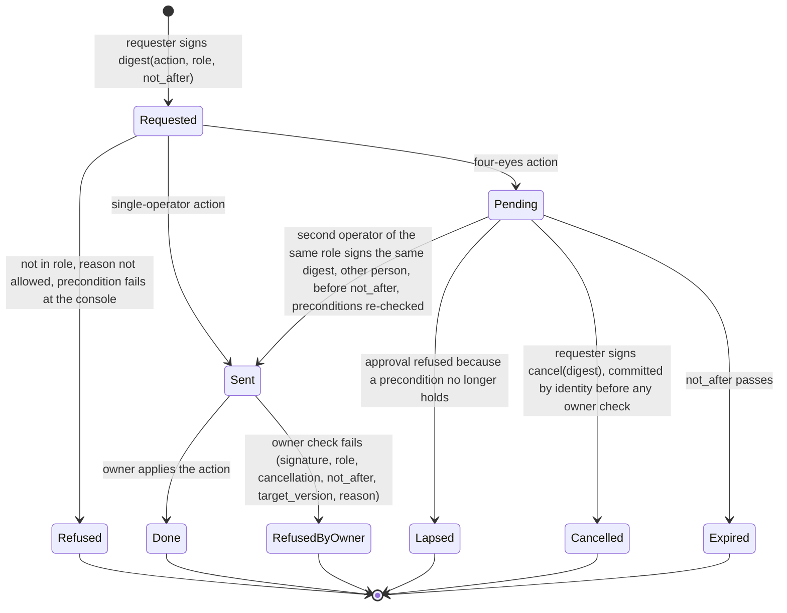

# RFC-005. Security and tenancy: principals at the edge, decisions at the owner, audit in the log

| | |
|---|---|
| Status | **Draft**, revision 4. Revision 4 rebases revision 3.1 on `requirements-v1.8` ([review 22](../reviews/22-requirements-amendments-from-c3-reviews.md), which resolves RQ-R5-1 … RQ-R5-7) and RFC-000 revision 4.2 (its "Revision 4.2 errata", which resolve AI-R5-1 … AI-R5-4); see "Revision 4 resolution". Revision 3 applied [review 16](../reviews/16-rfc-005-review.md) (R5-01 … R5-28, decisions D-1 … D-9), its "3.1" rows [review 21](../reviews/21-rfc-005-fix-verification.md) (V-1 … V-4) |
| Satisfies | X1-S01 … X1-S43 (all 43 X1 scenarios). Shares, with the primary RFC named in the traceability table: P2-S09 (webhook signing), P2-S64 and P2-S113 (principal identity for idempotency), P2-S67 (poll limit at the edge), P2-S72 and P2-S103 (key revocation push), P3-S71 (non-conforming payloads in the personal-data store), P4-S82 (finance action and KYB), P4-S99 (principal identity for source references), X2-S24, X2-S25 and X2-S29 (finance and network-operations actions, probe principals, declaration on measured probe evidence) |
| Policies | POL-01, POL-04, POL-06, POL-07, POL-08, POL-12, POL-14, POL-15, POL-16, POL-17, POL-18, POL-19, POL-21, POL-22, POL-23, POL-24, POL-25, POL-27, POL-28, POL-29, POL-30, POL-32, POL-33 |
| Builds on | The requirements at tag `requirements-v1.8` ([X1 problem statement](../01-discovery/X1-security-and-tenancy.md), [X1 spec](../02-specs/X1-security-and-tenancy.feature), [policy register](../02-specs/policy-register.md), [glossary](../02-specs/glossary.md)), which resolve this RFC's RQ5-1 … RQ5-10 ([review 11](../reviews/11-requirements-amendments-from-detailed-rfcs.md)), RQ5-11, RQ5-12 ([review 12](../reviews/12-requirements-amendments-from-rfc-revision-2.md)) and RQ-R5-1 … RQ-R5-7 ([review 22](../reviews/22-requirements-amendments-from-c3-reviews.md)); and [RFC-000](RFC-000-architecture.md) revision 4.2: its components, single-writer ownership with every cross-owner input owner-served and named in §8, the link displacement read the only SQL read (A1), two-region commits (A3), append-only facts (A4), the one decision point per request (A7), personal data never in a log (A11), the substrate (§5.5: CockroachDB at 2 + 2 + 1, TypeScript/NestJS owner services with epoch-fenced owner leases, insert-only log tables with the truncation role, Kafka fed by a transactional outbox), the topology (§5.1: every application column sealed, Kafka without brokers in R3), placement's account slot map (B-AI-10), the allocation table (§7) and the cross-RFC contracts (§8), which resolve this RFC's AI5-1 … AI5-7 (revision 4), AI5-8 … AI5-11 (revision 4.1 errata) and AI-R5-1 … AI-R5-4 (revision 4.2 errata) |
| Specifies | Per RFC-000 §7: the **edge gateway** (with the exact poll limiter), **identity and access** (with webhook endpoints, erasure requests and the **personal-data store**), the **operator console and approvals**, **audit**, **webhook signing**, the **authenticity verifier** for every money-moving input, and **payload encryption**; and the security obligations every other owner must meet when it consumes the contracts in §11 |

Terms are used in the sense of the [glossary](../02-specs/glossary.md). "Reserved rate" is
capacity and "traffic" is bytes. Figures marked "est." are estimates, to be replaced by
measurement in RFC-000's spike (RFC-000 R1). Sizing is at POL-06's design load (×50 of
launch; RFC-000 §6). Parameters written `like_this` are policy parameters from the
register; parameters written ‹like_this› are **design parameters** of this RFC, not
business policy, and are listed in §13.

## Need

X1 asks for eleven things (X1-N1 … X1-N11). Put together, they make one demand on the
architecture: **every state change in the marketplace must be traceable to exactly one
authenticated principal who was allowed to make it, by a pseudonymous identifier that
outlives any erasure of the person behind it, and nobody may see or change another
tenant's state, not even by learning that it exists**. That has to hold:

1. **On the 200 ms path** (POL-04, X2-N3). The edge has 10 ms of RFC-000's budget for TLS,
   authentication, principal resolution and advisory limits (RFC-000 §3, latency budget),
   at 25,000 booking requests/s and about 100,000 status polls/s (RFC-000 §6). No remote
   call is affordable on that path, yet a revoked agent key must stop working within 60 s
   (POL-25, X1-N3), and its undecided requests must fail at their one decision point
   (POL-04, RFC-000 A7). Every other credential (a user's session, a supplier's or an
   exporter's certificate or key) must stop working within the same 60 s of its
   revocation (X1-N3 v1.8, X1-S41).
2. **Without a second writer** (RFC-000 A1). Identity and access is the only writer of
   principals, keys, users, administrator rights, consent, endpoints, erasure requests and
   operator roles; the account owner is the only writer of a request's outcome. Revocation
   must cross that boundary without giving a request two decision points (RFC-000 D6), and
   without reads of another owner's tables that RFC-000 §8 does not name.
3. **Against Share's own operators, and a compromised console** (X1-N7, POL-32). Operators
   must act on any account, which is exactly the power to control: one role per action
   and per preparatory read, a reason the policy allows, four eyes in three roles
   (compliance, commercial, network operations), approvals that lapse, and a record of
   every attempt and read, granted or refused, that the console alone cannot forge or
   skip.
4. **Against suppliers who compete with each other and with Share's buyers** (X1-N2,
   POL-33). A supplier sees the reservations on its links by an opaque reference and its
   own termination points, never the buyer, unless the buyer's administrator consents or
   compliance discloses under a legal order, within the order's scope and term.
5. **At the money boundary** (X1-N5, X1-N6). Anything on the internet can claim a payment
   was made or a payout landed; only an input proven authentic by its provider's method may
   move money. Buyers must be able to verify Share's webhooks.
6. **For 7 years, immutably** (X1-N8, POL-19, POL-06). Every change to money, capacity,
   links, keys, roles, administrator rights, consent, policy and endpoints, every operator
   action and read, and every refused privileged attempt is recorded with principal and
   time, and nobody, operators and Share's own engineers and database administrators
   included, can alter or remove the record without it being detected and refused by every
   reader.
7. **While personal data stays erasable** (X1-N11, POL-19, RFC-000 A11). Logs, topics,
   archives and the audit trail are append-only for 7 years; a person's data must still be
   erased beyond recovery **only on a recorded erasure request** (a user's for its own data,
   an operator's for its own, a verified documented request by or for a person who is not a
   Share user, or a legal requirement approved by a second compliance operator; POL-19
   v1.8), in every copy (live store, backups, escrowed copies) **within `erasure_max` (30
   days) of the request's record**, without altering any record or any sum computed from
   them.
9. **When every administrator is gone** (X1-N9 v1.8, POL-32). An account or supplier none
   of whose administrators can act is recovered only by onboarding, and the recovery is
   the usual takeover path: for `recovery_hold` the new administrator must not be able to
   silence, spend through or redirect the account, and an administrator who held the right
   before may cancel it.
8. **Across region loss, on a substrate Share does not write** (X2-N4, X2-N5, RFC-000
   §5.5). Authentication is part of admission (99.99%, RTO 1 min; RFC-000 §5.4); every
   owner, the console included, is a NestJS service over CockroachDB at 2 + 2 + 1; the
   third region (R3, Google Cloud Johannesburg) is a different operator from Share and
   holds a voting replica of every range.

## Approach

### 1. Shape of the design

| # | Rule | Why |
|---|---|---|
| S1 | **Authenticate at the edge, from a local replica.** Every external call is authenticated by the edge gateway from a full in-memory replica of credential state streamed by identity and access (§3.3); nothing on the booking path waits for a remote call, and a replica more than 30 s behind identity refuses rather than serves. | X1-N1 within the 10 ms edge budget (RFC-000 §3); X1-N3 by one invariant. |
| S2 | **The tenant comes only from the credential.** The account (or supplier) a call acts for is the one bound to its credential at issuance. A tenant identifier in a path, body or resource identifier is never used to route or to authorise; if it differs from the credential's, the call is answered as for a resource that does not exist. | X1-N2, X1-S02 … X1-S05, X1-S09: a request for another account's data reveals nothing, not even existence. |
| S3 | **Decide at the edge, re-check at the owner.** The edge makes the coarse decision (principal kind, operation, tenant); the owner that holds the resource makes the fine one (does this resource belong to this partition, is this key still valid in my serial order) and records the principal in the same log row as the change. | RFC-000 A1, A7 and §4.1 (the audit record is part of the owner's entry); defence in depth against an edge defect. |
| S4 | **Fail closed on authority, fail open only on advice.** Missing or stale credentials, consent, envelopes or identity state deny (or hide); only advisory rate counters fail open. | X1-N1, X1-N2, X1-N3: no condition of Share's makes an operation succeed that should not. |
| S5 | **Operators act only through the console, and the console cannot act for them.** Every operator action and read carries what the operators themselves signed on their hardware authenticators, over a digest their own signing client computed, including its expiry; owners and readers verify it, check cancellations and roles with identity and access, and record reads themselves. | X1-N7, POL-32: a compromised console cannot make an action take effect that its operators did not sign, after its expiry or after its cancellation, nor read without a record. |
| S6 | **Audit is the owners' own log tables, made tamper-evident.** No separate audit write can be lost (RFC-000 §4.1); a hash chain written in the same transaction as each row, signed checkpoints written once in two trust domains, and Merkle roots over sealed segments make alteration detectable, including by a database administrator. | X1-N8, X1-S15. |
| S7 | **Every application column is ciphertext outside an authorised process**, except pseudonymous keys, ordering and fencing columns. Owners encrypt with keys held in Share's Kenyan HSMs, separated by purpose and bound to the row's position; the database (R3's replica included), Kafka and the archive store bytes they cannot read, and cannot alter or insert without detection. Authenticity between key holders rests on grants, ACLs and the chain (§5.4). | Tenant isolation against the third-party region and against the substrate's own operators (RFC-000 §5.1, AI5-3). |
| S8 | **Personal data lives in one erasable store, and nowhere else.** Every log, table, topic, trace and audit record carries pseudonymous identifiers only; personal data is in identity and access's personal-data store, encrypted per data subject; an erasure, executed only on a recorded request, deletes the subject's key (or the payload buckets the request covers), and every copy is unreadable when the key generation it was wrapped under is destroyed, within 24 days of the request's record. | X1-N11, RFC-000 A11, POL-19. |

### 2. Principals and authentication

#### 2.1 Principal kinds

A **principal** (glossary) is whoever performs an operation once authenticated. Every
principal has a **pseudonymous identifier** (`principal_id`, 128-bit random, never reused,
never derived from personal data) and a kind. Records identify it only by that identifier
for the retention period (POL-19). Personal data (names, email addresses, phone numbers,
KYB documents) lives only in the personal-data store (§3.7). Every revocation below takes
effect within ‹revocation_target› 60 s at every edge, and established connections and
streams authenticated by the revoked credential are closed (X1-N3 v1.8, X1-S41, §3.3).

| Kind | Tenant | Credential | Verified where | Revocation takes effect |
|---|---|---|---|---|
| **Account user** (buyer side); an **account administrator** is an account user holding the administrator right | One buyer account | OpenID Connect login at identity and access's authorisation server; password plus a second factor, **WebAuthn mandatory for administrators**; short-lived access token (ES256 JWT, ‹user_token_ttl› 5 min) naming a **session** and refresh token (rotating, 12 h idle). The token carries `principal_id` and the session identifier, never the login name | Edge: token signature and expiry locally, **and the session active in the edge replica** (§3.3). Identity and access re-checks the administrator right itself on every command of §3.2 | A session is revoked when its user ends it, when the user is removed from the account, or when the user loses a right the session relied on (the administrator right); ended in the replica within 31 s at every edge, connections closed; administrator commands always see the current right |
| **Agent key** | One buyer account, fixed at issuance (POL-25) | Bearer key `shk_<key id>_<secret>` with a check digit, secret 256-bit random, shown once at issuance; Share stores only `SHA-256(secret)` | Edge, from the replica (§3.3), constant-time comparison | Within 31 s at every edge for every operation; in the account owner's log for undecided requests, and no request of the key confirmed after 45 s (§3.3) |
| **Supplier user**, **supplier administrator** (a supplier user holding the supplier administrator right, glossary) | One supplier account | As account user | As account user | As account user |
| **Supplier key** (supplier API automation) | One supplier account | As agent key (`ssk_` prefix); may only call supplier operations | As agent key | As agent key |
| **Operator** | None (cross-tenant by role) | Share's corporate single sign-on, FIDO2 hardware authenticator mandatory, from managed devices on Share's operator network only; exactly one role bound to the operator identity (POL-32); every action and read grant signed on the authenticator through the **signing client** (§7.3) | Console for the session; every owner and reader for each signature, with identity's operator check (§7.4, C15) | Immediate at the console (sessions are server-side) and at every owner and reader, which check the role with identity at apply time (C15) |
| **Probe** | A designated probe account per account slot, or the designated probe supplier (POL-06) | Agent or supplier keys of the probe tenant, plus mTLS client certificates from the probe colocation sites | Edge, as agent key, plus the certificate | As agent key |
| **Payment provider** | None; bound per notification to the account the event names, by payments (RFC-000 §2) | The provider's own authenticity method (§8.1) | Edge payment ingress, by the provider's verifier | Removing the provider's verifier configuration |
| **Payment partner** | None | mTLS and signed reports, per the partner's scheme (§8.4) | Reconciliation (RFC-004), with the verifier library | As provider |
| **Payout provider** | None | Provider's method, as payment provider (§8.4) | Edge payment ingress, routed to payouts | As provider |
| **Partner system** | None | Share calls out with per-partner credentials; partner callbacks verified by the partner's scheme and then re-queried (§8.2) | Partner adapter | Rotating the partner credential |
| **Exporter** | The supplier that owns it, or Share for exporters on Share's own network | mTLS with a per-exporter certificate from Share's device CA, naming the exporter identity and its owning tenant; issued at the request of the supplier administrator, or of network operations for Share's own exporters (POL-32) | Edge: chain at the handshake, and **the certificate serial active in the edge replica on every message** of the persistent connection; ingestion checks each record's exporter against it (§8.4) | Within 31 s at every edge; the connection is closed |
| **Network operations** (consumer of the standing feed and queries) | None | mTLS client certificate | Edge, as exporter | As exporter |
| **Internal service** | None | Workload identity: short-lived X.509 certificate (‹workload_cert_ttl› 24 h) per service instance from Share's internal CA; the same certificate authenticates the service to the database (its own SQL role, §5.5), to Kafka (its own ACLs) and to gRPC peers | Every receiver, by mTLS, against the command allowlist (§4.4) | Certificate expiry and the allowlist |
| **Onboarding** (the external process that creates accounts, records KYB and recovers administrator access, POL-24, §3.8) | None | Internal service identity | Identity and access | As internal service |
| **Workforce administration** (the process outside X1 that vets operators, assigns roles and passes on operators' erasure requests, X1 Out of scope) | None | Internal service identity, with the approving person's WebAuthn assertion | Identity and access (operator partition) | As internal service |

A **data subject** (whose personal data the store holds) is not a principal kind: it is a
user, an operator, a contact of an account or supplier, or a person who is not a Share
user (for example an end customer whose address appears in a supplier's flow export),
named by its pseudonymous identifier (§3.7). A person who is not a user never
authenticates; its documented erasure request is recorded by a compliance operator
(§3.7), so X1-N1 holds: the recording principal is that operator.

#### 2.2 The edge authentication pipeline

Every external call passes these steps in order. The order matters: authentication comes
before any lookup of the resource named, so an unauthenticated caller learns nothing.

1. **TLS 1.3** termination (persistent connections; mTLS where the kind requires it).
2. **Pre-authentication shedding**: per source address and per credential prefix,
   ‹preauth_rate_limit›, soft state. Gross abuse is dropped here (RFC-000 §2, edge).
3. **Credential parse and check digit**: a malformed credential is unauthenticated, but
   its answer waits for the same floor as every other unauthenticated answer (§2.3).
4. **Authentication** from the edge replica (§3.3): key verifier (an unknown key identifier
   is compared against a fixed dummy verifier, so the work is the same), token signature
   and session, certificate serial; and the replica's freshness for the credential's
   identity slot (S1, S4).
5. **Principal context** built (§11, C1), carrying the identity-signed key record for an
   agent or supplier key. It is not signed by the edge: the owner authenticates the edge by
   its mTLS workload identity (R5-24).
6. **Coarse authorisation** (§4): principal kind × operation, tenant check for resources
   whose tenancy the edge knows (a link's supplier from the catalogue cache; a webhook
   endpoint's account or supplier from the replica).
7. **Advisory rate counters** per key and account (RFC-000 D5), and the **exact poll
   limiter** for status polls (§5.3).
8. **Forward once** over gRPC to the owner-lease holder of the principal's tenant's slot,
   read from placement's **account slot map** (RFC-006, overrides included; RFC-000
   B-AI-10) and the placement table for the lease holder (RFC-000 §3, §5.2), never by an
   identifier in the request.

Steps 3 to 6 are in-memory operations: about 20 µs of CPU per request (est.: one SHA-256,
one hash-map lookup, one ES256 verification for user tokens), well inside the edge's 10 ms
(RFC-000 §3). The edge keeps no authoritative state and never touches the database.

#### 2.3 Answers that reveal nothing

| Condition | Answer | Scenario |
|---|---|---|
| No credential, malformed, unknown, wrong secret, expired token, revoked key or ended session, certificate revoked | One "unauthenticated" answer, identical in status, body and headers for every cause, and **sent no earlier than ‹unauth_floor› 5 ms after the request arrived**, which exceeds the p99.9 of every cause's own work (est.), so its timing does not tell a known key identifier from an unknown one (R5-16; DT-23). A booking or status submission is **not accepted** (glossary), any other request is **refused** | X1-S01, X1-S06 |
| Authenticated, but the resource is outside the principal's tenant, or does not exist, or is a supply command on a link of another supplier, or an administrator command naming another supplier | One "not found" answer, identical to the answer for a resource that does not exist, produced by the same code path at the principal's own partition, so its timing is the same as a genuine miss (§5.1) | X1-S02, X1-S03, X1-S04, X1-S05, X1-S09, X1-S22, X1-S33 (fourth row) |
| Authenticated, within its own tenant, but the principal's kind or rights do not allow the operation (an agent key managing keys, users or endpoints; a user without the administrator right) | "Refused", naming the missing right; the attempt is recorded (§3.2) | X1-S19, X1-S25, X1-S29, X1-S33 (third row) |
| The edge replica for the credential's identity slot is more than ‹edge_staleness_max› behind identity (§3.3) | "Temporarily unavailable, retry", never "authenticated" (S4) | — |

### 3. Identity and access

#### 3.1 State, partitioning and the substrate

Identity and access is the only writer of the state below (RFC-000 §2). It is a NestJS
owner service; each partition is an append-only **log table** row sequence, primary key
(partition, sequence), written only by the holder of its slot's owner lease, every write a
transaction conditional on the lease epoch (RFC-000 §5.2, §5.5). Its partitions are
grouped into ‹iam_slots› 256 **identity slots** (est.), each with a lease holder and a hot
standby in the other Kenyan region, as link owners have (RFC-000 AI-R1-12), so a takeover
takes seconds (est.). Current state is a projection table written in the same transaction
(A4), encrypted like every application table (§5.4). The service's SQL role has insert on
its own log tables and insert and update on its own projection and head rows only, and no
grant on any other owner's tables (RFC-000 §5.5, A1).

| State | Partition | Notes |
|---|---|---|
| Buyer account: users (by `principal_id`) and their sessions, the administrator right per user, agent keys (identifier, verifier, label, status, `key_spend_limit`, `key_inflight_limit`, `key_rate_limit`, version), webhook endpoints and their signing secrets (§8.3), KYB status as recorded by onboarding, probe designation, **erasure requests** of its users and registered contacts (§3.7), **account recoveries** and their holds (§3.8) | **By buyer account** | One serial order per account: `account_max_keys` is checked against the keys not revoked in the same entry that issues a key, so concurrent issuance cannot exceed it (X1-S21); the count of administrators is checked in the same entry that removes a right or a user, so an account never loses its last one (X1-S38) |
| Supplier account: users and sessions, the supplier administrator right, supplier keys, exporter credentials (certificate serials and the exporter identities they name), webhook endpoints and their secrets, erasure requests of its users and registered contacts, account recoveries | By supplier account | Same serial-order checks as for buyer accounts |
| **Consent and disclosure registry**: per (buyer account, supplier) the consent state and its history; per legal-order disclosure its order register identifier, scope, approvers, validity and whether the buyer may be told | **By supplier** | Partitioned by the party whose views it governs, so one supplier view needs one consistent read, made by identity itself (§6.2) |
| Operator identities: the one role of each, the person each belongs to (a pseudonymous person identifier bound to a vetting record), WebAuthn public keys and the highest signature counter seen per credential, status; every grant and removal with its granting principal and approving person; **operator assertions consumed** (credential, counter, `action_id` or `grant_id`) and **action cancellations** (§7.3, C15); operators' erasure requests | One partition (small) | Granted by workforce administration (§2.1), never through the console (§7.1) |
| Policy: the permission matrix (§4.2), the operator action catalogue (§7.2), allowed reason codes, verifier configurations per provider, key-release policy (§5.4), the allowlist (§4.4) | One partition, versioned | Every change is an entry with its principal (X1-S14); consumers record the version they decided with |
| **Non-user erasure requests** (documented requests by or for a person who is not a Share user, §3.7) and **legal-requirement erasure requests** that name no user (v1.8) | One partition (small) | Recorded only from a compliance envelope (§7.2); a legal-requirement request naming a user or contact is recorded in that subject's account or supplier partition instead |
| Refused attempts at the operations it owns | With the partition of the attempted operation | X1-S19, X1-S25, X1-S29, X1-S33, X1-S38, X1-S40, X1-S42, X1-S43 |
| **Personal-data store** | Its own database, by data subject (§3.7) | The only place personal data lives (A11) |

**Sizing at the design load** (est.):

| Quantity | Estimate | Note |
|---|---|---|
| Buyer accounts; supplier accounts | 100,000; 1,000 | RFC-000 §6 |
| Agent and supplier keys | at most 10⁷ (`account_max_keys` × accounts); about 10⁶ active | Upper bound sizes the edge replica |
| User sessions alive | about 10⁶ | 12 h idle limit |
| Device certificates | about 10⁵ | Exporters, probes, network operations |
| Key, user, right, consent and endpoint commands | a few per second; peaks of 100/s at onboarding waves | `mgmt_rate_limit` per principal |
| Edge replica per node | about 2 GB in memory (10⁷ × about 200 B, est.) | §3.3 |
| Edge stream traffic | 256 slots × 1 heartbeat/s × about 50 edge nodes ≈ 13,000 small messages/s fleet-wide, plus the changes | §3.3 |
| Operator checks (C15) | a few per minute; peaks of 10/s | §7.4 |
| Personal-data subjects | about 10⁶ (est.) | §3.7 |
| Erasure requests, all channels | a few hundred a month (est.); non-user and legal-requirement requests a few a month (est.) | §3.7 |
| Payload bucket keys alive | ≤ exporters with non-conforming payloads × 24 h × 38 days; about 3×10⁵ at a few hundred misconfigured exporters (est.) | §3.7 |
| Account recoveries | a few a week (est.) | §3.8 |

**Reads.** Identity reads only its own tables. No other component reads identity's tables
by SQL (RFC-000 A1 rev 4.2, R5-12): every other component gets identity state through an
owner-served stream, feed or query, each named in §4.4 and §11, and in RFC-000 §8 (rev 4.2,
AI-R5-1): the **edge stream** (C14), the **identity status push** and **catch-up** (C3),
**supplier visibility** (C6), the **endpoint feed and query** (C8), the **operator check**
(C15), the **erasure-request intake** from the edge and the queue served to the console
(§3.7, C12), and the **recovery objection** from the edge (§3.8). Reads that must see every
committed change (the consent check, §6.2; the operator check, §7.4) are made by identity
itself at the present timestamp, served by the leaseholder.

**Feeds.** Every committed identity entry that a consumer needs is written to the outbox in
the same transaction and published to Kafka (RFC-000 §5.5): the **identity status push**
(C3) keyed by account, with the changefeed's resolved timestamps, the **endpoint feed**
(C8), and the audit feed (§9). Payloads are encrypted under per-topic feed keys (§5.4).

#### 3.2 Administrator commands

Every command below is accepted only from an **account administrator** of the account (or,
for a supplier account, a **supplier administrator** of the supplier), authenticated as in
§2.1. Anyone else within the tenant is refused, and the refusal is recorded with the
principal, the attempted command and the time; a principal of another tenant gets "not
found" (§2.3). Each command is idempotent by (account, idempotency key) for 24 h, as POL-29
sets for bookings; a replay returns the first answer, **except a secret**: a replay of
*issue a key* or *register an endpoint* returns the key or endpoint identifier and "secret
already issued", never the secret, which Share does not keep (keys) or shows once
(endpoints); a lost first answer is fixed by revoking and issuing again (R5-17). Each entry
records the administrator, the time, and the old and new values (X1-S14, X1-S20), by
pseudonymous identifiers only.

| Command | Effect | Reaches | Scenario |
|---|---|---|---|
| Issue an agent key | Refused, stating the limit, if the account already has `account_max_keys` keys not revoked; otherwise a key with its limits (defaults from POL-25), its secret returned once | Edge stream; identity status push | X1-S18, X1-S21 |
| Change a key's limits (raise or lower `key_spend_limit`, `key_inflight_limit`; lower `key_rate_limit` below the POL-25 default) | New version of the key | Edge stream; identity status push | X1-S18 |
| Revoke a key | Terminal; never reversed (a new key is issued instead) | Edge stream; identity status push | X1-S06, X1-S18, P2-S72 |
| Consent to identify the account to a named supplier; withdraw it | An entry in that supplier's registry partition (§6.2), recorded with the administrator and time | — (read at view time) | X1-S18, X1-S30 |
| Add a user to the account; remove one | A new `principal_id`, its personal data put to the personal-data store (§3.7); removal ends the user's sessions. Removing the last administrator is refused (below). Removal does **not** erase the user's personal data (D-5): that needs a request (next row) | Edge stream (sessions ended) | X1-S18 |
| Grant or remove the administrator right of a user (itself included) | Refused, stating that an account keeps at least one administrator, if it would leave none; checked in the account's serial order | Edge stream (sessions of a removed administrator re-issued without the right) | X1-S18, X1-S38 |
| **Pass on an erasure request**: a user's request for **its own** data, the user being of the account, current or former, the administrator itself included (POL-19 v1.8); or, acting for a contact person the account registered (who is not a user), that person's documented request | For a user: an open **erasure request** in the account's partition, with the subject, the administrator, the channel and the time, which starts the `erasure_max` clock (§3.7). For a contact: a **non-user request** in the same partition, status *to verify*, its clock started likewise; compliance verifies it before executing (§3.7). Compliance is alerted | Compliance's erasure queue (`open_requests`, C12) | X1-S39, X1-S42, X1-S12 |
| Register, change or remove a webhook endpoint | Endpoint URL validated (§8.3); a new signing secret shown once | Endpoint feed (notifier); edge stream (endpoint → tenant) | X1-S18, X1-S24, X1-S11 |
| *Supplier administrator*: add or remove supplier users; grant or remove the supplier administrator right; issue, change or revoke supplier keys; issue or revoke an **exporter credential** (a device-CA certificate for a submitted key, naming an exporter of the supplier); register, change or remove the supplier's webhook endpoints (supplier notices); pass on a supplier user's erasure request (or a registered contact's, as above) | As the buyer-side commands; at least one supplier administrator kept; revoking an exporter credential closes its connections within 31 s (§3.3) | Edge stream; endpoint feed | X1-S33, X1-S39, X1-S41 |

An agent key may read its own record (limits, status, key headroom through the account
owner, POL-18); account users may list the account's keys without verifiers. Nobody, the
issuing administrator included, can read a key's secret after issuance.

**Held administrators** (§3.8, POL-32 v1.8). While an account recovery is in its
`recovery_hold`, identity refuses, as "refused during recovery hold" and recorded, any of
these commands from a **held administrator** (the one the recovery granted, and anyone a
held administrator granted the right to during the hold): issue an agent key or supplier
key, issue an exporter credential, register or change a webhook endpoint, consent to
identify the account, remove a user, remove an administrator right. Every other command of
this table is allowed to it, recorded with it (X1-S40). The check is in the account's
serial order, against the recovery entry, so a command and the hold's end cannot both
apply out of order.

#### 3.3 The edge replica, the identity status push, and the 60-second revocation

**The edge replica** (C14; R5-21, R5-06, R5-11, R5-12). Each edge node holds in memory a
full replica of the credential state it authenticates against: agent and supplier key
records (verifier, account, limits, status, version), sessions (identifier, principal,
tenant, administrator right, status), device-certificate serials and their status, the
endpoint → tenant map, and the policy version. Each record is **signed by identity**
(Ed25519, a per-slot record-signing key certified by the key service for (identity, slot,
epoch); §10). The replica is filled per identity slot from:

1. a **snapshot**: every ‹snapshot_interval› 10 min each identity slot's lease holder
   writes its slot's records at a position to object storage, signed and encrypted under
   the edge stream key (§5.4); and
2. the **edge stream**: a gRPC server stream from the slot's lease holder, over mTLS, only to
   edge workload identities, carrying every change after a position in commit order, and a
   **heartbeat** every ‹stream_heartbeat› 1 s: (slot, head position, identity's timestamp
   when it was sent), signed. A heartbeat is sent only after every change up to its head.

The edge applies a record only if its version is higher than the one it holds (a replayed
or rolled-back record is ignored and alerted). For each slot it keeps `fresh_s`, the
timestamp of the last heartbeat whose head it has applied. **Invariant**: a credential of
slot s authenticates only while `now − fresh_s` ≤ ‹edge_staleness_max› 30 s (RFC-000 §3's
30 s cache bound); otherwise the answer is "temporarily unavailable" (§2.3). There are no
per-key fills, no negative cache and no extension on error. An edge that starts loads the
latest snapshot and streams from its position, and serves nothing until every slot is
fresh. Identity's timestamps and the edge's clock are both within the database's clock
domain (RFC-000 §5.5, `max_offset`).

On applying a revocation (key revoked, session ended, administrator right removed,
certificate revoked), the edge **closes every established connection and stream that the
revoked credential authenticated**, and refuses the credential's next request (X1-N3).

**The identity status push to the account owner** (C3). Every committed key and KYB entry
is published from identity's outbox, keyed by account, by the changefeed relay, which also
emits **resolved timestamps** (a promise that every row committed at or before it has been
emitted) to every topic partition every ‹resolved_interval› 1 s. The account owner's funds
module applies events as entries (RFC-004 Part A, F4) and keeps, per account slot,
`iam_fresh`: the minimum resolved timestamp applied over the topic partitions it consumes,
or the read timestamp of its last catch-up, whichever is later. Then:

- **Pull when the push is silent** (R5-05). When `now − iam_fresh` exceeds
  ‹iam_pull_after› 20 s, the slot's lease holder calls identity's **catch-up** (C3) for its
  account slot every ‹iam_pull_period› 5 s until fresh, and applies the answer in one
  entry. This needs no Kafka.
- **Confirm only when fresh.** The booking module (RFC-002) commits a confirmation only in
  a transaction whose timestamp is at most ‹iam_fresh_max› 45 s after `iam_fresh`;
  otherwise the request stays undecided (it may wait, or reach its deadline), so a silent
  push path and an unreachable identity fail safe (S4).

**Timeline of a revocation**, administrator revokes key K at `t0` (the commit of the
revocation entry, two-region durable, after which the administrator is answered):

| Where | Normally (est.) | Worst case | Bound |
|---|---|---|---|
| Edge, every operation by K (submission not accepted, request refused, as unauthenticated); its connections closed | `t0` + about 0.1 s (edge stream) | Stream to an edge lost just before `t0`: the last heartbeat it applied was sent at most at `t0`, so K is refused from `t0` + 30 s + clock offset ≤ `t0` + 31 s. Kafka plays no part | 60 s (X1-N3, X1-S06) |
| Account owner, K's undecided requests fail "key revoked" and every later intake with K is refused | `t0` + about 1 s (push, one entry) | Kafka lost: `iam_fresh` ≤ `t0` at `t0`; the pull starts by `t0` + 20 s and applies the revocation by about `t0` + 26 s (est.). Kafka **and** identity unreachable from the account owner: no request of the slot is confirmed after `t0` + 45 s; K's undecided requests fail when the revocation is applied | 60 s (POL-25) |
| A new account-owner lease holder | — | Catches up from identity (C3) before deciding anything | Before its first decision |

The account owner's log is the **one order** in which the revocation and each request's
decision are compared (POL-04, RFC-000 A7, D6): a request decided before the revocation
entry stays decided (P2-S103); one undecided when it is applied fails "key revoked"
(P2-S72), and its holds are released by RFC-002's request-scoped release. The account
owner exports `now − iam_fresh` per slot and the edges export `now − fresh_s` per slot;
monitoring (RFC-006) alarms when either passes ‹revocation_alarm› 30 s.

**Sessions and certificates** are in the same replica under the same invariant, so a
removed user, an ended session and a revoked device certificate stop working within the
same 31 s, with their connections closed (X1-N3 v1.8, X1-S41). Each case is one identity
entry that changes the credential's record on the edge stream:

| X1-S41 case | Identity entry | Effect at every edge |
|---|---|---|
| An account administrator removes user u1 | User removal ends every session of u1 | Every session of u1 refused, connections closed, ≤ 31 s |
| u1 ends its own session (sign-out) | Session ended | That session refused, ≤ 31 s; the refresh token is dead at once in identity |
| A supplier administrator removes supplier user v1 | As for an account user | As above |
| A supplier administrator revokes an exporter credential | Certificate serial revoked | The serial refused on the next message, the persistent connection closed, ≤ 31 s |
| A user loses the administrator right | Sessions that carried the right ended; the user signs in again without it | ≤ 31 s at the edge; administrator commands refused at once, since identity checks its own state |

A use from 10:01:00 of a credential revoked at 10:00:00 is therefore answered as
unauthenticated (§2.3) and changes nothing, with 29 s to spare. Administrator commands are
checked against identity's own current state.

#### 3.4 Supplier authority over links

The catalogue's link registry (RFC-001, RFC-000 §2) names each link's supplier. A supply
command (book or cancel maintenance, announce a permanent reduction, record a permanent
increase, record an unplanned outage or its restoration) is accepted only:

- from a principal of that supplier (user, administrator or supplier key) for any of them
  (POL-07, POL-32); or
- through the console, from an operator in the network operations role with a reason,
  and only for an outage or a restoration (POL-07, POL-32).

Registering and retiring a link are **commercial** console actions (§7.2), never supplier
or network-operations commands. The edge refuses anything else as "not found" (§2.3), so a
buyer or another supplier cannot tell a link it cannot change from one that does not exist
(X1-S22). The link schedule owner re-checks in its own entry that the principal context
names the link's supplier, or carries a network-operations envelope for an outage or
restoration (defence in depth, S3; RFC-001 implements the check, §11 C11). Network
operations asking for a permanent reduction or increase, maintenance, or a link
registration has no such action in its catalogue (§7.2): the console refuses, nothing
changes, and the attempt is recorded (X1-S23).

#### 3.5 Probe principals

The probe accounts (one per account slot, RFC-000 B-AI-10; POL-06) and the probe supplier
(RFC-000 §5.4) are identity-and-access tenants flagged *probe*; their keys have permission
sets (§4.2) that allow only booking **probe links**, reading the probe tenant's own state,
submitting from **probe exporters** and the probe supplier's own supply commands on probe
links, and only over mTLS from the probe colocation sites (RFC-000 §5.1). A probe key that
leaks therefore cannot buy real capacity on Share's credit (threat T-14). Every principal
context carries the probe flag, which consumers of rating, settlement, supplier reports
and quarantine reports use with the catalogue's probe designation to exclude probe
activity (RFC-006 owns the designation contract, C9). Each probe account's `credit_limit`
is set by a finance operator through the console like any other (X2-S24); the probe
accounts count as having passed KYB (POL-06), recorded as such by onboarding. At about
16,384 account slots (RFC-000 rev 4.2, AI-17-5; est.) that is about 16,384 probe accounts
and a few tens of thousands of keys: negligible in the replica. POL-06 v1.8 probes every
slot at least 3 times a minute from at least two locations, so the probe colocation sites
are at least two, each with its own mTLS client certificates, and probe keys' rate limits
allow that cadence: about 820 probe calls/s overall (est., POL-06), about 3% of the
admission design load, exempt from no check but counted as probe traffic. Which minutes
count as measured failing minutes or slot-minutes is RFC-006's measurement; this RFC only
guarantees each probe's principal and location are in its principal context.

#### 3.6 KYB status

Onboarding records each account's KYB result (passed, failed, withdrawn) in identity and
access, with its principal and time; the KYB documents themselves go to the personal-data
store (§3.7), never to a log. The result travels to the account owner on the identity status
push (C3, C10; RFC-000 AI4-2, "KYB on F4"), applied by its funds module. A finance
operator's request to set a `credit_limit` is checked against it by the console before the
action is sent, and again by the account owner, against the KYB status it has applied
(with `iam_fresh` within ‹iam_fresh_max›); an account that has not passed is refused,
recorded, and keeps no credit limit (P4-S82, X1-S12).

#### 3.7 The personal-data store, erasure requests and erasure

RFC-000 A11 makes this store the only place personal data lives (§8, the personal-data
store contract). Its design is what lets X1-N11 hold beside a 7-year append-only audit.

**What it holds.** Every item of personal data: users' and operators' names and contact
details, login identifiers, account and supplier contact details, display names of
accounts (treated as personal data, since a sole trader's business name is one), KYB
documents (put by onboarding), **case notes** (free text that operators or buyers write,
§7.5), the documents behind legal orders (§6.2), and **non-conforming flow-record
payloads** (put by metering ingestion, POL-19, P3-S71; below). Each item is keyed by the
pseudonymous identifier of its **data subject** (a `principal_id` or a contact
identifier); a case note by its note identifier, tagged with the subjects it concerns; a
payload by its record identity, tagged with the exporter's supplier and the attributed
account, if any.

**How it is stored.** A separate CockroachDB database at 2 + 2 + 1, owned by identity and
access, with no other service's SQL role granted on it, no changefeed, and
`gc.ttlseconds` ≤ ‹pd_gc_ttl› 1 h on every table, so `AS OF SYSTEM TIME` cannot reach a
deleted row after an hour. Each subject has a **subject key** (AES-256), and every item is
encrypted under it (AES-256-GCM, random 96-bit nonce, with the subject and item
identifiers as associated data). Subject keys are stored only in the store's key table,
wrapped under the store's **key-encryption key of the current generation** (`KEK_PD,g`),
held only in the Kenyan HSM clusters, never escrowed outside them (D-2). R3's replica,
every backup and the database's own files therefore hold only items under subject keys,
and subject keys under a generation KEK that never leaves the HSMs.

**Login lookup.** Login identifiers (an email address) are found through a **blind index**:
HMAC-SHA-256 of the normalised identifier under an index key of the same generation, held
in the HSM, mapped to the `principal_id`. The index row is deleted on erasure and
recomputed at each generation change (below), so an old backup's index rows cannot be
matched against a guessed address once its generation is destroyed.

**Interface** (C12), over gRPC with mTLS; the four store operations of RFC-000 §8 (put, get,
erase, expire) are kept apart, each with its own callers:

| Operation | Callers (allowlist, §4.4) | Semantics |
|---|---|---|
| `put(subject, item)` | Identity (users, contacts, legal-order and erasure-request documents), onboarding through identity (KYB documents), console (case notes) | Idempotent by (subject, item, content digest); acknowledged only once durable in two regions |
| `put_payload(record_id, exporter, supplier, account?, received_at, payload)` | Metering ingestion (RFC-003) | Into the **payload bucket** (exporter, UTC receipt hour) (RFC-000 §8); idempotent by `record_id`; at most ‹payload_put_limit› 10/s per exporter and ‹payload_put_global› 1,000/s overall; beyond either, the payload is not kept (its digest is, in ingestion's record), counted and alerted to the supplier and operations (decision RD-1, below) |
| `get(subject, item, purpose)` | Identity (login, administrator commands), notifier (contact details at send time), console (support views, case notes, payload evidence; with an operator read grant, §7.6), reporting (display names on statements at view time) | Each for its stated purpose; the store verifies the read grant for console reads and **appends every `get` to audit** with the reader, purpose, subject and grant, never the data; an erased or expired item answers "not found" |
| `erase(request_ref, scope)` | Identity only, executing a compliance action (below) | Destroys what the request covers: the subject's key and items, and the payload keys its scope names (below); idempotent by `request_ref` |
| expire | The store itself, by schedule | Each payload's expiry is fixed at put, per bucket day: its day's expiry key is destroyed at the day's start + `dispute_window` + 7 days (below) |
| `open_requests()` | Console, through identity (C12) | The erasure requests not yet executed or refused, oldest first, with their channel, status (*to verify*, *open*, *executing*) and age, for compliance's work queue |

Readers keep personal data in memory for the request only; they never write it to a table,
a topic, a cache that outlives the request, an application log or a trace.

**Erasure requests** (POL-19 v1.8, POL-32, X1-N11, X1-S39, X1-S42, X1-S43; R5-02). An
erasure is executed only on a recorded **erasure request**: an entry in identity, in the
subject's account, supplier or operator partition, or in the non-user request partition
(§3.1), holding the request identifier, the subject (a pseudonymous identifier; for a person
who is not a user, a new `subject_id` minted for the request), the channel, the recording
principal, the **scope** it covers, and **`requested_at`, identity's commit of the entry,
which starts the `erasure_max` clock**. There are five channels, and no other:

| Channel | Who asks, for whom | How it is recorded | Scope (what its erasure destroys) |
|---|---|---|---|
| Through an administrator (POL-32) | A user of a buyer or supplier account (current or former, the administrator itself included), for **its own** data, passed on by an administrator of its account | The *pass on an erasure request* command (§3.2); status *open* | The user's items and the case notes tagged with it; the payload coverage of a user (below) |
| The user's own documented request (POL-32, POL-19 v1.8) | A user principal (account or supplier user, not a key), for **its own** data only | Through the marketplace, **edge → identity directly** (`record_erasure_request`, C12; V-1): the edge forwards the user's principal context and its identity-signed access token; identity verifies the token itself (signature, expiry, session active in **its own** state, `principal_id` = the subject) and records the request in the subject's account or supplier partition; status *open*. The console takes no part in recording it | As above |
| Workforce administration (POL-32 v1.8) | An operator, for its own data | A command to identity's operator partition with the approving person's assertion; status *open* | The operator's items and case notes; no payloads |
| Non-user documented request (POL-19 v1.8, X1-S42) | A person who is not a Share user, or someone acting for that person (an administrator of an account that registered the person as a contact included), by a written request naming the person, the exporters and the period concerned, with evidence of identity or authority | By a compliance operator, the one-operator action *record a non-user erasure request* (§7.2), the written request and its evidence put as a case note tagged with the new `subject_id`, the log keeping its digest, the named exporters and the period; or, for a registered contact, the administrator's *pass on* command (§3.2). Status ***to verify*** | The payload buckets of the named exporters for every UTC hour that meets the period (whole hours, so a superset); for a registered contact, also the contact's items |
| Legal requirement (POL-19 v1.8, POL-32, X1-S43) | Nobody asks: compliance itself, on a documented legal requirement | The **four-eyes** compliance action *open an erasure on a legal requirement* (§7.2), citing the order register identifier; identity records the request when it applies the approved envelope, with the legal reference; status *open*. Pending, it records nothing and lapses at `approval_expiry`; without a legal reference it is refused and recorded | As the subject's own channel would: a user's, an operator's, or (naming exporters and a period) a non-user's |

**Refused, and recorded, with nothing erased** (X1-S42): a request by an agent or supplier
key (a key is not a person); a user's documented request naming any subject but itself; a
non-user request that compliance cannot verify (below); an envelope opening an erasure
without a legal reference. "Legal requirement" is a channel only through four eyes; one
compliance operator alone never erases a subject who did not ask. Removing a user or closing
an account does not erase by itself (D-5).

**Verification of a non-user request.** A request in *to verify* cannot be executed. The
compliance operator who acts on it either **verifies** it (the *erase* action carries the
verification, citing the evidence's case note; one operator, POL-32) or **refuses** it as
unverifiable (the one-operator action *refuse an erasure request*): the request becomes
*refused*, nothing is erased, and its sender is told by the notifier at the contact
address the request gave, read from the store at send time. Verification time counts
against `erasure_max`, since the clock started at the record (review 22, amender decision
7). When a non-user request's erasure destroys payload buckets, the supplier's
administrators are told which exporter and which hours were erased, never by whom or about
whom, so a supplier learns that its exporter sends personal data.

**Execution** (X1-S12 erasure row, X1-S34, X1-S39, X1-S42, X1-S43). The compliance action
*erase a data subject's personal data* (§7.2) cites `request_ref`; one compliance operator
suffices (POL-32). Its envelope goes to identity, which checks **in its own state** that the
request exists, is *open* (or *to verify*, with the verification carried in the envelope)
and names the envelope's subject, then:

1. commits `erasure_executing` (request, operator, envelope digest, scope) in the request's
   partition;
2. calls the store's `erase(request_ref, scope)`, which in one transaction deletes the
   subject's wrapped key, its items, its blind-index rows and the case notes tagged with it,
   and the payload keys the scope names (below), and appends the erasure to audit;
3. commits `erasure_executed` with the store's commit timestamp; the action is *applied*.

```mermaid
stateDiagram-v2
  [*] --> Open: erasure_requested (administrator, own request, workforce; requested_at starts erasure_max)
  [*] --> ToVerify: non-user request recorded (requested_at starts erasure_max)
  [*] --> Open: legal requirement, approved by a second compliance operator, applied by identity
  ToVerify --> Refused: compliance refuses as unverifiable; sender told
  ToVerify --> Executing: erasure_executing (envelope carries the verification)
  Open --> Open: envelope refused (no match, wrong subject, not compliance)
  Open --> Executing: erasure_executing (compliance envelope citing request_ref)
  Executing --> Executed: store erase committed, erasure_executed
  Executed --> Unrecoverable: generation h destroyed (at most e + 14 days)
  Refused --> [*]
  Unrecoverable --> [*]
```

Crash points: after 1, a recovering lease holder re-drives 2 for every request in
`erasure_executing` (idempotent; deleting absent rows is a no-op); after 2, it finds the
store's audit record and commits 3. A legal-requirement envelope applied twice (the
console's retry) records one request, deduplicated by `action_id`. The store refuses
`erase` from any caller but identity, and identity refuses an erasure envelope without a
matching request, and records a request only from the subject's own verified access token,
an administrator's command, workforce administration's command, a compliance operator's
non-user record (which can reach only the payload buckets it names, and is told to their
supplier), or an approved four-eyes envelope; so neither a console compromise nor one
compliance operator can erase a user, an operator or a contact who has not asked. A
compromised edge node remains T-33's residual: it can file a request only for a user whose
live token it terminates. Identity alerts on an open or to-verify request at
‹erasure_alert› 7 days and raises an incident at ‹erasure_incident› 20 days; the execution
target is ‹erasure_exec_target› 10 days (D-1), for every channel.

**Generations and destruction** (R5-01, R5-14). Generation g starts at `s_g`; every
‹kek_generation_period› 7 days a new generation starts. At `s_g+1` identity creates
`KEK_PD,g+1` and its index key, and rewraps every live subject key: one transaction per
batch of subjects, each conditional on the subject's key row still existing (serialisable),
so an erased subject is never rewrapped (about 10⁶ subjects by HSM batch rewrap, about
10⁴/s per cluster, under 2 minutes, est.), and likewise every live account payload key and
payload bucket key (about 4×10⁵, est., under a minute); the blind index is recomputed. Each generation
KEK is created in the HSM with a **usage end date** `s_g+1` + ‹pd_backup_retention› 7 days,
after which no HSM unwraps under it, and is then **destroyed** by a scheduled HSM quorum
operation authorised electronically by two of the named security officers (D-2), on every
member of every Kenyan HSM cluster and in every HSM-native backup (or HSM-native backup is
disabled for the `KEK_PD` class); each cluster returns a signed destruction attestation,
appended to audit. A cluster unreachable at the scheduled time is destroyed on reconnection
and cannot serve the key meanwhile (the usage end date). Store backups (RFC-006) are taken
without revision history, tagged with every generation they contain, and kept
‹pd_backup_retention› 7 days, so no backup outlives its generation (RFC-000 AI5-11).

**The bound, from the request** (D-1). Let the request be recorded at `r` (`requested_at`, for
every channel, a legal requirement's included), the erasure commit at `e`
≤ `r` + 10 days, and h the generation the subject's key was wrapped under at `e` (`s_h` ≤ `e`):

| Copy | Unreadable from | Worst case after the request |
|---|---|---|
| The live store through `get` | `e` | ≤ 10 days |
| The live store's MVCC history (`AS OF SYSTEM TIME`) | `e` + ‹pd_gc_ttl› | ≤ 10 days + 1 h |
| Raft logs and not-yet-compacted files on every replica, R3's included | Destruction of h, at `s_h+1` + 7 days ≤ `e` + 14 days | ≤ 24 days |
| Backups holding the key under h − 1 | Destruction of h − 1, at `s_h` + 7 days ≤ `e` + 7 days | ≤ 17 days |
| Backups holding the key under h | Destruction of h, ≤ `e` + 14 days | ≤ 24 days |
| HSM copies of `KEK_PD` (members, HSM backups) | The same destructions, attested | ≤ 24 days |
| Escrowed copies | None exist (D-2) | — |
| Owner memory, request-scoped reads | The end of the request | — |

Every copy is unrecoverable within **24 days** of the request, inside `erasure_max` (30
days), with 6 days of margin for one missed weekly rotation. Monitoring alarms if any
generation older than 14 days still exists, or an erasure request is open at 7 days.

**Non-conforming payloads** (POL-19 v1.8, P3-S71, X1-S42; R5-04, D-4, RQ-R5-2 resolved). A
payload has no known subject, so its item key is **wrapped in layers**, and destroying any
one layer makes it unrecoverable:

| Layer | Key | Held | Destroyed when |
|---|---|---|---|
| Innermost, only if the payload's traffic is attributed to an account | The account's **account payload key** | Store key table, wrapped under `KEK_PD,g` | An erasure of a user of that account executes (a new key serves later payloads) |
| Middle | The **bucket key** of the payload bucket (exporter, UTC receipt hour) (RFC-000 §8), created at the bucket's first put | Store key table, wrapped under `KEK_PD,g` | An erasure whose scope names that exporter and an hour of the bucket, or of a user of the exporter's supplier, executes (a bucket still filling gets a new key version for later payloads) |
| Outermost | The **expiry key** `X_d` of the UTC receipt day d | Only in the Kenyan HSMs, never escrowed or backed up (RFC-000 AI-R5-3, AI3-13), usage end date d's start + `dispute_window` + 7 days | At its usage end date, by the scheduled HSM quorum destruction, attested |

**Which requests cover a payload** (POL-19 v1.8; review 22, amender decision 6): one naming
its exporter and a period that meets its receipt hour (a non-user request, or a legal
requirement naming them); one by or for a user of the supplier whose exporter sent it; one
by or for a user of the account its traffic is attributed to. An operator's own request
covers none. A payload cannot be matched to the person whose data it may hold, so every
request that could concern it erases it: the loss is dispute evidence, in a case that is the
supplier's misconfiguration and whose record is rejected anyway.

**Bounds.** Expiry reaches every copy, backups and escrow included, at once, never later
than `dispute_window` + 7 days after receipt (at most one day earlier, which leaves
`dispute_window` + 6 days of evidence), whether or not any request covers it (P3-S71). A
covering erasure deletes the account payload key or bucket keys at `e`, so every payload
received before the erasure, a superset of those before the request, is unreadable in the
live store at once and in every copy by the generation bound above (≤ 24 days of the
request's record): whichever of the two comes first is when it is gone. Finance and support
read a payload only through the console with a read grant (§7.6), for dispute evidence.
Sizing: at the global cap, 1,000/s × about 1 KB × 37 days ≈ 3.2 TB per copy (est.); in
normal operation far less. Bucket keys: one per (exporter, hour) that received a payload,
about 3×10⁵ alive at a few hundred misconfigured exporters (est.); a supplier-wide erasure
deletes at most its exporters × 912 hours of them in one transaction, batched if larger.

**What erasure leaves.** Every log row, audit record, ledger movement and sealed segment
still carries the subject's `principal_id`, unaltered; no log is rewritten (A4). Recomputing
a balance or a charge reads only those records, so it gives the same result (X1-S34).
After erasure the identifier no longer leads to a person. A subject's later return is a new
`principal_id`.

**No personal data elsewhere** (X1-S37; R5-22). Enforced in four ways: (1) **on the write
path**: the owner runtime refuses a row or event whose typed schema has a free-text field
outside the enumerated case-note and payload references, and the schema lint refuses such
a schema at build; (2) the shared logging and tracing library accepts only typed
identifiers and enumerations, and drops anything else; (3) the edge strips personal data
from requests before any log (authorisation headers, bodies of user-management commands);
(4) a **sampling scanner** with its own workload identity in the key-release policy reads
a ‹scan_sample› 10⁻⁴ sample of log rows, topics, application logs and traces for patterns
of personal data, in an isolated service whose only output is findings (DT-14). A field
that needs personal data is a reference to the store.

**Decision RD-1 (payload caps).** Keeping every non-conforming payload of a misconfigured
exporter at full rate (up to 600,000/s) would cost tens of TB a day in the store. Beyond
the caps the payload is not kept, only its digest; the supplier is told its exporter is
non-conforming. The trade-off: dispute evidence beyond the caps is the digest alone, in a
case that is the supplier's misconfiguration and in which the record is rejected anyway.

#### 3.8 Account recovery

An account (or supplier) whose every administrator has left or lost its means of
authentication has no principal who may make administrator changes, and a documented
request cannot help (§7.5). Recovery is an **onboarding** action (POL-32 v1.8, X1-N9,
X1-S40; RQ-R5-4 resolved by review 22), the only way an administrator right is granted
other than by an administrator.

| Entry (account's partition, serial order) | Written by | Effect |
|---|---|---|
| `recovery_granted` (recovery_ref, user named, `prior_admins`, `hold_until` = commit + `recovery_hold`) | Onboarding (internal service identity), after re-verifying the business at KYB level | The named user holds the administrator right as a **held administrator** (§3.2); `prior_admins` is the set of users who held the administrator right at this commit; every user of the account is told at once, with the recovery_ref |
| `recovery_cancelled` (recovery_ref, objector) | Identity, on an objection | The right granted by the recovery is removed, and so is every administrator right a held administrator granted during the hold, in the same entry (the edge stream ends the affected sessions); the account is otherwise as before; onboarding is alerted; every user is told |
| `recovery_confirmed` (recovery_ref) | Identity, when `hold_until` passes | The hold ends; the administrator may take every administrator action |

```mermaid
stateDiagram-v2
  [*] --> Held: recovery_granted (onboarding; every user told)
  Held --> Held: held administrator's restricted command refused and recorded
  Held --> Cancelled: object_to_recovery by a prior administrator, committed before hold_until
  Held --> Confirmed: hold_until passes (recovery_confirmed)
  Cancelled --> [*]
  Confirmed --> [*]
```

**During the hold** (`recovery_hold`, POL-32: 24 h), the held administrator, and anyone it
grants the right to, cannot remove users or administrator rights (so it cannot silence an
objector), issue agent or supplier keys or exporter credentials (so it cannot spend or make
traffic), register or change webhook endpoints (so it cannot redirect outcomes) or give
consent to identify the account to a supplier (§3.2). Its other administrator commands
(adding a user, lowering or revoking a key, removing an endpoint, passing on an erasure
request) take effect, recorded with it (X1-S40, third row).

**Objection** (V-4; X1-S40 fourth row). Only an administrator who held the right before the
recovery (a member of `prior_admins` who still holds the right, a held administrator never)
may object, through the marketplace, **edge → identity directly**, as for the erasure intake
(§3.7): `object_to_recovery(context, access token, recovery_ref, idempotency key)`, where
`recovery_ref` is named in the notice. Identity verifies the token itself (signature,
expiry, session active in its own state, the principal in `prior_admins` and still an
administrator), then, in the account's serial order, commits `recovery_cancelled` if the
recovery is still in its hold. An objection after the hold, or to an unknown recovery,
answers "no recovery in hold"; one by any other user or by a key is refused; each is
recorded (§4.2). Idempotent by (principal, idempotency key) for 24 h. `recovery_cancelled`
and `recovery_confirmed` are conditional entries of one partition, so the first committed
wins: an objection committed before `hold_until` always cancels (X1-S40 fifth row: none by
10:00 the next day, so the recovery is final).

An account none of whose prior administrators can act has nobody to object; the hold still
applies, and the recovery becomes final at its end. Users added during the hold remain
users after a cancellation, listed in the cancellation notice so the objector may remove
them (decision D-10, RQ-R5-8).

Crash points: an objection whose answer is lost is retried by the user under the same
idempotency key; a lease holder that recovers commits `recovery_confirmed` for every hold
already expired, and the held administrator's restrictions are evaluated against the
recovery entry's state, so a late `recovery_confirmed` only delays the end of the
restrictions, never shortens the objection window.

### 4. Authorisation model

#### 4.1 Where each decision is made

| Decision | Made by | From | Recorded |
|---|---|---|---|
| Is the caller authenticated; who is it; which tenant | Edge | Replica (§3.3) | In the principal context |
| May this kind of principal call this operation; is the named resource in its tenant (where the edge can know) | Edge | Policy (§4.2), catalogue cache and replica | Refusals within the principal's own tenant are recorded by the operation's owner |
| Does this resource exist in this partition; is this key still valid here; does this administrator still hold the right | The owner partition (account owner, link owner, reporting, identity and access) | Its own state | In its log row (audit fields, §9.2) |
| Is this operator action or read in the operator's role, with an allowed reason, signed by its operators, approved where four eyes apply, before its `not_after`, not cancelled, with its preconditions holding | Console, then re-verified by the owner or reader from the operators' own signatures and identity's operator check (C15) | Action catalogue (§7.2), envelope or read grant | Console log; owner's row, or the reader's audit append |
| May this supplier see this buyer's identity in this view | Identity and access, from the consent registry, at view time (C6) | Consent and disclosure registry (§6.2) | The view's registry timestamp, recorded by reporting |
| Is there a recorded erasure request for this subject or scope, verified if it is a non-user's | Identity and access | Its own erasure requests (§3.7) | The erasure entries |
| Is this administrator held by an account recovery; may this principal object to it | Identity and access, in the account's serial order | Its recovery entries (§3.8) | The refusal, objection or recovery entry |

Every decision names the policy version it used, so any past decision can be explained
(X1-N8).

#### 4.2 Permission matrix

"Own" means the principal's own tenant. Anything not listed is denied. Operator actions
are in §7.2 and are never available at the public edge.

| Operation | Account administrator | Account user | Agent key | Supplier user or key | Supplier administrator | Probe key |
|---|---|---|---|---|---|---|
| Book, change, cancel, withdraw (own account) | Yes | Yes | Yes | No | No | Probe links only |
| Status of own requests; own reservations; balance and headroom | Yes | Yes | Yes (headroom shown as key headroom, POL-18) | No | No | Own |
| Own statements; own notice list | Yes | Yes | Yes | No | No | Own |
| Make a documented request to support (§7.5) for a change it may itself make | Yes | Yes | Yes | No | No | No |
| Make a documented request to erase **its own** personal data (§3.7; recorded by identity, not the console); a request naming anyone else is refused, recorded | Yes | Yes | Refused, recorded (a key is not a person) | Supplier user: yes; supplier key: refused, recorded | Yes | No |
| List own account's keys (without verifiers) | Yes | Yes | Its own record only | No | No | No |
| Issue, change limits of, revoke agent keys | Yes | Refused, recorded | Refused, recorded | No | No | No |
| Add or remove users; grant or remove the administrator right | Yes (at least one administrator kept) | Refused, recorded | Refused, recorded | No | No | No |
| Pass on a user's own erasure request, or a registered contact's documented request | Yes | Refused, recorded | Refused, recorded | No | Yes (its supplier's users and contacts) | No |
| Object to a pending account recovery of the own account or supplier, during its hold (§3.8) | Only an administrator in the recovery's `prior_admins`; a held administrator: refused, recorded | Refused, recorded | Refused, recorded (a key is not a person) | Refused, recorded | As account administrator | No |
| Consent to identify the account to a named supplier; withdraw it | Yes | Refused, recorded | Refused, recorded | No | No | No |
| Register, change, remove the account's webhook endpoints | Yes | Refused, recorded | Refused, recorded | No | No | No |
| Schedule of an own link (reservations by reference and termination points; identity only where §6 allows) | No | No | No | Yes | Yes | Probe supplier: probe links |
| Own supplier statement | No | No | No | Yes | Yes | No |
| Book or cancel maintenance, announce a permanent reduction, record a permanent increase, record an outage or restoration, on an own link | No | No | No | Yes | Yes | Probe supplier: probe links |
| Add or remove supplier users; grant or remove the supplier administrator right; issue, change, revoke supplier keys and exporter credentials; register, change, remove the supplier's webhook endpoints | No | No | No | Refused, recorded | Yes (at least one administrator kept) | No |
| Submit flow records and superseding versions of its own records (POL-23: measured fields only) | — | — | — | Exporter credential only | — | Probe exporters only |

During an account recovery's hold, a held administrator's column is the account
administrator's less the commands §3.2 lists as refused during the hold.

The matrix is policy data (§3.1), evaluated by a pure function shipped as the principal
and authorisation library (§11, C2) to the edge, identity and access, the console and
every owner, so the same decision is made wherever it is checked.

#### 4.3 One account per key, one tenant per call

An agent key acts for its account only (X1-S05): the edge routes its calls to that
account's slot, and if the call names a different account (in a path or body), the
submission is not accepted or the read refused with the "not found" answer, and nothing
is forwarded. The account owner refuses any command whose principal context names a
tenant other than its partition's account, or a key that is neither in its applied key
list for that account nor carried by an identity-signed key record naming that account
(S3, R5-13). There is no operation by which any buyer principal acts for two accounts.

#### 4.4 Internal commands and the substrate's own boundaries

Every internal call is gRPC over mTLS with workload identities (§2.1), and each receiver
accepts a command only from the components RFC-000 makes its callers. The allowlist is
part of the policy (§3.1). Rows marked † are owner-served streams and queries that replace
cross-owner SQL reads (R5-12), named in RFC-000 §3 and §8 by revision 4.2 (AI-R5-1).

| Receiver: command | Accepted only from |
|---|---|
| Account owner: booking API commands | Edge (with a buyer principal context) |
| Account owner: identity status push (Kafka) | Identity and access (topic ACL: identity's relay is the only producer) |
| Account owner, link owner, attribution, catalogue, payouts, payments, identity and access, placement (RFC-006, region disaster): operator commands | Console, relaying an operator envelope (§7.4) |
| Reporting, status replicas, link owner (schedule read), catalogue, audit query, personal-data store (`get`): operator reads | Console, relaying an operator read grant (§7.6) |
| Account owner, link owner, catalogue, identity and access, attribution, payouts, payments: target summaries † | Console, relaying a read grant or envelope request (§7.3); answers signed by the owner |
| Link owner: hold, convert, release, query, leg changes, offer holds | Account owner (RFC-000 §8, link hold port) |
| Link owner: supply commands | Edge (supplier principal) or console (network-operations envelope) |
| Ledger: posting | Settlement, payments, payouts (RFC-000 §8) |
| Payments, payouts, reconciliation: authenticated inputs | Edge payment ingress or the verifier library in-process (with a verdict, §8.1, C7) |
| Console: documented requests | Edge (with a buyer or supplier principal context, §7.5) |
| Identity and access: edge stream † (C14) | Edge |
| Identity and access: catch-up † (C3) | Account owner |
| Identity and access: `visibility` † (C6) | Reporting, notifier, provisioning feed |
| Identity and access: operator check † (C15) | Every owner and reader that accepts operator envelopes or read grants; the console |
| Identity and access: `record_erasure_request` (C12), `object_to_recovery` (§3.8) | Edge (with a user principal context and the user's access token, verified by identity) |
| Identity and access: `open_requests` † (C12) | Console |
| Identity and access: endpoint query (C8) | Notifier |
| Identity and access: account recovery (`recovery_granted`, §3.8), KYB results | Onboarding |
| Identity and access: role grants, operators' erasure requests | Workforce administration |
| Personal-data store: `put` | Identity, console (case notes), metering ingestion (`put_payload`) |
| Personal-data store: `get` | Identity, notifier, console (with a read grant), reporting (§3.7) |
| Personal-data store: `erase(request_ref, scope)` | Identity only |
| Identity and access: non-user erasure requests, legal-requirement erasures, refusals of unverifiable requests (§3.7) | Console, relaying a compliance envelope (§7.4); the legal-requirement one only with a second compliance approval |
| Audit: append (§9.4) | Console, secrets service, key service, personal-data store, identity and access, every reader of operator read grants, the platform's access logs and database audit channels |

A command from any other caller is refused and raised as a security alert.

The substrate adds three boundaries that the allowlist alone does not cover, each enforced
by the substrate's own controls and each a threat in §12:

- **Database.** Each owner service has its own SQL role, authenticated by its workload
  certificate, with insert on its own log tables, insert and update on its own projection
  and head rows, select on another owner's rows only where RFC-000 §8 names the read (A1
  rev 4.1; this RFC adds none), and nothing else (RFC-000 §5.5). No application role has
  update or delete on any log table. The database's `root` and administrative roles are
  reachable only through break-glass (§10). The truncation role (RFC-000 AI5-8) can delete
  only rows at or below audit's watermark, **enforced by the database** (§9.3).
- **Kafka.** Every topic has one producing workload identity (the owner's changefeed relay)
  and named consumer identities, by ACL. Payloads are sealed under the topic's feed key
  (§5.4), so Kafka's operators and R3 read nothing and cannot alter or inject an event
  that opens. Between key holders, a consumer could forge an event only if it could also
  produce to the topic, which the ACL denies: authenticity rests on the ACL and on the
  source row's chain (§9.3), not on the AEAD (R5-09).
- **Placement.** The placement table and owner-lease table (RFC-000 §5.2) are written only
  by the placement service and by lease holders under their own epochs, by grants. A
  forged lease row written through break-glass could let a process of the same owner kind
  write; that is detected by the chain (§9.3) and by the lease audit of RFC-006, not
  prevented by encryption.

### 5. Tenant isolation

#### 5.1 Data

- **Routing by tenant** (S2). Every buyer operation is routed to the principal's own
  account partition; every supplier operation is evaluated against the principal's own
  supplier's links and statements. A resource identifier never selects a partition, so a
  principal of "b2" naming reservation R of "b1" reaches b2's own partition, where R does
  not exist (X1-S03).
- **Uniform misses.** Because the request always reaches the principal's own partition
  and misses there by the ordinary lookup (its projection table, by (partition, resource)),
  a resource of another account and a resource that never existed take the same path and
  the same time; no answer depends on whether the identifier exists elsewhere (X1-S02,
  X1-S04).
- **Identifiers** for reservations, requests, keys, endpoints, principals and contacts are
  128-bit random. Their unguessability is not what isolates (routing is), but it removes
  enumeration as a way to probe for timing, and it makes them pseudonymous (S8).
- **Owners re-check** the principal context's tenant against the partition (§4.3).
- **Read models** (reporting, statements, supplier views) are partitioned by account or
  supplier (RFC-000 §2) and queried only with the principal's tenant.
- **Shared infrastructure** (database clear columns, Kafka message keys and topic names,
  metrics, traces, alerts) carries pseudonymous identifiers only, never personal data or
  another tenant's content (S8); no clear column relates two tenants (§5.4); operational
  dashboards that join across tenants are operator tools behind the console (§7). Topic
  names name owner kinds, never tenants.
- **Webhooks** go only to an endpoint registered by the event's own account (or supplier)
  and carry only that event's own data (§8.3; X1-S24).
- **Rejections and counter-offers** name no other account or reservation (POL-10; RFC-001
  owns the content, P1-S17).

#### 5.2 Idempotency scopes (POL-29)

| Input | Scope of the identity | Principal compared | Where | Answer to another principal |
|---|---|---|---|---|
| Booking request | (account, idempotency key) | `principal_id` of the first submission (agent key or user) | Account owner, entry 1 (RFC-000 §4.4) | Not accepted, "reuse by another principal", revealing nothing of the first request or its outcome (P2-S64) |
| Change request | (account, idempotency key); the same request only with the same reservation, kind of change, new end or rate and `wait` (POL-29, B-RQ-5) | As for bookings | Account owner | As for bookings (P2-S113) |
| Same key from another account | A different scope by construction | — | — | Decided on its own merits; a poll for a key never used in the account is answered as never used (X1-S08, X1-S09) |
| Administrator commands (§3.2) | (account or supplier, idempotency key), 24 h | Administrator's `principal_id` | Identity and access | Not accepted. A replay by the same administrator returns the first answer, never a secret (§3.2) |
| Operator actions | The console's action identifier, which is the source reference of any money-moving action (POL-29) | Requesting operator's `principal_id` | Console; the owner deduplicates by the same reference | Refused as reuse by another principal (P4-S99) |
| Payment notifications, transfer confirmations | (provider, transaction reference, event kind) (RFC-000 §4.4) | The provider principal | Payments, payouts | A different principal is refused (RFC-004) |

The principal compared is always the `principal_id` from the principal context (C1),
never a role or a display name, so two operators in the same role are two principals.

#### 5.3 Rate limits and fairness

| Limit | Enforced exactly at | Advisory at |
|---|---|---|
| `key_rate_limit`, `account_rate_limit` (bookings, retries counted; POL-25) | Account owner (RFC-000 D5; RFC-002, RFC-004 Part A), from owner memory rebuilt from the last second's intake entries (RFC-000 B-AI-4: up to twice the limit for one second after an owner change) | Edge per node, shedding only gross excess |
| `key_poll_limit` (status polls; POL-25, P2-S67) | **Edge poll limiter** (RFC-000 §2, AI4-6, AI5-1): poll-limiter instances in the leader region, each owning a set of **key shards** from the placement table; every edge, in either region, routes every poll of a key to the instance owning its shard (one round trip from the other region, about 10 ms, est.), which counts per key per UTC second | — |
| ‹mgmt_rate_limit› 5/s per principal for identity-and-access commands; ‹read_rate_limit› per account for reads served by reporting | Edge | — |
| ‹preauth_rate_limit› per source address before authentication | Edge | — |
| ‹operator_read_limit› per operator (read grants and reads per hour) | Every reader of read grants (§7.6) | — |

Polls are not on the booking path and have no latency target of their own, so the extra
hop costs nothing measured. Counters are soft state (RFC-000 §5.3). **Bound** (RFC-000 §2):
when a shard moves (its instance lost, or a region-wide failover moves the leader region),
the new owner of the shard starts counting from zero, so for one `key_poll_limit` window a
key can be answered up to twice its limit; between the loss of an instance and the move
(seconds, est.), polls of keys on its shards are answered "temporarily unavailable, retry",
never counted elsewhere. That is the only relaxation of an exact limit in this RFC.
`account_rate_limit` also bounds one account's load on its partition, so a noisy tenant
cannot starve another (RFC-000 R6).

#### 5.4 Encryption of every application column, at rest and through the substrate

RFC-000 §5.1 and §8 make payload encryption a library this RFC owns (C13). Its hook is in
the **NestJS owner runtime** (RFC-006 owns the runtime): after the owner has built a batch
and before the epoch-conditional transaction, the runtime seals every row it writes; on
read, it opens. There is no hook in the database or in the log convention (RFC-000 §5.5,
item 9).

- **Scope** (R5-11). **Every application table**: log rows, outbox rows, projection, head,
  idempotency, decision, registry and read-model rows. The clear columns are only those
  the database needs for keys, ordering, fencing and indexed lookups: owner kind,
  partition, sequence, epoch, row kind, version, commit timestamp, the chain hash (§9.3),
  and lookup keys that are pseudonymous identifiers, times or tenant-free enumerations.
  **No clear column relates two tenants**: where a lookup key would join two (the consent
  registry's (supplier, buyer account), say), the second is a keyed hash under the table's
  index key (HMAC-SHA-256), so R3 and a database administrator cannot read the relation.
  The owner's schema lists its clear columns; the schema lint refuses any other (RK-8).
- **Keys by purpose** (R5-09). Every key is AES-256, generated by the key service in the
  Kenyan HSMs and stored wrapped under a regional key-encryption key held only in the HSMs
  of R1 and R2:

| Key | Per | Seals | Released to |
|---|---|---|---|
| Log key | (owner kind, slot, month) | Log, projection, head and other table rows of the owner kind except the audit column | The owner kind; history (sealing and history queries); the sampling scanner (§3.7) |
| Audit-column key | (owner kind, month) | The `audit` column of every row (§9.2) | The owner kind; audit (indexing) |
| Feed key | (topic, month) | Outbox rows and the events they become | The producing owner kind and the topic's named consumers (RFC-000 §8) |
| Edge stream key | (month) | Identity's snapshots and stream records (§3.3) | Identity; the edge |

  A feed consumer therefore opens only the feeds it consumes, never the owner's log. Every
  unwrap is appended to audit (§9.4), at most ‹unwrap_rate_limit› per identity per minute.
- **Binding to position.** Each row is sealed with AES-256-GCM, associated data (owner
  kind, table, primary key, version or sequence, epoch, row kind, key identifier). A row
  copied to another partition, sequence or table, replayed under another epoch, or rolled
  back to an older version while a reader holds a newer one (readers reject a version
  lower than one they have seen), or written by anyone without the key, **fails to open**
  and is rejected by every reader, which raises a security alert (T-24).
- **Nonces and limits** (R5-10). Each lease holder derives its sealing key per (data key,
  epoch, holder session) with HKDF, and draws a **random 96-bit nonce** per seal; it counts
  seals in memory and derives the next sub-key (its index in the key identifier) at 2³¹
  seals, well below GCM's 2³² limit for random nonces. A batch retried at the same position
  draws new nonces, so content that differs never shares a nonce; a new epoch or session
  never shares a sub-key. At the design load the hottest slot seals about 10⁴ rows/s (est.),
  2.6×10¹⁰ a month: about a dozen sub-keys a month.
- **Month boundaries** (R5-20). The key service generates each slot's next-month keys from
  day 25, and lease holders unwrap them ahead, so no month boundary needs an HSM call on the
  write path.
- **Kafka.** Kafka keeps no broker in R3; R3's KRaft controller holds topic metadata only,
  and topic names carry no tenant (§5.1).
- **System ranges** (R5-11). CockroachDB's own system tables are replicated to R3 too. No
  secret is put in them: changefeed sinks and backup destinations are external connections
  that authenticate with workload certificates fetched at run time; statement diagnostics
  bundles with literal values are disabled in production; job and statement metadata
  carry only pseudonymous identifiers. What remains (schemas, job metadata, statistics on
  clear columns) is in T-19's residual.
- **The database's own encryption at rest** is on for every store, the personal-data store
  included, but it is not what protects R3: R3's database process holds its store key,
  never an application key (RFC-000 §5.1).
- **Third region.** R3's voting replica stores and votes on ciphertext; it serves no reads
  (RFC-000 §4.6) and is not a preferred leaseholder (RFC-000 §5.1). During a declared region
  disaster the surviving Kenyan region's HSMs serve the owners, and R3's two replicas
  (2 + 2) still hold ciphertext. What R3 can learn is the clear columns: pseudonymous
  identifiers, row counts and timing, and the system metadata above (T-19).
- **Sealed segments** in object storage (RFC-000 §5.3, RFC-006) stay encrypted under the
  same keys; log, audit-column and feed keys and their key-encryption keys are retained
  for 7 years (X2-N6), with escrow (§10).
- **A compromised data key** exposes one owner kind's slot for one month (or one topic's
  month), for 7 years, because rows and sealed segments are insert-only or object-locked and
  are never re-encrypted (R5-20). That is why keys are per slot and month; re-wrapping
  protects only against a compromised key-encryption key.
- **Cost** (est.): one AES-GCM pass per row at the owner, a few µs per batch; one per
  projection read; no change to RFC-000's latency budget.

### 6. Supplier visibility and consent (POL-33)

#### 6.1 The opaque reservation reference

A supplier sees each reservation on its link by a **reservation reference** (glossary)
computed as

`ref(supplier, reservation) = v ‖ AES-128_{K(supplier, v)}(reservation_id)`

where `reservation_id` is the reservation's 128-bit identity, `K(supplier, v)` is a
per-supplier key of version `v` held in the secrets service (§10), and `‖` is
concatenation.

- **Used for no other reservation** (POL-33, X1-S28): AES under one key is a permutation,
  so two reservations never share a reference for one supplier; the version prefix keeps
  references of different versions distinct.
- **Unlinkable**: without the key, references of one buyer's reservations look
  independent; two suppliers on one route get different references for the same
  reservation, so they cannot join their views by reference.
- **Stable**: a reservation keeps its reference for its life, through changes, extensions
  and a move to an equivalent path (POL-07), because it depends only on its identity; key
  versions are added for new reservations and never retired while a reservation of that
  version exists, nor within 7 years. A reference a supplier saw beside a buyer's identity
  stays the same after a withdrawal of consent, as provisioning needs (POL-33, X1-S30).
- **Charge-line references** (POL-33, RQ5-1): a usage-priced share on a supplier
  statement is shown by `ref_line(supplier, line_id)`, the same construction under a
  separate key `K_line(supplier, v)`, so it is used for no other line and is unlinkable to
  the reservation references and to other lines.
- **Computed, not stored**: reporting, the notifier (supplier notices) and the provisioning
  feed compute it; no owner stores it, so no owner gains a writer duty.
- **Resolving a reference** (R5-18). A supplier command that names a reference is resolved
  by the inverse under the **calling supplier's** key; the resolved reservation must have a
  leg on a link of the calling supplier, or the answer is "not found" (§2.3), on the same
  path and with the same timing as any miss.

#### 6.2 Consent, disclosure and the consent check

The **consent and disclosure registry** is partitioned by supplier (§3.1); the buyer
account in its lookup keys is a keyed hash (§5.4). Its entries:

- *consent given* (buyer account, supplier, administrator, time) and *consent withdrawn*
  (same fields), from an account administrator's command (§3.2); an agent key or a user
  without the right is refused, and the refusal recorded (X1-S29);
- *disclosure* (buyer account, supplier, order register identifier, **scope**, valid from
  the approval, **until** the order's stated end date if any, **buyer may be told**: yes
  only if compliance records that the order allows it), from an approved compliance
  action (§7.2); *disclosure ended*, a compliance action of one operator (POL-33). The
  order document itself is a case note in the personal-data store (§3.7); the registry
  holds only its identifier.

**Scope** (POL-33, X1-S35) is one of: the buyer's reservations on the supplier's links
(the default, when the order states none); the reservations the order lists; or those
active in a period the order states. A scope can never reach beyond the supplier's own
links, because a supplier view contains nothing else (§6.3).

**Consent check** (§11, C6; R5-12): for one supplier view, reporting calls identity's
`visibility(supplier, accounts, reservations)`. Identity reads the supplier's registry
partition by a **consistent read at the present timestamp** (served by the leaseholder) and
answers, for the buyer accounts and reservations in the view, *reveal* (with the consent or
disclosure entry) or *hide*, with the read's timestamp, which reporting records with the
view. No component but identity reads the registry. Then:

- A view started after a withdrawal is acknowledged reads at a timestamp after the
  withdrawal's commit, so **every later view hides** the buyer (X1-S30). Reservations of
  the buyer confirmed after the withdrawal appear only by their own unlinkable references
  (§6.1); R keeps the reference already seen.
- A disclosure reveals the identity only for reservations within its scope, and only while
  the view's timestamp is before both its end date and any *disclosure ended* entry
  (X1-S35); the order register identifier is recorded with the view (X1-S28, third row).
- If identity cannot answer, the view is **served with every identity hidden** (S4): the
  supplier's own reservations and references are still shown, so reporting's
  availability does not depend on the registry, and the failure can only hide.
- Reporting never caches a consent answer across views.
- **The buyer is told** of a disclosure only when the entry says it may be; then the
  notifier delivers a notice to the account's notice list (glossary *Told*), with the order
  register identifier and the scope. Otherwise nothing is pushed to the buyer (POL-33).

Supplier views are a few per second (est.; tens at the design load), so a leaseholder read
per view costs nothing material.

#### 6.3 What a supplier view contains

| View | Shown | Never shown unless revealed |
|---|---|---|
| Schedule of an own link (X1-S28) | Each reservation's rate, window, **termination points on this supplier's own link** (where traffic enters and leaves it, POL-33, RQ5-1) and reference; capacity history; maintenance bookings | Account identity, account-level identifiers, the route's ends and other legs, the buyer's sites, anything common to one buyer's reservations |
| Supplier statement (P4-N10, P4-S40) | Each share with its charge line by reservation reference and minute, weights, rule and tie order, payouts, debts, residues, amounts Share paid and why; usage-priced shares by charge-line reference (§6.1) | As above; never the buyer's account on a usage-priced line |
| Supplier notices (affected reservations, POL-07) | Reservation references | Account identity, always (notices are not views; identity is never pushed) |
| Quarantine reports (POL-17) | The unattributed traffic | Nothing to reveal: it is unattributed |

### 7. Operator console and approvals

#### 7.1 Operators and role grants

Each operator identity belongs to one person and holds **exactly one role** (POL-32):
support, network operations, commercial, finance or compliance. A person who works in two
roles has two identities, and the pseudonymous person identifier is what four eyes compares.
Operators sign in through Share's corporate single sign-on with a FIDO2 authenticator, on
managed devices, from Share's operator network; console sessions are server-side and end at
‹operator_session_ttl› 8 h or on idle (15 min). The session lets an operator prepare work;
nothing takes effect or is read without a per-action or per-case signature (§7.3, §7.6).

**Role grants** (POL-32, POL-19, X1-S14; R5-23). How operators are vetted stays out of scope
(X1). A grant or removal of a role reaches identity and access only from workforce
administration (§2.1), carrying the WebAuthn assertion of the approving person, who must be
one of the **workforce approvers**: persons registered in identity's operator partition as
approvers, holding no operator role themselves. Identity records the grant with the
granting principal, the approving person, the grantee and the time, refuses a grant whose
approving person is the grantee's person, and raises an alert on every grant. Each person
identifier is bound to a vetting record that workforce administration attests (out of
scope), and identity alerts when two operator identities in the same role register the
same authenticator attestation or are used from the same managed device (T-31's residual:
a workforce insider can mint two person identifiers for one human). The console has no
action that grants roles, so no operator can grant one.

#### 7.2 Action catalogue

Each action and each preparatory read belongs to exactly one role (POL-32). An action is
accepted only from that role, with a **reason code** from the action's closed list, and is
sent to the owner of the state it changes (RFC-000 §2, §3: the console only carries
authorised intent). Free text is optional and is stored as a case note (§7.5), never in a
log; the reason code, any order register identifier and any request reference are what the
audit keeps. Reads are made with read grants (§7.6).

| Action | Role | Four eyes | Allowed reasons | Owner it is sent to | Scenarios |
|---|---|---|---|---|---|
| Read an account's reservations, requests, money and statements | Support | No | Account's documented request, or support case | Reporting, status replicas (read grant) | X1-S27 |
| Act at an account's documented request (cancel, shorten, decrease, change, withdraw), as the account's own change (POL-08) | Support | No | Account's documented request (§7.5) | Account owner | X1-S27 |
| Read a link's schedule, to record an outage on it | Network operations | No | Outage investigation | Link schedule owner (read grant) | X1-S23 |
| Record an unplanned outage; record its restoration | Network operations | No | Outage cause | Link schedule owner | X1-S23 |
| Terminate a reservation for network abuse (the holder is always told; the action has no *withhold notice* flag, and a request to withhold made with it is refused and recorded while the termination proceeds) | Network operations | No | Network abuse (POL-30) | Account owner (reservation command port, RFC-000 §8) | X1-S12, X1-S17, X1-S36 |
| Declare a region disaster, with the evidence of the loss **or probe evidence** (`disaster_probe_minutes` consecutive **measured failing minutes** of admission in the region: each with at least 12 probes from at least two locations, fewer than 90% succeeding; POL-06 v1.8); declare its end | Network operations | **Yes**, second network operations operator | Region loss with evidence; probe evidence (POL-06) | Placement and probes (RFC-006, the declaration record, which checks the evidence) | X1-S31, X2-S25, X2-S29 |
| Issue or revoke a credential for an exporter on Share's own network | Network operations | No | Exporter commissioning or decommissioning | Identity and access | — (POL-32) |
| Set `reservation_price` or `usage_price` for a product and route | Commercial | **Yes**, second commercial operator | Price decision; notice per POL-27 | Catalogue (RFC-003) | X1-S31 |
| Set a supplier's split weight | Commercial | **Yes**, second commercial operator | Commercial agreement | Catalogue (RFC-003) | X1-S31 |
| Record a partner's terms: minimum term, cancellation fee, whether a leg can be decreased, whether and how long it holds capacity | Commercial | No | Partner agreement | Catalogue (RFC-003) | X1-S31 |
| Register a link for a supplier, with its capacity | Commercial | No | Supplier agreement | Link registry (RFC-001) | X1-S31 |
| Retire a link on which nothing is reserved, held, offered or booked as maintenance from then on | Commercial | No | Supplier agreement ended | Link registry and link owner (RFC-001, which checks the precondition) | X1-S31 |
| Correct a price, with its cause | Finance | No | Cause: Share, supplier, other (POL-23) | Catalogue and rating (RFC-003) | X1-S12, P3-S57 |
| Attribute quarantined traffic to an account | Finance | No | Attribution evidence (POL-17) | Attribution and quarantine | X1-S12 |
| Reverse a mistaken attribution, within `dispute_window` | Finance | No | Attribution error (POL-17) | Attribution and quarantine | X1-S12, P3-S65 |
| Set or remove a `credit_limit`, only on an account that has passed KYB | Finance | No | Credit decision; re-vetting after write-off (POL-21) | Account owner (funds and standing) | X1-S12, P4-S82, X2-S24 |
| Set `usage_rate_cap` for an account and product | Finance | No | Exposure decision (POL-14) | Catalogue (account-product terms) | X1-S12 |
| Resolve an escalated payout | Finance | No | Resolution with the provider's evidence (POL-22) | Payouts | X1-S12 |
| Resolve an escalated reversal whose payment never arrived | Finance | No | Resolution with the partner's evidence (POL-21) | Payments | X1-S12 |
| Terminate a reservation for fraud, or a sanctions or legal order; optionally **withhold the holder's notice**, citing a legal order that forbids it, as part of the termination (POL-30 v1.7) | Compliance | **Yes**, second compliance operator (one approval covers both) | Fraud; sanctions order; legal order (with order register identifier) | Account owner | X1-S12, X1-S26, X1-S36 |
| Disclose a buyer's identity to a supplier under a legal order, with the order's scope, end date and whether the buyer may be told | Compliance | **Yes**, second compliance operator | Legal order (with order register identifier) | Identity and access (consent registry) | X1-S12, X1-S28, X1-S35 |
| End a disclosure | Compliance | No | Order expired; order withdrawn; purpose met | Identity and access | X1-S35 |
| Read the audit trail | Compliance | No | Investigation; audit request; legal order | Audit (query, read grant) | X1-S31, X1-S13 |
| Record a non-user erasure request: the written request and its evidence (as a case note), the exporters and the period it names | Compliance | No | Documented erasure request received (POL-19 v1.8) | Identity and access (non-user request partition, *to verify*) | X1-S42 |
| Refuse an erasure request as unverifiable (non-user requests only); its sender is told | Compliance | No | Identity or authority not verified | Identity and access | X1-S42 |
| Open an erasure on a legal requirement, naming the subject (or exporters and period), with no request | Compliance | **Yes**, second compliance operator | Legal requirement (with order register identifier); no other reason | Identity and access, which records it as an erasure request with the legal reference, `requested_at` its commit | X1-S43 |
| Erase a data subject's personal data | Compliance | No | The recorded erasure request, cited by `request_ref` (POL-19 v1.8), and for a non-user request the verification (evidence case note) | Identity and access, which executes it in the personal-data store (§3.7) | X1-S12, X1-S34, X1-S39, X1-S42, X1-S43 |

Preparatory reads belong to their action's role (POL-32): finance reads the charges and
quarantine it corrects or attributes, and non-conforming payloads as evidence; commercial
reads the catalogue and link registry it changes; compliance reads what a termination,
disclosure or erasure targets. Each is a read of that role, made with a read grant and
recorded like any action. Support's reads are only those in the first row; no other role
reads the audit trail, and no role but compliance erases (X1-S13: support's attempts to
read the audit trail or to erase personal data are refused and recorded).

There is **no action** that ends a reservation for any other reason (X1-S16), that
changes a link's commercial capacity (X1-S23), that writes off a debt (write-offs are
automatic, X1-N7), that creates or edits flow records (POL-23, RQ3-2), that grants a role
(§7.1), that withholds a notice after the termination is decided (POL-30 v1.7; X1-S36 third
row), that erases without a recorded erasure request (a legal requirement becomes one only
with four eyes), that recovers an account (onboarding's, §3.8), or that alters an audit record or any owner's past row
(X1-S15). A request for one is refused and recorded.

#### 7.3 The request and approval state machine

The console is a NestJS owner service; its state is in its own log table at 2 + 2 + 1
(RFC-000 §2, §5.5), partitioned by action identifier. **What the operators sign** (R5-07):
every action is rendered for signing by the **signing client**, a separate application on
the managed device, distinct from the console's web pages. It receives the canonical action
(`action_id`, type, target, target version, flags, scope, amounts, reason code, references), fetches
the **target summary** from the target's owner through the console relay, **signed by that
owner** (so the console cannot alter it), shows both, and itself computes

`digest = SHA-256(canonical action ‖ role ‖ not_after)`, with `not_after` = the request's
time + `approval_expiry`, fixed by the requester's signing client.

The operator's authenticator signs a WebAuthn assertion whose challenge is that digest. The
approver's signing client re-renders the same action and summary, recomputes the same
digest and has the approver sign it. The console server never chooses what is signed.

- **Four eyes** (X1-S26, X1-S31, X1-S36, X1-S43). A four-eyes action takes no effect, and nothing
  is sent to the owner, until a second operator **in the same role**, a **different
  person** from the requester, approves it with their own authenticator signature over the
  same digest. The requester cannot approve their own action under any identity (the
  person identifier is compared, not the operator identity).
- **Expiry and cancellation** (X1-S32, X1-S43 second row, POL-32). A pending action expires
  at `not_after`; a legal-requirement erasure that lapses so records no request.
  Approval, cancellation and expiry are each a row conditional on the action being Pending,
  in the action's partition under one writer, so the first committed wins. The
  **owner** enforces both, independently of the console: it refuses an envelope when its
  own transaction timestamp is later than `not_after` − ε (ε the database's `max_offset`),
  and when identity reports a cancellation of the digest (C15). A cancellation is a
  requester-signed *cancel(digest)* that the signing client sends, through the console
  relay, to identity's operator partition; identity returns a signed receipt, which the
  signing client shows. A console that drops the cancellation leaves the operator without
  the receipt, and the signing client tells the operator to raise it. So a compromised
  console cannot make an action take effect after its expiry, or after a cancellation
  whose receipt the operator holds. Identity serialises `cancel` and the owners'
  `operator_check` on the digest in its operator partition (C15, V-3): a cancellation
  committed first makes every later check answer `cancelled`; once an owner's check has
  consumed the digest's assertions, `cancel` answers **too late: already applied or
  applying**, with no receipt, and the signing client shows "too late".
- **Preconditions re-checked at approval** (X1-S32, third row). Each action records, at
  request, the target and its **version** (for a reservation, the account owner's row
  sequence of its last change; for a disclosure, the registry state), from the signed target
  summary. At approval the console fetches a fresh summary; if the target has ended or
  changed, the approval is refused and the action **lapses**. The owner checks the same
  version again when it applies the envelope, so a change committed between the console's
  read and the owner's apply is still refused (RefusedByOwner), and the action lapses.
- **Sending** is synchronous to the owner over gRPC (RFC-000 §3) and retried with the same
  action identifier until the owner answers; the owner deduplicates by it.
- **Every transition is a row** on the console log with the operator(s), role, reason code
  and time, so every refused attempt (X1-S13, X1-S16, X1-S23, X1-S27 third and fourth rows,
  X1-S36 first and third rows, P4-S82) is recorded. The owner's own row records every applied
  action, and the reader's audit append every read (§7.6), so neither depends on the console
  alone.
- **Out-of-band confirmation.** Every applied operator action is notified by the notifier,
  from the owner's row, to each signing operator's corporate contact (resolved from the
  personal-data store at send time), so an action no operator recognises is reported.
- **Notice to the holder** of a termination (X1-S17, X1-S36, POL-30): the account owner's
  termination entry triggers the notifier as for any reservation end, so the holder is told
  within `affected_notice_time` with the reason. The notice is suppressed only when the
  termination's envelope carries *withhold notice* with an order register identifier, in
  the signed digest, which only the compliance termination action can carry, and only once
  approved by a second compliance operator; the owner refuses an envelope carrying *withhold
  notice* on any other action type. A network-abuse termination with a request to withhold
  takes effect with the request refused and recorded (X1-S36 first row); a compliance
  termination approved without the withholding, followed by a separate request to withhold,
  leaves the notice to be sent within `affected_notice_time`, and the later request is
  refused and recorded (X1-S36 third row).

#### 7.4 The operator envelope, and how owners verify it

Every operator command carries an **envelope** (§11, C4):

| Field | Meaning |
|---|---|
| `action_id` | The console's action identifier; also the source reference of any money-moving action (POL-29) |
| `action_type`, `target`, `target_version` | From the catalogue; the target names the account, reservation, link, product and route, payout, reversal, registry entry or data subject |
| `role`, `reason_code`, `order_ref` or `request_ref`, `note_ref` | As submitted; `note_ref` points to an optional case note in the personal-data store (§7.5) |
| `flags` | Action-specific options (for example *withhold notice* on a compliance termination, the scope and end of a disclosure) |
| `not_after` | Request time + `approval_expiry`, fixed by the requester's signing client |
| `requester` | Operator `principal_id`, person identifier, credential identifier, and the WebAuthn assertion (authenticator data, client data, signature) over `digest` |
| `approver` (four-eyes actions only) | The same fields for the approver |
| `console_epoch`, `issued_at` | Informational; not trusted for any check |

An owner applies an operator command only if all of the following hold, else it refuses
with the failed check, and the console records the refusal:

1. it recomputes `digest` from the envelope's fields itself, and the `action_type` is one
   it accepts, `role` is the catalogue's role for it, and the reason code is allowed;
2. each assertion verifies under the C4 WebAuthn rules: client data `type` is
   `webauthn.get`, its `challenge` equals `digest`, its `origin` is the signing client's
   registered origin; authenticator data's `rpIdHash` is SHA-256 of Share's operator RP
   identifier; the user-present and user-verified flags are set; the signature verifies
   under the credential's public key;
3. identity's **operator check** (C15), called at apply time, answers for each signer:
   the operator holds that role now, the credential is registered and active, the
   assertion's (credential, counter) has not been consumed under another `action_id` or
   `grant_id` (identity consumes it under this `action_id`; single use, V-2), and the
   digest is not cancelled;
4. for a four-eyes action, the approver's role equals the requester's and the person
   differs;
5. its own transaction timestamp ≤ `not_after` − ε;
6. `target_version` is still current in its own state.

A compromised console process therefore cannot make an action take effect that its
operators did not sign, after its `not_after`, or after a cancellation identity recorded
(threat T-9). The owner writes the envelope's fields into the audit column of the row that
makes the change (§9.2), so the change and its authority are one record (RFC-000 §4.1).

#### 7.5 Documented requests and case notes

A **documented request** (glossary *Operator*; POL-32; X1-S27) is a support request made
**through the marketplace** (the API or portal, through the edge) by an authenticated
principal of the account **that may itself make the change it asks for**: the console's
intake evaluates C2 `decide` with the requester's principal context and the requested
operation, and records the request only on *permit*. One more kind exists (POL-19,
POL-32 v1.8; RQ-R5-1 resolved by review 22): a user principal's request to **erase its own
personal data**, which the edge sends to identity directly and identity records from the user's own
access token (§3.7, V-1); support and compliance see it through `open_requests`, and the
console never records or forwards it.
The intake records, on the console log partition of the account's requests, the
requester's `principal_id`, the action and its target, and the time; any free text the
buyer adds is a case note (below). A support action of the "documented request" kind must
cite one, and the console checks that the action and target match it. The action is sent
to the account owner **as the account's own change** (POL-08), with the support operator as
principal and the request as `request_ref`: the account's fees and charges apply, and it is
never a termination (POL-30). Without a matching request it is refused and recorded (X1-S27
third row). A request received by e-mail, telephone or any other channel cannot be
entered: the console has no field for it, and an attempt to act on one is refused as not a
documented request and recorded (X1-S27 fourth row). The edge → console intake is RFC-000
§3 and §8 (AI5-9, revision 4.1).

**Case notes.** Free text (an operator's explanation, a buyer's message, a legal order's
document) may carry personal data, so it never enters a log (A11). It is put to the
personal-data store as a case note, under its own key, tagged with the data subjects the
author names; the log row carries only the note identifier and the note's SHA-256 (so the
audit proves which note was attached, without holding it). Erasing a subject destroys the
notes tagged with it; the reason code, which is what POL-32 records as "the reason", stays.

#### 7.6 Operator reads and read grants

Every operator read (X1-N7, X1-S27 first row, X1-S31) carries a **read grant** (R5-08, D-8):
an operator-signed statement, through the signing client, of (`grant_id`, operator, role, read type,
**one target**: an account, a link, a data subject, a payload, or an audit query's scope,
reason code, `not_after` = signing time + ‹read_grant_ttl› 1 h). One hardware touch covers
one case, not one page. The **reader** (reporting, status replicas, the link owner,
catalogue, the personal-data store, audit's query service) verifies it by the C4 rules and
the operator check (C15, once per grant and then every ‹operator_check_cache› 60 s),
answers only within the target, and **itself appends the read to audit** (C5 append) with
the operator, role, target, grant and time, before answering. Readers enforce
‹operator_read_limit› per operator and alert on breadth (many targets per operator per
hour; T-29 extended to the console). The console records the read on its log as well, but
a compromised console cannot read without a grant, nor read without the reader's record.

### 8. Webhook and input authenticity

#### 8.1 Inbound payment notifications

The edge's payment ingress runs one **verifier** per provider, configured in the policy
partition (§3.1). The provider's own method is an interface contract (X1 out of scope);
the verifier framework supports three:

| Method | How it proves authenticity | Replay protection |
|---|---|---|
| **Signature** (HMAC or public-key over the body and a timestamp) | Signature valid under the provider's current or previous key | Timestamp within ‹provider_timestamp_tolerance› 5 min; payments deduplicates by (provider, transaction reference, event kind) anyway (RFC-000 §4.4) |
| **Mutual TLS** with the provider's pinned certificate, from its published address ranges | The connection's certificate | As above |
| **Verify by fetch**, for a provider that does not sign its notifications | The notification is treated only as a hint; the transaction reference is validated against the provider's format, encoded, and fetched from the provider's authenticated API, at most ‹fetch_rate_limit› per provider and per source address; **the fetched content** is the event (R5-19) | The fetch is idempotent by transaction reference |

The verdict is forwarded with the notification to payments over gRPC (§11, C7):

- *Authentic* (with the normalised event and the proof: key identifier, method): payments
  records it, binds the reference to its account on the first authentic and well-formed
  event (RFC-000 §2, V-05), and acknowledges the provider once its transaction commits
  (two regions).
- *Not authentic* (with the reason): **no binding, no movement**; payments records it in
  its **investigation stream**, partitioned by provider (not by the claimed reference, so
  an attacker cannot fill real references' partitions), and an alert is raised (X1-S10;
  RFC-000 §2, §8, AI5-5). The provider is answered with a refusal. Under a flood beyond
  ‹preauth_rate_limit› the stream records counts, first and last occurrence and a sample
  per source, so recording cannot become the attack (RK-6).

A notification never moves money on the strength of the account, amount or reference it
claims; it moves money only as an authentic event (X1-N5).

#### 8.2 Inbound from partners

Share calls partners with per-partner credentials (§10); the partner adapter (RFC-002)
holds them. A partner callback, where a partner's API uses them, is verified by the
partner's scheme and then treated as a **hint**: the adapter re-queries the booking by its
idempotent partner key (POL-28's re-query) over its own authenticated outbound
connection, and only the queried result changes Share's state. A forged callback can
therefore cause a re-query, never a booking state change.

#### 8.3 Outbound webhooks to buyers and suppliers

Identity and access owns endpoints and their signing secrets (RFC-000 §2, §8, AI5-4); the
notifier (RFC-006) delivers from a Kafka topic; this RFC defines the signature (§11, C8).

- **Endpoints.** Registered, changed and removed only by an administrator of the account
  (or supplier) (§3.2, POL-32), as entries in identity's account (or supplier) partition,
  each with its tenant. The notifier learns them from the **endpoint feed** and can query
  identity for one by endpoint identifier.
- **Format** (the Standard Webhooks convention): headers `webhook-id` (the delivery's
  identity, stable across retries; for a delivery that carries one notice, the event's), `webhook-timestamp` (seconds since the epoch, **set
  afresh on every delivery attempt**, R5-19) and `webhook-signature` = `v1,` base64 of
  HMAC-SHA256(secret, id ‖ "." ‖ timestamp ‖ "." ‖ body), computed per attempt. **One
  delivery may carry many notices** (POL-04 v1.8, RFC-000 §8 signed webhook): the body is a
  list, each notice with its own event identity, all of one tenant (below), and the one
  signature covers them all, so each notice is as verifiable as the delivery carrying it,
  and is told when that delivery is first attempted. A retry carries the same notices under
  the same `webhook-id`; the receiver deduplicates per event identity.
- **Secret**: 32 bytes per endpoint, shown once to the administrator who registers or
  rotates it. Identity stores it inside its encrypted projection and, on the endpoint feed,
  wrapped under a key the key service releases only to the notifier; it is never in clear
  in the database, in Kafka or in a log. The notifier keeps it in memory.
- **Verification by the receiver** (X1-S11): recompute the HMAC with the secret Share gave
  them, compare in constant time, reject a timestamp more than 5 min old, and deduplicate
  by `webhook-id` and by each notice's event identity (delivery is at least once, POL-04). Nothing else is needed: "from the
  webhook alone and what Share has given them". Retries over `webhook_retry` carry fresh
  timestamps, so they verify.
- **Rotation**: a new secret is active at once; for `webhook_retry` (24 h, POL-04) every
  delivery carries signatures under both secrets, so a receiver may switch at its pace.
  **Rotate now** (after a compromise) makes the new secret the only one at once, with no
  dual signing.
- **One tenant per endpoint** (X1-S24; R5-28): an endpoint belongs to the account (or
  supplier) that registered it; the notifier picks endpoints by the event's tenant only,
  derived from the event's clear partition, never from the payload: on a topic partitioned
  by **account**, the account; on a topic partitioned by **link** (supplier notices from
  the link schedule feed), the link's supplier in the catalogue at the event's position.
  The event carries only its own fields.
- **Endpoint safety** (R5-19, D-9): HTTPS on **port 443 only**; the notifier resolves the
  host itself and accepts only **global unicast** addresses: it refuses private, loopback,
  link-local, unique-local (`fc00::/7`), carrier-grade NAT (`100.64.0.0/10`),
  `0.0.0.0/8`, multicast, reserved and documentation ranges, IPv4-mapped and NAT64 forms
  of any of them, Share's ranges and those of the payment, payout and partner providers
  Share trusts; it connects to the address it checked (no re-resolution), follows no
  redirects, and sends from a dedicated egress with no route into Share's networks (threat
  T-12). Registration answers "endpoint not accepted" for every failure cause alike, so it
  cannot be used to scan.
- **Contact details** for e-mail notices are fetched from the personal-data store at send
  time and never stored by the notifier (§3.7); its delivery records carry the contact
  identifier only.

#### 8.4 Other money-moving inputs and inbound parties

RFC-000 §8 gives this RFC the authenticity of **every money-moving input** (AI5-2): the
same verifier library and verdict contract (C7) is used by **payouts** for transfer
confirmations and failures from payout providers, arriving through the edge's payment
ingress and routed to payouts by provider, and by **reconciliation** for the payment
partner's signed reports (POL-24), fetched over mTLS. RFC-004 configures each provider and
partner in the policy partition. A confirmation or report that is not authentic moves no
money and confirms no payout; it is recorded in the investigation stream of its provider and
alerted (the same rule as §8.1). Exporters connect with per-exporter mTLS certificates
(§2.1), and ingestion refuses a record whose exporter is not the certificate's (RFC-003), so
one exporter cannot report traffic as another, and only an exporter can submit or supersede
its own records, changing measured fields only (POL-23 v1.7; RFC-003).

### 9. Audit trail

#### 9.1 What is recorded, and where

| What | Recorded in (the owner's own log row, or an audit source) | Scenarios |
|---|---|---|
| Every change to a reservation: confirm, change, cancel, revoke, release, terminate, move | Account owner (and the link owner's conversion or release) | X1-S14, X1-S07 |
| Every change to a link's capacity or registration: outages, restorations, maintenance and its cancellation, reductions, increases, registration, retirement | Link schedule owner, link registry | X1-S14, X1-S22, X1-S23, X1-S31 |
| Every money movement | Ledger (and the input it came from: payments, payouts, settlement) | X1-S14, X1-S34 |
| Every key issue, limit change and revocation, with old and new values | Identity and access | X1-S18, X1-S20 |
| Every user added or removed, every administrator right granted or removed, every endpoint registered, changed or removed, every account recovery | Identity and access | X1-S14, X1-S18, X1-S33 |
| Every grant or removal of an operator role | Identity and access (operator partition) | X1-S14 |
| Every consent, withdrawal, disclosure and end of a disclosure | Identity and access (registry) | X1-S30, X1-S12, X1-S35 |
| Every erasure request, its execution (operator, request, time) and the store's erase | Identity and access; audit's append log (the store) | X1-S39, X1-S34 |
| Every change of a price, weight, partner term, `usage_rate_cap` or other policy setting | Catalogue (RFC-003), identity and access (policy partition) | X1-S14, X1-S31 |
| Every refused attempt to manage keys, users, rights, consent, endpoints or erasure requests | Identity and access | X1-S19, X1-S25, X1-S29, X1-S33, X1-S38 |
| Every operator action and refused operator attempt | Console; the owner's row for each applied action | X1-S12, X1-S13, X1-S16, X1-S27, X1-S31, X1-S32, X1-S36 |
| Every operator read | The reader's audit append (§7.6), and the console | X1-S27, X1-S31 |
| Every operator action's effect | The owner's row, with the envelope (§7.4) | X1-S12, X1-S17, X1-S26 |
| Secret accesses, key unwraps, personal-data reads and erasures, HSM destruction attestations, break-glass sessions, database administrative sessions and permission-denied events, storage-level access and deletion attempts | Audit's own append log (§9.4) | X1-S15, X1-S34 |

#### 9.2 The audit field set

Every row above carries, in its encrypted `audit` column (§5.4; §11, C5), pseudonymous
identifiers only:

| Field | Content |
|---|---|
| `principal` | `principal_id`, kind, tenant, key identifier for an agent key (X1-S07), session or certificate identifier, the edge node's workload identity |
| `on_behalf_of` | For support at a documented request: the account and `request_ref` |
| `role`, `reason_code`, `order_ref`, `request_ref`, `note_ref` and note hash, `approver`, envelope digest | For operator actions, from the envelope |
| `cause` | For a change no principal asked for (release after grace, revocation at the end of `revocation_notice`, a charge posted by settlement, an expiry): `internal_service` as principal, the rule (POL-nn) and the row that triggered it |
| `received_at`, `request_id` | The edge's receipt time and request identity, from the principal context |
| `decided_at` | The row's commit timestamp (RFC-000 §4.3, §5.5) |
| `policy_version`, `iam_position` | What the authorisation decision used |
| `old`, `new` | For changes of configured values (key limits, credit limits, prices, weights, rights) |

The **audit record identifier** is (owner kind, partition, sequence): unique, and ordered
within the partition.

#### 9.3 Immutability: hash chains over the log tables, checkpoints in two places

An audit record cannot be altered or removed **through the system** by any principal,
operators included: the attempt is refused and itself recorded, and the record is
unchanged (X1-S15 first row). Below the system, an administrator with administrative or
physical access to storage can change bytes; that alteration or removal is **detected and
recorded, and no reader accepts the altered record or the gap left** as the audit record
(X1-S15 second row, X1-N8 v1.8; RQ-R5-7 resolved by review 22). Five layers make that so,
and a reader rule completes it:

1. **No mutation path exists.** No owner, console action, API or administrative tool
   rewrites or deletes a row (RFC-000 A4); a correction is a new row. No application SQL
   role has update or delete on a log table (§4.4). An attempt through the console is
   refused and recorded (§7.2); an attempt by an application role is refused by the
   database, and its permission-denied event (CockroachDB's `SENSITIVE_ACCESS` audit
   channel) is routed to audit's append log (R5-15).
2. **Consensus.** Every range has five voters in three regions; changing a committed row
   through the database needs a transaction that a majority accepts, which only a principal
   with SQL write access can issue (break-glass only, §10).
3. **Sealed columns.** Every row's application columns are AES-GCM sealed and bound to
   their position (§5.4). Anyone without the key, R3's operator and a database
   administrator included, cannot alter a row's content or insert a row that any reader
   accepts. Holders of a key (the owner kind, history) are bound by grants instead, and
   by layer 4.
4. **A hash chain written with each row.** Each log row carries
   `chain = SHA-256(chain_prev ‖ owner kind ‖ partition ‖ sequence ‖ epoch ‖ row kind ‖
   payload ‖ audit)`, computed by the owner over the ciphertext in the same transaction,
   from the previous row's chain, which it holds in memory and in the partition's head row.
   The commit timestamp is not known before commit, so it is outside the chain; it is
   covered by layer 5's checkpoints and by the Merkle roots of sealed segments.
   **Audit's verifier** consumes every log table's changefeed (from Kafka; it needs no
   payload key, since the chain is over ciphertext), checks each partition's chain and the
   continuity of sequences (no gap, no fork, no row changed after it was first seen), and
   keeps, per partition, the head (sequence, chain, commit timestamp).
5. **Checkpoints written once, in two places.** Every ‹checkpoint_interval› 10 min, the
   verifier builds a Merkle tree over the heads of the partitions that changed since the
   previous checkpoint, chained to the previous checkpoint's root, and signs it with the
   audit checkpoint key (HSM). It writes each checkpoint **once** to two stores:
   (a) a bucket in Share's Kenyan object storage, replicated in R1 and R2, under object lock
   in compliance mode for 7 years; and (b) a retention-locked bucket in R3 under a separate
   Google Cloud organisation, administered by staff with no access to Share's data centres
   or database. Neither store allows an overwrite or a delete for the retention period, by
   anyone, its own administrators included. An alteration of any row, in the live tables
   or in the archive, is then detected by the next verification against both stores, and
   an alteration in one store cannot rewrite the other. A **second, independent verifier**
   (separate code base, separate workload identity and operators) rebuilds the checkpoints
   monthly from the sealed segments and compares roots, so a compromised verifier cannot
   sign over altered input unnoticed (R5-25, T-36).

**Sealing and truncation** (R5-15). History (RFC-006) reads the log tables and seals
per-partition segments to two-region object storage under object lock in compliance mode
for 7 years, with each segment's Merkle root over its rows (commit timestamps included) and
its first and last chain values. Audit verifies each sealed segment against its own chain
heads and checkpoints, and only then writes the partition's **sealed-through watermark**
in a table only audit's role can write. The truncation role (RFC-000 AI5-8) deletes through
a **row-level security policy** on every log table, `USING (sequence <= watermark of the
row's partition)`, so the database itself refuses a delete above the watermark, whoever
runs the job (CockroachDB row-level security; if the spike finds it unavailable, a stored
procedure owned by audit's role is the only delete path). Audit checks after each run that
no row above a watermark disappeared. Any **pause, alteration or cancellation of a
changefeed** is a security incident, recorded through the append log, since gap detection
relies on the changefeeds.

Verification runs continuously on the changefeeds, on every sealed segment, and monthly
over a random sample of the whole retention period; a failure is a security incident,
**recorded** on audit's append log with the partition, the sequence range and the layer
that detected it.

**No reader accepts an altered record or a gap** (X1-S15 second row). Every reader of
audit records checks before it answers:

| Reader | Check | On failure |
|---|---|---|
| Audit query service (the only reader of the audit trail, §9.4) | Each returned row's chain link to its predecessor, sequence continuity over the range, and the range's head against the latest checkpoint in both stores; sealed segments by their Merkle roots | The range is answered as **"record altered or missing at partition p, sequences n … m, detected at t"**, never with the altered row, and never as a range without it; the detection record is cited |
| Owners replaying their own log (takeover, rebuild) | Opening every row (AEAD with its position) and the chain from the head row | The owner refuses the lease's first decision and raises an incident (fail closed, S4); RFC-006 restores from the sealed segments |
| History sealing a segment | The chain over the rows it seals, against audit's heads | It does not seal; truncation waits (the watermark does not move) |
| Exports given to finance and auditors | Signed by the checkpoint key with the rows' chain values | The holder of the public key (§10) rejects it |

So a deletion below the system leaves no silent gap: the sequence numbers, chain and
checkpoints show where it was, and every answer over that range says so.

#### 9.4 The audit store and its append log

- **Index.** Low-volume records (operator actions and reads, key, user, right, consent,
  endpoint, erasure, role and policy changes, refused attempts) are fully indexed by
  principal, tenant, target and time. High-volume records (booking rows, link rows, ledger
  movements; about 100,000 rows/s, est.) are indexed sparsely: per principal and per
  tenant, per hour, the segments that contain their rows, with a membership filter per
  segment, so a query reads only the segments it needs. A 7-year full index at about
  100,000 rows/s would be about 2×10¹³ entries (est.), which this avoids. Audit opens only
  the `audit` column (§5.4) to index, in an isolated service whose only outputs are the
  index and query answers.
- **Append log.** Sources that are not owners (secrets service, key service,
  personal-data store, readers of operator read grants, break-glass, database
  administrative sessions and permission-denied events, the platform's storage access
  logs, HSM destruction attestations) append to audit's own log table at 2 + 2 + 1,
  chained and checkpointed like every other, idempotent by the source's reference,
  acknowledged once committed (§11, C5). Under a flood of refused attempts, sources
  aggregate (counts, first and last, sample) beyond ‹mgmt_rate_limit› (T-39).
- **Lag.** The index follows the changefeeds within minutes (RFC-000 §4.2); the record
  itself exists from the owner's commit, so lag never loses a record.
- **Who reads it.** Only an operator in **compliance**, through the console, with a read
  grant for the query's scope (POL-32, X1-S31); every query is itself a recorded operator
  read, appended by the query service. Support and every other role are refused (X1-S13).
  Finance and auditors receive the checkpoint public keys (§10) to verify exports they are
  given.

#### 9.5 Retention

Every record is kept for 7 years from its time (POL-19, POL-06); object lock enforces it,
and History (RFC-006) owns the storage. Keys for encrypted rows and segments (§5.4) are
kept as long. Personal data is outside the records (§3.7), so erasing a person's data
leaves every audit record intact and attributable to its `principal_id` (X1-S34).

### 10. Secrets and key management

**Roots of trust.** HSM clusters in both facilities of R1 and of R2 (FIPS 140-3 level 3),
four clusters. R3 holds no key that decrypts tenant data, unwraps a data key or signs on
Share's behalf; it holds only database store keys for its own disks (RFC-000 §5.1) and the
audit checkpoint copies (§9.3). Key export and destruction need HSM quorum authentication
by two named security officers (T-37).

**Key service.** A NestJS service in front of the HSMs that generates and unwraps keys for
the workload identities the key-release policy names (§5.4), at most ‹unwrap_rate_limit›
per identity per minute, every unwrap appended to audit. At a region-wide failover the
unwraps of every slot's keys are paced by slot priority, admission first (T-38).

**Secrets service.** A small owner on its own log table at 2 + 2 + 1, values encrypted
under HSM-held keys (§5.4), released only to the workload identities its access policy
names. Every read is appended to audit (§9.4). Components fetch secrets at start and on
rotation events, and keep them in memory.

| Key or secret | Purpose | Form | Held | Rotation | On compromise |
|---|---|---|---|---|---|
| Internal root and issuing CAs | Workload certificates (gRPC, database, Kafka) | ECDSA P-256 | Root offline in HSM; issuing CAs in HSM, R1 and R2 | Issuing CAs yearly; workload certificates 24 h | Re-issue; revoke the issuing CA; all workload certificates expire within 24 h |
| Device CA | Exporter, probe and network-operations certificates | ECDSA P-256 | HSM | Device certificates 1 year | Serial status in the edge replica: refused within 31 s, connections closed |
| Public TLS certificates | Edge | Public CA | Edge nodes | 90 days, automatic | Revoke and re-issue |
| User token signing key | Access tokens (§2.1) | ES256 | HSM | 90 days, previous key valid for one token lifetime | Remove from the replica's JWKS: every token signed with it is refused within 31 s |
| Identity record-signing keys | Edge replica records and heartbeats, key records in principal contexts (§3.3) | Ed25519 per (identity slot, epoch) | Lease holder memory, certified by the key service | Each lease epoch | Revoke the certification; edges and account owners refuse its records |
| Owner summary-signing keys | Target summaries for the signing client (§7.3) | Ed25519 per (owner kind, slot, epoch) | Lease holder memory, certified by the key service | Each lease epoch | As above |
| Operator authenticators | Operator assertions | WebAuthn credentials | Operators' hardware keys; public keys, highest counters and consumed assertions in identity and access | On loss | Revoke the credential (immediate through C15) |
| Agent and supplier key secrets | API access | 256-bit random | Client only; Share keeps SHA-256 | On demand | Revoke (31 s); the `shk_`/`ssk_` prefix and check digit let secret scanners report leaks to Share |
| Webhook endpoint secrets | Webhook HMAC (§8.3) | 32 bytes | Identity's encrypted projection; notifier memory | On demand, 24 h overlap; or *rotate now* | Rotate now |
| Provider and payout credentials, verification keys | §8.1, §8.4 | Per provider | Secrets service | Per provider | Per provider |
| Partner credentials | §8.2 | Per partner | Secrets service | Per partner | Rotate |
| Reference keys `K(supplier, v)`, `K_line(supplier, v)` | §6.1 | AES-128 | Secrets service, wrapped by HSM keys | New version for new reservations or lines only; never retired within 7 years | New version for new reservations; existing references stay linkable by whoever has the old key (RK-5) |
| Log, audit-column, feed and edge stream keys, and their key-encryption keys | §5.4 | AES-256 | KEKs in HSM R1, R2; data keys wrapped | Data keys monthly, generated from day 25; KEKs yearly; kept 7 years | A KEK: re-wrap. A data key: its slot-month stays exposed for 7 years (§5.4); revoke its release, rotate at once; escrow 3-of-5 for KEKs |
| Personal-data subject keys, account payload keys and payload bucket keys; `KEK_PD,g` and the blind-index key | §3.7 | AES-256, HMAC-SHA-256 | Subject, account payload and bucket keys wrapped in the store; KEK and index key only in the Kenyan HSM clusters, **no escrow** | KEK and index key every ‹kek_generation_period› 7 days; destroyed at the generation's usage end (+ ‹pd_backup_retention› 7 days) by HSM quorum, attested | Start a new generation at once and destroy the old one; erasure is the deletion of a subject key |
| Payload expiry keys `X_d` | §3.7 | AES-256 | Only in the Kenyan HSM clusters, no escrow, never in any backup | One per UTC day; destroyed at d + `dispute_window` + 7 days | Destroy early (payloads of that day lost) |
| Audit checkpoint key | §9.3 | Ed25519 | HSM | Yearly, public keys published to finance and auditors | Re-sign from the last verified checkpoint |

**Escrow** (D-2, R5-14). The log, audit-column and feed key-encryption keys are backed up,
split 3-of-5 among named custodians, in sealed storage in Nairobi, Mombasa and one off-site
vault, so losing every Kenyan HSM cluster does not lose the ability to read the archive or
R3's copy. **`KEK_PD` and the expiry keys have no escrow and no copy outside the Kenyan
HSM clusters.** Losing all four clusters loses personal data (contacts, KYB documents, case
notes, payloads) but no record and no money; that is accepted, since a copy erasure cannot
reach would break POL-19.

**Break-glass.** Direct access to production stores (a SQL session under an
administrative role, a Kafka administrative session, object-storage administration) is
possible only through a break-glass session approved by two named platform security
staff, limited to ‹break_glass_ttl› 4 h, recorded through audit's append log, with the
session's statements captured to it. It grants no application key, so even a break-glass
session cannot produce a row any reader accepts (§9.3, layer 3), and every change it makes
to a log table is detected by the chain (§9.3, layer 4).

### 11. Contracts this RFC provides

RFC-000 §8 names them; this section gives their complete semantics. Wire formats belong to
[contracts](../04-delivery/contracts.md) (README). C14 and C15, and the query forms of C3,
C6 and C12, are named in RFC-000 §8 by revision 4.2 (AI-R5-1); C12's v1.8 channels are
AI-R5-5.

#### C1. Principal and authorisation context (library and gRPC metadata; every component)

- **Content**: `principal_id` (pseudonymous), kind, tenant (account or supplier, or none),
  rights (administrator), key identifier, session or certificate identifier,
  authentication method and time, the identity slot position the replica was fresh at,
  for an agent or supplier key the **identity-signed key record** (account, limits,
  status, version, signature), probe flag, `request_id`, `received_at`, edge region,
  expiry (‹context_ttl› 60 s). No personal data. Not signed by the edge (R5-24).
- **Guarantees**: issued only after authentication (§2.2); the tenant is the credential's
  (S2); sent only by an edge workload over mTLS, or, for operator commands, accompanied by
  an envelope (C4).
- **Obligations of a receiver**: accept a context only from a peer whose mTLS workload
  identity the allowlist names for that command (an edge for external principals); check
  expiry; for a tenant-scoped command, refuse as "not found" if the tenant is not the
  partition's; verify the key record's identity signature and that it names the
  partition's account; use the record's limits **for that request only**, never as the
  key's persistent state (C3); copy the principal fields into the audit column of any row
  the command causes (C5); never widen what the context allows.
- **Failure**: an invalid context never reaches an effect; there is no fallback identity.

#### C2. Authorisation decision (library; edge, identity and access, console, owners)

- `decide(context, operation, resource) → permit | not_found | refused(right) |
  unauthenticated`, a pure function of its inputs and the policy version, which it
  returns.
- `not_found` for anything outside the principal's tenant or whose existence it may not
  learn; `refused` only within its own tenant (and then recorded by the operation's
  owner); deny unless a matrix row (§4.2) permits.
- The same version gives the same answer anywhere, so the edge and the owner cannot
  disagree except across a policy change; an owner that sees a newer version than the
  context uses decides with the newer one. The console's documented-request intake uses
  it too (§7.5), with the erasure-of-own-data rule of §4.2.

#### C3. Identity status push and catch-up (identity and access → account owner; RFC-004 Part A applies, RFC-002 reads)

- **Events** per key: `issued`, `limits_changed`, `revoked`, with the key's limits and
  version; per account: `kyb_status` (RFC-000 AI4-2); each with account, administrator (or
  onboarding), commit timestamp and (identity partition, sequence).
- **Delivery**: a Kafka topic fed by identity's outbox through the changefeed relay
  (RFC-000 §5.5), keyed by account, so ordered per account; at least once; with **resolved
  timestamps** to every topic partition every ‹resolved_interval› 1 s.
- **Application** (RFC-004 Part A, F4): as an entry in the account's log, idempotent by
  (identity partition, sequence); per key the event of highest version wins, from the push
  or catch-up **only**. `revoked` is terminal. On applying it, the booking module (RFC-002)
  gives every undecided request of the key an ending entry "key revoked" (P2-S72), and
  refuses every later intake with the key as unauthenticated; decided requests are
  unchanged (P2-S103). A key not yet in the applied list is admitted only with an
  identity-signed key record in the context naming the account (C1), whose limits govern
  that request and are held in memory as provisional until the push or catch-up brings
  the key; a record for a key whose applied state is revoked, or with a version lower than
  the applied one, is ignored (R5-13).
- **Freshness**: F4 keeps `iam_fresh` per account slot (§3.3) and exposes it to the
  booking module, which confirms only when its transaction timestamp ≤ `iam_fresh` +
  ‹iam_fresh_max› 45 s. F4 records `iam_fresh` with each KYB check it makes (§3.6).
- **Catch-up**: `catch_up(account_slot, since) → (events, read_timestamp)`, a gRPC query
  that identity answers by a consistent read of its push events for accounts of that slot
  committed after `since` (identity keeps them, indexed by (account slot, commit timestamp),
  for 7 days). Called by a new account-owner lease holder before deciding any request, and
  by any lease holder when `now − iam_fresh` > ‹iam_pull_after› 20 s, every
  ‹iam_pull_period› 5 s until fresh; the answer is applied in one entry and sets
  `iam_fresh` to its read timestamp. Idempotent; at the design load about 100 accounts per
  slot (est.), so an answer is small.
- **Bound**: every event is applied within 60 s of its commit while either Kafka or
  identity is reachable; otherwise no request of the slot is confirmed after 45 s.

#### C4. Operator action envelope and read grant (console relays → every owner and reader that accepts operator commands or reads)

- **Envelope fields and owner checks** as in §7.4: digest recomputed by the owner; the
  WebAuthn rules (type, challenge = digest, origin, `rpIdHash`, user-present and
  user-verified flags, signature); identity's operator check (C15) for role, credential,
  single use of each assertion and cancellation; same role and other person for four eyes; own transaction
  timestamp ≤ `not_after` − ε; `target_version` current.
- **Read grant fields and reader checks** as in §7.6: the same WebAuthn rules over
  `digest(grant_id ‖ read type ‖ target ‖ role ‖ reason ‖ not_after)`, the operator check, the
  target bound, and the reader's own audit append before answering.
- **Target summaries**: an owner answers a summary request for one target, signed by its
  summary-signing key (§10), so the signing client can show what it signs.
- **Answers**: *applied* (with its row position) or *refused* (with the check that
  failed). Idempotent by `action_id`; for money-moving actions `action_id` is the source
  reference, and its principal the requesting operator (POL-29, P4-S99). An owner never
  applies an operator change, and a reader never answers an operator read, without a valid
  envelope or grant.

#### C5. Audit record (field set in every owner's log table; chain; feed; append)

- **Field set**: §9.2, in the encrypted `audit` column of every row that changes money,
  capacity, a link, a key, a user or right, a role, a consent or disclosure, a policy
  setting, an endpoint, an erasure request, a standing, a reservation or a request, or
  applies an operator action. Pseudonymous identifiers only.
- **Owner obligations**: write the `chain` column in the same transaction as each row
  (§9.3, layer 4), through the owner runtime; let the changefeed relay every log table to
  audit; no operation that rewrites or deletes rows; truncation only through the
  row-level-security policy below audit's watermark.
- **Append** (for non-owner sources and readers of read grants): `append(source,
  source_ref, record) → position`, acknowledged once committed, idempotent by
  `source_ref`, never altered.
- **Audit guarantees**: chain and continuity verification, checkpoints every
  ‹checkpoint_interval› written once to two stores in two trust domains, a second
  independent verifier monthly, verification of sealed segments before any truncation, a
  query interface for the compliance read action, retention 7 years (with RFC-006).

#### C6. Supplier visibility (identity and access → reporting, notifier, provisioning feed)

- `ref(supplier, reservation_id)`, `ref_line(supplier, line_id)` and their inverses
  (§6.1), as a library; the keys are released only to the three consumers. The inverse's
  result is used only if the reservation has a leg on a link of the calling supplier.
- `visibility(supplier, accounts, reservations) → ({reservation: reveal(entry) | hide},
  registry_timestamp)`, a gRPC query answered by identity with a consistent read at the
  present timestamp; callers must call it per view, must not cache across views, must
  record the timestamp with the view, and must hide every identity if it fails.
  Disclosures are applied with their scope and end (§6.2).
- Commands: consent given and withdrawn (administrator, §3.2), disclosure and its end
  (compliance envelope, §7.2).

#### C7. Authenticity of money-moving inputs (edge payment ingress and verifier library → payments, payouts, reconciliation; RFC-004)

`verify(provider, request) → authentic(event, proof) | not_authentic(reason)`, for
payment notifications, payout-provider transfer confirmations and failures, and the
payment partner's reports (RFC-000 §8, AI5-2). Payments, payouts and reconciliation create
bindings, movements and payout confirmations only from `authentic`; they record
`not_authentic` in the provider's investigation stream without binding, movement or
confirmation, and alert (AI5-5); the provider is acknowledged only once the authentic
event's transaction commits (RFC-004). The provider principal is the principal for POL-29's
comparison. Verify-by-fetch validates and encodes the reference and is rate-limited
(§8.1).

#### C8. Webhook endpoints, secrets and signed webhooks (identity and access → notifier, RFC-006; buyers and suppliers)

- **Endpoints and secrets** (RFC-000 §8, AI5-4): the endpoint feed (registrations,
  changes, removals, *rotate now*, each with its tenant, and the secret wrapped for the
  notifier) and a query by endpoint identifier.
- **Signed webhook**: signature format with a fresh timestamp and signature per attempt,
  secret custody, rotation and *rotate now*, and endpoint rules (port 443, global unicast
  only, no redirects, safe egress) as in §8.3. The notifier must sign every delivery, must
  pick endpoints only by the event's tenant derived from the clear partition (account;
  or the link's supplier from the catalogue at the event's position), and must use the
  safe-egress rules. A delivery may carry many notices of **one** tenant under one
  signature (POL-04 v1.8), each with its own event identity, the `webhook-id` naming the
  delivery; it never mixes tenants.

#### C9. Probe designation (identity and access → every consumer named in RFC-000 §5.4)

The probe flag on the probe tenants and in every principal context of their keys; the
restricted permission sets (§3.5). RFC-006 owns the designation contract as a whole.

#### C10. KYB status (identity and access → console, account owner)

KYB result per account with its principal, time and position, on the identity status push
(C3); the console checks it before a credit-limit action; the account owner checks it with
`iam_fresh` within ‹iam_fresh_max› and records both (§3.6).

#### C11. Supplier authority on supply commands (edge and library → link schedule owner, RFC-001)

The link owner accepts maintenance (and its cancellation), permanent-reduction and
permanent-increase commands only from a principal context whose tenant is the link's
supplier, outage and restoration commands from that supplier or with a network-operations
envelope, and registration and retirement only with a commercial envelope (§3.4).

#### C12. Personal-data store and erasure requests (identity and access → identity, notifier, console, reporting, metering ingestion)

- **Store operations**, kept apart (RFC-000 §8): `put(subject, item)`;
  `put_payload(record_id, exporter, supplier, account?, received_at, payload)` into the
  payload bucket (exporter, UTC receipt hour); `get(subject, item, purpose[, read grant])`;
  `erase(request_ref, scope)`; expire (by the store, per bucket day). Callers, idempotency
  and caps as in §3.7. Every `get` audited; readers must not persist what they read beyond
  the request. `get` of an erased subject, or of an expired or erased payload, fails as
  "not found". `put` and `put_payload` are acknowledged only once durable in two regions.
- **Erasure requests**, five channels and no other (§3.7):
  - `record_erasure_request(context, access token, idempotency key) → request_ref,
    requested_at`, **from the edge only** (V-1), for the user's own data: identity
    verifies the token itself (signature, expiry, session active in its own state, a user
    principal, not a key, subject = `principal_id`), records the request in the subject's
    account or supplier partition and sets `requested_at` to its own commit. Idempotent by
    (subject, idempotency key) for 24 h; a lost answer is retried by the user with the same
    key, so no clock starts that identity has not recorded. Errors: key principal, another
    subject, invalid token: refused and recorded (X1-S42);
  - the administrator's *pass on* command (§3.2): a user's own request, or a registered
    contact's documented request (*to verify*);
  - workforce administration's command, for an operator's own data;
  - the compliance action *record a non-user erasure request* (envelope, one operator):
    `(written request note_ref, exporters, period) → request_ref, requested_at`, status
    *to verify*;
  - the compliance action *open an erasure on a legal requirement* (envelope, four eyes,
    `order_ref` required): `(subject or exporters and period, order_ref) → request_ref,
    requested_at`, recorded only when the approved envelope is applied, deduplicated by
    `action_id`; refused without `order_ref`.
  `requested_at` is identity's commit in every case and starts the `erasure_max` clock.
  `open_requests(scope) → [request_ref, subject, channel, requested_at, status]` for the
  console (compliance's queue; support's view of documented requests), read-only; the
  console never records a request except through those two compliance envelopes.
- **Scope** of a request (what `erase` destroys): the subject's items and tagged case
  notes; payload keys: a user of account a → a's account payload key; a user of supplier s
  → every bucket key of s's exporters; named exporters and period → their bucket keys for
  every hour that meets the period; an operator → none.
- **Erasure**: executed only by identity, on a compliance envelope citing a recorded
  request for the same subject, and for a non-user request carrying its verification
  (§3.7); refusal of an unverifiable non-user request by envelope, its sender told. After
  the store's commit, `get` fails at once; every copy, the live store's history, every
  replica, every backup and every HSM copy, is unreadable within 24 days of the request's
  record, inside `erasure_max` (30 days). When the scope destroys bucket keys, the
  supplier's administrators are told the exporter and hours, never the requester.
- **Expiry**: a payload is unreadable in every copy, backups and escrow included, at most
  `dispute_window` + 7 days after receipt (its day's expiry key, never escrowed or backed
  up, destroyed), or earlier once a covering request is executed.
- **Retention obligations on RFC-006**: store backups kept ‹pd_backup_retention› 7 days,
  without revision history, tagged with their generations; no changefeed on the store;
  `gc.ttlseconds` ≤ ‹pd_gc_ttl›; expiry keys outside every backup.

#### C13. Encryption of application columns (library → every owner, the owner runtime, history, Kafka consumers)

`seal(key purpose, owner kind, table, primary key, version or sequence, epoch, row kind,
columns) → ciphertexts` and `open(...)`, with keys from the key service per the release
policy (§5.4), sub-keys per (key, epoch, session) and random 96-bit nonces, at most 2³¹
seals per sub-key. Obligations: every owner seals every row of every application table
and every outbox row before its transaction; every reader opens before use, rejects and
alerts on a row that fails or whose version is lower than one it has seen; nothing is ever
written in clear outside the clear columns its schema lists under §5.4's rules; no clear
column relates two tenants.

#### C14. Identity edge stream (identity and access → edge)

`edge_stream(identity_slot, from_position)`: a gRPC server stream from the slot's lease
holder, over mTLS to edge workloads only, of identity-signed credential records (agent and
supplier keys, sessions, device-certificate serials, endpoint → tenant, policy version) in
commit order after the position, and a signed heartbeat (slot, head, timestamp) every
‹stream_heartbeat› 1 s, sent only after every record up to its head. Snapshots per slot every
‹snapshot_interval› in object storage under the edge stream key. Guarantee: a record
committed at `t` is either delivered, or every heartbeat after `t` is withheld from the
edge, so the edge's invariant (§3.3) refuses the slot's credentials by `t` + 31 s. The edge
applies only higher versions.

#### C15. Operator check (identity and access → every owner and reader of operator envelopes and read grants; console)

`operator_check(action_id or grant_id, digest, [(operator, credential, counter)]) →
per signer: role, credential status, person identifier, unused: bool; cancelled: bool`, a
gRPC command answered by identity from its operator partition at the present timestamp.

- **Single use** (V-2). Called by an owner or reader, it consumes each assertion's
  (credential, counter) under the `action_id` or `grant_id`, and answers `unused` = false
  if that pair is already consumed under **another** identifier; repeating the same call
  is idempotent. Consumed pairs are kept for `approval_expiry` (72 h) (longer than any
  `not_after` window, read grants included), after which the owner's `not_after` check
  refuses the assertion anyway. A counter lower than the credential's highest one seen is
  **not refused** (a four-eyes request signed before later read grants is legitimate) but
  raises a possible-cloned-authenticator alert to workforce administration. Because the
  digest covers `action_id` or `grant_id` (§7.3, §7.6), a signature cannot be re-sent
  under a new identifier. Enrolment accepts only authenticators that report a non-zero,
  incrementing signature counter, checked when workforce
  administration registers the credential (§7.1).
- **Cancellation** (V-3). `cancel(action_id, digest, requester assertion) → receipt |
  too_late`. `cancel` and owners' `operator_check` calls on the same digest are
  serialised in identity's operator partition (each a conditional entry on the digest's
  state: open → cancelled, or open → consumed). If the digest is still open, `cancel`
  commits the cancellation and returns an identity-signed receipt, and every later
  `operator_check` answers `cancelled` = true; if an owner's check has consumed it,
  `cancel` answers `too_late` ("already applied or applying"), without a receipt. The
  console's own call (at approval, §7.3) is a read: it consumes nothing and does not
  block a cancellation.
- **Load**: a few calls per minute; at most 10/s (est.).

**Contracts this RFC consumes**: the catalogue's link registry, link → supplier map and
probe designations (RFC-001, RFC-003); the outcome feed (RFC-002) for webhooks; the
substrate conventions (RFC-006: log-table schema, owner runtime with the sealing, schema
and chain hooks of C13 and C5, owner leases with hot standbys for identity slots,
changefeeds with resolved timestamps and Kafka topics, sealing, retention, backups of the
personal-data store per C12, the truncation role with the row-level-security policy of
§9.3); placement's account slot map and the placement table (edge routing, poll-limiter
shards; RFC-000 B-AI-10); the region-disaster
declaration record and its probe evidence (RFC-006).

### 12. Threat model

STRIDE per trust boundary. "Scenarios" names what each mitigation makes hold; "T-" numbers
are cited elsewhere in this RFC. Revision 3 changed T-2, T-9, T-12, T-17 … T-20, T-24 …
T-31, and added T-33 … T-41; revision 4 changed T-2, T-6, T-18, T-28, T-40 and added T-42,
T-43.

| # | Boundary | Threat | STRIDE | Mitigation | Scenarios |
|---|---|---|---|---|---|
| T-1 | Internet → edge | Call without credential, or with a guessed or stolen one | S | §2.2 authentication before any lookup; 256-bit secrets; uniform unauthenticated answer; secret-scanning prefixes | X1-S01 |
| T-2 | Internet → edge | Revoked key, ended session or revoked certificate keeps working | S, E | Edge replica with the 30 s freshness invariant, independent of Kafka; connections closed on revocation; account owner applies in its order, pulls when the push is silent, confirms only when fresh; catch-up on lease takeover; sessions ended on user removal, sign-out or loss of the right they relied on | X1-S06, X1-S41, P2-S72, P2-S103 |
| T-3 | Edge → owner | Principal of one account reads or changes another's data, or learns it exists | I, T | Routing by credential's tenant only; uniform misses; owner re-check | X1-S02, X1-S03, X1-S05 |
| T-4 | Edge → owner | Idempotency key collision or probing across accounts or principals | I | Scope (account, key), principal compared | X1-S08, X1-S09, P2-S64, P2-S113 |
| T-5 | Within an account or supplier | Agent key or ordinary user raises limits, issues keys, adds users, grants rights, registers an endpoint, consents, passes on an erasure | E | Administrator right checked by identity and access on every command; refusals recorded | X1-S19, X1-S25, X1-S29, X1-S33 |
| T-6 | Within an account | Too many keys to evade per-key limits; last administrator removed, locking the account | E, D | `account_max_keys` and the administrator count in one serial order; `account_rate_limit`, `account_inflight_limit`; recovery through onboarding only, with re-verification, every user told, and `recovery_hold` (§3.8) | X1-S21, X1-S38, X1-S40 |
| T-7 | Supplier → edge | Supplier sees another supplier's links or statements | I | Tenant check on the link registry; "not found" | X1-S04 |
| T-8 | Supplier → edge | Supplier identifies buyers or links their reservations | I | Opaque permutation references for reservations and charge lines; inverse checked against the caller's links; only own termination points; consent and disclosure read per view by identity, with scope and end; fail to hide; notices never identify | X1-S28, X1-S29, X1-S30, X1-S35 |
| T-9 | Operator → console → owner | Operator acts outside role, without reason, or alone on a four-eyes action; a stale or cancelled approval; a compromised console substitutes the action, forges times, ignores cancellations or replays assertions | E, R | Catalogue by role; reason codes; signing client computes the digest over action (with `action_id`), role and `not_after` and shows owner-signed summaries; owners verify the WebAuthn rules, call identity's operator check (role, single use of each assertion, cancellation serialised against the check) and compare their own commit time with `not_after`; out-of-band confirmation to signers. Residual: a console that drops a cancellation leaves the operator without a receipt; a cancellation after an owner's check answers "too late" (§7.3) | X1-S12, X1-S13, X1-S16, X1-S26, X1-S31, X1-S32 |
| T-10 | Support → owner | Support acts on an account without its request, or on an off-channel one | E | Documented request recorded from an authenticated principal of the account who may make the change, matched by the console; no off-channel entry | X1-S27 |
| T-11 | Provider → edge | Forged or replayed payment notification credits an account; forged transfer confirmation marks a payout paid | S, T | Verifiers (signature, mTLS, verify by fetch with validated references); binding, movement and confirmation only from authentic verdicts; deduplication by reference | X1-S10, P4-S01, P4-S04 |
| T-12 | Notifier → endpoint | Webhook forged by a third party; webhook sent to another tenant; endpoint used to reach or scan Share's or a trusted party's network | S, I, E | HMAC per endpoint, fresh per attempt; endpoints by the event's derived tenant; port 443, global unicast only, generic registration errors, safe egress | X1-S11, X1-S24, P2-S09 |
| T-13 | Anyone → link owner | Forged capacity change or link registration takes away buyers' guarantees | T, E | Supplier authority (C11) at the edge and the owner; network operations only for outages and restorations; registration only by commercial | X1-S22, X1-S23, X1-S31 |
| T-14 | Probe | Leaked probe key buys real capacity on Share's credit | E | Probe keys limited to probe links, mTLS from probe sites | X2-S24 |
| T-15 | Partner → adapter | Forged partner callback changes a booking | S, T | Callback as hint; state from authenticated re-query | — (P2-N7) |
| T-16 | Exporter → ingestion | Records injected or superseded under another exporter's identity, billing a buyer | S, T | Per-exporter certificate bound to record identity, checked per message; only its supplier administrator (or network operations, for Share's) obtains one; superseding records change measured fields only (POL-23, RFC-003) | — (P3-N3) |
| T-17 | Any principal | Denies having made a change | R | Principal in the same row as the change, with the edge's workload identity; operators' signatures and digests in the envelope | X1-S07, X1-S14, X1-S20 |
| T-18 | Engineers, database and storage administrators | Alter or delete audit records or past facts, in the live tables or the archive | T, R | No mutation grant; permission-denied events recorded; break-glass with two approvers and statement capture; sealed columns (§9.3, 3); chain verified from the changefeed; checkpoints written once in two trust domains, re-verified independently; object lock; truncation only below audit's watermark, enforced by the database; readers answer an altered or missing range as such (§9.3). Residual: detection, not prevention, against physical access, as X1-N8 v1.8 states | X1-S15 |
| T-19 | R3 operator (third party) | Reads tenant data from R3's database replica, its KRaft controller or its checkpoint bucket | I | Every application column sealed with keys only in Kenyan HSMs; no clear column relates two tenants; no secrets in system ranges and no value-bearing diagnostics; no Kafka broker in R3; topic names without tenants. Residual: pseudonymous identifiers, volumes, timing, schemas, job and statistics metadata (RK-12) | X1-N2, X1-S37 |
| T-20 | Internal network | Compromised component sends commands outside its role (a fake hold, a fake key push) | S, E | mTLS workload identity and the command allowlist (§4.4); Kafka producer ACLs; identity-signed key records | — |
| T-21 | Internet → edge | Flood exhausting the edge or refused-attempt recording | D | Pre-authentication shedding; no per-key fills (full replica); per-principal management limits; aggregated recording under flood | — (X2-N1) |
| T-22 | Secrets and keys | Theft of signing, data or subject keys | I, S | HSMs; key service with release policy by purpose, rate limits and audited unwraps; short-lived certificates; rotation table (§10) | X1-S11 |
| T-23 | Webhook receiver side | Replay of an old genuine webhook | S | Timestamp tolerance and `webhook-id` deduplication by the receiver | X1-S11 |
| T-24 | Database (any replica, R3's included) | A row inserted, altered, copied to another partition or table, replayed under another epoch, or rolled back to an older version, by someone with database access but no key | T, S | AES-GCM with associated data binding table, key, version and epoch: the row fails to open and every reader rejects it and alerts; version regression rejected by readers that saw the newer one; chain breaks for log rows. Residual: a projection rolled back before any reader saw the newer version is caught only by the owner's rebuild from its log | X1-S15 |
| T-25 | Kafka | Forged or replayed events on a topic (a fake revocation, a fake standing, a fake outcome) | S, T | One producer identity per topic by ACL; payloads sealed under the topic's feed key, so Kafka's operators cannot forge; consumers deduplicate by (partition, epoch, sequence). Between key holders, authenticity rests on the ACL, not the AEAD | — |
| T-26 | Owner → database | An owner (bug or compromise) writes another owner's tables, bypassing A1 | T, E | Per-owner SQL roles from workload certificates, grants on own tables only; log keys released per owner kind, so a foreign row written by another owner fails to open | — |
| T-27 | Any component | Personal data leaks into a log, topic, trace or audit record | I | Typed schemas refused on the write path and at build; logging library; edge stripping; case notes and payloads in the store; sampling scanner | X1-S37 |
| T-28 | Personal-data store | Erasure incomplete: a backup, escrow, HSM backup, MVCC history, cache, index or a log still yields the data, beyond `erasure_max` | I | Subject keys only in the store; weekly generations destroyed in every HSM member and HSM backup by quorum, attested; no escrow; backups 7 days without revision history; `gc.ttlseconds` 1 h; request-scoped reads; blind index regenerated; no personal data in logs; open requests alerted at 7 days; payload layers (account, bucket, day expiry key never backed up) | X1-S34, X1-S39, X1-S42, P3-S71 |
| T-29 | Personal-data store, readers | Bulk exfiltration by a compromised reader or console | I | Named readers, per-purpose `get`; console reads only with per-target read grants; unwrap rate limits; every `get` and read appended by the reader; per-operator limits and breadth alerts | X1-N11, X1-S27 |
| T-30 | Truncation | Rows deleted before they are sealed, or above the watermark, to erase history | T, R | Separate truncation role; row-level-security policy against the watermark that only audit writes after verification; gap detection; any changefeed pause or alteration is an incident | X1-S15 |
| T-31 | Workforce administration | An operator obtains a role, or a second role in another identity, without independent approval | E | Grants only through workforce administration with a workforce approver's assertion; approvers hold no operator role; self-approval refused; every grant recorded and alerted; shared authenticator or device across identities in one role alerted. Residual: a workforce insider minting two person identifiers for one human | X1-S14 |
| T-32 | Operator → console | An operator withholds a termination notice, or extends a disclosure, alone | E | Withholding only inside an approved compliance termination, in the signed digest; disclosure scope and end in the approved digest; ending a disclosure narrows, never widens | X1-S35, X1-S36 |
| T-33 | Edge node | A compromised edge node acts as any principal whose traffic it terminates, or injects limits or keys into account state | S, E | Edge has no write path; key records signed by identity, limits used per request only, persistent key state only from the push or catch-up; owners check the key's account. Residual: until its workload certificate is revoked, a node can act as any principal whose credential it sees | — |
| T-34 | Build and supply chain | A compromised shared library (C1, C2, C13) or dependency reaches every owner | T, E | Reproducible builds; signed artefacts verified at deployment; dependency pinning and review; two-person release approval | — |
| T-35 | Operator device | Malware on a managed device rides an operator's session | S, E | Nothing takes effect or is read without a per-action or per-case hardware touch over a digest the signing client shows; out-of-band confirmations | X1-S26 |
| T-36 | Audit verifier | A compromised verifier signs checkpoints over altered rows | T, R | Second, independent verifier rebuilding monthly from sealed segments; both checkpoint stores written once | X1-S15 |
| T-37 | Key service or HSM administration | An insider exports or destroys keys | I, D | HSM quorum authentication for export and destruction; every operation attested and appended to audit; escrow for log KEKs | — |
| T-38 | Key service | Unwrap flood at a region-wide takeover delays admission | D | Keys per slot and month unwrapped once per takeover and pre-fetched for the next month; pacing by slot priority; HSMs in four clusters | — (X2-N1) |
| T-39 | Identity and access | Flood of refused attempts exhausts identity's write path | D | ‹mgmt_rate_limit› per principal; aggregation beyond it (counts, first and last, sample) | — (X2-N1) |
| T-40 | Compliance operator | Erases a subject who never asked (an operator, an investigation target) | T, E | Identity executes only against a recorded request for the same subject; identity records a user's own request only from the edge with the user's access token, verified by identity itself (signature, expiry, active session, subject = `principal_id`), never from the console (V-1); a legal requirement only with a second compliance operator's approval over the signed digest, with its order register identifier (X1-S43); the store accepts `erase` from identity only. Residual: a compromised edge node can file a request for a user whose live token it terminates (T-33) | X1-S39, X1-S43 |
| T-42 | Compliance operator | Fabricates a non-user erasure request to destroy a supplier's dispute evidence | T, R | A non-user request reaches only payload buckets of the exporters and hours it names, never a user's, operator's or contact's items; the written request's digest and the operator are recorded; the supplier's administrators are told which exporter and hours were erased. Residual: one operator can destroy rejected payloads (evidence the supplier's own misconfiguration produced) | X1-S42 |
| T-43 | Onboarding → identity | Account takeover through recovery: an attacker who passes or bypasses re-verification administers the account | S, E | Onboarding only, after KYB re-verification; every user told at once; for `recovery_hold` the held administrator, and anyone it grants the right to, cannot remove users or rights, issue keys or exporter credentials, register or change endpoints, or consent; a prior administrator's objection cancels it and removes every right granted in the hold. Residual: an account whose prior administrators cannot act has no objector | X1-S40 |
| T-41 | Internet → edge | Timing reveals whether a key identifier exists | I | Dummy verifier for unknown identifiers; fixed floor on unauthenticated answers | X1-S01 |

### 13. Design parameters

Not business policy (they are not in the register); each can change without a change of
mechanism. `approval_expiry` (72 h), `erasure_max` (30 days), `dispute_window` and, from
v1.8, `recovery_hold` (24 h, POL-32; revision 3's design parameter ‹recovery_hold›) are POL
parameters, not listed here.

| Parameter | Default | Bound or reason |
|---|---|---|
| ‹edge_staleness_max› | 30 s | RFC-000 §3's 30 s bound; gives the 31 s worst case (§3.3) |
| ‹stream_heartbeat›, ‹snapshot_interval› | 1 s, 10 min | Heartbeat well inside the staleness bound; snapshot bounds an edge's catch-up |
| ‹iam_slots› | 256 | Identity slots; few enough for one stream per slot per edge |
| ‹resolved_interval› | 1 s | Changefeed resolved timestamps on the identity status push |
| ‹iam_pull_after› / ‹iam_pull_period› / ‹iam_fresh_max› | 20 s / 5 s / 45 s | Account owner applies a revocation within about 26 s without Kafka; confirms nothing beyond 45 s of staleness, inside POL-25's 60 s |
| ‹revocation_target› / ‹revocation_alarm› | 60 s / 30 s | POL-25, X1-N3 (every credential) |
| ‹unauth_floor› | 5 ms | Above the p99.9 of every unauthenticated cause's work (est.); inside the edge's 10 ms |
| ‹user_token_ttl› | 5 min | Bounds a stolen access token; sessions are checked on every call anyway |
| ‹context_ttl› | 60 s | Longer than any path from edge to entry 1 |
| ‹read_grant_ttl› | 1 h | One hardware touch per case (D-8) |
| ‹operator_check_cache› | 60 s | Readers re-check a grant's operator while the grant is in use |
| ‹operator_read_limit› | Set from measured support load | Bounds reads per operator per hour |
| ‹operator_session_ttl› | 8 h, idle 15 min | |
| ‹provider_timestamp_tolerance›, receiver webhook tolerance | 5 min | |
| ‹fetch_rate_limit› | Per provider, set from its API limits | Bounds verify-by-fetch abuse |
| ‹mgmt_rate_limit› | 5/s per principal | Bounds refused-attempt records |
| ‹preauth_rate_limit›, ‹read_rate_limit› | Set by RFC-006 from measured load | |
| ‹workload_cert_ttl› | 24 h | |
| ‹break_glass_ttl› | 4 h | |
| ‹checkpoint_interval› | 10 min | Bounds how long an alteration of the live tail can go undetected against a written-once store |
| ‹erasure_exec_target› / ‹erasure_alert› / ‹erasure_incident› | 10 / 7 / 20 days | D-1: with the two below, every copy unreadable within 24 days of the request |
| ‹kek_generation_period› | 7 days | D-1 |
| ‹pd_backup_retention› | 7 days | Recovery from operator error on the personal-data store; D-1 |
| ‹pd_gc_ttl› | 1 h | `gc.ttlseconds` on the store's tables |
| ‹payload_put_limit› / ‹payload_put_global› | 10/s per exporter / 1,000/s | RD-1 |
| ‹scan_sample› | 10⁻⁴ | Sampling scanner (§3.7) |
| ‹unwrap_rate_limit› | Set from measured takeover load (RFC-006) | Bounds bulk unwraps by one identity |

### 14. Failure behaviour

| Failure | Effect |
|---|---|
| Identity-and-access lease holder of a slot lost | The hot standby takes the lease after expiry (RFC-000 §5.2), seconds (est.); its stream resumes from each edge's position; if it takes more than 30 s, edges answer "temporarily unavailable" for that slot's credentials (S4), within admission's 1 min RTO |
| Edge stream to one edge lost | That edge refuses the slot's credentials 30 s after the last heartbeat; other edges serve; the edge reconnects from its position |
| Kafka unavailable | Edges are unaffected (the edge stream is gRPC). Account owners stop receiving the push; after 20 s they pull every 5 s from identity (C3); notifier, audit verifier and feeds wait; the changefeed replays once Kafka returns (RFC-000 §5.5) |
| Kafka and identity both unreachable from an account owner | No request of the slot is confirmed after 45 s of staleness; requests wait or reach their deadlines; RFC-006 alarms at 30 s |
| Identity cannot answer `visibility` | Supplier views served with identities hidden (§6.2) |
| Console without quorum or lease holder | No operator action can be taken; owners keep running; pending actions keep their `not_after` (owners check it) |
| Identity's operator check unavailable | Operator actions and reads are refused by owners and readers (S4); nothing else is affected |
| Poll-limiter instance lost | Its shards move (seconds); polls of their keys "temporarily unavailable" meanwhile; up to twice `key_poll_limit` for one window after (§5.3) |
| Key service or HSM cluster in one Kenyan region lost | The other region's serves; owners keep unwrapped keys in memory, and next month's keys are pre-fetched, so only lease takeovers need it; during a declared disaster, the surviving region's |
| An HSM cluster unreachable at a generation's destruction | The usage end date stops it serving the generation; destruction runs on reconnection, attested |
| Identity lease holder lost while a recovery is in its hold | The standby commits `recovery_confirmed` for any hold already expired; the held administrator stays restricted until then, and objections committed before `hold_until` still cancel (§3.8) |
| Personal-data store unavailable | Logins by identifier, e-mail notices, support views of names, statement display names and payload puts wait or show identifiers; erasures wait (the clock runs; alert at 7 days); nothing on the booking or posting path depends on it (RFC-000 R21) |
| Audit verifier behind | Records exist from the commit; checkpoints and truncation wait (truncation never runs ahead of verification) |
| Region loss | As RFC-000 §5.1; identity, console, audit, secrets and the personal-data store are at 2 + 2 + 1 like every owner, reconfigured to 2 + 2 |

### 15. Design-level acceptance tests

Each cites the scenario it serves (README: design tests belong to the RFC that chose the
mechanism).

| # | Test | Serves |
|---|---|---|
| DT-1 | Revoke a key with Kafka blocked and no lease takeover: every edge refuses it within 31 s; the account owner fails its undecided requests by `t0` + 30 s by its pull. With Kafka blocked and identity unreachable from the account owner, no request of the slot is confirmed after `t0` + 45 s. The same for each X1-S41 case (a user removed by its account or supplier administrator, a session ended by its user, an exporter credential revoked by its supplier administrator, an administrator right removed), whose established connections are closed: every use from `t0` + 60 s is answered as unauthenticated and changes nothing | X1-S06, X1-S41, P2-S72 |
| DT-2 | A request decided confirmed one entry before the revocation entry stays confirmed | P2-S103 |
| DT-3 | For 10⁶ random identifiers, "not found" for another account's resource and for a never-existing one are byte-identical and have the same latency distribution (two-sample test, p > 0.05) | X1-S02, X1-S03 |
| DT-4 | A context naming tenant b1 sent to b2's partition is refused; a context from a peer that is not an edge workload is refused before any effect | X1-S05 |
| DT-5 | Concurrent issuance of 10 keys at 95 keys yields exactly 5 issued; concurrent removal of the right from both of an account's two administrators leaves exactly one | X1-S21, X1-S38 |
| DT-6 | A view issued after a consent withdrawal's acknowledgement never shows the buyer, across a leaseholder move of the registry range | X1-S30 |
| DT-7 | References of 10⁷ reservations, and of 10⁷ charge lines, for one supplier are distinct; references for one buyer pass a randomness test against references of other buyers; a reference resolved by another supplier answers "not found" | X1-S28 |
| DT-8 | Every owner refuses: an envelope with a valid console path but no, a reused (same credential and counter under another `action_id` or `grant_id`), a same-person or an other-role approver assertion; an assertion whose challenge, origin or `rpIdHash` differs, or without user verification; an envelope applied after `not_after`; one whose digest identity reports cancelled; a stale `target_version`; an envelope whose fields differ from what was signed (a widened scope, another target). Every owner **applies** a four-eyes action whose requester signed read grants (higher counters) while it was pending, and identity alerts only. A `cancel` committed before the owner's check makes the owner refuse; a `cancel` after it answers "too late" with no receipt, under concurrent cancel and apply at every interleaving | X1-S26, X1-S32 |
| DT-9 | Altering one byte of a live log row with an administrative SQL session, deleting one row the same way, and altering a sealed segment in R1 storage, are each detected at the next verification against both checkpoint stores and recorded; an audit query over each range answers "record altered or missing" with the detection record, never the altered row and never a range without it; an owner replaying the partition refuses to decide; the same alteration through the console or an application role is refused and recorded, and the row is unchanged | X1-S15 |
| DT-10 | A webhook endpoint resolving to a private, unique-local, CGNAT, IPv4-mapped or NAT64 address, or on a port other than 443, is refused at registration with the same answer as any refusal, and at delivery (DNS rebinding) | X1-S24 |
| DT-11 | R3's database replica files, system ranges and KRaft controller contain no plaintext of a known marker written through an account's log, its projections and the consent registry | T-19 |
| DT-12 | 21 polls in one UTC second from one key, spread over edges in R1 and R2: exactly 20 are accepted; with the key's shard moved mid-window, at most 40 | P2-S67 |
| DT-13 | A notification with a bad signature, one from an unsigned provider whose fetch fails, and a forged payout confirmation move no money, confirm no payout and appear in the investigation stream | X1-S10 |
| DT-14 | After a full functional run with marker names and addresses, the write path has refused every free-text field, and the scanner finds no marker in log tables, topics, application logs or traces | X1-S37 |
| DT-15 | Erase a user with recorded changes and movements: `get` fails at once; `AS OF SYSTEM TIME` before the erasure fails after `pd_gc_ttl`; a store backup taken before the erasure, restored after its generation's destruction, cannot unwrap the key; every HSM cluster has a destruction attestation; every audit record and movement is unchanged and every balance and charge recomputes identically | X1-S34 |
| DT-16 | A row copied to another partition, sequence or table, re-inserted under another epoch, or a projection rolled back to an older version, fails at every reader that saw the newer one and raises an alert | T-24 |
| DT-17 | The truncation role cannot delete a row above the sealed-through watermark, even in a manual session; a delete above it by break-glass is detected as a gap | T-30 |
| DT-18 | A disclosure without stated scope reveals only the buyer's reservations on that supplier's links; after its end date or a compliance end, the next view hides them | X1-S35 |
| DT-19 | A network-abuse termination with a withhold request takes effect, refuses the request and notifies; a compliance termination with withholding approved by a second compliance operator does not notify; one without withholding followed by a separate request to withhold notifies within `affected_notice_time` and refuses the request | X1-S36 |
| DT-20 | For the administrator pass-on and the user's own documented request (and, in DT-27 and DT-28, the other three channels), with parameters compressed in time: the request is recorded with its time (for the user's own request, identity's commit); a console-supplied or edge-supplied context without the subject's valid access token records no request; one compliance operator erases it citing the request; an erasure envelope without a matching open request is refused; every copy (live, history, backups, HSM) is unreadable within 24 days of the request | X1-S39, X1-S12 |
| DT-21 | A non-conforming payload is readable by a finance read grant; it is unreadable in live and restored-backup copies after its day's expiry key is destroyed (no backup or escrow holds that key), and, earlier, after an erasure of a user of its attributed account, of a user of its exporter's supplier, or of a request naming its exporter and an hour of its receipt; a payload of the same exporter in an hour outside the named period stays readable | P3-S71, X1-S42 |
| DT-22 | A batch retried at the same position, and 10⁹ seals under one sub-key, never repeat a nonce; a new sub-key is derived at 2³¹ | T-24 |
| DT-23 | Unauthenticated answers for malformed, unknown and known-with-wrong-secret credentials have the same latency distribution (two-sample test, p > 0.05) | X1-S01 |
| DT-24 | A read by the console of reporting, the personal-data store or the audit query without a read grant is refused; with one, the reader's own audit append exists before the answer | X1-S27, X1-S31 |
| DT-25 | A context carrying a forged key record, or a genuine record with a lower version than the applied one, changes nothing in the account's applied key state | — (T-33) |
| DT-26 | With `recovery_hold` compressed: during a recovery's hold, a prior administrator's objection through the edge cancels it, removes the granted right and every right the held administrator granted, tells every user, and alerts onboarding; an objection by an ordinary user, by the held administrator, by a key, without a valid access token, or after `hold_until` changes nothing and is recorded; objection and hold expiry raced commit exactly one of the two; the held administrator's attempts to remove a user, issue a key, register or change an endpoint or consent are refused and recorded, while adding a user takes effect recorded with it; after `recovery_confirmed` each is allowed | X1-S40 (T-6, T-43) |
| DT-27 | A compliance operator records a non-user request naming exporter x1 and days D to D + 3: `requested_at` is identity's commit; it cannot be executed until verified; verified and executed, x1's rejected payloads of those days are unreadable at once and in every copy within 24 days of the record, the supplier is told the exporter and hours; an unverifiable one is refused, its sender told, nothing erased; a user's documented request naming another user, and an agent key's request, are refused and recorded with nothing erased; an operator's request through workforce administration is recorded and executable by one compliance operator | X1-S42 |
| DT-28 | A legal-requirement erasure approved by a second compliance operator is recorded as a request with its order register identifier and `requested_at` at identity's apply commit, then executable by one compliance operator; one left pending records nothing and lapses at `approval_expiry`; one without an order register identifier is refused at the console and by identity, recorded, with nothing erased | X1-S43 |

## Benefits

| Target | How this design meets it |
|---|---|
| Authentication on every call within the 10 ms edge budget (X1-N1, POL-04) | In-memory verification from a full replica, about 20 µs of CPU per call (est.); no remote call or database read on the booking path |
| Revocation within 60 s, for every credential (X1-N3 v1.8, POL-25) | 31 s worst case at every edge by one invariant that needs no Kafka; about 0.1 s normally; connections closed; at the account owner, about 26 s without Kafka by the pull, and no confirmation beyond 45 s of staleness; one order with each request's decision (RFC-000 D6) |
| Zero cross-account reads, changes or disclosures (X1-N2, X1-N4) | Tenant from the credential only, so isolation does not depend on any check being remembered at each endpoint; misses are the same code path as genuine misses; owners re-check |
| Zero supplier disclosures without consent or order (X1-N2, POL-33) | Permutation references for reservations and lines, checked against the caller's links; own termination points only; consistent registry read per view by identity, with disclosure scope and end; failure hides |
| Zero operator actions outside role, without four eyes, after expiry, after cancellation or on changed preconditions; every operator read recorded (X1-N7, POL-32) | Catalogue by role and read; operators sign, on hardware, a digest their own signing client computed over the action, the role and `not_after`; owners verify it, check role, single use and cancellation with identity, and compare their own commit time; readers record reads themselves. A compromised console cannot make an action take effect that its operators did not sign, after its expiry or after a confirmed cancellation, nor read without a record |
| Zero money from unproven inputs (X1-N5) | Binding, movement and payout confirmation only from authentic verdicts, for every money-moving input |
| Every webhook verifiable (X1-N6) | HMAC per endpoint, fresh per attempt, with stable event identities, rotation overlap and *rotate now* |
| Every change attributable, zero altered records accepted (X1-N8, POL-19) | Principal in the same row as the change (no audit write to lose, RFC-000 §4.1); sealed rows, a chain per row, checkpoints written once in two trust domains and re-verified independently; truncation bounded by the database itself; every reader answers an altered or missing range as such |
| Zero administrator rights outside onboarding's recovery; zero recoveries over a timely objection (X1-N9 v1.8) | One onboarding entry in the account's serial order; a 24 h hold in which the held administrator cannot silence, spend or redirect, and a prior administrator's objection, first-committed against the hold's end, cancels it |
| Personal data erasable without breaking the audit, only on a recorded request, within `erasure_max` (X1-N11 v1.8) | No personal data in any log, topic or archive; erasure only on a recorded request from one of five channels, so every data subject (users, operators, people with no account) can ask and nobody erases another's data by asking; a legal requirement with four eyes; every copy, live history, replicas, backups and HSM copies included, unreadable within 24 days of the request (30 allowed); no escrow; non-conforming payloads expire in every copy at once; records and sums untouched |
| Tenant data safe from the third-party region and the substrate (X1-N2) | Every application column sealed; no clear column relates two tenants; no secrets in system ranges; at a few µs per batch (est.) |
| Policy changes without mechanism changes | Permission matrix, action catalogue, reason codes, verifier configurations, allowlist and key-release policy are versioned data |

## Competition

| Alternative | Why it loses |
|---|---|
| **A central policy decision service called on every request** | One more remote call on the 200 ms path, at 125,000 calls/s with polls, and admission's availability tied to it. The library with pushed policy gives the same decisions locally (C2). |
| **Per-key cache fills by follower reads** (revision 2) | About 1.7×10⁵ follower reads/s at the design load (est.), a negative cache, an SQL grant and a data key for the edge, and a bound that holds only if every code path honours the TTL. A full replica with one freshness invariant is simpler, cheaper and checkable. |
| **Edge replica fed by Kafka** | Would tie the 60 s bound to Kafka's health; the gRPC stream from identity's lease holder has no intermediary, and its heartbeat gives the freshness invariant directly. |
| **Self-contained signed tokens (JWT) as agent keys** | No revocation before expiry without a deny-list, which is the replica this design has anyway; long-lived bearer tokens with embedded limits would also go stale when an administrator lowers a limit. |
| **Request signing (an HMAC over each request, as cloud APIs do) for agent keys** | Protects against a secret seen in transit, which TLS 1.3 already covers, at the cost of a harder client for every AI agent. Can be added later as an option without changing the model. |
| **Client certificates for agents** | Strong, but certificate handling is a poor fit for self-serve agents and short-lived experiments; kept for exporters, probes, network operations and providers, which are few and managed. |
| **Edge-signed principal contexts** (revision 2) | 125,000 signatures/s with no record kept and no gain over the mTLS peer identity the owner already checks. Identity-signed key records give the one thing a signature adds: an edge cannot invent a key's limits (R5-24). |
| **Revocation only at the edge** | An undecided request already past the edge would still be confirmed after revocation, with no defined order against its decision (POL-04, P2-S72). Applying it in the account owner's log gives the one order (RFC-000 D6). |
| **Identity calls the account owner to force a catch-up** (review 16's proposal) | Needs a new identity → account owner path and identity to watch every slot. The account owner pulling when its own freshness lapses uses the existing catch-up query, and its 45 s confirm guard fails safe even if identity is unreachable. |
| **Audit as a separate write to an audit service** | A dual write that can be lost or reordered relative to the change; RFC-000 §4.1 already rejects it. |
| **Database encryption at rest only** (no owner-side encryption) | R3's database process holds its store key, so the third party could read every row; so could any database administrator and every Kafka broker. |
| **One data key per owner kind for log and feeds** (revision 2) | Every feed consumer could read the owner's whole log, and authenticity claims between holders were false. Keys by purpose confine each consumer to its feeds. |
| **Per-batch Ed25519 signatures over chain heads for row authenticity** | Would make rows attributable to the lease holder even against other key holders, at a signature per batch and a verification per reader; the remaining threat (a workload of the same owner kind or history forging rows) is already bounded by grants and detected by the chain. Kept as an option if the spike finds it cheap. |
| **Deterministic nonces from the row position** | A batch retried at the same position with different content would reuse a nonce, which breaks GCM. Random nonces under per-epoch sub-keys cannot. AES-GCM-SIV was the other option; it costs a second pass per row. |
| **Hash chain computed only at sealing** (revision 1) | On the substrate the live tail sits in a database whose administrators can rewrite rows for hours before a seal; a chain in the same transaction, verified from the changefeed, closes that window to ‹checkpoint_interval›. |
| **A keyed (HMAC) chain instead of a plain hash over AEAD ciphertext** | The AEAD already denies forgery to anyone without the key; a plain hash lets the verifier run without any key, which keeps audit's verifier out of the key-release policy. |
| **Database row-level TTL or partition drops for live-tail truncation** | Deletes by age, not by verified seal, so a stalled seal would lose rows; the watermark ties deletion to audit's verification. |
| **A public blockchain or third-party timestamping as the anchor** | Adds an external dependency and discloses activity patterns; a retention-locked bucket in a separate cloud organisation gives an independent trust domain at no such cost. |
| **Erasure by rewriting or redacting log rows** | Breaks A4 and the chain, and cannot reach archives under object lock; POL-19 rejects it. |
| **Crypto-shredding with per-subject keys inside the owner logs** | Every row of a busy account would need a person's key, so erasing one user would make the account's own history unreadable and its sums irreproducible, against X1-S34. |
| **No backups of the personal-data store** | Would meet the bound trivially, but one operator error would lose every contact and KYB document with no recovery. Seven days of generation-scoped backups cost 6 days of margin. |
| **Per-subject exclusion lists applied on backup restore** | An insider restoring a backup bypasses the list; only key destruction reaches every copy. |
| **Monthly generations with 14-day backups** (revision 2) | 44 days from the erasure commit, plus unbounded time to execution: outside `erasure_max`. |
| **Escrow of `KEK_PD` one generation at a time** (revision 2) | Escrow is a copy erasure must reach; a weekly vault ceremony at three sites would not be done reliably (D-2). |
| **Payload keys under the generation KEK only** | A payload's expiry would need a per-payload deletion in every backup; a per-day expiry key reaches every copy at once. Per-payload generation rewrap (billions of items) is replaced by account payload keys and bucket keys (about 4×10⁵, est.). |
| **One payload key per supplier** (revision 3) | A non-user's request naming one exporter and four days would erase every rejected payload of the whole supplier for 37 days; per (exporter, hour) bucket keys erase what is named, at about 3×10⁵ keys to rewrap weekly (est.), and match RFC-000 §8's buckets. |
| **A public, unauthenticated erasure form for people with no account** | Records a change without an authenticated principal (against X1-N1), and anyone could start clocks and erase evidence by naming an exporter. A compliance operator records the written request and verifies it (POL-19 v1.8). |
| **No erasure without a request** (revision 3, D-3) | A court order would have no way to be obeyed; v1.8 allows it with a legal reference and four eyes, which keeps it off one person's judgment. |
| **Objection by any user of the account** (revision 3) | Any user, a takeover's own added user aside, could cancel a legitimate recovery; v1.8 limits objection to administrators who held the right before, who are the ones a takeover displaces. |
| **Consent as a column in reporting's read model** | Reporting lags by minutes (RFC-000 §4.2), so a view right after a withdrawal could still show the buyer, against X1-S30. |
| **Reporting reading the consent registry by SQL** (revision 2) | A cross-owner read RFC-000 §8 does not name (A1 rev 4.1); identity answering `visibility` keeps the same consistency with no grant. |
| **Random references stored with each reservation** | Needs a writer and a lookup index for the inverse; the keyed permutation is computed anywhere the key is released, and distinct by construction. |
| **Four eyes and approval expiry enforced only by the console** | A console defect or compromise would bypass them. |
| **Console-signed timestamps for expiry** (revision 2) | A compromised console forges them; `not_after` in the operators' digest and the owner's own commit time cannot be forged by it. |
| **Withholding a termination notice as a separate, later action** | The notice is due within `affected_notice_time` (60 s); a later four-eyes request cannot beat it. POL-30 v1.7 decides it with the termination. |
| **Asymmetric webhook signatures** | A leak of one Share key would allow forging to every buyer; per-endpoint HMAC confines a leak to one endpoint and is the more widely supported scheme. |
| **Exact poll limits at the account owner** | Polls would then touch the owner's write path, which RFC-000 §4.6 keeps them off. |
| **One role per person with role switching** | POL-32 asks that every operator act under exactly one role; separate identities per role make it a property of the credential. |

## Risks and open issues

| # | Risk or issue | Mitigation or next step |
|---|---|---|
| RK-1 | **The 60 s revocation bound depends on the edge's freshness invariant** and the account owner's confirm guard; a code path that bypasses either would break it silently. | One invariant per side, in the shared runtime; DT-1 in continuous testing; staleness exported and alarmed at 30 s. |
| RK-2 | **Providers without signatures** need a verify-by-fetch round trip, which may put top-ups through them near or over the 10 s p99 target (X2-N3). | Measure per provider before go-live; prefer signed or mTLS integrations commercially; RFC-004 reports the latency per provider. |
| RK-3 | **Four-eyes availability**: fraud terminations, disclosures, notice withholding, legal-requirement erasures, price changes and region-disaster declarations each need two operators of one role. | Network abuse needs only one operator (POL-30); a region disaster counts from the earlier of the recorded loss and a run of measured failing probe minutes, not from the declaration (POL-06 v1.8); a legal-requirement erasure's clock starts only at its approved record; pending actions are visible and alerted well before `not_after`. |
| RK-4 | **Linkability beyond the reference**: rates, windows, termination points and timing may still let a supplier link one buyer's reservations. | RQ5-1 removed the route's ends; supplier views show the minimum POL-33 lists. |
| RK-5 | **A leaked reference key** lets its holder link that supplier's references of that version. | Released only to three consumers; reads audited; a new version for new reservations at once. |
| RK-6 | **Recording refused and unauthentic attempts under a flood** could itself become a denial of service. | Pre-authentication shedding; aggregated recording beyond the limit; per-principal limits on management commands (T-39). |
| RK-7 | **Social engineering of support**: an attacker who controls an account user can create a documented request, including an erasure of that user's own data. | That attacker could make the change directly; erasure of its own data harms no record. MFA for account users is recommended; for administrators it is mandatory. |
| RK-8 | **Sealing, schema rules, envelope and read-grant verification are duties of every owner and reader** (RFC-001 … RFC-004, RFC-006). | In the shared libraries and the owner runtime (C1, C2, C4, C13); schema lint at build; DT-8, DT-11, DT-16, DT-24 run against every owner. |
| RK-9 | **HSM and key-service dependence**: takeovers unwrap keys, a region-wide failover unwraps every slot's at once, and generation destruction and payload expiry depend on HSM operations on time. | Keys per slot and month, pre-fetched from day 25, unwrapped once per takeover; pacing by slot priority; four HSM clusters; usage end dates make destruction fail safe; the spike measures a full failover's unwrap load against admission's 1 min RTO. |
| RK-10 | **Clock dependence** of token expiry, edge freshness, `not_after`, `iam_fresh` and webhook timestamps. | All are bounded in seconds or more, far above the database's `max_offset` (RFC-000 §5.5); edges, identity and owners are in the database's clock domain; owners compare `not_after` with their own commit timestamps less ε. |
| RK-11 | **Audit query cost** over sparse indexes for high-volume records. | Queries are rare and by principal or tenant over bounded periods; RFC-006 sizes the segment filters. |
| RK-12 | **Metadata visible in clear**: pseudonymous identifiers, sequences, commit timestamps, schemas and statistics are visible to R3 and to database administrators, so per-tenant activity volumes and timing are observable. | No clear column relates two tenants; hiding volumes would need padding or a different substrate; accepted. |
| RK-13 | **Erasure depends on weekly HSM operations and on executing requests within 10 days.** A missed rotation or a backlog eats the 6-day margin. | Alarms at 7 days for open requests and for any generation older than 14 days; usage end dates stop old generations serving even if destruction is late; `erasure_max` is *Assumed* and legal confirms it per market (POL-24). |
| RK-14 | **Case-note tagging is the author's**: a note naming a person who is not tagged survives that person's erasure. | The console proposes subjects from the action's target; the sampling scanner flags untagged notes with personal data. |
| RK-15 | **Database administrative access is a vendor-shaped surface** (CockroachDB `root`, console, support bundles, system ranges). | Break-glass only; support bundles and statement diagnostics without values; secret-free system ranges; sealed columns and the chain make any change detectable and any forged row unreadable (T-18, T-24). |
| RK-16 | **Identity is on the authentication path through the freshness invariant**: an identity slot without a lease holder for more than 30 s makes its credentials unauthenticable at every edge. | Hot standbys for identity slots; takeover in seconds (est.); measured in the spike against admission's 1 min RTO. |
| RK-17 | **The account owner's confirm guard** stops confirmations in a slot when both Kafka and identity are unreachable from it for 45 s. | That combination already stops edges authenticating within 30 s; the guard only aligns the owner with the edge. Monitored per slot. |
| RK-18 | **Row-level security on the substrate**: the truncation predicate assumes CockroachDB's row-level security. | Spike confirms; fallback is a stored procedure owned by audit's role as the only delete path (§9.3). |
| RK-19 | **Signing client** is a second operator application on managed devices. | Small, separately built and signed (T-34); it holds no secret, only renders and computes the digest. |
| RK-20 | **Non-user requests depend on compliance's verification**, done by people on written evidence, inside `erasure_max` from the record; one operator can record and execute one (T-42). | Execution target 10 days for every channel; alerts at 7 days; the scope reaches only named payload buckets; the supplier is told. Volume is a few a month (est.). |
| RK-21 | **Account recovery costs the real owner a day** of restricted administration, and an account whose prior administrators all left has nobody to object (T-43). | POL-32 accepts the day; the held administrator can still add users, revoke keys and remove endpoints; onboarding's re-verification is the guard where nobody can object. |

## Requirements issues

Revision 1's RQ5-1 … RQ5-10 were resolved in `requirements-v1.6`
([review 11](../reviews/11-requirements-amendments-from-detailed-rfcs.md)); revision 2's
RQ5-11 and RQ5-12 in `requirements-v1.7`
([review 12](../reviews/12-requirements-amendments-from-rfc-revision-2.md)); revision 3's
RQ-R5-1 … RQ-R5-7 (from [review 16](../reviews/16-rfc-005-review.md)) in
`requirements-v1.8` ([review 22](../reviews/22-requirements-amendments-from-c3-reviews.md)).
Revision 4 raises RQ-R5-8 against `requirements-v1.8`; it does not block this design.

| # | Issue | Resolution or proposal | Reading adopted | Implemented in |
|---|---|---|---|---|
| RQ5-1 … RQ5-10 | (Revision 1) | **Resolved** in `requirements-v1.6` (review 11) | — | §3.2, §4.2, §6, §7, §9 |
| RQ5-11 | Erasure had no owner, trigger or time bound | **Resolved** in `requirements-v1.7` (review 12) | — | §3.2, §3.7, §7.2 |
| RQ5-12 | X1-S36 read as a later request to withhold | **Resolved** in `requirements-v1.7` (review 12) | — | §7.2, §7.3 |
| RQ-R5-1 | A documented request could not ask for erasure as POL-32 defined it | **Resolved** in `requirements-v1.8` (review 22; POL-19, POL-32, X1-N11, X1-S42): a user asks only for its own data, through an administrator or by its own documented request; others' data refused | — (the revision 3 reading, now the requirement) | §3.2, §3.7, §4.2, §7.5, C12 |
| RQ-R5-2 | "An erasure it falls under" undefined for payloads; expiry and backups | **Resolved** in `requirements-v1.8` (review 22, amender decision 6; POL-19, P3-S71): gone from every copy by `dispute_window` + 7 days; covered by a request naming its exporter and period, or of a user of its supplier or attributed account | — (D-4 extended by exporter and period: bucket keys) | §3.7, C12, DT-21 |
| RQ-R5-3 | No erasure the law requires without a request | **Resolved** in `requirements-v1.8` (review 22; POL-19, POL-32, X1-S43): compliance opens one only on a documented legal requirement, four eyes, recorded as a request with its legal reference | — (revision 3's D-3 withdrawn) | §3.7, §7.2, §7.3, C12, T-40, DT-28 |
| RQ-R5-4 | Account recovery had no owner | **Resolved** in `requirements-v1.8` (review 22; POL-32 onboarding row, `recovery_hold`, X1-N9, X1-S40): only an administrator who held the right before may object; during the hold no user or right removals, keys, endpoint registrations or changes, or consent | — (revision 3 let any user object; now prior administrators only) | §3.2, §3.8, §4.2, DT-26 |
| RQ-R5-5 | X1-N3's 60 s bound covered agent keys only | **Resolved** in `requirements-v1.8` (review 22; X1-N3, X1-S41): every credential | — (revision 3's D-6, now the requirement) | §2.1, §3.3, DT-1 |
| RQ-R5-6 | Operators' own erasure had no request path | **Resolved** in `requirements-v1.8` (review 22; POL-32 workforce administration row, X1-S42) | — | §3.7, C12 |
| RQ-R5-7 | X1-S15's "refused" could not hold against physical access | **Resolved** in `requirements-v1.8` (review 22; X1-N8, X1-S15 outline): refused through the system; below it, detected, recorded and accepted by no reader | — | §9.3, T-18, DT-9 |
| RQ-R5-8 | **The recovery hold leaves two doors open** (POL-32 v1.8, X1-S40): "its other administrator actions are allowed" lets a held administrator (a) grant the administrator right to a user it just added, who is then not under the hold and may issue keys, register endpoints and consent, and (b) issue exporter credentials (a supplier's way to make billable traffic), which the restricted list does not name; and "the account is as before" after a cancellation does not say what happens to rights granted and users added during the hold | Amend POL-32's *Account recovery*: "a right granted by a held administrator during the hold is held likewise and removed if the recovery is cancelled; a held supplier administrator cannot issue supplier keys or exporter credentials; users added during the hold remain, listed in the cancellation notice" | As proposed (decision D-10) | §3.2, §3.8, §4.2, T-43, DT-26 |

## Architecture issues

Revision 1's AI5-1 … AI5-7 were resolved in RFC-000 revision 4; revision 2's AI5-8 …
AI5-11 in revision 4.1; revision 3's AI-R5-1 … AI-R5-4 in revision 4.2 ("Revision 4.2
errata"). Revision 4 raises AI-R5-5 against revision 4.2; it changes no component, owner or
principle.

| # | Issue | Resolution or proposal | Reading adopted |
|---|---|---|---|
| AI5-1 … AI5-7 | (Revision 1) | **Resolved** in RFC-000 revision 4 | — |
| AI5-8 … AI5-11 | Truncation, documented-request flow, four-eyes scope, store backups | **Resolved** in RFC-000 revision 4.1 | §9.3, §7.5, §3.7, C12 |
| AI-R5-1 | Cross-owner reads and flows §3 and §8 did not name | **Resolved** in RFC-000 revision 4.2 (errata AI-R5-1: §1 A1, §2, §3, §5.5, §8 six new rows) | §3.1, §4.4, C3, C6, C12, C14, C15 as specified |
| AI-R5-2 | "R3 holds ciphertext" scoped to payloads only | **Resolved** in RFC-000 revision 4.2 (errata AI-R5-2: every application column) | §5.4, C13 |
| AI-R5-3 | Store operations not separated; payload expiry unstated | **Resolved** in RFC-000 revision 4.2 (errata AI-R5-3 with AI3-13: put / get / erase / expire, per-bucket expiry at put, expiry keys never escrowed or backed up) | §3.7, C12 |
| AI-R5-4 | Identity status push Kafka-only | **Resolved** in RFC-000 revision 4.2 (errata AI-R5-4: catch-up pull after 20 s, confirm only within 45 s of freshness) | §3.3, C3 |
| AI-R5-5 | **RFC-000 §8 names only the user's own erasure intake**, "from the user's own session", and `erase` "citing an open erasure request for the same subject"; v1.8 adds requests recorded by compliance (a non-user's documented request, verified before execution; a legal requirement, four eyes) and requests whose scope is payload buckets (exporters and hours) rather than a subject's items | Amend §8's *Erasure-request intake* row: "also non-user and legal-requirement requests, recorded by identity from compliance envelopes (the latter with a second compliance approval)"; and the *personal-data store* row's erase: "`erase(request_ref, scope)`: the subject's items, or the account payload keys and payload bucket keys the request covers" | §3.7, §4.4, C12 as specified; the console still never records a user's own request |

## Revision 4 resolution

Rebase on `requirements-v1.8` and RFC-000 revision 4.2. Impact (`impact.py diff
requirements-v1.7 requirements-v1.8`) for S-SEC: P3-S71, X1-N03, X1-N07, X1-N08, X1-N09,
X1-N11, X1-S15, X1-S40 … X1-S43, X2-N01, X2-S29; POL-04, POL-06, POL-07, POL-08, POL-14,
POL-16, POL-19, POL-23, POL-25, POL-32.

| Finding, issue or item | Change | Where |
|---|---|---|
| RQ-R5-1 … RQ-R5-7 | Marked resolved by review 22, each with the change it required | Requirements issues |
| AI-R5-1 … AI-R5-4 | Marked resolved by RFC-000 revision 4.2 errata; "raised as AI-R5-1" wording replaced by the §8 names | §3.1, §4.4, §11, Architecture issues |
| X1-N3, X1-S41 (every credential within 60 s) | The four cases mapped to identity entries and edge effects; "loses a right the session relied on"; D-6 references replaced by X1-N3 | Need, §2.1, §3.2, §3.3, T-2, DT-1, Benefits |
| X1-N7, X1-N11, X1-S42 (erasure only on a recorded request, five channels) | Channel table; non-user requests recorded by compliance, *to verify*, refused with the sender told; requests naming another subject or from a key refused; scope per channel; supplier told of erased buckets | §2.1, §3.1, §3.2, §3.7, §4.1, §4.2, §4.4, §7.2, C12, T-28, T-42, DT-27, RK-20 |
| X1-S43 (legal requirement, four eyes) | New four-eyes compliance action; recorded as a request at identity's apply commit with the order register identifier; lapses at `approval_expiry`; refused without a legal reference; D-3 withdrawn | §3.7, §7.2, §7.3, C12, T-40, DT-28, Competition |
| P3-S71, POL-19 (payload gone from every copy by `dispute_window` + 7 days; coverage) | Payload layers: account payload key, **bucket key per (exporter, hour)** (RFC-000 §8's bucket, replacing revision 3's per-supplier key), day expiry key never backed up or escrowed; coverage rules; `put_payload` takes the exporter | §3.7, C12, DT-21, Competition |
| X1-N9, X1-S40, POL-32 (recovery, `recovery_hold`) | Recovery entries and state machine; only prior administrators object; held restrictions per POL-32 plus D-10 (rights granted in the hold are held; exporter credentials refused); `recovery_hold` now a POL parameter | §3.2, §3.8, §4.1, §4.2, §13, §14, T-6, T-43, DT-26, RK-21, RQ-R5-8 |
| X1-N8, X1-S15 (outline) | Through the system refused; below it detected, recorded, and no reader accepts the altered record or the gap: reader table | §9.3, T-18, DT-9, Benefits |
| X2-N1, X2-S29, POL-06 (measured failing minutes; slot probes 3 a minute from two locations) | Declaration row on measured failing minutes; one probe account per slot at about 16,384 slots; at least two probe sites; about 820 probe calls/s | §3.5, §7.2, RK-3 |
| POL-04 (one delivery, many notices) | Signed delivery carries a list of one tenant's notices, each with its event identity | §8.3, C8 |
| RFC-000 B-AI-10 (account slot map) | Edge routes by placement's account slot map | §2.2, §11 |
| POL-07, POL-08, POL-14, POL-16, POL-23, POL-25 | No change to this RFC's mechanisms: supply-command authority (C11) is unchanged by capacity levels; key spending by parts uses the key identity every entry already records (C1, §9.2); fees, exposure, resume amount and paid costs are other slices' | — |
| New | RQ-R5-8 (recovery hold gaps), AI-R5-5 (§8 erasure channels and scope) | Requirements issues, Architecture issues |

## Revision 3 resolution

Every finding of review 16 and every rebase item, and where it is addressed.

| Finding or item | Change | Where |
|---|---|---|
| R5-01 (Blocker) erasure bound and live-store claim | Bound from the request: execution ≤ 10 days, weekly generations, 7-day backups, 24 days worst case; `gc.ttlseconds` 1 h; copy table with every copy (MVCC, Raft logs, replicas, both generations of backups, HSM copies); destruction by scheduled HSM quorum with usage end dates and attestations; DT-15 from the request, with `AS OF SYSTEM TIME` and a restored backup | §3.7, §10, §13, C12, DT-15, RK-13, Benefits |
| R5-02 (Blocker) erasure request path, X1-S39 | Erasure requests in identity with `requested_at`; administrator *pass on* command; own-data documented request; workforce path for operators; erase only against an open request, checked by identity; "legal requirement" removed; X1-S39 in Satisfies, Traceability and DT-20 | §3.2, §3.7, §4.2, §7.2, §7.5, C12, T-40, DT-20 |
| R5-03 rebase | Header on `requirements-v1.7` and RFC-000 rev 4.1; RQ5-11, RQ5-12 resolved by review 12; AI5-8 … AI5-11 resolved by rev 4.1; "(v1.7)" traceability rows; X1-S36 and region-disaster rows conformed | Header, §7.2, §7.3, Requirements and Architecture issues, Traceability |
| R5-04 non-conforming payloads | `put_payload` for ingestion; per-tenant payload keys and per-day expiry keys; D-4; caps (RD-1); DT-21 | §3.7, §4.4, C12, DT-21 |
| R5-05 revocation at the account owner without Kafka | Changefeed resolved timestamps; pull catch-up after 20 s; confirm only within 45 s of freshness; DT-1 without takeover | §3.3, C3, §14, DT-1, AI-R5-4 |
| R5-06 sessions and certificates | Sessions and certificate serials in the replica under the same invariant; connections and streams closed on revocation; restart from snapshot | §2.1, §3.3, §10, DT-1 |
| R5-07 compromised console and operator signatures | Signing client, owner-signed target summaries, digest over action, role and `not_after`; owners compare their own commit time; cancellations recorded by identity with receipts; WebAuthn rules; operator check with counters; out-of-band confirmations; S5, T-9 and Benefits restated; DT-8 extended | §1, §7.3, §7.4, C4, C15, T-9, DT-8 |
| R5-08 operator reads bypassing the record | Read grants per case, verified by readers, which append the read to audit themselves; per-operator limits and breadth alerts | §7.6, §4.4, C4, C5, T-29, DT-24 |
| R5-09 AEAD authenticity and key release | Keys by purpose (log, audit column, feed, edge stream); authenticity claims removed and stated as resting on grants, ACLs and the chain; "the verifier" removed from release | §4.4, §5.4, §9.3, T-25, T-26, Competition |
| R5-10 nonces | Random 96-bit nonces under per-(key, epoch, session) sub-keys, new sub-key at 2³¹ seals; DT-22 | §5.4, C13, DT-22 |
| R5-11 rows outside log tables, system ranges | Every application table sealed with version in the associated data; no clear column relates two tenants; readers reject version regression; edge fed by identity's stream, not SQL; secret-free system ranges, no value-bearing bundles; DT-11 extended | §5.4, §3.3, T-19, T-24, DT-11, DT-16, AI-R5-2 |
| R5-12 unnamed cross-owner reads | Each replaced by an owner-served stream, query or command; listed for RFC-000 | §3.1, §4.4, §6.2, §11, AI-R5-1 |
| R5-13 edge compromise and context limits | Identity-signed key records; context limits per request only; persistent key state only from push or catch-up; account check; T-33; DT-25 | §2.2, §4.3, C1, C3, T-33, DT-25 |
| R5-14 escrow and HSM copies | No escrow of `KEK_PD` (D-2); destruction scope every member, every HSM backup; attestations | §3.7, §10 |
| R5-15 truncation predicate, changefeed tampering, refused SQL | Row-level security against the watermark (fallback stored procedure); changefeed pause or alteration is an incident; permission-denied events to audit | §9.3, §4.4, T-30, DT-17, RK-18 |
| R5-16 timing oracle | Dummy verifier; fixed floor for unauthenticated answers; DT-23 | §2.2, §2.3, T-41, DT-23 |
| R5-17 idempotent replay of secrets | Replay returns the identifier and "secret already issued" | §3.2, §5.2 |
| R5-18 inverse reference | Resolved reservation must have a leg on the caller's link, else "not found" | §6.1, C6, DT-7 |
| R5-19 webhooks and verify-by-fetch | Per-attempt timestamp; global unicast and port 443 only, generic errors; *rotate now*; reference validation, encoding and rate limit | §8.1, §8.3, C7, C8, DT-10 |
| R5-20 data-key compromise and month boundaries | Residual stated; next month's keys from day 25 | §5.4, §10, RK-9 |
| R5-21 fill load | Full replica with freshness invariant; sizing stated | §3.1, §3.3, Competition |
| R5-22 scanner keys | Write-path schema refusal; sampling scanner with its own identity and release | §3.7, §5.4, DT-14 |
| R5-23 approver set and person identifiers | Workforce approvers holding no role; vetting binding; shared-authenticator alerts; T-31 residual | §7.1, T-31 |
| R5-24 per-request context signatures | Dropped; mTLS peer identity; identity-signed key records kept | §2.2, C1, §10, Competition |
| R5-25 STRIDE gaps | T-34 … T-39 (supply chain, operator device, audit verifier, key insider, unwrap flood, refused-attempt flood); second verifier; HSM quorum | §9.3, §10, §12 |
| R5-26 account recovery | Onboarding recovery with re-verification, notice and 24 h hold (D-7) | §3.8, RQ-R5-4 |
| R5-27 NABC | Benefits, Competition (no backups; exclusion lists; revision 2's choices) and Risks updated | Benefits, Competition, Risks |
| R5-28 tenant derivation for supplier notices | Account partition → account; link partition → the link's supplier from the catalogue | §8.3, C8 |
| D-1 … D-9 | Applied as written; none conflicts with v1.7 (D-3 and D-5 follow POL-19 v1.7's request-only erasure) | §3.2, §3.3, §3.7, §3.8, §7.6, §8.3, §10 |
| RQ-R5-1 … RQ-R5-7, AI-R5-1 … AI-R5-4 | Raised for the coordinator, with readings adopted | Requirements issues, Architecture issues |
| 3.1: V-1 (review 21) console-forgeable own-data erasure intake | The user's own erasure request goes edge → identity; identity verifies the user's access token itself and sets `requested_at` to its own commit; idempotent retries from the user; the console only reads `open_requests`; T-40 restated with T-33's residual; AI-R5-1 updated | §3.1, §3.7, §4.2, §4.4, §7.5, C12, T-40, DT-20, AI-R5-1 |
| 3.1: V-2 (review 21) counter monotonicity refused legitimate actions | Single use of (credential, counter) per `action_id` or `grant_id`, kept for `approval_expiry`; a lower counter is alerted, not refused; digest covers `action_id` (read grants: `grant_id`); enrolment requires counting authenticators | §3.1, §7.3, §7.4, §7.6, C4, C15, T-9, §10, DT-8, Benefits |
| 3.1: V-3 (review 21) cancellation not ordered against the owner's check | `cancel` and owners' `operator_check` serialised per digest in identity's operator partition; "too late" without receipt once consumed; the console's check consumes nothing; signing client shows "too late" | §7.3, C15, T-9, DT-8 |
| 3.1: V-4 (review 21) recovery hold had no objection path | §4.2 row for objection; `object_to_recovery` edge → identity, cancelling in the account's serial order against `recovery_confirmed`; held administrator cannot remove users or rights; §3.8 reflowed; DT-26 | §3.1, §3.8, §4.2, §4.4, AI-R5-1, DT-26 |
| v1.7 changes in scope: X1-N7, X1-N11, X1-S12, X1-S13 (erasure rows), X1-S36 (rewritten), X1-S39, X2-N1 (probe per slot; declaration on probe evidence), POL-06, POL-07, POL-23, POL-30, POL-32 | Erasure row in the catalogue and support's refused attempt; X1-S36's three rows; probe accounts per account slot; region-disaster declaration on probe evidence (X2-S29); superseding records measured fields only | §3.5, §7.2, §7.3, §8.4, Traceability |

## Revision 2 resolution

Revision 2 rebased revision 1 on `requirements-v1.6` and RFC-000 revision 4: substrate
mapping (NestJS owners over CockroachDB, owner leases, outbox and Kafka); the personal-data
store with crypto-shredding; payload encryption in the owner runtime; the chain written
with each row and checkpoints in two trust domains; contracts aligned with RFC-000 §8 rev 4;
the v1.6 role catalogue; threats T-24 … T-32; RQ5-1 … RQ5-10 and AI5-1 … AI5-7 resolved;
RQ5-11, RQ5-12 and AI5-8 … AI5-11 raised (now resolved, above).

## Traceability

Every X1 scenario, and every scenario of another spec this RFC contributes to. Rows marked
"(v1.6)", "(v1.7)" or "(v1.8)" are new or changed in that baseline.

| Scenario | Where this RFC satisfies it | Primary RFC (if not this one) |
|---|---|---|
| X1-S01 | §2.2 (authentication before lookup), §2.3 (uniform unauthenticated answer, timing floor), DT-23 | — |
| X1-S02 | §1 S2, §2.3, §5.1 (routing by tenant, uniform misses), C1, C2, DT-3 | — |
| X1-S03 | §5.1, §4.3, C1 (owner re-check) | — (RFC-002 holds the reservation) |
| X1-S04 | §3.4, §4.2, §5.1, §6.3 | — |
| X1-S05 | §4.3, C1, DT-4 | — |
| X1-S06 | §2.3, §3.3 (replica invariant, timeline), C3, C14, DT-1 | — |
| X1-S07 | §9.1, §9.2 (`principal` with key identifier), C1, C5 | — |
| X1-S08 | §5.2 | RFC-002 (idempotency check in entry 1) |
| X1-S09 | §5.2, §5.1 | RFC-002 |
| X1-S10 | §8.1, C7, DT-13 | RFC-004 (investigation stream) |
| X1-S11 | §8.3, C8 | RFC-006 (delivery) |
| X1-S12 (v1.6: `usage_rate_cap`, attribution reversal rows; v1.7: erasure row) | §7.2 (catalogue), §7.3, §7.4, §3.6, §3.7 (erasure execution), §6.2 (disclosure), §9.1, DT-20 | Owners apply: RFC-002 (terminations), RFC-003 (price correction, attribution and its reversal, `usage_rate_cap`), RFC-004 (credit limit, escalations) |
| X1-S13 (v1.6: commercial, finance-price, support-audit, network-operations-link rows; v1.7: support erase row) | §7.2 (catalogue by role; audit read and erasure by compliance only), §7.3 (refused and recorded), §9.4 | — |
| X1-S14 (v1.6: roles, rights, consent, policy, endpoints; pseudonymous) | §9.1, §9.2 (`principal`, `cause`, `decided_at`), §7.1 (role grants), §3.7, C5 | Each owner writes the fields (RFC-001 … RFC-004) |
| X1-S15 (v1.8: outline; through the system refused, below it detected and accepted by no reader) | §9.3 (five layers, second verifier, database-enforced truncation, reader table), §7.2 (no such action), §10 (break-glass), T-18, DT-9, DT-17 | RFC-006 (storage, object lock, truncation job, restore from sealed segments) |
| X1-S16 | §7.2 (no action for other reasons), §7.3 | — |
| X1-S17 (v1.6: told within `affected_notice_time`, with the reason) | §7.2, §7.3 (notice), §9.1 | RFC-002 (termination, charges stop), RFC-003 (charges stop at termination), RFC-006 (notice delivery) |
| X1-S18 (v1.6: users, rights, endpoints) | §3.2, §4.2, §6.2 | — |
| X1-S19 (v1.6: endpoint, administrator-right rows) | §3.2, §4.2, §9.1 | — |
| X1-S20 | §3.2 (old and new values), §9.2 | — |
| X1-S21 | §3.1 (one serial order), §3.2, DT-5 | — |
| X1-S22 (v1.6: permanent increase, cancel maintenance rows) | §3.4, §2.3, C11 | RFC-001 (owner re-check) |
| X1-S23 (v1.6: permanent increase, link registration rows) | §3.4, §7.2 (network operations actions; registration is commercial), §7.3 | RFC-001 |
| X1-S24 | §8.3 (one tenant per endpoint, derived tenant, safe egress), §5.1, DT-10 | RFC-006 (delivery) |
| X1-S25 (v1.6: endpoint, self-grant rows) | §3.2, §4.2, §9.1 | — |
| X1-S26 | §7.3 (four eyes, same role, other person, signing client), §7.4 (owner verifies), DT-8 | RFC-002 (applies the termination) |
| X1-S27 (v1.6: through the marketplace; e-mail or telephone refused) | §7.2, §7.5 (documented request, account's own change), §7.6 (reads recorded by readers), DT-24 | RFC-002 (the change under POL-08) |
| X1-S28 (v1.6: termination points) | §6.1 (reference, inverse check), §6.2 (consent check, disclosure), §6.3, DT-7 | RFC-004 (reporting builds the view) |
| X1-S29 | §3.2, §4.2, §6.2 | — |
| X1-S30 (v1.6: later reservations unlinkable; R keeps its reference) | §6.1 (stable, unlinkable), §6.2 (consistent read per view by identity), §9.1, DT-6 | RFC-004 (reporting) |
| X1-S31 (v1.6) | §7.2 (commercial, network-operations disaster declaration, compliance audit read), §7.3 (four eyes by role), §7.6, §9.1, §9.4 | RFC-003 (prices, weights, partner terms), RFC-001 (link registration and retirement), RFC-006 (declaration record) |
| X1-S32 (v1.6) | §7.3 (`not_after`, cancellation recorded by identity, re-check at approval), §7.4 (owner checks its commit time, cancellation and `target_version`), DT-8 | RFC-002 (refuses on a changed reservation) |
| X1-S33 (v1.6) | §3.2 (supplier administrator commands), §4.2, §2.3, §9.1 | — |
| X1-S34 (v1.6) | §3.7 (store, execution, generations, copy table), §9.5, §7.2 (erasure action), C12, DT-15 | RFC-006 (store backups), RFC-004 (sums recomputed from records) |
| X1-S35 (v1.6) | §6.2 (scope, end, disclosure ended), §7.2, DT-18 | RFC-004 (reporting builds the view) |
| X1-S36 (v1.7: rewritten; withholding part of the termination; later request refused) | §7.2 (no flag on network abuse; withholding only in a compliance termination), §7.3 (notice, refused requests), §7.4 (`flags`), DT-19 | RFC-002 (termination entry), RFC-006 (notice delivery) |
| X1-S37 (v1.6) | §3.7 (no personal data elsewhere: write-path refusal, scanner), §5.1, §5.4 (clear columns pseudonymous), §7.5 (case notes), §9.2, DT-14 | Every owner (schemas), RFC-006 (logging, tracing) |
| X1-S38 (v1.6) | §3.1 (administrator count in the serial order), §3.2, DT-5 | — |
| X1-S39 (v1.7, new) | §3.2 (*pass on an erasure request*), §3.7 (erasure requests, execution, the bound from the request), §4.2, §7.2, §7.5 (own-data documented request), C12, T-40, DT-20 | RFC-006 (store backups, HSM operations) |
| X1-S40 (v1.8, new) | §3.8 (recovery entries, hold, objection by prior administrators), §3.2 (held administrators), §4.1, §4.2, §4.4 (onboarding), T-43, DT-26 | — (onboarding's re-verification is outside X1) |
| X1-S41 (v1.8, new) | §2.1, §3.3 (X1-S41 case table, replica invariant), §3.2 (exporter credential revocation), §2.3, T-2, DT-1 | — |
| X1-S42 (v1.8, new) | §3.7 (channels, refusals, non-user verification, payload coverage), §3.2 (pass-on), §4.2, §7.2 (record, refuse, erase), C12, T-42, DT-21, DT-27 | RFC-006 (store backups, HSM operations, notifier e-mail to the sender) |
| X1-S43 (v1.8, new) | §3.7 (legal-requirement channel), §7.2 (four-eyes action), §7.3 (four eyes, lapse), C12, T-40, DT-28 | — |
| P2-S09 | §8.3 (the signature) | RFC-002 (outcome), RFC-006 (delivery and retry) |
| P2-S64 | §5.2 (principal compared), C1 | RFC-002 |
| P2-S113 | §5.2 (change-request sameness, principal compared) | RFC-002 |
| P2-S67 | §5.3 (edge poll limiter and its bound), DT-12 | RFC-002 |
| P2-S72 | §3.3, C3 | RFC-002 (ending entry, release), RFC-004 Part A (applies the push) |
| P2-S103 | §3.3 (one order), C3, DT-2 | RFC-002 |
| P3-S71 (v1.8: every copy by `dispute_window` + 7 days, or earlier by a covering request) | §3.7 (non-conforming payloads: bucket put, layers, expiry, coverage), C12, DT-21 | RFC-003 (rejection, record of identity, digest and reason) |
| P4-S82 | §3.6, §7.2, §7.3 (refused and recorded), C10 | RFC-004 (credit limit) |
| P4-S99 | §5.2 (operator principal), C4 | RFC-004 (source-reference deduplication) |
| X2-S24 | §3.5, §7.2 (finance sets the credit limit) | RFC-006 (probes), RFC-004 (credit hold) |
| X2-S25 | §7.2 (declaration with four eyes in network operations), §7.3, §7.4 | RFC-006 (declaration record and measurement) |
| X2-S29 (v1.8: measured failing minutes) | §7.2 (declaration on measured probe evidence, four eyes), §3.5 (probe principals and locations) | RFC-006 (probe evidence and the declaration record) |

Scenarios allocated elsewhere that rely on these contracts without being satisfied here:
P1-S17 (rejections disclose nothing; RFC-001, under §5.1's rule), P2-S41 and P2-S68
(booking rate limits; RFC-002 and RFC-004 Part A, exact at the account owner), P3-S30 and
P3-S66 (only the exporter corrects its records; RFC-003, under §8.4's certificate binding),
P3-S72 and P3-S73 (superseding records change measured fields only; RFC-003), P3-S31 and
P4-S29 (records and movements cannot be altered; RFC-003 and RFC-004, with §9.3's
mechanism and the console's refusal record), P3-S65 (reversal of a mistaken attribution;
RFC-003, under §7.2's finance action), P4-S01 … P4-S05 (payment idempotency and malformed
events; RFC-004, after C7's verdict).
