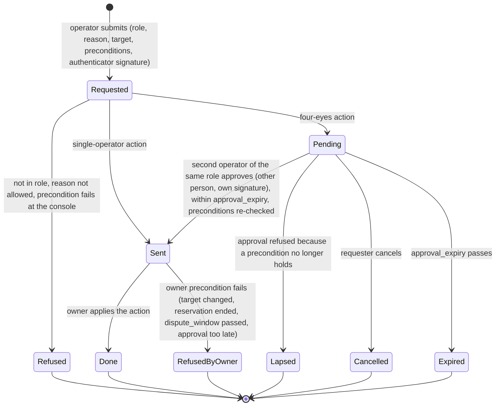

# RFC-005. Security and tenancy: principals at the edge, decisions at the owner, audit in the log

| | |
|---|---|
| Status | **Draft**, revision 2. Revision 2 rebases revision 1 on `requirements-v1.6` and RFC-000 revision 4 (the distributed SQL substrate); see "Revision 2 resolution" |
| Satisfies | X1-S01 … X1-S38 (all 38 X1 scenarios). Shares, with the primary RFC named in the traceability table: P2-S09 (webhook signing), P2-S64 and P2-S113 (principal identity for idempotency), P2-S67 (poll limit at the edge), P2-S72 and P2-S103 (key revocation push), P4-S82 (finance action and KYB), P4-S99 (principal identity for source references), X2-S24 and X2-S25 (finance and network-operations actions, probe principals) |
| Policies | POL-01, POL-04, POL-06, POL-07, POL-08, POL-12, POL-14, POL-15, POL-16, POL-17, POL-18, POL-19, POL-21, POL-22, POL-23, POL-24, POL-25, POL-27, POL-28, POL-29, POL-30, POL-32, POL-33 |
| Builds on | The requirements at tag `requirements-v1.6` ([X1 problem statement](../01-discovery/X1-security-and-tenancy.md), [X1 spec](../02-specs/X1-security-and-tenancy.feature), [policy register](../02-specs/policy-register.md), [glossary](../02-specs/glossary.md)), which resolve this RFC's RQ5-1 … RQ5-10 ([review 11](../reviews/11-requirements-amendments-from-detailed-rfcs.md)); and [RFC-000](RFC-000-architecture.md) revision 4: its components, single-writer ownership (A1), two-region commits (A3), append-only facts (A4), the one decision point per request (A7), personal data never in a log (A11), the substrate (§5.5: CockroachDB at 2 + 2 + 1, TypeScript/NestJS owner services with epoch-fenced owner leases, append-only log tables, Kafka fed by a transactional outbox), the topology (§5.1: payload encryption, Kafka without brokers in R3), the allocation table (§7) and the cross-RFC contracts (§8), which resolve this RFC's AI5-1 … AI5-7 |
| Specifies | Per RFC-000 §7: the **edge gateway** (with the exact poll limiter), **identity and access** (with webhook endpoints and the **personal-data store**), the **operator console and approvals**, **audit**, **webhook signing**, the **authenticity verifier** for every money-moving input, and **payload encryption**; and the security obligations every other owner must meet when it consumes the contracts in §11 |

Terms are used in the sense of the [glossary](../02-specs/glossary.md). "Reserved rate" is
capacity and "traffic" is bytes. Figures marked "est." are estimates, to be replaced by
measurement in RFC-000's spike (RFC-000 R1). Parameters written `like_this` are policy
parameters from the register; parameters written ‹like_this› are **design parameters** of
this RFC, not business policy, and are listed in §13.

## Need

X1 asks for eleven things (X1-N1 … X1-N11). Put together, they make one demand on the
architecture: **every state change in the marketplace must be traceable to exactly one
authenticated principal who was allowed to make it, by a pseudonymous identifier that
outlives any erasure of the person behind it, and nobody may see or change another
tenant's state, not even by learning that it exists**. That has to hold:

1. **On the 200 ms path** (POL-04, X2-N3). The edge has 10 ms of RFC-000's budget for TLS,
   authentication, principal resolution and advisory limits (RFC-000 §3, latency budget),
   at 25,000 booking requests/s and about 100,000 status polls/s (RFC-000 §6). No remote
   call is affordable on that path, yet a revoked agent key must stop working within 60 s
   (POL-25, X1-N3), and its undecided requests must fail at their one decision point
   (POL-04, RFC-000 A7).
2. **Without a second writer** (RFC-000 A1). Identity and access is the only writer of
   principals, keys, users, administrator rights, consent, endpoints and operator roles;
   the account owner is the only writer of a request's outcome. Revocation must cross that
   boundary without giving a request two decision points (RFC-000 D6).
3. **Against Share's own operators** (X1-N7, POL-32). Operators must act on any account,
   which is exactly the power to control: one role per action and per preparatory read, a
   reason the policy allows, four eyes in three roles (compliance, commercial, network
   operations), approvals that lapse, and a record of every attempt and read, granted or
   refused.
4. **Against suppliers who compete with each other and with Share's buyers** (X1-N2,
   POL-33). A supplier sees the reservations on its links by an opaque reference and its
   own termination points, never the buyer, unless the buyer's administrator consents or
   compliance discloses under a legal order, within the order's scope and term.
5. **At the money boundary** (X1-N5, X1-N6). Anything on the internet can claim a payment
   was made or a payout landed; only an input proven authentic by its provider's method may
   move money. Buyers must be able to verify Share's webhooks.
6. **For 7 years, immutably** (X1-N8, POL-19, POL-06). Every change to money, capacity,
   links, keys, roles, administrator rights, consent, policy and endpoints, every operator
   action and read, and every refused privileged attempt is recorded with principal and
   time, and nobody, operators and Share's own engineers and database administrators
   included, can alter or remove the record.
7. **While personal data stays erasable** (X1-N11, POL-19, RFC-000 A11). Logs, topics,
   archives and the audit trail are append-only for 7 years; a person's data must still be
   erasable beyond recovery, without altering any record or any sum computed from them.
8. **Across region loss, on a substrate Share does not write** (X2-N4, X2-N5, RFC-000
   §5.5). Authentication is part of admission (99.99%, RTO 1 min; RFC-000 §5.4); every
   owner, the console included, is a NestJS service over CockroachDB at 2 + 2 + 1; the
   third region (R3, Google Cloud Johannesburg) is a different operator from Share and
   holds a voting replica of every range.

## Approach

### 1. Shape of the design

| # | Rule | Why |
|---|---|---|
| S1 | **Authenticate at the edge, from local state.** Every external call is authenticated by the edge gateway from caches pushed by identity and access; nothing on the booking path waits for a remote identity call. | X1-N1 within the 10 ms edge budget (RFC-000 §3). |
| S2 | **The tenant comes only from the credential.** The account (or supplier) a call acts for is the one bound to its credential at issuance. A tenant identifier in a path, body or resource identifier is never used to route or to authorise; if it differs from the credential's, the call is answered as for a resource that does not exist. | X1-N2, X1-S02 … X1-S05, X1-S09: a request for another account's data reveals nothing, not even existence. |
| S3 | **Decide at the edge, re-check at the owner.** The edge makes the coarse decision (principal kind, operation, tenant); the owner that holds the resource makes the fine one (does this resource belong to this partition, is this key still valid in my serial order) and records the principal in the same log row as the change. | RFC-000 A1, A7 and §4.1 (the audit record is part of the owner's entry); defence in depth against an edge defect. |
| S4 | **Fail closed on authority, fail open only on advice.** Missing or stale credentials, consent or envelopes deny (or hide); only advisory rate counters fail open. | X1-N1, X1-N2, X1-N3: no condition of Share's makes an operation succeed that should not. |
| S5 | **Operators act only through the console, and the console cannot act alone.** Every operator command carries an envelope signed by the console and by each operator's own hardware authenticator; owners verify it. | X1-N7, POL-32: four eyes cannot be bypassed by a compromised console. |
| S6 | **Audit is the owners' own log tables, made tamper-evident.** No separate audit write can be lost (RFC-000 §4.1); a hash chain written in the same transaction as each row, signed checkpoints written once in two trust domains, and Merkle roots over sealed segments make alteration detectable, including by a database administrator. | X1-N8, X1-S15. |
| S7 | **Payloads are ciphertext everywhere but in an authorised process.** Owners encrypt every row's payload with keys held in Share's Kenyan HSMs before the write, bound to the row's position; the database (R3's replica included), Kafka and the archive store and replicate bytes they cannot read or forge. | Tenant isolation against the third-party region and against the substrate's own operators (RFC-000 §5.1, AI5-3). |
| S8 | **Personal data lives in one erasable store, and nowhere else.** Every log, table, topic, trace and audit record carries pseudonymous identifiers only; personal data is in identity and access's personal-data store, encrypted per data subject, and erasure destroys the subject's key. | X1-N11, RFC-000 A11, POL-19. |

### 2. Principals and authentication

#### 2.1 Principal kinds

A **principal** (glossary) is whoever performs an operation once authenticated. Every
principal has a **pseudonymous identifier** (`principal_id`, 128-bit random, never reused,
never derived from personal data) and a kind. Records identify it only by that identifier
for the retention period (POL-19). Personal data (names, email addresses, phone numbers,
KYB documents) lives only in the personal-data store (§3.7).

| Kind | Tenant | Credential | Verified where | Revocation takes effect |
|---|---|---|---|---|
| **Account user** (buyer side); an **account administrator** is an account user holding the administrator right | One buyer account | OpenID Connect login at identity and access's authorisation server; password plus a second factor, **WebAuthn mandatory for administrators**; short-lived access token (ES256 JWT, ‹user_token_ttl› 5 min) and refresh token (rotating, 12 h idle). The token carries `principal_id`, never the login name | Edge: token signature and expiry locally (JWKS pushed), session deny-list pushed. Identity and access re-checks the administrator right itself on every command of §3.2 | Session deny-list push, within ‹revocation_target› 60 s; administrator commands always see the current right |
| **Agent key** | One buyer account, fixed at issuance (POL-25) | Bearer key `shk_<key id>_<secret>` with a check digit, secret 256-bit random, shown once at issuance; Share stores only `SHA-256(secret)` | Edge, from the key cache (§3.3), constant-time comparison | Within 60 s at the edge for every operation, and in the account owner's log for undecided requests (§3.3) |
| **Supplier user**, **supplier administrator** (a supplier user holding the supplier administrator right, glossary) | One supplier account | As account user | As account user | As account user |
| **Supplier key** (supplier API automation) | One supplier account | As agent key (`ssk_` prefix); may only call supplier operations | As agent key | As agent key |
| **Operator** | None (cross-tenant by role) | Share's corporate single sign-on, FIDO2 hardware authenticator mandatory, from managed devices on Share's operator network only; exactly one role bound to the operator identity (POL-32) | Console only; operators have no credential the public edge accepts | Immediate at the console (sessions are server-side); a role removal is pushed to every owner's envelope verifier (§7.4) |
| **Probe** | A designated probe account or the designated probe supplier (POL-06) | Agent or supplier keys of the probe tenant, plus mTLS client certificates from the probe colocation sites | Edge, as agent key, plus the certificate | As agent key |
| **Payment provider** | None; bound per notification to the account the event names, by payments (RFC-000 §2) | The provider's own authenticity method (§8.1) | Edge payment ingress, by the provider's verifier | Removing the provider's verifier configuration |
| **Payment partner** | None | mTLS and signed reports, per the partner's scheme (§8.4) | Reconciliation (RFC-004), with the verifier library | As provider |
| **Payout provider** | None | Provider's method, as payment provider (§8.4) | Edge payment ingress, routed to payouts | As provider |
| **Partner system** | None | Share calls out with per-partner credentials; partner callbacks verified by the partner's scheme and then re-queried (§8.2) | Partner adapter | Rotating the partner credential |
| **Exporter** | The supplier that owns it, or Share for exporters on Share's own network | mTLS with a per-exporter certificate from Share's device CA, naming the exporter identity and its owning tenant; issued at the request of the supplier administrator, or of network operations for Share's own exporters (POL-32) | Edge for exporters; ingestion checks each record's exporter against it (§8.4) | Certificate revocation list pushed to edges within 60 s |
| **Network operations** (consumer of the standing feed and queries) | None | mTLS client certificate | Edge | As exporter |
| **Internal service** | None | Workload identity: short-lived X.509 certificate (‹workload_cert_ttl› 24 h) per service instance from Share's internal CA; the same certificate authenticates the service to the database (its own SQL role, §5.5), to Kafka (its own ACLs) and to gRPC peers | Every receiver, by mTLS, against the command allowlist (§4.4) | Certificate expiry and the allowlist |
| **Onboarding** (the external process that creates accounts and records KYB, POL-24) | None | Internal service identity | Identity and access | As internal service |
| **Workforce administration** (the process outside X1 that vets operators and assigns roles, X1 Out of scope) | None | Internal service identity, with the approving person's WebAuthn assertion | Identity and access (operator partition) | As internal service |

#### 2.2 The edge authentication pipeline

Every external call passes these steps in order. The order matters: authentication comes
before any lookup of the resource named, so an unauthenticated caller learns nothing.

1. **TLS 1.3** termination (persistent connections; mTLS where the kind requires it).
2. **Pre-authentication shedding**: per source address and per credential prefix,
   ‹preauth_rate_limit›, soft state. Gross abuse is dropped here (RFC-000 §2, edge).
3. **Credential parse and check digit**: a malformed credential is unauthenticated at once,
   without a cache lookup.
4. **Authentication** from the local caches (§3.3): key verifier, token signature, session
   deny-list, certificate revocation list.
5. **Principal context** built (§11, C1) and signed by the edge node's workload key.
6. **Coarse authorisation** (§4): principal kind × operation, tenant check for resources
   whose tenancy the edge knows (a link's supplier from the catalogue cache; a webhook
   endpoint's account or supplier from its own cache).
7. **Advisory rate counters** per key and account (RFC-000 D5), and the **exact poll
   limiter** for status polls (§5.3).
8. **Forward once** over gRPC to the owner-lease holder of the slot that the principal's
   tenant hashes to (RFC-000 §3, §5.2), from the edge's copy of the placement table, never
   by an identifier in the request.

Steps 3 to 6 are in-memory operations: about 50 µs of CPU per request with Ed25519 signing
of the context (est.), well inside the edge's 10 ms (RFC-000 §3). The edge keeps no
authoritative state and never touches the database on the booking path.

#### 2.3 Answers that reveal nothing

| Condition | Answer | Scenario |
|---|---|---|
| No credential, malformed, unknown, wrong secret, expired token, revoked key or session, certificate revoked | One "unauthenticated" answer, identical in status, body and headers for every cause. A booking or status submission is **not accepted** (glossary), any other request is **refused** | X1-S01, X1-S06 |
| Authenticated, but the resource is outside the principal's tenant, or does not exist, or is a supply command on a link of another supplier, or an administrator command naming another supplier | One "not found" answer, identical to the answer for a resource that does not exist, produced by the same code path at the principal's own partition, so its timing is the same as a genuine miss (§5.1) | X1-S02, X1-S03, X1-S04, X1-S05, X1-S09, X1-S22, X1-S33 (fourth row) |
| Authenticated, within its own tenant, but the principal's kind or rights do not allow the operation (an agent key managing keys, users or endpoints; a user without the administrator right) | "Refused", naming the missing right; the attempt is recorded (§3.2) | X1-S19, X1-S25, X1-S29, X1-S33 (third row) |
| Identity and access unreachable and a cache entry has expired | "Temporarily unavailable, retry", never "authenticated" (S4) | — |

### 3. Identity and access

#### 3.1 State, partitioning and the substrate

Identity and access is the only writer of the state below (RFC-000 §2). It is a NestJS
owner service; each partition is an append-only **log table** row sequence, primary key
(partition, sequence), written only by the holder of its slot's owner lease, every write a
transaction conditional on the lease epoch (RFC-000 §5.2, §5.5). Current state is a
projection table written in the same transaction (A4). The service's SQL role has insert
on its own log tables and insert and update on its own projection and head rows only, and
no grant on any other owner's tables (RFC-000 §5.5, A1).

| State | Partition | Notes |
|---|---|---|
| Buyer account: users (by `principal_id`), the administrator right per user, agent keys (identifier, verifier, label, status, `key_spend_limit`, `key_inflight_limit`, `key_rate_limit`, version), webhook endpoints and their signing secrets (§8.3), KYB status as recorded by onboarding, probe designation | **By buyer account** | One serial order per account: `account_max_keys` is checked against the keys not revoked in the same entry that issues a key, so concurrent issuance cannot exceed it (X1-S21); the count of administrators is checked in the same entry that removes a right or a user, so an account never loses its last one (X1-S38) |
| Supplier account: users, the supplier administrator right, supplier keys, exporter credentials (certificate serials and the exporter identities they name), webhook endpoints and their secrets | By supplier account | Same serial-order checks as for buyer accounts |
| **Consent and disclosure registry**: per (buyer account, supplier) the consent state and its history; per legal-order disclosure its order register identifier, scope, approvers, validity and whether the buyer may be told | **By supplier** | Partitioned by the party whose views it governs, so one supplier view needs one consistent read (§6.2) |
| Operator identities: the one role of each, the person each belongs to (a pseudonymous person identifier), WebAuthn public keys, status; every grant and removal with its granting principal and approving person | One partition (small) | Granted by workforce administration (§2.1), never through the console (§7.1) |
| Policy: the permission matrix (§4.2), the operator action catalogue (§7.2), allowed reason codes, verifier configurations per provider, key-release policy (§5.4) | One partition, versioned | Every change is an entry with its principal (X1-S14); consumers record the version they decided with |
| Refused attempts at the operations it owns | With the partition of the attempted operation | X1-S19, X1-S25, X1-S29, X1-S33, X1-S38 |
| **Personal-data store** | Its own database, by data subject (§3.7) | The only place personal data lives (A11) |

Sizing (est.): about 100,000 buyer accounts with at most `account_max_keys` (100) keys
each, so at most 10 M keys; key, user and endpoint commands are a few per second. The load
is on reads, served from caches (§3.3).

**Reads.** Edge cache fills and the console's checks read identity's projection tables by
**bounded-staleness follower reads** with maximum staleness ‹iam_read_staleness› 1 s, from
a Kenyan replica in the reader's own region; a read that no local replica can serve within
the bound goes to the leaseholder (RFC-000 §4.6's mechanism, without status-replica
leases, since nothing here is a report). R3's replica serves no reads (RFC-000 §4.6).
Reads that must see every committed change (the consent check, §6.2; the console's
precondition checks, §7.3) are consistent reads at the present timestamp, served by the
leaseholder.

**Feeds.** Every committed identity entry that a consumer needs is written to the outbox in
the same transaction and published to Kafka (RFC-000 §5.5): the **identity status push**
(§3.3, C3) keyed by account, the **edge invalidation feed** (§3.3), the **endpoint feed**
(§8.3, C8), and the audit feed (§9). Payloads are encrypted (§5.4).

#### 3.2 Administrator commands

Every command below is accepted only from an **account administrator** of the account (or,
for a supplier account, a **supplier administrator** of the supplier), authenticated as in
§2.1. Anyone else within the tenant is refused, and the refusal is recorded with the
principal, the attempted command and the time; a principal of another tenant gets "not
found" (§2.3). Each command is idempotent by (account, idempotency key) for 24 h, as POL-29
sets for bookings. Each entry records the administrator, the time, and the old and new
values (X1-S14, X1-S20), by pseudonymous identifiers only.

| Command | Effect | Pushed to | Scenario |
|---|---|---|---|
| Issue an agent key | Refused, stating the limit, if the account already has `account_max_keys` keys not revoked; otherwise a key with its limits (defaults from POL-25), its secret returned once | Edge invalidation feed; identity status push | X1-S18, X1-S21 |
| Change a key's limits (raise or lower `key_spend_limit`, `key_inflight_limit`; lower `key_rate_limit` below the POL-25 default) | New version of the key | Edge invalidation feed; identity status push | X1-S18 |
| Revoke a key | Terminal; never reversed (a new key is issued instead) | Edge invalidation feed; identity status push | X1-S06, X1-S18, P2-S72 |
| Consent to identify the account to a named supplier; withdraw it | An entry in that supplier's registry partition (§6.2), recorded with the administrator and time | — (read at view time) | X1-S18, X1-S30 |
| Add a user to the account; remove one | A new `principal_id`, its personal data put to the personal-data store (§3.7); removal ends the user's sessions. Removing the last administrator is refused (below) | Session deny-list (on removal) | X1-S18 |
| Grant or remove the administrator right of a user (itself included) | Refused, stating that an account keeps at least one administrator, if it would leave none; checked in the account's serial order | Session deny-list (on removal) | X1-S18, X1-S38 |
| Register, change or remove a webhook endpoint | Endpoint URL validated (§8.3); a new signing secret shown once | Endpoint feed (notifier) | X1-S18, X1-S24, X1-S11 |
| *Supplier administrator*: add or remove supplier users; grant or remove the supplier administrator right; issue, change or revoke supplier keys; issue or revoke an **exporter credential** (a device-CA certificate for a submitted key, naming an exporter of the supplier); register, change or remove the supplier's webhook endpoints (supplier notices) | As the buyer-side commands; at least one supplier administrator kept | Edge invalidation feed; certificate revocation list; endpoint feed | X1-S33 |

An agent key may read its own record (limits, status, key headroom through the account
owner, POL-18); account users may list the account's keys without verifiers. Nobody, the
issuing administrator included, can read a key's secret after issuance. Removing a user
does not erase its personal data: that is a separate act (§3.7), because the record of
what the user did stays attributable either way.

#### 3.3 Caches, the identity status push and the 60-second revocation

**Edge caches.** Each edge node keeps: agent and supplier key records it has used
recently (positive entries live at most ‹key_cache_ttl› 30 s, RFC-000 §3; negative entries
for unknown key identifiers 5 s, to absorb floods); the JWKS for user tokens; the session
deny-list; certificate revocation lists; the catalogue's link → supplier map; the endpoint
→ tenant map; the placement table; the policy version. A miss or an expiry is filled by a
follower read of identity's projection (§3.1), at most ‹iam_read_staleness› 1 s behind.
Entries are **never extended on error**: an agent-key entry that cannot be refreshed
expires (S4).

**Two paths for every key entry** (§11, C3). Every committed key entry is published from
identity's outbox on two Kafka topics: (a) the **edge invalidation feed**, which every edge
node consumes and on which it evicts or replaces the entry; and (b) the **identity status
push** to the account owner (RFC-000 §8), applied by its funds module as an entry (RFC-004
Part A, F4) and read from there by the booking module (RFC-002).

**Timeline of a revocation**, administrator revokes key K at `t0` (the commit of the
revocation entry, two-region durable, after which the administrator is answered):

| Where | Normally (est.) | Worst case if every push is lost | Bound |
|---|---|---|---|
| Edge, every operation by K (submission not accepted, request refused, as unauthenticated) | `t0` + about 1 s (outbox publish and Kafka fan-out; the changefeed relays the row if the owner died before publishing, RFC-000 §5.5) | `t0` + 30 s (an entry filled just before `t0` expires) + 1 s (follower-read staleness) = `t0` + 31 s | 60 s (X1-N3, X1-S06) |
| Account owner, K's undecided requests fail "key revoked" and every later intake with K is refused | `t0` + about 1 s (push, one entry) | Identity and access watches the account owner's applied identity position (a follower read of the account owner's projection row) and alarms at ‹revocation_alarm› 30 s; a new account-owner lease holder catches up from identity and access before deciding anything (C3) | 60 s (POL-25) |

The account owner's log is the **one order** in which the revocation and each request's
decision are compared (POL-04, RFC-000 A7, D6): a request decided before the revocation
entry stays decided (P2-S103); one undecided when it is applied fails "key revoked"
(P2-S72), and its holds are released by RFC-002's request-scoped release. Identity and
access tracks, per revocation, the positions applied by the account owner and the edge
fleet's consumer offsets, and alerts if either lags beyond ‹revocation_alarm›.

**Session and certificate revocations** use the same feed with the same bound.

#### 3.4 Supplier authority over links

The catalogue's link registry (RFC-001, RFC-000 §2) names each link's supplier. A supply
command (book or cancel maintenance, announce a permanent reduction, record a permanent
increase, record an unplanned outage or its restoration) is accepted only:

- from a principal of that supplier (user, administrator or supplier key) for any of them
  (POL-07, POL-32); or
- through the console, from an operator in the network operations role with a reason,
  and only for an outage or a restoration (POL-07, POL-32).

Registering and retiring a link are **commercial** console actions (§7.2), never supplier
or network-operations commands. The edge refuses anything else as "not found" (§2.3), so a
buyer or another supplier cannot tell a link it cannot change from one that does not exist
(X1-S22). The link schedule owner re-checks in its own entry that the principal context
names the link's supplier, or carries a network-operations envelope for an outage or
restoration (defence in depth, S3; RFC-001 implements the check, §11 C11). Network
operations asking for a permanent reduction or increase, maintenance, or a link
registration has no such action in its catalogue (§7.2): the console refuses, nothing
changes, and the attempt is recorded (X1-S23).

#### 3.5 Probe principals

The probe accounts and the probe supplier (POL-06; RFC-000 §5.4) are identity-and-access
tenants flagged *probe*; their keys have permission sets (§4.2) that allow only booking
**probe links**, reading the probe tenant's own state, submitting from **probe exporters**
and the probe supplier's own supply commands on probe links, and only over mTLS from the
probe colocation sites (RFC-000 §5.1). A probe key that leaks therefore cannot buy real
capacity on Share's credit (threat T-14). Every principal context carries the probe flag,
which consumers of rating, settlement, supplier reports and quarantine reports use with
the catalogue's probe designation to exclude probe activity (RFC-006 owns the designation
contract, C9). Each probe account's `credit_limit` is set by a finance operator through the
console like any other (X2-S24); the probe accounts count as having passed KYB (POL-06),
recorded as such by onboarding.

#### 3.6 KYB status

Onboarding records each account's KYB result (passed, failed, withdrawn) in identity and
access, with its principal and time; the KYB documents themselves go to the personal-data
store (§3.7), never to a log. The result travels to the account owner on the identity status
push (C3, C10; RFC-000 AI4-2), applied by its funds module. A finance operator's request to
set a `credit_limit` is checked against it by the console before the action is sent, and
again by the account owner, against both the KYB status it has applied and the envelope's
KYB precondition at its identity position (§7.4); an account that has not passed is
refused, recorded, and keeps no credit limit (P4-S82, X1-S12).

#### 3.7 The personal-data store and erasure

RFC-000 A11 makes this store the only place personal data lives (§8, the personal-data
store contract). Its design is what lets X1-N11 hold beside a 7-year append-only audit.

**What it holds.** Every item of personal data: users' and operators' names and contact
details, login identifiers, account and supplier contact details, display names of
accounts (treated as personal data, since a sole trader's business name is one), KYB
documents (put by onboarding), **case notes** (free text that operators or buyers write,
§7.5), and the documents behind legal orders (§6.2). Each item is keyed by the
pseudonymous identifier of its **data subject** (a `principal_id` or a contact identifier)
and, for a case note, by the note identifier, with the subjects it concerns.

**How it is stored.** A separate CockroachDB database at 2 + 2 + 1, owned by identity and
access, with no other service's SQL role granted on it. Each subject has a **subject key**
(AES-256), and every item is encrypted under it (AES-256-GCM, with the subject and item
identifiers as associated data). Subject keys are stored only in the store's key table,
wrapped under the store's **key-encryption key of the current generation** (`KEK_PD,g`),
held in the Kenyan HSMs. R3's replica, every backup and the database's own files therefore
hold only items under subject keys, and subject keys under a KEK that never leaves the
HSMs.

**Login lookup.** Login identifiers (an email address) are found through a **blind index**:
HMAC-SHA-256 of the normalised identifier under an index key of the same generation, held
in the HSM, mapped to the `principal_id`. The index row is deleted on erasure and
recomputed at each generation change (below), so an old backup's index rows cannot be
matched against a guessed address once its generation is destroyed.

**Interface** (C12): `put(subject, item)`, `get(subject, item, purpose)` and
`erase(subject)`, over gRPC with mTLS. `get` is allowed only to the readers RFC-000 §8
names, each for its stated purpose: identity and access (login, administrator commands),
the notifier (contact details at send time), the console (support views and case notes),
reporting (display names on statements at view time). Readers keep personal data in
memory for the request only; they never write it to a table, a topic, a cache that
outlives the request, an application log or a trace. Every `get` is appended to audit with
the reader, the purpose and the subject (§9.4), never the data.

**Erasure** (X1-S34). `erase(subject)` is a compliance action (§7.2; RQ5-11), taken at a
data subject's request or when the law requires it, with a reason, recorded. It commits one
transaction in the store that deletes the subject's wrapped key, its items and its
blind-index rows. From that commit, nothing Share runs can read the subject's data: the
items are ciphertext under a key that no longer exists in any live store. Copies made before
the commit become unreadable as follows:

| Copy | Unreadable from |
|---|---|
| The live store, its three Kenyan and one R3 replica | The commit |
| Owner memory, request-scoped reads | The end of the request (nothing is cached across requests) |
| Database backups of the store (taken by RFC-006, kept ‹pd_backup_retention› 14 days) | When the generation they were taken under is destroyed: at most ‹kek_generation_period› 30 days plus ‹pd_backup_retention›, so **44 days** after the commit |
| The HSM escrow of `KEK_PD` (below) | The same destruction ceremony |

**Generations.** Every ‹kek_generation_period›, identity and access rewraps every live
subject key under `KEK_PD,g+1` (about 10⁶ subjects, est., a few minutes of HSM time) and
recomputes the blind index under the new index key. Once every backup taken under
generation g has passed ‹pd_backup_retention›, `KEK_PD,g` and its index key are destroyed in
both Kenyan HSM clusters and in escrow, by a recorded two-person ceremony. A backup is
therefore restorable only while its generation lives, which is the cost; the store's
durability rests on the database's two-region commits (RFC-000 §5.3), not on backups.
`KEK_PD` is a separate key hierarchy from the log keys of §5.4, which are kept for 7 years.

**What erasure leaves.** Every log row, audit record, ledger movement and sealed segment
still carries the subject's `principal_id`, unaltered; no log is rewritten (A4). Recomputing
a balance or a charge reads only those records, so it gives the same result (X1-S34).
After erasure the identifier no longer leads to a person. A subject's later return is a new
`principal_id`.

**No personal data elsewhere** (X1-S37). Enforced in four ways: (1) the owners' row and
topic schemas carry typed identifier columns and encrypted payloads whose schemas
(contracts, README) have no free-text field outside case-note references; (2) the shared
logging and tracing library accepts only typed identifiers and enumerations, and drops
anything else; (3) the edge strips personal data from requests before any log
(authorisation headers, bodies of user-management commands); (4) a scanner runs in CI and
continuously over log tables (after decryption, in the audit enclave), topics, application
logs and traces for patterns of personal data (DT-14). A field that needs personal data is
a reference to the store.

### 4. Authorisation model

#### 4.1 Where each decision is made

| Decision | Made by | From | Recorded |
|---|---|---|---|
| Is the caller authenticated; who is it; which tenant | Edge | Caches (§3.3) | In the principal context |
| May this kind of principal call this operation; is the named resource in its tenant (where the edge can know) | Edge | Policy (§4.2), catalogue and endpoint caches | Refusals within the principal's own tenant are recorded by the operation's owner |
| Does this resource exist in this partition; is this key still valid here; does this administrator still hold the right | The owner partition (account owner, link owner, reporting, identity and access) | Its own state | In its log row (audit fields, §9.2) |
| Is this operator action or read in the operator's role, with an allowed reason, approved where four eyes apply, still within `approval_expiry`, with its preconditions holding | Console, then re-verified by the owner from the envelope | Action catalogue (§7.2), envelope signatures | Console log; owner's row |
| May this supplier see this buyer's identity in this view | Reporting, from the consent registry, at view time | Consent and disclosure registry (§6.2) | The view's registry timestamp |

Every decision names the policy version it used, so any past decision can be explained
(X1-N8).

#### 4.2 Permission matrix

"Own" means the principal's own tenant. Anything not listed is denied. Operator actions
are in §7.2 and are never available at the public edge.

| Operation | Account administrator | Account user | Agent key | Supplier user or key | Supplier administrator | Probe key |
|---|---|---|---|---|---|---|
| Book, change, cancel, withdraw (own account) | Yes | Yes | Yes | No | No | Probe links only |
| Status of own requests; own reservations; balance and headroom | Yes | Yes | Yes (headroom shown as key headroom, POL-18) | No | No | Own |
| Own statements; own notice list | Yes | Yes | Yes | No | No | Own |
| Make a documented request to support (§7.5) for a change it may itself make | Yes | Yes | Yes | No | No | No |
| List own account's keys (without verifiers) | Yes | Yes | Its own record only | No | No | No |
| Issue, change limits of, revoke agent keys | Yes | Refused, recorded | Refused, recorded | No | No | No |
| Add or remove users; grant or remove the administrator right | Yes (at least one administrator kept) | Refused, recorded | Refused, recorded | No | No | No |
| Consent to identify the account to a named supplier; withdraw it | Yes | Refused, recorded | Refused, recorded | No | No | No |
| Register, change, remove the account's webhook endpoints | Yes | Refused, recorded | Refused, recorded | No | No | No |
| Schedule of an own link (reservations by reference and termination points; identity only where §6 allows) | No | No | No | Yes | Yes | Probe supplier: probe links |
| Own supplier statement | No | No | No | Yes | Yes | No |
| Book or cancel maintenance, announce a permanent reduction, record a permanent increase, record an outage or restoration, on an own link | No | No | No | Yes | Yes | Probe supplier: probe links |
| Add or remove supplier users; grant or remove the supplier administrator right; issue, change, revoke supplier keys and exporter credentials; register, change, remove the supplier's webhook endpoints | No | No | No | Refused, recorded | Yes (at least one administrator kept) | No |
| Submit flow records and corrected versions of its own records (POL-23) | — | — | — | Exporter credential only | — | Probe exporters only |

The matrix is policy data (§3.1), evaluated by a pure function shipped as the principal
and authorisation library (§11, C2) to the edge, identity and access, the console and
every owner, so the same decision is made wherever it is checked.

#### 4.3 One account per key, one tenant per call

An agent key acts for its account only (X1-S05): the edge routes its calls to that
account's slot, and if the call names a different account (in a path or body), the
submission is not accepted or the read refused with the "not found" answer, and nothing
is forwarded. The account owner refuses any command whose principal context names a
tenant other than its partition's account (S3). There is no operation by which any buyer
principal acts for two accounts.

#### 4.4 Internal commands and the substrate's own boundaries

Every internal call is gRPC over mTLS with workload identities (§2.1), and each receiver
accepts a command only from the components RFC-000 makes its callers. The allowlist is
part of the policy (§3.1):

| Receiver: command | Accepted only from |
|---|---|
| Account owner: booking API commands | Edge (with a buyer principal context) |
| Account owner: identity status push (Kafka) and catch-up query answers | Identity and access (topic ACL: identity is the only producer) |
| Account owner, link owner, attribution, catalogue, payouts, payments, identity and access, placement (RFC-006, region disaster): operator commands | Console (with an operator envelope, §7.4) |
| Link owner: hold, convert, release, query, leg changes, offer holds | Account owner (RFC-000 §8, link hold port) |
| Link owner: supply commands | Edge (supplier principal) or console (network-operations envelope) |
| Ledger: posting | Settlement, payments, payouts (RFC-000 §8) |
| Payments, payouts, reconciliation: authenticated inputs | Edge payment ingress or the verifier library in-process (with a verdict, §8.1, C7) |
| Console: documented requests | Edge (with a buyer principal context, §7.5) |
| Identity and access: endpoint and secret reads | Notifier |
| Personal-data store: get | Identity and access, notifier, console, reporting (§3.7) |
| Audit: append (§9.4) | Console, secrets service, key service, personal-data store, identity and access, the platform's access logs |

A command from any other caller is refused and raised as a security alert.

The substrate adds three boundaries that the allowlist alone does not cover, each enforced
by the substrate's own controls and each a threat in §12:

- **Database.** Each owner service has its own SQL role, authenticated by its workload
  certificate, with insert on its own log tables, insert and update on its own projection
  and head rows, select where RFC-000 lets it read another owner's projection, and nothing
  else (RFC-000 §5.5). No application role has update or delete on any log table. The
  database's `root` and administrative roles are reachable only through break-glass (§10).
  Truncating the live tail after sealing needs a delete; it is a separate role, limited as
  in §9.3 (AI5-8).
- **Kafka.** Every topic has one producing workload identity (the owner whose outbox feeds
  it, or its changefeed relay) and named consumer identities, by ACL; payloads are
  encrypted and bound to their source row (§5.4), so a consumer can verify that an event is
  a committed row of its producer (§5.4) and rejects anything else.
- **Placement.** The placement table and owner-lease table (RFC-000 §5.2) are written only
  by the placement service and by lease holders under their own epochs; a forged lease row
  cannot produce valid payloads, because data keys are released to a workload identity of
  the owner kind only (§5.4).

### 5. Tenant isolation

#### 5.1 Data

- **Routing by tenant** (S2). Every buyer operation is routed to the principal's own
  account partition; every supplier operation is evaluated against the principal's own
  supplier's links and statements. A resource identifier never selects a partition, so a
  principal of "b2" naming reservation R of "b1" reaches b2's own partition, where R does
  not exist (X1-S03).
- **Uniform misses.** Because the request always reaches the principal's own partition
  and misses there by the ordinary lookup (its projection table, by (partition, resource)),
  a resource of another account and a resource that never existed take the same path and
  the same time; no answer depends on whether the identifier exists elsewhere (X1-S02,
  X1-S04).
- **Identifiers** for reservations, requests, keys, endpoints, principals and contacts are
  128-bit random. Their unguessability is not what isolates (routing is), but it removes
  enumeration as a way to probe for timing, and it makes them pseudonymous (S8).
- **Owners re-check** the principal context's tenant against the partition (§4.3).
- **Read models** (reporting, statements, supplier views) are partitioned by account or
  supplier (RFC-000 §2) and queried only with the principal's tenant.
- **Shared infrastructure** (database clear columns, Kafka message keys and topic names,
  metrics, traces, alerts) carries pseudonymous identifiers only, never personal data or
  another tenant's content (S8); operational dashboards that join across tenants are
  operator tools behind the console (§7). Topic names name owner kinds, never tenants.
- **Webhooks** go only to an endpoint registered by the event's own account (or supplier)
  and carry only that event's own data (§8.3; X1-S24).
- **Rejections and counter-offers** name no other account or reservation (POL-10; RFC-001
  owns the content, P1-S17).

#### 5.2 Idempotency scopes (POL-29)

| Input | Scope of the identity | Principal compared | Where | Answer to another principal |
|---|---|---|---|---|
| Booking request | (account, idempotency key) | `principal_id` of the first submission (agent key or user) | Account owner, entry 1 (RFC-000 §4.4) | Not accepted, "reuse by another principal", revealing nothing of the first request or its outcome (P2-S64) |
| Change request | (account, idempotency key); the same request only with the same reservation, kind of change, new end or rate and `wait` (POL-29, B-RQ-5) | As for bookings | Account owner | As for bookings (P2-S113) |
| Same key from another account | A different scope by construction | — | — | Decided on its own merits; a poll for a key never used in the account is answered as never used (X1-S08, X1-S09) |
| Administrator commands (§3.2) | (account or supplier, idempotency key), 24 h | Administrator's `principal_id` | Identity and access | Not accepted |
| Operator actions | The console's action identifier, which is the source reference of any money-moving action (POL-29) | Requesting operator's `principal_id` | Console; the owner deduplicates by the same reference | Refused as reuse by another principal (P4-S99) |
| Payment notifications, transfer confirmations | (provider, transaction reference, event kind) (RFC-000 §4.4) | The provider principal | Payments, payouts | A different principal is refused (RFC-004) |

The principal compared is always the `principal_id` from the principal context (C1),
never a role or a display name, so two operators in the same role are two principals.

#### 5.3 Rate limits and fairness

| Limit | Enforced exactly at | Advisory at |
|---|---|---|
| `key_rate_limit`, `account_rate_limit` (bookings, retries counted; POL-25) | Account owner (RFC-000 D5; RFC-002, RFC-004 Part A), from owner memory rebuilt from the last second's intake entries (RFC-000 B-AI-4: up to twice the limit for one second after an owner change) | Edge per node, shedding only gross excess |
| `key_poll_limit` (status polls; POL-25, P2-S67) | **Edge poll limiter** (RFC-000 §2, AI4-6, AI5-1): poll-limiter instances in the leader region, each owning a set of **key shards** from the placement table; every edge, in either region, routes every poll of a key to the instance owning its shard (one round trip from the other region, about 10 ms, est.), which counts per key per UTC second | — |
| ‹mgmt_rate_limit› 5/s per principal for identity-and-access commands; ‹read_rate_limit› per account for reads served by reporting | Edge | — |
| ‹preauth_rate_limit› per source address before authentication | Edge | — |

Polls are not on the booking path and have no latency target of their own, so the extra
hop costs nothing measured. Counters are soft state (RFC-000 §5.3). **Bound** (RFC-000 §2):
when a shard moves (its instance lost, or a region-wide failover moves the leader region),
the new owner of the shard starts counting from zero, so for one `key_poll_limit` window a
key can be answered up to twice its limit; between the loss of an instance and the move
(seconds, est.), polls of keys on its shards are answered "temporarily unavailable, retry",
never counted elsewhere. That is the only relaxation of an exact limit in this RFC.
`account_rate_limit` also bounds one account's load on its partition, so a noisy tenant
cannot starve another (RFC-000 R6).

#### 5.4 Payload encryption, at rest and in transit through the substrate

RFC-000 §5.1 and §8 make payload encryption a library this RFC owns (C13). Its hook is in
the **NestJS owner runtime's write path** (RFC-006 owns the runtime): after the owner has
built a batch and before the epoch-conditional transaction, the runtime encrypts each row's
payload; on read, the runtime decrypts. There is no hook in the database or in the log
convention (RFC-000 §5.5, item 9).

- **What is in clear.** Only the columns the database needs for keys, ordering and fencing:
  owner kind, partition, sequence, epoch, row kind, commit timestamp, and the chain hash
  (§9.3). All carry pseudonymous identifiers only (A11). **Everything else**, the audit
  fields of §9.2 included, is in two encrypted columns: `payload` and `audit` (separate so
  that audit's index can be built without decrypting business payloads it does not need).
- **Keys.** A **data key** (AES-256) per (owner kind, slot, month), generated by the key
  service in the Kenyan HSMs and stored wrapped under a regional key-encryption key held
  only in the HSMs of R1 and R2. An owner-lease holder unwraps its slots' current data keys
  on taking the lease and keeps them in memory (RFC-000 R21).
- **Binding to position.** Each row is sealed with AES-256-GCM, with associated data
  (owner kind, partition, sequence, epoch, row kind, data-key identifier). A row copied to
  another partition or sequence, replayed under another epoch, or written by anyone without
  the data key **fails to decrypt** and is rejected as corrupt by every reader, which
  raises a security alert (T-24).
- **Kafka.** Outbox rows are encrypted the same way, so every event on Kafka is ciphertext
  bound to its source row; consumers decrypt with data keys the key service releases to
  their workload identity (below). Kafka keeps no broker in R3; R3's KRaft controller holds
  topic metadata only, and topic names carry no tenant (§5.1).
- **Key release policy** (policy partition, §3.1). The key service unwraps a data key only
  for workload identities the policy names for that owner kind: the owner kind itself, the
  consumers of its feeds that RFC-000 §8 names, history (sealing), audit (indexing the
  `audit` column only, with a separate key per column) and the verifier. Every unwrap is
  appended to audit (§9.4).
- **The database's own encryption at rest** is on for every store, the personal-data store
  included, but it is not what protects R3: R3's database process holds its store key,
  never a payload key (RFC-000 §5.1).
- **Third region.** R3's voting replica stores and votes on ciphertext; it serves no reads
  (RFC-000 §4.6) and is not a preferred leaseholder (RFC-000 §5.1). During a declared region
  disaster the surviving Kenyan region's HSMs serve the owners, and R3's two replicas
  (2 + 2) still hold ciphertext. What R3 can learn is the clear columns: pseudonymous
  partition identifiers, row counts and timing (T-19).
- **Sealed segments** in object storage (RFC-000 §5.3, RFC-006) stay encrypted under the
  same data keys; data keys and their key-encryption keys are retained for 7 years
  (X2-N6), with escrow (§10).
- **Cost** (est.): one AES-GCM pass per row at the owner, a few µs per batch; no change to
  RFC-000's latency budget.

### 6. Supplier visibility and consent (POL-33)

#### 6.1 The opaque reservation reference

A supplier sees each reservation on its link by a **reservation reference** (glossary)
computed as

`ref(supplier, reservation) = v ‖ AES-128_{K(supplier, v)}(reservation_id)`

where `reservation_id` is the reservation's 128-bit identity, `K(supplier, v)` is a
per-supplier key of version `v` held in the secrets service (§10), and `‖` is
concatenation.

- **Used for no other reservation** (POL-33, X1-S28): AES under one key is a permutation,
  so two reservations never share a reference for one supplier; the version prefix keeps
  references of different versions distinct.
- **Unlinkable**: without the key, references of one buyer's reservations look
  independent; two suppliers on one route get different references for the same
  reservation, so they cannot join their views by reference.
- **Stable**: a reservation keeps its reference for its life, through changes, extensions
  and a move to an equivalent path (POL-07), because it depends only on its identity; key
  versions are added for new reservations and never retired while a reservation of that
  version exists, nor within 7 years. A reference a supplier saw beside a buyer's identity
  stays the same after a withdrawal of consent, as provisioning needs (POL-33, X1-S30).
- **Charge-line references** (POL-33, RQ5-1): a usage-priced share on a supplier
  statement is shown by `ref_line(supplier, line_id)`, the same construction under a
  separate key `K_line(supplier, v)`, so it is used for no other line and is unlinkable to
  the reservation references and to other lines.
- **Computed, not stored**: reporting, the notifier (supplier notices) and the provisioning
  feed compute it; a supplier command that names a reference is resolved by the inverse.
  No owner stores it, so no owner gains a writer duty.

#### 6.2 Consent, disclosure and the consent check

The **consent and disclosure registry** is partitioned by supplier (§3.1). Its entries:

- *consent given* (buyer account, supplier, administrator, time) and *consent withdrawn*
  (same fields), from an account administrator's command (§3.2); an agent key or a user
  without the right is refused, and the refusal recorded (X1-S29);
- *disclosure* (buyer account, supplier, order register identifier, **scope**, valid from
  the approval, **until** the order's stated end date if any, **buyer may be told**: yes
  only if compliance records that the order allows it), from an approved compliance
  action (§7.2); *disclosure ended*, a compliance action of one operator (POL-33). The
  order document itself is a case note in the personal-data store (§3.7); the registry
  holds only its identifier.

**Scope** (POL-33, X1-S35) is one of: the buyer's reservations on the supplier's links
(the default, when the order states none); the reservations the order lists; or those
active in a period the order states. A scope can never reach beyond the supplier's own
links, because a supplier view contains nothing else (§6.3).

**Consent check** (§11, C6): for one supplier view, reporting reads the supplier's
registry partition by a **consistent read at the present timestamp** (served by the
leaseholder; RFC-000 §4.6's rule for reads that must see every commit) and gets, for the
buyer accounts and reservations in the view, *reveal* (with the consent or disclosure
entry) or *hide*, at the read's timestamp, which it records with the view. Then:

- A view started after a withdrawal is acknowledged reads at a timestamp after the
  withdrawal's commit, so **every later view hides** the buyer (X1-S30). Reservations of
  the buyer confirmed after the withdrawal appear only by their own unlinkable references
  (§6.1); R keeps the reference already seen.
- A disclosure reveals the identity only for reservations within its scope, and only while
  the view's timestamp is before both its end date and any *disclosure ended* entry
  (X1-S35); the order register identifier is recorded with the view (X1-S28, third row).
- If the registry cannot be read, the view is **served with every identity hidden** (S4):
  the supplier's own reservations and references are still shown, so reporting's
  availability does not depend on the registry, and the failure can only hide.
- Reporting never caches a consent answer across views.
- **The buyer is told** of a disclosure only when the entry says it may be; then the
  notifier delivers a notice to the account's notice list (glossary *Told*), with the order
  register identifier and the scope. Otherwise nothing is pushed to the buyer (POL-33).

Supplier views are a few per second (est.), so a leaseholder read per view costs nothing
material.

#### 6.3 What a supplier view contains

| View | Shown | Never shown unless revealed |
|---|---|---|
| Schedule of an own link (X1-S28) | Each reservation's rate, window, **termination points on this supplier's own link** (where traffic enters and leaves it, POL-33, RQ5-1) and reference; capacity history; maintenance bookings | Account identity, account-level identifiers, the route's ends and other legs, the buyer's sites, anything common to one buyer's reservations |
| Supplier statement (P4-N10, P4-S40) | Each share with its charge line by reservation reference and minute, weights, rule and tie order, payouts, debts, residues, amounts Share paid and why; usage-priced shares by charge-line reference (§6.1) | As above; never the buyer's account on a usage-priced line |
| Supplier notices (affected reservations, POL-07) | Reservation references | Account identity, always (notices are not views; identity is never pushed) |
| Quarantine reports (POL-17) | The unattributed traffic | Nothing to reveal: it is unattributed |

### 7. Operator console and approvals

#### 7.1 Operators and role grants

Each operator identity belongs to one person and holds **exactly one role** (POL-32):
support, network operations, commercial, finance or compliance. A person who works in two
roles has two identities, and the pseudonymous person identifier is what four eyes compares.
Operators sign in through Share's corporate single sign-on with a FIDO2 authenticator, on
managed devices, from Share's operator network; console sessions are server-side and end at
‹operator_session_ttl› 8 h or on idle (15 min).

**Role grants** (POL-32, POL-19, X1-S14). How operators are vetted stays out of scope
(X1). A grant or removal of a role reaches identity and access only from workforce
administration (§2.1), carrying the WebAuthn assertion of the approving person; identity
and access records it in the operator partition with the granting principal, the
approving person, the grantee and the time, refuses a grant whose approving person is the
grantee's person, and raises an alert on every grant (T-31). The console has no action that
grants roles, so no operator can grant one.

#### 7.2 Action catalogue

Each action and each preparatory read belongs to exactly one role (POL-32). An action is
accepted only from that role, with a **reason code** from the action's closed list, and is
sent to the owner of the state it changes (RFC-000 §2, §3: the console only carries
authorised intent). Free text is optional and is stored as a case note (§7.5), never in a
log; the reason code, any order register identifier and any documented-request reference
are what the audit keeps.

| Action | Role | Four eyes | Allowed reasons | Owner it is sent to | Scenarios |
|---|---|---|---|---|---|
| Read an account's reservations, requests, money and statements | Support | No | Account's documented request, or support case | Reporting, status replicas | X1-S27 |
| Act at an account's documented request (cancel, shorten, decrease, change, withdraw), as the account's own change (POL-08) | Support | No | Account's documented request (§7.5) | Account owner | X1-S27 |
| Read a link's schedule, to record an outage on it | Network operations | No | Outage investigation | Link schedule owner (read) | X1-S23 |
| Record an unplanned outage; record its restoration | Network operations | No | Outage cause | Link schedule owner | X1-S23 |
| Terminate a reservation for network abuse (the holder is always told) | Network operations | No | Network abuse (POL-30) | Account owner (reservation command port, RFC-000 §8) | X1-S12, X1-S17, X1-S36 |
| Declare a region disaster, with the evidence of the loss; declare its end | Network operations | **Yes**, second network operations operator | Region loss with evidence (POL-06) | Placement and probes (RFC-006, the declaration record) | X1-S31, X2-S25 |
| Issue or revoke a credential for an exporter on Share's own network | Network operations | No | Exporter commissioning or decommissioning | Identity and access | — (POL-32) |
| Set `reservation_price` or `usage_price` for a product and route | Commercial | **Yes**, second commercial operator | Price decision; notice per POL-27 | Catalogue (RFC-003) | X1-S31 |
| Set a supplier's split weight | Commercial | **Yes**, second commercial operator | Commercial agreement | Catalogue (RFC-003) | X1-S31 |
| Record a partner's terms: minimum term, cancellation fee, whether a leg can be decreased, whether and how long it holds capacity | Commercial | No | Partner agreement | Catalogue (RFC-003) | X1-S31 |
| Register a link for a supplier, with its capacity | Commercial | No | Supplier agreement | Link registry (RFC-001) | X1-S31 |
| Retire a link on which nothing is reserved, held, offered or booked as maintenance from then on | Commercial | No | Supplier agreement ended | Link registry and link owner (RFC-001, which checks the precondition) | X1-S31 |
| Correct a price, with its cause | Finance | No | Cause: Share, supplier, other (POL-23) | Catalogue and rating (RFC-003) | X1-S12, P3-S57 |
| Attribute quarantined traffic to an account | Finance | No | Attribution evidence (POL-17) | Attribution and quarantine | X1-S12 |
| Reverse a mistaken attribution, within `dispute_window` | Finance | No | Attribution error (POL-17) | Attribution and quarantine | X1-S12, P3-S65 |
| Set or remove a `credit_limit`, only on an account that has passed KYB | Finance | No | Credit decision; re-vetting after write-off (POL-21) | Account owner (funds and standing) | X1-S12, P4-S82, X2-S24 |
| Set `usage_rate_cap` for an account and product | Finance | No | Exposure decision (POL-14) | Catalogue (account-product terms) | X1-S12 |
| Resolve an escalated payout | Finance | No | Resolution with the provider's evidence (POL-22) | Payouts | X1-S12 |
| Resolve an escalated reversal whose payment never arrived | Finance | No | Resolution with the partner's evidence (POL-21) | Payments | X1-S12 |
| Terminate a reservation for fraud, or a sanctions or legal order; optionally **withhold the holder's notice**, citing a legal order that forbids it | Compliance | **Yes**, second compliance operator (one approval covers both) | Fraud; sanctions order; legal order (with order register identifier) | Account owner | X1-S12, X1-S26, X1-S36 |
| Disclose a buyer's identity to a supplier under a legal order, with the order's scope, end date and whether the buyer may be told | Compliance | **Yes**, second compliance operator | Legal order (with order register identifier) | Identity and access (consent registry) | X1-S12, X1-S28, X1-S35 |
| End a disclosure | Compliance | No | Order expired; order withdrawn; purpose met | Identity and access | X1-S35 |
| Read the audit trail | Compliance | No | Investigation; audit request; legal order | Audit (query) | X1-S31, X1-S13 |
| Erase a data subject's personal data | Compliance | No | Data subject's request; legal requirement (RQ5-11) | Personal-data store | X1-S34 |

Preparatory reads belong to their action's role (POL-32): finance reads the charges and
quarantine it corrects or attributes; commercial reads the catalogue and link registry it
changes; compliance reads what a termination or disclosure targets. Each is a read action
of that role, recorded like any action. Support's reads are only those in the first row;
no other role reads the audit trail (X1-S13, "support … read the audit trail").

There is **no action** that ends a reservation for any other reason (X1-S16), that
changes a link's commercial capacity (X1-S23), that writes off a debt (write-offs are
automatic, X1-N7), that creates or edits flow records (POL-23, RQ3-2), that grants a role
(§7.1), that withholds a notice after the termination is decided (RQ5-12), or that alters an
audit record or any owner's past row (X1-S15). A request for one is refused and recorded.

#### 7.3 The request and approval state machine

The console is a NestJS owner service; its state is in its own log table at 2 + 2 + 1
(RFC-000 §2, §5.5), partitioned by action identifier. Each action moves through:

- **Four eyes** (X1-S26, X1-S31, X1-S36). A four-eyes action takes no effect, and nothing
  is sent to the owner, until a second operator **in the same role**, a **different
  person** from the requester, approves it with their own authenticator signature over the
  same action digest. The requester cannot approve their own action under any identity
  (the person identifier is compared, not the operator identity).
- **Expiry and cancellation** (X1-S32, POL-32). A pending action expires at
  `approval_expiry` (72 h) after its request's commit. Approval, cancellation and expiry
  are each a row conditional on the action being Pending, in the action's partition under
  one writer, so the first committed wins and a later approval of an Expired or Cancelled
  action is refused. The console's expiry row is liveness only: the owner also refuses an
  envelope whose approval commit time is later than `requested_at` + `approval_expiry`
  (§7.4), so a console that fails to expire an action still cannot make it take effect.
- **Preconditions re-checked at approval** (X1-S32, third row). Each action records, at
  request, the target and its **version** (for a reservation, the account owner's row
  sequence of its last change; for a disclosure, the registry state), read consistently.
  At approval the console re-reads them at the present timestamp; if the target has ended
  or changed, the approval is refused and the action **lapses**. The owner checks the same
  version again when it applies the envelope, so a change committed between the console's
  read and the owner's apply is still refused (RefusedByOwner), and the action lapses.
- **Sending** is synchronous to the owner over gRPC (RFC-000 §3) and retried with the same
  action identifier until the owner answers; the owner deduplicates by it.
- **Every transition is a row** on the console log with the operator(s), role, reason code
  and time, so every refused attempt (X1-S13, X1-S16, X1-S23, X1-S27 third and fourth rows,
  X1-S36 first row, P4-S82) and every operator read (X1-S27 first row, X1-S31) is
  recorded.
- **Notice to the holder** of a termination (X1-S17, X1-S36, POL-30): the account owner's
  termination entry triggers the notifier as for any reservation end, so the holder is told
  within `affected_notice_time` with the reason. The notice is suppressed only when the
  termination's envelope carries *withhold notice* with an order register identifier,
  which only the compliance termination action can carry, and only once approved by a
  second compliance operator; the owner refuses *withhold notice* on any other action type
  (a network-abuse termination always notifies, X1-S36 first row). A compliance termination
  approved without the withholding, or a stand-alone request to withhold, leaves the notice
  to be sent (X1-S36 third row; RQ5-12).

#### 7.4 The operator envelope, and how owners verify it

Every operator command carries an **envelope** (§11, C4):

| Field | Meaning |
|---|---|
| `action_id` | The console's action identifier; also the source reference of any money-moving action (POL-29) |
| `action_type`, `target`, `target_version` | From the catalogue; the target names the account, reservation, link, product and route, payout, reversal, registry entry or data subject |
| `role`, `reason_code`, `order_ref` or `request_ref`, `note_ref` | As submitted; `note_ref` points to an optional case note in the personal-data store (§7.5) |
| `flags` | Action-specific options in the digest (for example *withhold notice* on a compliance termination, the scope and end of a disclosure) |
| `requester` | Operator `principal_id`, person identifier, and the WebAuthn assertion over `digest(action)` |
| `approver` (four-eyes actions only) | The same three fields for the approver |
| `requested_at`, `approved_at` | Commit timestamps of the request and approval rows |
| `preconditions` | Facts the console checked, with their positions (for example KYB status at an identity-and-access position) |
| `issued_at`, `console_epoch`, signature | Signed by the console's HSM-held key |

An owner applies an operator command only if: the console signature is valid; the
`action_type` is one the owner accepts and `role` is the catalogue's role for it; the
reason code is allowed; each authenticator assertion verifies against that operator's
registered public key, and the operator holds that role, at an identity-and-access
position no older than ‹envelope_ttl›; for a four-eyes action, the approver's role equals
the requester's, the person differs, and `approved_at` ≤ `requested_at` + `approval_expiry`;
`target_version` is still current in its own state; and `issued_at` is within
‹envelope_ttl› 5 min. Otherwise it refuses, and the console records the refusal. A
compromised console process therefore cannot create a four-eyes action, or any operator
action, that no operator signed (threat T-9).

The owner writes the envelope's fields into the audit column of the row that makes the
change (§9.2), so the change and its authority are one record (RFC-000 §4.1).

#### 7.5 Documented requests and case notes

A **documented request** (glossary *Operator*; POL-32; X1-S27) is a support request made
**through the marketplace** (the API or portal, through the edge) by an authenticated
principal of the account **that may itself make the change it asks for**: the console's
intake evaluates C2 `decide` with the requester's principal context and the requested
operation, and records the request only on *permit*. The intake records, on the console log
partition of the account's requests, the requester's `principal_id`, the action and its
target, and the time; any free text the buyer adds is a case note (below). A support action
of the "documented request" kind must cite one, and the console checks that the action and
target match it. The action is sent to the account owner **as the account's own change**
(POL-08), with the support operator as principal and the request as `request_ref`: the
account's fees and charges apply, and it is never a termination (POL-30). Without a
matching request it is refused and recorded (X1-S27 third row). A request received by
e-mail, telephone or any other channel cannot be entered: the console has no field for it,
and an attempt to act on one is refused as not a documented request and recorded (X1-S27
fourth row). The edge → console intake is AI5-9.

**Case notes.** Free text (an operator's explanation, a buyer's message, a legal order's
document) may carry personal data, so it never enters a log (A11). It is put to the
personal-data store as a case note, under its own key, tagged with the data subjects the
author names; the log row carries only the note identifier and the note's SHA-256 (so the
audit proves which note was attached, without holding it). Erasing a subject destroys the
notes tagged with it; the reason code, which is what POL-32 records as "the reason", stays.

### 8. Webhook and input authenticity

#### 8.1 Inbound payment notifications

The edge's payment ingress runs one **verifier** per provider, configured in the policy
partition (§3.1). The provider's own method is an interface contract (X1 out of scope);
the verifier framework supports three:

| Method | How it proves authenticity | Replay protection |
|---|---|---|
| **Signature** (HMAC or public-key over the body and a timestamp) | Signature valid under the provider's current or previous key | Timestamp within ‹provider_timestamp_tolerance› 5 min; payments deduplicates by (provider, transaction reference, event kind) anyway (RFC-000 §4.4) |
| **Mutual TLS** with the provider's pinned certificate, from its published address ranges | The connection's certificate | As above |
| **Verify by fetch**, for a provider that does not sign its notifications | The notification is treated only as a hint; the verifier queries the provider's authenticated API for the transaction and uses **the fetched content** as the event | The fetch is idempotent by transaction reference |

The verdict is forwarded with the notification to payments over gRPC (§11, C7):

- *Authentic* (with the normalised event and the proof: key identifier, method): payments
  records it, binds the reference to its account on the first authentic and well-formed
  event (RFC-000 §2, V-05), and acknowledges the provider once its transaction commits
  (two regions).
- *Not authentic* (with the reason): **no binding, no movement**; payments records it in
  its **investigation stream**, partitioned by provider (not by the claimed reference, so
  an attacker cannot fill real references' partitions), and an alert is raised (X1-S10;
  RFC-000 §2, §8, AI5-5). The provider is answered with a refusal. Under a flood beyond
  ‹preauth_rate_limit› the stream records counts, first and last occurrence and a sample
  per source, so recording cannot become the attack (RK-6).

A notification never moves money on the strength of the account, amount or reference it
claims; it moves money only as an authentic event (X1-N5).

#### 8.2 Inbound from partners

Share calls partners with per-partner credentials (§10); the partner adapter (RFC-002)
holds them. A partner callback, where a partner's API uses them, is verified by the
partner's scheme and then treated as a **hint**: the adapter re-queries the booking by its
idempotent partner key (POL-28's re-query) over its own authenticated outbound
connection, and only the queried result changes Share's state. A forged callback can
therefore cause a re-query, never a booking state change.

#### 8.3 Outbound webhooks to buyers and suppliers

Identity and access owns endpoints and their signing secrets (RFC-000 §2, §8, AI5-4); the
notifier (RFC-006) delivers from a Kafka topic; this RFC defines the signature (§11, C8).

- **Endpoints.** Registered, changed and removed only by an administrator of the account
  (or supplier) (§3.2, POL-32), as entries in identity's account (or supplier) partition,
  each with its tenant. The notifier learns them from the **endpoint feed** (a Kafka topic
  from identity's outbox) and can query identity for one by endpoint identifier.
- **Format** (the Standard Webhooks convention): headers `webhook-id` (the event's
  identity, stable across retries), `webhook-timestamp` (seconds since the epoch) and
  `webhook-signature` = `v1,` base64 of HMAC-SHA256(secret, id ‖ "." ‖ timestamp ‖ "." ‖
  body).
- **Secret**: 32 bytes per endpoint, shown once to the administrator who registers or
  rotates it. Identity stores it inside its encrypted payload and, on the endpoint feed,
  wrapped under a key the key service releases only to the notifier; it is never in clear
  in the database, in Kafka or in a log. The notifier keeps it in memory.
- **Verification by the receiver** (X1-S11): recompute the HMAC with the secret Share gave
  them, compare in constant time, reject a timestamp more than 5 min old, and deduplicate
  by `webhook-id` (delivery is at least once, POL-04). Nothing else is needed: "from the
  webhook alone and what Share has given them".
- **Rotation**: a new secret is active at once; for `webhook_retry` (24 h, POL-04) every
  delivery carries signatures under both secrets, so retries of older events still verify.
- **One tenant per endpoint** (X1-S24): an endpoint belongs to the account (or supplier)
  that registered it; the notifier picks endpoints by the event's tenant only, which it
  takes from the event's partition (the clear column), never from the payload, and the event
  carries only its own fields.
- **Endpoint safety**: HTTPS only; the notifier resolves the host itself, refuses private,
  loopback, link-local and Share address ranges, connects to the address it checked
  (no re-resolution), follows no redirects, and sends from a dedicated egress with no
  route into Share's networks (threat T-12).
- **Contact details** for e-mail notices are fetched from the personal-data store at send
  time and never stored by the notifier (§3.7); its delivery records carry the contact
  identifier only.

#### 8.4 Other money-moving inputs and inbound parties

RFC-000 §8 gives this RFC the authenticity of **every money-moving input** (AI5-2): the
same verifier library and verdict contract (C7) is used by **payouts** for transfer
confirmations and failures from payout providers, arriving through the edge's payment
ingress and routed to payouts by provider, and by **reconciliation** for the payment
partner's signed reports (POL-24), fetched over mTLS. RFC-004 configures each provider and
partner in the policy partition. A confirmation or report that is not authentic moves no
money and confirms no payout; it is recorded in the investigation stream of its provider and
alerted (the same rule as §8.1). Exporters connect with per-exporter mTLS certificates
(§2.1), and ingestion refuses a record whose exporter is not the certificate's (RFC-003), so
one exporter cannot report traffic as another, and only an exporter can submit or correct
its own records (POL-23).

### 9. Audit trail

#### 9.1 What is recorded, and where

| What | Recorded in (the owner's own log row, or an audit source) | Scenarios |
|---|---|---|
| Every change to a reservation: confirm, change, cancel, revoke, release, terminate, move | Account owner (and the link owner's conversion or release) | X1-S14, X1-S07 |
| Every change to a link's capacity or registration: outages, restorations, maintenance and its cancellation, reductions, increases, registration, retirement | Link schedule owner, link registry | X1-S14, X1-S22, X1-S23, X1-S31 |
| Every money movement | Ledger (and the input it came from: payments, payouts, settlement) | X1-S14, X1-S34 |
| Every key issue, limit change and revocation, with old and new values | Identity and access | X1-S18, X1-S20 |
| Every user added or removed, every administrator right granted or removed, every endpoint registered, changed or removed | Identity and access | X1-S14, X1-S18, X1-S33 |
| Every grant or removal of an operator role | Identity and access (operator partition) | X1-S14 |
| Every consent, withdrawal, disclosure and end of a disclosure | Identity and access (registry) | X1-S30, X1-S12, X1-S35 |
| Every change of a price, weight, partner term, `usage_rate_cap` or other policy setting | Catalogue (RFC-003), identity and access (policy partition) | X1-S14, X1-S31 |
| Every refused attempt to manage keys, users, rights, consent or endpoints | Identity and access | X1-S19, X1-S25, X1-S29, X1-S33, X1-S38 |
| Every operator action and refused operator attempt, every operator read | Console | X1-S12, X1-S13, X1-S16, X1-S27, X1-S31, X1-S32, X1-S36 |
| Every operator action's effect | The owner's row, with the envelope (§7.4) | X1-S12, X1-S17, X1-S26 |
| Secret accesses, data-key unwraps, personal-data reads and erasures, break-glass sessions, database administrative sessions, storage-level access and deletion attempts | Audit's own append log (§9.4) | X1-S15, X1-S34 |

#### 9.2 The audit field set

Every row above carries, in its encrypted `audit` column (§5.4; §11, C5), pseudonymous
identifiers only:

| Field | Content |
|---|---|
| `principal` | `principal_id`, kind, tenant, key identifier for an agent key (X1-S07), session or certificate identifier |
| `on_behalf_of` | For support at a documented request: the account and `request_ref` |
| `role`, `reason_code`, `order_ref`, `note_ref` and note hash, `approver` | For operator actions, from the envelope |
| `cause` | For a change no principal asked for (release after grace, revocation at the end of `revocation_notice`, a charge posted by settlement, an expiry): `internal_service` as principal, the rule (POL-nn) and the row that triggered it |
| `received_at`, `request_id` | The edge's receipt time and request identity, from the principal context |
| `decided_at` | The row's commit timestamp (RFC-000 §4.3, §5.5) |
| `policy_version`, `iam_position` | What the authorisation decision used |
| `old`, `new` | For changes of configured values (key limits, credit limits, prices, weights, rights) |

The **audit record identifier** is (owner kind, partition, sequence): unique, and ordered
within the partition.

#### 9.3 Immutability: hash chains over the log tables, checkpoints in two places

An audit record cannot be altered or removed by anyone, operators, engineers and database
administrators included (X1-S15). Five layers make that so:

1. **No mutation path exists.** No owner, console action, API or administrative tool
   rewrites or deletes a row (RFC-000 A4); a correction is a new row. No application SQL
   role has update or delete on a log table (§4.4). An attempt through the console is
   refused and recorded (§7.2).
2. **Consensus.** Every range has five voters in three regions; changing a committed row
   through the database needs a transaction that a majority accepts, which only a principal
   with SQL write access can issue (break-glass only, §10).
3. **Authenticated payloads.** Every row's payload and audit columns are AES-GCM sealed
   and bound to their position (§5.4). Anyone without the data key, R3's operator and a
   database administrator included, cannot alter a row's content or insert a row that any
   reader accepts.
4. **A hash chain written with each row.** Each log row carries
   `chain = SHA-256(chain_prev ‖ owner kind ‖ partition ‖ sequence ‖ epoch ‖ row kind ‖
   payload ‖ audit)`, computed by the owner over the ciphertext in the same transaction,
   from the previous row's chain, which it holds in memory and in the partition's head row.
   The commit timestamp is not known before commit, so it is outside the chain; it is
   covered by layer 5's checkpoints and by the Merkle roots of sealed segments.
   **Audit's verifier** consumes every log table's changefeed (from Kafka; it needs no
   payload key, since the chain is over ciphertext), checks each partition's chain and the
   continuity of sequences (no gap, no fork, no row changed after it was first seen), and
   keeps, per partition, the head (sequence, chain, commit timestamp).
5. **Checkpoints written once, in two places.** Every ‹checkpoint_interval› 10 min, the
   verifier builds a Merkle tree over the heads of the partitions that changed since the
   previous checkpoint, chained to the previous checkpoint's root, and signs it with the
   audit checkpoint key (HSM). It writes each checkpoint **once** to two stores:
   (a) a bucket in Share's Kenyan object storage, replicated in R1 and R2, under object lock
   in compliance mode for 7 years; and (b) a retention-locked bucket in R3 under a separate
   Google Cloud organisation, administered by staff with no access to Share's data centres
   or database. Neither store allows an overwrite or a delete for the retention period, by
   anyone, its own administrators included. An alteration of any row, in the live tables
   or in the archive, is then detected by the next verification against both stores, and
   an alteration in one store cannot rewrite the other.

**Sealing and truncation.** History (RFC-006) reads the log tables and seals per-partition
segments to two-region object storage under object lock in compliance mode for 7 years,
with each segment's Merkle root over its rows (commit timestamps included) and its first
and last chain values. Audit verifies each sealed segment against its own chain heads and
checkpoints, and only then writes the partition's **sealed-through watermark**. The live
tail is truncated below it (RFC-000 §5.5) by a dedicated truncation role whose only grant is
delete on log tables, used only by the truncation job, which deletes only rows at or below
the watermark audit wrote; audit checks after each run that no row above a watermark
disappeared (a gap in the changefeed it consumes is a security incident). Making that
grant exist is AI5-8.

Verification runs continuously on the changefeeds, on every sealed segment, and monthly
over a random sample of the whole retention period; a failure is a security incident.

#### 9.4 The audit store and its append log

- **Index.** Low-volume records (operator actions and reads, key, user, right, consent,
  endpoint, role and policy changes, refused attempts) are fully indexed by principal,
  tenant, target and time. High-volume records (booking rows, link rows, ledger movements;
  about 100,000 rows/s, est.) are indexed sparsely: per principal and per tenant, per hour,
  the segments that contain their rows, with a membership filter per segment, so a query
  reads only the segments it needs. A 7-year full index at about 100,000 rows/s would be
  about 2×10¹³ entries (est.), which this avoids. Audit decrypts only the `audit` column
  (§5.4) to index, in an isolated service whose only outputs are the index and query
  answers.
- **Append log.** Sources that are not owners (secrets service, key service,
  personal-data store, break-glass, database administrative sessions, the platform's
  storage access logs) append to audit's own log table at 2 + 2 + 1, chained and
  checkpointed like every other, idempotent by the source's reference, acknowledged once
  committed (§11, C5).
- **Lag.** The index follows the changefeeds within minutes (RFC-000 §4.2); the record
  itself exists from the owner's commit, so lag never loses a record.
- **Who reads it.** Only an operator in **compliance**, through the console, as the read
  action "read the audit trail" (POL-32, X1-S31); every query is itself a recorded
  operator read. Support and every other role are refused (X1-S13). Finance and auditors
  receive the checkpoint public keys (§10) to verify exports they are given.

#### 9.5 Retention

Every record is kept for 7 years from its time (POL-19, POL-06); object lock enforces it,
and History (RFC-006) owns the storage. Data keys for encrypted rows and segments (§5.4)
are kept as long. Personal data is outside the records (§3.7), so erasing a person's
data leaves every audit record intact and attributable to its `principal_id` (X1-S34).

### 10. Secrets and key management

**Roots of trust.** HSM clusters in both facilities of R1 and of R2 (FIPS 140-3 level 3).
R3 holds no key that decrypts tenant data, unwraps a data key or signs on Share's behalf;
it holds only database store keys for its own disks (RFC-000 §5.1) and the audit checkpoint
copies (§9.3).

**Key service.** A NestJS service in front of the HSMs that generates and unwraps data
keys and subject keys for the workload identities the key-release policy names (§5.4), at
most ‹unwrap_rate_limit› per identity per minute, every unwrap appended to audit.

**Secrets service.** A small owner on its own log table at 2 + 2 + 1, values encrypted
under HSM-held keys (§5.4), released only to the workload identities its access policy
names. Every read is appended to audit (§9.4). Components fetch secrets at start and on
rotation events, and keep them in memory.

| Key or secret | Purpose | Form | Held | Rotation | On compromise |
|---|---|---|---|---|---|
| Internal root and issuing CAs | Workload certificates (gRPC, database, Kafka) | ECDSA P-256 | Root offline in HSM; issuing CAs in HSM, R1 and R2 | Issuing CAs yearly; workload certificates 24 h | Re-issue; revoke the issuing CA; all workload certificates expire within 24 h |
| Device CA | Exporter, probe and network-operations certificates | ECDSA P-256 | HSM | Device certificates 1 year | Revocation list pushed within 60 s |
| Public TLS certificates | Edge | Public CA | Edge nodes | 90 days, automatic | Revoke and re-issue |
| User token signing key | Access tokens (§2.1) | ES256 | HSM | 90 days, previous key valid for one token lifetime | Remove from JWKS: every token signed with it is refused within 60 s |
| Edge context signing keys | Principal contexts (C1) | Ed25519 per edge node | Memory, certified by the internal CA | 24 h | Revoke the node's certificate |
| Console envelope key | Envelopes (§7.4) | Ed25519 | HSM | Yearly | Rotate; owners refuse the old key; every envelope still needs operator signatures |
| Operator authenticators | Operator assertions | WebAuthn credentials | Operators' hardware keys; public keys in identity and access | On loss | Revoke the credential |
| Agent and supplier key secrets | API access | 256-bit random | Client only; Share keeps SHA-256 | On demand | Revoke (60 s); the `shk_`/`ssk_` prefix and check digit let secret scanners report leaks to Share |
| Webhook endpoint secrets | Webhook HMAC (§8.3) | 32 bytes | Identity's encrypted payload; notifier memory | On demand, 24 h overlap | Rotate |
| Provider and payout credentials, verification keys | §8.1, §8.4 | Per provider | Secrets service | Per provider | Per provider |
| Partner credentials | §8.2 | Per partner | Secrets service | Per partner | Rotate |
| Reference keys `K(supplier, v)`, `K_line(supplier, v)` | §6.1 | AES-128 | Secrets service, wrapped by HSM keys | New version for new reservations or lines only; never retired within 7 years | New version for new reservations; existing references stay linkable by whoever has the old key (RK-5) |
| Log data keys and their key-encryption keys | §5.4 | AES-256 | KEKs in HSM R1, R2; data keys wrapped | Data keys monthly per slot; KEKs yearly; kept 7 years | Re-wrap; escrow 3-of-5 |
| Personal-data subject keys and `KEK_PD,g`, blind-index key | §3.7 | AES-256, HMAC-SHA-256 | Subject keys wrapped in the store; KEK and index key in HSM R1, R2 | KEK and index key every ‹kek_generation_period› 30 days; old generation destroyed after ‹pd_backup_retention› | Rewrap under a new generation at once and destroy the old one; erasure is the destruction of a subject key |
| Audit checkpoint key | §9.3 | Ed25519 | HSM | Yearly, public keys published to finance and auditors | Re-sign from the last verified checkpoint |

**Escrow.** The log key-encryption keys are backed up, split 3-of-5 among named
custodians, in sealed storage in Nairobi, Mombasa and one off-site vault, so losing both
Kenyan HSM clusters does not lose the ability to read the archive or R3's copy. The
personal-data KEK is escrowed the same way, **one generation at a time**: each destroyed
generation is destroyed in escrow too, so escrow never defeats an erasure (§3.7).

**Break-glass.** Direct access to production stores (a SQL session under an
administrative role, a Kafka administrative session, object-storage administration) is
possible only through a break-glass session approved by two named platform security
staff, limited to ‹break_glass_ttl› 4 h, recorded through audit's append log, with the
session's statements captured to it. It grants no payload key, so even a break-glass
session cannot produce a row any reader accepts (§9.3, layer 3), and every change it makes
to a log table is detected by the chain (§9.3, layer 4).

### 11. Contracts this RFC provides

RFC-000 §8 names them; this section gives their complete semantics. Wire formats belong to
[contracts](../04-delivery/contracts.md) (README).

#### C1. Principal and authorisation context (library and token; every component)

- **Content**: `principal_id` (pseudonymous), kind, tenant (account or supplier, or none),
  rights (administrator), key identifier, session or certificate identifier,
  authentication method and time, the identity-and-access position and key version it was
  validated at, the key's limits at that version (agent keys), probe flag, `request_id`,
  `received_at`, edge region, expiry (‹context_ttl› 60 s), the edge node's signature. No
  personal data.
- **Guarantees**: issued only after authentication (§2.2); the tenant is the credential's
  (S2); signed by an edge node certified by the internal CA, or by the console for
  operator commands (C4).
- **Obligations of a receiver**: verify signature and expiry, and refuse as
  unauthenticated otherwise; for a tenant-scoped command, refuse as "not found" if the
  tenant is not the partition's; copy the principal fields into the audit column of any
  row the command causes (C5); never widen what the context allows.
- **Failure**: an invalid context never reaches an effect; there is no fallback identity.

#### C2. Authorisation decision (library; edge, identity and access, console, owners)

- `decide(context, operation, resource) → permit | not_found | refused(right) |
  unauthenticated`, a pure function of its inputs and the policy version, which it
  returns.
- `not_found` for anything outside the principal's tenant or whose existence it may not
  learn; `refused` only within its own tenant (and then recorded by the operation's
  owner); deny unless a matrix row (§4.2) permits.
- The same version gives the same answer anywhere, so the edge and the owner cannot
  disagree except across a policy change; an owner that sees a newer version than the
  context uses decides with the newer one. The console's documented-request intake uses
  it too (§7.5).

#### C3. Identity status push and catch-up (identity and access → account owner; RFC-004 Part A applies, RFC-002 reads)

- **Events** per key: `issued`, `limits_changed`, `revoked`, with the key's limits; per
  account: `kyb_status` (RFC-000 AI4-2); each with account, administrator (or onboarding),
  commit timestamp and (identity partition, sequence).
- **Delivery**: a Kafka topic fed by identity's outbox and changefeed (RFC-000 §5.5),
  keyed by account, so ordered per account; at least once. Identity watches the account
  owner's applied identity sequence and alarms at ‹revocation_alarm› 30 s; the target is
  60 s from commit (POL-25).
- **Application** (RFC-004 Part A, F4): as an entry in the account's log, idempotent by
  sequence; per key the event of highest sequence wins, from the push or from a principal
  context (C1), so a request from a just-issued key is admitted with the limits it carries,
  and an older context can never undo a newer change. `revoked` is terminal. On applying
  it, the booking module (RFC-002) gives every undecided request of the key an ending entry
  "key revoked" (P2-S72), and refuses every later intake with the key as unauthenticated;
  decided requests are unchanged (P2-S103).
- **Catch-up**: a new account-owner lease holder, after its takeover and before deciding
  any request, queries identity and access over gRPC for every event of the account above
  its applied sequence and applies them in one entry.

#### C4. Operator action envelope (console → every owner that accepts operator actions)

Fields and owner checks as in §7.4, including the same-role, other-person,
`approval_expiry` and `target_version` checks. The owner's answer is *applied* (with its
row position) or *refused* (with the precondition that failed). Idempotent by `action_id`;
for money-moving actions `action_id` is the source reference, and its principal the
requesting operator (POL-29, P4-S99). An owner never applies an operator change that
arrives without a valid envelope.

#### C5. Audit record (field set in every owner's log table; chain; feed; append)

- **Field set**: §9.2, in the encrypted `audit` column of every row that changes money,
  capacity, a link, a key, a user or right, a role, a consent or disclosure, a policy
  setting, an endpoint, a standing, a reservation or a request, or applies an operator
  action or read. Pseudonymous identifiers only.
- **Owner obligations**: write the `chain` column in the same transaction as each row
  (§9.3, layer 4), through the owner runtime; let the changefeed relay every log table to
  audit; no operation that rewrites or deletes rows; let truncation happen only below
  audit's sealed-through watermark.
- **Append** (for non-owner sources): `append(source, source_ref, record) → position`,
  acknowledged once committed, idempotent by `source_ref`, never altered.
- **Audit guarantees**: chain and continuity verification, checkpoints every
  ‹checkpoint_interval› written once to two stores in two trust domains, verification of
  sealed segments before any truncation, a query interface for the compliance read
  action, retention 7 years (with RFC-006).

#### C6. Supplier visibility (identity and access, library → reporting, notifier, provisioning feed)

- `ref(supplier, reservation_id)`, `ref_line(supplier, line_id)` and their inverses
  (§6.1); the keys are released only to the three consumers.
- `visibility(supplier, accounts, reservations) → {reservation: reveal(entry) | hide}` at
  a registry timestamp, read consistently at the present timestamp; callers must call it
  per view, must not cache across views, and must hide every identity if it fails.
  Disclosures are applied with their scope and end (§6.2).
- Commands: consent given and withdrawn (administrator, §3.2), disclosure and its end
  (compliance envelope, §7.2).

#### C7. Authenticity of money-moving inputs (edge payment ingress and verifier library → payments, payouts, reconciliation; RFC-004)

`verify(provider, request) → authentic(event, proof) | not_authentic(reason)`, for
payment notifications, payout-provider transfer confirmations and failures, and the
payment partner's reports (RFC-000 §8, AI5-2). Payments, payouts and reconciliation create
bindings, movements and payout confirmations only from `authentic`; they record
`not_authentic` in the provider's investigation stream without binding, movement or
confirmation, and alert (AI5-5); the provider is acknowledged only once the authentic
event's transaction commits (RFC-004). The provider principal is the principal for POL-29's
comparison.

#### C8. Webhook endpoints, secrets and signed webhooks (identity and access → notifier, RFC-006; buyers and suppliers)

- **Endpoints and secrets** (RFC-000 §8, AI5-4): the endpoint feed (registrations,
  changes, removals, each with its tenant, and the secret wrapped for the notifier) and a
  query by endpoint identifier.
- **Signed webhook**: signature format, secret custody, rotation and endpoint rules as in
  §8.3. The notifier must sign every delivery, must pick endpoints only by the event's
  tenant (from the partition), and must use the safe-egress rules.

#### C9. Probe designation (identity and access → every consumer named in RFC-000 §5.4)

The probe flag on the probe tenants and in every principal context of their keys; the
restricted permission sets (§3.5). RFC-006 owns the designation contract as a whole.

#### C10. KYB status (identity and access → console, account owner)

KYB result per account with its principal, time and position, on the identity status push
(C3); the console checks it before a credit-limit action; the account owner checks it and
the envelope's KYB precondition and records both (§3.6).

#### C11. Supplier authority on supply commands (edge and library → link schedule owner, RFC-001)

The link owner accepts maintenance (and its cancellation), permanent-reduction and
permanent-increase commands only from a principal context whose tenant is the link's
supplier, outage and restoration commands from that supplier or with a network-operations
envelope, and registration and retirement only with a commercial envelope (§3.4).

#### C12. Personal-data store (identity and access → identity, notifier, console, reporting)

`put(subject, item)`, `get(subject, item, purpose)`, `erase(subject)` (§3.7). `get` only by
the four named readers, for their purposes, every call audited; readers must not persist
what they read beyond the request. `erase` only from a compliance envelope; after it
commits, `get` for the subject fails, and every copy is unreadable within 44 days.

#### C13. Payload encryption (library → every owner, the owner runtime, history, Kafka consumers)

`seal(owner kind, partition, sequence, epoch, row kind, payload, audit) → ciphertexts,
chain` and `open(...)`, with data keys from the key service per the release policy
(§5.4). Obligations: every owner seals every row and outbox row before its transaction;
every reader opens before use and rejects, and alerts on, a row that fails; nothing is
ever written in clear outside the clear columns of §5.4.

**Contracts this RFC consumes**: the catalogue's link registry and probe designations
(RFC-001, RFC-003); the outcome feed (RFC-002) for webhooks; the substrate conventions
(RFC-006: log-table schema, owner runtime with the encryption and chain hooks of C13 and C5,
owner leases, changefeeds and Kafka topics, sealing, retention, backups of the
personal-data store per §3.7, the truncation role of §9.3); the placement table (edge
routing, poll-limiter shards).

### 12. Threat model

STRIDE per trust boundary. "Scenarios" names what each mitigation makes hold; "T-" numbers
are cited elsewhere in this RFC. Revision 2 changed T-2, T-18, T-19, T-20 and T-22 for the
substrate, and added T-24 … T-32.

| # | Boundary | Threat | STRIDE | Mitigation | Scenarios |
|---|---|---|---|---|---|
| T-1 | Internet → edge | Call without credential, or with a guessed or stolen one | S | §2.2 authentication before any lookup; 256-bit secrets; uniform unauthenticated answer; secret-scanning prefixes | X1-S01 |
| T-2 | Internet → edge | Revoked key keeps working | S, E | Kafka invalidation feed plus 30 s cache bound, never extended on error, fills at most 1 s stale; changefeed relays a row the owner died before publishing; account owner applies in its order; catch-up on lease takeover | X1-S06, P2-S72, P2-S103 |
| T-3 | Edge → owner | Principal of one account reads or changes another's data, or learns it exists | I, T | Routing by credential's tenant only; uniform misses; owner re-check | X1-S02, X1-S03, X1-S05 |
| T-4 | Edge → owner | Idempotency key collision or probing across accounts or principals | I | Scope (account, key), principal compared | X1-S08, X1-S09, P2-S64, P2-S113 |
| T-5 | Within an account or supplier | Agent key or ordinary user raises limits, issues keys, adds users, grants rights, registers an endpoint, consents | E | Administrator right checked by identity and access on every command; refusals recorded | X1-S19, X1-S25, X1-S29, X1-S33 |
| T-6 | Within an account | Too many keys to evade per-key limits; last administrator removed, locking the account | E, D | `account_max_keys` and the administrator count in one serial order; `account_rate_limit`, `account_inflight_limit` | X1-S21, X1-S38 |
| T-7 | Supplier → edge | Supplier sees another supplier's links or statements | I | Tenant check on the link registry; "not found" | X1-S04 |
| T-8 | Supplier → edge | Supplier identifies buyers or links their reservations | I | Opaque permutation references for reservations and charge lines; only own termination points; consent and disclosure read per view, with scope and end; fail to hide; notices never identify | X1-S28, X1-S29, X1-S30, X1-S35 |
| T-9 | Operator → console → owner | Operator acts outside role, without reason, or alone on a four-eyes action; a stale approval; compromised console forges actions | E, R | Catalogue by role; reason codes; operator hardware signatures verified by owners; person identity compared; `approval_expiry` and `target_version` checked by owners | X1-S12, X1-S13, X1-S16, X1-S26, X1-S31, X1-S32 |
| T-10 | Support → owner | Support acts on an account without its request, or on an off-channel one | E | Documented request recorded from an authenticated principal of the account who may make the change, matched by the console; no off-channel entry | X1-S27 |
| T-11 | Provider → edge | Forged or replayed payment notification credits an account; forged transfer confirmation marks a payout paid | S, T | Verifiers (signature, mTLS, verify by fetch); binding, movement and confirmation only from authentic verdicts; deduplication by reference | X1-S10, P4-S01, P4-S04 |
| T-12 | Notifier → endpoint | Webhook forged by a third party; webhook sent to another tenant; endpoint used to reach Share's internal network | S, I, E | HMAC per endpoint; endpoints by the event's partition; safe egress | X1-S11, X1-S24, P2-S09 |
| T-13 | Anyone → link owner | Forged capacity change or link registration takes away buyers' guarantees | T, E | Supplier authority (C11) at the edge and the owner; network operations only for outages and restorations; registration only by commercial | X1-S22, X1-S23, X1-S31 |
| T-14 | Probe | Leaked probe key buys real capacity on Share's credit | E | Probe keys limited to probe links, mTLS from probe sites | X2-S24 |
| T-15 | Partner → adapter | Forged partner callback changes a booking | S, T | Callback as hint; state from authenticated re-query | — (P2-N7) |
| T-16 | Exporter → ingestion | Records injected or corrected under another exporter's identity, billing a buyer | S, T | Per-exporter certificate bound to record identity; only its supplier administrator (or network operations, for Share's) obtains one | — (P3-N3) |
| T-17 | Any principal | Denies having made a change | R | Principal in the same row as the change; signed contexts and envelopes | X1-S07, X1-S14, X1-S20 |
| T-18 | Engineers, database and storage administrators | Alter or delete audit records or past facts, in the live tables or the archive | T, R | No mutation grant; break-glass with two approvers and statement capture; AEAD rows (§9.3, 3); chain verified from the changefeed; checkpoints written once in two trust domains; object lock; truncation only below audit's watermark | X1-S15 |
| T-19 | R3 operator (third party) | Reads tenant data from R3's database replica, its KRaft controller or its checkpoint bucket | I | Payload and audit columns encrypted with keys only in Kenyan HSMs; no Kafka broker in R3; clear columns pseudonymous; topic names without tenants. Residual: R3 sees pseudonymous partition identifiers, volumes and timing (RK-12) | X1-N2, X1-S37 |
| T-20 | Internal network | Compromised component sends commands outside its role (a fake hold, a fake key push) | S, E | mTLS workload identity and the command allowlist (§4.4); signed contexts; Kafka producer ACLs; payloads bound to their source row | — |
| T-21 | Internet → edge | Flood exhausting edge, identity follower reads or refused-attempt recording | D | Pre-authentication shedding; negative caching; per-principal management limits; aggregated recording under flood | — (X2-N1) |
| T-22 | Secrets and keys | Theft of signing, data or subject keys | I, S | HSMs; key service with release policy, rate limits and audited unwraps; short-lived certificates; rotation table (§10) | X1-S11 |
| T-23 | Webhook receiver side | Replay of an old genuine webhook | S | Timestamp tolerance and `webhook-id` deduplication by the receiver | X1-S11 |
| T-24 | Database (any replica, R3's included) | A row inserted, altered, copied to another partition or replayed under another epoch, by someone with database access but no data key | T, S | AES-GCM with position-bound associated data: the row fails to open and every reader rejects it and alerts; chain breaks | X1-S15 |
| T-25 | Kafka | Forged or replayed events on a topic (a fake revocation, a fake standing, a fake outcome) | S, T | One producer identity per topic by ACL; payloads bound to their source row; consumers deduplicate by (partition, epoch, sequence) and reject what fails to open | — |
| T-26 | Owner → database | An owner (bug or compromise) writes another owner's tables, bypassing A1 | T, E | Per-owner SQL roles from workload certificates, grants on own tables only; data keys released per owner kind, so a foreign row fails to open | — |
| T-27 | Any component | Personal data leaks into a log, topic, trace or audit record | I | Typed schemas and logging library; edge stripping; case notes in the store; continuous scanner | X1-S37 |
| T-28 | Personal-data store | Erasure incomplete: a backup, escrow, cache, index or a log still yields the data | I | Subject keys only in the store; KEK generations destroyed in HSMs and escrow; request-scoped reads; blind index regenerated; no personal data in logs | X1-S34 |
| T-29 | Personal-data store | Bulk exfiltration by a compromised reader | I | Four named readers, per-purpose `get`, unwrap rate limits, every `get` audited and alerted on anomaly | X1-N11 |
| T-30 | Truncation | Rows deleted before they are sealed, or above the watermark, to erase history | T, R | Separate truncation role, watermark written only by audit after verification, gap detection on the changefeed | X1-S15 |
| T-31 | Workforce administration | An operator obtains a role, or a second role in another identity, without independent approval | E | Grants only through workforce administration with another person's assertion; self-approval refused; every grant recorded and alerted | X1-S14 |
| T-32 | Operator → console | An operator withholds a termination notice, or extends a disclosure, alone | E | Withholding only inside an approved compliance termination; disclosure scope and end in the approved digest; ending a disclosure narrows, never widens | X1-S35, X1-S36 |

### 13. Design parameters

Not business policy (they are not in the register); each can change without a change of
mechanism. `approval_expiry` (72 h) is now a POL-32 parameter (RQ5-4), no longer listed
here.

| Parameter | Default | Bound or reason |
|---|---|---|
| ‹key_cache_ttl› | 30 s | RFC-000 §3; with ‹iam_read_staleness› gives the 31 s worst case (§3.3) |
| ‹iam_read_staleness› | 1 s | Bounded-staleness follower reads of identity's projections (§3.1) |
| ‹revocation_target› / ‹revocation_alarm› | 60 s / 30 s | POL-25 |
| ‹user_token_ttl› | 5 min | Bounds a stolen access token; administrator commands re-check rights at identity and access |
| ‹context_ttl› | 60 s | Longer than any path from edge to entry 1 |
| ‹envelope_ttl› | 5 min | Bounds replay of a signed envelope and the age of the role check |
| ‹operator_session_ttl› | 8 h, idle 15 min | |
| ‹provider_timestamp_tolerance›, receiver webhook tolerance | 5 min | |
| ‹mgmt_rate_limit› | 5/s per principal | Bounds refused-attempt records |
| ‹preauth_rate_limit›, ‹read_rate_limit› | Set by RFC-006 from measured load | |
| ‹workload_cert_ttl› | 24 h | |
| ‹break_glass_ttl› | 4 h | |
| ‹checkpoint_interval› | 10 min | Bounds how long an alteration of the live tail can go undetected against a written-once store |
| ‹kek_generation_period› | 30 days | With ‹pd_backup_retention›, bounds erasure from every copy at 44 days (RQ5-11) |
| ‹pd_backup_retention› | 14 days | Recovery from operator error on the personal-data store |
| ‹unwrap_rate_limit› | Set from measured takeover load (RFC-006) | Bounds bulk unwraps by one identity |

### 14. Failure behaviour

| Failure | Effect |
|---|---|
| Identity-and-access owner-lease holder of a slot lost | A standby takes the lease after expiry (RFC-000 §5.2); reads continue from follower reads; key and administrator commands for those accounts wait for the new holder, within admission's 1 min RTO |
| Identity-and-access replicas unreachable from an edge | Cached entries keep working until they expire (at most 30 s for keys, token lifetime for users); then "temporarily unavailable" (S4) |
| Kafka unavailable | Edge invalidations and the identity status push stop; edges fall back to the 31 s cache bound; identity's revocation alarm fires at 30 s; the changefeed replays once Kafka returns (RFC-000 §5.5) |
| Consent registry unreadable | Supplier views served with identities hidden (§6.2) |
| Console without quorum or lease holder | No operator action can be taken; owners keep running; pending actions keep their `approval_expiry` clock (owners check it) |
| Poll-limiter instance lost | Its shards move (seconds); polls of their keys "temporarily unavailable" meanwhile; up to twice `key_poll_limit` for one window after (§5.3) |
| Key service or HSM cluster in one Kenyan region lost | The other region's serves; owners keep unwrapped data keys in memory, so only lease takeovers and new months need it; during a declared disaster, the surviving region's |
| Personal-data store unavailable | Logins by identifier, e-mail notices, support views of names and statement display names wait or show identifiers; nothing on the booking or posting path depends on it (RFC-000 R21) |
| Audit verifier behind | Records exist from the commit; checkpoints and truncation wait (truncation never runs ahead of verification) |
| Region loss | As RFC-000 §5.1; identity, console, audit, secrets and the personal-data store are at 2 + 2 + 1 like every owner, reconfigured to 2 + 2 |

### 15. Design-level acceptance tests

Each cites the scenario it serves (README: design tests belong to the RFC that chose the
mechanism).

| # | Test | Serves |
|---|---|---|
| DT-1 | Revoke a key with Kafka and every push path blocked; every edge refuses it within 31 s, and the account owner fails its undecided requests on catch-up | X1-S06, P2-S72 |
| DT-2 | A request decided confirmed one entry before the revocation entry stays confirmed | P2-S103 |
| DT-3 | For 10⁶ random identifiers, "not found" for another account's resource and for a never-existing one are byte-identical and have the same latency distribution (two-sample test, p > 0.05) | X1-S02, X1-S03 |
| DT-4 | A context naming tenant b1 sent to b2's partition is refused; a context with a bad signature is refused before any effect | X1-S05 |
| DT-5 | Concurrent issuance of 10 keys at 95 keys yields exactly 5 issued; concurrent removal of the right from both of an account's two administrators leaves exactly one | X1-S21, X1-S38 |
| DT-6 | A view issued after a consent withdrawal's acknowledgement never shows the buyer, across a leaseholder move of the registry range | X1-S30 |
| DT-7 | References of 10⁷ reservations, and of 10⁷ charge lines, for one supplier are distinct; references for one buyer pass a randomness test against references of other buyers | X1-S28 |
| DT-8 | An envelope with a valid console signature but no, a reused, a same-person or an other-role approver assertion, an approval after `approval_expiry`, or a stale `target_version` is refused by every owner | X1-S26, X1-S32 |
| DT-9 | Altering one byte of a live log row with an administrative SQL session, and of a sealed segment in R1 storage, is each detected at the next verification against both checkpoint stores | X1-S15 |
| DT-10 | A webhook endpoint resolving to a private address is refused at registration and at delivery (DNS rebinding) | X1-S24 |
| DT-11 | R3's database replica files and KRaft controller contain no plaintext of a known marker written through an account's log | T-19 |
| DT-12 | 21 polls in one UTC second from one key, spread over edges in R1 and R2: exactly 20 are accepted; with the key's shard moved mid-window, at most 40 | P2-S67 |
| DT-13 | A notification with a bad signature, one from an unsigned provider whose fetch fails, and a forged payout confirmation move no money, confirm no payout and appear in the investigation stream | X1-S10 |
| DT-14 | Scan every log table (opened), topic, application log and trace after a full functional run with marker names and addresses: no marker found outside the personal-data store | X1-S37 |
| DT-15 | Erase a user with recorded changes and movements: `get` fails at once; a store backup taken before the erasure cannot be read after its generation is destroyed; every audit record and movement is unchanged and every balance and charge recomputes identically | X1-S34 |
| DT-16 | A row copied to another partition or sequence, or re-inserted under another epoch, fails to open at every reader and raises an alert | T-24 |
| DT-17 | The truncation job cannot delete a row above the sealed-through watermark; a manual delete above it is detected as a gap | T-30 |
| DT-18 | A disclosure without stated scope reveals only the buyer's reservations on that supplier's links; after its end date or a compliance end, the next view hides them | X1-S35 |
| DT-19 | A network-abuse termination with a withhold request notifies; a compliance termination with withholding approved by a second compliance operator does not; one without approval does | X1-S36 |

## Benefits

| Target | How this design meets it |
|---|---|
| Authentication on every call within the 10 ms edge budget (X1-N1, POL-04) | In-memory verification from pushed caches, about 50 µs of CPU per call (est.); no remote call or database read on the booking path |
| Revocation within 60 s (X1-N3, POL-25) | 31 s worst case at the edge even if Kafka and every push are lost; about 1 s normally; one order with each request's decision at the account owner (RFC-000 D6) |
| Zero cross-account reads, changes or disclosures (X1-N2, X1-N4) | Tenant from the credential only, so isolation does not depend on any check being remembered at each endpoint; misses are the same code path as genuine misses; owners re-check |
| Zero supplier disclosures without consent or order (X1-N2, POL-33) | Permutation references for reservations and lines, own termination points only, consistent registry read per view with disclosure scope and end, failure hides |
| Zero operator actions outside role, without four eyes, after expiry or on changed preconditions (X1-N7, POL-32) | Catalogue by role and read; owners verify operators' own hardware signatures, same role, other person, `approval_expiry` and target version, so neither a console defect nor a console compromise can produce such an action |
| Zero money from unproven inputs (X1-N5) | Binding, movement and payout confirmation only from authentic verdicts, for every money-moving input |
| Every webhook verifiable (X1-N6) | HMAC per endpoint with stable event identities and rotation overlap |
| Every change attributable, zero altered records (X1-N8, POL-19) | Principal in the same row as the change (no audit write to lose, RFC-000 §4.1); AEAD rows, a chain per row, checkpoints written once in two trust domains, even against database administrators |
| Personal data erasable without breaking the audit (X1-N11) | No personal data in any log, topic or archive; per-subject keys destroyed on erasure, every copy unreadable within 44 days; records and sums untouched |
| Tenant data safe from the third-party region and the substrate (X1-N2) | R3, Kafka and the database hold ciphertext only, at a few µs per batch (est.) |
| Policy changes without mechanism changes | Permission matrix, action catalogue, reason codes, verifier configurations and key-release policy are versioned data |

## Competition

| Alternative | Why it loses |
|---|---|
| **A central policy decision service called on every request** | One more remote call on the 200 ms path, at 125,000 calls/s with polls, and admission's availability tied to it. The library with pushed policy gives the same decisions locally (C2). |
| **Self-contained signed tokens (JWT) as agent keys** | No revocation before expiry without a deny-list, which is the cache this design has anyway; long-lived bearer tokens with embedded limits would also go stale when an administrator lowers a limit. Opaque keys with a 30 s cache meet X1-N3 directly. |
| **Request signing (an HMAC over each request, as cloud APIs do) for agent keys** | Protects against a secret seen in transit, which TLS 1.3 already covers, at the cost of a harder client for every AI agent. Can be added later as an option without changing the model. |
| **Client certificates for agents** | Strong, but certificate handling is a poor fit for self-serve agents and short-lived experiments; kept for exporters, probes, network operations and providers, which are few and managed. |
| **Revocation only at the edge** | An undecided request already past the edge would still be confirmed after revocation, with no defined order against its decision (POL-04, P2-S72). Applying it in the account owner's log gives the one order (RFC-000 D6). |
| **Audit as a separate write to an audit service** | A dual write that can be lost or reordered relative to the change; RFC-000 §4.1 already rejects it. |
| **Database encryption at rest only** (no owner-side payload encryption) | R3's database process holds its store key, so the third party could read every row; so could any database administrator and every Kafka broker. Owner-side encryption keeps them all at ciphertext (RFC-000 §5.1). |
| **Hash chain computed only at sealing** (revision 1) | On the substrate the live tail sits in a database whose administrators can rewrite rows for hours before a seal; a chain in the same transaction, verified from the changefeed, closes that window to ‹checkpoint_interval›. |
| **A keyed (HMAC) chain instead of a plain hash over AEAD ciphertext** | The AEAD already denies forgery to anyone without the data key; a plain hash lets the verifier run without any key, which keeps audit's verifier out of the key-release policy. |
| **Database row-level TTL or partition drops for live-tail truncation** | Deletes by age, not by verified seal, so a stalled seal would lose rows; the watermark ties deletion to audit's verification. |
| **A public blockchain or third-party timestamping as the anchor** | Adds an external dependency and discloses activity patterns; a retention-locked bucket in a separate cloud organisation gives an independent trust domain at no such cost. Third-party timestamping can be added to checkpoints later. |
| **Erasure by rewriting or redacting log rows** | Breaks A4 and the chain, and cannot reach archives under object lock; POL-19 rejects it. Crypto-shredding of a store that alone holds personal data reaches every copy without touching a record. |
| **Crypto-shredding with per-subject keys inside the owner logs** (each log row encrypted per person) | Every row of a busy account would need a person's key, so erasing one user would make the account's own history unreadable and its sums irreproducible, against X1-S34. Keeping personal data out of logs entirely is simpler and keeps every record readable. |
| **Personal-data store backups kept as long as other backups** | A backup would hold a wrapped subject key that the live KEK still unwraps, so erasure would not reach it; generation-scoped KEKs with short backup retention do. |
| **Consent as a column in reporting's read model** | Reporting lags by minutes (RFC-000 §4.2), so a view right after a withdrawal could still show the buyer, against X1-S30. |
| **Consent partitioned by buyer account** | One supplier view would read many account partitions; partitioning by supplier makes it one read. |
| **Random references stored with each reservation** | Needs a writer (the account owner) and a lookup index for the inverse, and a lookup in every consumer; the keyed permutation is computed anywhere the key is released, and distinct by construction. A keyed hash would not be (collisions are possible, against "used for no other reservation"). |
| **Four eyes and approval expiry enforced only by the console** | A console defect or compromise would bypass them; owners verifying the operators' own signatures, the role, the expiry and the target version close that. |
| **Withholding a termination notice as a separate, later action** | The notice is due within `affected_notice_time` (60 s); a later four-eyes request cannot beat it, so it would either be useless or would need the notice delayed for every termination. Deciding it with the termination is the only form that works. |
| **Asymmetric webhook signatures** (one Share key, buyers verify with a public key) | A leak of one Share key would allow forging to every buyer, and Ed25519 signing at webhook volume needs software keys anyway; per-endpoint HMAC confines a leak to one endpoint and is the more widely supported scheme. Worth offering as a second scheme if buyers ask. |
| **Exact poll limits at the account owner** | Polls would then touch the owner's write path, which RFC-000 §4.6 keeps them off. |
| **One role per person with role switching** | POL-32 asks that every operator act under exactly one role; a switchable role makes "which role" a session property that is easy to misattribute. Separate identities per role make it a property of the credential. |

## Risks and open issues

| # | Risk or issue | Mitigation or next step |
|---|---|---|
| RK-1 | **The 60 s revocation bound depends on edge discipline**: a code path that extends a cache entry on error, or reads keys from anywhere but the cache, would break it silently. | DT-1 in continuous testing; identity and access tracks acknowledgement per revocation and alarms at 30 s (§3.3). |
| RK-2 | **Providers without signatures** need a verify-by-fetch round trip, which may put top-ups through them near or over the 10 s p99 target (X2-N3). | Measure per provider before go-live; prefer signed or mTLS integrations commercially; RFC-004 reports the latency per provider. |
| RK-3 | **Four-eyes availability**: fraud terminations, disclosures, notice withholding, price changes and region-disaster declarations each need two operators of one role; at night there may be one, and `approval_expiry` lapses an unattended request. | Network abuse needs only one operator (POL-30); a region disaster counts from the loss, not the declaration (POL-06, RQ-B), so a late declaration costs nothing; staffing is an operational requirement; pending actions are visible and alerted well before expiry. |
| RK-4 | **Linkability beyond the reference**: rates, windows, termination points and timing may still let a supplier link one buyer's reservations. | RQ5-1 removed the route's ends; supplier views show the minimum POL-33 lists. |
| RK-5 | **A leaked reference key** lets its holder link that supplier's references of that version. | Released only to three consumers; reads audited; a new version for new reservations at once. |
| RK-6 | **Recording refused and unauthentic attempts under a flood** could itself become a denial of service. | Pre-authentication shedding; aggregated recording beyond the limit (§8.1); per-principal limits on management commands. |
| RK-7 | **Social engineering of support**: an attacker who controls an account user can create a documented request. | That attacker could make the change directly, since a documented request needs a principal who may make it; the control is that support cannot act without one. MFA for account users is recommended; for administrators it is mandatory. |
| RK-8 | **Envelope verification and payload encryption are duties of every owner** (RFC-001 … RFC-004): an owner that skips either re-opens T-9 or T-19. | Both are in the shared libraries and the owner runtime (C2, C4, C13); DT-8, DT-11 and DT-16 run against every owner. |
| RK-9 | **HSM and key-service dependence**: payload encryption puts the key service on every lease takeover, and a region-wide failover unwraps every slot's keys at once (RFC-000 R21). | Data keys per slot and month, not per partition; unwrapped once per takeover and kept in memory; HSM clusters in both facilities of both Kenyan regions; the spike measures a full failover's unwrap load against admission's 1 min RTO. |
| RK-10 | **Clock dependence** of token expiry, envelope freshness, `approval_expiry` and webhook timestamps. | All are bounded in minutes or hours, far above the database's `max_offset` (100 ms, RFC-000 §5.5); `approval_expiry` uses commit timestamps. |
| RK-11 | **Audit query cost** over sparse indexes for high-volume records. | Queries are rare and by principal or tenant over bounded periods; RFC-006 sizes the segment filters. |
| RK-12 | **Metadata visible in clear**: partition identifiers, sequences and commit timestamps are clear in the database and visible to R3 and to database administrators, so per-tenant activity volumes and timing are observable. | Identifiers are pseudonymous; topic names carry no tenant. Hiding volumes would need padding or a different substrate; accepted. |
| RK-13 | **Erasure is not instant in every copy**: backups of the personal-data store stay readable for up to 44 days after an erasure. | Short backup retention and KEK generations; legal confirms the bound per market (RQ5-11, POL-24). |
| RK-14 | **Case-note tagging is the author's**: a note naming a person who is not tagged survives that person's erasure. | The console proposes subjects from the action's target; notes are retained only for their purpose (RQ5-11 asks the retention); the scanner flags untagged notes with personal data. |
| RK-15 | **Database administrative access is a vendor-shaped surface** (CockroachDB `root`, console, support bundles that may contain rows). | Break-glass only; support bundles generated without row data; AEAD and the chain make any change detectable and any forged row unreadable (T-18, T-24). |

## Requirements issues

Revision 1's RQ5-1 … RQ5-10 were raised against `requirements-v1.5` and are all **resolved
in `requirements-v1.6`** ([review 11](../reviews/11-requirements-amendments-from-detailed-rfcs.md)).
New issues are raised against `requirements-v1.6`; none blocks this design, and each states
the reading this draft takes.

| # | Issue | Resolution (v1.6) or proposal | Implemented in |
|---|---|---|---|
| RQ5-1 | "Endpoints" could link a buyer's reservations | **Resolved**: the endpoints a supplier sees are its own link's termination points; usage-priced shares by an opaque charge-line reference (POL-33; X1-N2; X1-S28 amended) | §6.1, §6.3 |
| RQ5-2 | No role read the audit trail; only support read at all | **Resolved**: a preparatory read belongs to its action's role and is recorded; reading the audit trail is a compliance read (POL-32; X1-S31, X1-S13) | §7.2, §9.4 |
| RQ5-3 | Disclosure under a legal order had no scope, duration or end | **Resolved**: the order's scope (default: the buyer's reservations on that supplier's links), to the order's end date or until compliance ends it (one operator); the buyer told only if the order allows (POL-33; X1-S35) | §6.2, §7.2 |
| RQ5-4 | A pending four-eyes action had no lifetime | **Resolved**: `approval_expiry` 72 h (POL-32 parameter); the requester may cancel; preconditions re-checked at approval (X1-S32) | §7.3, §7.4 |
| RQ5-5 | Management of users, administrator rights, endpoints and supplier credentials was unassigned | **Resolved**: account administrators manage users, rights (at least one kept) and endpoints; supplier administrators manage supplier users, credentials (exporters' included) and endpoints (POL-32; X1-S18, X1-S19, X1-S25, X1-S33, X1-S38) | §3.2, §4.2 |
| RQ5-6 | Role grants were not attributable | **Resolved**: role grants, administrator rights, consents, policy settings and endpoints are attributable; vetting stays out of scope (POL-19; X1-N8; X1-S14 amended) | §7.1, §9.1 |
| RQ5-7 | Who decides that the law forbids a termination notice | **Resolved**: the holder is always told, unless compliance, with four eyes, records a legal order forbidding it (POL-30; X1-S36, X1-S17 amended) | §7.2, §7.3 |
| RQ5-8 | Immutable 7-year audit against personal-data erasure | **Resolved** (coordinator): personal data never in logs or audit; pseudonymous identifiers; an erasable store (POL-19; X1-N11; X1-S34, X1-S37) | §3.7, §9.5 |
| RQ5-9 | "Documented request" had no evidence standard | **Resolved**: made through the marketplace by an authenticated principal of the account who may make that change, and recorded; other channels refused (POL-32; X1-S27 rows) | §7.5 |
| RQ5-10 | Withdrawn consent cannot unlearn | **Resolved**: a withdrawal stops all new disclosure; reservations confirmed after it are unlinkable; references already seen stay (POL-33; X1-S30 amended) | §6.1, §6.2 |
| **RQ5-11** (new) | **Erasure has no owner, trigger or time bound.** POL-19 and X1-N11 say personal data is erased "when it must be", but POL-32, which names an owner for every action, names none for erasure; nor is it said whether removing a user or closing an account triggers it, how long after the request every copy must be unreadable, or how long case notes are kept. | Erasure is a **compliance** action, one operator, with a reason (data subject's request; legal requirement), recorded; removing a user or closing an account does not erase by itself; every copy unreadable within 44 days of the erasure (live store at once); case notes kept as long as the record they explain. Legal confirms the bound per market (POL-24). This draft implements that (§3.7, §7.2). |
| **RQ5-12** (new) | **X1-S36 can be read as a later request to withhold.** Its rows say a termination happened and then someone "asks that its holder not be told"; but POL-30 tells the holder within `affected_notice_time` (60 s), which a four-eyes request cannot beat. | State that withholding is decided with the termination, in the same compliance action and approval; a later request cannot withhold a notice already due, and is refused. This draft implements that (§7.3); X1-S36's results hold under this reading. |

## Architecture issues

Revision 1's AI5-1 … AI5-7 were raised against RFC-000 revision 3.2 and are all **resolved
in RFC-000 revision 4** ("Revision 4 resolution"). New issues are raised against revision
4; none changes a component, an owner or a principle.

| # | Issue | Resolution (RFC-000 rev 4) or proposal |
|---|---|---|
| AI5-1 | The exact poll limit had no enforcement point | **Resolved**: the edge enforces `key_poll_limit` exactly, by key-sharded poll counters in the leader region, with a stated bound across a shard move (RFC-000 §2, AI4-6). This RFC: §5.3 |
| AI5-2 | Authenticity of other money inputs was unallocated | **Resolved**: RFC-005 owns the authenticity of every money-moving input, by one verifier (RFC-000 §2, §7, §8). This RFC: §8.4, C7 |
| AI5-3 | R3 held every log in plaintext | **Resolved**: owners encrypt every payload with Kenyan-HSM keys; R3 and every Kafka node hold ciphertext; no Kafka broker in R3; segment Merkle roots in the archive (RFC-000 §5.1, §5.5 item 9, §8). This RFC: §5.4, §9.3, C13 |
| AI5-4 | Webhook endpoints had no owner | **Resolved**: identity and access owns endpoints and signing secrets; the notifier reads them (RFC-000 §2, §8). This RFC: §3.2, §8.3, C8 |
| AI5-5 | Where unproven notifications are recorded was unstated | **Resolved**: payments' investigation stream, partitioned by provider, never creating a binding (RFC-000 §2, §8). This RFC: §8.1, C7 |
| AI5-6 | Refused attempts recorded outside the console | **Resolved**: identity and access records refusals of its own commands; audit indexes both (RFC-000 §2). This RFC: §3.1, §9.1 |
| AI5-7 | The interaction diagram missed three flows | **Resolved**: console → reporting, console → status replicas, identity → notifier, reporting → identity (RFC-000 §3) |
| **AI5-8** (new) | **Live-tail truncation needs a delete that §5.5 forbids.** RFC-000 §5.5 says no role is granted update or delete on a log table, and also that the live tail is truncated after sealing and verification; one of them must give. | A dedicated truncation role, the only one with delete on log tables, used only by the truncation job and only at or below the sealed-through watermark that audit writes after verifying the sealed segment; audit detects any row lost above it (§9.3). RFC-000 §5.5 should say so; RFC-006 implements the job. |
| **AI5-9** (new) | **Documented requests have no flow.** RFC-000 §3 and §8 have no edge → console path, yet a documented request (POL-32, v1.6) is made through the marketplace by a buyer principal and must reach the console's log. | Add edge → console (documented-request intake, with a buyer principal context) to §3 and to §8 as part of the booking API's surface, owned by RFC-005 (§7.5). |
| **AI5-10** (new) | **RFC-000 §2 still says four eyes is compliance-only.** The operator console's responsibility reads "four-eyes actions wait for a second compliance approval"; v1.6 has four eyes in compliance, commercial and network operations, always by the same role. RFC-000 §2 also lists audit's scope as "money, capacity, links or keys", narrower than X1-N8 v1.6. | Reword both cells: "a second approval by another operator of the same role" and X1-N8's list (§7.3, §9.1). No design change. |
| **AI5-11** (new) | **The personal-data store's backups must not outlive a KEK generation.** RFC-000 §5.5 item 9 asks RFC-006 to add "the personal-data store's backups and key destruction", without the constraint that makes erasure reach them. | RFC-006's backup policy for the store: retention ‹pd_backup_retention› 14 days, each backup tagged with its KEK generation, no copy outside that policy (§3.7). |

## Revision 2 resolution

| Change | Where |
|---|---|
| Rebased on `requirements-v1.6` and RFC-000 revision 4; Status, Satisfies (X1-S01 … S38), Policies, Builds on, Specifies | Header |
| Substrate mapping: identity, console, audit, secrets and the personal-data store as NestJS owners over CockroachDB log tables with owner leases, epoch-conditional writes, follower reads, outbox and Kafka; edge routing to owner-lease holders by the placement table | §2.2, §3.1, §3.3, §4.4, §7.3, §10 |
| Personal-data store with per-subject keys, generation-scoped KEKs, blind index, request-scoped readers, erasure reaching every copy within 44 days; case notes for free text | §3.7, §7.5, C12 |
| Payload encryption hook in the owner runtime's write path, AEAD bound to row position, per-slot monthly data keys, key-release policy, Kafka ciphertext without R3 brokers | §5.4, C13 |
| Audit: chain written in each row's transaction over ciphertext, verified from the changefeed; checkpoints every 10 min written once to an object-locked Kenyan bucket and a retention-locked R3 bucket in a separate organisation; truncation only below a verified watermark | §9.3, C5 |
| Contracts aligned with RFC-000 §8 rev 4: identity status push carries KYB and is applied by RFC-004 Part A; endpoint feed; authenticity of every money-moving input; personal-data store; payload encryption; exact poll limiter with the twice-the-limit bound | §11, §5.3 |
| v1.6 decisions: POL-32 role catalogue with commercial, finance additions, network-operations disaster declaration and exporter credentials, reads per role, audit read by compliance; supplier administrator; administrator count; `approval_expiry` as policy with cancel and re-check; legal-order disclosure scope, end and buyer notice; documented-request evidence; role grants recorded; consent withdrawal semantics; termination points and charge-line references; notice withholding | §3.2, §4.2, §6, §7 |
| Threat model: T-2, T-18, T-19, T-20, T-22 revised; T-24 … T-32 added | §12 |
| Issues: RQ5-1 … RQ5-10 and AI5-1 … AI5-7 marked resolved; RQ5-11, RQ5-12, AI5-8 … AI5-11 raised | Requirements issues, Architecture issues |

## Traceability

Every X1 scenario, and every scenario of another spec this RFC contributes to. Rows marked
"(v1.6)" are new or changed in `requirements-v1.6`.

| Scenario | Where this RFC satisfies it | Primary RFC (if not this one) |
|---|---|---|
| X1-S01 | §2.2 (authentication before lookup), §2.3 (uniform unauthenticated answer) | — |
| X1-S02 | §1 S2, §2.3, §5.1 (routing by tenant, uniform misses), C1, C2, DT-3 | — |
| X1-S03 | §5.1, §4.3, C1 (owner re-check) | — (RFC-002 holds the reservation) |
| X1-S04 | §3.4, §4.2, §5.1, §6.3 | — |
| X1-S05 | §4.3, C1, DT-4 | — |
| X1-S06 | §2.3, §3.3 (timeline), C3, DT-1 | — |
| X1-S07 | §9.1, §9.2 (`principal` with key identifier), C1, C5 | — |
| X1-S08 | §5.2 | RFC-002 (idempotency check in entry 1) |
| X1-S09 | §5.2, §5.1 | RFC-002 |
| X1-S10 | §8.1, C7, DT-13 | RFC-004 (investigation stream) |
| X1-S11 | §8.3, C8 | RFC-006 (delivery) |
| X1-S12 (v1.6: `usage_rate_cap`, attribution reversal rows) | §7.2 (catalogue), §7.3, §7.4, §3.6, §6.2 (disclosure), §9.1 | Owners apply: RFC-002 (terminations), RFC-003 (price correction, attribution and its reversal, `usage_rate_cap`), RFC-004 (credit limit, escalations) |
| X1-S13 (v1.6: commercial, finance-price, support-audit, network-operations-link rows) | §7.2 (catalogue by role; audit read by compliance only), §7.3 (refused and recorded), §9.4 | — |
| X1-S14 (v1.6: roles, rights, consent, policy, endpoints; pseudonymous) | §9.1, §9.2 (`principal`, `cause`, `decided_at`), §7.1 (role grants), §3.7, C5 | Each owner writes the fields (RFC-001 … RFC-004) |
| X1-S15 | §9.3 (five layers, truncation watermark), §7.2 (no such action), §10 (break-glass), DT-9, DT-17 | RFC-006 (storage, object lock, truncation job) |
| X1-S16 | §7.2 (no action for other reasons), §7.3 | — |
| X1-S17 (v1.6: told within `affected_notice_time`, with the reason) | §7.2, §7.3 (notice), §9.1 | RFC-002 (termination, charges stop), RFC-003 (charges stop at termination), RFC-006 (notice delivery) |
| X1-S18 (v1.6: users, rights, endpoints) | §3.2, §4.2, §6.2 | — |
| X1-S19 (v1.6: endpoint, administrator-right rows) | §3.2, §4.2, §9.1 | — |
| X1-S20 | §3.2 (old and new values), §9.2 | — |
| X1-S21 | §3.1 (one serial order), §3.2, DT-5 | — |
| X1-S22 (v1.6: permanent increase, cancel maintenance rows) | §3.4, §2.3, C11 | RFC-001 (owner re-check) |
| X1-S23 (v1.6: permanent increase, link registration rows) | §3.4, §7.2 (network operations actions; registration is commercial), §7.3 | RFC-001 |
| X1-S24 | §8.3 (one tenant per endpoint, safe egress), §5.1, DT-10 | RFC-006 (delivery) |
| X1-S25 (v1.6: endpoint, self-grant rows) | §3.2, §4.2, §9.1 | — |
| X1-S26 | §7.3 (four eyes, same role, other person), §7.4 (owner verifies), DT-8 | RFC-002 (applies the termination) |
| X1-S27 (v1.6: through the marketplace; e-mail or telephone refused) | §7.2, §7.5 (documented request, account's own change), §7.3 (reads recorded) | RFC-002 (the change under POL-08) |
| X1-S28 (v1.6: termination points) | §6.1 (reference), §6.2 (consent check, disclosure), §6.3, DT-7 | RFC-004 (reporting builds the view) |
| X1-S29 | §3.2, §4.2, §6.2 | — |
| X1-S30 (v1.6: later reservations unlinkable; R keeps its reference) | §6.1 (stable, unlinkable), §6.2 (consistent read per view), §9.1, DT-6 | RFC-004 (reporting) |
| X1-S31 (v1.6, new) | §7.2 (commercial, network-operations disaster declaration, compliance audit read), §7.3 (four eyes by role), §9.1, §9.4 | RFC-003 (prices, weights, partner terms), RFC-001 (link registration and retirement), RFC-006 (declaration record) |
| X1-S32 (v1.6, new) | §7.3 (expiry, cancellation, re-check at approval), §7.4 (owner checks expiry and `target_version`), DT-8 | RFC-002 (refuses on a changed reservation) |
| X1-S33 (v1.6, new) | §3.2 (supplier administrator commands), §4.2, §2.3, §9.1 | — |
| X1-S34 (v1.6, new) | §3.7 (store, erasure, generations), §9.5, §7.2 (erasure action), C12, DT-15 | RFC-006 (store backups), RFC-004 (sums recomputed from records) |
| X1-S35 (v1.6, new) | §6.2 (scope, end, disclosure ended), §7.2, DT-18 | RFC-004 (reporting builds the view) |
| X1-S36 (v1.6, new) | §7.2 (withholding only in a compliance termination), §7.3 (notice), §7.4 (`flags`), DT-19 | RFC-002 (termination entry), RFC-006 (notice delivery) |
| X1-S37 (v1.6, new) | §3.7 (no personal data elsewhere), §5.1, §5.4 (clear columns pseudonymous), §7.5 (case notes), §9.2, DT-14 | Every owner (schemas), RFC-006 (logging, tracing) |
| X1-S38 (v1.6, new) | §3.1 (administrator count in the serial order), §3.2, DT-5 | — |
| P2-S09 | §8.3 (the signature) | RFC-002 (outcome), RFC-006 (delivery and retry) |
| P2-S64 | §5.2 (principal compared), C1 | RFC-002 |
| P2-S113 | §5.2 (change-request sameness, principal compared) | RFC-002 |
| P2-S67 | §5.3 (edge poll limiter and its bound), DT-12 | RFC-002 |
| P2-S72 | §3.3, C3 | RFC-002 (ending entry, release), RFC-004 Part A (applies the push) |
| P2-S103 | §3.3 (one order), C3, DT-2 | RFC-002 |
| P4-S82 | §3.6, §7.2, §7.3 (refused and recorded), C10 | RFC-004 (credit limit) |
| P4-S99 | §5.2 (operator principal), C4 | RFC-004 (source-reference deduplication) |
| X2-S24 | §3.5, §7.2 (finance sets the credit limit) | RFC-006 (probes), RFC-004 (credit hold) |
| X2-S25 | §7.2 (declaration with four eyes in network operations), §7.3, §7.4 | RFC-006 (declaration record and measurement) |

Scenarios allocated elsewhere that rely on these contracts without being satisfied here:
P1-S17 (rejections disclose nothing; RFC-001, under §5.1's rule), P2-S41 and P2-S68
(booking rate limits; RFC-002 and RFC-004 Part A, exact at the account owner), P3-S30 and
P3-S66 (only the exporter corrects its records; RFC-003, under §8.4's certificate binding),
P3-S31 and P4-S29 (records and movements cannot be altered; RFC-003 and RFC-004, with §9.3's
mechanism and the console's refusal record), P3-S65 (reversal of a mistaken attribution;
RFC-003, under §7.2's finance action), P4-S01 … P4-S05 (payment idempotency and malformed
events; RFC-004, after C7's verdict).
