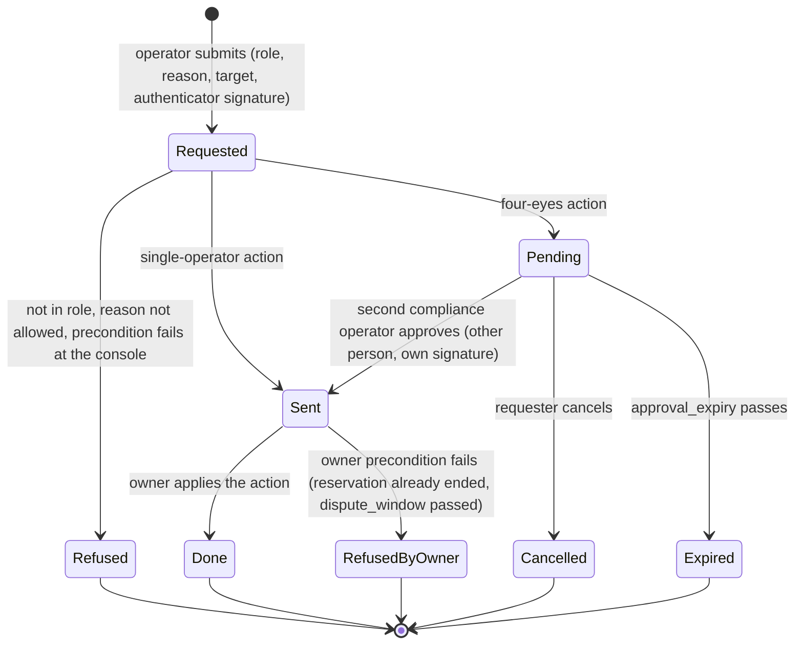

# RFC-005. Security and tenancy: principals at the edge, decisions at the owner, audit in the log

| | |
|---|---|
| Status | **Draft**, revision 1 |
| Satisfies | X1-S01 … X1-S30 (all 30 X1 scenarios). Shares, with the primary RFC named in the traceability table: P2-S09 (webhook signing), P2-S64 (principal identity for idempotency), P2-S67 (poll limit at the edge), P2-S72 and P2-S103 (key revocation push), P4-S82 (finance action and KYB), P4-S99 (principal identity for source references), X2-S24 (finance action, probe principal) |
| Policies | POL-04, POL-06, POL-07, POL-08, POL-15, POL-16, POL-17, POL-18, POL-19, POL-21, POL-22, POL-23, POL-24, POL-25, POL-29, POL-30, POL-32, POL-33 |
| Builds on | The requirements at tag `requirements-v1.5` ([X1 problem statement](../01-discovery/X1-security-and-tenancy.md), [X1 spec](../02-specs/X1-security-and-tenancy.feature), [policy register](../02-specs/policy-register.md), [glossary](../02-specs/glossary.md)) and the accepted architecture [RFC-000](RFC-000-architecture.md) revision 3.2 (tag `rfc-000-accepted`): its components, single-writer ownership (A1), two-region logs (A3), append-only facts (A4), the one decision point per request (A7), the allocation table (§7) and the cross-RFC contracts (§8) |
| Specifies | Per RFC-000 §7: the **edge gateway**, **identity and access**, the **operator console and approvals**, **audit**, and **webhook signing**; and the security obligations every other owner must meet when it consumes the contracts in §11 |

Terms are used in the sense of the [glossary](../02-specs/glossary.md). "Reserved rate" is
capacity and "traffic" is bytes. Figures marked "est." are estimates, to be replaced by
measurement in RFC-000's spike (RFC-000 R1). Parameters written `like_this` are policy
parameters from the register; parameters written ‹like_this› are **design parameters** of
this RFC, not business policy, and are listed in §13.

## Need

X1 asks for ten things (X1-N1 … X1-N10). Put together, they make one demand on the
architecture: **every state change in the marketplace must be traceable to exactly one
authenticated principal who was allowed to make it, and nobody may see or change another
tenant's state, not even by learning that it exists**. That has to hold:

1. **On the 200 ms path** (POL-04, X2-N3). The edge has about 10 ms of RFC-000's budget for
   TLS, authentication, principal resolution and advisory limits (RFC-000 §3, latency
   budget), at 25,000 booking requests/s and about 100,000 status polls/s (RFC-000 §6). No
   remote call is affordable on that path, yet a revoked agent key must stop working
   within 60 s (POL-25, X1-N3), and its undecided requests must fail at their one decision
   point (POL-04, RFC-000 A7).
2. **Without a second writer** (RFC-000 A1). Identity and access is the only writer of
   principals, keys, consent and roles; the account owner is the only writer of a
   request's outcome. Revocation must cross that boundary without giving a request two
   decision points (RFC-000 D6).
3. **Against Share's own operators** (X1-N7, POL-32). Operators must act on any account,
   which is exactly the power to control: one role per action, a reason the policy allows,
   four eyes on fraud and legal-order terminations and on identity disclosure, and a
   record of every attempt, granted or refused.
4. **Against suppliers who compete with each other and with Share's buyers** (X1-N2,
   POL-33). A supplier sees the reservations on its links by an opaque reference and never
   the buyer, unless the buyer's administrator consents or compliance discloses under a
   legal order with a second approval; a withdrawal of consent applies to every later view.
5. **At the money boundary** (X1-N5, X1-N6). Anything on the internet can claim a payment
   was made; only a notification proven authentic by its provider's method may move
   money. Buyers must be able to verify Share's webhooks.
6. **For 7 years, immutably** (X1-N8, POL-19, POL-06). Every change to money, capacity,
   links or keys, every operator action and every refused privileged attempt is recorded
   with principal and time, and nobody, operators and Share's own engineers included, can
   alter or remove the record.
7. **Across region loss** (X2-N4, X2-N5). Authentication is part of admission (99.99%,
   RTO 1 min; RFC-000 §5.4); approvals are on a two-region log (RFC-000 §2); the third
   region (R3, Google Cloud Johannesburg) is a different operator from Share and keeps a
   voter of every log.

## Approach

### 1. Shape of the design

| # | Rule | Why |
|---|---|---|
| S1 | **Authenticate at the edge, from local state.** Every external call is authenticated by the edge gateway from caches pushed by identity and access; nothing on the booking path waits for a remote identity call. | X1-N1 within the 10 ms edge budget (RFC-000 §3). |
| S2 | **The tenant comes only from the credential.** The account (or supplier) a call acts for is the one bound to its credential at issuance. A tenant identifier in a path, body or resource identifier is never used to route or to authorise; if it differs from the credential's, the call is answered as for a resource that does not exist. | X1-N2, X1-S02 … X1-S05, X1-S09: a request for another account's data reveals nothing, not even existence. |
| S3 | **Decide at the edge, re-check at the owner.** The edge makes the coarse decision (principal kind, operation, tenant); the owner that holds the resource makes the fine one (does this resource belong to this partition, is this key still valid in my serial order) and records the principal in the same log entry as the change. | RFC-000 A1, A7 and §4.1 (the audit record is part of the owner's entry); defence in depth against an edge defect. |
| S4 | **Fail closed on authority, fail open only on advice.** Missing or stale credentials, consent or envelopes deny (or hide); only advisory rate counters fail open. | X1-N1, X1-N2, X1-N3: no condition of Share's makes an operation succeed that should not. |
| S5 | **Operators act only through the console, and the console cannot act alone.** Every operator command carries an envelope signed by the console and by each operator's own hardware authenticator; owners verify it. | X1-N7, POL-32: four eyes cannot be bypassed by a compromised console. |
| S6 | **Audit is the owners' own logs, made tamper-evident.** No separate audit write can be lost (RFC-000 §4.1); hash chains over sealed segments and signed checkpoints anchored outside Share's own storage make alteration detectable. | X1-N8, X1-S15. |
| S7 | **R3 holds ciphertext only.** Log payloads are encrypted with keys held in Share's Kenyan HSMs; the voter in Johannesburg votes on bytes it cannot read. | Tenant isolation against the third-party region (Architecture issue AI5-3). |

### 2. Principals and authentication

#### 2.1 Principal kinds

A **principal** (glossary) is whoever performs an operation once authenticated. Every
principal has a stable opaque identifier (`principal_id`, 128-bit random, never reused) and
a kind. Personal data (names, email addresses, phone numbers) lives only in identity and
access's profile records, never in owner logs, which carry the `principal_id` (RQ5-8).

| Kind | Tenant | Credential | Verified where | Revocation takes effect |
|---|---|---|---|---|
| **Account user** (buyer side); an **account administrator** is an account user holding the administrator right | One buyer account | OpenID Connect login at identity and access's authorisation server; password plus a second factor, **WebAuthn mandatory for administrators**; short-lived access token (ES256 JWT, ‹user_token_ttl› 5 min) and refresh token (rotating, 12 h idle) | Edge: token signature and expiry locally (JWKS pushed), session deny-list pushed. Identity and access re-checks the administrator right itself on every key, limit, consent and endpoint command | Session deny-list push, within ‹revocation_target› 60 s; administrator commands always see the current right |
| **Agent key** | One buyer account, fixed at issuance (POL-25) | Bearer key `shk_<key id>_<secret>` with a check digit, secret 256-bit random, shown once at issuance; Share stores only `SHA-256(secret)` | Edge, from the key cache (§3.3), constant-time comparison | Within 60 s at the edge for every operation, and in the account owner's log for undecided requests (§3.3) |
| **Supplier user**, **supplier administrator** | One supplier account | As account user | As account user | As account user |
| **Supplier key** (supplier API automation) | One supplier account | As agent key (`ssk_` prefix); may only call supplier operations | As agent key | As agent key |
| **Operator** | None (cross-tenant by role) | Share's corporate single sign-on, FIDO2 hardware authenticator mandatory, from managed devices on Share's operator network only; one role bound to the operator identity (POL-32) | Console only; operators have no credential the public edge accepts | Immediate at the console (sessions are server-side) |
| **Probe** | The designated Share probe account (POL-06) | Agent keys of the probe account, plus mTLS client certificates from the probe colocation sites | Edge, as agent key, plus the certificate | As agent key |
| **Payment provider** | None; bound per notification to the account the event names, by payments (RFC-000 §2) | The provider's own authenticity method (§8.1) | Edge payment ingress, by the provider's verifier | Removing the provider's verifier configuration |
| **Payment partner** | None | mTLS and signed reports, per the partner's scheme (§8.4) | Payments, reconciliation (RFC-004) with the verifier library | As provider |
| **Payout provider** | None | Provider's method, as payment provider (§8.4) | Edge payment ingress, routed to payouts | As provider |
| **Partner system** | None | Share calls out with per-partner credentials; partner callbacks verified by the partner's scheme and then re-queried (§8.2) | Partner adapter | Rotating the partner credential |
| **Exporter** | None | mTLS with a per-exporter certificate from Share's device CA; the certificate names the exporter identity | Edge for exporters; ingestion checks each record's exporter against it (§8.4) | Certificate revocation list pushed to edges within 60 s |
| **Network operations** (consumer of the standing feed and queries) | None | mTLS client certificate | Edge | As exporter |
| **Internal service** | None | Workload identity: short-lived X.509 certificate (‹workload_cert_ttl› 24 h) per component instance from Share's internal CA | Every receiver, by mTLS, against the command allowlist (§4.4) | Certificate expiry and the allowlist |
| **Onboarding** (the external process that creates accounts and records KYB, POL-24) | None | Internal service identity | Identity and access | As internal service |

#### 2.2 The edge authentication pipeline

Every external call passes these steps in order. The order matters: authentication comes
before any lookup of the resource named, so an unauthenticated caller learns nothing.

1. **TLS 1.3** termination (persistent connections; mTLS where the kind requires it).
2. **Pre-authentication shedding**: per source address and per credential prefix,
   ‹preauth_rate_limit›, soft state. Gross abuse is dropped here (RFC-000 §2, edge).
3. **Credential parse and check digit**: a malformed credential is unauthenticated at once,
   without a cache lookup.
4. **Authentication** from the local caches (§3.3): key verifier, token signature, session
   deny-list, certificate revocation list.
5. **Principal context** built (§11, C1) and signed by the edge node's workload key.
6. **Coarse authorisation** (§4): principal kind × operation, tenant check for resources
   whose tenancy the edge knows (a link's supplier from the catalogue cache; a webhook
   endpoint's account from its own cache).
7. **Advisory rate counters** per key and account (RFC-000 D5), and the **exact poll
   limiter** for status polls (§5.3).
8. **Forward once** to the owner partition's leader chosen by the principal's tenant
   (RFC-000 §3), never by an identifier in the request.

Steps 3 to 6 are in-memory operations: about 50 µs of CPU per request with Ed25519 signing
of the context (est.), well inside the edge's 10 ms (RFC-000 §3). The edge keeps no
authoritative state.

#### 2.3 Answers that reveal nothing

| Condition | Answer | Scenario |
|---|---|---|
| No credential, malformed, unknown, wrong secret, expired token, revoked key or session, certificate revoked | One "unauthenticated" answer, identical in status, body and headers for every cause. A booking or status submission is **not accepted** (glossary), any other request is **refused** | X1-S01, X1-S06 |
| Authenticated, but the resource is outside the principal's tenant, or does not exist, or is a supply command on a link of another supplier | One "not found" answer, identical to the answer for a resource that does not exist, produced by the same code path at the principal's own partition, so its timing is the same as a genuine miss (§5.1) | X1-S02, X1-S03, X1-S04, X1-S05, X1-S09, X1-S22 |
| Authenticated, within its own tenant, but the principal's kind or rights do not allow the operation (an agent key managing keys, a user without the administrator right) | "Refused", naming the missing right; the attempt is recorded (§3.2) | X1-S19, X1-S25, X1-S29 |
| Identity and access unreachable and a cache entry has expired | "Temporarily unavailable, retry", never "authenticated" (S4) | — |

### 3. Identity and access

#### 3.1 State and partitioning

Identity and access is the only writer of the state below (RFC-000 §2). Every partition
is a single-leader state machine on a 2 + 2 + 1 log (RFC-000 A2, A3, §5.1), with status
replicas in R1 and R2 serving reads under read leases, as RFC-000 §4.6 does for the account
owner.

| State | Partition | Notes |
|---|---|---|
| Buyer account: users, the administrator right per user, agent keys (identifier, verifier, label, status, `key_spend_limit`, `key_inflight_limit`, `key_rate_limit`, version), webhook endpoints and their signing secrets (encrypted), KYB status as recorded by onboarding, probe designation | **By buyer account** | One serial order per account: `account_max_keys` is checked against the keys not revoked in the same entry that issues a key, so concurrent issuance cannot exceed it (X1-S21) |
| Supplier account: users, the administrator right, supplier keys | By supplier account | |
| **Consent and disclosure registry**: per (buyer account, supplier) the consent state and its history; per legal-order disclosure its order reference, scope, approvers and validity | **By supplier** | Partitioned by the party whose views it governs, so one supplier view needs one linearisable read (§6.2) |
| Operator identities: the one role of each, the person each belongs to, WebAuthn public keys, status | One partition (small) | Role assignment is outside the console (RQ5-6) |
| Policy: the permission matrix (§4.2), the operator action catalogue (§7.2), allowed reason codes, verifier configurations per provider | One partition, versioned | Every change is an entry with its principal; consumers record the version they decided with |
| Refused attempts at the operations it owns | With the partition of the attempted operation | X1-S19, X1-S25, X1-S29 |

Sizing (est.): about 100,000 buyer accounts with at most `account_max_keys` (100) keys
each, so at most 10 M keys; key and user commands are a few per second. The load is on
reads, served from caches (§3.3).

#### 3.2 Administrator commands

Every command below is accepted only from an **account administrator** of the account,
authenticated as in §2.1 (agent keys and other users are refused, and the refusal is
recorded with the principal, the attempted command and the time). Each is idempotent by
(account, idempotency key) for 24 h, as POL-29 sets for bookings. Each entry records the
administrator, the time, and the old and new values (X1-S20).

| Command | Effect | Pushed to | Scenario |
|---|---|---|---|
| Issue an agent key | Refused, stating the limit, if the account already has `account_max_keys` keys not revoked; otherwise a key with its limits (defaults from POL-25), its secret returned once | Edge caches; account owner (key-status push) | X1-S18, X1-S21 |
| Change a key's limits (raise or lower `key_spend_limit`, `key_inflight_limit`; lower `key_rate_limit` below the POL-25 default) | New version of the key | Edge caches; account owner | X1-S18 |
| Revoke a key | Terminal; never reversed (a new key is issued instead) | Edge caches; account owner | X1-S06, X1-S18, P2-S72 |
| Consent to identify the account to a named supplier; withdraw it | An entry in that supplier's registry partition (§6.2), recorded with the administrator and time | — (read at view time) | X1-S18, X1-S30 |
| Register, rotate or remove a webhook endpoint | Endpoint URL validated (§8.3); a new signing secret shown once | Notifier | X1-S24, X1-S11 |
| Grant or withdraw the administrator right of another user of the account | — | Session deny-list (on withdrawal) | RQ5-5 |

An agent key may read its own record (limits, status, key headroom through the account
owner, POL-18); account users may list the account's keys without verifiers. Nobody, the
issuing administrator included, can read a key's secret after issuance.

#### 3.3 Caches, the key-status push and the 60-second revocation

**Edge caches.** Each edge node keeps: agent and supplier key records it has used
recently (positive entries live at most ‹key_cache_ttl› 30 s, RFC-000 §3; negative
entries for unknown key identifiers 5 s, to absorb floods); the JWKS for user tokens; the
session deny-list; certificate revocation lists; the catalogue's link → supplier map; the
policy version. A miss or an expiry is filled from an identity-and-access **status
replica** in the edge's own region, which holds a read lease and so lags its leader by at
most `status_staleness` (1 s, RFC-000 §4.6). Entries are **never extended on error**:
an agent-key entry that cannot be refreshed expires (S4).

**Key-status push** (§11, C3). Every committed key entry is published on two paths:
(a) a fan-out feed to every edge node, which evicts or replaces the entry on receipt; and
(b) the key-status push to the account's owner (RFC-000 §8), applied there as a log entry.

**Timeline of a revocation**, administrator revokes key K at `t0` (the commit of the
revocation entry, two-region durable, after which the administrator is answered):

| Where | Normally (est.) | Worst case if every push is lost | Bound |
|---|---|---|---|
| Edge, every operation by K (submission not accepted, request refused, as unauthenticated) | `t0` + about 1 s (feed fan-out) | `t0` + 30 s (an entry filled just before `t0` expires) + 1 s (replica lag) = `t0` + 31 s | 60 s (X1-N3, X1-S06) |
| Account owner, K's undecided requests fail "key revoked" and every later intake with K is refused | `t0` + about 1 s (push, one entry) | Identity and access retries until the account owner acknowledges; it alarms at ‹revocation_alarm› 30 s; a new account-owner leader catches up from identity and access before deciding anything (C3) | 60 s (POL-25) |

The account owner's log is the **one order** in which the revocation and each request's
decision are compared (POL-04, RFC-000 A7, D6): a request decided before the revocation
entry stays decided (P2-S103); one undecided when it is applied fails "key revoked"
(P2-S72), and its holds are released by RFC-002's request-scoped release. Identity and
access tracks, per revocation, the positions acknowledged by the account owner and by
the edge fleet, and alerts if either is not acknowledged within ‹revocation_alarm›.

**Session and certificate revocations** use the same fan-out with the same bound.

#### 3.4 Supplier authority over links

The catalogue's link registry (RFC-001, RFC-000 §2) names each link's supplier. A supply
command (book maintenance, announce a permanent reduction, record an unplanned outage or
its restoration) is accepted only:

- from a principal of that supplier (user, administrator or supplier key) for any of the
  four (POL-07); or
- through the console, from an operator in the network operations role with a reason,
  and only for an outage or a restoration (POL-07, POL-32).

The edge refuses anything else as "not found" (§2.3), so a buyer or another supplier
cannot tell a link it cannot change from one that does not exist (X1-S22). The link
schedule owner re-checks in its own entry that the principal context names the link's
supplier, or carries a network-operations envelope for an outage or restoration
(defence in depth, S3; RFC-001 implements the check, §11 C11). Network operations asking
for a permanent reduction or maintenance has no such action in the catalogue (§7.2): the
console refuses, nothing changes, and the attempt is recorded (X1-S23).

#### 3.5 The probe principal

The probe account (POL-06) is an identity-and-access account flagged *probe*; its keys
are agent keys whose permission set (§4.2) allows only booking **probe links**, reading
the probe account's own state and submitting from **probe exporters**, and only over mTLS
from the probe colocation sites (RFC-000 §5.1). A probe key that leaks therefore cannot
buy real capacity on Share's credit (threat T-14). Every principal context carries the
probe flag, which consumers of rating, settlement, supplier reports and quarantine
reports use with the catalogue's probe designation to exclude probe activity (RFC-000
§5.4; RFC-006 owns the designation contract). The probe account's `credit_limit` is set
by a finance operator through the console like any other (X2-S24); the account counts as
having passed KYB (POL-06), recorded as such by onboarding.

#### 3.6 KYB status

Onboarding records each account's KYB result (passed, failed, withdrawn) in identity and
access, with its principal and time. A finance operator's request to set a `credit_limit`
is checked against it by the console before approval of the action and again by the
account owner, which receives the KYB status and its identity-and-access position in the
operator envelope (§7.4) and records it in the same entry; an account that has not passed
is refused, recorded, and keeps no credit limit (P4-S82, X1-S12).

### 4. Authorisation model

#### 4.1 Where each decision is made

| Decision | Made by | From | Recorded |
|---|---|---|---|
| Is the caller authenticated; who is it; which tenant | Edge | Caches (§3.3) | In the principal context |
| May this kind of principal call this operation; is the named resource in its tenant (where the edge can know) | Edge | Policy (§4.2), catalogue cache | Refusals within the principal's own tenant are recorded by the operation's owner |
| Does this resource exist in this partition; is this key still valid here | The owner partition (account owner, link owner, reporting, identity and access) | Its own state | In its log entry (audit fields, §9.2) |
| Is this operator action in the operator's role, with an allowed reason, approved where four eyes apply | Console, then re-verified by the owner from the envelope | Action catalogue (§7.2), envelope signatures | Console log; owner's entry |
| May this supplier see this buyer's identity in this view | Reporting, from the consent registry, at view time | Consent and disclosure registry (§6.2) | The view's consent position |

Every decision names the policy version it used, so any past decision can be explained
(X1-N8; the same reasoning as RFC-000 A0-21 for headroom).

#### 4.2 Permission matrix

"Own" means the principal's own tenant. Anything not listed is denied. Operator actions
are in §7.2 and are never available at the public edge.

| Operation | Account administrator | Account user | Agent key | Supplier user or key | Supplier administrator | Probe key |
|---|---|---|---|---|---|---|
| Book, change, cancel, withdraw (own account) | Yes | Yes | Yes | No | No | Probe links only |
| Status of own requests; own reservations; balance and headroom | Yes | Yes | Yes (headroom shown as key headroom, POL-18) | No | No | Own |
| Own statements | Yes | Yes | Yes | No | No | Own |
| List own account's keys (without verifiers) | Yes | Yes | Its own record only | No | No | No |
| Issue, change limits of, revoke agent keys | Yes | Refused, recorded | Refused, recorded | No | No | No |
| Consent to identify the account to a named supplier; withdraw it | Yes | Refused, recorded | Refused, recorded | No | No | No |
| Register, rotate, remove webhook endpoints | Yes | Refused, recorded | Refused, recorded | No | No | No |
| Schedule of an own link (reservations by reference; identity only where §6 allows) | No | No | No | Yes | Yes | No |
| Own supplier statement | No | No | No | Yes | Yes | No |
| Book maintenance, announce a permanent reduction, record an outage or restoration on an own link | No | No | No | Yes | Yes | No |
| Issue, change, revoke supplier keys | No | No | No | Refused, recorded | Yes | No |

The matrix is policy data (§3.1), evaluated by a pure function shipped as the principal
and authorisation library (§11, C2) to the edge, identity and access, the console and
every owner, so the same decision is made wherever it is checked.

#### 4.3 One account per key, one tenant per call

An agent key acts for its account only (X1-S05): the edge routes its calls to that
account's partition, and if the call names a different account (in a path or body), the
submission is not accepted or the read refused with the "not found" answer, and nothing
is forwarded. The account owner refuses any command whose principal context names a
tenant other than its partition's account (S3). There is no operation by which any buyer
principal acts for two accounts.

#### 4.4 Internal commands

Every internal call is mTLS with workload identities (§2.1), and each receiver accepts a
command only from the components RFC-000 makes its callers. The allowlist is part of the
policy (§3.1):

| Receiver: command | Accepted only from |
|---|---|
| Account owner: booking API commands | Edge (with a buyer principal context) |
| Account owner: key-status push and catch-up | Identity and access |
| Account owner, link owner, attribution, catalogue, payouts, payments, identity and access: operator commands | Console (with an operator envelope, §7.4) |
| Link owner: hold, convert, release, query | Account owner (RFC-000 §8, link hold port) |
| Link owner: supply commands | Edge (supplier principal) or console (network-operations envelope) |
| Ledger: posting | Settlement, payments, payouts (RFC-000 §8) |
| Payments: notification ingress | Edge payment ingress (with a verifier verdict, §8.1) |
| Notifier: signing secrets | Identity and access |
| Audit: append (§9.4) | Console, secrets service, identity and access, the platform's access logs |

A command from any other caller is refused and raised as a security alert.

### 5. Tenant isolation

#### 5.1 Data

- **Routing by tenant** (S2). Every buyer operation is routed to the principal's own
  account partition; every supplier operation is evaluated against the principal's own
  supplier's links and statements. A resource identifier never selects a partition, so a
  principal of "b2" naming reservation R of "b1" reaches b2's own partition, where R does
  not exist (X1-S03).
- **Uniform misses.** Because the request always reaches the principal's own partition
  and misses there by the ordinary lookup, a resource of another account and a resource
  that never existed take the same path and the same time; no answer depends on whether
  the identifier exists elsewhere (X1-S02, X1-S04).
- **Identifiers** for reservations, requests, keys and endpoints are 128-bit random.
  Their unguessability is not what isolates (routing is), but it removes enumeration as a
  way to probe for timing.
- **Owners re-check** the principal context's tenant against the partition (§4.3).
- **Read models** (reporting, statements, supplier views) are partitioned by account or
  supplier (RFC-000 §2) and queried only with the principal's tenant.
- **Shared infrastructure** (logs, metrics, traces, alerts) carries `principal_id`s and
  resource identifiers, never personal data or another tenant's content; operational
  dashboards that join across tenants are operator tools behind the console (§7).
- **Webhooks** go only to an endpoint registered by the event's own account and carry only
  that request's own data (§8.3; X1-S24).
- **Rejections and counter-offers** name no other account or reservation (POL-10; RFC-001
  owns the content, P1-S17).

#### 5.2 Idempotency scopes (POL-29)

| Input | Scope of the identity | Principal compared | Where | Answer to another principal |
|---|---|---|---|---|
| Booking request | (account, idempotency key) | `principal_id` of the first submission (agent key or user) | Account owner, entry 1 (RFC-000 §4.4) | Not accepted, "reuse by another principal", revealing nothing of the first request or its outcome (P2-S64) |
| Same key from another account | A different scope by construction | — | — | Decided on its own merits; a poll for a key never used in the account is answered as never used (X1-S08, X1-S09) |
| Administrator commands (§3.2) | (account, idempotency key), 24 h | Administrator's `principal_id` | Identity and access | Not accepted |
| Operator actions | The console's action identifier, which is the source reference of any money-moving action (POL-29) | Requesting operator's `principal_id` | Console; the owner deduplicates by the same reference | Refused as reuse by another principal (P4-S99) |
| Payment notifications | (provider, transaction reference, event kind) (RFC-000 §4.4) | The provider principal | Payments | A different principal is refused (RFC-004) |

The principal compared is always the `principal_id` from the principal context (C1),
never a role or a display name, so two operators in the same role are two principals.

#### 5.3 Rate limits and fairness

| Limit | Enforced exactly at | Advisory at |
|---|---|---|
| `key_rate_limit`, `account_rate_limit` (bookings, retries counted; POL-25) | Account owner (RFC-000 D5; RFC-002, RFC-004 Part A) | Edge per node, shedding only gross excess |
| `key_poll_limit` (status polls; POL-25, P2-S67) | **Edge poll limiter**: one counter per key, per UTC second, held by one counter shard chosen by hashing the key, placed in the leader region; edges in the other region ask it over one round trip (about 10 ms, est.) | — |
| ‹mgmt_rate_limit› 5/s per principal for identity-and-access commands; ‹read_rate_limit› per account for reads served by reporting | Edge | — |
| ‹preauth_rate_limit› per source address before authentication | Edge | — |

Polls are not on the booking path and have no latency target of their own, so the extra
hop costs nothing measured. If a counter shard is lost, its keys are counted by each edge
node at the limit divided by the number of nodes until the shard is replaced (seconds);
that is the only place where a limit fails open (S4: polls are reads of the key's own
requests). `account_rate_limit` also bounds one account's load on its partition, so a
noisy tenant cannot starve another (RFC-000 R6).

#### 5.4 Data at rest, and the third region

- **Owner log payloads are encrypted** at the leader with a per-partition data key
  (AES-256-GCM), wrapped by a regional key-encryption key held in HSMs in R1 and R2 only.
  Voters in R3 store and acknowledge ciphertext; they never lead (RFC-000 §5.1) and need
  no key. During a declared region disaster the surviving Kenyan region's HSMs serve the
  leaders; R3's two voters (2 + 2) still hold ciphertext.
- **Sealed segments** in object storage (RFC-000 §5.3, RFC-006) stay encrypted under the
  same data keys; data keys are retained for 7 years (X2-N6).
- **Cost** (est.): one AES-GCM pass per entry at the leader, a few µs per group commit;
  no change to RFC-000's latency budget.
- **Key escrow**: the key-encryption keys are backed up, split 3-of-5 among named
  custodians, in sealed storage in Nairobi, Mombasa and one off-site vault, so losing
  both Kenyan HSM clusters does not lose the ability to read R3's copy.

RFC-006 owns the replicated-log convention; this RFC requires the encryption hook in it
(Architecture issue AI5-3).

### 6. Supplier visibility and consent (POL-33)

#### 6.1 The opaque reservation reference

A supplier sees each reservation on its link by a **reservation reference** (glossary)
computed as

`ref(supplier, reservation) = v ‖ AES-128_{K(supplier, v)}(reservation_id)`

where `reservation_id` is the reservation's 128-bit identity, `K(supplier, v)` is a
per-supplier key of version `v` held in the secrets service (§10), and `‖` is
concatenation.

- **Used for no other reservation** (POL-33, X1-S28): AES under one key is a permutation,
  so two reservations never share a reference for one supplier; the version prefix keeps
  references of different versions distinct.
- **Unlinkable**: without the key, references of one buyer's reservations look
  independent; two suppliers on one route get different references for the same
  reservation, so they cannot join their views by reference.
- **Stable**: a reservation keeps its reference for its life, through changes, extensions
  and a move to an equivalent path (POL-07), because it depends only on its identity; key
  versions are added for new reservations and never retired while a reservation of that
  version exists, nor within 7 years.
- **Computed, not stored**: reporting, the notifier (supplier notices) and the provisioning
  feed compute it; a supplier command that names a reference is resolved by the inverse.
  No owner stores it, so no owner gains a writer duty.

#### 6.2 Consent and the consent check

The **consent and disclosure registry** is partitioned by supplier (§3.1). Its entries:

- *consent given* (buyer account, supplier, administrator, time) and *consent withdrawn*
  (same fields), from an account administrator's command (§3.2); an agent key or a user
  without the right is refused, and the refusal recorded (X1-S29);
- *disclosure* (buyer account, supplier, order reference, scope, valid from approval,
  until the date the order states or until ended), from an approved compliance action
  (§7.3); *disclosure ended*, also a compliance action (RQ5-3).

**Consent check** (§11, C6): for one supplier view, reporting reads the supplier's
registry partition **linearisably** (at its leader under the leadership lease) and gets,
for the buyer accounts in the view, *reveal* (with the consent or disclosure entry) or
*hide*, at a registry position it records with the view. Then:

- A view started after a withdrawal is acknowledged reads a position at or after it, so
  **every later view hides** the buyer (X1-S30). A disclosure under a legal order reveals
  the identity with the order reference recorded (X1-S28, third row).
- If the registry cannot be read, the view is **served with every identity hidden** (S4):
  the supplier's own reservations and references are still shown, so reporting's
  availability does not depend on the registry, and the failure can only hide.
- Reporting never caches a consent answer across views.

Supplier views are a few per second (est.), so a leader read per view costs nothing
material.

#### 6.3 What a supplier view contains

| View | Shown | Never shown unless revealed |
|---|---|---|
| Schedule of an own link (X1-S28) | Each reservation's rate, window, endpoints (RQ5-1) and reference; capacity history; maintenance bookings | Account identity, account-level identifiers, the route's other legs, anything common to one buyer's reservations |
| Supplier statement (P4-N10, P4-S40) | Each share with its charge line by reservation reference and minute, weights, rule and tie order, payouts, debts, residues, amounts Share paid and why | As above; usage-priced lines are shown by a per-line reference computed the same way from the line's identity, never by account (RQ5-1) |
| Supplier notices (affected reservations, POL-07) | Reservation references | Account identity, always (notices are not views; identity is never pushed) |
| Quarantine reports (POL-17) | The unattributed traffic | Nothing to reveal: it is unattributed |

### 7. Operator console and approvals

#### 7.1 Operators

Each operator identity belongs to one person and holds **exactly one role** (POL-32): a
person who works in two roles has two identities, and the person identifier is what
four eyes compares. Operators sign in through Share's corporate single sign-on with a
FIDO2 authenticator, on managed devices, from Share's operator network; console sessions
are server-side and end at ‹operator_session_ttl› 8 h or on idle (15 min).

#### 7.2 Action catalogue

Each action belongs to exactly one role (POL-32). An action is accepted only from that
role, with a **reason code** from the action's closed list plus free text, and is sent to
the owner of the state it changes (RFC-000 §2, §3: the console only carries authorised
intent).

| Action | Role | Four eyes | Allowed reasons | Owner it is sent to | Scenarios |
|---|---|---|---|---|---|
| Read an account's reservations, requests, statements, wallet | Support | No | Account's documented request, or support case | Reporting, account-owner replicas | X1-S27 |
| Act at an account's documented request (cancel, shorten, decrease, change, withdraw), as the account's own change (POL-08) | Support | No | Account's documented request (§7.5) | Account owner | X1-S27 |
| Record an unplanned outage; record its restoration | Network operations | No | Outage cause | Link schedule owner | X1-S23 |
| Terminate a reservation for network abuse | Network operations | No | Network abuse (POL-30) | Account owner (reservation command port, RFC-000 §8) | X1-S12, X1-S17 |
| Terminate a reservation for fraud, or a sanctions or legal order | Compliance | **Yes**, second compliance operator | Fraud; sanctions order; legal order (with order reference) | Account owner | X1-S12, X1-S26 |
| Disclose a buyer's identity to a supplier under a legal order | Compliance | **Yes**, second compliance operator | Legal order (with order reference) | Identity and access (consent registry) | X1-S12, X1-S28 |
| End a disclosure | Compliance | No | Order expired; order withdrawn | Identity and access | RQ5-3 |
| Correct a price, with its cause | Finance | No | Cause: Share, supplier, other (POL-23) | Catalogue and rating (RFC-003) | X1-S12, P3-S57 |
| Attribute quarantined traffic to an account | Finance | No | Attribution evidence (POL-17) | Attribution and quarantine | X1-S12 |
| Set or remove a `credit_limit`, only on an account that has passed KYB | Finance | No | Credit decision; re-vetting after write-off (POL-21) | Account owner (funds and standing) | X1-S12, P4-S82, X2-S24 |
| Resolve an escalated payout | Finance | No | Resolution with the provider's evidence (POL-22) | Payouts | X1-S12 |
| Resolve an escalated reversal whose payment never arrived | Finance | No | Resolution with the partner's evidence (POL-21) | Payments | X1-S12 |

There is **no action** that ends a reservation for any other reason (X1-S16), that
changes a link's commercial capacity (X1-S23), that writes off a debt (write-offs are
automatic, X1-N7), or that alters an audit record or any owner's past entry (X1-S15). A
request for one is refused and recorded.

#### 7.3 The request and approval state machine

The console's state is on its own 2 + 2 + 1 log (RFC-000 §2, A0-17), partitioned by
action identifier. Each action moves through:

- **Four eyes** (X1-S26). A four-eyes action takes no effect, and nothing is sent to the
  owner, until a second operator **in the same role (compliance)**, a **different person**
  from the requester, approves it with their own authenticator signature over the same
  action digest. The requester cannot approve their own action under any identity.
  Pending actions expire after ‹approval_expiry› 72 h (RQ5-4).
- **Sending** is synchronous to the owner (RFC-000 §3) and retried with the same action
  identifier until the owner answers; the owner deduplicates by it.
- **Every transition is an entry** on the console log with the operator(s), role, reason
  and time, so every refused attempt (X1-S13, X1-S16, X1-S27 third row, P4-S82) and every
  read by support (X1-S27 first row) is recorded.
- **Notice to the holder** of a termination (X1-S17, POL-30): the account owner's
  termination entry triggers the notifier as for any reservation end. A termination may
  suppress the notice only when it is a compliance action citing a legal order that
  forbids notice; a network-abuse termination always notifies (RQ5-7).

#### 7.4 The operator envelope, and how owners verify it

Every operator command carries an **envelope** (§11, C4):

| Field | Meaning |
|---|---|
| `action_id` | The console's action identifier; also the source reference of any money-moving action (POL-29) |
| `action_type`, `target` | From the catalogue; the target names the account, reservation, link, payout, reversal or registry entry |
| `role`, `reason_code`, `reason_text`, `order_ref` or `request_ref` | As submitted |
| `requester` | Operator `principal_id`, person identifier, and the WebAuthn assertion over `digest(action)` |
| `approver` (four-eyes actions only) | The same three fields for the approver |
| `preconditions` | Facts the console checked, with their positions (for example KYB status at an identity-and-access position) |
| `issued_at`, `console_term`, signature | Signed by the console leader's HSM-held key |

An owner applies an operator command only if: the console signature is valid; the
`action_type` is one the owner accepts and `role` is the catalogue's role for it; the
reason code is allowed; each authenticator assertion verifies against that operator's
registered public key (from identity and access) over the same digest; for a four-eyes
action, the approver's role is compliance and the person differs from the requester's;
and `issued_at` is within ‹envelope_ttl› 5 min. Otherwise it refuses, and the console
records the refusal. A compromised console process therefore cannot create a four-eyes
action, or any operator action, that no operator signed (threat T-9).

The owner writes the envelope's fields into the audit fields of the entry that makes the
change (§9.2), so the change and its authority are one record (RFC-000 §4.1).

#### 7.5 Support at the account's documented request

A **documented request** is a support request created by an authenticated principal of
the account (an account user, or an administrator for actions that need the right)
through the API or portal, naming the action and its target; it is recorded in the
console log with its principal. A support action of the "documented request" kind must
cite one, and the console checks that the action and target match it. The action is sent
to the account owner **as the account's own change** (POL-08), with the support operator
as principal and the request as `request_ref`: the account's fees and charges apply, and
it is never a termination (POL-30; X1-S27). Without a matching request it is refused and
recorded (X1-S27 third row). What else counts as documentation is RQ5-9.

### 8. Webhook authenticity

#### 8.1 Inbound payment notifications

The edge's payment ingress runs one **verifier** per provider, configured in the policy
partition (§3.1). The provider's own method is an interface contract (X1 out of scope);
the verifier framework supports three:

| Method | How it proves authenticity | Replay protection |
|---|---|---|
| **Signature** (HMAC or public-key over the body and a timestamp) | Signature valid under the provider's current or previous key | Timestamp within ‹provider_timestamp_tolerance› 5 min; payments deduplicates by (provider, transaction reference, event kind) anyway (RFC-000 §4.4) |
| **Mutual TLS** with the provider's pinned certificate, from its published address ranges | The connection's certificate | As above |
| **Verify by fetch**, for a provider that does not sign its notifications | The notification is treated only as a hint; the verifier queries the provider's authenticated API for the transaction and uses **the fetched content** as the event | The fetch is idempotent by transaction reference |

The verdict is forwarded with the notification to payments (§11, C7):

- *Authentic* (with the normalised event and the proof: key identifier, method): payments
  records it, binds the reference to its account on the first authentic and well-formed
  event (RFC-000 §2, V-05), and acknowledges the provider once it is two-region durable.
- *Not authentic* (with the reason): **no binding, no movement**; payments records it in
  an investigation stream partitioned by provider (not by the claimed reference, so an
  attacker cannot fill real references' partitions), and an alert is raised (X1-S10). The
  provider is answered with a refusal. Under a flood beyond ‹preauth_rate_limit› the
  stream records counts, first and last occurrence and a sample per source, so recording
  cannot become the attack (Risk RK-6).

A notification never moves money on the strength of the account, amount or reference it
claims; it moves money only as an authentic event (X1-N5).

#### 8.2 Inbound from partners

Share calls partners with per-partner credentials (§10); the partner adapter (RFC-002)
holds them. A partner callback, where a partner's API uses them, is verified by the
partner's scheme and then treated as a **hint**: the adapter re-queries the booking by its
idempotent partner key (POL-28's re-query) over its own authenticated outbound
connection, and only the queried result changes Share's state. A forged callback can
therefore cause a re-query, never a booking state change.

#### 8.3 Outbound webhooks to buyers

The notifier (RFC-006) delivers; this RFC defines the signature (§11, C8) and owns the
endpoints and secrets (identity and access, §3.2).

- **Format** (the Standard Webhooks convention): headers `webhook-id` (the event's
  identity, stable across retries), `webhook-timestamp` (seconds since the epoch) and
  `webhook-signature` = `v1,` base64 of HMAC-SHA256(secret, id ‖ "." ‖ timestamp ‖ "." ‖
  body).
- **Secret**: 32 bytes per endpoint, shown once to the administrator who registers or
  rotates it; stored encrypted (§10); fetched by the notifier over its workload identity
  and kept in memory.
- **Verification by the buyer** (X1-S11): recompute the HMAC with the secret Share gave
  them, compare in constant time, reject a timestamp more than 5 min old, and deduplicate
  by `webhook-id` (delivery is at least once, POL-04). Nothing else is needed: "from the
  webhook alone and what Share has given them".
- **Rotation**: a new secret is active at once; for `webhook_retry` (24 h, POL-04) every
  delivery carries signatures under both secrets, so retries of older events still verify.
- **One account per endpoint** (X1-S24): an endpoint belongs to the account that
  registered it; the notifier picks endpoints by the event's account only, and the event
  carries only that request's own fields.
- **Endpoint safety**: HTTPS only; the notifier resolves the host itself, refuses private,
  loopback, link-local and Share address ranges, connects to the address it checked
  (no re-resolution), follows no redirects, and sends from a dedicated egress with no
  route into Share's networks (threat T-12).

#### 8.4 Other inbound parties

The same verifier library (§8.1) is used by payouts for transfer confirmations and
failures from payout providers, and by reconciliation for the payment partner's signed
reports (POL-24); RFC-004 configures them (Architecture issue AI5-2). Exporters connect
with per-exporter mTLS certificates, and ingestion refuses a record whose exporter is not
the certificate's (RFC-003), so one exporter cannot report traffic as another.

### 9. Audit trail

#### 9.1 What is recorded, and where

| What | Recorded in (the owner's own log entry, or an audit source) | Scenarios |
|---|---|---|
| Every change to a reservation: confirm, change, cancel, revoke, release, terminate, move | Account owner (and the link owner's conversion or release) | X1-S14, X1-S07 |
| Every change to a link's capacity: outages, restorations, maintenance, reductions | Link schedule owner | X1-S14, X1-S22, X1-S23 |
| Every money movement | Ledger (and the input it came from: payments, payouts, settlement) | X1-S14 |
| Every key issue, limit change and revocation, with old and new values | Identity and access | X1-S18, X1-S20 |
| Every consent, withdrawal and disclosure | Identity and access (registry) | X1-S30, X1-S12 |
| Every refused attempt to manage keys, consent or endpoints | Identity and access | X1-S19, X1-S25, X1-S29 |
| Every operator action and refused operator attempt, every support read | Console | X1-S12, X1-S13, X1-S16, X1-S27 |
| Every operator action's effect | The owner's entry, with the envelope (§7.4) | X1-S12, X1-S17, X1-S26 |
| Secret accesses, break-glass sessions, storage-level access and deletion attempts | Audit's own append log (§9.4) | X1-S15 |
| Changes to policy, verifier configurations and operator role assignments | Identity and access (policy and operator partitions) | RQ5-6 |

#### 9.2 The audit field set

Every entry above carries (§11, C5):

| Field | Content |
|---|---|
| `principal` | `principal_id`, kind, tenant, key identifier for an agent key (X1-S07), session or certificate identifier |
| `on_behalf_of` | For support at a documented request: the account and `request_ref` |
| `role`, `reason`, `approver` | For operator actions, from the envelope |
| `cause` | For a change no principal asked for (release after grace, revocation at the end of `revocation_notice`, a charge posted by settlement): `internal_service` as principal, the rule (POL-nn) and the entry that triggered it |
| `received_at`, `request_id` | The edge's receipt time and request identity, from the principal context |
| `decided_at` | The entry's own timestamp (RFC-000 §4.3) |
| `policy_version`, `iam_position` | What the authorisation decision used |
| `old`, `new` | For changes of configured values (key limits, credit limits, prices) |

The **audit record identifier** is (owner, partition, term, log index): unique, and
ordered within the partition.

#### 9.3 Immutability

An audit record cannot be altered or removed by anyone, operators and engineers
included (X1-S15). Four layers make that so:

1. **No mutation exists.** No owner, console action, API or administrative tool rewrites
   or deletes an entry (RFC-000 A4); a correction is a new entry. An attempt through the
   console is refused and recorded (§7.2).
2. **Consensus.** The live tail of each log is on five voters in three regions; altering a
   committed entry needs a majority of them.
3. **Hash chains and signed checkpoints.** When History seals a segment (RFC-006), it
   computes the segment's Merkle root over its entries and chains it to the previous
   segment's root of the same partition. Audit verifies each chain and the continuity of
   indexes (no gap, no fork), and every hour signs a **checkpoint** of every partition's
   latest root with its HSM-held key.
4. **Write-once storage in two trust domains.** Sealed segments are kept under object
   lock in compliance mode for 7 years in R1 and R2 (RFC-006); checkpoints are also
   written to a retention-locked bucket in R3 under a separate Google Cloud organisation,
   administered by staff with no access to Share's data centres. An alteration in Share's
   own storage is then detected by the next verification against R3's checkpoints, and an
   alteration in R3 cannot rewrite Share's segments.

Verification runs continuously on new segments and monthly over a random sample of the
whole retention period; a failure is a security incident.

#### 9.4 The audit store and its append log

- **Index.** Low-volume records (operator actions, key, consent and policy changes,
  refused attempts) are fully indexed by principal, tenant, target and time. High-volume
  records (booking entries, link entries, ledger movements; about 100,000 entries/s,
  est.) are indexed sparsely: per principal and per tenant, per hour, the segments that
  contain their entries, with a membership filter per segment, so a query reads only the
  segments it needs. A 7-year full index at about 100,000 entries/s would be about
  2×10¹³ entries (est.), which this avoids.
- **Append log.** Sources that are not owners (secrets service, break-glass, the
  platform's storage access logs) append to audit's own 2 + 2 + 1 log, idempotent by the
  source's reference, acknowledged once two-region durable (§11, C5).
- **Lag.** The index follows the owners' feeds within minutes (RFC-000 §4.2); the record
  itself exists from the owner's commit, so lag never loses a record.
- **Who reads it.** Through the console, as a read action (RQ5-2 proposes compliance);
  every query is itself recorded.

#### 9.5 Retention

Every record is kept for 7 years from its time (POL-19, POL-06); object lock enforces
it, and History (RFC-006) owns the storage. Data keys for encrypted segments (§5.4) are
kept as long. Personal data is outside the records (§2.1), so erasing a person's profile,
where the law requires it (RQ5-8), leaves every audit record intact and attributable to
its `principal_id`.

### 10. Secrets and key management

**Roots of trust.** HSM clusters in both facilities of R1 and of R2 (FIPS 140-3 level 3).
R3 holds no key that decrypts tenant data or signs on Share's behalf; it holds only the
audit checkpoint copies (§9.3).

**Secrets service.** A small replicated store on its own 2 + 2 + 1 log (RFC-006
convention), values encrypted under HSM-held keys, released only to the workload
identities its access policy names. Every read is appended to audit (§9.4). Components
fetch secrets at start and on rotation events, and keep them in memory.

| Key or secret | Purpose | Form | Held | Rotation | On compromise |
|---|---|---|---|---|---|
| Internal root and issuing CAs | Workload and device certificates | ECDSA P-256 | Root offline in HSM; issuing CAs in HSM, R1 and R2 | Issuing CAs yearly; workload certificates 24 h | Re-issue; revoke the issuing CA; all workload certificates expire within 24 h |
| Device CA | Exporter and network-operations certificates | ECDSA P-256 | HSM | Device certificates 1 year | Revocation list pushed within 60 s |
| Public TLS certificates | Edge | Public CA | Edge nodes | 90 days, automatic | Revoke and re-issue |
| User token signing key | Access tokens (§2.1) | ES256 | HSM | 90 days, previous key valid for one token lifetime | Remove from JWKS: every token signed with it is refused within 60 s |
| Edge context signing keys | Principal contexts (C1) | Ed25519 per edge node | Memory, certified by the internal CA | 24 h | Revoke the node's certificate |
| Console envelope key | Envelopes (§7.4) | Ed25519 | HSM | Yearly | Rotate; owners refuse the old key; every envelope still needs operator signatures |
| Operator authenticators | Operator assertions | WebAuthn credentials | Operators' hardware keys; public keys in identity and access | On loss | Revoke the credential |
| Agent and supplier key secrets | API access | 256-bit random | Client only; Share keeps SHA-256 | On demand | Revoke (60 s); the `shk_`/`ssk_` prefix and check digit let secret scanners report leaks to Share |
| Webhook endpoint secrets | Webhook HMAC (§8.3) | 32 bytes | Secrets service | On demand, 24 h overlap | Rotate |
| Provider and payout credentials, verification keys | §8.1, §8.4 | Per provider | Secrets service | Per provider | Per provider |
| Partner credentials | §8.2 | Per partner | Secrets service | Per partner | Rotate |
| Reference keys `K(supplier, v)` | §6.1 | AES-128 | Secrets service, wrapped by HSM keys | New version for new reservations only; never retired within 7 years | New version for new reservations; existing references stay linkable by whoever has the old key (Risk RK-5) |
| Log data keys and key-encryption keys | §5.4 | AES-256 | KEKs in HSM R1, R2; data keys wrapped | Data keys monthly (new entries); KEKs yearly | Re-wrap; escrow 3-of-5 |
| Audit checkpoint key | §9.3 | Ed25519 | HSM | Yearly, public keys published to finance and auditors | Re-sign from the last verified checkpoint |

**Break-glass.** Direct access to production stores is possible only through a
break-glass session approved by two named platform security staff, limited to
‹break_glass_ttl› 4 h, recorded through audit's append log; it grants no way to rewrite
log entries (§9.3).

### 11. Contracts this RFC provides

RFC-000 §8 names them; this section gives their complete semantics. Wire formats belong to
[contracts](../04-delivery/contracts.md) (README).

#### C1. Principal and authorisation context (library and token; every component)

- **Content**: `principal_id`, kind, tenant (account or supplier, or none), rights
  (administrator), key identifier, session or certificate identifier, authentication
  method and time, the identity-and-access position and key version it was validated at,
  the key's limits at that version (agent keys), probe flag, `request_id`, `received_at`,
  edge region, expiry (‹context_ttl› 60 s), the edge node's signature.
- **Guarantees**: issued only after authentication (§2.2); the tenant is the credential's
  (S2); signed by an edge node certified by the internal CA, or by the console for
  operator commands (C4).
- **Obligations of a receiver**: verify signature and expiry, and refuse as
  unauthenticated otherwise; for a tenant-scoped command, refuse as "not found" if the
  tenant is not the partition's; copy the principal fields into the audit fields of any
  entry the command causes (C5); never widen what the context allows.
- **Failure**: an invalid context never reaches an effect; there is no fallback identity.

#### C2. Authorisation decision (library; edge, identity and access, console, owners)

- `decide(context, operation, resource) → permit | not_found | refused(right) |
  unauthenticated`, a pure function of its inputs and the policy version, which it
  returns.
- `not_found` for anything outside the principal's tenant or whose existence it may not
  learn; `refused` only within its own tenant (and then recorded by the operation's
  owner); deny unless a matrix row (§4.2) permits.
- The same version gives the same answer anywhere, so the edge and the owner cannot
  disagree except across a policy change; an owner that sees a newer version than the
  context uses decides with the newer one.

#### C3. Key-status push and catch-up (identity and access → account owner, RFC-002)

- **Events** per key: `issued`, `limits_changed`, `revoked`, with the key's limits,
  account, administrator, commit time and (identity-and-access partition, term,
  sequence).
- **Delivery**: at least once, ordered per account, retried until the account owner
  acknowledges the position it applied; identity and access alarms at ‹revocation_alarm›
  30 s and the target is 60 s from commit (POL-25).
- **Application** (RFC-002): as a log entry, idempotent by sequence; per key the event of
  highest sequence wins, from the push or from a principal context (C1), so a request
  from a just-issued key is admitted with the limits it carries, and an older context can
  never undo a newer change. `revoked` is terminal. On applying it, every undecided
  request of the key gets an ending entry "key revoked" (P2-S72), and every later intake
  with the key is refused as unauthenticated; decided requests are unchanged (P2-S103).
- **Catch-up**: a new account-owner leader, after its takeover entry and before deciding
  any request, queries identity and access for every key event of the account above its
  applied sequence and applies them in one entry.

#### C4. Operator action envelope (console → every owner that accepts operator actions)

Fields and owner checks as in §7.4. The owner's answer is *applied* (with its entry
position) or *refused* (with the precondition that failed). Idempotent by `action_id`;
for money-moving actions `action_id` is the source reference, and its principal the
requesting operator (POL-29, P4-S99). An owner never applies an operator change that
arrives without a valid envelope.

#### C5. Audit record (field set in every owner's log; feed; append)

- **Field set**: §9.2, in every entry that changes money, capacity, a link, a key, a
  consent, a standing, a reservation or a request, or applies an operator action.
- **Owner obligations**: publish the log as a feed to audit (at least once, ordered per
  partition); no operation that rewrites or deletes entries; seal segments with Merkle
  roots through the RFC-006 hook.
- **Append** (for non-owner sources): `append(source, source_ref, record) → position`,
  acknowledged once two-region durable, idempotent by `source_ref`, never altered.
- **Audit guarantees**: continuity and chain verification, hourly signed checkpoints in
  two trust domains, a query interface for the console, retention 7 years (with RFC-006).

#### C6. Supplier visibility (identity and access, library → reporting, notifier, provisioning feed)

- `ref(supplier, reservation_id)` and its inverse (§6.1); the key is released only to the
  three consumers.
- `visibility(supplier, accounts) → {account: reveal(entry) | hide}` at a registry
  position, read linearisably; callers must call it per view, must not cache across
  views, and must hide every identity if it fails.
- Commands: consent given and withdrawn (administrator, §3.2), disclosure and its end
  (compliance envelope, §7.2).

#### C7. Payment notification authenticity (edge payment ingress → payments and payouts, RFC-004)

`verify(provider, request) → authentic(event, proof) | not_authentic(reason)`.
Payments and payouts create bindings and movements only from `authentic`; they record
`not_authentic` in the investigation stream without binding or movement; the provider is
acknowledged only per RFC-004 (two-region durability). The provider principal is the
principal for POL-29's comparison.

#### C8. Signed webhook (identity and access → notifier, RFC-006; buyers)

Signature format, secret custody, rotation and endpoint rules as in §8.3. The notifier
must sign every delivery, must pick endpoints only by the event's account, and must use
the safe-egress rules.

#### C9. Probe designation (identity and access → every consumer named in RFC-000 §5.4)

The probe flag on the probe account and in every principal context of its keys; the
restricted permission set (§3.5). RFC-006 owns the designation contract as a whole.

#### C10. KYB status (identity and access → console, account owner)

KYB result per account with its principal, time and position; the console checks it
before a credit-limit action; the account owner checks the envelope's KYB precondition
and records it (§3.6).

#### C11. Supplier authority on supply commands (edge and library → link schedule owner, RFC-001)

The link owner accepts maintenance and permanent-reduction commands only from a principal
context whose tenant is the link's supplier, and outage and restoration commands from that
supplier or with a network-operations envelope (§3.4).

**Contracts this RFC consumes**: the catalogue's link registry and probe designations
(RFC-001, RFC-003); the outcome feed (RFC-002) for webhooks; the replicated-log, placement,
sealing and retention conventions (RFC-006), with the two hooks this RFC requires
(payload encryption, §5.4; segment Merkle roots, §9.3).

### 12. Threat model

STRIDE per trust boundary. "Scenarios" names what each mitigation makes hold; "T-" numbers
are cited elsewhere in this RFC.

| # | Boundary | Threat | STRIDE | Mitigation | Scenarios |
|---|---|---|---|---|---|
| T-1 | Internet → edge | Call without credential, or with a guessed or stolen one | S | §2.2 authentication before any lookup; 256-bit secrets; uniform unauthenticated answer; secret-scanning prefixes | X1-S01 |
| T-2 | Internet → edge | Revoked key keeps working | S, E | Push plus 30 s cache bound, never extended on error; account owner applies in its order; catch-up on takeover | X1-S06, P2-S72, P2-S103 |
| T-3 | Edge → owner | Principal of one account reads or changes another's data, or learns it exists | I, T | Routing by credential's tenant only; uniform misses; owner re-check | X1-S02, X1-S03, X1-S05 |
| T-4 | Edge → owner | Idempotency key collision or probing across accounts or principals | I | Scope (account, key), principal compared | X1-S08, X1-S09, P2-S64 |
| T-5 | Within an account | Agent key or ordinary user raises limits, issues keys, consents | E | Administrator right checked by identity and access on every command; refusals recorded | X1-S19, X1-S25, X1-S29 |
| T-6 | Within an account | Too many keys to evade per-key limits | E | `account_max_keys` in one serial order; `account_rate_limit`, `account_inflight_limit` | X1-S21 |
| T-7 | Supplier → edge | Supplier sees another supplier's links or statements | I | Tenant check on the link registry; "not found" | X1-S04 |
| T-8 | Supplier → edge | Supplier identifies buyers or links their reservations | I | Opaque permutation references; consent read per view; fail to hide; notices never identify | X1-S28, X1-S29, X1-S30 |
| T-9 | Operator → console → owner | Operator acts outside role, without reason, or alone on a four-eyes action; compromised console forges actions | E, R | Catalogue by role; reason codes; operator hardware signatures verified by owners; person identity compared | X1-S12, X1-S13, X1-S16, X1-S26 |
| T-10 | Support → owner | Support acts on an account without its request | E | Documented request recorded from an authenticated principal of the account, matched by the console | X1-S27 |
| T-11 | Provider → edge | Forged or replayed payment notification credits an account | S, T | Verifiers (signature, mTLS, verify by fetch); binding only from authentic events; deduplication by reference | X1-S10, P4-S01, P4-S04 |
| T-12 | Notifier → buyer endpoint | Webhook forged by a third party; webhook sent to another account; endpoint used to reach Share's internal network | S, I, E | HMAC per endpoint; endpoints by event's account; safe egress | X1-S11, X1-S24, P2-S09 |
| T-13 | Anyone → link owner | Forged capacity change takes away buyers' guarantees | T, E | Supplier authority (C11) at the edge and the owner; network operations only for outages and restorations | X1-S22, X1-S23 |
| T-14 | Probe | Leaked probe key buys real capacity on Share's credit | E | Probe keys limited to probe links, mTLS from probe sites | X2-S24 |
| T-15 | Partner → adapter | Forged partner callback changes a booking | S, T | Callback as hint; state from authenticated re-query | — (P2-N7) |
| T-16 | Exporter → ingestion | Records injected under another exporter's identity, billing a buyer | S, T | Per-exporter certificate bound to record identity | — (P3-N3) |
| T-17 | Any principal | Denies having made a change | R | Principal in the same entry as the change; signed contexts and envelopes | X1-S07, X1-S14, X1-S20 |
| T-18 | Engineers, storage administrators | Alter or delete audit records or past facts | T, R | No mutation path; consensus; hash chains; object lock; checkpoints in a separate trust domain | X1-S15 |
| T-19 | R3 operator (third party) | Reads tenant data from R3's voters or copies | I | Payload encryption, keys only in Kenyan HSMs | X1-N2 (no scenario names R3) |
| T-20 | Internal network | Compromised component sends commands outside its role (for example a fake hold, a fake key push) | S, E | mTLS workload identity and the command allowlist (§4.4); signed contexts | — |
| T-21 | Internet → edge | Flood exhausting edge, identity replicas or refused-attempt recording | D | Pre-authentication shedding; negative caching; per-principal management limits; aggregated recording under flood | — (X2-N1) |
| T-22 | Secrets | Theft of signing or data keys | I, S | HSMs; secrets service with audited reads; short-lived certificates; rotation table (§10) | X1-S11 |
| T-23 | Webhook receiver side | Replay of an old genuine webhook | S | Timestamp tolerance and `webhook-id` deduplication by the buyer | X1-S11 |

### 13. Design parameters

Not business policy (they are not in the register); each can change without a change of
mechanism.

| Parameter | Default | Bound or reason |
|---|---|---|
| ‹key_cache_ttl› | 30 s | RFC-000 §3; with 1 s replica lag gives the 31 s worst case (§3.3) |
| ‹revocation_target› / ‹revocation_alarm› | 60 s / 30 s | POL-25 |
| ‹user_token_ttl› | 5 min | Bounds a stolen access token; administrator commands re-check rights at identity and access |
| ‹context_ttl› | 60 s | Longer than any path from edge to entry 1 |
| ‹envelope_ttl› | 5 min | Bounds replay of a signed envelope |
| ‹approval_expiry› | 72 h | RQ5-4 |
| ‹operator_session_ttl› | 8 h, idle 15 min | |
| ‹provider_timestamp_tolerance›, buyer webhook tolerance | 5 min | |
| ‹mgmt_rate_limit› | 5/s per principal | Bounds refused-attempt records |
| ‹preauth_rate_limit›, ‹read_rate_limit› | Set by RFC-006 from measured load | |
| ‹workload_cert_ttl› | 24 h | |
| ‹break_glass_ttl› | 4 h | |

### 14. Failure behaviour

| Failure | Effect |
|---|---|
| Identity-and-access leader of a partition lost | Elected within seconds (RFC-000 §5.2); reads continue from status replicas; key commands for those accounts wait for the leader, within admission's 1 min RTO |
| Identity-and-access replicas unreachable from an edge | Cached entries keep working until they expire (at most 30 s for keys, token lifetime for users); then "temporarily unavailable" (S4) |
| Consent registry unreadable | Supplier views served with identities hidden (§6.2) |
| Console log without quorum | No operator action can be taken; owners keep running |
| Poll counter shard lost | Per-node fallback counting for seconds (§5.3) |
| HSM cluster in one Kenyan region lost | The other region's cluster serves; during a declared disaster, the surviving region's |
| Region loss | As RFC-000 §5.1; identity and access, console and audit logs are 2 + 2 + 1 like every owner |

### 15. Design-level acceptance tests

Each cites the scenario it serves (README: design tests belong to the RFC that chose the
mechanism).

| # | Test | Serves |
|---|---|---|
| DT-1 | Revoke a key with every push path blocked; every edge refuses it within 31 s, and the account owner fails its undecided requests on catch-up | X1-S06, P2-S72 |
| DT-2 | A request decided confirmed one entry before the revocation entry stays confirmed | P2-S103 |
| DT-3 | For 10⁶ random identifiers, "not found" for another account's resource and for a never-existing one are byte-identical and have the same latency distribution (two-sample test, p > 0.05) | X1-S02, X1-S03 |
| DT-4 | A context naming tenant b1 sent to b2's partition is refused; a context with a bad signature is refused before any effect | X1-S05 |
| DT-5 | Concurrent issuance of 10 keys at 95 keys yields exactly 5 issued | X1-S21 |
| DT-6 | A view issued after a consent withdrawal's acknowledgement never shows the buyer, across a registry failover | X1-S30 |
| DT-7 | References of 10⁷ reservations for one supplier are distinct; references for one buyer pass a randomness test against references of other buyers | X1-S28 |
| DT-8 | An envelope with a valid console signature but no, a reused or a same-person approver assertion is refused by every owner | X1-S26 |
| DT-9 | Altering one byte of a sealed segment in R1 storage is detected at the next verification against R3's checkpoint | X1-S15 |
| DT-10 | A webhook endpoint resolving to a private address is refused at registration and at delivery (DNS rebinding) | X1-S24 |
| DT-11 | An R3 voter's disk contains no plaintext of a known marker written through an account's log | T-19 |
| DT-12 | 21 polls in one UTC second from one key, spread over edges in R1 and R2: exactly 20 are accepted | P2-S67 |
| DT-13 | A notification with a bad signature, and one from an unsigned provider whose fetch fails, move no money and appear in the investigation stream | X1-S10 |

## Benefits

| Target | How this design meets it |
|---|---|
| Authentication on every call within the 10 ms edge budget (X1-N1, POL-04) | In-memory verification from pushed caches, about 50 µs of CPU per call (est.); no remote call on the booking path |
| Revocation within 60 s (X1-N3, POL-25) | 31 s worst case at the edge even if every push is lost; about 1 s normally; one order with each request's decision at the account owner (RFC-000 D6) |
| Zero cross-account reads, changes or disclosures (X1-N2, X1-N4) | Tenant from the credential only, so isolation does not depend on any check being remembered at each endpoint; misses are the same code path as genuine misses; owners re-check |
| Zero supplier disclosures without consent or order (X1-N2, POL-33) | Permutation references (distinct by construction), linearisable consent read per view, failure hides |
| Zero operator actions outside role or without four eyes (X1-N7, POL-32) | Catalogue by role, and owners verify operators' own hardware signatures, so neither a console defect nor a console compromise can produce an unsigned or single-person four-eyes action |
| Zero money from unproven notifications (X1-N5) | Binding and movement only from authentic verdicts; unsigned providers verified by fetch |
| Every webhook verifiable (X1-N6) | HMAC per endpoint with stable event identities and rotation overlap |
| Every change attributable, zero altered records (X1-N8, POL-19) | Principal in the same entry as the change (no audit write to lose, RFC-000 §4.1); tamper evidence in two trust domains |
| Tenant data safe from the third-party region (X1-N2) | R3 holds ciphertext only, at a few µs per group commit (est.) |
| Policy changes without mechanism changes | Permission matrix, action catalogue, reason codes and verifier configurations are versioned data |

## Competition

| Alternative | Why it loses |
|---|---|
| **A central policy decision service called on every request** | One more remote call on the 200 ms path, at 125,000 calls/s with polls, and admission's availability tied to it. The library with pushed policy gives the same decisions locally (C2). |
| **Self-contained signed tokens (JWT) as agent keys** | No revocation before expiry without a deny-list, which is the cache this design has anyway; long-lived bearer tokens with embedded limits would also go stale when an administrator lowers a limit. Opaque keys with a 30 s cache meet X1-N3 directly. |
| **Request signing (an HMAC over each request, as cloud APIs do) for agent keys** | Protects against a secret seen in transit, which TLS 1.3 already covers, at the cost of a harder client for every AI agent. Can be added later as an option without changing the model. |
| **Client certificates for agents** | Strong, but certificate handling is a poor fit for self-serve agents and short-lived experiments; kept for exporters, probes, network operations and providers, which are few and managed. |
| **Revocation only at the edge** | An undecided request already past the edge would still be confirmed after revocation, with no defined order against its decision (POL-04, P2-S72). Applying it in the account owner's log gives the one order (RFC-000 D6). |
| **Audit as a separate write to an audit service** | A dual write that can be lost or reordered relative to the change; RFC-000 §4.1 already rejects it. |
| **A public blockchain or third-party timestamping as the anchor** | Adds an external dependency and discloses activity patterns; a retention-locked bucket in a separate cloud organisation gives an independent trust domain at no such cost. Third-party timestamping can be added to checkpoints later. |
| **Consent as a column in reporting's read model** | Reporting lags by minutes (RFC-000 §4.2), so a view right after a withdrawal could still show the buyer, against X1-S30. |
| **Consent partitioned by buyer account** | One supplier view would read many account partitions; partitioning by supplier makes it one read. |
| **Random references stored with each reservation** | Needs a writer (the account owner) and a lookup index for the inverse, and a lookup in every consumer; the keyed permutation is computed anywhere the key is released, and distinct by construction. A keyed hash would not be (collisions are possible, against "used for no other reservation"). |
| **Four eyes enforced only by the console** | A console defect or compromise would bypass it; owners verifying the operators' own signatures close that. |
| **Asymmetric webhook signatures** (one Share key, buyers verify with a public key) | A leak of one Share key would allow forging to every buyer, and Ed25519 signing at webhook volume needs software keys anyway; per-endpoint HMAC confines a leak to one endpoint and is the more widely supported scheme. Worth offering as a second scheme if buyers ask. |
| **Exact poll limits at the account owner** | Polls would then touch the leader's path, which RFC-000 §4.6 keeps them off. |
| **Plaintext replication to R3, relying on Google Cloud's encryption at rest** | Google holds those keys; tenant data and the audit history would be readable by a party outside Share. |
| **One role per person with role switching** | POL-32 asks that every operator act under exactly one role; a switchable role makes "which role" a session property that is easy to misattribute. Separate identities per role make it a property of the credential. |

## Risks and open issues

| # | Risk or issue | Mitigation or next step |
|---|---|---|
| RK-1 | **The 60 s revocation bound depends on edge discipline**: a code path that extends a cache entry on error, or reads keys from anywhere but the cache, would break it silently. | DT-1 in continuous testing; identity and access tracks acknowledgement per revocation and alarms at 30 s (§3.3). |
| RK-2 | **Providers without signatures** need a verify-by-fetch round trip, which may put top-ups through them near or over the 10 s p99 target (X2-N3). | Measure per provider before go-live; prefer signed or mTLS integrations commercially; RFC-004 reports the latency per provider. |
| RK-3 | **Four-eyes availability**: a fraud termination needs two compliance operators; at night there may be one. | Network abuse needs only one operator (POL-30); compliance staffing is an operational requirement; pending actions are visible and alerted. |
| RK-4 | **Linkability beyond the reference**: endpoints, rates, windows and timing may let a supplier link one buyer's reservations. | RQ5-1; supplier views show the minimum POL-33 lists. |
| RK-5 | **A leaked reference key** lets its holder link that supplier's references of that version. | Released only to three consumers; reads audited; a new version for new reservations at once. |
| RK-6 | **Recording refused and unauthentic attempts under a flood** could itself become a denial of service. | Pre-authentication shedding; aggregated recording beyond the limit (§8.1); per-principal limits on management commands. |
| RK-7 | **Social engineering of support**: an attacker who controls an account user can create a documented request. | That attacker could make the change directly; the control is that support cannot act without one. MFA for account users is recommended; for administrators it is mandatory. |
| RK-8 | **Envelope verification is a duty of every owner** (RFC-001 … RFC-004): an owner that skips it re-opens T-9. | The verification is in the shared library (C2, C4); DT-8 runs against every owner. |
| RK-9 | **HSM dependence**: payload encryption puts the HSMs on every leader's start-up path. | Data keys are unwrapped once per partition and kept in memory; HSM clusters in both facilities of both Kenyan regions. |
| RK-10 | **Clock dependence** of token expiry, envelope freshness and webhook timestamps. | All are bounded in minutes, far above RFC-000's `ε` (about 40 ms, est.). |
| RK-11 | **Audit query cost** over sparse indexes for high-volume records. | Queries are rare and by principal or tenant over bounded periods; RFC-006 sizes the segment filters. |

## Requirements issues

Issues found against `requirements-v1.5`. None blocks this design: each states the
reading this draft takes. Numbered RQ5-n to keep them apart from RFC-000's RQ-n.

| # | Issue | Where | Proposal |
|---|---|---|---|
| RQ5-1 | **"Endpoints" can link a buyer's reservations.** POL-33 shows a supplier each reservation's endpoints, yet forbids anything that links it to the buyer's other reservations (X1-N2, X1-S28). If "endpoints" means the route's ends (the buyer's sites or ports), every reservation of a buyer at one site is linkable. The same holds for usage-priced charge lines, which are per account (glossary, *Charge line*), on a supplier statement. | POL-33, X1-N2, X1-S28, glossary *Reservation reference* | Define the endpoints a supplier sees as **its own link's termination points** for the reservation (which is all provisioning on its link needs), and state that usage-priced lines appear on supplier statements by line reference. This draft shows only those. |
| RQ5-2 | **No role reads the audit trail, and only support reads at all.** POL-32 makes every action belong to exactly one role and gives "reads" to support; finance, compliance and network operations need reads to do their own actions, and someone must be able to read the audit records X1-N8 keeps. | POL-32, X1-N7 | Reads needed to prepare an action belong to that action's role and are recorded; reading the audit trail is a compliance read, recorded. This draft implements that. |
| RQ5-3 | **Disclosure under a legal order has no scope, duration or end.** Is it for one reservation, all the buyer's reservations on the supplier's links, or the account; for how long; who ends it; is the buyer told? | POL-33, POL-32, X1-S12, X1-S28 | Scope stated in the order (default: the account's reservations on that supplier's links); valid until the order's end date or until compliance ends it (one operator, recorded); the buyer is not told unless compliance records that the order allows it. |
| RQ5-4 | **A pending four-eyes action has no lifetime.** POL-32 and X1-S26 say it takes effect only once approved, but not whether it can wait forever, be cancelled, or be approved after the reservation it targets has changed. | POL-32, X1-S26 | A new POL-32 parameter, `approval_expiry` (72 h); the requester may cancel; the owner checks its preconditions at the time of sending. This draft uses ‹approval_expiry› as a design parameter until then. |
| RQ5-5 | **Management of users, administrator rights, webhook endpoints and supplier credentials is unassigned.** X1-N9 restricts agent keys, limits and consent to administrators, but says nothing of who registers webhook endpoints (an endpoint redirects an account's outcomes), who grants the administrator right, or who manages supplier keys. | X1-N9, POL-25, POL-04 | All are account-administrator (or supplier-administrator) actions, recorded like key changes. This draft implements that. |
| RQ5-6 | **Operator role assignment is out of scope but is the master key.** X1's Out of scope excludes how operators are assigned to roles, and X1-N8's audited changes are money, capacity, links and keys; a role grant is none of these. | X1 Out of scope, X1-N8 | Keep the vetting process out of scope, but add role grants, consent, policy and endpoint changes to what X1-N8 requires to be attributable. This draft records them. |
| RQ5-7 | **Who decides that "the law forbids" a termination notice?** X1-S17 and POL-30 tell the holder unless the law forbids it; a network-abuse termination is one operator's decision. | POL-30, X1-S17 | Notice may be suppressed only by a compliance action citing a legal order (four eyes); a network-abuse termination always notifies. |
| RQ5-8 | **Immutable 7-year audit against personal-data erasure.** POL-24 asks legal to confirm 7-year retention per market; Kenya's Data Protection Act 2019 also gives data subjects erasure rights. Records that name people could not satisfy both. | POL-19, POL-24, X1-N8 | State that audit records identify principals by a stable pseudonymous identifier and that personal data is held apart and erasable; legal confirms per market. This draft is built that way. |
| RQ5-9 | **"Documented request" has no evidence standard.** X1-S27 and POL-32 let support act at an account's documented request, without saying what documents it. | POL-32, POL-08, X1-S27 | A request made by an authenticated principal of the account and recorded; any other channel is out of scope until the business defines it. |
| RQ5-10 | **Withdrawn consent cannot unlearn.** X1-S30 requires that, after a withdrawal, a view "shows nothing that … links R to b1's other reservations"; but the supplier has already seen R's reference next to b1's identity, and the reference must stay stable for provisioning. | POL-33, X1-S30 | Clarify that withdrawal removes the identity from every later view and that references already disclosed cannot be made unlinkable; reservations confirmed after the withdrawal are unlinkable. This draft meets X1-S30 as the content of later views. |

## Architecture issues

Issues found against RFC-000 revision 3.2. None changes a component, an owner or a
principle; each is a gap this RFC fills within its own components, or a contract
addition to record in RFC-000 §8 when it is next revised.

| # | Issue | RFC-000 | Proposal |
|---|---|---|---|
| AI5-1 | **The exact poll limit has no enforcement point.** P2-S67 needs `key_poll_limit` exact, but the edge's counters are advisory (D5) and polls never reach the account owner (§4.6, §6). | §2 edge, §4.6, §6 | The edge's soft state gains key-sharded exact poll counters in the leader region (§5.3); RFC-000 §2 should say the edge enforces `key_poll_limit`. |
| AI5-2 | **Authenticity of other money inputs is unallocated.** §8 gives RFC-005 the authenticity of payment notifications only; transfer confirmations from payout providers and the payment partner's reports are money-moving inputs too (POL-29) with no authenticity owner. | §8 | The verifier library (§8.1, C7) covers them; RFC-000 §8 should name RFC-005 for their authenticity, as for payment notifications. |
| AI5-3 | **R3 is a third party holding every log in plaintext.** §5.1 puts a voter of every log in Google Cloud; nothing keeps the operator of R3 from reading tenant data, the ledger or the audit history. | §5.1, §5.3 | Leaders encrypt log payloads with keys held only in Kenyan HSMs (§5.4); RFC-006's replicated-log convention gains an encryption hook and a segment Merkle-root hook (§9.3). |
| AI5-4 | **Webhook endpoints have no owner.** §7 allocates X1-N2's "webhook endpoints" to the notifier, but neither the notifier's nor identity and access's state in §2 lists endpoint registrations or their secrets. | §2, §7 | Identity and access owns endpoints and signing secrets, as administrator-managed credentials (§3.2); the notifier reads them (C8). |
| AI5-5 | **Where unproven notifications are recorded is unstated.** X1-S10 requires them to be recorded for investigation; payments' state in §2 lists authenticated events only, and the edge keeps no durable state. | §2 payments, edge | Payments records them in an investigation stream partitioned by provider, never creating a binding (C7); RFC-004 confirms. |
| AI5-6 | **Refused attempts recorded outside the console.** §2 gives the console "refused attempts at privileged actions", but X1-S19, X1-S25 and X1-S29 are refusals of key and consent commands, which identity and access decides. | §2 identity and access, audit | Identity and access records refusals of its own commands in its log (§3.1); audit indexes both. |
| AI5-7 | **The interaction diagram misses three flows.** Support reads go from the console to reporting and account-owner replicas; identity and access supplies signing secrets to the notifier; reporting reads the consent registry at view time. | §3 | Add console → reporting, identity and access → notifier, reporting → identity and access. |

## Traceability

Every X1 scenario, and every scenario of another spec this RFC contributes to.

| Scenario | Where this RFC satisfies it | Primary RFC (if not this one) |
|---|---|---|
| X1-S01 | §2.2 (authentication before lookup), §2.3 (uniform unauthenticated answer) | — |
| X1-S02 | §1 S2, §2.3, §5.1 (routing by tenant, uniform misses), C1, C2 | — |
| X1-S03 | §5.1, §4.3, C1 (owner re-check) | — (RFC-002 holds the reservation) |
| X1-S04 | §3.4, §4.2, §5.1, §6.3 | — |
| X1-S05 | §4.3, C1 | — |
| X1-S06 | §2.3, §3.3 (timeline), C3, DT-1 | — |
| X1-S07 | §9.1, §9.2 (`principal` with key identifier), C1, C5 | — |
| X1-S08 | §5.2 | RFC-002 (idempotency check in entry 1) |
| X1-S09 | §5.2, §5.1 | RFC-002 |
| X1-S10 | §8.1, C7, DT-13 | RFC-004 (investigation stream) |
| X1-S11 | §8.3, C8 | RFC-006 (delivery) |
| X1-S12 | §7.2 (catalogue), §7.3, §7.4, §3.6, §6.2 (disclosure), §9.1 | Owners apply: RFC-002 (terminations), RFC-003 (price correction, attribution), RFC-004 (credit limit, escalations) |
| X1-S13 | §7.2, §7.3 (refused and recorded) | — |
| X1-S14 | §9.1, §9.2 (`principal`, `cause`, `decided_at`), C5 | Each owner writes the fields (RFC-001 … RFC-004) |
| X1-S15 | §9.3, §7.2 (no such action), DT-9 | RFC-006 (storage, object lock) |
| X1-S16 | §7.2 (no action for other reasons), §7.3 | — |
| X1-S17 | §7.2, §7.3 (notice), §9.1 | RFC-002 (termination, charges stop), RFC-003 (charges stop at termination) |
| X1-S18 | §3.2, §6.2 | — |
| X1-S19 | §3.2, §4.2, §9.1 | — |
| X1-S20 | §3.2 (old and new values), §9.2 | — |
| X1-S21 | §3.1 (one serial order), §3.2, DT-5 | — |
| X1-S22 | §3.4, §2.3, C11 | RFC-001 (owner re-check) |
| X1-S23 | §3.4, §7.2 (network operations actions), §7.3 | RFC-001 |
| X1-S24 | §8.3 (one account per endpoint, safe egress), §5.1, DT-10 | RFC-006 (delivery) |
| X1-S25 | §3.2, §4.2, §9.1 | — |
| X1-S26 | §7.3 (four eyes, other person), §7.4 (owner verifies), DT-8 | RFC-002 (applies the termination) |
| X1-S27 | §7.2, §7.5 (documented request, account's own change), §7.3 (reads recorded) | RFC-002 (the change under POL-08) |
| X1-S28 | §6.1 (reference), §6.2 (consent check, disclosure), §6.3, DT-7 | RFC-004 (reporting builds the view) |
| X1-S29 | §3.2, §4.2, §6.2 | — |
| X1-S30 | §6.2 (linearisable read per view), §9.1, DT-6 | RFC-004 (reporting) |
| P2-S09 | §8.3 (the signature) | RFC-002 (outcome), RFC-006 (delivery and retry) |
| P2-S64 | §5.2 (principal compared), C1 | RFC-002 |
| P2-S67 | §5.3 (edge poll limiter), DT-12 | RFC-002 |
| P2-S72 | §3.3, C3 | RFC-002 (ending entry, release) |
| P2-S103 | §3.3 (one order), C3, DT-2 | RFC-002 |
| P4-S82 | §3.6, §7.2, §7.3 (refused and recorded) | RFC-004 (credit limit) |
| P4-S99 | §5.2 (operator principal), C4 | RFC-004 (source-reference deduplication) |
| X2-S24 | §3.5, §7.2 (finance sets the credit limit) | RFC-006 (probes), RFC-004 (credit hold) |

Scenarios allocated elsewhere that rely on these contracts without being satisfied here:
P1-S17 (rejections disclose nothing; RFC-001, under §5.1's rule), P2-S41 and P2-S68
(booking rate limits; RFC-002 and RFC-004 Part A, exact at the account owner), P3-S31 and
P4-S29 (records and movements cannot be altered; RFC-003 and RFC-004, with §9.3's
mechanism and the console's refusal record), P4-S01 … P4-S05 (payment idempotency and
malformed events; RFC-004, after C7's verdict).
