# RFC-006. Availability, durability and operations: the platform layer

| | |
|---|---|
| Status | **Draft, revision 4.** Revision 4 answers [review 20](../reviews/20-rfc-006-review.md) (REJECT: R6-01 … R6-32, decisions D1 … D7) and rebases revision 3 on `requirements-v1.8` ([review 22](../reviews/22-requirements-amendments-from-c3-reviews.md): measured failing minutes and slot-minutes, at least 3 probes per account slot from two locations, the earlier-of rule, many notices per delivery, payload expiry in every copy) and on RFC-000 **revision 4.2** (its errata AI-R6-1 … AI-R6-4, AI-17-2, AI-17-4, AI-17-5, B-AI-10, AI-R5-2, AI-R5-3, AI3-13, risks R23, R24). Revision 3 rebased revision 2 on `requirements-v1.7` and RFC-000 revision 4.1. Revision 2 rewrote the platform for RFC-000 revision 4's substrate (CockroachDB at 2 + 2 + 1, NestJS owners with epoch-fenced owner leases, Kafka fed by a transactional outbox). Revision 1 specified a custom multi-group Raft platform, now a rejected alternative (Competition). See "Revision 4 resolution" at the end |
| Satisfies | X2-S01 … X2-S32 (all 32 X2 scenarios, as primary RFC), including X2-S30, X2-S31 and X2-S32 (new in `requirements-v1.8`) and X2-S27, X2-S29 (amended in v1.8). Contributes the platform, history, notifier, alerting and backup contracts to P1-S26, P1-S33, P1-S40, P1-S78, P3-S71, X1-S39, P1-S50, P1-S54, P1-S62, P1-S63, P1-S72, P1-S75, P2-S04, P2-S09, P2-S10, P2-S22, P2-S23, P2-S51, P2-S53, P2-S93, P2-S99, P2-S104, P2-S106, P2-S107, P2-S108, P2-S111, P3-S31, P3-S36, P3-S39, P4-S23, P4-S54, P4-S71, P4-S72, P4-S80, P4-S81, P4-S90, P4-S91, P4-S104, X1-S11, X1-S14, X1-S15, X1-S24, X1-S31, X1-S34, X1-S37, whose primary RFC is named in the traceability table |
| Policies | POL-04 (`ack_budget`, `status_staleness`, `webhook_retry`, "told", v1.8: one delivery carries many notices, each first attempted when the delivery is), POL-06 (targets, available minute with v1.8's **measured failing slot-minute**, every account slot probed at least 3 times a minute from at least two locations, probe accounts and probe supplier, p99 per calendar month and serving region, declared region disaster with four eyes, counted from the recorded loss or from the first of `disaster_probe_minutes` **measured failing minutes**, whichever is earlier when the run leads up to the loss, go-live fibre condition), POL-07 (`affected_notice_time`; "begun committing" judged by the displacement record, v1.8), POL-14 (`attribution_lag_max`, `max_lateness`, the 430 s lateness bound), POL-15 (each probe account's `credit_limit`), POL-16 (notices), POL-18, POL-19 (`erasure_max`, erasure complete in every copy; v1.8: a non-conforming payload unrecoverable in every copy by `dispute_window` + 7 days), POL-24 (retention pending legal confirmation), POL-26 (`release_grace`, the deadline, the commit fence), POL-29 (7-year identities), POL-32 (network operations declares and ends disasters with four eyes; `approval_expiry`; compliance four eyes for an erasure without request) |
| Builds on | [RFC-000](RFC-000-architecture.md) **revision 4.2** (revision 4, its "Revision 4.1 errata" and "Revision 4.2 errata"): §1 principles A1 … A11, §2 components (placement and time, history, notifier, probes), §3 latency budget with batching waits and leader placement, §4.3 the confirm fence, `ε`, `δ_x_cfg`, `τ` and the monitored quantities, §4.5 closed timestamps, §4.6 positions, read leases and status replicas, §5.1 topology, §5.2 owner leases, revocation, generations and fencing, §5.3, §5.4, §5.5 (the substrate mapping, items 10 and 11), §6 sizing, §8 the substrate-conventions, account-slot-map and probe-designation contracts, R1, R2, R4, R13, R14, R16, R18 … R21, R23, R24. The requirements at tag **`requirements-v1.8`** ([review 22](../reviews/22-requirements-amendments-from-c3-reviews.md)), which include v1.6 ([review 11](../reviews/11-requirements-amendments-from-detailed-rfcs.md)) and v1.7 ([review 12](../reviews/12-requirements-amendments-from-rfc-revision-2.md)) |
| Prior decisions | Review 20's decisions D1 … D7 (binding): D1 and D2 are now `requirements-v1.8`; D3 Kafka `min.insync.replicas` 2 on a facility lost or drained; D4 batched webhooks of up to 100 events; D5 cold archive on two providers' object storage in South Africa with one Kenyan hot copy; D6 a per-slot internal page; D7 an isolated region is not declarable. RFC-000 revision 4.2 R24 resolution: **more account slots** are the default lever and the second in-flight account batch the spike fallback |

Terms are used in the sense of the [glossary](../02-specs/glossary.md). "Reserved rate" is
capacity and "traffic" is bytes. Every round-trip time, latency, volume, size, rate and
count below is an **estimate** (marked "est.") unless it is a requirement's own figure or
a configured value; the R1 spike (§22.1) replaces the estimates with measurements. Design
parameters that are not policies (lease lengths, intervals, retention of transport data
and the like) are named in `code` and listed in §12.10; changing one changes no mechanism.
Database and Kafka settings are named as the products name them; where a setting's exact
name or behaviour depends on the release Share deploys, the text says so and the spike
confirms it.

**Revision 2 in one paragraph.** Share writes no consensus code. Every owner's log is an
insert-only table in one self-hosted **CockroachDB** cluster whose ranges each have five
voters, one in each Kenyan facility and one in R3, with range leases preferred in R1 and
then R2 and one non-voting replica per Kenyan facility on the account tables for status
reads (§3). Owners are **NestJS** services; each slot of partitions is held by one owner
process through a **session** row it heartbeats and a **slot row** carrying the epoch that
fences every write, which is one transaction conditional on that epoch (§4). Feeds leave
through a **transactional outbox**: the owner publishes committed rows to **Apache Kafka**
and a CockroachDB **changefeed** relays the same rows as the guaranteed path (§5); Redpanda
is not used (§5.1). Clocks are disciplined by GNSS and PTP so that the database's
**`max_offset` of 100 ms** holds with a wide margin, with an alarm ladder at 20, 40, 50 and
80 ms (§6). Placement keeps owner slots with range leases, fails both over region-wide,
and reconfigures every range to **2 + 2** automatically once a region has been unreachable
for `region_detect` + 10 min (§7, §8). The declaration of a region disaster now governs
measurement only, needs two network-operations operators, and counts from the loss the
system recorded (§8.2, §8.3). Probes, history, the notifier and the measurement method
are kept and re-based (§13 … §18); capacity, bandwidth and 7-year storage are re-costed
(§19); backups are CockroachDB backups to GCS and Ceph beside the write-once archive (§14).

**Revision 3 in one paragraph.** The substrate is unchanged. The owner runtime now commits
**one batch transaction per slot** (every partition of the slot with entries pending, each
with its own head row; §4.3, RFC-000 AI3-11), link slots get **two hot standbys** fed by the
holder's push (§4.4, AI-R1-12), and report positions travel as **per-slot markers** on a
slot-keyed outcome topic (§4.6, §5.3, B-AI-8). The account owner's role may read the link
owners' displacement markers and nothing else of theirs (§3.7, AI-R1-11); the truncator
deletes only below audit's verified sealed-through watermark (§13.2, AI5-8). A region with
no recorded loss may be declared on **probe evidence**, `disaster_probe_minutes` (5)
consecutive minutes in which admission was not available there, counted from the first of
them (§8.2, §8.3, X2-S29). The personal-data store is backed up apart, tagged with its key
generation and deleted with it, so an erasure reaches every copy within **`erasure_max`**
(30 days) of the request (§14.4).

**Revision 4 in one paragraph.** The owner runtime is re-proved against review 20. An
acquisition **revokes** the expired holder's session, and a renewal succeeds only on a
non-revoked session, so no renewal can be serialised after a successor (§4.2). A read lease
is granted only if it ends inside the granter's lease view, and **every** new holder,
handoff included, reports nothing for `read_lease` + ε after its acquisition (§4.6).
Session, slot and timing rows are **sharded** over many ranges, and a renewal that fails
only because a range is unavailable keeps the process's warm state: it renews or re-homes
its slots instead of exiting, so one database node can no longer expire the platform
(§3.2, §4.2, §4.4). Partitions carry a **generation**, head rows are keyed by partition, and
feeds carry **per-stream sequences** (§3.7, §4.5, §5.5). Slot counts follow RFC-000's
occupancy target (about **16,384 account** and **4,096 shared link** slots), marker-only
transactions run outside the lane, and the database is re-sized for the resulting
transaction count (§4.1, §4.3, §19.2). Placement owns the **account slot map** and one
probe account per slot (§7.1, §17). Measurement follows `requirements-v1.8`: measured
failing minutes as evidence, the per-slot rule with at least 3 probes from two locations,
the earlier-of rule (§8.2, §8.3, §17.3). Kafka lowers `min.insync.replicas` on a facility
loss or drain, a metro split and a Kenyan-link cut are topology states, webhooks are
batched, and the archive keeps two cloud copies with two providers in South Africa and one
Kenyan hot copy (§5, §7.3, §13, §15).

## Need

RFC-000 revision 4 (as corrected by revisions 4.1 and 4.2) decides the shape: single-writer owners (A1, A2), each partition an
append-only log in a distributed SQL database whose every commit is acknowledged by a
majority that spans two regions (A3), five voters per range placed 2 (R1 Nairobi) + 2 (R2
Mombasa) + 1 (R3 Johannesburg, GCP `africa-south1`), range leases and owner leases in one
Kenyan region, reconfigured to 2 + 2 after a sustained region loss. It leaves to this RFC
everything that makes that shape run and be measured (RFC-000 §5.5, §7, §8):

1. **The platform layer** (X2-N4, X2-N5): the database's topology and configuration (zone
   configurations, voters and non-voters, lease preferences, closed timestamps, follower
   reads, changefeeds), the log-table schema conventions, and the owner runtime (sessions
   and their revocation, slot leases, epochs and generations, epoch-guarded batch
   transactions, reload on failure, standby tailing, read leases and the report position,
   per-stream feed sequences), as a contract complete enough for RFC-001 … RFC-005 to
   build on.
2. **The feeds** (RFC-000 §5.5, §8): the outbox, the changefeeds, the Kafka cluster and its
   topic conventions, and webhook delivery.
3. **Time** (RFC-000 §4.3, R4): the GNSS-disciplined clock discipline that the 100 ms `max_offset` relies
   on, the owner hosts' offset check, `δ_x` per topology state at p99.9, and the monitored
   quantities (AI-1).
4. **Failure handling with stated numbers** (X2-N5, R16): detection, region-wide failover
   of every range lease and owner slot within admission's 1 min RTO, the automatic 2 + 2
   change (AI-2), declaration and restoration, and what each failure does to RPO, RTO,
   availability and latency.
5. **RPO 0** (X2-N4) for every fact and failure scope, during a declared disaster too.
6. **RTO per capability** (X2-N5) and the per-minute arithmetic for the hot standbys on the
   rating paths, with the about-5 s takeover RFC-000 fixed (AI3-9).
7. **Measurement** (X2-N1, X2-N3): the probes, the designated probe accounts (one per
   account slot, from placement's account slot map) and probe supplier, the available
   minute with `requirements-v1.8`'s measured failing slot-minute, percentiles per calendar
   month and serving region, and the disaster exclusion from the recorded loss or from a
   run of measured failing minutes, whichever is earlier.
8. **Capacity** (X2-N2) at POL-06's provisional design load (×50) on this substrate, and
   the load test that accepts it.
9. **Retention for 7 years** (X2-N6, POL-19, X1-N8, P3-N11): history, the write-once
   archive, storage, backups and restore tests, and the personal-data store's backups and
   key destruction (A11, X1-N11).
10. **The notifier and the operational alert feed** (RFC-000 §2, §8).
11. **The diverse-fibre go-live condition** as `requirements-v1.6` now states it (RQ-F).

What hurts if this is wrong: an acknowledged fact lost on a region loss (finance cannot
trust the books, X2-N4); two writers for one link after a slow failover (an oversell,
POL-05); a confirm accepted after its fence because a clock drifted (POL-26); a region
failover that takes longer than admission's 1 min RTO because thousands of slots and
range leases move at once; availability that cannot be audited because the probes measure
the wrong thing or a declaration can be timed to flatter the figure.

## Approach

### 1. Scope and building blocks

| Block | What it is | Section |
|---|---|---|
| **Database** | One self-hosted CockroachDB cluster (enterprise licence) over R1, R2 and R3: every owner's log, head, projection and outbox tables, the session and slot tables, placement, timing and approvals tables | §3 |
| **Owner runtime** | A NestJS module every owner service embeds: sessions, slot acquisition, epoch-guarded batch transactions, standby tailing, read leases and report positions, outbox publishing, timers, payload encryption hooks. It is the implementation of the platform contract (§12) | §4, §12 |
| **Kafka and the relay** | One Apache Kafka cluster over the four Kenyan facilities (no broker in R3), the changefeeds that relay outbox rows to it, and the consumer conventions | §5 |
| **Time** | GNSS-disciplined NTP in every Kenyan facility (PTP only if the spike needs it), NTP from Kenya to R3, the offset checks and the alarm ladder | §6 |
| **Placement** | The placement controller: the **account slot map** and slot groups, slot preferences, region preference, topology state, zone-configuration changes (failover, 2 + 2, restoration), disaster records, timing parameters, probe-account provisioning | §7, §8, §17 |
| **History** | Sealing of owner logs into the write-once archive (two cloud copies with two providers in two South African regions, one Kenyan hot copy for 13 months), indexes, the "as known at T" query and replay, truncation of the live tail below audit's watermark, the checkpoint store | §13, §12.11 |
| **Backups** | Scheduled CockroachDB backups to GCS and to Ceph in R2, restore tests, the personal-data store's own backups (Kenyan Ceph only, 7 days, generation-tagged) | §14 |
| **Notifier** | Outbound delivery: webhooks, notices, alerts to people | §15 |
| **Alerting** | The operational alert feed and its routing | §16 |
| **Probes** | Probe runners at three locations outside each serving region; one probe account per account slot, the probe supplier, probe links and exporters; the measurement pipeline (available minutes, measured failing minutes and slot-minutes) | §17, §18 |

It does not specify any owner's state machine, entry kinds or business rules (RFC-001 …
RFC-005), the signing of webhooks or the payload-encryption library (RFC-005), or the
exclusion logic inside rating and settlement (RFC-003, RFC-004), beyond the contract they
must meet.

### 2. Topology: sites, facilities, racks and nodes

RFC-000 §5.1 fixes the regions, the voter placement and the leader region. RFC-006 adds
the facility layout and the node roles.

| Site | Facilities ("zones") | Node roles |
|---|---|---|
| R1 Nairobi (Share data centres, serving) | Two independent facilities, `r1a` and `r1b` (own power and fibre entry), **to be confirmed by Share's platform team** (RFC-000 R2; §20.4) | Database nodes (one voter and, for account tables, one non-voter of every range per facility; range leases while R1 is preferred); owner hosts (slot holders and in-region hot standbys); status-reader hosts; Kafka brokers; one KRaft controller; edge nodes; stateless workers; a small Ceph cluster (personal-data store backups, link checkpoints); GNSS time servers |
| R2 Mombasa (Share data centres, serving) | Two independent facilities, `r2a` and `r2b`, to be confirmed likewise | As R1, and the Kenyan **hot archive** copy and the Kenyan database backups on R2's Ceph cluster (§13.2, §14.1). Range leases and owner slots only after a region-wide failover, or after the R1 spike shows Mombasa nearer to R3 (RFC-000 R2-D7); its owner processes are the cross-region warm standbys meanwhile |
| R3 GCP `africa-south1` (voter only) | Google's zones `r3a`, `r3b`, `r3c` | Database nodes only: one voter of every range, spread over the three zones; a standing non-voter of every admission range in a zone other than its voter's (§8.1); a second voter set kept as stopped VMs with provisioned disks under a capacity reservation (§8.1); one KRaft controller (metadata only, never the active controller, §5.2); the GCS archive and backup buckets. No edge, no owner process, no Kafka broker, no status reader (RFC-000 AI5-3) |
| AWS `af-south-1` (Cape Town; archive only) | Amazon S3 | The second cloud copy of the archive (§13.2, D5): ciphertext segments only, no compute, no database, reached by Direct Connect at a Johannesburg interconnect facility over the Kenya–Johannesburg paths |
| Probe sites | Three colocation sites per serving region, within about 10 ms, outside Share's facilities (RFC-000 D2) | Probe runners only |

**Rack layout in a Kenyan facility.** Each facility has at least **three racks on separate
power distribution** (A, B, C), and every role is spread over them: database nodes
round-robin by rack, owner hosts and status-reader hosts likewise, the Kafka brokers two
per rack, the KRaft controller in rack A, the two time servers in racks A and B, edge and
worker nodes in every rack. The database is started with the locality
`region=<r>,zone=<facility>,rack=<rack>`; replica constraints are at facility level (one
voter per facility, §3.2), so a rack loss costs at most a few nodes of each role and never
more than one replica of a range, and the allocator's diversity rule keeps a range's
non-voter in a different rack from its voter. Kafka brokers carry `broker.rack` = the
facility (§5.2). Each rack has two top-of-rack switches to two spine switches; each
facility has two diverse building entries, one towards each Nairobi–Mombasa path (§20).

**R3 layout.** R3's database nodes run in a GCP project with Share's own VPC, reached over
two Partner or Dedicated Interconnects, one terminating the Nairobi–Johannesburg path and
one the Mombasa–Johannesburg path (§20). Nodes carry `region=r3,zone=r3a|r3b|r3c`; GCP
zones are the racks of R3.

**Where state lives.** Every range has five voters on five different nodes in five
different facilities or zones. The account tables also have one **non-voting replica per
Kenyan facility**, which with the three Kenyan voters other than the leaseholder's back the
**status readers** (RFC-000 §4.6, AI-4): one status reader per Kenyan facility (§4.6). Every
serving region therefore answers status and headroom reads from its own metro. R3's
replicas serve no reads.

**External reachability.** Buyers, suppliers, exporters and payment providers reach the
edges through anycast addresses that Share announces by BGP from both R1 and R2 (Share runs
its own network), withdrawn from a region whose edge fails its health check; DNS names
with a 30 s TTL are the fallback. The **edge health check** (R6-27) is not only "the edge
process answers": every 2 s each edge node makes a **canary commit**, an append to the
canary partition of one account slot and one link slot chosen round-robin, through the
current holders, and a region withdraws its anycast prefix when more than half of its edge
nodes fail three consecutive canaries. An R1 isolated from R2 and R3 therefore stops
attracting clients within about 6 s although its edges are running, and a Mombasa edge
cut off from the owners in a double Nairobi–Mombasa cut withdraws likewise (§11). Each region's edge also has a **unicast** address, which
the probes use, so a region's own availability is measured even while anycast routes
clients around it (§17).

### 3. The database: CockroachDB configuration

#### 3.1 Cluster, release and licence

- **One cluster**, self-hosted on Share's nodes in R1 and R2 and on GCP VMs in R3. The
  managed CockroachDB service is not usable: it runs only in cloud regions, and Kenya has
  none (Competition).
- **Release**: the vendor's current long-term-support release at go-live, with the lease
  protocol in which a range's lease is held by its Raft leader ("leader leases"), so that a
  lease does not depend on a separate node-liveness heartbeat; the spike (§22.1) confirms
  the release and measures range-lease failover with it.
- **Licence and support** (RFC-000 R18): the enterprise licence (changefeeds, follower
  reads, bounded-staleness reads, encryption at rest, backups with revision history and
  locality-aware restore) and a 24 × 7 support contract are **go-live conditions**, recorded
  with the fibre and facility conditions (§20).
- **Upgrades** are rolling, one facility at a time, after the node's leases are drained
  (§21, RB-13), so a crash loop in a new release never reaches a majority of any range.

#### 3.2 Localities and replica placement (zone configurations)

RFC-006 uses **explicit zone configurations**, not the database's multi-region SQL
abstractions (`PRIMARY REGION`, `SURVIVE REGION FAILURE`): the abstractions place voters by
region, not by facility, cannot express "one voter in each Kenyan facility" or the
non-voter layout below, and would have to be overridden table by table anyway
(Competition). The database is an ordinary one whose nodes carry localities; the zone
configurations are the contract, applied by placement (§7.1) through a privileged role and
checked every minute by a conformance report (`SHOW ZONE CONFIGURATIONS` against the
expected set; any difference pages).

**Every range** (the `default` range configuration, and the same explicitly for the
`meta`, `liveness`, `system` and `timeseries` ranges and the `system` database, so the
database's own metadata is placed like the data):

```sql
ALTER RANGE default CONFIGURE ZONE USING
  num_replicas      = 5,
  num_voters        = 5,
  voter_constraints = '{"+zone=r1a": 1, "+zone=r1b": 1, "+zone=r2a": 1, "+zone=r2b": 1, "+region=r3": 1}',
  lease_preferences = '[[+region=r1], [+region=r2]]',
  gc.ttlseconds     = 14400;
```

**Account tables** (the account owner's log, head, projection and outbox tables): five
voters as above, one **non-voting replica per Kenyan facility** for status reads, and one
standing non-voter in R3 for the 2 + 2 change (§8.1). The allocator's diversity rule puts
R3's two replicas in different GCP zones; the conformance report checks it.

```sql
ALTER TABLE account_log CONFIGURE ZONE USING
  num_replicas      = 10,
  num_voters        = 5,
  constraints       = '{"+zone=r1a": 2, "+zone=r1b": 2, "+zone=r2a": 2, "+zone=r2b": 2, "+region=r3": 2}',
  voter_constraints = '{"+zone=r1a": 1, "+zone=r1b": 1, "+zone=r2a": 1, "+zone=r2b": 1, "+region=r3": 1}',
  lease_preferences = '[[+region=r1], [+region=r2]]';
```

**Other admission tables** (link, partner adapter, session and slot tables, placement,
timing, approvals, identity): five voters and the standing R3 non-voter, `num_replicas = 6`,
`constraints = '{"+region=r3": 2}'`.

**The personal-data store's tables** (RFC-005 C12): five voters as `default`, no
non-voters, `gc.ttlseconds` = `pd_gc_ttl` (3,600), and **no changefeed** on them, ever
(§14.4).

**Every other table**: the `default` configuration.

**The platform's own control rows are sharded, never one range** (R6-03). Every
transaction of the platform reads or writes one of three small tables: `owner_session`
(renewed by every process twice a second), `owner_slot` (read by every batch as the fence)
and `platform_timing` (read by every confirm). As single ranges, the loss of the one node
holding a range's lease would stop renewals, every batch or every confirm in the platform
for the range-lease failover (4 to 9 s, est.), longer than `session_ttl`. So:

| Table | Key | Pre-split | Effect of one database node loss |
|---|---|---|---|
| `owner_session` | (`shard`, `session_id`), `shard` = hash(`session_id`) mod 64 (a hash-sharded primary key) | 64 ranges, one per shard | Only the sessions in the shards whose leaseholder was on the node (about 1/48 of shards, 1 or 2) cannot renew for the failover; their processes keep their warm state and renew or re-home once the range is back (§4.4) |
| `owner_slot` | (`kind`, `slot`) | At every 64 slots of each kind (about 400 ranges, est.), the same boundaries as the kind's log and head tables (§3.6) | Only the slots whose fence row was on the node pause, about the same slots whose data ranges pause anyway |
| `platform_timing` | (`shard`, `version`), 64 identical copies per version, one per shard; a confirm reads shard `slot mod 64` | 64 ranges | Only the confirms of the slots reading that shard pause; placement writes every new version to all 64 copies in **one** transaction, so a version is never visible in one shard and not another (§6.4) |

Their leaseholders are spread over `r1a` and `r1b` by the allocator's load-based lease
placement within the preference `[[+region=r1], [+region=r2]]`, which the conformance
report checks (no more than 60% of any table's leases in one facility).

| Replica | Count per range | Role |
|---|---|---|
| Kenyan voter | 4 (one per facility) | Quorum; leaseholder candidates (R1's two first, then R2's) |
| R3 voter | 1 | Quorum only; never preferred for the lease |
| Kenyan non-voter (account tables) | 4 (one per facility) | Follower reads for status readers; no vote, so no effect on commit latency |
| R3 non-voter (admission tables) | 1, in a zone other than R3's voter | Promoted to voter by the 2 + 2 change in seconds rather than bootstrapped (§8.1) |

No region holds three voters, so every majority (3 of 5) contains voters in at least two
regions, and a commit is durable in two regions by construction (A3, X2-N4). The R3
non-voter does not vote and so changes nothing about that.

#### 3.3 Lease preferences and range leases

- `lease_preferences = [[+region=r1], [+region=r2]]` keeps every range lease in R1 while it
  can, otherwise in R2. The database's allocator spreads leases over `r1a` and `r1b` by
  load. R3 cannot be forbidden to hold a lease; it holds one only transiently (after the
  loss of both Kenyan candidates of a range there is no majority to lead anyway, RFC-000
  §5.1), and placement transfers any lease it finds in R3 at once.
- **Range-lease failover** after a node loss is the database's: the range's Raft leader is
  re-elected among the surviving voters (the R1 peer first, by preference) and takes the
  lease, a few seconds after the loss (est. 4 to 9 s; the spike's exit criterion is p99
  ≤ 6 s, §22.1). Writes to the ranges whose leaseholder was on the node wait meanwhile;
  nothing is lost.
- `server.time_until_store_dead` = 5 min (the default): a node silent that long has its
  replicas replaced on another node of the **same facility** (the voter constraints allow
  nothing else). A rack loss in one facility therefore heals within that facility.
- Placement changes preferences only for a region-wide move (§7.4) and restoration (§8.4);
  it never per range.

#### 3.4 Closed timestamps, follower reads and rangefeeds

| Setting | Value | Why |
|---|---|---|
| `kv.closed_timestamp.target_duration` | **1 s** (default 3 s) | The closed timestamp backs the ledger's closed positions, the changefeeds' resolved timestamps (the lifecycle feed's effective-time closure, RFC-000 §4.5, AI3-2), the history sealer's cut (§13.2) and follower reads (§4.6). 1 s keeps them within about 1.5 s of now (est.) while every owner transaction (tens of milliseconds) stays far below it, so none is pushed |
| `kv.closed_timestamp.side_transport_interval` | 200 ms (default) | Closed timestamps of idle ranges advance without writes |
| `kv.rangefeed.enabled` | true | Changefeeds (§3.5) |
| Follower reads | `AS OF SYSTEM TIME follower_read_timestamp()` for scans (sealer, standbys, reconciliation cuts); for status readers' point reads, `with_min_timestamp(P_grant, true)` (bounded staleness, nearest replica only, **never older than the report position the reader's lease was granted at**, §4.6) | A read served by a replica in the reader's own facility, never by the leaseholder; a replica not yet closed past `P_grant` refuses, and the reader answers by rule 4 instead |

A transaction whose provisional timestamp falls at or below a range's closed timestamp is
pushed above it and must re-validate its reads; an owner batch transaction that reads its
own commit timestamp (§3.7) then retries, which the runtime handles as any retry (§4.3).
With a 1 s target and transactions of tens of milliseconds this is rare; the spike counts
it.

**Consistent cuts.** A read at a fixed timestamp `T` below the closed timestamp, of any
set of rows, sees every transaction committed at or below `T` and no other, and no
transaction can later commit at or below `T` on those ranges (the closed timestamp, or the
timestamp cache the read leaves). Reconciliation and payout runs (RFC-004) read every
ledger partition `AS OF SYSTEM TIME T` with `T` = `follower_read_timestamp()` at the run's
start, record `T`, and so cut consistently (RFC-000 §4.5).

#### 3.5 Changefeeds

Every outbox table (§3.7) has one enterprise changefeed to Kafka, the **guaranteed publish
path** (§5.3):

```sql
CREATE CHANGEFEED FOR TABLE account_outbox
  INTO 'kafka://kafka-r1a-1:9093,kafka-r2a-1:9093?tls_enabled=true&topic_name=cdc.account'
  WITH envelope = 'wrapped', format = 'json', updated, mvcc_timestamp,
       resolved = '1s', min_checkpoint_frequency = '1s',
       initial_scan = 'no', on_error = 'pause', protect_data_from_gc_on_pause,
       kafka_sink_config = '{"RequiredAcks": "ALL", "Flush": {"Frequency": "5ms", "Messages": 500}}';
```

- **Relay topics** `cdc.<owner kind>` carry the outbox rows as the database committed them;
  a relay consumer per owner kind (a stateless NestJS service) re-keys each row to its
  destination topic (§5.4) with its (partition, stream, stream sequence, generation, epoch) and its outbox payload,
  which is already ciphertext. The changefeed's own payload is the row; columns in clear
  are only keys, sequence, epoch, timestamps and pseudonymous identifiers (A11).
- **Resolved timestamps** (`resolved = '1s'`) are forwarded by the relay as markers on every
  destination partition: "no row with a commit timestamp at or below `R` will follow". On
  the **link schedule feed** the relay publishes them per link as **`CLOSED(t, feed_seq)`**
  markers (RFC-001 rev. 4): the link's feed is closed through time `t`, and `feed_seq` is the
  last schedule-feed sequence of that link committed at or below `t` (read from the link's
  outbox rows), so a consumer knows both that the minute is closed and which event it must
  have applied first.
  They are the lifecycle feed's effective-time closure (RFC-000 §4.5) and every consumer's
  safe cut.
- **Where the changefeed runs.** Its aggregators are planned by the database on nodes that
  hold replicas, R3's included; an R3 aggregator produces to Kenyan brokers over a
  Johannesburg path, carrying ciphertext payloads only. Pinning aggregators to one region
  would make the guaranteed path stop with that region; the owner's direct publish and the
  takeover republish (§5.3) cover the seconds a region-wide failover costs the changefeed.
- **Failures.** A changefeed that errors pauses, keeps its data protected from garbage
  collection (`protect_data_from_gc_on_pause`), and pages (§16); resumed, it continues from
  its checkpoint. A changefeed lost entirely is recreated with `cursor` = the oldest
  resolved timestamp any consumer has applied, which is within the outbox tables'
  `gc.ttlseconds` (25 h, §3.6) by the alarm on changefeed lag (1 h page).
- The **history sealer** does not use changefeeds: it scans log tables by follower reads
  below the closed timestamp (§13.2), which is cheaper at the log tables' volume.
- **A log table that is its own outbox** (R6-07; RFC-003's `ingest_log`). An owner RFC may
  declare a log table **self-outboxed**: its changefeed runs on the log table itself and the
  relay derives each destination event from the row. Such a table gets the outbox's
  `gc.ttlseconds` (25 h) instead of 4 h, and the truncator never deletes a row newer than
  the oldest resolved timestamp of its changefeed's registered consumers minus 1 h (§13.2),
  so a recreated changefeed always finds its history. The truncator's deletes reach the
  changefeed as delete events; the relay **drops every delete event** of every changefeed
  (deletes are never feed events), and audit's verifier treats deletes at or below the
  sealed-through watermark as the expected truncation (RFC-005 §9.3).
- **Row-level TTL deletes** (R6-07). Outbox tables are created with
  `ttl_disable_changefeed_replication = true` where the release supports it (the spike
  confirms), so expiring outbox rows emit nothing; the relay drops delete events in any
  case.
- **No secret in a job definition** (RFC-000 AI-R5-2). Changefeed sink URIs carry no
  credential: the brokers expose a dedicated **CDC listener** (TLS server authentication)
  that admits only the database nodes' addresses and maps them to one Kafka principal
  allowed to produce only to `cdc.*`. Backup and archive destinations use implicit
  (node-environment) credentials (§14.1). System ranges therefore hold no secret; debug
  bundles are taken with redaction (`--redact`), and statement diagnostics never capture
  placeholder values.
- **Changefeeds are watched as security events** (RFC-005 §9.3). Audit's verifier consumes
  the changefeeds of every log table for chain and gap verification; any pause,
  alteration or cancellation of a changefeed is recorded through audit's append log and
  pages security as well as platform on-call (§16). **No changefeed is ever created on the
  personal-data store** (RFC-005 C12).
- **Resolved interval** (R6-26). `resolved = '1s'` with the 1 s closed-timestamp target
  gives resolved timestamps about 1.5 to 2 s behind now (est.). RFC-003's planning figure of
  3 to 5 s (R3-5) is conservative and stays as its budget; the spike measures both.

#### 3.6 Other cluster settings

| Setting | Value | Why |
|---|---|---|
| `--max-offset` (every node) | **100 ms** | `ε` (RFC-000 coordinator decision); a node whose offset from a majority of its peers exceeds 80 ms terminates itself (§6.3) |
| Clock source | `chrony` from the facility's GNSS-disciplined NTP servers (§6.1) | §6 |
| `gc.ttlseconds` | 14,400 (4 h) by default; **90,000 (25 h) on outbox tables and self-outboxed log tables** (§3.5); 3,600 (1 h, `pd_gc_ttl`) on the personal-data store | The default covers historical reads, backups' protected timestamps and the garbage of the truncator's deletes (§13.2); outbox tables keep 25 h of history so a changefeed can be recreated from a consumer's resolved timestamp |
| Row-level TTL on outbox tables | `ttl_expire_after = '26 hours'`, `ttl_disable_changefeed_replication = true` | Outbox rows are transport, not record; the log is the record; expiries are not feed events (§3.5) |
| Row-level TTL on declared projections | As the owner RFC declares, e.g. RFC-001's `link_request` at **24 h**; never on a log table | Short-lived request state expires without owner deletes (the owner role has no DELETE); the log keeps the record |
| `range_max_bytes` | 512 MiB (default) | Load-based splitting (on by default) splits busy ranges; a hot link's slot is its own range at most a few hundred MB |
| Pre-splits | Every log, head and outbox table pre-split every 64 slots (account, link) or every slot (other kinds); `owner_session`, `owner_slot` and `platform_timing` sharded (§3.2) | Slot ranges start apart, so a slot's writes do not contend with a distant slot's range lease, and no control row is a single range |
| Encryption at rest | On (enterprise `--enterprise-encryption`, AES-256, store keys rotated monthly) | Every store; R3's nodes hold their own store keys, never a payload key (RFC-000 §5.1) |
| Snapshot rate (`kv.snapshot_rebalance.max_rate`) | 256 MiB/s per store | Up-replication after a node loss, the 2 + 2 change and restoration (§8) |
| Delegated snapshots | On, where the release supports them | A new R3 voter is bootstrapped from R3's existing replica, not across the Johannesburg path (§8.1) |
| `storage.max_sync_duration` | 10 s | A node whose disk stalls that long terminates itself, a node loss, instead of stalling its ranges for longer |
| Admission control | On (default) | Overload sheds at the database rather than queueing |
| Timeouts (R6-17; RFC-000 AI-17-4) | Owner sessions: `idle_in_transaction_session_timeout` = **1 s**; `statement_timeout` = 2 s on every statement **except `COMMIT`**, which the runtime sends after `SET LOCAL statement_timeout = '15s'` (above the range-lease failover p99, §3.3); the runtime itself abandons (ROLLBACK) any batch not at `COMMIT` within 2 s of `BEGIN`. History and reporting: 30 s | A paused holder's open transaction is aborted by the database within 1 s, below the lease margin, so it cannot block a successor (AI-17-4); a `COMMIT` caught in a range-lease move waits for the new leaseholder instead of becoming `Ambiguous` and causing a reload storm as the range recovers (R6-17). Reloads are also rate-limited per process (§4.3) |

#### 3.7 Schema conventions for log tables

Each owner kind has four table types, created by RFC-006's migration tool from the owner
RFC's declaration:

| Table | Primary key | Columns | Writes |
|---|---|---|---|
| `<kind>_log` | (`slot` INT4, `partition` BYTES, `seq` INT8) | `generation` INT4 and `epoch` INT8 (the writer, §4.5); `kind` INT2; `schema_v` INT2; `ts` DECIMAL (the commit timestamp, below); `identity` BYTES (the command's idempotency identity, A6); `emits` (the (stream, stream sequence) pairs of the feed events the entry produced, §5.5); `audit` (pseudonymous principal, role, reason code: RFC-005's field set, A11); `retention` INT2 (§13.1); `key_id` BYTES; `payload` BYTES (owner-compressed, then sealed, RFC-005 C13) | **Insert only.** No application role is granted UPDATE or DELETE; the truncator role alone has DELETE, and the database itself refuses any delete above audit's verified sealed-through watermark (row-level security, §13.2; RFC-000 AI5-8; RFC-005 §9.3) |
| `<kind>_head` | (`home`, `partition`), `home` = a fixed hash of the partition (never its current slot) | current `slot`, `generation`, last `seq`, last `ts`, last `epoch`, the last sequence of each **feed stream** (`streams`), `batch_id` of the last batch that wrote it | Upserted in the batch transaction. **Keyed by partition**, so a move to another slot changes columns, never the key, and needs no delete (RFC-000 AI-R6-3) |
| `<kind>_<projection>` | Owner-defined | Current state derived from the log (A4), payload columns sealed likewise | Upserted in the batch transaction |
| `<kind>_outbox` | (`slot`, `partition`, `stream`, `stream_seq`, `n`) | destination topic, key, headers, ciphertext payload, `ts`, `generation`, `epoch` | Inserted in the batch transaction; expired by row-level TTL (26 h) without changefeed events (§3.6). A **self-outboxed** log table (§3.5) has no outbox table |

- **Slot first, home for heads.** Log and outbox keys begin with the slot, so a slot's rows
  are contiguous, ranges split along slots, and a slot is the unit of leasing, moving and
  failure. Head rows are keyed by the partition's **home** (its default hash slot): for the
  partitions that never move, the home is the slot, so a batch still touches one head range;
  a moved partition (a hot link, an account re-slotted, §4.5) keeps its head row where it
  was.
- **Generation.** Each partition carries a generation, incremented by each move to another
  slot (§4.5), written in every log row, outbox row, feed header and command. Writers of a
  partition are ordered by **(generation, epoch, sequence)** (RFC-000 §5.2, AI-R6-3).
- **Commit timestamp.** `ts` is `cluster_logical_timestamp()` read in the batch
  transaction, which fixes the transaction's commit timestamp to it; if the database must
  push the transaction, it fails with a retry error instead, and the runtime retries
  (§4.3). Within a partition `ts` is strictly increasing across owners (each batch reads
  the head row its predecessor wrote, so the database orders it later), and no entry is
  ever stamped at or below a closed timestamp (RFC-000 §4.3, §4.5, A0R-10).
- **Contiguous sequences.** `seq` continues the head row's `seq`, so the log has no gap
  inside one partition. Feed events do not use `seq` (most entries emit nothing on a given
  stream): each **feed stream** of a partition has its own contiguous `stream_seq`, kept in
  the head row's `streams` and assigned by the runtime in the batch that emits the event, so
  it continues across owner changes and moves, and a consumer that sees a gap knows an event
  of that stream is missing (§5.5; RFC-000 AI-17-2). Point-to-point notifications carry no
  stream sequence (§5.5).
- **Grants.** Each owner service's database role may INSERT and SELECT on its own kind's
  log and outbox, UPSERT on its own head and projections, and SELECT on the session and
  slot tables; nothing on any other owner's tables except SELECT where a contract makes
  them readable (RFC-000 A1). The only such read **inside an owner's own transaction** is
  RFC-000 §8's **link displacement read** (revision 4.1, AI-R1-11): the account owner's role
  has SELECT on `link_displacement` (the link owner's marker projection, keyed by link slot,
  link and request, written only in the reduction's own batch) and on no other link table;
  the confirm transaction makes one point read per Share leg (RFC-002). The read joins the
  confirm's serialisable read set, so a reduction that commits after the read and before the
  confirm makes the confirm fail with a retry error (it is **retried** as a whole, not
  refreshed), and the retry re-reads and finds the marker; the
  reduction is never blocked by it. Whether a confirmation had begun committing is judged
  by exactly this: whether its confirm transaction sees the marker (POL-07 and POL-26 as
  amended in `requirements-v1.8`, P1-S78). Status readers, the sealer and the relay are
  read-only.
  Grants are checked by the conformance job (§20.3): any UPDATE or DELETE on a log table by
  an application role, or any cross-owner SELECT not named in RFC-000 §8, fails it.
- **Encryption.** The runtime calls RFC-005's library (C13) to compress and seal every
  payload and every application column before the insert, with the table, primary key,
  sequence, epoch and kind as associated data, and keys held only in the Kenyan HSMs
  (RFC-000 AI5-3, AI-R5-2). The only clear columns are pseudonymous keys and the ordering
  and fencing columns named above (`slot`, `partition`, `home`, `seq`, `stream_seq`,
  `generation`, `epoch`, `ts`, `kind`, `schema_v`, `key_id`, `retention`) (A11).

### 4. Owner leases and the NestJS owner runtime

#### 4.1 Owner kinds and slots

A **partition** is the unit of single writing (a link, an account, a partner link, an
exporter, a ledger home, RFC-000 §2). Partitions hash into a fixed number of **slots** per
owner kind; a slot is held by one owner process at a time, which is the only writer of
every partition in it (A1, A2). A hot partition gets a slot of its own (the hottest links,
RFC-000 §6).

| Owner kind | Partitions | Slots at the design load (est.) | Notes |
|---|---|---|---|
| Account owner | Account | **16,384** | RFC-000 §3's occupancy target (lane about 0.11 occupied): about 110,000 entries/s (intake and deciding entries, marks, "releases durable", applied unposted usage and ledger positions; RFC-002, RFC-004), about 6 accounts and 7 entries/s per slot. Account → slot by placement's **account slot map** (§7.1). One account at `account_rate_limit` (200/s) is about 400 entries/s, its own wait |
| Link schedule owner | Link | **4,096 shared** + up to 128 dedicated | About 45,000 entries/s on shared slots (lane about 0.2); a link above 200 requests/s for 10 min moves to a dedicated slot (§4.5); the hottest link (2,500/s, at least 5,000 entries/s) is one |
| Partner adapter | Partner link | 64 | |
| Metering ingestion; attribution stage A | Exporter | 128; 128 (the same slot map as ingestion) | RFC-003 §1.1; `ingest_log` is self-outboxed (§3.5) |
| Attribution stage B; rating | Buyer account | 256; 256, as **slot group** pairs (stage B *i*, rating *i*) kept in one process (§7.1) | Hot standbys (§10.3); RFC-003 §1.1 |
| Settlement | Buyer account; supplier (debts) | 256 | Hot standby (AI3-9) |
| Ledger | Movement home (RFC-000 §2) | 128 | RFC-004 |
| Payments, receivables, reconciliation | (provider, transaction reference); account; day | 128 + 128 + 4 | RFC-000 V-04 |
| Payouts | Supplier | 32 | |
| Identity and access | Account, supplier, operator | **256** (`iam_slots`, RFC-005) | Push-fed hot standby in the other Kenyan region, as link slots (§4.4) |
| Catalogue, approvals, notifier, alerts, probe results | Entity; request; account; alert; probe account | 16 + 8 + **1,024** + 8 + **64** | Notifier sized for batched deliveries (§15); probe results for about 3,300 results/s (§17.1) |
| History (sealer, pruner) | Slot range | 64 | §13.2, §14.4 |
| Placement | One partition | 1 | §7.1 |
| **Total** | | **about 23,600 slots** | Held by about 600 owner processes in the preferred region (est., §19.2). Slots are logical: sessions are renewed per process (§4.2) and read leases per holder and reader process (§4.6). Counts are raised only, by moving partitions (§4.5); the spike may set the account count lower if the per-transaction cost dominates (§19.2, RK28) |

#### 4.2 Sessions, slot leases and epochs

RFC-000 §5.2 (revision 4.2) states the owner lease as a slot row naming its holder session
and epoch, valid while that session is live and not revoked. RFC-006 implements it as two
tables, so that renewing costs one row per **process**, not one per slot (about 23,600
slots renewed twice a second would be about 47,000 two-region writes a second for nothing):

| Table | Key | Columns | Written by |
|---|---|---|---|
| `owner_session` | (`shard`, `session_id`), `session_id` random, never reused (§3.2) | `host`, `region`, `facility`, `kind`, `started_at`, **`expires_at`**, **`revoked`** BOOL | Its process: inserted at start, `expires_at` renewed every `session_renew` (500 ms) to `now() + session_ttl` (3 s). `revoked` is set only by an acquisition (below) |
| `owner_slot` | (`kind`, `slot`) | `session_id` (the holder), **`epoch`**, `acquired_at`, `group` (the slot group, §7.1) | Acquisitions, handoffs and re-homes, one transaction each |

```mermaid
stateDiagram-v2
  [*] --> Live: insert session
  Live --> Live: renew (NOT revoked)
  Live --> Lapsed: no renewal for session_ttl
  Lapsed --> Live: renew succeeds (NOT revoked; no slot was taken)
  Lapsed --> Revoked: an acquisition of one of its slots
  Live --> Revoked: an acquisition after expiry by the database clock
  Revoked --> [*]: process re-homes its untaken slots under a new session (§4.4)
```



- **A slot's owner lease is valid** while its `owner_slot.session_id` names a session that
  is not revoked and whose `expires_at` is in the future by the database's clock. The
  **epoch** is the term of A2.
- **Renewal** (one statement, its own transaction):

  ```sql
  UPDATE owner_session SET expires_at = now() + '3s'
   WHERE shard = $shard AND session_id = $me AND NOT revoked;
  ```

  It requires only that the session is not revoked, not that it is unexpired: a session
  that lapsed while its range was unavailable, and none of whose slots was taken, may
  resume (§4.4). It writes only the session row, so it never conflicts with a batch
  transaction's epoch read. A renewal that updates no row (revoked) fails, and the process
  re-homes (§4.4). A renewal that errors for unavailability or a timeout is retried every
  100 ms; the process acts meanwhile only within its own view (below).
- **Acquisition revokes** (R6-01; RFC-000 AI-R6-1). Taking a slot whose holder session has
  expired, in one transaction:

  ```sql
  BEGIN PRIORITY HIGH;
  UPDATE owner_session SET revoked = true
   WHERE shard = $old_shard AND session_id = $old
     AND (revoked OR expires_at <= now());                 -- must update one row, else abort
  UPDATE owner_slot SET session_id = $me, epoch = epoch + 1, acquired_at = now()
   WHERE kind = $kind AND slot = ANY($slots) AND session_id = $old
  RETURNING slot, epoch;
  COMMIT;
  ```

  A standby takes **every** slot it stands by for of one expired session, up to 256, in
  one such transaction (§7.4); a free slot (no session) is taken by the second statement
  alone. **Why no renewal can be serialised after it.** The acquisition writes the old
  session's row. A renewal in flight writes the same row: if the renewal's write is ordered
  first, the acquisition reads `expires_at` in the future and updates nothing, so it aborts;
  if the acquisition's write is ordered first, the renewal either reads `revoked` and
  updates nothing, or, if it started earlier, meets the acquisition's committed write above
  its own read timestamp, is pushed, fails its read refresh on that row and retries, then
  reads `revoked`. The trace of R6-01 (a renewal started at `r`, the acquisition at `a` >
  `r + session_ttl`, the renewal pushed above `a`) therefore ends with the renewal failing.
  Serialisable isolation also orders the acquisition after every batch that read the old
  epoch: such a batch committed before it (and the new holder sees its rows) or aborts.
- **The holder's own view.** The process takes its lease to end at `t_send + session_ttl −
  ε` by its **monotonic** clock (`process.hrtime`), where `t_send` is when it sent the last
  renewal that succeeded and `ε` = 100 ms covers the offset between the database node that
  stamped that renewal and the one that will stamp a successor's acquisition (both within
  `max_offset`) plus the owner host's offset (held below 50 ms, §6.2). From then on it
  proposes nothing, decides nothing from memory, grants and renews no read lease and sends
  no command, until a renewal succeeds. Safety does not depend on this timing (A8): the
  epoch-conditional write (§4.3) and the revocation do.
- **Handoff** (planned moves, rebalancing, failback, drained hosts): the holder stops
  proposing and **stops granting read leases**, waits for its in-flight batch, and in one
  transaction sets `session_id` to the named successor's session and increments the epoch,
  conditional on the epoch still being its own. The successor serves (commits) at once, but
  **reports nothing until `read_lease` + ε after the handoff's commit** (§4.6; R6-02).
  Slots of one group are handed off together (§7.1).
- **Re-home** (a process whose session was revoked, or that chooses a new session): the
  process opens a new session and, for each slot still named under the old session with
  the epoch it holds, `UPDATE owner_slot SET session_id = $new, epoch = epoch + 1 WHERE
  kind = $kind AND slot = $slot AND session_id = $old AND epoch = $mine`. No other writer
  can have written the slot's partitions, since the epoch is still its own, so its memory
  stays valid; it is an acquisition all the same (takeover entry, `read_lease` + ε
  reporting wait). A slot that fails the condition was taken: its memory is dropped.
- **Crash points.** Acquisition: before commit, nothing changed; after commit and before
  the answer, the standby re-reads `owner_slot` and finds itself the holder (or not).
  Handoff: as acquisition, from the successor's side; the old holder treats an unknown
  outcome as lost and stops serving the slot. Renewal: an unknown outcome is a failed
  renewal for the view; the next renewal settles it. Re-home: as acquisition.

#### 4.3 The epoch-guarded slot batch transaction

**One batch transaction in flight per slot** (RFC-000 §3 and §5.5, revision 4.1, AI3-11).
The runtime keeps, per slot, a queue of pending `append` calls. When no transaction of the
slot is in flight, it takes **every** pending call, of every partition of the slot, into one
transaction; calls that arrive while it commits form the next. So each partition still has
at most one transaction in flight, and its sequence stays contiguous and its `ts`
monotone, because each partition reads and writes its own head row in the transaction.

```sql
BEGIN;  -- SERIALIZABLE; statement timeout 2 s; idle-in-transaction 1 s (§3.6)
SELECT epoch FROM owner_slot WHERE kind = $kind AND slot = $slot;            -- must equal mine
SELECT partition, slot, generation, seq, streams, ts FROM account_head
 WHERE home = ANY($homes) AND partition = ANY($partitions);                  -- one row per partition; slot and generation must be mine
SELECT ...;                                                                  -- each call's condition reads (own slot; the
                                                                             -- displacement read where §3.7 names it)
SELECT cluster_logical_timestamp();                                          -- this batch's ts, shared by its partitions
INSERT INTO account_log (slot, partition, seq, epoch, kind, ts, ...) VALUES ...;  -- every partition's entries, seq per partition
INSERT INTO account_outbox (...) VALUES ...;                                 -- incl. a report marker (§4.6) if due
UPSERT INTO account_head (..., batch_id) VALUES ...;                         -- one per partition in the batch, with this batch's id
UPSERT INTO account_requests (...) VALUES ...;                               -- projections
SET LOCAL statement_timeout = '15s';
COMMIT;
```

- **Per-call conditions.** Every read precedes every write. The runtime evaluates each
  call's conditions on the rows read; a call whose condition fails contributes no write and
  is answered `ConditionFailed(which)`; the others commit. One call's failure never aborts
  another's.
- **Size limits.** A batch carries at most `slot_batch_max_entries` (2,000) entries or
  `slot_batch_max_bytes` (4 MB); the rest wait for the next. Per-partition order is the
  order of calls.
- **Batching wait** (RFC-000 §3 revision 4.2, AI-17-5, AI-R6-4; R6-05). At the design load
  no admission slot is idle: an entry finds the lane busy with probability about the lane's
  occupancy ρ and waits the rest of the commit in flight. Slot counts are set for ρ of about
  0.15 or less (§4.1), which gives the budgeted waits `W_a` (account) and `W_l` (shared
  link): about 20 ms at p99 in steady state, 25 ms with a facility lost in R2 or a path cut,
  65 to 70 ms after a region loss (est., RFC-000 §3's wait table). The hottest links, each on
  a dedicated always-busy slot, wait up to one commit (30 ms).
- **Marker-only transactions do not take the lane** (§4.6): they read the epoch and write
  only the slot's marker row under partition `''`, so they run beside the batch in flight.
- **The second in-flight batch** (one mechanism, two uses). The runtime can run a **second
  lane** per slot: a second batch may start while the first is in flight, carrying only
  calls of partitions **not** in the first, so each partition still has at most one
  transaction in flight and its sequences and `ts` stay as above. (a) **Account slots**: the
  fallback lever if the R1 spike's account step p99, batching wait included, exceeds 50 ms
  at the design load (RFC-000 R23; §22.1): with it `W_a` falls to about 5 ms steady (an entry
  waits only when both lanes are busy or its own account is in flight). (b) **Deadline
  entries** (expiry entries at the account owner, releases at the link owner) ride the
  second lane whenever their partition is not in flight, if the measured `δ_x` would take
  `τ` past its cap (§6.4). (c) **Dedicated link slots** keep R19's lever: a second batch of
  the same single partition, with sequences assigned by the runtime and the second batch's
  head read conditional on the first's committed head. Each lane is enabled per owner kind
  by a `platform_timing`-style configuration row, so turning it on needs no release.
- **Crash points.** Before `COMMIT` is sent: nothing committed; the callers get "not known
  to be committed" only if the process dies, otherwise the runtime retries. After `COMMIT`
  is sent and before the answer: `Ambiguous` for **every** call in the batch; the runtime
  resolves it by reading the batch's head rows (below) and reloads every partition of the
  batch. A process paused with the transaction open: the database aborts it after 1 s idle
  (§3.6), and a successor's high-priority catch-up read pushes it, so it never commits after
  the successor's acquisition (RFC-000 AI-17-4). After the answer and before the outbox
  publish: the changefeed relays the rows; a takeover republishes them (§4.4). After the
  publish and before the callers are answered: callers retry with the same identities and
  are answered from the deduplicated entries (A6).

- The epoch read is the fence: if a successor's acquisition commits after this read and
  before this commit, this transaction cannot commit (its read is invalidated) and fails
  with a retry error. A deposed owner, however long it was paused, therefore never commits
  an entry after its successor started (RFC-000 §5.2).
- Conditions an entry depends on ("confirm if undecided", "binding is new", "`ts` < `D − τ`")
  are evaluated against the rows read in the same transaction and against `ts`; the
  decision row's primary key is the request, so a second deciding entry cannot commit
  (RFC-000 §5.5). The fence reads `τ` from the `platform_timing` row (§6.4) in the same
  transaction.
- **Results** the runtime returns to each call in the batch:

  | Result | Meaning | Owner's action |
  |---|---|---|
  | `Committed(seq range, ts)` | Durable on a majority spanning two regions | Apply to memory; acknowledge; publish outbox rows (§5.3) |
  | `ConditionFailed(which)` | This call's condition failed; nothing of it committed (the rest of the batch may have) | Owner decides (for example, answer "already decided") |
  | `Retry` (SQLSTATE 40001) | Not committed (the whole batch) | Re-read epoch, heads and rows; re-evaluate every call's conditions; retry the batch (up to `batch_retries` = 5, then `Overloaded`) |
  | `StaleEpoch` | The epoch read differs from the holder's | Stop serving **that slot** (drop its memory, `onRelease`); the process's other slots continue (§4.4) |
  | `Moved(slot, generation)` | The partition now lives in another slot | The caller re-routes (§4.5) |
  | `Ambiguous` (SQLSTATE 40003, or a lost connection after COMMIT was sent) | May or may not have committed (all or nothing, for the whole batch) | Read, at the present timestamp, the head rows the batch would have upserted: the batch committed if any carries its `batch_id` (no later batch of the slot starts while one is unresolved; if the epoch read in the same read is no longer the holder's, the slot is lost and the question moot) (R6-16); a batch that wrote nothing because every call failed its condition has no effect either way and is re-evaluated. Then **reload** every partition of the batch; never re-decide before that. Reloads are rate-limited per process (at most 8 partitions reloading at once, est.) |
  | `Overloaded(retry_after)` | Admission control or timeout | Back-pressure to callers, mapped by the owner RFC to its POL-04 answer |

- **An owner's memory is a cache of its log** (RFC-000 §5.2): after any result other than
  `Committed` or `ConditionFailed` the memory of each partition in the batch is rebuilt from the head, the projections and the log
  since the last projection checkpoint before the next decision.
- The fence's epoch read goes to the slot row's leaseholder in R1 (one of about 400
  `owner_slot` ranges, §3.2), about 1 ms within the metro (est.), inside RFC-000 §3's 2 to
  5 ms of per-transaction overhead. A batch of `n` partitions adds one head point read and
  one head upsert per partition (batched statements, about 0.1 ms each, est.); a slot's
  ranges are contiguous (§3.7), so most batches touch one range per table.
- **Generation check.** The batch also checks that each head row names this slot and the
  generation the holder holds for the partition; a mismatch (the partition was moved
  meanwhile) fails that call with `Moved` (§4.5).

#### 4.4 Takeover, standbys and reload

Every slot has, besides its holder, two standbys that tail it (RFC-000 §5.1, AI3-9):

| Standby | Where | Takes over on |
|---|---|---|
| **In-region hot standby** | The other facility of the preferred region | Holder process, host or facility loss |
| **Cross-region warm standby** | The other Kenyan region, spread over its two facilities | Region-wide failover (§7.4) |

**Link slots and identity slots have two hot standbys** (RFC-000 §5.1 and §5.4, revision
4.1, AI-R1-12; RFC-005 §2 for identity): one in the other facility of the preferred region
and one in the second Kenyan region, each holding the slot's state **a fraction of a second
behind**, so a takeover never rebuilds a hot link or an identity slot cold, even
region-wide (identity's credentials go unauthenticable at the edges after 30 s without a
holder, RFC-005 RK-16). Rating, attribution and settlement slots keep the hot in-region
standby of AI3-9 and a warm cross-region one. A **slot group** (§7.1) has one standby
process per role, standing by for every slot of the group.
- **Tailing.** A standby reads its slot's new log rows every `standby_poll` (250 ms) by
  follower reads from its own facility's replicas (`AS OF SYSTEM TIME
  follower_read_timestamp()`, so about 1.5 s behind, est.) and applies them to its memory
  exactly as the holder did. For rating and attribution, whose state is largely derived
  from their input feeds, the standby also consumes the same Kafka partitions as the
  holder, without acting on them.
- **Push to link and identity standbys.** A link or identity slot's holder pushes every
  `Committed` batch (entries, `seq` range, `ts`) to both its hot standbys over gRPC, as it does to status readers
  (§4.6), without waiting for an acknowledgement; each standby applies a push only if its
  `seq` continues what it holds for the partition, and otherwise waits for the missing rows
  from its follower-read tail. The `standby_poll` tail is the backstop. **No reader but a
  taking-over standby reads the live log tail at the present timestamp** (RFC-001 rev. 4):
  standbys, status readers, the sealer and consumers' gap fills use follower reads, so none
  leaves timestamp-cache entries that push the holder's batches (rule 3's check, §4.6, reads at the present timestamp only while the slot has no live holder). Lag: about 1 to 5 ms
  in-region and 5 to 10 ms cross-region (est.); a lost push costs at most one
  `standby_poll` plus the follower-read lag (about 1.5 s). Cost: about 2 × 42,000 pushed link batches a second plus a few
  hundred identity batches at the design load (est., §19.2; R6-22), on the owner hosts'
  network, not the database.
- **Takeover.** A standby watches its holder's `owner_session.expires_at` and `revoked`
  (read with the tail). When the session has expired by the database's clock, the in-region
  standby acquires the slot, revoking the session (§4.2); the cross-region standby does so
  only if the slot is still held by the expired session `standby_grace` (1 s) later, or at
  once if placement has set its region as preferred (§7.4). **If the standby's reads of the
  session's range were failing** (its leaseholder was moving), it waits `standby_grace`
  after the range answers again before acquiring, so a holder whose session lapsed only
  because of that range renews first and keeps its slots warm (R6-03). The standby then
  reads every row committed after its tail at the present timestamp, in a **high-priority**
  transaction that pushes any pending batch of the deposed holder (RFC-000 AI-17-4), applies
  them, calls the owner's `onAcquire(slot, epoch)`, and serves; it reports nothing until
  `read_lease` + ε after its acquisition commit (§4.6).
- **Takeover time (est.)**: session expiry up to 3 s after the holder's last renewal, plus
  the acquisition transaction (about 30 ms), plus the catch-up read and apply (about 0.2 to
  0.5 s): **about 3.5 to 4.5 s, p99 ≤ 5 s** (the spike's exit criterion, AI3-9) to serving;
  reports follow 0.5 s later. A
  takeover whose ranges also lost their leaseholder (a database node failure under the
  slot's ranges) waits for the range lease as well (§3.3).
- **Takeover entry and resumption** (RFC-000 §4.3, POL-03): the owner's first entry in the
  new epoch, in each partition it touches, is its takeover entry; it re-arms its timers from
  its state (§12.6), re-sends releases for ending entries without a "releases durable"
  entry (RFC-002), and starts reporting only `read_lease` + ε after its acquisition commit,
  whatever the kind of acquisition (expiry, handoff, re-home), so every read lease its
  predecessor granted has ended without any timing argument (§4.6; RFC-000 AI-R6-2).
- **Takeover republish.** Before serving, the new holder republishes every outbox row of
  its slot committed within `republish_window` (30 s) before its acquisition, so a row the
  old holder committed but never published reaches Kafka at once rather than by the
  changefeed (§5.3). Consumers drop the duplicates (§5.5).
- **Losing and giving up** (R6-03). Failures are handled at the narrowest scope that is
  safe, so a database fault never turns into a platform-wide cold restart:

  | Event | Scope | What the process does |
  |---|---|---|
  | `StaleEpoch` on a slot, or `Moved` for a whole slot | That slot | Stops serving it, fails its in-flight calls as "not known to be committed", drops its memory, `onRelease`; other slots continue |
  | Renewal errors or times out (range unavailable) | The view only | Acts on nothing past its view's end (§4.2); keeps every slot's memory; retries renewal every 100 ms; resumes when a renewal succeeds |
  | Renewal finds the session revoked | The session | Re-homes every slot still under the old session with its own epoch (§4.2), keeping their memory; drops the slots that were taken |
  | Offset bound above 50 ms (§6.2), or event-loop limit (§4.7) | The process | Stops serving every slot, fails in-flight calls, exits; the supervisor restarts it with a new session; standbys take its slots on expiry |

  A database node loss under the session table's ranges therefore costs the processes whose
  sessions were there a pause of about the range-lease failover (4 to 9 s, est.) for their
  slots, and no cold reload: they renew (or a standby, warm, takes over) when the range is
  back. The failure-injection suite kills the leaseholders of these ranges weekly (§22.2).

#### 4.5 Fencing across components

RFC-000 §5.2 (revision 4.2) states the rules; the runtime enforces them as follows.

| Fence | Carried in | Checked by | A stale one gets |
|---|---|---|---|
| **Epoch** (per slot) | Every log and outbox row | The database: the batch transaction's epoch read (§4.3) | Not committed |
| **(Generation, epoch)** (per partition; RFC-000 AI-R6-3) | Every command and point-to-point notification an owner sends, every feed header | Every receiver of a **command**, against the highest (generation, epoch) it has recorded for the sending partition (the partner adapter's account-owner check, RFC-000 V-03, is one) | Refused, and journaled where the receiver keeps a journal |
| **Routing epoch** | Every command routed to an owner carries the slot, generation and epoch it was routed with | The receiving owner, against its own | `StaleEpoch(current, holder hint)` or `Moved(slot, generation)`; the sender re-routes. A command already applied (same identity) is answered with its result |
| **Stream sequence** (per partition and feed stream; AI-17-2) | Every feed event: (`partition`, `stream`, `stream_seq`) with (`generation`, `epoch`) | Every consumer, in its own state (§5.5) | Ignored as a duplicate |
| **Notification identity** | Point-to-point notifications: (request, attempt, kind) | The receiving owner, in the same entry as the effect | Deduplicated; no high-water rule (§5.5) |

**Moving a partition** to another slot (a hot link to a dedicated slot, an account
re-slotted by the slot map, §7.1; R6-09):

1. Placement records the move (partition, from slot, to slot, new generation `g + 1`).
2. The old slot's holder appends a final **`moved(to slot, g + 1)`** entry and, in the same
   batch, upserts the partition's head row with `slot` = the new slot and `generation` =
   `g + 1`; from then on it answers every command for the partition with `Moved`.
3. The new slot's holder appends **`adopt(g + 1)`** in the partition: its batch reads the
   head row (keyed by the partition's home, so it has not moved), checks `slot` and
   `generation`, and continues `seq` and every stream sequence from it. No row is deleted
   or re-keyed, so the owner roles' INSERT and UPSERT grants suffice.
4. Commands in between get `Moving, retry` (about 100 ms, est.); edges and owners refresh
   their routing from the placement feed. Moves are made at low load.

The new writer's epoch is the new slot's, which may be lower than the old slot's (57 there,
3 here): receivers order by generation first, so the moved partition's commands are never
taken for stale ones, and consumers follow stream sequences, which continue. The database
splits and moves **ranges** under owners by itself, which changes no slot, no owner, no
epoch and no generation.

**No two writers, ever.** Within a slot, the epoch-conditional write gives one writer per
epoch, revocation stops a deposed session renewing, and the expiry timing stops the old
holder acting before a new one can. Across slots, `moved` commits before `adopt`, and both
check the head row's generation. Feed events carry stream sequences and commands carry
(generation, epoch), so no consumer applies an older writer's output after a newer one's
(POL-05 across failures; P1-N1).

#### 4.6 Report position, read leases and status readers

The logic is RFC-000 §4.6's (revision 4.2); RFC-006 gives the mechanism.

- **Status readers** (AI-4). One per Kenyan facility, four in all. A status reader is a
  service of `status_shards` (8) processes on the facility's status-reader hosts, each the
  facility's reader for one-eighth of the account slots, so each account slot has exactly
  four leased readers, one per facility. A reader holds (a) every committed batch the
  holder has pushed to it since its read lease began, and (b) for anything older, point
  reads from the facility's own replicas (the Kenyan voter and the account tables'
  non-voter there, §3.2) by bounded staleness **with a minimum timestamp**: `AS OF SYSTEM
  TIME with_min_timestamp(P_grant, true)`, where `P_grant` is the report position (a commit
  timestamp, below) at which its current lease was granted (R6-04). Such a read is served at
  a timestamp at or after `P_grant`, so it sees every entry the lease guarantees; if the
  local replica's closed timestamp has not reached `P_grant`, the read errors and the reader
  answers by RFC-002's rule 4 instead of rule 2. A reader that restarted, or whose lease
  lapsed, starts with no pushed state and relies on (b) under the new grant's `P_grant`.
- **Push and acknowledgement.** On every `Committed` batch that contains an entry the owner
  marks `report_wanted` (deciding and "releases durable" entries, RFC-002), and otherwise
  every `heartbeat_interval` (100 ms), the holder pushes the batch to each leased reader of
  its slot over one gRPC stream per (holder process, reader process), coalescing whatever is
  ready every 2 ms; each reader acknowledges once applied. At the design load this is about
  4 × 100,000 batch pushes a second over about 9,600 streams (est., §19.2).
- **Report position.** Per slot, a commit timestamp `P`: every entry of the slot with `ts`
  ≤ `P` is committed **and** every reader holding a live read lease has acknowledged applying
  through `P`, or that reader's lease has expired. Because the database acknowledges only
  two-region-durable commits, no further round is needed for "every later majority holds
  it" (RFC-000 V-02 as restated in revision 4). Delay: about 10 ms steady (the farthest
  reader is in R2), about 5 ms when only one region's readers remain (est., RFC-000 §3).
- **After any acquisition** (expiry, handoff or re-home), the new holder does not advance
  the report position, write a marker, or report anything until **`read_lease` + ε** (500 ms)
  after its acquisition commit, by its monotonic clock from the moment it learned of the
  commit (R6-02; RFC-000 AI-R6-2). Every read lease its predecessor granted ended inside the
  predecessor's lease view (next item), which ended no later than the acquisition, so after
  that wait none is live, whatever the predecessor's clock or pause. Commits are not delayed;
  only reports, by about 0.5 s after an owner change.
- **Report markers per account slot** (RFC-000 §4.6 and §8, B-AI-8). Each time the report
  position advances past the last marker, the runtime adds a marker outbox row (slot,
  generation, epoch, report position) to the **next batch** of the slot (§4.3), whatever
  partition that batch carries; if no batch is due within `marker_max_wait` (20 ms), it
  commits a **marker-only transaction** (the epoch read, the marker row in the slot's
  `_outbox` under a reserved partition `''` with its own head and stream sequence, nothing
  else), which **runs beside the slot's batch, outside its lane** (RFC-000 revision 4.2,
  §3). Marker-only transactions are about 20,000 a second at the design load (est.,
  §19.2): with about 6 batches a second per account slot, most report advances find no
  batch within 20 ms. A marker is never written for a position the slot has not reached,
  and never by a holder whose epoch is stale (the fence aborts it).
- **Read leases.** A reader asks the holder process for a read lease covering every slot of
  that holder it serves; one lease message per (holder process, reader process) every
  `heartbeat_interval` renews them all (RFC-000 §3: read-lease heartbeats are per process).
  The holder grants or renews a lease on a slot only if **(1)** the reader has applied
  through the slot's current report position, **(2)** `now_mono + read_lease ≤
  untilMonotonic` of its own lease view (§4.2), so the read lease ends inside the owner
  lease (R6-02), **(3)** it is not handing the slot off (it stops granting at the handoff
  transaction), and **(4)** its post-acquisition wait (above) is over. A lease lasts
  `read_lease` = 400 ms from the reader's **send** time of the request, and the reader treats
  it as expired `ε` (100 ms) before that. The holder does not renew the lease of a reader
  behind the position it is trying to reach, so a slow reader delays a report by at most one
  lease. Bound (RFC-000 §4.6, revision 4.2): worst decision-to-report path (about 305 ms, a
  route ended after a region loss, batching waits included) + `read_lease` + `ε` = 305 +
  400 + 100 = **805 ms ≤ `status_staleness` (1 s)**.
- **Replica rule 3's check** (RFC-002 owns the rule). "No instance holds the account's owner
  lease" is one consistent read at the present timestamp: the account slot's `owner_slot`
  row and its holder's `owner_session` (`expires_at`, `revoked`); if the session has expired
  or is revoked, or the slot is unassigned, the reader reads the request's rows in the same
  transaction, which sees every committed entry (RFC-000 B-AI-6). While those ranges are
  moving their range lease after a database node loss, the read waits for the new
  leaseholder (seconds, est.) rather than answer (the spike measures it). A holder that
  later renews a lapsed, unrevoked session (§4.2) does so with every earlier commit
  visible to that read, so the check stays exact.
- **Closed position** on the readers: the timestamp at which their bounded-staleness read
  was served (at or after `P_grant`), which the reader records with any answer it gives
  from it.

#### 4.7 Process hygiene

NestJS on Node.js runs an owner's decisions on one event loop. A long pause (a garbage
collection, a blocked loop) does not break safety (§4.3), but would make the holder act on
a lease that has expired or answer late. Rules: (1) the runtime monitors the loop's delay
(`perf_hooks.monitorEventLoopDelay`) and gives up its session (§4.4) if the delay exceeds
`max_loop_delay` (200 ms) twice in 10 s; (2) the lease check of §4.2 is made immediately
before every reply or command sent from memory, after any `await`; (3) heap limits and the
young-generation size are set per process class so that measured pauses stay below 50 ms
at p99.9 (the spike measures them); (4) CPU-heavy work (payload encryption, compression,
Parquet encoding) runs in worker threads, never on the decision loop. Database access uses
the `pg` driver with prepared statements and a pool per process to database nodes (SQL
gateways) in the process's own facility, with the metro's other facility as the fallback
when its own gateways fail (a gateway only forwards to leaseholders, so this changes no
latency rule; the metro split of §7.3 is handled by consolidation, not by gateways); Kafka uses `@confluentinc/kafka-javascript` (librdkafka); gRPC uses
`@grpc/grpc-js`.

### 5. Kafka and the outbox relay

#### 5.1 Why Kafka, not Redpanda

RFC-000 allows Redpanda. RFC-006 picks **Apache Kafka (KRaft mode)**, because of how each
replicates under the constraint that **no broker runs in R3** (RFC-000 AI5-3). Redpanda
replicates every partition by Raft, so a write needs a majority of its replicas; with
replicas only in the four Kenyan facilities, a Kenyan region loss leaves 2 of 4, no
majority, and every partition stops until an operator forces a reconfiguration. Kafka's
in-sync-replica model lets a partition continue on the surviving region's two replicas
once the controller (whose quorum includes R3's metadata-only controller) removes the lost
ones from the in-sync set, with no unclean election. Redpanda would need a broker in R3
holding data, which AI5-3 rules out (RFC-000 revision 4.1, AI6-2).

#### 5.2 Cluster topology and broker configuration

| Item | Value | Why |
|---|---|---|
| Brokers | 6 per Kenyan facility, 24 in all; none in R3 | §19.2 |
| KRaft controllers | 5 voters: one in each Kenyan facility, one in R3 (metadata only, no partition data) | A controller majority (3 of 5) survives any one region. **The active controller is kept in the preferred region** (R6-28): placement checks every 10 s and, when the active controller is in R3 or in the other region, asks it to resign (the admin API's controller resignation), at most once a minute, so broker heartbeats and metadata changes never ride a Johannesburg path; RB-15 states it |
| `broker.rack` | The facility (`r1a` … `r2b`) | Rack-aware placement: one replica per facility |
| Replication factor | 4 | One replica per facility |
| `min.insync.replicas` | **3** while all four facilities hold in-sync replicas; **2** whenever any facility is lost or **drained** for maintenance, a region is lost or isolated, or the Kenyan link is cut (§7.3 "Kafka degraded"; decision D3, R6-11, R6-12) | With four replicas and three required, every acknowledged write is on at least one replica in each Kenyan region. With one facility gone, any further broker failure would leave 2 in sync for about a sixth of the partitions and stop them (R6-12); Kafka is transport and the facts are two-region in the database (§5.3), so placement lowers it through the admin API the moment the state changes, and restores 3 once all four facilities have been in sync for 10 min. A drain lowers it before the first broker stops |
| `unclean.leader.election.enable` | false | No acknowledged message is lost by an election |
| `replica.lag.time.max.ms` | 10 s | A lagging replica leaves the in-sync set quickly; `min.insync.replicas` keeps writes two-region meanwhile |
| Partition leaders | Preferred replica in the preferred region (assignment order), `auto.leader.rebalance.enable` = true; placement reassigns preferred leaders on a region-wide failover (§7.4) | Producers (owners) are in the preferred region |
| Follower fetching | `replica.selector.class` = rack-aware; consumers set `client.rack` | Consumers read from their own facility's replica; no cross-region fetch traffic |
| Retention | 3 days for the metering hand-off and charge-line topics; **26 h for the relay topics `cdc.*`** (R6-20); 7 days for every other topic | Transport only (§5.6); the outbox tables keep 25 h, the self-outboxed logs 25 h, and the archive keeps everything |
| Compression | zstd producer batches (headers and clear fields; payloads are already compressed and encrypted) | |
| Security | mTLS between brokers and clients (RFC-005's PKI); ACLs per service: an owner may produce only to its own topics; the CDC listener admits only database nodes, as one principal producing only to `cdc.*` (§3.5) | A1 for transport; no credential in a changefeed definition |

#### 5.3 The outbox: two publish paths

Every feed event is an outbox row committed in the same transaction as the fact it
reports (RFC-000 §5.5). It reaches Kafka by two paths:

1. **Direct publish** (the fast path): after `Committed`, the holder produces the batch's
   outbox rows to their destination topics (`acks=all`, idempotent producer), tens of
   milliseconds after the commit (est.). It never publishes before commit, so nothing is
   published that did not commit.
2. **Changefeed relay** (the guaranteed path): the outbox table's changefeed (§3.5) carries
   every committed row to `cdc.<kind>`, and the relay forwards it to the destination topic,
   about 1 to 2 s after the commit (est.).

So every event is normally published twice; consumers drop the duplicate by (partition,
stream, stream sequence) (§5.5). The **takeover republish** (§4.4) adds a third copy only for the last
`republish_window` of a slot that changed holder. Nothing in Kafka is a fact: a lost topic
or cluster is rebuilt from the database (§5.6).

**Report markers.** The request outcome feed carries the slot's report position as
**per-slot markers** (slot, generation, epoch, report position), written as outbox rows of the slot's
next batch or of a marker-only transaction (§4.6; RFC-000 B-AI-8). The outcome topic is
**keyed by slot**, so a marker follows, in the same Kafka partition, every outcome it
covers, by both publish paths. The notifier and every other consumer that reports
outcomes acts only on an outcome event whose commit timestamp is at or below the report
position of a marker of the same slot written by the same or a later writer (epoch at
least the event's). A marker-only transaction runs outside the slot's batch lane (§4.6).

#### 5.4 Topic conventions

- **Names**: `<owner kind>.<feed>.v<n>` (for example `account.outcome.v1`,
  `ingestion.handoff.v1`, `account.standing.v1`, `notifier.delivery.v1`); relay topics
  `cdc.<owner kind>`.
- **Keys**: the producing partition, so one partition's events stay in order in one Kafka
  partition; **except the request outcome feed, keyed by account slot** (B-AI-8), which
  keeps every partition of a slot, and its markers, in one Kafka partition (order per
  account partition is unchanged, since a slot's events are produced in commit order). Kafka partition counts are a power of two at least the producer's slot count
  divided by 4, and never decrease.
- **Headers**: `partition`, `stream`, `stream_seq` (feed events) or `notification_id`
  (point-to-point notifications), `generation`, `epoch`, `ts` (commit timestamp), `kind`,
  `schema_v`, `key_id`, and for markers `report_through` or `resolved`.
- **Value**: the owner's ciphertext payload; schemas are versioned with the entry kinds and
  kept in a schema registry so every reader can decode every version for 7 years (§13.5).
- **Topics** (RFC-000 §8): the metering hand-off; the request outcome feed (with report
  markers); the reservation lifecycle feed (with resolved markers, the effective-time
  closure); the link schedule feed; the standing feed and the standing enforcement
  acknowledgement; the identity status push; the unposted-usage feed and the usage-applied
  acknowledgement; the charge-line feed and the posting acknowledgement; the ledger
  movement feed; the quarantine and breach report feeds; the partner reconciliation feed;
  the catalogue feed; the placement feed; the operational alert feed; probe results; and
  `notifier.delivery` (§15).

#### 5.5 Consumers: order, deduplication, gaps and replay

- **Feed events** (RFC-000 §4.4, AI-17-2). A consumer applies an event of (partition,
  stream) only if its `stream_seq` is the next one it expects, whatever its (generation,
  epoch): stream sequences continue across owner changes and moves, so no epoch rule is
  needed to order them (R6-09). It ignores lower ones (duplicates of the two publish paths
  and the takeover republish), and on a **gap** waits `gap_timeout` (5 s) and then reads the
  missing events directly from the producer's outbox by (partition, stream, `stream_seq`)
  by follower read (the outbox is readable to consumers named in a contract), so a lost or
  delayed Kafka message costs seconds, never a fact.
- **Point-to-point notifications** (waiting notice, capacity released, yield requested,
  `DISPLACED`, release acknowledged, expire requested) are idempotent state messages: the
  receiver applies one whose (request, attempt, kind) is new, however late, and records the
  identity in the same entry as the effect; there is no high-water rule. The runtime's
  `notify` (§12.5) sends them; the receiver also reconciles every request still waiting with
  a `query` on a timer (the owner RFC's interval).
- **Commands** are refused below the highest (generation, epoch) recorded for the sending
  partition (§4.5).
- An owner that consumes checkpoints (partition, stream, `stream_seq`) in its **own** log, in
  the same batch that applies the event; Kafka offsets are committed only as a restart hint.
  A consumer restart neither skips nor double-applies.
- **Replay from the start.** A consumer rebuilding from older than the outbox's 25 h reads
  the producer's sealed log segments from history (§13.3): each log row lists the
  (stream, `stream_seq`) of the events it emitted (`emits`, §3.7), and the owner RFC's
  versioned **emit function** turns the entry into the event, so history serves any stream
  from the log at lower throughput (about 50 MB/s per stream, est.); the consumer switches
  to Kafka at a resolved timestamp it has passed.

#### 5.6 Kafka failures

| Failure | Effect | Action |
|---|---|---|
| A broker | Its partitions' leaders move within seconds; in-sync set shrinks to 3 | None; replaced as a node |
| A facility (lost or drained) | Every partition loses one replica; 3 in sync | Placement lowers `min.insync.replicas` to 2 at once (D3), so a further broker failure elsewhere stops no partition; restored to 3 after recovery (R6-12) |
| A Kenyan region | 2 replicas in sync; producers fail with `NotEnoughReplicas` until placement lowers `min.insync.replicas` to 2 (seconds after the topology state changes) | Automatic (§7.3); feeds resume from the surviving region; the takeover republish and the changefeed cover the gap |
| The Kenyan link cut (both Nairobi–Mombasa paths, R6-11) | R2's two replicas of every partition fall out of sync; R1 keeps two in sync; R2's consumers and brokers are cut off from R1 (no transit through R3, §20.1) | Placement lowers `min.insync.replicas` to 2 ("Kafka degraded", §7.3), so R1's producers continue; the active controller is in R1 (§5.2), so R1's brokers stay unfenced; R2's brokers rejoin and catch up after repair. Residual: a cut at the instant the controller is outside R1 fences R1's brokers until RB-15's forced resignation (RK29) |
| The whole cluster | Feeds stop; facts keep committing (owners do not wait for Kafka); consumers fall behind | RB-15: restore the cluster, then recreate each changefeed from the oldest resolved timestamp any consumer applied (within the outbox's 25 h); consumers fill gaps from the logs (§5.5). Admission is unaffected except for webhooks and status of `pending` outcomes by webhook (polls still answer) |

### 6. Time: clock discipline and the offset alarm ladder

#### 6.1 Sources and distribution

- **Kenyan facilities** (R6-14). Each facility has two GNSS-disciplined NTP stratum-1
  servers with **OCXO holdover** (drift of the order of 10 µs a day without GNSS, est.),
  from different vendors, in different racks. Every host runs `chrony` with both local
  servers and the same metro's other facility's servers as sources (sub-millisecond on the
  facility LAN, est.) and the other Kenyan region's servers (about 10 ms RTT) as
  cross-checks. **PTP is not deployed by default**: `ε` is fixed at 100 ms, `τ` uses `ε_cfg`,
  and the first alarm is at 20 ms, so microsecond time buys nothing the design uses. The
  spike measures NTP offsets under load (§22.1); only if any host's offset exceeds 5 ms at
  p99.9 does Share add PTP (grandmaster-capable GNSS servers and hardware time-stamping
  NICs on the database and owner hosts). The trade-off: rubidium and PTP everywhere cost
  hardware and a timing fabric a small team must run; OCXO holdover is days, not weeks,
  which the 24 h GNSS-holdover page (§6.3) already covers.
- **R3.** GCP does not offer PTP to customer VMs. R3's database nodes synchronise by NTP
  from the **Kenyan** time servers over both Johannesburg paths (two independent server
  sets), with Google's metadata NTP server as a monitored source that `chrony` does not
  select. Path asymmetry bounds the error at about half the round trip, at most about 25 ms
  and typically a few ms (est.; the spike measures it). R3's nodes are inside the database's
  clock domain (they compare offsets with every peer and could hold a range lease
  transiently), so their time must come from the same reference as Kenya's.
- **Leap seconds.** Every node, Kenyan and R3, runs the same `chrony` leap-second handling
  (`leapsecmode slew`, the same `maxslewrate`), so all slew together and inter-node offsets
  are unaffected; Google's smeared time is not selected. No leap second is scheduled; a
  runbook (RB-8) re-checks the configuration if one is announced.
- **No steps.** `chrony` may step a clock only at boot, before the database or owner
  process starts; afterwards it only slews.

#### 6.2 The database's bound and the owner hosts' check

- **The database** enforces `max_offset` = 100 ms among its nodes: each node measures its
  offset to every peer, and a node whose offset from a majority of its peers exceeds 80% of
  `max_offset` (80 ms) terminates itself (RFC-000 R4). Its replicas then behave as a node
  loss (§11).
- **Owner hosts.** The runtime of every owner, status-reader and relay process measures,
  every second, its offset to the database: it sends `SELECT cluster_logical_timestamp()`
  over its pool, measures the round trip `rtt` with the **monotonic** clock
  (`process.hrtime`), and takes `offset = db_ts − (t_send_wall + rtt / 2)` with uncertainty
  `rtt / 2`, using the wall clock only for `t_send_wall` (R6-31); a slew during the sample
  cannot then distort `rtt`. The **owner offset bound** is `|offset| + rtt / 2`. Above 50 ms on three
  consecutive samples the process gives up its session (§4.4); above 40 ms it stops taking
  new slots and hands its slots off (§4.2). The database's HLC may run slightly ahead of
  physical time, which makes the check conservative.
- **External reference.** The database cannot see a drift of the whole cluster together.
  A **clock monitor** in each Kenyan facility compares the database's time (sampled as above)
  with three independent references: the facility's GNSS servers, the other region's GNSS
  servers (other vendor), and NTS-authenticated public servers.

#### 6.3 The alarm ladder

| Level | Condition | Automatic action | Alert |
|---|---|---|---|
| Normal | Offsets within a few ms (Kenyan NTP: sub-millisecond; R3 NTP: a few ms, est.) | — | — |
| **W (20 ms)** | Any database node's offset to its peers, or any owner host's owner offset bound, above 20 ms for 1 min; or a facility's GNSS lost (both servers in holdover) | None | Warning; GNSS holdover pages after 24 h |
| **A (40 ms, 40% of `max_offset`)** | Any database node or owner host above 40 ms; or the cluster's time against the external references above 40 ms; or a facility's time source lost beyond holdover | Database node: placement **drains its leases** (`cockroach node drain`, the node stays a replica), so it serves no leaseholder writes; it is restarted and rejoins once within bound for 10 min. Owner host: stops taking slots and hands its slots off (§6.2) | **Page** (RFC-000 R4's alarm, before nodes start to stop) |
| **D (50 ms)** | An owner host's bound above 50 ms on three samples | The process gives up its session at once; standbys take its slots (§4.4) | Page |
| **T (80 ms)** | A database node's offset from a majority of peers above 80 ms | The node terminates itself (the database); a node loss | Page |
| **Region** | More than half of a region's database nodes at level A or above | Topology state "region gated" (§7.3), region-wide failover (T3, §7.4) | Critical |
| **Cluster** | The cluster against the external references above 80 ms | None automatic (no single node is wrong); RB-8 decides whether to stop admission | Critical |

Every level is measured and alarmed independently of the database's own check, so a
drifting clock pages at 40 ms, before the database starts removing nodes at 80 ms. Safety
does not depend on any of it (A8): a confirm is accepted only if its commit timestamp is
before `D − τ`, and a deposed owner's writes fail the epoch condition.

#### 6.4 Timing parameters: `ε`, `δ_x` and `τ`

The fence, the expiry timer and the read-lease margin use one version of `platform_timing`
(version, `ε_cfg`, `δ_x_cfg`, `τ_cfg`, lane settings), written only by placement, to all 64
shards in one transaction (§3.2), and read by every confirm transaction from its shard
(§4.3), so a change orders before every later confirm.

| Parameter | Value | Source |
|---|---|---|
| `ε_cfg` | **100 ms** | The database's `max_offset` (RFC-000 coordinator decision) |
| `δ_x_cfg` | **320 ms** | RFC-000 §4.3 revision 4.2: the worst-case `δ_x` **with batching waits** (R1 lost, owners in R2, commits through R3: `W_a` + expiry commit + hop + `W_l` + release commit, about 300 ms at p99, 305 ms on the hottest link), configured at **p99.9** (AI6-3), to be confirmed by the spike |
| `τ_cfg` = max(`ack_budget`, `ε_cfg` + `δ_x_cfg`) | **420 ms**, **cap 450 ms** | RFC-000 §4.3: confirms only if `ts` < `D − τ`; expiry entry at `D − ε − δ_x`; partner confirm window `commit_margin − τ` ≈ 9.58 s (9.55 s at the cap); `route_deadline_min` (1 s) leaves at least about 550 ms before the fence |

One configured `τ` for every topology state: the worst-case value is what the fence must
honour at the moment a region is lost, before any measurement catches up, and in steady
state it costs only a request's last few hundred milliseconds of commit time. **Beyond the
cap** `τ` is not raised further: placement turns on the **second lane for deadline
entries** (§4.3 (b)) for the account and link kinds in a new `platform_timing` version,
which removes `W_a` and the shared-slot `W_l` from `δ_x` (about 160 ms worst, 235 ms on the
hottest link, est.), and sets `δ_x_cfg` ≈ 235 ms, `τ` ≈ 335 ms. `δ_x` is still **measured**
per topology state (§6.5):

| Topology state (§7.3) | `δ_x` estimate at p99 (RFC-000 §4.3, waits included) | p99.9 the spike must show (≤ `δ_x_cfg`) |
|---|---|---|
| Steady (leases and slots in R1) | about 105 ms (20 + 30 + 5 + 20 + 30); 115 ms on the hottest link | ≤ 160 ms |
| One facility lost in R2, or one Nairobi–Mombasa path cut | about 125 ms | ≤ 180 ms |
| R2 lost, or R1 committing through R3 (Kenyan link cut) | about 275 ms (65 + 70 + 5 + 65 + 70) | ≤ 320 ms |
| R1 lost, leases and slots in R2 (worst) | about 300 ms (70 + 75 + 10 + 70 + 75); 305 ms on the hottest link | ≤ 320 ms |

#### 6.5 Monitored quantities (AI-1)

RFC-000 §4.3 replaced the invariant by measured quantities against configured ones. The
platform measures:

1. **Measured `δ_x`.** For every expiry and every non-confirmed ending entry, the account
   owner records the time from the entry's `ts` to the `ts` of each Share leg's release (both
   commit timestamps, carried in the release acknowledgement, RFC-002). Synthetic **timing
   probes** run one expiry-and-release round trip a second between a sample of account and
   link slots. `δ_x_meas` = p99.9 over a sliding 5-minute window per topology state, and
   the maximum.
2. **Measured `ε`**: the maximum database peer offset and owner offset bound (§6.2), and the
   cluster against the external references.
3. **Late releases**: every Share-link release for an expiry durable after `D`, counted.

| Alarm | Condition | Severity | Automatic action |
|---|---|---|---|
| A-T1 | `ε_cfg` + `δ_x_meas` > `τ_cfg` − 30 ms for 5 min | Warning | None |
| A-T2 | `δ_x_meas` > `δ_x_cfg` for 1 min | Page | Placement raises `δ_x_cfg` to `δ_x_meas` + 20 ms, rounded up to 10 ms, in a new `platform_timing` version (fast attack); `τ` follows; the fence and the expiry move earlier, never the release later (RFC-000 §4.3). Lowered again only by operator order after a week below |
| A-T3 | A-T2 would take `τ_cfg` above its cap (450 ms) | Page | Placement turns on the deadline-entry lane (§6.4) instead of raising `τ`; a fence earlier than `D − ack_budget` still meets POL-26 (stricter), but short deadlines lose commit time. RB-8 |
| A-T4 | Any Share-link release for an expiry durable after `D`; any request still pending at `D` (POL-26) | Page, aggregated per minute | Reported per request (P2-S53, RFC-002); feeds A-T2 |
| A-T5 | Any offset at ladder level A or above (§6.3) | Page | As the ladder |

### 7. Placement, failure detection and region-wide failover

#### 7.1 The placement controller

Placement is an owner on one slot (an admission-class slot, held in the preferred region
with standbys like any other). Its state is tables in the database:

| Table | Content |
|---|---|
| `slot_preference` | Per owner kind and slot: preferred region, preferred facility (by a hash of the slot, spreading slots over the region's two facilities) |
| **`account_slot_map`** (B-AI-10; R6-08) | The **single source of truth** for account → account slot: the slot count, and override rows (account, slot, reason, operator), each change a new map **version**; every other account is in `hash(account) mod slot count`. Insert-only history; current rows in a projection |
| `partition_moves` | Every move of a partition between slots of any kind (a hot link to a dedicated slot, an account re-slotted): partition, from, to, new generation, state (§4.5) |
| `slot_groups` | Sets of slots of different kinds acquired, handed off and taken over together (RFC-003's stage B *i* with rating *i*); a standby or successor takes all slots of a group in one transaction or none (R6-07) |
| `probe_accounts` | Per account slot, its designated probe account (exactly one, B-AI-10), and per serving region the probe links and exporters (§17.1) |
| `region_preference` | `R1` by default, until the R1 spike measures each Kenyan region's RTT to R3 (RFC-000 R2-D7); changed by failover and failback |
| `topology_events` | Every topology-state change (§7.3), with its detection time and evidence; insert-only; the **recorded losses** that a declaration names (§8.3) |
| `zone_state` | The expected zone configurations (steady, failed over, 2 + 2 for R1 or R2, restoring) and the progress of every change |
| `disasters` | Declared region disasters: their **basis** (the recorded loss they name, or the probe evidence: region, first and last failing probe minute, each minute's probe count and success share, §8.2), declaration and approval (operators, reasons, evidence, times), the window start the system derived, end and how it ended (restored, replaced or, for a probe-evidence disaster, service recovered) (§8.2) |
| `platform_timing` | §6.4 |

Edges and owners read it through a cache refreshed from the placement feed and on any
`StaleEpoch` or `Moved` answer.

**The account slot map** (RFC-000 §8, revision 4.2; R6-08). Placement owns it; the account
owner (RFC-002), the edge's routing (RFC-005) and the probes read it and keep no mapping of
their own:

- `slot_of(account) → { slot, map_version }`, served from the placement feed's cache (and a
  point query for a cache miss). The feed carries every new version in order.
- `reslot(accounts[], to_slot, reason)`, ordered by an operator in network operations
  through the console (RFC-005 envelope, audited); placement applies it as partition moves
  (§4.5), one account at a time, each with its generation increment, and publishes the new
  version once each `adopt` commits. Idempotent by (request identity).
- **Refusals**: a re-slotting is refused, recorded and answered with the reason if it would
  move a probe account out of its slot, put a second probe account in a slot, move an
  account into a slot that has no probe account, or lower the slot count. Raising the slot
  count first provisions the new slots' probe accounts (§17.1), then publishes the version.
- **Ordering**: an owner that receives a command for an account its current map version
  places elsewhere answers `Moved(slot, generation)`; a command carrying an older map
  version is re-routed by the sender.
- A dedicated slot for one account (an account given a slot of its own) is an override row
  to a new slot whose probe account placement provisions first; probe accounts of override
  slots are placed by override rows, never by hash. **Failover never depends on placement being up**: range
leases move by the database, and slots are taken by standbys on session expiry; a lost
placement holder delays only placement actions (preference swaps, moves, the 2 + 2 change),
until its own standby takes over (seconds).

#### 7.2 Steady state

- **Range leases** follow the preferences (§3.3); placement checks every 10 s that no lease
  is outside the preferred region and transfers any it finds (`ALTER RANGE … RELOCATE
  LEASE`), at most 100 a second.
- **Slots.** An owner process acquires only slots whose preferred region is its own; the
  in-region standby of a slot is in the other facility. Placement rebalances slots between
  processes of a kind by handoff (§4.2) when a process holds more than 1.2 × its share.
- **Keeping slots with leaseholders** (RFC-000 AI-3). Both are in the preferred region, so
  every commit costs at most a metro round trip between owner and leaseholder. A slot whose
  holder is in the other region (after a cross-region takeover without a region-wide
  failover) is handed back to an in-region process within `drift_correct` (10 s).

#### 7.3 Failure detection: topology states

Placement aggregates, every second: the database's node liveness and per-node health
(`crdb_internal.gossip_liveness`, store metrics), owner session ages, Kafka broker and
in-sync state, per-path BFD and RTT, the clock ladder, and probe results. All are
evaluated **from outside** the region in question.

| State | Condition |
|---|---|
| Steady | Every facility reachable |
| Facility lost | Every database node of a facility not live for 3 s, as seen from both other regions **and** from the same metro's other facility |
| **Metro split** (R6-10) | The two facilities of one serving region cannot reach each other for 3 s while both still reach the other Kenyan region and R3 (BFD and liveness from each side, confirmed from the other region) |
| R3 lost | Every R3 node not live for 3 s from both Kenyan regions |
| **Region unreachable** (R1 or R2) | Every node of both facilities of the region not live for **`region_detect`** = 3 s, as seen from **both** other regions (so a Kenyan link cut, where R3 still hears R1, is not this state) |
| **Kenyan link cut** | R1 and R2 cannot reach each other directly (both Nairobi–Mombasa paths down) while each reaches R3. No traffic transits R3 (§20.1) |
| Kenyan link degraded | R1–R2 RTT above 25 ms for 1 min |
| Region gated | More than half of a region's database nodes at clock level A or above (§6.3), or with disk-sync p99 above 20 ms for 30 s |
| Kafka degraded | Any facility lost or drained, a region unreachable, or the Kenyan link cut: fewer than four facilities hold in-sync replicas everywhere (§5.2) |

The state drives the `min.insync.replicas` change (§5.2), the region-wide failover (§7.4),
the automatic 2 + 2 change (§8.1), the metro-split consolidation (below), the dashboards
and the `topology_events` record that a declaration names (§8.3). It does not declare a
disaster.

**Metro split: consolidation** (R6-10). With R1's facilities cut from each other, no range
loses its majority, but each owner process reaches only its own facility's gateways and
about half of the leaseholders it needs are across the cut, so batches, renewals and
status reads fail on both sides and slots would flap. Automatic action, within 10 s: placement
(on whichever side holds its slot; its standby otherwise) chooses the facility with more
live owner processes and database nodes (ties: `r1a`), writes the zone configurations'
`lease_preferences` as `[[+zone=<chosen>], [+region=r2]]` for every table, and hands every
slot held on the other side to the chosen side's in-region standbys (or lets their sessions
expire, which the chosen side's standbys see). Range leases on the cut-off side cannot be
transferred while cut; they move as the database finds their holders unable to heartbeat a
majority (leader leases, §3.1). The cut-off facility's edges fail their canary commits and
are withdrawn (§2). Expected recovery: about 10 to 20 s of unavailability for the slots and
ranges that were on the cut-off side (est.), counting against availability; placement
restores `[[+region=r1], [+region=r2]]` by operator order once the cut is repaired and stable
for 30 min. The case is in the cut tests (§20.2) and failure injection (§22.2).

**Loss recorders outside placement** (R6-29). Each Kenyan facility also runs a **loss
recorder** (beside the clock monitor) that evaluates the region-unreachable condition for
the other Kenyan region from its own vantage point and, with the R3 view it reads, writes
the `topology_events` loss row if placement has not: the row's **time is derived from the
liveness evidence** (the first second in which the region's last heartbeat had been
missing, i.e. the start of the `region_detect` window), never from when the row is written.
Placement and the recorders write with one identity per (region, episode), so the first
write stands and the others are no-ops. A loss of R1, which takes placement's holder with
it, is therefore recorded within seconds by R2's recorders with the right time, before
placement's standby takes over.

#### 7.4 Region-wide failover (R16)

**What it is.** Moving every range lease and every owner slot from the preferred region to
the other Kenyan region together, so that no owner and its leaseholders, and no account and
link owners, are split across regions (RFC-000 A0-05, AI-3), and admission recovers within
1 min. It is automatic; declaring a disaster is not (§8.2).

**Triggers.** Placement sets `region_preference` to the other region when any of these
holds and the other region is **ready** (its database nodes live, not gated, its owner
processes' standbys tailing within 5 s):

| Trigger | Condition | Covers | What moves the range leases |
|---|---|---|---|
| T1 Region lost | "Region unreachable" for the preferred region | R1 lost or isolated | The database, by itself: R1's replicas cannot lead (2 of 5), so leases go to R2, the second preference |
| T2 Probes | In each of `probe_trigger` = 3 consecutive 10 s rounds, **more than 10% of the admission probes** against **each** serving region's edge fail (R6-27), while the preferred region is reachable and the other region's canary commits succeed | A gray failure of the preferred region (overload, disk, a bad deploy there) that the database does not detect. A failure of one region's probes only means that region's edge is failing; it pages instead (RB-12) | Placement: swaps every zone configuration's `lease_preferences` to `[[+region=r2], [+region=r1]]` and drains the leases of R1's database nodes (`cockroach node drain`, nodes stay replicas) |
| T3 Region gated | "Region gated" for the preferred region for 10 s | Site-wide time or storage failure | As T2 |
| T4 Operator | An operator in network operations orders it through the console (RFC-005), with a reason; audited | Planned moves, drills, failback | As T2 |

**Damping.** At most one automatic failover per `failover_damping` (30 min); a second needs
T4. Never to a region that is unreachable, gated or not ready.

**Procedure.**

1. Placement's own slot moves first (its cross-region standby takes it on session expiry or
   by preference) and records the trigger and evidence.
2. **Range leases**: by the database (T1) or by the preference swap and drain (T2 … T4).
3. **Owner slots**, staggered by class so that thousands of acquisitions do not land at
   once: placement and admission (account, link, partner adapter, approvals, identity) at
   once; ingestion after 1 s; payments and ledger after 2 s; rating, attribution and
   settlement after 3 s; the rest after 5 s; within a class, spread over 1 s by a hash of
   the slot. A standby takes every slot it stands by for of one expired session (up to 256)
   in one acquisition transaction (§4.2), and a slot group always together. Under T1 the old sessions expire by themselves and cross-region standbys take
   the slots; under T2 … T4 holders hand their slots off (§4.2).
4. **Kafka**: placement reassigns preferred partition leaders to the new region; under T1
   it also lowers `min.insync.replicas` to 2 (§5.2).
5. Edges learn new holders from `StaleEpoch` hints and the placement feed.

**Expected time (est.; R1 lost; about 21,000 admission slots, account, link, partner and
identity, over about 300 admission processes in R2, so about 300 to 600 acquisition
transactions).**

| Phase | From the loss |
|---|---|
| Range leases of every range re-elected and held in R2 (majority R2 + R2 + R3) | 4 to 9 s |
| R1 sessions expire (up to `session_ttl`) | 0 to 3 s, overlapping |
| Admission slots acquired by R2 standbys (each acquisition transaction about 75 ms through R3, up to 256 slots each), in parallel, once the session and slot tables' ranges have their new leaseholders | + 0.1 to 0.5 s |
| Catch-up of the last 1 to 2 s of each slot (account slots: warm standbys; link and identity slots: hot), `onAcquire`, resumption; reports 0.5 s later (§4.6) | + 0.3 to 1 s |
| Edges re-route | + up to 1 s |
| **Every admission slot served from R2** | **about 6 to 12 s** |
| Every other slot (staggered) | about 10 to 18 s |

The design target is **p99 ≤ 30 s** for every admission slot, leaving half of the 1 min
RTO for anything the estimate misses; the R1 spike measures it. Under T2 … T4 the lease
drain of about 25,000 leaseholder ranges (est., §19) by transfers takes about 20 to 60 s
(est.), during which ranges move one by one and slots follow their ranges' class order; no
range is unavailable for more than one transfer (milliseconds).

**What buyers see.** After T1, the R1 edge is down with R1; R2's edge answers again once its
admission slots are held in R2 (about 6 to 12 s); requests in flight resume (POL-03) or
expire, as RFC-002 specifies; status reads answer `pending` meanwhile (RQ-12, replica rule
3). The failover costs R2 at most one or two unavailable minutes (est.); R1's minutes are
unavailable until R1 returns, unless its loss is declared, and then they are excluded from
the loss the system recorded (§8.3).

#### 7.5 Failback

Leases and slots return to the original region **only by operator order** (T4) once the
region has been back, every range at 2 + 2 + 1, and caught up for 30 min, never
automatically, so a flapping region cannot make leases flap. Failback is the T4 procedure
in reverse. If the R1 spike shows R2 nearer to R3, the default preference becomes R2 the
same way.

### 8. Sustained region loss: automatic 2 + 2, declaration and restoration

#### 8.1 Automatic reconfiguration to 2 + 2 (AI-2)

After the loss of R1 or R2, only 3 of 5 voters survive, so every commit needs all three and
one more node, facility or R3-zone fault stops writes (RFC-000 §5.1). Placement therefore
changes every zone configuration to **2 + 2** automatically once the region has been in
"region unreachable" for **`region_detect` + `reconfig_delay`** (3 s + 10 min), **whether
or not a disaster is declared**, and whether the region is lost or only isolated (a fibre
isolation is never declared). With A the surviving region (R2 below) the `default`
configuration becomes:

```sql
ALTER RANGE default CONFIGURE ZONE USING
  num_replicas      = 4,
  num_voters        = 4,
  voter_constraints = '{"+zone=r2a": 1, "+zone=r2b": 1, "+region=r3": 2}',
  lease_preferences = '[[+region=r2]]';
```

Every explicitly configured zone is rewritten too (R6-18); the full expected set, which
the conformance report checks during and after the change, is:

| Zone | Steady (2 + 2 + 1) | After 2 + 2 with A surviving |
|---|---|---|
| `default`, `meta`, `liveness`, `system`, `timeseries`, the `system` database | 5 replicas, 5 voters | 4 replicas, 4 voters: A's two facilities, two in R3 (different zones); `lease_preferences` `[[+region=A]]` |
| Account tables | 10 replicas: 5 voters, a non-voter per Kenyan facility, the standing R3 non-voter | 6 replicas: 4 voters (A's two, R3's two: the standing non-voter promoted), A's two non-voters |
| Other admission tables, `owner_session`, `owner_slot`, `platform_timing`, placement, approvals, identity | 6 replicas: 5 voters, the standing R3 non-voter | 4 replicas, 4 voters (the standing non-voter promoted) |
| Outbox and self-outboxed log tables | `default` placement, `gc.ttlseconds` 25 h | As `default` after, `gc.ttlseconds` kept |
| Personal-data store | 5 voters, `gc.ttlseconds` 1 h | 4 voters as `default` after, `gc.ttlseconds` kept |

Placement writes each class's zones in one transaction per class, and the conformance
report's expected set follows `zone_state`, so a half-applied change pages.

**Why this is safe if the region is only isolated.** The database applies each range's
change as an **atomic replication change through a joint configuration**: the change
commits only with a majority of the old voters ({A1, A2, B1, B2, C1}: A1, A2 and C1 suffice)
**and** of the new ({A1, A2, C1, C2}). The isolated B voters can never form a majority of
either, because both need an R3 voter that follows A's leader, so the disjoint-majority
hazard of a one-step switch (RFC-000 V-07) cannot arise. The new R3 voter is a learner (or
the standing non-voter) caught up before it is promoted, so the range never needs four of
four. Every majority of {A1, A2, C1, C2} contains an A voter and a C voter: still two
regions (A3, X2-N4), and commit latency is unchanged (leaseholder, Kenyan peer, nearer R3
voter). When the isolated region comes back, its replicas find themselves removed and are
garbage-collected.

**Order and speed (est.).**

| Ranges | How C2 is made | Time to tolerate one more fault |
|---|---|---|
| System ranges (`meta`, `liveness`, `system`) | Learner bootstrapped from C1 (delegated snapshot, small) | about 1 min |
| Admission tables (session, slot, timing, placement, approvals, account, link, partner, identity) | **Standing R3 non-voter promoted**: one joint-configuration change per range, about 150 ms each through R3, about 50 in parallel per store | **about 1 to 5 min** after the change starts |
| Payments (reference bindings about 22 TB), ingestion and ledger: about 25 TB per copy at year 7 | Learner bootstrapped by delegated snapshot from C1, inside R3, on the second voter set | about 2 to 4 h (est.; R6-19) |
| Every other range (the rest of about 38 TB per copy, §19.4) | As above | about 1 h more (est.) |

The second voter set is **24 VMs kept stopped with their persistent disks provisioned**,
under a GCP capacity reservation for the machine type in a second R3 zone (a reservation
covers VMs, not disks, R6-19). Placement starts them when the timer reaches `region_detect`
+ 5 min, so they have joined the cluster (about 3 to 5 min, est.) by the time the change
starts; the admission class does not need them, since its standing non-voters already run
on the 24 running R3 nodes. Placement applies the classes in this order and waits for each
class to finish before starting the next. Until a range's change completes, all three
survivors are needed for its commits (RFC-000 §5.1); the standing non-voter makes that
window minutes for admission, at the cost of one extra R3 copy of the admission tables
(§19.3). On-demand capacity in one cloud region during a regional event is not assured
(RK8). Fault tolerance for the non-admission tables takes hours (RFC-000 AI6-4).

The automatic change is **not** made for "Kenyan link degraded" (both regions alive, R1
still commits with R3), for a facility loss, or for R3's loss.

#### 8.2 Declaration (POL-06 and POL-32 as of `requirements-v1.8`)

- **Who** (POL-06, POL-32, X2-S25, X1-S31). An operator in **network operations** declares a
  region disaster through the operator console, with a reason and its **basis**, and the
  declaration takes effect only once a **second network-operations operator** approves it.
  An attempt by any other role is refused and recorded (RFC-005's approvals; the refusal is
  audited, X1-N8). An unapproved declaration lapses after `approval_expiry` (72 h, POL-32),
  may be cancelled by its requester, and its basis is re-checked at approval. The **end** of
  a disaster is declared and approved the same way.
- **Measured failing minute** (POL-06 v1.8; RQ6-4 resolved by review 22). Only a minute in
  which admission in the region was probed at least 12 times from at least two locations
  and fewer than 90% of those probes succeeded is **probe evidence**. A minute probed less
  than that is not available (§17.3) but is **not evidence and breaks a run**; nor is a
  minute that is unavailable only because of a measured failing slot-minute (§17.3). The
  probe-results owner records, per (region, capability, minute), the probe count, the
  locations, the success share and the classification (available; measured failing;
  unmeasured; slot-minute failing), so the check reads the measurement's own record and the
  evidence cannot be supplied by an operator.
- **Basis** (POL-06; X2-S26, X2-S29, X2-S31, X2-S32). Exactly one of:

  | Basis | Precondition, checked by placement at request and at approval | Window starts at |
  |---|---|---|
  | **Recorded loss** | An open `topology_events` loss of the region (§8.3), named by the declaration; facility reports attached as evidence | The **earlier** of the recorded loss's time and the first minute of an unbroken run of at least `disaster_probe_minutes` (5) measured failing minutes of admission there **leading up to** the loss: the run's last minute is the minute in which the loss was recorded or the one before it (POL-06 v1.8; RQ6-5 resolved; X2-S31) |
  | **Probe evidence** (X2-S29, X2-S32) | No loss of the region recorded at any time from the run's first minute to the request; a **run** of at least `disaster_probe_minutes` consecutive UTC minutes, **each a measured failing minute** of admission in that region; the declaration names the run's first and last minute, and the minute before the first must not be a measured failing minute, so the start is the run's own first minute and cannot be chosen | The run's **first minute** |

  The system computes the window start itself in both cases; the operator cannot state it.
  A declaration with neither basis is refused, recorded, and the minutes count against
  every target. X2-S29: five measured failing minutes 10:00 to 10:04 are declared from 10:00;
  four (10:00 to 10:03) are refused. X2-S32: if the minute 10:02 had 12 probes from two
  locations of which 3 succeeded, it is evidence and the run holds (declared from 10:00); if
  it had only 8 probes, or 12 from one location, it is not evidence, the run breaks into
  two runs of two minutes, the declaration is refused, and 10:02 still counts as
  unavailable. X2-S31: with a loss recorded at 10:06, a run 10:00 to 10:05 (six minutes)
  starts the window at 10:00; a run 10:03 to 10:05 (three) leaves it at 10:06. A request
  made while a run is still open names its last complete minute; the window, once approved,
  runs from its start until the declared end whatever happened since.
- **When** (runbook RB-4): when a whole region has been lost for 10 min with no credible
  restoration within 1 h, or at once on confirmed destruction or loss of power in both its
  facilities; on probe evidence, when the region's admission has been unusable for at least
  `disaster_probe_minutes` with no recorded loss (edges down with the database healthy, for
  example) and the cause is a regional failure, not a single slot. A fibre isolation is
  **not** a disaster unless the region itself is lost (RFC-000 R2-D2; decision D7).
- **Effects: measurement only.** The 2 + 2 change does not wait for it (§8.1), and a
  probe-evidence declaration changes no placement or topology state. The declaration
  records, in `disasters`, its basis, both operators, the reasons, the evidence (each
  minute's classification and counts) and the window start the system derived; the
  measurement pipeline then excludes the disaster window (§18.4).

#### 8.3 When a disaster counts from (POL-06 v1.8)

POL-06: a declared disaster lasts, for every measurement, **from the loss of the region as
the system recorded it when it happened**, or from the start of an unbroken run of at least
`disaster_probe_minutes` measured failing minutes leading up to that loss if that is
earlier, or, with no recorded loss, **from the first minute of the run of measured failing
minutes** it was declared on, until the declared end; a loss never declared is no disaster.

- **The recorded loss** is a `topology_events` row of kind *region unreachable* or *region
  gated* for that region, written by placement or by a loss recorder (§7.3), or the T2
  failover record for it. It is insert-only, written only by those roles, and its time is
  derived from the liveness evidence (the first second of the 3 s `region_detect` window,
  not its end, nor when the row was written), so it cannot be backdated or moved.
- **A declaration must name an open recorded loss** of the region, or a run of measured
  failing minutes; it cannot state its own start time. Whatever start an operator writes in
  the reason (X2-S26's 09:40) is kept as text and ignored by the measurement: the window
  starts as computed above (10:00), and the minutes before it count as usual.
- **A loss never declared** leaves no window: every minute counts against every target, in
  each serving region (X2-S28). The recorded loss is still kept, and the monthly report
  lists it.
- **The end** is the approved end declaration's time. A recorded-loss disaster can be ended
  only once the region is restored or replaced (§8.4); a probe-evidence disaster once the
  region's admission has had at least one available minute since the run, or the region is
  replaced. The end cannot be backdated.
- **A disaster left open over a healthy region** pages network operations and the
  compliance audit read when the region's admission has been available for
  `disaster_healthy_alert` (30 min) with the disaster still open, and every such interval
  is listed in the monthly report, so the exclusion cannot be kept open silently.
- **A loss recorded after a probe-evidence declaration**: the declaration stands, and its
  window already starts at the run's first minute, which is no later than the loss.

#### 8.4 Restoration or replacement

- **Restored region.** Its database nodes are wiped and rejoin as **new nodes** (the old
  node IDs are decommissioned, so no stale replica rejoins). Placement reverts the zone
  configurations to 2 + 2 + 1 in class order (system, admission, …): the allocator adds the
  region's voters by snapshot: the first copy over the Nairobi–Mombasa paths (about 38 TB
  per copy at year 7, about 4.5 to 9 h at 10 to 20 Gbps, est.), the second voter and the
  account tables' two non-voters (about 2 TB each) by delegated snapshots from the first
  inside the metro (about 1 to 2 h more, est.; R6-19), and demotes R3's second voter back to the
  standing non-voter (admission) or removes it, and stops the second voter set's VMs again.
  Kafka partitions are reassigned to the region's brokers and `min.insync.replicas` returns
  to 3 once all four facilities are in sync. Owner processes start as
  cross-region standbys. Once every range is at 2 + 2 + 1 and the region's probes pass,
  operators declare the end (four eyes, §8.2), and failback follows by order (§7.5).
- **Replacement.** A new site takes the lost region's place with new nodes and localities,
  by the same steps. Before the disaster is ended as "replaced", the new site's RTTs are
  measured (§22.1) and the go-live fibre condition is re-verified for it (§20).
- **The end time** in `disasters` ends the measurement exclusion (§18.4).

#### 8.5 Degraded latency, and the two-write path (R13)

After a region loss, a single-link final answer is about 425 ms (R2 lost) or 455 ms (R1
lost) at p99 with the batching waits (RFC-000 §3 revision 4.2; p50 about 200 to 210 ms),
with `pending` within `ack_budget`. RFC-000 R13 asks RFC-006 to evaluate a two-write
single-link path for this state and for the Kenyan link cut. With the degraded waits it
would be about 10 + 6 + 2 × (65 + 70) + 5 ≈ 290 ms (about 230 ms with the second account
lane): **no longer within** 200 ms, so it would not restore X2-S15 in these states.

**Decision: not built.** It is no longer even a lever for the 200 ms target. During a declared disaster the
latency targets are suspended (POL-06), so the path would help only the undeclared cases:
the minutes before a loss is detected are few, and the double Nairobi–Mombasa cut needs two
independent cuts under the go-live condition (§20) and is repaired as a priority-one
incident (RB-7). Against that, the path makes the decision a derived fact over two logs,
which costs the single decision point (POL-04) a resolution step in every status read and
ordering against suspension, revocation and withdrawal (RFC-000 Competition). Degraded,
undeclared states count against the targets in proportion to their share of the month
(Risk RK19). A **replacement site** is not
pre-built (RFC-000 Competition) and remains an option if the business asks for latency
during a disaster.

### 9. Durability: RPO 0

**Rule.** A fact is acknowledged to anyone (a buyer, a payment provider, an exporter, the
service that posted a movement, another owner) only once the transaction that records it
has **committed**: the database acknowledges a commit only once its writes are durable,
synced to the Raft log on disk, on a majority of each range's voters (three of five), which
by placement span at least two regions (A3). A transaction over several ranges commits by
parallel commits, whose staging record and every write are each replicated to such a
majority before the commit is acknowledged. The owner runtime has no other acknowledgement
path: `append` returns success only at `Committed` (§12.2), and the edge's final answer, the
outcome feed and webhooks also wait for the report position (§4.6). Kafka is never the
record (§5.3).

| Fact (X2-S14) | Recorded by | Acknowledged to | When |
|---|---|---|---|
| A confirmed reservation | The account owner's deciding entry (RFC-002) | The buyer | At the report position, after commit |
| A received payment event | The payments partition's event entry (RFC-004) | The payment provider | After commit |
| A posted money movement | The ledger's entry (RFC-004) | The posting service | After commit |
| An accepted usage record | The ingestion partition's batch entry (RFC-003) | The exporter | After commit |

**Why nothing acknowledged is lost on any failure scope.**

| Scope | Copies left of every committed write | Why |
|---|---|---|
| A node or a rack | At least 2 of the 3 that committed it | A node, or a rack (§2), holds at most one replica of a range |
| A facility | At least 2 | A facility holds one voter of a range |
| A region (R1 or R2) | At least 1, in the other two regions; the Raft election rule makes only a voter with every committed entry electable | A region holds two of five voters; a majority of three is never inside one region |
| R3 | At least 2 in Kenya | |
| After the 2 + 2 change | Each commit on 3 of 4 voters, at least one Kenyan and one in R3 | The next facility or zone fault still leaves a copy in two regions (X2-S23) |
| A loss of Kafka, a changefeed, a status reader | No fact is there | Transport and caches only |

Sealed history is in two-region object storage before the live tail is truncated (§13.2),
so retention never depends on the voters. Ingestion may lag (X2-S02): its acknowledgements
are commits, and the consumers behind it read the committed log through Kafka, the logs or
history at their own pace, so a lag loses nothing.

Out of scope, and stated: the simultaneous loss of **both** Kenyan regions (two regions,
beyond X2-N4). R3's single voter may then lack the newest commits; what remains is R3's
replicas, the GCS archive (everything sealed) and the GCS backups (§14), so recovery would
lose at most the commits that had not reached R3 (RK11).

### 10. Recovery per capability: RTO, and hot standbys

#### 10.1 Recovery targets and how each is met

| Capability (POL-06) | RTO node or zone (target) | Design (est.) | RTO region (target) | Design (est.) | Mechanism |
|---|---|---|---|---|---|
| Admission, with the funds holds and headroom checks a booking needs (X2-S21) | 1 min | Owner process or host: 3.5 to 4.5 s; database node under the slot's ranges: 4 to 9 s | 1 h | 6 to 12 s to slots in R2; R2 edge serving | §4.4 takeover; §3.3 range-lease failover; §7.4. The account owner is an admission-class slot, so its funds module recovers with it (RFC-000 §2) |
| Usage ingestion | 1 min | As admission | 1 h | about 7 to 13 s | Same; exporters retry to the other region's edge (anycast) |
| Rating and posting | 5 min (ceiling) | about 4 to 5 s on the attribution → unposted-usage and accrual-posting paths (hot standbys, AI3-9); up to 9 s if a database node under them is lost | 1 h | about 10 to 15 s | §4.4 hot standbys; §10.3 |
| Wallet, other operations | 5 min | seconds | 1 h | about 10 to 15 s | Status readers in both regions; payments and ledger slots |
| Payouts | 15 min | seconds; a run resumes by reference (RFC-004) | 1 h | about 15 s | Payout slots; instructions are facts |
| Reporting and statements | 30 min | seconds (read models in both Kenyan regions) | 1 h | seconds | Read models kept in R1 and R2, each fed from Kafka; a lost region's copy is not used |

Every RTO is verified by failure injection (§22.2), measured from the injection to the
capability's probes succeeding again (X2-S10).

#### 10.2 Availability budget arithmetic

A month has 43,200 minutes; 99.99% allows **4.32 unavailable minutes**, 99.9% allows 43.2.
Under `requirements-v1.8` a minute of admission or the wallet in a region is unavailable if
fewer than 90% of its probes succeed, **or** if any account slot had a **measured failing
slot-minute** (at least 3 probes from at least two locations, all failed), or if it was not
probed as required (§17.3). Each account slot is probed 3 times a minute per capability
and region, once from each location, **20 s apart** (§17.1). So:

- an event that stops a fraction `f` of slots for `s` seconds fails about `f × s / 60` of a
  minute's probes (90% rule);
- a slot-minute fails only if all three of its probes in that minute fail: an outage of
  one slot must cover three probe instants 20 s apart, so **outages of 40 s or less never
  make a measured failing slot-minute**; one longer than 40 s costs about one unavailable
  minute per minute it lasts beyond that;
- independent probe failures (a probe answered after 200 ms, a runner glitch) with
  probability `p` each make a slot-minute fail with probability about `p³`; over 16,384
  slots that is `16,384 p³` per minute.

| Event | Worst minute (est.) | Unavailable minutes per event (est.) | Events a month the 99.99% budget allows |
|---|---|---|---|
| Owner process or host loss (its slots, about 1 to 2% of a kind's, for 4 s) | well under 1% of probes; at most 1 probe of a slot | 0 | unlimited |
| Database node loss (its leaseholder ranges, about 1/48 of R1's, for up to 9 s; R6-22), including the leaseholder of a session, slot or timing shard (§3.2) | about 0.3% of probes; at most 1 probe of a slot | 0 | unlimited |
| Facility loss in the preferred region (half the slots and leases for up to 9 s) | about 8% | 0 to 1 | at least 4 |
| Metro split (§7.3; the cut-off side's slots for 10 to 20 s) | about 10 to 17% | 1 | 4 |
| Region-wide failover after T1 (every slot for 6 to 12 s, p99 30 s) | 10 to 20%; up to 2 probes of a slot (3 only beyond 40 s) | 1 (2 at the p99 tail) | 2 to 4 |
| One account slot down beyond 40 s (a stuck slot) | one measured failing slot-minute per minute | about 1 per minute of outage beyond 40 s | 4 minutes in all |
| Independent probe failures at `p` = 10⁻³ | `16,384 × 10⁻⁹` ≈ 1.6×10⁻⁵ per minute | about 0.7 a month (16% of the budget) | — |
| Rolling deploy, one facility at a time, leases drained and slots handed off first | 0 | 0 | unlimited |

Node losses are affordable at the expected rate; facility, metro and region events spend
the budget, and a single slot stuck for minutes now spends it too (as it should: its
buyers were not served). The internal per-slot page (D6, §17.3) fires at the first measured
failing slot-minute. The last-but-one row is why the share of admission probes answered
after 200 ms must stay below about **5×10⁻⁴** at each probe location (a spike exit
criterion, §22.1; RK28): at that rate `16,384 p³` costs about 0.1 minute a month. The probes'
three instants per slot are 20 s apart so that one slow moment of a busy slot cannot fail
all three (their failures are then close to independent). Upgrades always drain leases and
hand slots off first (planned maintenance is not excluded, POL-06).

#### 10.3 Hot standbys on the rating paths: the per-minute arithmetic (AI3-9)

X2-S22 and X2-S13 are judged per minute at 99.99%: 4.32 breaching minutes a month.

**Attribution → unposted usage → account (X2-S22, `attribution_lag_max` = 10 s).** Let `L`
be the normal lag from acceptance to counting in headroom (target p99.9 ≤ 3 s, est.: the
direct publish of the hand-off, attribution, rating, the unposted-usage feed and the
account owner's apply), `O` the duration of an interruption (takeover), and `k` the catch-up
rate (throughput at full speed over the arriving rate, at least 3 at the design peak). A
record accepted at time `t` after an interruption starts at 0 is counted at about `O + t /
k + L`, so its lag is `O + L − t (1 − 1/k)`, largest for the records accepted just as the
path stopped: `O + L`. **No record breaches if `O ≤ 10 s − L`**; otherwise the records
accepted over about `(O + L − 10 s) / (1 − 1/k)` breach.

| Takeover `O` | With `L` = 3 s, `k` = 3: breach-free if `O` ≤ 7 s | Breaching minutes per event |
|---|---|---|
| 4.5 s (hot standby, §4.4, p50) | none | 0 |
| 5 s (hot standby, p99, AI3-9) | none | 0 |
| 9 s (a database node under the path's ranges, worst estimate) | records accepted over about 3 s | 1 |
| 5 min (the RTO ceiling) | records accepted over about 7.3 min | 8 or 9: **the whole month's budget** |

So the path must take over in **under about 7 s**, which the hot standby does (§4.4): it
has applied every committed entry of its slot to within about 1.5 s and consumes the same
Kafka partitions, so on acquiring it reads 1 to 2 s of rows and resumes. A database node
loss under the path's ranges can cost one breaching minute (est.), so the budget absorbs
about four a month; the spike's range-lease exit criterion (p99 ≤ 6 s) removes it. The R1
spike measures `L`, `k` and `O` (exit criterion `O` ≤ 5 s at p99).

**Reservation accrual posting (X2-S13, 2 min).** If minute `m`'s accruals are normally
posted within `P` = 30 s of its end (est.), a takeover of `O` delays minutes ending in the
`O − (120 s − P)` before recovery: **no** minute breaches while `O` < 90 s. The same holds
for usage-priced charges against `max_lateness` + 2 min. A zone loss costs no breaching
minute, and the 7-minute bound (X2-S13) is met with a wide margin. During a declared
disaster the affected minutes are excluded and every charge is posted within its target
plus the 1 h regional RTO (X2-S19); the design posts them within minutes (§10.1), and the
ledger's per-line deduplication (RFC-004) ensures none is posted twice.

### 11. Failure modes

Latency figures are single-link p99 (est.) from RFC-000 §3 and §5.1 unless stated. "Targets"
are RPO, RTO, availability and latency in the serving regions.

| Failure | Detection | Automatic action | Effect on targets |
|---|---|---|---|
| A database node holding range leases, including those of session, slot or timing shards (R6-03) | Raft leader loss on its ranges; node liveness | The database re-elects each range's leader among survivors (R1 peer first) and moves the lease; processes whose sessions were in an affected shard keep their warm state and renew (or are taken over warm) when it returns (§4.4); after 5 min, replicas replaced in the same facility | RPO 0. Writes to its ranges, and the slots whose session, fence or timing shard was there, wait 4 to 9 s (est.); no cold reload. No unavailable minute (§10.2). Latency unchanged after |
| A database node without leases | Liveness | Replicas replaced after 5 min in the same facility | None; its ranges have 4 of 5 meanwhile |
| An owner process or host | Its session expires (3 s) | In-region hot standbys take its slots (§4.4) | RPO 0. 3.5 to 4.5 s for its slots. Latency unchanged |
| A status-reader process | Its read leases lapse (400 ms) | The holder stops waiting for it; supervisor restarts it with fresh leases, reading older state only at or after `P_grant` (§4.6) | Reports wait at most one lease; polls retry to another reader (rule 4) |
| An edge or stateless worker node | Load-balancer health check, 2 s | Removed from rotation | Requests in flight retried by clients (POL-29). None measurable |
| A Kafka broker or controller | Kafka | Partition leaders move; controller quorum keeps 4 of 5; an active controller outside the preferred region is asked to resign (§5.2) | None on facts; feeds pause for seconds |
| A rack | As its nodes | As its nodes; at most one replica of any range is in a rack | As a few node losses |
| A facility in R1 (preferred) | All its nodes not live 3 s from three viewpoints (§7.3) | Range leases move to `r1b`; in-region standbys there take the slots; Kafka `min.insync.replicas` 2 (D3) | RPO 0. 4 to 9 s. 0 to 1 unavailable minute. Latency about 176 ms p99 (RFC-000 §3) |
| A facility in R2 | As above | None for leases; commits use the R1 peer and the other R2 voter, R3 as spare; cross-region standbys of the facility's slots are re-homed to the other R2 facility; Kafka `min.insync.replicas` 2 | RPO 0. None on RTO. Latency about 205 ms p99 while it lasts (RFC-000 §3) |
| A facility drained for maintenance | Placement's maintenance state | Leases and slots moved off first; Kafka `min.insync.replicas` 2 before the first broker stops (D3) | None |
| Region R1 lost (or isolated) | T1: R1 not live 3 s from R2 and R3; the loss recorded with its evidence time by R2's loss recorders (§7.3) | Database moves leases to R2; region-wide failover of slots (§7.4); Kafka `min.insync.replicas` 2 | RPO 0. Admission back in R2 in 6 to 12 s. R1 unavailable. R2 final answers about 455 ms p99, `pending` within budget. Counts against every target unless declared, and then from the recorded loss (§8.3) |
| … still unreachable after `region_detect` + 10 min | Placement timer | **Automatic 2 + 2** (§8.1), declared or not | One further fault tolerated: admission within minutes, the rest within hours |
| … declared | Network operations, four eyes (§8.2) | Measurement exclusion from the recorded loss | Latency targets suspended; availability not measured; charges within target + 1 h (POL-06) |
| Region R2 lost (or isolated) | T1 for R2 | None for leases or slots (they are in R1); the slots have no cross-region standby until R2 returns (their in-region standbys remain); Kafka `min.insync.replicas` 2; after 10 min, automatic 2 + 2 | RPO 0. R1 final answers about 425 ms p99 (commits through R3). R2 unavailable; counts unless declared |
| Region R3 lost | All R3 nodes not live | None (R3 is never on the commit path while Kenya is whole); Kafka controller quorum keeps 4 of 5 | None; each range tolerates one more Kenyan fault, not two. sealing to GCS and GCS backups paused; S3 and the Kenyan hot copy keep segments two-region durable, Ceph backups continue (§13.2) |
| One Nairobi–Mombasa path | BFD, sub-second | Traffic on the diverse path | Latency about 205 ms p99 while it lasts (RFC-000 §3) |
| Both Nairobi–Mombasa paths (two independent cuts; R6-11) | "Kenyan link cut" (§7.3) | R1 keeps leading (R1 + R1 + R3); **no transit through R3** (§20.1), so R2's edges fail their canary commits and withdraw from anycast (§2), and R2's clients reach R1; Kafka `min.insync.replicas` 2; priority-one repair (RB-7) | RPO 0. R1 final answers about 425 ms p99, `pending` within budget; **R2 unserved** for the cut's duration (its minutes unavailable). Counts against availability and latency (not a disaster, RFC-000 R2-D2; D7) |
| The R1–R3 or R2–R3 path | BFD; R3 replica lag | None | None; ranges lose their spare voter for the duration |
| Clock: one database node drifting | Ladder (§6.3) | Leases drained at 40 ms; self-termination at 80 ms | None beyond lease transfers |
| Clock: one owner host drifting | Owner offset check (§6.2) | Hand-off at 40 ms; session given up at 50 ms | As an owner host loss at worst |
| Clock: a region's time sources fail, or GNSS spoofed there | Ladder; cross-region and external references | Region gated → T3 failover | As a region-wide failover. Safety intact: confirms fail safe |
| Clock: the whole cluster drifts together | External references (§6.2) | None automatic; RB-8 | Deadlines judged against drifted time; never an oversell or partial booking (A8) |
| An owner's event loop stalls (GC, blocking) | Loop-delay monitor | Session given up above 200 ms twice in 10 s (§4.7) | As an owner process loss |
| Slow disk or gray database node | Disk-sync p99 > 20 ms for 30 s; `storage.max_sync_duration` | Leases drained from it; it terminates itself after 10 s of stall | Latency spike for its ranges limited to tens of seconds |
| Gray failure of the preferred region | T2 probes in both regions, or T3 | Region-wide failover by preference swap and drain (§7.4) | 1 to 3 unavailable minutes (30 s of trigger plus the move) |
| A hot link above its slot's capacity | Batch queue length, per-link request rate | Placement moves the link to a dedicated slot (§4.5) | About 100 ms of `Moving, retry` for that link |
| A hot range | Database load-based splitting | Split and rebalance by the database | None visible |
| Placement holder lost | Its session expires | Its standby takes the slot | None on targets; placement actions pause for seconds |
| A changefeed paused or failed | Changefeed status and lag metrics | Pages at 1 min lag; owners' direct publish continues | None while direct publishing works; RB-16 |
| Kafka cluster lost | Producer errors | Facts keep committing; webhooks and feed consumers stop | RB-15; webhooks late; polls answer; ratings and postings fall behind and catch up (X2-S13 minutes may breach) |
| Archive store unavailable (GCS, S3 or the Kenyan hot copy) | Seal-write failures; archive lag 10 min | Sealing continues to the other stores; truncation waits for two (§13.2) | None while two of three accept; the tail buffers 24 h (§19.4) |
| All archive writes failing | Archive lag 1 h page | Truncation stops; the database grows | None for 24 h; then disk risk (RB-9) |
| Backup schedule failing | Schedule status | Pages after two missed incrementals | None on targets; recovery from logical corruption loses PITR coverage (RB-10) |
| Audit finds a live record altered or missing (RFC-005 §9.3) | Audit's verification against its checkpoints | The owner of the partition stops deciding for it (RFC-005); RFC-006 restores the partition's log rows from the sealed segments, and the unsealed tail from the backups' revision history as of the last verified checkpoint (§14.3, RB-18), and rebuilds the projections by replay; the owner resumes only after audit re-verifies | RPO 0 for every sealed entry; that partition unavailable meanwhile (minutes to hours, est.); an incident |
| HSMs unavailable in one region | RFC-005's health checks | Owners use the other region's HSMs; data keys cached | None |
| HSMs unavailable in both regions | As above | Owners continue on cached and pre-generated data keys (RFC-005) | None for the cache's horizon; then writes stop (RFC-005 R21) |
| A bad software release (logical fault, crash loop) | Canary facility's digest mismatch (§14.2), crash loops, probe failures | Rollout halts automatically; one facility at a time, leases drained first | Bounded to the canary facility; RPO 0; a faulty apply is corrected by replay (§14.3) |
| A partition between R1's two facilities (metro split; R6-10) | "Metro split" (§7.3) | Leases and slots consolidated in one facility by preference and handoff; the other facility's edges withdraw | RPO 0. About 10 to 20 s for the slots and ranges on the cut-off side (est.); about 1 unavailable minute (§10.2) |
| Notifier endpoint failures | Delivery failures | Backoff for `webhook_retry`; per-endpoint isolation (§15) | None on other buyers |
| A probe location fails | Runner heartbeat | Two locations remain; page | None while two remain (§17.3) |
| Alert pipeline fails | Dead-man's switch | External watchdog pages | None on targets |

### 12. The platform contract

This section is the complete semantics of RFC-000 §8's **substrate conventions** contract:
"database topology and zone configurations, log-table schema, owner leases and
epoch-conditional writes, leader placement for every group and region-wide failover, the
automatic 2 + 2 reconfiguration, closed and report positions, read leases and status
replicas, the transactional outbox, changefeeds and Kafka topics; the clock bound `ε` and
the monitored quantities", with revision 4.1's additions: the truncation role (AI5-8),
owner leases as session rows plus slot epochs (AI6-1), slot batch transactions (AI3-11),
hot standbys for link slots (AI-R1-12), the standing R3 non-voter for admission tables
(AI6-4), R3 on Kenyan time (AI6-5) and `δ_x_cfg` at p99.9 (AI6-3); and revision 4.2's:
session revocation on acquisition (AI-R6-1), read leases inside the granter's lease and the
`read_lease` + ε reporting wait after any acquisition (AI-R6-2), generations and
partition-keyed head rows (AI-R6-3), per-stream sequences and idempotent notifications
(AI-17-2), session timeouts and high-priority takeover reads (AI-17-4), slot counts by
occupancy, marker-only transactions outside the lane and the second lane (AI-17-5,
AI-R6-4). It also states RFC-000 §8's **account slot map** contract (§7.1, §12.7) and the
checkpoint store RFC-001 consumes (§12.11). It is a TypeScript interface of the owner
runtime (§4); the delivery phase defines the exact signatures.

#### 12.1 Schema

- Each owner RFC declares its kinds' log entry kinds (with retention class), projections,
  outbox destinations and readable contracts; RFC-006's migration tool creates the tables
  of §3.7 with their zone configurations (§3.2), grants, pre-splits and the truncation
  row-level-security policy (§13.2). A declaration may mark a log table **self-outboxed**
  (§3.5) and names each feed **stream** with its versioned emit function (§5.5).
- Owners never write SQL against log or outbox tables directly; they use `append` (§12.2).
  Projections are written only inside `append`'s transaction, from the batch's entries.

#### 12.2 Lifecycle and appending

- `onAcquire(slot, epoch, kind = 'expiry' | 'handoff' | 'rehome')` and `onRelease(slot,
  reason)`: called when a slot is taken (after the catch-up of §4.4) and when it is lost or
  handed off; for a slot group, once per slot, all before the group serves. Between them
  the owner is the slot's only writer. Reporting is enabled by the runtime `read_lease` + ε
  after the acquisition (`onReportable(slot)`).
- `append(partition, entries[], projections, events[], notifications[]) →
  Committed(seqFrom, seqTo, ts, streamSeqs) | ConditionFailed(which) | Retry | StaleEpoch |
  Moved(slot, generation) | Ambiguous | Overloaded(retryAfter)`, as §4.3. `events` are feed
  events by stream (the runtime assigns `stream_seq`); `notifications` are point-to-point
  state messages with their (request, attempt, kind) identity (§5.5). **Committed** means
  durable on a majority spanning two regions; it is the only success. Every other result is
  "not known to be committed"; the caller retries with the **same identities**, and the
  owner's entries deduplicate by identity in the same transaction that applies the effect
  (A6). The runtime batches calls **per slot**: one transaction in flight per slot,
  carrying every partition with calls pending (§4.3; AI3-11); a call may also return
  `ConditionFailed(which)` while the rest of its batch commits.
- `conditions`: an `append` may carry conditions over rows of its own slot (for example
  "no decision row for request r"), over `ts` ("`ts` < `D − τ`") and, for the account owner
  only, over the link displacement read (§3.7; RFC-000 §8); a failed condition commits
  nothing of that call and returns which failed.
- `leaseValid() → { valid, untilMonotonic }`: the owner must check it immediately before
  any action taken from memory rather than through `append` (a headroom answer, the checks
  before a partner confirm, a command sent, RFC-000 §3).
- `epoch()` and `generation(partition)`: put in every command and notification the owner
  sends (§4.5). Receivers call `admitCommand(partition, generation, epoch)`, which refuses
  below the highest pair recorded.
- `lane(kind, use = 'account' | 'deadline' | 'dedicated', on)`: the second in-flight batch
  (§4.3), set by placement in `platform_timing`, never by an owner.

#### 12.3 Time

- Entry timestamps are the commit timestamps the runtime assigns (§3.7); owners never stamp
  entries themselves.
- `timing() → { version, epsilon, deltaX, tau }` as read in the transaction (§6.4); the
  fence condition reads `tau` from there.
- `now() → { ts, bound }`: the database's time as last sampled and the owner offset bound
  (§6.2), for liveness only (timers, expiry proposals), never to decide an outcome (A8).

#### 12.4 Positions and reads

- `reportPosition(slot)` and `onReport(slot, P)`: the report position (§4.6); owners report
  outcomes only at or below it.
- Read leases are the runtime's (§4.6); a status reader gets `readLease(slot) → { valid,
  untilMonotonic, appliedThrough, reportPosition, pGrant }` and reads older state only
  through `leasedRead(fn)`, which runs at `with_min_timestamp(pGrant)` and throws
  `NotClosed` (answer by rule 4) if the local replica is behind it.
- `replicaRule3Check(accountSlot, requestKey) → { holderLive, rows }`: the consistent read
  of §4.6, for RFC-002's rule.
- `consistentRead(fn, at = 'present' | T)`: a read-only transaction at the present timestamp
  (leaseholders) or at a fixed `T` (`AS OF SYSTEM TIME`), for cuts (§3.4).
- `followerRead(fn)`: a read from the caller's own facility's replicas at
  `follower_read_timestamp()` or bounded staleness, returning the timestamp served.
- `closedTimestamp()`: `follower_read_timestamp()`, a timestamp at or below the closed
  timestamp of every range, used as the conservative "closed through" for the ledger and
  the sealer.

#### 12.5 Feeds

- `events` and `notifications` in `append` (§12.2) are the only way to publish; the runtime
  publishes them after `Committed` and the changefeed relays them (§5.3).
- `subscribe(topic, fromCheckpoint, gate = 'committed' | 'reported') → events in
  stream-sequence order per (producer partition, stream), deduplicated, gaps filled from the
  outbox or history (§5.5)`. `reported` delivers outcome events only at or below a report
  marker of the same account slot (A10, B-AI-8). `onNotification(handler)` delivers
  point-to-point notifications, deduplicated by identity, with no order.
- Delivery is **at least once, in stream-sequence order per (producer partition, stream)**,
  with no order across partitions (RFC-000 §4.5). A consumer that is an owner checkpoints
  in its own `append`.
- Resolved markers: `onResolved(topic, R)`: no event with `ts` ≤ `R` will follow on that
  topic (the lifecycle feed's effective-time closure).
- **Replay from the archive** below the outbox's 25 h is served by history (§13.3).

#### 12.6 Timers

- `timer(partition, key, atTs)`: a holder-only timer, persisted only as part of the
  partition's state (the owner records the deadline in an entry); on `onAcquire`, the owner
  re-arms its timers from its state. Firing a timer only makes the owner append an entry;
  timers never decide (A8).

#### 12.7 Routing and placement

- `route(kind, partitionKey) → { slot, generation, holderHint, epoch, readers, mapVersion }`
  from the placement cache; for accounts, the slot comes from the **account slot map**
  (§7.1): `slotOf(account) → { slot, mapVersion }`. Commands carry the slot, generation,
  epoch and map version; `StaleEpoch`, `Moved` and `Moving` refresh the cache. The edge
  (RFC-005), the account owner (RFC-002) and the probes route only through it.
- `reslot(accounts[], toSlot, reason, requestId)` (network operations, through the console):
  as §7.1, idempotent by request, refused when a slot would be left without, or given a
  second, probe account. `slotGroup(kind, slot) → [ (kind, slot) ]` (§7.1).
- `topology() → { state, preferredRegion, disaster }`: the topology state (§7.3), the
  preferred region and any declared disaster, for owners that must know (RFC-002 may
  shorten its `pending` threshold in a degraded state).

#### 12.8 Encryption

- The runtime calls RFC-005's library (C13) on every payload and application column before
  `append` and every event value before publishing; decryption is in the consumer's
  runtime. Payloads are compressed before encryption. Clear columns carry only
  pseudonymous identifiers and the ordering and fencing columns (§3.7; A11, AI-R5-2).

#### 12.9 Guarantees the platform gives, and what it requires of owners

| Guarantee | Requires of the owner |
|---|---|
| One writer per partition at any moment (§4.2, §4.3, §4.5) | Every effect is an entry; nothing is decided from memory without `leaseValid()` |
| Two-region durability of every acknowledged entry (§9) | Acknowledge nothing before `Committed` (or the report position, for reports) |
| `ts` strictly increasing per partition across owners, never at or below a closed timestamp, within `max_offset` of the database's other clocks | Compare times only through entry fields and `timing()` |
| A reported entry is found by every later reader (§4.6) | Report only at or below the report position |
| Feeds at least once, ordered per partition and stream, nothing lost (outbox, two paths, gap fill) | Consume feed events idempotently by (partition, stream, stream sequence) and notifications by identity (A6) |
| Placement, failover and the 2 + 2 change never create two writers or lose an entry | Handle `StaleEpoch`, `Moved`, `Moving` and `Ambiguous` by re-routing or reloading and retrying with the same identity |
| 7-year retention of every entry of a `7y` class (§13) | Declare each entry kind's retention class; keep every decoder version (§13.5) |
| Personal data never stored by the platform (A11) | Put only pseudonymous identifiers in clear columns, headers, audit fields and logs |

#### 12.10 Platform parameters (defaults)

| Parameter | Default | Section |
|---|---|---|
| `max_offset` (`ε`) | 100 ms | §3.6, §6 |
| `δ_x_cfg`, `τ_cfg` (cap) | 320 ms, 420 ms (450 ms; beyond it the deadline lane, `τ` ≈ 335 ms) | §6.4 |
| `session_ttl`, `session_renew` | 3 s, 500 ms | §4.2 |
| `standby_poll`, `standby_grace` | 250 ms, 1 s | §4.4 |
| Session, slot and timing shards | 64, every 64 slots, 64 | §3.2 |
| `idle_in_transaction_session_timeout`, `statement_timeout`, `COMMIT` timeout | 1 s, 2 s, 15 s | §3.6 |
| Account, shared link slots | 16,384, 4,096 (est.; set by the spike) | §4.1 |
| Second lane (account; deadline; dedicated link) | off; off below the `τ` cap; off | §4.3, §6.4 |
| `slot_batch_max_entries`, `slot_batch_max_bytes` | 2,000, 4 MB | §4.3 |
| `marker_max_wait` | 20 ms | §4.6 |
| `republish_window` | 30 s | §4.4 |
| `batch_retries` | 5 | §4.3 |
| `heartbeat_interval` (owner → readers) | 100 ms | §4.6 |
| `read_lease` | 400 ms | §4.6 |
| `status_shards` | 8 per facility | §4.6 |
| Post-acquisition reporting wait | `read_lease` + ε = 500 ms | §4.6 |
| `max_loop_delay` | 200 ms | §4.7 |
| `kv.closed_timestamp.target_duration` | 1 s | §3.4 |
| `gc.ttlseconds` | 4 h; outbox and self-outboxed logs 25 h; personal-data store 1 h | §3.6 |
| Edge canary commit | every 2 s; withdraw on half the nodes failing 3 in a row | §2 |
| `region_detect`, `reconfig_delay` | 3 s, 10 min | §7.3, §8.1 |
| `probe_trigger`, `failover_damping` | 3 rounds (30 s), 30 min | §7.4 |
| `drift_correct` | 10 s | §7.2 |
| `gap_timeout` | 5 s | §5.5 |
| Kafka `min.insync.replicas` | 3 (2 while "Kafka degraded": a facility lost or drained, a region lost, the Kenyan link cut) | §5.2 |
| Probes per account slot | 3 a minute per capability and region, 20 s apart, one per location (6 from two locations while one is down) | §17.1 |
| `seal_interval` | 60 s or 64 MB | §13.2 |
| `tail_buffer` | 24 h | §13.2 |
| `disaster_probe_minutes` (POL-06, a policy parameter, listed for reference) | 5 consecutive minutes | §8.2 |
| `disaster_healthy_alert` | 30 min | §8.3 |
| `pd_backup_retention`, `kek_generation_period`, `pd_gc_ttl` (RFC-005's parameters; RFC-006 enforces them on storage) | 7 days, 7 days, 1 h | §14.4 |
| Webhook batch size, first-attempt concurrency cap per endpoint | 100 events, 16 | §15 |
| Checkpoint retention | the last 3 per partition, at least 48 h | §12.11 |

#### 12.11 Checkpoint store (R6-25; consumed by RFC-001 §7.6)

- `putCheckpoint(kind, partition, seq, bytes) → { reference, digest }`: a standby writes a
  state checkpoint (RFC-001: 1 to 2 GB for a hot link, every 10 min or 1 M entries); the
  runtime compresses and seals it with the partition's payload key (RFC-005 C13) and
  writes it to the Kenyan Ceph clusters of **both** regions (object storage, not the
  archive), returning once both have it; the owner records the reference and digest in its
  `Checkpoint` entry.
- `getCheckpoint(reference) → bytes`: read from the reading process's own region's copy (a
  cold rebuild after a region-wide failover reads R2's), digest verified; a missing or
  mismatched copy falls back to the other region, then to replay from history.
- Retention: the last 3 checkpoints of each partition and at least 48 h, then deleted by
  the history service; checkpoints hold no personal data (A11) and are never a record (the
  log is). Volume: about 130 hot links × 2 GB × 3 ≈ 0.8 TB per region (est.).

### 13. History and archive: retention for 7 years

#### 13.1 What is kept, and for how long

RFC-000 makes every owner's log the bitemporal record of its state (A4); history archives
and indexes it, and is never a writer (RFC-000 §2). Transaction time is the entry's `ts`
("known at"); valid time is whatever the owner's payload states.

| Record (X2-N6, POL-19, X1-N8, P3-N7) | Where it lives | Retention |
|---|---|---|
| Ledger movements (P4-N7, P4-N15) | Ledger log | 7 years (class `7y`) |
| Payment events and reference bindings (P4-N1) | Payments log; bindings also as a live index (§19.4) | 7 years |
| Reservation history: every change, who and when (POL-19); link schedule changes and capacity history (P1-N9) | Account and link logs | 7 years |
| Raw flow records, accepted or not, with reasons (P3-N7, P3-N11) | Ingestion log | 7 years |
| Audit records (X1-N8), by pseudonymous principal (A11) | The audit fields of the owners' entries; the approvals log | 7 years |
| Inputs a charge is reproduced from (P3-N9) | Catalogue, attribution, account logs | 7 years |
| Source-reference and record-identity indexes (POL-29) | Ledger, payments, ingestion projections | 7 years |
| Transient coordination entries (capacity holds, tombstones, waiter registrations) | Link and account logs | Class `ops`: 400 days, **unless** the owning RFC declares the kind `7y`; the default for any undeclared kind is `7y` |
| Personal data | **Never in the archive** (A11): only in RFC-005's personal-data store, backed up per §14.4 | Until erased |

The legal end of retention is not yet confirmed per market (POL-24). Storage is
**write-once** under object locks in compliance mode, by **separate buckets per tier and
retention class** (R6-13): class `7y` segments in the cloud buckets under a lock of **7 years
+ 90 days**, class `ops` segments in cloud buckets under **400 days**, and the Kenyan hot
copy under **13 months**, each lock counted from the **object's creation** (which is after
the segment's newest entry, so the retention is at least as long as stated). Deletion after
a lock is a lifecycle job, enabled for `7y` only once legal confirms the period, per market.
Nothing inside its retention can be deleted by anyone, operators included (X1-S15).
Erasure of personal data never touches the archive, because no personal data is in it
(X1-S34, X1-S37).

#### 13.2 Sealing, tiers and truncation

- **Sealing.** The **sealer** (a NestJS service in Kenya, one worker per slot range, with the
  history service's own session and slot leases) seals each slot every `seal_interval`
  (60 s, or 64 MB): it scans the slot's new log rows **by follower read at a timestamp `T`
  at or below `closedTimestamp()`**, so the set of rows with `ts` ≤ `T` is complete and
  final; it decrypts the payloads (it holds the history key grant), reorganises the rows by
  partition and `seq` into a Parquet file with zstd compression, and applies **Parquet
  modular encryption** with segment keys wrapped by the Kenyan HSMs. Compression is
  therefore columnar, as RFC-000 §6 sized it (the ledger's delta-encoded lines, A0R-11),
  and every archive copy, GCS included, is ciphertext.
- **Hash chain.** Each segment's hash and the previous segment's hash of the same slot and
  kind are recorded in an insert-only `sealed` table (§13.4); each segment also lists, per
  partition, its first and last `seq` and the partition's chain values, so audit can verify
  and watermark per partition (RFC-005 §9.3). Audit's checkpoints go to its own two
  write-once stores (RFC-005: a Kenyan bucket and a bucket in a separate Google Cloud
  organisation), which RFC-006 hosts as buckets but does not administer for the second.
- **Tiers** (R6-13, decision D5).

  | Tier | Age | Copies | Stores |
  |---|---|---|---|
  | Live tail | Minutes (up to `tail_buffer`, 24 h) | 5 voters (+ non-voters) | The database |
  | **Cold (the record)** | From sealing to 7 years + 90 days (`7y`) or 400 days (`ops`) | **2, with two providers in two South African regions**: GCS `africa-south1` (Johannesburg; Archive class after 30 days) and Amazon S3 `af-south-1` (Cape Town; Glacier Instant Retrieval after 30 days), each under S3/GCS object lock in compliance mode | GCS; S3 |
  | **Kenyan hot copy** | Up to 13 months | 1 | Ceph RGW on R2's cluster, erasure-coded 4 + 2 over the racks of one R2 facility, under a 13-month object lock |

  The two cloud copies are the record: two operators, two regions, ciphertext only (A11,
  RFC-000 AI5-3), nothing in them needs Kenyan residency (no personal data; POL-24 legal
  confirmation pending, and if legal requires a Kenyan cold copy, the hot copy's lock and
  capacity are extended to 7 years, RK30). The hot copy exists for **fast replay** and
  history queries from Kenya; nothing depends on it for durability, so it is not built to
  survive a facility loss: if `r2a`'s Ceph is lost, replay and queries read GCS (slower,
  about 50 MB/s per stream instead of hundreds, est.) and the hot copy is re-filled from
  GCS. This replaces revision 3's Ceph erasure coding across a metro's two facilities, which
  lost the copy with either facility (R6-13), and removes most of the multi-petabyte
  on-premises operation (R6-14).
- **Two-region durable** means **both cloud copies** have acknowledged the segment and its
  checksum has been verified on read-back (or, while one cloud store is unavailable, one
  cloud copy and the Kenyan hot copy: still two regions and two operators). Truncation waits
  for it.
- **Truncation** (RFC-000 §5.5, AI5-8; RFC-005 §9.3). The **truncator** role, the only role
  with DELETE on log tables, granted to the truncation job alone, deletes a partition's rows
  only once the segment covering them is two-region durable **and** at or below the
  **sealed-through watermark** that audit writes per partition after verifying the segment
  against the live rows and its chain. The database enforces the second condition itself: a
  **row-level-security policy** on every log table, `USING (seq <= (SELECT watermark FROM
  audit_watermark w WHERE w.kind = <kind> AND w.partition = <row>.partition))`, so a delete
  above the watermark is refused whoever runs it (if the release lacks row-level security,
  the spike's fallback is a stored procedure owned by audit's role as the only delete path,
  RFC-005 RK-18). The job also never deletes rows newer than the oldest resolved timestamp
  of any registered consumer that is less than `tail_buffer` behind, nor, on a
  self-outboxed log, within 1 h of its changefeed's oldest consumer position (§3.5). Its
  deletes are range deletes in `seq` order; their MVCC garbage is collected after
  `gc.ttlseconds`. With the archive healthy the live tail is minutes of log plus audit's
  verification lag (est.); the database is sized to buffer 24 h (§19.4), and archive lag
  alarms at 10 min (warning) and 1 h (page). Audit checks after each run that no row above a
  watermark disappeared (RFC-005).

#### 13.3 Indexes and queries

- **Per-slot index**: `seq` range and `ts` range → segment, kept in the history service's
  catalogue (a read model, rebuilt from the segments if lost).
- **Entity indexes**, declared by the owning RFC: reservation → partitions and `seq`
  (RFC-002); link → schedule entries by valid minute range (RFC-001); source reference →
  movement (RFC-004); (exporter, epoch, sequence) and (reservation, link, minute) → records
  (RFC-003, P3-S39).
- **Bitemporal projections** for the query kinds the owner RFCs define (the link schedule as
  known at T, P1-S33; a reservation's history; the inputs to an account's headroom at a
  position, P4-S72), with valid-time and transaction-time intervals per entity, updated
  from Kafka and backfilled from segments.
- **Queries**: `asKnownAt(entity, T)`, `history(entity, from, to)`, `entries(partition, seq
  or ts range)` (served from the live tail and the archive seamlessly), `replayFrom(partition,
  seq)` for consumers (§5.5). Result semantics are the owner RFC's; RFC-006 guarantees
  completeness (every committed entry of a `7y` class is returned for its range) and
  immutability.
- **Replay** (P3-S36, P4-S72): history runs the owner's own state machine over projections
  checkpointed in segments plus entries. Owners keep every version of their decoders and
  apply logic loadable for the retention period, selected by the `schema_v` and logic
  version recorded in the entries; a replay never uses a newer rule for an older entry.

#### 13.4 Immutability

Besides the retention lock, the hash chain of every slot is published daily into the
approvals log and signed with RFC-005's keys. Altering or removing a sealed segment is
therefore both prevented (write-once) and detectable (chain mismatch found by the daily
integrity check, §14.1). In the live database, log tables are insert-only by grants
(§3.7), and the truncator deletes only below a verified seal. This is the storage half of
X1-S15 and P3-S31; RFC-005 and RFC-003 own the rest.

#### 13.5 Format durability over 7 years

Rules: (1) segment formats and payload schemas are versioned (the schema registry, §5.4) and
every reader keeps decoding every version ever written; (2) a **format corpus** with one
sample segment and projection checkpoint of every format and schema version is kept and
decoded by every build in CI; (3) archive and payload keys are kept for the retention
period by RFC-005's key management. Crypto-shredding applies only to the personal-data
store's subject keys, never to archive keys (A11).

### 14. Backups and restore

The **archive** is the 7-year, write-once record of every log. **Backups** cover what the
archive does not: the database's current state (heads, projections, indexes, sessions,
placement, the unsealed tail of the logs), so that a logical fault or an operator error can
be undone to a point in time without replaying 7 years.

#### 14.1 CockroachDB backups and continuous checks

- **Two schedules**, one to each destination, so each holds a complete chain:

  ```sql
  CREATE SCHEDULE backup_gcs FOR BACKUP DATABASE share
    INTO 'gs://share-backup-af-south1/cluster?AUTH=implicit'
    WITH revision_history, kms = 'gs:///projects/share/locations/africa-south1/keyRings/backup/cryptoKeys/db-backup?AUTH=implicit'
    RECURRING '@hourly' FULL BACKUP '@weekly'
    WITH SCHEDULE OPTIONS first_run = 'now', on_previous_running = 'wait';
  -- and backup_ceph to 's3://share-backup?AWS_ENDPOINT=https://rgw.r2.share.internal'
  -- (Ceph RGW in R2; R1's for a database whose leases are in R2)
  ```

- **Scope.** Every table except the high-volume ingestion, attribution and rating log and
  outbox tables, whose rows the archive holds write-once within `seal_interval` plus the
  archive lag, and except the **personal-data store's tables**, which have their own
  schedule (§14.4); the account, link, partner, ledger, payments and every other log are
  included. This keeps the incrementals to about 60 MB/s per destination (est., §19.3).
- **Encryption** (R6-24). CockroachDB's backup `kms` option accepts cloud KMS URIs, not an
  on-premises HSM. The backup key is therefore a **GCP Cloud KMS key under Cloud External Key
  Manager**, whose key material stays in the Kenyan HSMs (Google holds only a reference and
  calls the HSMs' EKM endpoint for each wrap and unwrap), with implicit node credentials, so
  no secret sits in the schedule (AI-R5-2). The spike confirms EKM's availability in
  `africa-south1` and its latency; the fallback is `encryption_passphrase` released by the
  Kenyan HSMs to the scheduler at each run, which does put the passphrase in the job
  record and so is a fallback only. Payload columns are already ciphertext (§3.7), so a GCS
  backup is ciphertext twice over.
- **Retention.** 35 days (five weekly chains), write-once under a 35-day bucket or object
  lock. Point-in-time restore to any moment in the last 35 days (revision history).
- **Checks.**

  | Check | Frequency | Pass condition |
  |---|---|---|
  | Backup schedules | Continuous | No more than one missed incremental; page on two |
  | Archive integrity | Daily, a random 0.1% of segments in every store, every segment within a month | Checksums match `sealed`; hash chains intact |
  | Projection digests | Hourly per slot | The holder's digest of its projections at a `seq` equals the digest the standby computes from the log at the same `seq`; a mismatch pages |
  | Archive lag | Continuous | Below 10 min |

#### 14.2 Restore tests

| Test | Frequency | What it proves |
|---|---|---|
| **Table restore**: a rotating sample of tables restored from the latest backup into an isolated restore cluster (`RESTORE TABLE … WITH into_db`), projections compared with a replay of the archive at the same timestamp | Weekly, automated | Backups are complete and consistent with the logs |
| **Point-in-time restore** of one owner kind to a chosen timestamp, timed | Monthly | RB-10 works within hours |
| **Full cluster restore** from GCS alone into a restore cluster in R3, timed | Quarterly | The answer to a correlated loss of both Kenyan regions (outside X2-N4) or a fault in every replica |
| **Retention-edge retrieval**: records of each X2-S11 kind retrieved from the cold tier at the oldest age available, plus back-dated synthetic segments of every format version aged 7 years less one day | Quarterly | X2-S11: returned unchanged |
| **2 + 2 drill**: the zone change of §8.1 on the pre-production cell with one region isolated | Monthly | §8.1 timings and safety |
| **Canary digest** on every release: the canary facility's processes compute projection digests before the next facility upgrades | Every release | A faulty apply is caught on one facility (RB-13) |

#### 14.3 Logical corruption

A faulty apply (a bug in an owner's logic) is not undone by restoring older data alone,
because facts are append-only (A4): the remedy is to fix the code, **rebuild** the affected
projections by replaying the log (from the archive and the live tail) or by restoring them
to a point before the faulty release and replaying forward, then let the owner append
corrective entries where its own rules say so (corrections are new facts). Releases roll
out one facility at a time with canary digests (RB-13).

**A record found altered or missing by audit** (RFC-005 §9.3; RB-18). When audit's
verification finds a live log row of a partition altered, or a row missing above the
sealed-through watermark, the partition's owner stops deciding for it (RFC-005) and
RFC-006 restores it: the rows at or below the watermark from the sealed segments (verified
against audit's checkpoints), the rows above it from the database backups' revision
history at the last timestamp audit verified, each written back by a **restore role**
usable only through break-glass with two approvers (RFC-005 §10), the only role that may
rewrite a log row. The projections are rebuilt by replay, audit re-verifies, and only then
does the owner resume. Rows committed after the last verified point and not recoverable
are an incident reported to compliance, not silently re-created.

#### 14.4 The personal-data store: backups and key destruction (A11, X1-N11, POL-19)

RFC-005 owns the personal-data store, its key hierarchy (`KEK_PD` generations, a new one
every `kek_generation_period` = 7 days, each destroyed by a scheduled HSM quorum operation
on every member of every Kenyan HSM cluster at its usage end date, with signed
attestations), the per-day **expiry keys** of non-conforming payloads, and the erasure
itself; RFC-006 runs its storage. Its tables are in the same database with their own zone
configuration (5 voters, no non-voters, §3.2), `gc.ttlseconds` = `pd_gc_ttl` (1 h) and **no
changefeed**, holding subject keys wrapped under the current `KEK_PD` generation, items
encrypted under the subject keys, and the payloads of flow records refused for not
conforming to their template (P3-S71, RFC-003, RFC-000 AI3-12, AI3-13), each item key
wrapped under its receipt day's expiry key (RFC-005 §3.7). At the design load the payloads
are sized at 0.01% of records refused (est.), about 26 payloads/s of 100 KB on average,
about 225 GB a day and about 8 TB per copy over `dispute_window` (30 days) + 7 days, to be
replaced by the measured refusal rate (§19.4, RK27).

**The bounds** (POL-19 as of `requirements-v1.8`): an erasure is complete in every copy,
the live store, every backup and every escrowed copy, within **`erasure_max` = 30 days of
the request** (X1-N11, X1-S39); a non-conforming payload is unrecoverable in every copy,
backups and escrow included, by **`dispute_window` + 7 days** after receipt, or earlier when
an erasure covering it is executed (P3-N7, P3-S71). The copies RFC-006 keeps, and how each
meets them (R6-23 corrected):

| Copy | Kept by | Becomes unrecoverable | Bound |
|---|---|---|---|
| Live store (four Kenyan voters and R3's voter) | RFC-006 storage; RFC-005 erases and expires | At the erasure's commit (subject key row deleted) or the expiry key's destruction; MVCC history after `pd_gc_ttl` (1 h); Raft logs and uncompacted files when the generation or expiry key is destroyed (RFC-005) | RFC-005's arithmetic: every copy within 24 days of the request |
| The store's own backups (**this schedule only**) | RFC-006 | Unreadable when the `KEK_PD` generations they contain are destroyed, or for a payload when its day's expiry key is destroyed; deleted at `pd_backup_retention` (7 days) of age, and within 24 h of any contained generation's destruction as a backstop | ≤ 7 days of age; RFC-005's 24-day bound holds by key destruction alone |
| HSM-held keys (`KEK_PD` generations, expiry keys) | RFC-005 | Destroyed weekly (generations) and daily (expiry keys) by quorum, attested | RFC-005 |
| Escrowed copies | — | **None exist** (RFC-005 D-2): no key is escrowed and no expiry key or `KEK_PD` is ever in any backup | — |
| Database backups of other tables (§14.1) | RFC-006 | Hold no personal data (A11; DT-25 checks), so nothing to erase | — |
| Archive, Kafka, checkpoints, logs | RFC-006 | Hold no personal data (A11) | — |

- **Schedule.** `CREATE SCHEDULE backup_pds FOR BACKUP TABLE pds.*` to Ceph RGW in R1 and R2
  only (never a cloud store), daily full plus hourly incrementals, **without revision
  history**, encrypted with the backup key (§14.1). Each backup object is tagged with
  **every `KEK_PD` generation it contains** (read from RFC-005's generation table at the
  backup's AS OF SYSTEM TIME; during a rewrap, two) and written under an object lock of at
  most `pd_backup_retention` (7 days), so deletion is never blocked by the lock. The **expiry
  keys and `KEK_PD` are never in a backup**: they live only in the HSMs; the store's tables
  hold only wrapped keys and ciphertext (RFC-005 AI3-13).
- **Deletion.** The backup pruner (a NestJS job on the history service's slots) deletes each
  backup object at 7 days of age and, as a backstop, consumes RFC-005's
  generation-destruction entries from identity's log and deletes within **24 h** every
  backup object tagged with a destroyed generation, then records the deletion. A daily
  **erasure-conformance check** lists every backup object of the store and pages compliance
  and platform on-call if any is tagged with a destroyed generation, is older than
  `pd_backup_retention` + 24 h, or sits outside the two named buckets.
- **Restores** of the store (from its own backups, RB-10) re-apply every erasure and expiry
  recorded in identity's log since the backup before the store serves, so a restore never
  resurrects an erased subject or an expired payload; a backup whose generation is
  destroyed cannot be read at all.
- **What RFC-006 contributes to RFC-005's arithmetic**: backups at most 7 days old, without
  revision history, never holding a key; the 1 h garbage collection; no changefeed. RFC-005
  states the bound (24 days of the request, inside `erasure_max`).

### 15. Notifier

RFC-000 §2: "deliver every outbound notice: signed buyer webhooks retried for
`webhook_retry`, affected-reservation notices within `affected_notice_time`, suspension and
low-balance notices, supplier notices, operational alerts".

**Structure.** The notifier is an owner on 1,024 slots partitioned by account (or supplier).
For each input event it appends a **notice** entry (destination endpoint, content
reference, idempotency identity = (source partition, stream, `stream_seq`, destination)) and
records it in the account's **notice list**. **Delivery workers** (stateless, in both Kenyan
regions) take notices per endpoint, form **deliveries**, make the attempt and send the
result back to the notifier, which appends a **delivery** entry (the notices it carried, the
attempt's start time and result). Deliveries therefore survive failover and are never lost
or duplicated by a restart, only retried, and the receiver deduplicates.

| Input feed (gate) | Notice | Destination |
|---|---|---|
| Request outcome feed, RFC-002 (`reported`) | Outcome of a request answered `pending` (P2-S09) | The account's registered webhook endpoint (from identity and access, RFC-005; X1-S24) |
| Reservation lifecycle and affected-status feed, RFC-002 (`committed`) | Affected reservation, restoration, revocation, offers (P1-S26, P1-S40, P1-S50, P1-S72; POL-07) | The holder's webhook and notice list |
| Link schedule feed, RFC-001 | Affected reservations and restorations; a confirmation completed across a reduction (P1-S63) | Network operations' integration |
| Account owner standing and funds feeds, RFC-004 | Suspension, release at the end of the grace (P4-S23), low balance, resume amount (POL-16) | The account's webhook and notice list |
| Supplier-facing feeds, RFC-001 and RFC-004 | Supplier notices | Supplier endpoints |
| Identity and access (RFC-005): a documented erasure request refused as unverifiable (POL-19) | The refusal, to the requester who is not a Share user | **E-mail** to the address in the request, read from the personal-data store at send time, never logged (A11) |
| Operational alert feed (§16) | Pages and messages to people | Paging provider, chat, e-mail, by routing rule |

**Delivery semantics.**

- **Batched deliveries** (decision D4; POL-04 as amended in `requirements-v1.8`; R6-15). One
  signed POST carries **up to 100 notices** for one endpoint, as a JSON array, each with its
  own event ID; receivers deduplicate per event. **A delivery never mixes tenants**: an
  endpoint belongs to one account or supplier (RFC-005 §8.3), and the worker forms a
  delivery only from notices of that endpoint's tenant, which the notifier's partitioning by
  account already guarantees and the worker checks again. RFC-005 signs the delivery.
- **Told** (POL-04, P1-S75; glossary *Told*): a principal has been told once the notice is
  in its account's notice list **and** its first delivery attempted, within the notice's
  time; a notice carried in a delivery has its first delivery attempted **when that
  delivery is first attempted**. Delivery is then retried for `webhook_retry`. The notifier
  records both times per notice, and the measurement of `affected_notice_time` uses them
  (§18.2).
- **Per-endpoint concurrency, adaptive.** First attempts are scheduled ahead of retries.
  Each endpoint starts at 4 deliveries in flight and grows by one per second while
  deliveries succeed within 1 s and first-unattempted notices are queued, up to **16**; it
  halves on errors or timeouts. **The circuit breaker governs retries only**: an endpoint in
  failure still gets the first attempt of every new delivery, so a down endpoint never makes
  a notice late. A burst of 10,000 affected notices to one AI-agent buyer is 100 deliveries:
  at 16 in flight and the 5 s timeout of a dead endpoint, all are first attempted within
  about 32 s; at 100 ms per POST, about 1 s (DT-23b).
- **At least once**, each notice carrying its identity as event ID. A request's outcome is
  final once reported, so its outcome webhook never contradicts another.
- **Signed** by RFC-005's signing service with the delivery's event IDs and a timestamp
  inside the signature (X1-S11).
- **Retries**: on failure or no 2xx within 5 s, exponential backoff from 1 s doubling to a cap
  of 1 h, with jitter, for `webhook_retry` (24 h), the undelivered notices regrouped into
  deliveries of up to 100; then recorded as given up, visible to the buyer and support. The
  outcome is still available by poll (POL-04).
- **Isolation**: one queue, concurrency limit and circuit breaker per endpoint, so a slow or
  failing endpoint delays only its own tenant.
- **Personal data** (A11): contact details for e-mail notices are read from the
  personal-data store at send time by the delivery worker and never written to the
  notifier's log, Kafka or any application log.
- **No order across requests**; per reservation, notices are delivered in stream order (a
  delivery carries them in that order, and the next delivery of the endpoint waits for its
  predecessor's first attempt).

**Timing (est.).** Affected notices: the link owner records the outage (RFC-001); its feed
reaches the account owner and the notifier within tens of milliseconds by direct publish
(about 2 s by the relay); the first attempt is within about 1 to 3 s of the record for one
notice, about 30 s for a 10,000-notice burst to a dead endpoint, against
`affected_notice_time` (60 s). Outcome webhooks: first attempt within about 1 s of the
report; one account at `account_rate_limit` (200/s) is about 2 to 4 deliveries a second.

**Load (R10, X2 open question 2).** No target exists. Provisional: one notice per request
answered `pending` (about 5,000 to 7,000/s at the design load, RFC-000 §6), plus notices;
sized for **20,000 notices/s** with retries, which batching turns into about 2,000 to
10,000 deliveries/s (est.), to be replaced by measurement.

### 16. Operational alerts

The **operational alert feed** (RFC-000 §8) is how every owner raises an alert (P2-S53,
P2-S104, P1-S63, P4-S81, reconciliation differences P4-S54, P4-S80, P4-S91, POL-14 breach
reports, and every platform alarm in this RFC).

- **Raising.** An owner raises an alert as an entry in its **own** log with an outbox row
  (kind `alert`, with kind, severity, the entities concerned by pseudonymous identifier,
  reason and identity), so the alert is as durable as the fact that caused it and cannot be
  lost by a failing alert service. Platform components without a log (the clock monitor,
  the conformance report) raise through the alert service's own `append`.
- **Alert service.** An owner on 8 slots: deduplicates by identity, tracks raised →
  acknowledged → resolved, escalates unacknowledged pages after 5 min, and routes by kind to
  the role that acts on it (network operations, finance, compliance, support, platform
  on-call). Routing rules are data.
- **Visibility.** Alerts and the requests in trouble behind them are listed in the operator
  console with their reason and the leg concerned (P2-S51, RFC-002).
- **Dead-man's switch.** Every alert producer and the alert service send a heartbeat every
  minute to a watchdog **outside** Share's sites, which pages through an independent
  provider if heartbeats stop.
- **Error-budget alerts** (§18.5) and the alarms of §6 use the same path.
- **Alarms RFC-006's monitoring raises for other RFCs** (from metrics the owners export, so
  no owner has to watch itself):

  | Alarm | Condition | Routed to | Asked by |
  |---|---|---|---|
  | Identity freshness | An account owner's `now − iam_fresh` for a slot, or an edge's `now − fresh_s`, above `revocation_alarm` (30 s) | Platform on-call, security | RFC-005 §6, RFC-002 |
  | Catalogue price cache | A consumer's catalogue position older than 60 s | Platform on-call, commercial | RFC-002 |
  | F2 apply lag | The account owner's applied unposted-usage (F2) position behind the feed by more than the owner RFC's bound | Platform on-call, finance | RFC-002, RFC-004 |
  | Late E11 | A future-effective lifecycle entry recorded after its effective minute (RFC-000 AI-17-3) | Platform on-call | RFC-002 |
  | Changefeed paused, altered or cancelled | Any such job event | Security and platform on-call; recorded in audit's append log | RFC-005 §9.3 |
  | Measured failing slot-minute | Any (D6) | Platform on-call | §17.3 |
  | Feed lag | A consumer more than 60 s behind a stream's head | The consumer's team | RFC-002 RB-13, RFC-004 |

### 17. Probes and availability measurement

#### 17.1 The probe estate

| Item | Design |
|---|---|
| Probe runners | Three colocation sites per serving region (at least two required, POL-06), outside Share's facilities, within about 10 ms (RFC-000 D2); persistent TLS connections to the region's **unicast** edge address (§2), so each region is measured on its own |
| **Probe accounts** (X2-S27; RFC-000 B-AI-10) | **Exactly one designated probe account per account slot** (about 16,384 at the design load), each Share-internal, placed in its slot by **placement's account slot map** (§7.1): by hash for ordinary slots, by an override row for a slot created by an override, never by guessing identifiers (R6-08). Placement provisions them in bulk: identity creates each as a Share-internal account with **KYB passed** (Share's own, POL-06), then one finance action sets the credit limits of the whole set (POL-15, POL-32; RFC-004), and only then is a slot's probe account eligible for probing, so a new slot is published only after its probe account has a credit limit. Each counts as vetted, is never invoiced, and has one agent key per runner location. No probe account is a buyer's account (designation is set only on a new Share-internal account, §17.4). The wallet's balance and headroom answer is the account owner's funds module in the same slot, so one probe account per slot covers both capabilities |
| Probe links | 64 designated probe links per serving region, each a Share link on Share's own equipment in that region with a large virtual capacity (10 Gbps), on shared link slots spread over both facilities' processes; probes never book the hottest links (RFC-000 R24) |
| **Probe supplier** | One designated Share-internal supplier owning every probe link; it never earns (nothing is settled), and its payout runs always end "nothing due" (X2-S20) |
| Probe exporters | Eight per serving region, spread over ingestion slots |
| Schedule (`requirements-v1.8`, X2-S27, X2-S30) | **Admission and wallet**: each of the three locations probes **every account slot once a minute** for admission and once for the wallet, through the slot's probe account, the three locations' probes of one slot **20 s apart** (location *k* at offset `hash(slot) mod 20 s + 20k s`), so each slot gets **at least 3 probes a minute from 3 locations** per capability and region. If a location fails (runner heartbeat), the other two each probe every slot **twice** a minute (10 s and 30 s apart), so each slot still gets 4 probes from two locations and the slot rule stays live. Volume: 16,384 × 3 ≈ **820 admission bookings/s and 820 wallet reads/s per region** (about 3,300 probes/s in both regions, about 6.6% of the design booking load in bookings, est.). **Ingestion, payouts and reporting**: each location every 10 s, offset by about 3.3 s, **18 a minute** per region. Every capability is therefore probed at least every 10 s from at least two locations (X2-S16) |

#### 17.2 Per-capability operation and "correct answer" (X2-S18)

| Capability | Operation | Limit | Correct when |
|---|---|---|---|
| Admission API | Book a single probe link, 1 Mbps, window [next minute, +1 min), `wait = true`, fresh idempotency key, as the probe account of the slot due; probe links rotate | 200 ms | A well-formed answer for this request: confirmed (expected, since probe links always have free capacity), or `pending` whose outcome, read later, is confirmed. A rejection, an error, a different request's answer or a `pending` that ends not confirmed is incorrect (scored retroactively) |
| Usage ingestion | Send one flow record from a probe exporter with the next (epoch, sequence); every tenth probe resends an earlier record | 1 s | Acknowledged as accepted, naming that record; a resend acknowledged as the same accepted record (never accepted twice, P3-N3) |
| Wallet | Ask for the probe account's balance and headroom | 200 ms | Well-formed, carrying its account-log position, internally consistent (headroom = balance − funds held − usage exposure + credit limit, POL-18), with the credit limit finance set |
| Payouts | Ask for the status of the probe supplier's latest payout run | 1 s | Well-formed, for the run expected by the schedule, "nothing due" |
| Reporting and statements | Ask for a probe account's statement for the previous UTC day | 2 s | Well-formed, for that day, containing no charges and the credit holds as expected |

The probes take the real path: edge, identity, account owner (credit hold against the
credit limit, X2-S24), link owner, report position, status readers. The limits are measured
end to end at the runner (RFC-000 §3: about 125 to 135 ms for admission, est.).

#### 17.3 The available minute (X2-S16) and the monthly figure (X2-S01)

- Probe results (runner, region, capability, probe account or exporter, send time, latency,
  correctness, error) are recorded by the probe-results owner (64 slots, about 3,300 results a second over both regions, est.), timestamped by the
  runner's NTP clock; a result scored incorrect retroactively is a new entry, not an edit.
- A **minute** (UTC) of a capability in a region is **available** (POL-06 as of
  `requirements-v1.8`; X2-S16, X2-S30) only if all hold:
  1. it was **probed as required**: at least 12 probes, from at least two locations;
  2. at least 90% of its probes succeeded;
  3. for admission and the wallet, **no account slot had a measured failing slot-minute**
     in it: a slot with at least 3 probes from at least two locations in that minute, all
     of which failed. A slot with fewer probes, or from one location, is not evidence for
     this rule (it pages as a coverage gap, below, but does not make the minute
     unavailable).

  X2-S30: with 99% of probes succeeding, slot 17's 3 probes from two locations all failing
  make the minute unavailable; 2 of 3 failing, or only 2 probes both failing, leave it
  available; 11 probes all from one location make it unavailable by rule 1.
- **Classification recorded per minute** (for §8.2): available; **measured failing** (rule 1
  holds and rule 2 fails: the only probe evidence for a disaster); **unmeasured** (rule 1
  fails: unavailable, not evidence, breaks a run, X2-S32); **slot-failing** (only rule 3
  fails: unavailable, not evidence). The record keeps the probe count, locations, success
  share and the failing slots.
- **Pages.** An unmeasured minute pages as a measurement fault; an account slot with fewer
  than 3 probes or one location in a minute (an X2-S27 coverage gap) pages and is flagged in
  the monthly report; **any measured failing slot-minute pages platform on-call at once**
  (decision D6, R6-30: a stuck slot is acted on at its first minute, not after it has spent
  the month's budget).
- Availability per capability, per serving region, per calendar month = available minutes /
  minutes in the month, leaving out the minutes of a declared disaster (§18.4). Planned
  maintenance is not excluded.
- Monthly reports are generated from the probe-results log and kept 7 years with the
  results, so every figure can be recomputed; they list the measured failing slot-minutes
  and the unmeasured minutes.

#### 17.4 Probe designation and isolation (X2-S20, X2-S24, X2-S27)

RFC-006 owns the "probe designation and exclusion" contract (RFC-000 §8). Its rules:

1. **Designation** is an attribute of an account (identity and access), a supplier, a link
   and an exporter (catalogue). It is set only at provisioning, by placement's provisioning
   for probe accounts (from the slot map) and by network operations for links, exporters
   and the probe supplier, with a reason, audited (RFC-005); finance sets the accounts'
   credit limits. It can be set only on an entity with no
   history, and **never cleared**, so no real link, account, supplier or exporter can be
   turned into a probe one to hide revenue, and no probe one can start earning.
2. **Probe traffic stays probe traffic.** A probe account may book only probe links, and a
   non-probe account may not book a probe link: the account owner refuses such a request at
   intake as invalid (RFC-002 enforces). Probe exporters report only flows on probe links.
3. **Exclusion.** Rating produces no charge line for a reservation of a probe account or a
   record from a probe exporter (RFC-003); settlement therefore receives nothing (RFC-004);
   supplier reports leave out probe links; quarantine reports leave out probe exporters'
   records; reconciliation is unaffected because no movement exists. Every consumer checks
   the designation in the catalogue or identity; since designation never changes, any
   position gives the same answer.
4. **Real funds path.** Each probe account's credit holds are real (POL-06, X2-S24): they
   gate its bookings like any account's and are released when the reservation ends
   (RFC-004). Each credit limit is sized for its rate: 3 bookings a minute per region (6
   while a location is down) × 2 regions, each holding its coverage for a 1-minute
   reservation of 1 Mbps, so at most about 12 to 24 holds at once; finance sets the limits
   of the whole set with that figure in one action, and the alert "probe account headroom
   below 25%" pages.
5. **Retention.** Probe records and reservations are kept like any (they are facts): about
   1,640 probe bookings a second over both regions (est.), sealed like other account and
   link entries.
6. **What probes do not show.** Probes cover every account slot three times a minute, but only
   statistically every edge node and status-reader process. Internal canaries (§18.5)
   cover every slot, reader and node for detection; they are not the measurement POL-06
   defines.

### 18. Latency and timeliness measurement

#### 18.1 Latency at the system boundary (X2-S05, X2-S15, X2-S06, X2-S07; RQ-D)

- The edge records, per request, the arrival time (first byte) and response time (last byte
  sent), the operation, the region, whether the answer was final or `pending`, and, for
  single-link bookings, whether the link reported capacity in flight (the link owner's hold
  answer carries the flag, RFC-001), into per-minute HDR histograms per (region, operation,
  class).
- **Every percentile is per calendar month and per serving region** (POL-06 as decided on
  RQ-D): the month's per-minute histograms of a region are merged and its p99 taken, leaving
  out the minutes of a declared disaster (§18.4). Daily figures are computed for operations
  only.
- X2-S05: all single-link bookings, final or `pending`. X2-S15: single-link bookings on Share
  links without capacity in flight, final answers only (a `pending` there counts as a miss).
  X2-S06: route bookings to the first response; outcome by deadline from RFC-002's outcome
  records (decision `ts` before `D`, A-T4 for any that is not). X2-S07: top-up from
  notification to credited headroom (§18.2), p99 per month and region.

#### 18.2 End-to-end timings (X2-S07, X2-S22, X2-S17, X2-S08, P1-S75)

All times are entry `ts` values (commit timestamps, within the measured database offsets of
one another, normally about 1 ms or less with LAN NTP, est.) or boundary times recorded by the edge or
the notifier, so each timing is exact to within twice the measured offset.

| Target | Start | End | Computed by |
|---|---|---|---|
| Top-up to credited headroom ≤ 10 s, p99 per month per region | Edge arrival of the provider's notification (in the payments event entry) | `ts` of the account owner's entry applying the ledger balance through a position at or after the movement (RFC-004) | Joining source reference → movement position → account-log position |
| Accepted record to headroom ≤ `attribution_lag_max`, 99.99% of minutes | `ts` of the ingestion batch entry that accepted the record | `ts` of the account owner's entry applying unposted usage through a rating position that covers the record (RFC-003) | **Watermarks**: for each acceptance second, when every ingestion position accepted in it is covered; a minute is good if every second in it is within 10 s; RFC-003 reports each late record as a breach (POL-14) |
| Standing to network operations ≤ `standing_notice_time` | `ts` of the standing-change entry | Network operations' acknowledgement (RFC-004's feed) | Per change |
| Suspension to enforcement ≤ 60 s | `ts` of the suspension entry | Network operations' report of the block in effect | Per suspension |
| Told within `affected_notice_time` (P1-S75) | `ts` of the link owner's record of the outage or change | The later of the notice-list entry's `ts` and the first attempt's start (§15) | Per notice |

#### 18.3 Charge timeliness (X2-S13, X2-S19)

- **Reservation accrual.** Rating publishes, per slot, a watermark "accruals posted through
  minute m" with its `ts` (RFC-003; posting acknowledged by the ledger, RFC-004). Minute `m`
  is good if every slot's watermark passes `m` within 2 min of its end.
- **Usage-priced.** For minute `m`, the records that arrived within `max_lateness` of its end
  are those accepted at ingestion positions up to `m_end + max_lateness`; minute `m` is good
  if the usage charges covering them are posted by `m_end + max_lateness + 2 min`.
- **Monthly figure**: good minutes / minutes, excluding the minutes affected by a declared
  disaster (§18.4), against 99.99%.
- **Bounds**: any charge later than its target + 5 min (outside a disaster) or target + 1 h
  (in one) is a page and a reported breach.

#### 18.4 Declared-disaster exclusions (X2-S19, X2-S23, X2-S26, X2-S28)

The measurement pipeline reads the `disasters` table (§7.1). A window runs from the start
placement derived (§8.2, §8.3): the **recorded loss**, or the first minute of a run of at
least `disaster_probe_minutes` measured failing minutes leading up to it if earlier, or for
a probe-evidence declaration the **first measured failing minute** of its run, to the
approved end; minutes before that
start, and every minute of a loss never declared, count as usual. Because a declaration
may be approved after the month's report was generated, the report is regenerated on every
approved declaration or end, and every version is kept.

| Measurement | Treatment in the window |
|---|---|
| Availability (X2-S01) | Minutes excluded for every serving region (POL-06). Probes keep running and their results are kept, so the surviving region's service stays visible |
| Latency targets (X2-S05, X2-S15, X2-S06, X2-S07, X2-S22, X2-S17, X2-S08; X2-S23) | Not measured |
| Charge timeliness and attribution lag (X2-S13, X2-S22) | Affected minutes excluded; bounds of target + 1 h apply (X2-S19) |
| RPO, outcomes by deadline, breach reporting | **Always** measured (X2-S23): A-T4 and the durability checker run throughout |

A declaration approved at 10:20 for a loss recorded at 10:00 (X2-S26) excludes 10:00 onwards;
the minutes 09:40 to 10:00 that an operator may claim count. A recorded loss from 10:00 to
10:20 never declared (X2-S28) counts in full. With no recorded loss, measured failing
admission minutes from 10:00 to 10:04 and a declaration approved at 10:20 (X2-S29) exclude
10:00 onwards, latency included (X2-N3); 10:00 to 10:03 only, or a run broken at 10:02 by an
unmeasured minute (X2-S32), and the declaration is refused and every minute counts. With a
loss recorded at 10:06 after measured failing minutes from 10:00 to 10:05, the window starts
at 10:00; from 10:03 only, at 10:06 (X2-S31). The monthly report lists every recorded loss,
declared or not, with its window.

#### 18.5 Error budgets and canaries

- Burn-rate alerts on each availability and timeliness budget: a page when the 1 h burn rate
  exceeds 14.4 × the monthly rate and when the 6 h burn rate exceeds 6 ×; a warning at 1 ×
  over 3 days.
- **Internal canaries** (not the POL-06 measurement): a canary partition in every slot
  appends an entry every 10 s and checks it through Kafka and from a status reader in every
  Kenyan facility, so a failing slot, reader, relay or broker is detected even if no probe
  touches it.

### 19. Capacity planning and storage at the design load (×50)

#### 19.1 Sizing rules

1. **Size for the provisional design load of POL-06** (25,000 requests/s, 2,500/s on one
   link, 260,000 records/s average and 600,000/s peak, 1,000 notifications/s, the admission
   mix), plus RFC-000 §6's derived loads (about 1 M reservation lines/s rated, about 1,700
   movements/s, 100,000 status polls/s).
2. **One facility carries its region.** Each Kenyan facility can hold every range lease and
   every owner slot of the design load at no more than 70% CPU, because after the loss of
   the other facility of the preferred region one facility leads everything.
3. **The other region mirrors it**, since it must carry everything after a region-wide
   failover, and during 2 + 2 one of its facilities alone may again carry everything.
4. **R3** carries one voter of every range, a non-voter of every admission range, and a
   reserved second voter set.
5. **Re-run on measurement.** When exporter, provider and admission measurements replace the
   provisional figures (X2 open question 1), this section and the load test are re-run
   before production.

#### 19.2 Transaction load and node counts (est.)

Revision 4 re-derives the load from the slot counts RFC-000 revision 4.2 sets and from
RFC-003 §1.1 and RFC-004 (R6-06). At an occupancy of about 0.1 to 0.2, most batches carry
one or two partitions, so the transaction count rises steeply and the fixed cost of a
transaction (epoch read, `ts` read, commit) dominates. Statements are counted per
transaction as below, at about 1,000 statements per vCPU-second (est., to be measured).

| Load | Transactions/s (est.) | Statements per transaction (est.) | Note |
|---|---|---|---|
| Account owners: batches | about 105,000 | 8 | About 110,000 entries/s plus about 1,640 probe bookings/s (×2 entries), 16,384 slots at about 6.5 batches/s each, about 1.1 entries per batch (RFC-000 §3) |
| Account owners: marker-only | about 20,000 | 3 | Outside the lane (§4.6); most report advances find no batch within 20 ms |
| Link owners | about 42,000 | 8 | 4,096 shared slots (about 37,000) and up to 128 dedicated (about 5,000) |
| Ingestion; stage A; stage B; rating | about 6,400; 2,600; 8,500; 8,500 (26,000) | 10 | RFC-003 §1.1 and R3-12 |
| Ledger, settlement, payments, receivables, payouts | about 6,000 | 10 | RFC-004 (one batch in flight per ledger slot, 1 to 3 movements each) |
| Notifier | about 10,000 | 8 | About 20,000 notices/s and about 2,000 to 10,000 delivery entries/s on 1,024 slots (§15; R6-06 recounted) |
| Identity, catalogue, approvals, alerts, probe results, placement, partner adapters | about 4,000 | 6 | Probe results about 3,300 entries/s on 64 slots |
| Session renewals | about 2,400 | 1 | About 1,200 processes in both regions twice a second |
| **Total** | **about 215,000** | | **about 1.66 M statements/s at R1's leaseholders** |

| Item | Per Kenyan facility | R3 | Notes |
|---|---|---|---|
| Database nodes (96 vCPU, 384 GB RAM, 4 × 3.84 TB NVMe) | **34** | 8 per zone × 3 zones running (64 vCPU); 24 more stopped with disks provisioned (§8.1) | Leaseholder work about 1,660 vCPU plus follower work about 30%: about 2,160 vCPU, **66%** of one facility's 3,264 (§19.1 rule 2). Revision 3's 24 nodes of 64 vCPU (1,536) would be at 141%: the slot counts RFC-000 revision 4.2 adopted about double the database's CPU (RK28) |
| Owner hosts (64 cores, 256 GB) | 32 | — | About 600 owner processes per region at about 2 cores each (est.), all within one facility at ≤ 70%, plus the hot standbys of the other facility and, in the other region, the link and identity slots' cross-region hot standbys; the read-lease and push streams (§4.6) |
| Status-reader hosts | 4 (8 reader processes, §4.6) | — | 25,000 polls/s per facility, most from pushed state, plus 820 wallet probes/s per region |
| Kafka brokers (32 cores, 128 GB, 8 × 3.84 TB NVMe) | 6 | — (one KRaft controller) | §19.3 |
| KRaft controller | 1 | 1 | Small hosts |
| Edge nodes | 8 | — | 25,000 bookings/s plus 1,640 probe bookings/s + 100,000 polls/s + ingestion and payments ingress across a region, one facility able to take it all |
| Stateless workers (partner calls, relay, delivery workers, reporting read models) | 12 | — | |
| Time servers | 2 (GNSS, OCXO holdover, NTP) | — | §6.1 |
| Ceph | R1: 4 nodes (personal-data store backups, checkpoints); R2: 4 such nodes plus the hot archive and database backups, about 3 PB raw (about 16 nodes of 200 TB, est.) | — (GCS; S3 in Cape Town) | §13.2, §14 |

**The trade-off of more slots** (R24, as the coordinator decided). The default is more slots
(16,384 account, 4,096 shared link), which keeps the batching wait at about 20 ms and every
per-partition guarantee simple, at about double the database CPU of fewer, fuller
batches. The alternative, about 2,048 account slots with the second lane always on, would
carry roughly half the account transactions (about 2 entries per batch) for a similar
wait, at the cost of running the second lane everywhere from day one. The spike measures
the per-transaction cost; if it is above the estimate, the spike sets the least account
slot count that meets the R23 exit criterion (account step p99 ≤ 50 ms, §22.1) and enables
the second account lane to cover the rest (RK28). Coalescing applied unposted usage
(RFC-004) would roughly halve the account load either way.

#### 19.3 Replication and fibre bandwidth (est., at peak)

Payloads are compressed by the owner before encryption, so database and Kafka traffic is
close to RFC-000 §6's compressed figures, plus clear columns and the write amplification
of heads, projections and outbox rows.

| Stream | Rate |
|---|---|
| Logical writes at the leaseholders (log rows, outbox rows, heads, projections, indexes) | about 220 MB/s (more, smaller batches add per-row overhead) |
| R1 → R2: two voters, plus two non-voters of the account tables | about 500 MB/s (4.0 Gbps) |
| R1 → R3: one voter, plus the admission tables' non-voter | about 280 MB/s (2.2 Gbps) |
| Kafka: about 60 MB/s of outbox values produced **three** times (direct, the changefeed into `cdc.*`, the relay), each replicated to R2's two replicas (R6-20) | about 360 MB/s R1 → R2 (2.9 Gbps); consumers fetch locally |
| Archive: each segment to GCS and to S3 (both over the Kenya–Johannesburg paths), and to R2's hot copy | about 60 MB/s each: 120 MB/s towards Johannesburg, 60 MB/s R1 → R2 |
| Backups: hourly incrementals to GCS and to R2's Ceph | about 60 MB/s each |
| **Nairobi–Mombasa, total** | **about 980 MB/s (7.8 Gbps)** |
| **Each Kenya–Johannesburg path** | about 460 MB/s (3.7 Gbps) from the preferred region; during 2 + 2, about 680 MB/s (5.4 Gbps), plus snapshot bursts if delegation is unavailable |
| Restoration of a region (§8.4) | 10 to 20 Gbps of snapshots over the Nairobi–Mombasa paths for hours |

**Rule for the fibre**: each Nairobi–Mombasa path must carry **at least 40 Gbps** for the
platform alone, and each Kenya–Johannesburg path, including its GCP interconnect and its
AWS Direct Connect, **at least 10 Gbps**, so that either path of a pair carries everything
with room for snapshot bursts (§20). **No traffic transits R3 between the Kenyan regions**
(R6-11): Share does not configure transit through its GCP VPC or carrier transit in
Johannesburg, so a Kenyan link cut leaves R2 unserved (§11) rather than adding about
980 MB/s to a Johannesburg path that could not carry it. This is about four times revision
1's Nairobi–Mombasa figure (Risk RK6).

#### 19.4 Storage over 7 years (est.)

| Data | Per copy at year 7 | Copies | Total |
|---|---|---|---|
| **Archive** (§13.2): raw flow records about 2.9 PB, ledger lines about 2.2 PB, account and link logs about 1.1 PB (up to 3.8 PB if every kind is `7y`), rating, attribution, payments and audit about 1 PB | **about 7 to 10 PB**, growing about 1.2 PB a year | 2 cloud copies (GCS, S3) for 7 years; the Kenyan hot copy for 13 months (about 1.3 PB, 2 PB raw at 4 + 2) | about 14 to 20 PB in two clouds; about 2 PB raw on R2's Ceph (R6-13: revision 3's three copies could not be kept, since every copy was under the 7-year lock) |
| **Database, live**: payment reference bindings about 22 TB; ledger watermarks, record-identity range sets, projections and 63 M active reservations about 3 TB; outbox rows 26 h live plus 25 h of MVCC garbage at about 60 MB/s, about **11 TB** (R6-21); the truncator's garbage (4 h at about 100 MB/s of log) about 1.5 TB; log tails (minutes normally) | **about 38 TB normally; about 60 TB with a 24 h archive outage buffered** | 5 voters, plus non-voters of the account tables (about 2 TB each) and admission tables | about 200 to 310 TB; about 50 to 75 TB per Kenyan facility (with the personal-data store), about 10 to 15% of its 522 TB of NVMe |
| **Kafka**: 3 days of the high-volume topics, 26 h of `cdc.*`, 7 days of the rest | about 66 TB | 4 | about 265 TB, about 11 TB per broker |
| **Personal-data store**: subject items and keys (about 10⁶ subjects, under 1 TB) and refused-template payloads (about 8 TB, §14.4) | about 9 TB | 5 voters | about 45 TB; its own backups about 2 fulls (7 days) on each Kenyan Ceph |
| **Backups**: 35 days, weekly fulls of about 10 TB (the backed-up tables) and hourly incrementals of about 60 MB/s | about 0.35 PB | 2 (GCS, R2's Ceph) | about 0.7 PB |
| **Checkpoints** (§12.11) | about 0.8 TB | 2 (R1 and R2 Ceph) | about 1.6 TB |

The live database grows by about 3 TB a year per copy, almost all payment reference
bindings; if that becomes a cost problem, bindings older than 13 months can be served from
a history index instead (RFC-004 decides; RK22).

#### 19.5 The load test (X2-S03, X2-S04)

On a **pre-production cell on the real three sites and fibre** (its own nodes, same
placement, same paths), a generator reproduces the design profile for **at least one hour**:
25,000 requests/s with 2,500/s on one link, 80% single-link and 20% routes, 70% fitting, with
realistic account and link skews, poll and webhook traffic; records at 260,000/s with
600,000/s peaks for 5 min each quarter hour, duplicated, late and out of order as P3
describes; 1,000 payment notifications/s; and the full probe schedule (§17.1) running
against the cell. Pass: every latency target of X2-S05, X2-S15 and X2-S06 and every
timeliness target of X2-S13 and X2-S22 met throughout (§18 methods), no measured failing
slot-minute, and the share of admission probes slower than 200 ms below 5×10⁻⁴ at each
location (§10.2). A
second run injects a database node loss, an owner host loss, a facility loss and a
region-wide failover during the hour and checks RPO 0 and the RTOs (§22.2).

### 20. The diverse-fibre go-live condition

#### 20.1 The condition (RQ-F, as decided)

`requirements-v1.6` now states exactly the condition RFC-000 §5.1's cut analysis depends on
(X2 constraints; POL-06; glossary *Serving region*): **four paths, pairwise with no shared
risk** (no common duct, trench, cable, landing station, building entry, bridge or right of
way, and no common power for in-line equipment):

| Path | Requirement |
|---|---|
| N–M A and N–M B | Two Nairobi–Mombasa paths |
| N–J | Nairobi to Johannesburg (GCP `africa-south1` interconnect), **not via Mombasa** |
| M–J | Mombasa to Johannesburg, **not via Nairobi** |

Each with the capacity rule of §19.3 and latency within RFC-000 §3's RTT matrix, the diverse
N–M path within 15 ms RTT. The Johannesburg ends terminate both Share's GCP interconnect and
its AWS Direct Connect (§2). **No transit between the Kenyan regions through Johannesburg**
is configured (R6-11; §19.3); RFC-000 §5.1's double-cut row reading "R2 reaches the owners
only through R3" is therefore read as "R2 unserved" (AI6-9). The same gate includes the facility inventory (§20.4) and the
database's enterprise licence and support contract (§3.1).

#### 20.2 Verification before production

Share's network team owns the verification; the platform lead countersigns. Production does
not start until the record is complete.

1. **Route evidence.** For every path and every carrier on it: the as-built route (GIS file
   of duct and cable, landing stations, building entries, in-line amplifier and regeneration
   sites), the carrier's written statement of shared risk, and the contractual duty to notify
   Share of any reroute.
2. **Shared-risk register.** Every element of every path is entered as a shared-risk link
   group (SRLG); the condition holds only if the four paths' SRLG sets are pairwise disjoint,
   checked mechanically, with attention to the corridors that tend to be shared (the
   Mombasa–Nairobi road and railway corridors, power-line fibre, the Mombasa cable landing
   stations, the Johannesburg interconnect facility).
3. **Independent desk audit** of the evidence by someone outside the team that procured the
   paths.
4. **Cut tests** on the pre-production cell: each path disabled in turn, and each pair whose
   loss RFC-000 §5.1 analyses (N–M A + N–M B; N–J alone; M–J alone), checking that traffic
   takes the expected path, that the database's commits and Kafka's replication behave as
   §11 states (including `min.insync.replicas` 2 and R2's anycast withdrawal on the Kenyan
   link cut, and no traffic transiting Johannesburg), and that the latency rows hold; and
   the **metro split** of each Kenyan region (the link between its two facilities cut),
   checking the consolidation of §7.3.
5. **Sign-off record** (evidence, register, audit, test results) kept with the platform's
   records for the retention period.

#### 20.3 Keeping it true

- Per-path latency, loss and BFD monitoring; an alert when a path's RTT changes by more than
  2 ms for 5 min (a sign of a reroute that may share risk), investigated within a day.
- Re-verification yearly, on any carrier change and on any carrier notice of a reroute; the
  condition is re-checked for a replacement site before a disaster is ended as "replaced"
  (§8.4).

#### 20.4 The facility inventory (RFC-000 R2)

Part of the same gate: Share's platform team confirms at least two independent facilities
(own power feed, own fibre entry) in each of Nairobi and Mombasa, each with three racks on
separate power distribution (§2). If a metro has only one, the topology state "facility
lost" becomes "region lost" for it, the voter constraints change, and §10.2's budget
arithmetic is redone before go-live.

### 21. Runbooks (outline)

| ID | Situation | Outline |
|---|---|---|
| RB-1 | Database node loss | Confirm every range has a leaseholder (no unavailable ranges); confirm probe minutes; after 5 min confirm replicas re-placed in the same facility; open a hardware ticket; decommission the old node ID if it will not return |
| RB-2 | Owner host loss | Confirm standbys hold every slot (dashboard: slots without a live holder = 0); confirm no `Ambiguous` batch left unresolved; restart or replace the host; standbys re-created |
| RB-3 | Facility loss | Confirm leases and slots consolidated in the surviving facility; check CPU headroom (§19.1 rule 2); freeze deploys; confirm Kafka in-sync at 3; track recovery; rejoin as new nodes |
| RB-4 | Region-wide failover (automatic) and declaration | Verify trigger and evidence; verify every admission slot in the new region within 30 s; confirm Kafka `min.insync.replicas` 2; watch the 10 min timer for the automatic 2 + 2; within 10 min decide whether to declare (§8.2); **declaration**: network operations declares naming the recorded loss, with reason and evidence; a second network-operations operator approves; publish the customer notice. **On probe evidence** (no recorded loss): only after RB-12 has shown a service fault of the whole region, not a slot; the console shows the run of **measured failing minutes** (unmeasured and slot-failing minutes are not evidence and break a run, so a measurement fault cannot build one); second operator approves; end it once admission there is available again. With a recorded loss, the window start is computed by placement (the earlier-of rule) |
| RB-5 | Automatic 2 + 2 in progress | Watch class progress (system, admission within minutes; others within hours); confirm R3 reserved capacity in use; confirm no range needs 4 of 4; escalate if admission is not done in 10 min |
| RB-6 | Restore a region, end a disaster, fail back | Wipe and rejoin as new nodes; revert zone configurations in class order; watch up-replication; Kafka reassignment and `min.insync.replicas` 3; probes pass in the region; **end** declared and approved by two network-operations operators; after 30 min stable, order failback (T4) |
| RB-7 | Fibre cut (one or both N–M paths, or a Kenya–J path) | Confirm network failover; for both N–M paths: priority-one with carriers; do not declare (counts against availability); consider T4 to R2 only if R2 reaches R3 better and the cut will last hours |
| RB-8 | Clock alarm (ladder A and above, A-T2, A-T3) | Identify drained nodes and dropped hosts; check GNSS status, holdover, the NTP servers, R3's NTP paths; if region-wide, confirm T3; if the cluster drifts against external references, decide with the business whether to stop admission; review `δ_x_meas` by state; on a leap-second announcement, re-check `chrony` configuration everywhere |
| RB-9 | Archive lag or failure | Identify the failing store; confirm two of three accept; watch the database's tail growth against the 24 h buffer; never truncate below the two-region rule |
| RB-10 | Logical corruption, restore or replay | Identify affected kinds and the faulty release; choose replay from the log or a point-in-time restore of projections into a side database; compare digests; promote the corrected code; owner appends corrective entries per its RFC |
| RB-11 | Hot partition or range | Confirm automatic move to a dedicated slot; check the range's load and splits; if a dedicated slot is saturated, page the owner RFC's team (RFC-001's measured ceiling) |
| RB-12 | Probe failures | Separate measurement faults (runner, probe account headroom, coverage gap, probe link) from service faults (one region's edge, a slot); if only one region's probes fail, investigate its edge and anycast, not leases |
| RB-13 | Release | Drain one facility's leases, hand off its slots, upgrade, compare canary digests, proceed; automatic halt on mismatch, crash loop or probe failure; roll back; replay if an apply was faulty (RB-10) |
| RB-14 | Decision record unavailable at a deadline (P2-S104); request pending at deadline (P2-S53) | Identify the slot and its ranges; confirm the takeover or range-lease move; confirm holds released within `release_grace`; report the affected requests |
| RB-15 | Kafka cluster loss, or the active KRaft controller outside the preferred region | If the controller is in R3 or the other region and placement's automatic resignation has not moved it within 2 min, force the resignation (and under a Kenyan link cut, stop R2's controllers so R1's and R3's elect); confirm owners still commit; restore brokers; recreate changefeeds from the oldest consumer resolved timestamp; confirm consumers filled gaps from the logs; confirm webhooks resumed |
| RB-16 | Changefeed paused or lagging | Inspect the error; resume; if lost, recreate with `cursor`; confirm the relay's resolved markers advance |
| RB-18 | A record found altered or missing by audit (RFC-005 §9.3) | Confirm the owner stopped deciding for the partition; break-glass with two approvers for the restore role; restore rows at or below the watermark from sealed segments and above it from backups' revision history at the last verified point; rebuild projections by replay; audit re-verifies; owner resumes; incident report to compliance (§14.3) |
| RB-19 | Metro split | Confirm consolidation to one facility (§7.3); confirm the cut-off facility's edges withdrawn and its sessions expired or handed off; Kafka `min.insync.replicas` 2; repair; restore the region's lease preference by order after 30 min stable |
| RB-20 | A measured failing slot-minute (D6) | Identify the slot's holder, ranges and probe account; check the probe account's headroom and the probe link; take over or move the slot (handoff) if its holder is stuck; record the cause in the monthly report |
| RB-17 | Vendor escalation | Open a priority case with the database vendor under the support contract; collect debug zips; never apply an unreviewed cluster setting change in production |

### 22. Verification

#### 22.1 The R1 spike (RFC-000 R1)

On the real three sites, before RFC-001, RFC-002 and RFC-004 are approved, a CockroachDB
cluster at 2 + 2 + 1 with this RFC's zone configurations, NestJS account and link owners on
the owner runtime, status readers, the outbox and a Kafka cluster:

| Measurement | Exit criterion |
|---|---|
| RTT matrix (RFC-000 §3) with each fibre path alone | Within the estimates ± 25%; else RFC-000's budget is redone |
| Each Kenyan region's RTT to R3 | Fixes the default preferred region (R2-D7) |
| Zone configurations as applied | `SHOW ZONE CONFIGURATIONS` and every range's replicas match §3.2 exactly |
| Two-region commit p50, p99, p99.9 of the batch transaction, at the hottest-link rate, in every topology state | Within RFC-000 §3 |
| Single-link booking p99 at the edge, steady and degraded, batching waits included | About 176 ms from R1, 196 ms at the R2 probe (RFC-000 §3, R23) |
| **Account step p99, batching wait included, at the design load** (RFC-000 R23) | ≤ 50 ms; otherwise the second account lane is turned on before go-live (§4.3) |
| **Share of admission probes answered after 200 ms**, per location, at the design load (§10.2, RK28) | ≤ 5×10⁻⁴; otherwise the second account lane, then fewer probe-path hops |
| **Per-transaction database cost** at about 1.1 partitions per batch (§19.2) | Within the estimate ± 25%; otherwise the slot count is re-chosen (RK28) |
| `δ_x` p99.9 per topology state; report-position delay | `δ_x` p99.9 ≤ 320 ms in the worst state (§6.4) |
| Clock offsets with NTP from the facility GNSS servers, in holdover, and R3 over NTP from Kenya | Every Kenyan host below 5 ms at p99.9 (else PTP is added, §6.1); R3 below 20 ms |
| Product features the design relies on: row-level security for the truncation policy; `ttl_disable_changefeed_replication`; `with_min_timestamp` in bounded-staleness reads; `SET LOCAL statement_timeout` before `COMMIT`; `PRIORITY HIGH` pushes; hash-sharded keys; Cloud EKM in `africa-south1` for the backup key | Each works as §3, §4, §13.2 and §14.1 assume; fallbacks as stated there |
| Renewal across expiry (R6-01): a renewal delayed past `session_ttl` while a standby acquires | The renewal fails every time (revocation) |
| Owner takeover (process kill, host kill) | p99 ≤ 5 s (AI3-9) |
| Range-lease failover (database node kill) | p99 ≤ 6 s |
| Killing the leaseholder of an `owner_session`, `owner_slot` and `platform_timing` shard (R6-03) | No process exits; no slot re-acquired cold; no unavailable minute |
| Region-wide failover of about 23,600 slots and every range lease (T1 by isolating R1; T4 by preference swap and drain) | Every admission slot served from R2 within 30 s at p99 |
| Automatic 2 + 2 of every range with R1 isolated (not killed) | No two majorities; admission ranges fault-tolerant within 10 min; all within 4 h |
| Changefeed lag, relay lag, direct-publish lag | Changefeed p99 ≤ 2 s; direct publish p99 ≤ 50 ms |
| Attribution path takeover `O`, lag `L`, catch-up `k` (§10.3) | `O` ≤ 5 s at p99 |
| Transactions pushed by the closed timestamp (§3.4) | Below 0.01% |
| Node.js pauses per process class (§4.7) | p99.9 ≤ 50 ms |

#### 22.2 Failure injection (X2-S09, X2-S10, X2-S12)

Before production on the pre-production cell, and then regularly:

| Scope | Where and how often | Check |
|---|---|---|
| Database node kill (including the leaseholders of session, slot and timing shards), disk stall, clock skew, packet loss; owner process and host kill; event-loop stalls | Production weekly, one at a time; pre-production daily | Every fact acknowledged before the failure is present after (a checker writes facts of each X2-S09 kind and verifies them); RTO by probes |
| Facility isolation; metro split (§7.3); Kenyan link cut | Facility isolation in production quarterly; metro split and link cut in pre-production monthly | Same, and RTO ≤ 1 min for admission and ingestion; consolidation within 20 s; R2 withdrawn on a link cut; Kafka `min.insync.replicas` 2 |
| Region isolation, automatic 2 + 2, declared disaster | Pre-production quarterly; production only as a planned T4 switch, monthly | X2-S12 (no fact lost), X2-S10 region rows, 2 + 2 safety with the "lost" region alive but isolated (V-07) |
| Lease and fencing safety | Continuous in CI: a Jepsen-style harness against the owner runtime on a real CockroachDB cluster with partitions, clock skew within and beyond 100 ms, process pauses longer than `session_ttl`, renewals delayed across expiry, session-range unavailability, `Ambiguous` commits, crashes during acquisition, handoff, re-home and moves; a **TLA+ model of the owner-lease protocol** (sessions with revocation and lapsed renewal, slot epochs, epoch-conditional writes under serialisability with timestamp pushes, handoff, re-home, read leases granted inside the lease, the post-acquisition reporting wait, the report position, partition moves with generations, takeover republish), required before any owner RFC is approved (review 20) | No two holders with valid leases acting; no renewal serialised after an acquisition; no entry committed by a deposed holder after its successor's acquisition; no reader answering `pending` after a report, across expiry, handoff and moves; no reported entry lost or contradicted; no gap or duplicate applied by a consumer |

#### 22.3 Design-level acceptance tests

Each cites the scenario it serves (docs/README.md conventions).

| Test | Serves |
|---|---|
| DT-01 A batch is acknowledged only after commit; killing any two voters after the acknowledgement loses nothing | X2-S14, X2-S09 |
| DT-02 Isolating R1 entirely: every entry acknowledged before is present on the R2 + R2 + R3 majority, and admission is back within 1 min | X2-S12, X2-S10 |
| DT-03 A holder whose session has expired by its own monotonic view proposes nothing, answers no headroom query and grants no read lease | X2-S21 (and POL-05 via RFC-001) |
| DT-04 A holder paused past its session's expiry, then resumed, commits nothing after its successor's acquisition (the epoch read fails) | X2-S09 (and POL-05 via RFC-001) |
| DT-05 A new holder neither reports nor calls `onAcquire` before its catch-up, and reports nothing for `read_lease` + ε after its acquisition commit, after an expiry takeover, a **handoff** and a re-home alike; no read lease is granted that ends after the granter's lease view; a handing-off holder grants none after the handoff | P2-S108, P2-S10, P2-S111 (with RFC-002) |
| DT-06 The report position never passes an entry that is not committed or that a leased reader has not applied | P2-S10, P2-S99 (with RFC-002) |
| DT-07 Rule 3's consistent read answers "no holder" only when the holder's session has expired by the database's clock | P2-S111 (with RFC-002) |
| DT-08 `ts` is strictly increasing per partition across holders and partition moves, and never at or below a closed timestamp; a reconciliation read at `T` is a consistent cut | P4-S90, P4-S104 (with RFC-004) |
| DT-09 An owner host whose offset bound exceeds 50 ms gives up its session within 3 s; a database node over 40 ms has its leases drained | X2-S06, P2-S93 (with RFC-002) |
| DT-10 Raising `δ_x_cfg` writes a new `platform_timing` version; a confirm whose `ts` is at or after `D − τ` under the new version is refused | P2-S93 (with RFC-002) |
| DT-11 The 2 + 2 change with the "lost" region alive but isolated never yields two majorities and never needs four of four | X2-S23, X2-S12 |
| DT-12 A moved partition's old slot refuses every command after `moved`; the new slot's first entry continues `seq` and every stream sequence from the unmoved head row, with generation + 1; a receiver that has seen (g, 57) accepts (g + 1, 3) and refuses (g, 56); consumers apply the moved partition's events in stream order | X2-S09 (and POL-05 via RFC-001) |
| DT-13 Every outbox row reaches its topic if the holder dies between commit and publish; a consumer applies each event once in `seq` order and fills a gap from the log | P2-S09, X2-S02 |
| DT-14 Losing Kafka entirely loses no fact; after restoration every consumer reaches the same state as without the loss | X2-S12, X2-S02 |
| DT-15 A minute with 10 of 12 probes succeeding is unavailable; 11 of 12, available; with probes from one location only, unavailable | X2-S16 |
| DT-16 Every account slot receives at least 3 admission and 3 wallet probes a minute from at least two locations in each region, 20 s apart, also with one location down; a coverage gap pages; every slot has exactly one probe account, and a re-slotting that would break that is refused | X2-S27 |
| DT-30 With 99% of a minute's probes succeeding: slot 17's 3 probes from two locations all failing make it unavailable for that capability and page; 2 of 3 failing, or 2 probes both failing, leave it available; 11 probes from one location make it unavailable | X2-S30 |
| DT-31 Measured failing minutes 10:00 to 10:05 and a loss recorded at 10:06: the window starts at 10:00; with 10:03 to 10:05 only, at 10:06 | X2-S31 |
| DT-32 A run 10:00 to 10:04 in which 10:02 had 12 probes from two locations with 3 succeeding is declared from 10:00; with 8 probes, or 12 from one location, the declaration is refused and 10:02 counts as unavailable | X2-S32 |
| DT-33 A renewal held in flight across its session's expiry while a standby acquires never succeeds; the old holder's view ends and it grants no read lease; killing the leaseholder of the session shard of 50 processes makes none of them exit or reload cold | X2-S09, X2-S10, P2-S108 |
| DT-34 A restarted status reader with a fresh lease answers `pending` only from a read served at or after `P_grant`; a replica behind `P_grant` makes it answer by rule 4 | P2-S108 (with RFC-002) |
| DT-35 A metro split consolidates leases and slots in one facility within 20 s; a Kenyan link cut withdraws R2's anycast and lowers Kafka `min.insync.replicas` to 2 | X2-S10, X2-S12 |
| DT-17 A probe account cannot book a non-probe link and a buyer cannot book a probe link; probe bookings and records produce no charge line, settlement, supplier-report or quarantine-report entry; each probe account's credit hold is real and never invoiced | X2-S20, X2-S24 |
| DT-18 A declaration by one network-operations operator has no effect until a second approves; a declaration by another role is refused and recorded; the end likewise | X2-S25 |
| DT-19 A disaster window starts at the recorded loss whatever the declaration states, and a recorded loss never declared counts in full | X2-S26, X2-S28 |
| DT-20 Percentiles are computed per calendar month per serving region, leaving out disaster windows | X2-S05, X2-S06, X2-S07, X2-S15 |
| DT-21 A sealed segment cannot be overwritten or deleted inside its retention lock, in any store; a chain mismatch is detected the same day; the truncator never deletes a row not yet two-region archived, and a delete above audit's watermark is refused by the database even in a manual session; an altered row found by audit is restored from sealed segments (RB-18) | X2-S11, X1-S15 |
| DT-22 Records, movements, payment events and reservation changes back-dated 7 years less one day are returned unchanged from the cold tier, for every format version | X2-S11 |
| DT-23 A webhook delivery survives a notifier holder failover without loss, is retried with backoff for 24 h, and carries the same event IDs on every attempt; a notice is "told" once in the notice list and the first delivery carrying it is attempted; no delivery carries two tenants' notices | P2-S09, P1-S75, X1-S24 |
| DT-23b 10,000 affected notices to one endpoint, alive or timing out, are all first attempted within 60 s, in deliveries of at most 100 | P1-S75, P1-S26 |
| DT-24 An alert raised in an owner's log reaches the alert service after the alert service's holder is killed | P2-S53 |
| DT-25 No personal data appears in any log table, outbox row, Kafka message, archive segment, checkpoint, backup of an owner table or application log (scanner over samples of each); an erased subject's data is unreadable in the live store at once; store backups have no revision history, carry every contained generation, hold no key, and are deleted at 7 days and within 24 h of a contained generation's destruction; the daily erasure-conformance check pages on any left; no changefeed exists on the store | X1-S34, X1-S37, X1-S39, P3-S71 (with RFC-005) |
| DT-26 With no recorded loss of R1, admission a measured failing minute in R1 in every minute 10:00 to 10:04: a declaration at 10:20 approved by a second operator excludes from 10:00 until its end, for availability and latency; with 10:00 to 10:03 only, it is refused and recorded; naming 10:01 as first minute when 10:00 also failed is refused; with a loss of R1 recorded at 10:06 after that run, the declaration names the loss and counts from 10:00 (DT-31); an open disaster over a region available for 30 min pages | X2-S29 |
| DT-27 A slot batch carrying partitions p and q, with q's condition failing, commits p only; an `Ambiguous` batch reloads both; a deposed holder's batch commits neither | X2-S09, X2-S14 (and POL-05 via RFC-001) |
| DT-28 Killing a hot link's holder: the in-region hot standby serves within 5 s with no reload from the log beyond the last pushed batch; isolating the region: the cross-region hot standby likewise | X2-S10 (and P1-S54, P1-S62 via RFC-001) |
| DT-29 An outcome on an idle account slot is followed within `marker_max_wait` + commit by a marker covering it, in the same Kafka partition; the notifier never delivers above a marker | P2-S09 (with RFC-002) |

## Benefits

Figures marked "est." are estimates (to be replaced by the R1 spike and the load test).

| Target | How this design meets it |
|---|---|
| RPO 0 on node, rack, zone and region loss, and during a declared disaster (X2-N4, X2-S09, S12, S14, S23) | One acknowledgement path, at commit by a database majority that by placement spans two regions; feeds are outbox rows of the same commit; after a sustained loss the automatic 2 + 2 keeps two-region commits and tolerates one further fault, declared or not |
| Admission RTO 1 min on node or zone loss (X2-S10) | About 4 s for an owner loss, 4 to 9 s for a database node loss (est.): hot standbys in the other facility, range-lease failover by the database; control rows sharded and lapsed sessions renewed warm, so no single database node can expire the platform (R6-03) |
| Region RTO 1 h (X2-S10) | Region-wide failover of every range lease and slot in about 6 to 12 s for admission and under 20 s for everything (est.), against a 30 s design target; nothing is rebuilt |
| Availability 99.99% (X2-S01, X2-S30) | Owner and database node losses cost no unavailable minute, a facility loss at most one (est.); upgrades cost none (leases drained, slots handed off); probes measure each region on its own path and every account slot 3 times a minute, so **a slot down for more than about 40 s is now seen by the figure** (`requirements-v1.8`) and pages at its first minute (R6-30, D6); the probe-tail condition (§10.2) keeps random probe failures to about 0.1 minute a month |
| Charge timeliness and attribution lag, 99.99% of minutes (X2-S13, S22) | Hot standbys tailing within about 1.5 s take over in about 4 to 5 s: no breaching minute (est.) |
| Confirm fence and deadlines (POL-26, P2-S93) | `τ` = 420 ms in every state (cap 450 ms, then the deadline lane), configured from the worst case with batching waits; `τ` is a row read in the confirm transaction, so it moves earlier the moment measured `δ_x` grows; GNSS-disciplined NTP keeps offsets far below the 40 ms alarm and the 80 ms self-termination |
| Single writer across failures (POL-05) | Sessions revoked on acquisition, slot epochs, every write conditional on the epoch under serialisable isolation, `moved`/`adopt` with generations, stream sequences on every feed event |
| Auditable measurement (X2-N1, X2-S25 … S32) | Every probe result and monthly figure kept and recomputable; absence of probes never counts as available and is never evidence; disaster windows start at a loss the system recorded or at an earlier run of measured failing minutes leading up to it, or at the first minute of such a run with no loss, computed by placement, and need two network-operations operators |
| Retention 7 years (X2-S11, POL-19, X1-S15) | Write-once, two copies with two providers in two regions (plus a Kenyan hot copy for 13 months), hash-chained, encrypted columnar archive; truncation bounded by the database itself; format corpus; quarterly retrieval at the retention edge; backups for point-in-time recovery of current state |
| Design load (X2-S03, S04) | About 215,000 transactions/s (about 1.66 M statements/s) on 34 database nodes of 96 vCPU per facility, each facility able to hold every lease at about 66% CPU (est.); slots added by moves without re-partitioning |
| Personal data erasable within `erasure_max`, payloads expired by `dispute_window` + 7 days (A11, X1-N11, X1-S39, P3-S71) | No platform store but the personal-data store holds personal data; its backups are apart, 7 days old at most, without revision history, generation-tagged, never holding a key, and checked daily, so every copy becomes unreadable with RFC-005's key destructions |
| A platform the team can build and run (RFC-000 RK10; R6-14) | No consensus code of Share's own: an off-the-shelf database and Kafka under a TypeScript runtime, one language with the rest of Share's stack; no PTP fabric or rubidium by default; the 7-year archive in two managed object stores rather than petabytes of on-premises Ceph. The staffing it needs is stated below |

**Staffing and on-call** (R6-14; est.). The estate is about 440 running machines (database
136 Kenyan + 24 R3, owner hosts 128, status readers 16, Kafka 24 + 5 controllers, edges 32,
workers 48, time servers 8, Ceph about 24) plus two cloud object stores. The code is the
owner runtime (sessions, batches, standbys, read leases, outbox), placement, the sealer and
truncator, the notifier, alerting, probes and measurement, the clock monitor and loss
recorders: an estimated 25,000 to 40,000 lines of TypeScript, not "a few thousand".

| Role | People before go-live | Steady state | Vendor support used |
|---|---|---|---|
| Platform engineering (owner runtime, placement, history, notifier, probes) | 4 | 4 to 5 | — |
| Database and Kafka SRE | 2 | 3 | CockroachDB enterprise 24 × 7 (a go-live condition, §3.1); a Kafka support subscription |
| Network and facilities (fibre, BGP and anycast, racks, GNSS) | 2 | 3 | Carriers' NOCs; facility operators |
| Storage (Ceph, cloud object stores, backups) | shared with SRE | 1 | A Ceph support contract; GCP and AWS support |
| Security officers for HSM ceremonies (RFC-005) | 2 named, part-time | 2 named, part-time | HSM vendor |
| **24 × 7 on-call** | — | Two rotations, **platform** (runtime, database, Kafka, storage) and **network**, each at least 6 people for one week in six, with a secondary; the RFC-005 security rotation separately | Vendor escalation within 1 h (RB-17) |

That is about 8 to 10 engineers before go-live and about 11 to 13 in steady state,
against RFC-000's rejection of the Go platform at "at least four" for the platform alone:
the same order of people, but none of them writing consensus code.

## Competition

| Alternative | Why it loses |
|---|---|
| **A custom multi-group Raft platform** (this RFC's revision 1: `etcd-io/raft` embedded in a Go partition host, about 5,000 groups, four extensions: non-campaigning R3 voters, leadership and read leases, the report position and lease-status query, the own-term-entry guard) | **Rejected** (RFC-000 revision 4, the coordinator's decision on RK10). Technically sound, and it gave finer control: a 10 ms clock bound instead of 100 ms (so `τ` 200 ms in every state instead of 260 ms), R3 voters forbidden to lead, election priorities per class, Raft pipelining instead of one transaction in flight per partition, about 5 ms less per commit, and a rule-3 check that read a majority's positions instead of waiting for a range lease. But a company of **11 to 50 people** would have had to build, prove (TLA+, fault injection) and operate at 99.99% a consensus platform hosting every owner, with its own write-ahead log, snapshots, membership changes, lease timing, placement, archive path and on-call, staffed by a platform team of at least four before go-live; it put **Go** under owners in a **TypeScript** stack, so two runtimes, toolchains and hiring profiles; and every operating burden (5,000 groups, coalesced heartbeats, staggered elections) was Share's alone, with no vendor to escalate to. RK10 named this as the risk; the database gives the same quorum, placement, leases and closed timestamps as a supported product. What is given up changes margins and latency, stated in §4, §6.4 and RFC-000 §3, never a guarantee |
| **Build Raft in TypeScript** | No production-grade multi-group Raft exists for Node.js; writing one is a multi-year correctness risk, worse than the rejected Go platform |
| **YugabyteDB instead of CockroachDB** | **Retained alternative** (RFC-000 §5.5), not rejected. Tablets with Raft per tablet, placement 2 + 2 + 1 by placement policies, preferred leader zones in R1 then R2, read replicas for status reads, bounded-staleness follower reads, a maximum clock skew set to 100 ms. Differences this RFC would change: no closed timestamp exposed in the same form, so the effective-time closure, reconciliation cuts and the sealer's cut use the CDC stream's checkpoints and safe times; CDC through its change-data-capture connector into Kafka instead of changefeeds; per-facility replica placement and the standing R3 non-voter expressed as placement blocks and read replicas; its YSQL layer is closer to Postgres. Chosen against only because CockroachDB's closed and resolved timestamps, non-voting replicas and native changefeeds map onto RFC-000 §4.5 and §4.6 directly; kept if the spike or licence terms rule CockroachDB out |
| **Managed globally distributed databases** (Google Cloud Spanner, Amazon Aurora DSQL, Azure Cosmos DB, the managed CockroachDB or YugabyteDB services) | **Not available in-region.** None runs in Share's Nairobi or Mombasa data centres or in any Kenyan cloud region (there is none); the nearest regions are Johannesburg and Cape Town. Every commit would then be in South Africa, the serving regions would hold no voter, a South African region loss would be a total outage, and RPO 0 "durable in two regions" would mean two South African regions. Spanner's TrueTime would give a tighter clock bound, but only inside Google's regions. Aurora Global Database and similar replicate asynchronously across regions (RPO above 0) |
| **TiDB** | Placement rules can express 2 + 2 + 1 with leader preference, Raft per region, learners and stale reads, and TiCDC feeds Kafka. It speaks the MySQL protocol, not Postgres, which Share's TypeScript stack and RFC-000 assume; it splits SQL, storage and placement into three services (TiDB, TiKV, PD) to operate; and it offers nothing CockroachDB lacks for this design |
| **Postgres with synchronous quorum replication** (a primary per shard, Patroni-style failover) | RFC-000 Competition: failover safety rests on an external lease manager and fencing scripts, and sharding and rebalancing are Share's to build |
| **The database's multi-region SQL abstractions** (`PRIMARY REGION`, `SURVIVE REGION FAILURE`, regional tables) | They place voters by region and cannot state one voter per facility or the non-voter layout of §3.2; using them would mean overriding their zone configurations table by table, which the database discourages and which a later abstraction change could silently undo. Explicit zone configurations with a conformance check say exactly what RFC-000 §5.1 requires |
| **Regional-by-row tables** (each account's rows homed in a chosen region) | Useful when writers live in several regions; here every range lease and slot is in one region by design (AI-3), so homing rows elsewhere would only split owners from leaseholders |
| **One owner-lease row per slot with its own expiry** (RFC-000 §5.2 read literally) | About 47,000 two-region renewal writes a second for about 23,600 slots at a 500 ms renewal. Sessions renew once per process; slot rows change only on acquisition, handoff and re-home (AI6-1) |
| **Renewals stamped with `cluster_logical_timestamp()`** instead of revocation (review 20's alternative for R6-01) | Forbids the push, so a renewal in flight across an acquisition fails as a retry; but it also makes every renewal under contention or a closed-timestamp push fail, and it does not let a lapsed but untaken session resume, which R6-03's fix needs. Revocation is one write per acquisition and gives both |
| **Exit on any failed renewal** (revision 3) | One database node holding the session range expired every session and restarted every process cold (R6-03). Renewing unless revoked, and re-homing, keep warm state |
| **Handoff passing the live reader set** (review 20's alternative for R6-02) | The successor would need every reader's acknowledgement; the fixed `read_lease` + ε wait costs 0.5 s of reporting only after an owner change and needs no state transfer |
| **`global_reads` (non-blocking) ranges for `owner_slot` and `platform_timing`** | Local reads at every replica, but every write (an acquisition, a `τ` change) waits out the clock bound in the future, adding hundreds of milliseconds to takeovers, and it relies on a product feature for the fence; sharding to 64 ranges gives the same failure isolation with ordinary ranges |
| **Fewer account slots with the second lane on from day one** (RFC-000 R24) | About half the account transactions (§19.2) for a similar wait, but every account slot then runs two lanes and their interaction from go-live; kept as the spike's fallback, as decided |
| **Redpanda** (allowed by RFC-000) | Raft per partition needs a majority of replicas; without a broker in R3 (AI5-3) a Kenyan region loss leaves 2 of 4 and stops every partition (§5.1, AI6-2) |
| **Kafka as the system of record**, or Kafka transactions for the relay | RFC-000 Competition for the first; for the second, exactly-once relay transactions would still leave the direct publish and the takeover republish as duplicates, so consumers deduplicate by sequence anyway |
| **Owner publishes only, no changefeed** | Then an owner dying between commit and publish would leave an event unpublished until the takeover republish, and a lost Kafka could not be replayed from a resolved timestamp; the changefeed is the guaranteed path and the source of the resolved timestamps the lifecycle closure needs |
| **A polling relay instead of changefeeds** (a job scanning outbox tables by follower read) | Viable and kept as the fallback if changefeeds misbehave at scale (RK20), but it must compute its own "nothing more at or below T", which the changefeed's resolved timestamp gives as a product |
| **Postgres logical replication or Debezium for CDC** | The database's changefeeds are its supported CDC; a Postgres replication-slot interface is not the path its vendor supports for this |
| **Changefeed aggregators pinned to one region** | The guaranteed path would stop with that region, exactly when owners are failing over; unpinned aggregators in R3 carry only ciphertext (§3.5) |
| **Waiting for a declaration before the 2 + 2 change** (revision 1) | Leaves every range without fault tolerance between loss and declaration, and for the whole of a fibre isolation, which is never declared (AI-2) |
| **Bootstrapping the second R3 voter on demand for admission tables** | Admission would then take an hour or more to tolerate the next fault; the standing non-voter costs one R3 copy of the admission tables and makes it minutes (§8.1) |
| **A per-state `τ`** (revision 1's presets in a timing epoch) | It would let `τ` fall to about 205 ms in steady state, but must jump to the worst case the moment a region is lost, before measurement catches up; one configured worst-case `τ` (420 ms) is simpler and costs only a request's last few hundred milliseconds of commit time |
| **A smaller `max_offset`** (for example 20 ms) | Would move the fence about 80 ms later, but a PTP or GNSS fault in one facility would then make its nodes self-terminate at 16 ms; the coordinator chose 100 ms with an alarm ladder that pages at 40 ms |
| **Google's leap-smeared time in R3** | Mixing smeared and unsmeared clocks would put up to 0.5 s between R3 and Kenya around a leap second, beyond `max_offset`; R3 takes Kenyan time and every node slews identically (§6.1) |
| **Two-write degraded fast path** (RFC-000 R13) | With the degraded batching waits it would be about 290 ms, no longer within 200 ms, and it costs the single decision point a resolution step (§8.5) |
| **Ceph erasure-coded across a metro's two facilities** (revision 3) | At least 6 of 11 chunks sit in one facility, so losing it loses the copy; Ceph's stretch mode needs replicated pools and a tie-breaker site (R6-13) |
| **A Ceph cluster per Kenyan facility with RGW multisite, for every archive copy** | Durable and Kenyan, but about 3 × 7 to 10 PB of on-premises storage over 7 years, operated by a small team; the archive holds only ciphertext and no personal data (A11), so nothing requires it in Kenya unless legal says so (POL-24, RK30) |
| **Managed object storage of a second provider in South Africa** (S3 `af-south-1`) | **Adopted** (D5): two providers, two regions, write-once locks, no hardware |
| **PTP and rubidium in every facility** (revision 3) | Microsecond time buys nothing a 100 ms `ε` and a 20 ms first alarm use; costs a timing fabric and NIC choices. **NTP from facility GNSS servers adopted**, PTP only if the spike shows offsets above 5 ms (§6.1) |
| **Transit between the Kenyan regions through Johannesburg** | GCP does not transit between interconnect attachments by default, carrier transit would add about 1 GB/s to a 10 Gbps Johannesburg path, and the case is two independent cuts; R2 unserved during it is the stated cost (§11, R6-11) |
| **A pre-built replacement site** | A third Kenyan facility set and its fibre to end disasters sooner; latency during a disaster is not a target (§8.5) |
| **The archive as the only backup** (revision 1) | The archive holds every log write-once, but rebuilding the database's current state (heads, projections, indexes) from 7 years of logs would take days; point-in-time backups restore it in hours (§14) |
| **Server-side availability from logs** instead of external probes | POL-06 requires probes from outside the region; server logs miss failures in front of the servers |
| **Missing probes counted as available** (or the minute skipped) | Would make a probe-estate failure look like uptime (§17.3) |
| **One probe account** (revision 1) | Measured admission through one account slot only (RQ-C, now decided) |
| **Probe accounts chosen by identifiers that hash to their slot** (revision 3) | Cannot land in an override slot, and a second routing source could disagree with the account owner's; placement's slot map is the single source (R6-08, B-AI-10) |
| **One webhook per notice** (revision 3) | A 10,000-notice burst to one endpoint at 4 in flight takes minutes, past `affected_notice_time` (R6-15); batches of up to 100 are allowed by `requirements-v1.8` (D4) |
| **A message broker's redelivery for the notifier's retries** | Retries for 24 h need per-delivery state and per-endpoint isolation; delivery entries in the notifier's own log are durable and idempotent, and Kafka carries only the tasks |
| **DNS-only failover** for clients | Minutes of TTL and resolver caching; anycast from Share's own network converges in seconds, with DNS as the fallback |
| **Fully automatic failback** | A flapping region would make every lease and slot flap; failback costs nothing to delay (§7.5) |

## Risks and open issues

| # | Risk or issue | Mitigation or next step |
|---|---|---|
| RK1 | **The owner runtime is where single-writer bugs would hide**: sessions, revocation, lapsed renewal and re-home, epochs and generations, handoff, ambiguous commits, read leases, the report position, takeover republish (review 20 found three) | TLA+ model of the owner-lease protocol with every interleaving of §22.2 and a Jepsen-style harness against a real cluster in CI, **required before any owner RFC is approved**; keep the runtime small; review by someone outside the team |
| RK2 | **The go-live fibre condition may not be procurable**, notably a Nairobi–Johannesburg path not via Mombasa, now also at 40 Gbps between Nairobi and Mombasa | Start procurement now; production does not start without it (§20); if impossible, raise against RFC-000 before production |
| RK3 | **Facility inventory** (RFC-000 R2): fewer than two independent facilities, or fewer than three power-separated racks, in a metro | Part of the go-live gate (§20.4) |
| RK4 | **GNSS jamming or spoofing** in the region | Two vendors per facility, OCXO holdover (24 h page), cross-region and external references, the alarm ladder; a spoofed region is gated and fails over (§6) |
| RK5 | *(Resolved.)* Zero fault tolerance between a region loss and its declaration | The 2 + 2 change is automatic after `region_detect` + 10 min (§8.1; RFC-000 AI-2) |
| RK6 | **Bandwidth and storage are estimates**, and this substrate needs about four times revision 1's Nairobi–Mombasa bandwidth | Measured in the spike and the load test; the 40 Gbps rule leaves about 6 × headroom over the estimate |
| RK7 | *(Resolved by RQ-C and B-AI-10.)* One probe account measured one partition | One probe account per account slot, from the slot map (§17.1) |
| RK8 | **R3 capacity during a regional event**: on-demand GCP capacity in `africa-south1` is not assured | Reserved capacity for the second voter set; standing non-voters for admission (§8.1) |
| RK9 | **Seven-year readability** of formats, schemas and keys | Format corpus in CI, schema registry, versioned decoders, key retention by RFC-005 (§13.5) |
| RK10 | *(Closed.)* Team size and skills for a custom consensus platform | Substrate changed by RFC-000 revision 4; Competition |
| RK11 | **Correlated loss of both Kenyan regions** (shared country, grid, some fibre; RFC-000 R2) | Outside X2-N4. R3's voters, the GCS archive and GCS backups remain; recovery would lose commits not yet on R3. Stated, not designed for; the quarterly full restore from GCS (§14.2) times it |
| RK12 | **Webhook load unknown** (R10) | Provisional 20,000/s (§15); measured once buyers integrate |
| RK13 | **`δ_x` tail in the degraded state**: about 300 ms at p99 with waits; at p99.9 the worst state may exceed 320 ms | A-T2 raises `τ` up to its 450 ms cap, then the deadline lane (§6.4); the spike measures p99.9 |
| RK14 | **Gray failures that probes do not catch** (a reader or node) | Internal canaries in every slot, reader and relay (§18.5) |
| RK15 | **The database is a product Share does not control** (RFC-000 R18): closed-timestamp behaviour, lease failover time, changefeed scale, per-transaction cost, upgrade regressions | Enterprise licence and support as go-live conditions; the spike measures each figure; YugabyteDB retained; one facility at a time upgrades with canary digests; no unreviewed setting changes (RB-17) |
| RK16 | **Range-lease failover may exceed the hot-standby budget**: a database node loss under the rating path's ranges could cost a breaching minute (§10.3) | Spike exit criterion p99 ≤ 6 s; the budget absorbs about four such events a month meanwhile |
| RK17 | **Node.js pauses** (garbage collection, blocking) under owners | Loop-delay self-fencing, worker threads for heavy work, measured pauses per process class (§4.7) |
| RK18 | **Fault tolerance after the 2 + 2 change takes hours for non-admission tables** (snapshot volume) | Standing non-voters for admission; delegated snapshots inside R3; snapshot rate raised; stated as a known cost in RFC-000 revision 4.1 (AI6-4) |
| RK19 | **Degraded latency in undeclared states** (double Nairobi–Mombasa cut, an isolated region before its 2 + 2 or never declared) counts against the targets | The go-live condition; RB-7; the second account lane narrows it; the two-write path no longer helps (§8.5) |
| RK20 | **Changefeeds at scale**: about 20 changefeeds over thousands of ranges, R3-planned aggregators, resolved-timestamp lag | The spike measures lag; the polling relay is the fallback (Competition); the direct publish and gap fill make changefeed lag cost latency, not facts |
| RK21 | **A drift of the whole cluster** is invisible to the database's own checks | External references and the cluster level of the ladder (§6.2, §6.3); safety does not depend on it (A8) |
| RK22 | **Live database growth from 7-year payment reference bindings** (about 22 TB per copy at year 7) | Sized for (§19.4); RFC-004 may move bindings older than 13 months to a history index |
| RK23 | **Ciphertext limits database compression**: payloads compressed by owners entry by entry compress worse than columnar storage would | Accounted for in §19; the archive decrypts and re-encrypts with columnar compression (§13.2) |
| RK24 | *(Resolved by `requirements-v1.7`.)* Erasure completion through backups took up to 35 days | `erasure_max` = 30 days (RQ6-1 decided); generation-tagged store backups deleted with their generation (§14.4). RFC-005's own arithmetic (44 days in its revision 2) must come within 30 days |
| RK25 | *(Mostly resolved by `requirements-v1.8`.)* A disaster declared on probe evidence could hide a measurement fault | Only measured failing minutes are evidence (§8.2); remaining: an open disaster over a healthy region pages after 30 min and is listed monthly (§8.3) |
| RK26 | **Batching waits on every admission step** (RFC-000 R23): about 196 ms p99 at the R2 probe, about 4 ms margin on X2-S15 | Spike exit criterion: account step p99 ≤ 50 ms with the wait; else the second account lane (about 166 ms); the deadline lane beyond the `τ` cap (§4.3, §6.4, §22.1) |
| RK27 | **Refused-template payloads in the personal-data store** may be far more than its designed size if exporters misconfigure templates | Sized at 0.01% of records (est., about 8 TB per copy, §14.4); expiry at `dispute_window` + 7 days; a page when refusals exceed 0.01% of an exporter's records over an hour, and storage alarms at 50% of the store's allotment; at 10 × the estimate the store needs about 80 TB per copy, which the facilities' NVMe holds (§19.4) |
| RK28 | **The slot rule turns probe tail latency into unavailable minutes, and more slots cost database CPU** (RFC-000 R24 under `requirements-v1.8`): with 3 probes a slot, a share `p` of probes slower than 200 ms costs about `16,384 p³` minutes per minute; at `p` = 10⁻³ about 0.7 minute a month. And 16,384 account slots about double the database's CPU (§19.2) | Spike exit criteria: `p` ≤ 5×10⁻⁴ per location and the per-transaction cost within 25% (§22.1); probes of one slot 20 s apart; probes never on hot links; if either fails, fewer account slots with the second lane on, as RFC-000 R24 allows |
| RK29 | **Kafka controller outside R1 at a Kenyan link cut** fences R1's brokers and stops every feed (facts continue) | Placement keeps the active controller in the preferred region (§5.2); RB-15 |
| RK30 | **Legal may require a Kenyan cold copy** of the archive (POL-24) | The Kenyan hot copy's lock and capacity extend to 7 years (about 15 PB raw at 4 + 2 by year 7) and the cloud copies stay; decided when legal confirms |
| RK31 | **Staffing**: about 11 to 13 engineers to run the platform 24 × 7 (Benefits), a large share of an 11 to 50 person company | Vendor support for the database, Kafka and Ceph; no PTP, no on-premises cold archive; two on-call rotations; re-assessed at go-live |

## Requirements issues

**Resolved in `requirements-v1.6`** ([review 11](../reviews/11-requirements-amendments-from-detailed-rfcs.md)),
applied since revision 2:

| # | Issue | Decision in `requirements-v1.6` | Applied in |
|---|---|---|---|
| RQ-A | Who may declare a region disaster | Network operations declares, and ends, with reason and evidence; a second network-operations operator approves (POL-06, POL-32; X2-S25, X1-S31; glossary *Declared region disaster*) | §8.2, §7.1 (`disasters`), RB-4, RB-6, DT-18 |
| RQ-B | When a disaster starts for measurement | From the loss as the system recorded it, not the declaration; a loss never declared counts against every target (POL-06; X2-S26, X2-S28, X2-S23 amended) | §8.3, §18.4, DT-19 |
| RQ-C | One probe account; no probe supplier | Several designated probe accounts spread so every part of admission and the wallet serving accounts is probed, plus a designated probe supplier owning the probe links (POL-06; X2-S20, X2-S24, X2-S27) | §17.1, §17.4, DT-16, DT-17; "part" confirmed as account slot by RQ6-2 in `requirements-v1.7` |
| RQ-D | Window of the p99 targets | Every percentile per calendar month and per serving region (POL-06; X2-S05, S06, S07, S15) | §18.1, DT-20 |
| RQ-E | "Told" when the endpoint is down | Told once recorded in the account's notice list and first delivery attempted within the time, then retried for `webhook_retry` (POL-04; P1-S75; glossary *Told*) | §15, §18.2, DT-23 |
| RQ-F | The fibre condition was weaker than the design's | Four paths pairwise without shared risk: two Nairobi–Mombasa, one from each serving region to Johannesburg not via the other (POL-06; X2 constraints; glossary *Serving region*) | §20.1 |

**Resolved in `requirements-v1.7`** ([review 12](../reviews/12-requirements-amendments-from-rfc-revision-2.md)),
applied in revision 3:

| # | Issue (revision 2) | Decision in `requirements-v1.7` | Applied in |
|---|---|---|---|
| RQ6-1 | How soon an erasure must be complete, backups included | `erasure_max` = 30 days from the request, in every copy (live store, backups, escrow); one compliance operator executes (POL-19, POL-32; X1-N11, X1-S39). RFC-006's 35-day reading was not adopted | §14.4 (store backups apart, generation-tagged, deleted within 24 h of the generation's destruction; daily check), §14.1 (scope), §19.4, DT-25, RK24 |
| RQ6-2 | What "every part of admission and the wallet that serves accounts" is | Every account slot, each probed by at least one probe account every minute (POL-06; X2-S27 retitled) | §17.1 (as designed), §17.3, DT-16 |
| RQ6-3 | A reachable but unusable region has no recorded loss | It may be declared on probe evidence, admission not available there for `disaster_probe_minutes` (5) consecutive minutes, counted from the first of them (POL-06, POL-32; X2-S29). RFC-006's reading (only an unreachable or gated region) was not adopted | §7.1, §8.2, §8.3, §18.4, RB-4, DT-26 |

**Resolved in `requirements-v1.8`** ([review 22](../reviews/22-requirements-amendments-from-c3-reviews.md)),
applied in revision 4:

| # | Issue | Decision in `requirements-v1.8` | Applied in |
|---|---|---|---|
| RQ6-4 (revision 3) | A run of minutes unavailable only for lack of probes could be probe evidence | Only a **measured failing minute** (at least 12 probes from two locations, under 90% succeeding) is evidence; an unmeasured minute is unavailable, not evidence, and breaks a run (POL-06; X2-N1; X2-S29 amended, X2-S32) — review 20's D1 | §8.2, §17.3 (classification), §18.4, RB-4, DT-26, DT-32; RK25 |
| RQ6-5 (revision 3) | Probe evidence followed by a recorded loss counted from the loss | From the **earlier** of the recorded loss and the start of an unbroken run of at least `disaster_probe_minutes` measured failing minutes leading up to it (POL-06; X2-S31) — review 20's D2 | §8.2 (basis table), §8.3, §18.4, DT-31 |
| RQ-R6-1 (review 20) | The 90% rule could not see a partial outage of one account slot | A minute of admission or the wallet is also unavailable when one slot had a **measured failing slot-minute** (at least 3 probes from two locations, all failed); every slot probed at least 3 times a minute from two locations (POL-06; X2-S27 amended, X2-S30) | §17.1 (schedule), §17.3, §10.2, Benefits, DT-16, DT-30; RK28 |
| RQ-R6-2 (review 20) | "Told" for many notices in one delivery | A notice carried in a delivery is first attempted when the delivery is (POL-04, P1-N8, glossary *Told*) — review 20's D4 | §15, §18.2, DT-23, DT-23b |

**New.** None. The per-slot rule's coupling with the 200 ms per-probe limit (a share `p` of
slow probes costs about `16,384 p³` of the minutes) is a consequence the design must meet,
not a defect: it is a spike exit criterion and RK28.

## Architecture issues

**Resolved by RFC-000 revision 4.** AI-1 (monitored quantities instead of the invariant;
`δ_x` at p99.9), AI-2 (automatic 2 + 2 after `region_detect` + 10 min), AI-3 (placement of
every group) and AI-4 (status replicas named), and RK10 (substrate changed), applied here in
§6.5, §8.1, §7.2 and §4.6, and Competition.

**Resolved by RFC-000 revision 4.1** ("Revision 4.1 errata"), each as proposed in revision 2:

| # | Issue (revision 2) | Decision in RFC-000 revision 4.1 | Applied in |
|---|---|---|---|
| AI6-1 | Owner-lease expiry per slot row is too costly to renew | Session rows (one per process, renewed) plus slot rows (holder session, epoch) | §4.2 (as designed), §4.6, §12 |
| AI6-2 | Redpanda cannot survive a Kenyan region loss without a broker in R3 | Apache Kafka (KRaft), replication factor 4, `min.insync.replicas` 3, lowered to 2 by placement | §5.1, §5.2, §5.6 (as designed) |
| AI6-3 | `δ_x` = 160 ms is a p99 figure | `δ_x_cfg` at p99.9; `τ` starts at about 260 ms, up to about 300 ms | §6.4, §6.5, RK13 |
| AI6-4 | Fault tolerance after the automatic 2 + 2 returns in minutes only with a standing R3 non-voter | The admission tables keep a standing R3 non-voter; other tables about 30 min to 3 h (est.), a known cost | §3.2, §8.1, RK18 |
| AI6-5 | R3's clocks are inside the database's clock domain | R3 takes Kenyan time (NTP from Kenyan time servers) | §6.1 |

**Resolved by RFC-000 revision 4.2** ("Revision 4.2 errata"), each as review 20 proposed:

| # | Issue (review 20) | Decision in RFC-000 revision 4.2 | Applied in |
|---|---|---|---|
| AI-R6-1 | A renewal could be serialised after an acquisition | Acquisitions revoke the expired holder session; renewals only on non-revoked sessions | §4.2, §22.1, §22.2, DT-33 |
| AI-R6-2 | Read leases could outlive the owner lease; handoff skipped the wait | Read leases end inside the granter's lease; after any acquisition, `read_lease` + ε before reporting | §4.6, §4.2 (handoff), §4.4, DT-05 |
| AI-R6-3 | The per-slot epoch served as a per-partition order | Per-partition generation; (generation, epoch, sequence); head rows keyed by partition | §3.7, §4.5, §5.4, §5.5, DT-12 |
| AI-R6-4 | Account slots were busy at the design load | Batching waits budgeted; about 16,384 account slots; marker-only transactions outside the lane; the second account lane as fallback | §4.1, §4.3, §4.6, §6.4, §19.2, §22.1 |

**New** (revision 4). Each with the reading adopted meanwhile.

| # | Issue | RFC-000 location | Proposed amendment | Reading adopted meanwhile |
|---|---|---|---|---|
| AI6-6 | "Idle-in-transaction **and transaction** timeouts below the lease margin" (AI-17-4) would apply to `COMMIT` too, turning every commit caught in a 4 to 9 s range-lease move into `Ambiguous` and a reload storm (review 20 R6-17) | §5.2 "A deposed owner paused inside an open transaction" | "Owner sessions run with an idle-in-transaction timeout below the lease margin, and the runtime abandons any batch not at `COMMIT` within that margin; `COMMIT` itself waits for a range-lease move" | As the amendment (§3.6): the paused-holder case is the idle case, and high-priority takeover reads push a pending batch anyway |
| AI6-7 | R24's noise arithmetic ("an independent probe failure below about 2.5×10⁻⁵ at 16,384 slots") predates `requirements-v1.8`'s measured slot-minute (3 probes, all failing); the binding quantity is now the share of probes slower than 200 ms, about `16,384 p³` | R24 | Restate R24: with 3 probes per slot a minute, the share of admission probes slower than 200 ms must stay below about 5×10⁻⁴ per location; R23's thin X2-S15 margin is what threatens it | §10.2 and the spike exit criterion (§22.1), RK28 |
| AI6-8 | "Slots are logical" (§3, revision 4.2) leaves out that at ρ ≈ 0.11 most batches carry one partition, so the transaction count roughly triples (about 215,000/s) and the database's CPU about doubles | §3 "Occupancy target"; §6 | Add the per-transaction cost of low occupancy to §3 and §6, and name it in R24 beside probe cost | Sized in §19.2 (34 nodes of 96 vCPU per facility); the spike may choose fewer slots with the second lane (RK28) |
| AI6-9 | §5.1's double Nairobi–Mombasa cut row says "R2's edge reaches the owners only through R3", which needs transit between Share's interconnect attachments that neither GCP nor the design provides (review 20 R6-11) | §5.1 failure table | "R2 is unserved for the cut's duration; its edge withdraws from anycast" | No transit; R2 unserved (§11, §19.3, §20.1) |

## Traceability

**X2 scenarios (RFC-006 primary).** "Also" names the RFC that specifies the mechanism the
measurement observes.

| Scenario | Approach section | Also |
|---|---|---|
| X2-S01 Availability per capability | §17.3, §10.1, §10.2, §11, §20 | — |
| X2-S16 Available minute, 90% of probes | §17.1, §17.3, DT-15 | — |
| X2-S30 A minute of admission or the wallet unavailable when one account slot's measured probes all fail, or when not probed as required *(new in v1.8)* | §17.1 (3 probes per slot, 20 s apart, from three locations), §17.3 (rules 1 to 3), §10.2, §16, DT-30 | RFC-002 (account slots) |
| X2-S18 Each capability probed by its own operation and limit | §17.2 | — |
| X2-S20 Probes end to end as designated probe accounts, without business side effects *(amended)* | §17.1, §17.4, DT-17 | RFC-002 (intake rule), RFC-003, RFC-004 (exclusions) |
| X2-S24 Each probe account on a credit limit set by finance, never invoiced *(amended)* | §17.4 (rule 4), §17.1, DT-17 | RFC-004 (credit holds), RFC-005 (finance sets the limit) |
| X2-S27 Enough probe accounts that every account slot is probed, at least 3 times a minute from two locations *(amended in v1.8)* | §17.1, §7.1 (account slot map, one probe account per slot, refusals), §17.3 (coverage gap), §12.7, DT-16 | RFC-002 (reads the slot map), RFC-005 (edge routing by the map), RFC-004 (credit limits) |
| X2-S21 Funds holds and headroom checks at admission's targets | §10.1, §4.4, §11, DT-03 | RFC-002, RFC-004 Part A (in the account owner) |
| X2-S02 Ingestion may lag, never loses an accepted record | §9, §5.5, §13.2, DT-13, DT-14 | RFC-003 |
| X2-S03 Admission sustains the design load | §19, §19.5 | RFC-001, RFC-002 |
| X2-S04 Metering keeps up with the design volume | §19, §19.5 | RFC-003 |
| X2-S05 Single-link answer within `ack_budget`, any length *(amended: per month, per region)* | §18.1, §19.5, DT-20 | RFC-001, RFC-002 (path), RFC-000 §3 (budget) |
| X2-S15 Final answer with no capacity in flight *(amended)* | §18.1, §8.5, DT-20 | RFC-001, RFC-002 |
| X2-S06 Route acknowledged within `ack_budget`, outcome by deadline *(amended)* | §18.1, §6.4, §6.5, DT-20 | RFC-002 |
| X2-S07 Top-up credited within 10 s *(amended)* | §18.1, §18.2, DT-20 | RFC-004 |
| X2-S22 Accepted record counted in headroom within `attribution_lag_max` | §10.3, §18.2 | RFC-003 |
| X2-S17 Standing reaches network operations within `standing_notice_time` | §18.2 | RFC-004 |
| X2-S08 Suspension enforced within 60 s | §18.2 | RFC-004; network operations |
| X2-S13 Charges posted within target and bound | §10.3, §18.3 | RFC-003, RFC-004 |
| X2-S19 Disaster minutes excluded, charges within target + 1 h, none lost or doubled | §8, §10.1, §10.3, §18.3, §18.4 | RFC-004 (per-line deduplication) |
| X2-S23 During a disaster, from the recorded loss to its end, latency suspended, deadlines and RPO 0 hold *(amended)* | §8.1, §8.3, §9, §6.4, §6.5, §18.4, DT-11 | RFC-002 (deadlines) |
| X2-S25 A disaster and its end take effect only once declared with evidence and approved by a second operator *(new)* | §8.2, §7.1, RB-4, RB-6, DT-18 | RFC-005 (approvals, refusals audited) |
| X2-S26 A disaster counts from the loss the system recorded *(new)* | §8.3, §18.4, DT-19 | — |
| X2-S28 A loss never declared counts against every target *(new)* | §8.3, §18.4, DT-19 | — |
| X2-S29 A region with no recorded loss may be declared on probe evidence of measured failing minutes, counted from the first *(amended in v1.8)* | §8.2 (basis), §8.3, §7.1 (`disasters`), §17.3 (classification), §18.4, RB-4, DT-26 | RFC-005 (approvals, four eyes) |
| X2-S31 A declared disaster counts from the earlier of the recorded loss and a run of probe evidence leading up to it *(new in v1.8)* | §8.2 (basis table), §8.3, §7.3 (loss time from evidence), §18.4, DT-31 | — |
| X2-S32 A minute not probed as required is unavailable but is not probe evidence *(new in v1.8)* | §8.2, §17.3 (unmeasured minutes), §18.4, DT-32 | — |
| X2-S09 A fact survives a node or zone loss | §9, §11, §22.2, §4.2 (revocation), §4.3 (slot batches), DT-01, DT-04, DT-12, DT-27, DT-33 | — |
| X2-S12 No fact lost on a region loss | §9, §7.4, §8.1, §11, §22.2, DT-02, DT-11, DT-14 | — |
| X2-S14 Acknowledged only once durable in two regions | §9, §3.2, §4.3, §12.2, DT-01 | RFC-002, RFC-003, RFC-004 (each acknowledgement) |
| X2-S10 Recovery time per capability and scope | §10.1, §4.4 (incl. link and identity hot standbys, warm renewal), §3.2 (sharded control rows), §3.3, §7.3 (metro split), §7.4, §11, §22.2, DT-02, DT-28, DT-33, DT-35 | — |
| X2-S11 Retrieval at the end of the retention period | §13, §14.2, DT-21, DT-22 | — |

**Other scenarios to which RFC-006 contributes a contract** (primary RFC named; the scenario
is satisfied there).

| Scenario | RFC-006 contribution | Primary |
|---|---|---|
| P1-S26, P1-S40, P1-S50, P1-S72 Affected and restoration notices within `affected_notice_time` (P1-S40 retitled in v1.7: the flag ends from the first minute boundary at or after the restoration's record) | §15 delivery and timing; the boundary rule is RFC-001's | RFC-001 (flags), RFC-002 (holders) |
| P1-S78 A confirmation that had begun committing is judged by whether the reduction's displacement record is visible to the confirming transaction *(v1.7; cites POL-07 in v1.8)* | §3.7 (the account owner's SELECT on `link_displacement`, serialisable read set, retry when a reduction commits in between), §4.3 (condition reads in the slot batch) | RFC-002 (the read), RFC-001 (the markers) |
| P1-S75 Told: recorded in the notice list and first attempted (a delivery may carry many notices, v1.8) | §15 (batched deliveries, first attempts never held back), §18.2, DT-23, DT-23b | RFC-001 |
| P1-S63 A confirmation completed across a reduction is alerted *(Given restated in POL-07 terms in v1.8)* | §15, §16 | RFC-001 |
| P1-S33 Schedule as known at a past time | §13 storage, indexes, `asKnownAt` | RFC-001 |
| P1-S54, P1-S62 Release within `release_grace` while a record or schedule owner fails over | §4.4 takeover in seconds, §10.1 | RFC-001, RFC-002 |
| P2-S04 Whatever fails, never booked on some legs only | §4.2, §4.3, §4.5 (one writer, takeover) | RFC-002 |
| P2-S09 Webhook sent, signed, retried | §15, §5.3 (per-slot markers, slot-keyed topic), DT-13, DT-23, DT-29 | RFC-002 (outcome), RFC-005 (signing) |
| P2-S10, P2-S99, P2-S107, P2-S108, P2-S111 Status reads, report position | §4.6 report position, read leases, rule-3 check; DT-05, DT-06, DT-07 | RFC-002 (replica rule) |
| P2-S22, P2-S23 Interrupted requests resumed or failed | §4.4 takeover, `onAcquire` | RFC-002 |
| P2-S93 Every hold released at the deadline | §6.4, §6.5 (`δ_x`, `τ`, alarms), DT-09, DT-10 | RFC-002 |
| P2-S104, P2-S106 Decision record unavailable at the deadline | §4.4 (seconds to a new holder), §3.3, §16 alert | RFC-002 |
| P2-S51, P2-S53 Requests in trouble visible; pending at deadline alerted | §16, DT-24 | RFC-002 |
| P3-S31 An accepted record is never altered or removed | §3.7 (insert-only), §13.1, §13.4 | RFC-003 |
| P3-S36 Recomputing a period gives the recorded charges | §13.1 (inputs kept), §13.3 replay | RFC-003 |
| P3-S39 Records retrieved by reservation, link and minute | §13.3 entity indexes | RFC-003 |
| P3-S71 A non-conforming payload kept only in the erasable store, unrecoverable in every copy by `dispute_window` + 7 days *(amended in v1.8)* | §14.4 (storage, sizing, backups without keys, 7 days), §19.4, RK27, DT-25 | RFC-003 (refusal), RFC-005 (the store, expiry keys) |
| P4-S23 Buyer told when reservations are released | §15 | RFC-004 |
| P4-S71, P4-S72 Movements trace to facts; past headroom rebuilt | §13.3 replay and projections | RFC-004 |
| P4-S90, P4-S104 Reconciliation at a consistent cut | §3.4 consistent cuts, §3.7 `ts`, DT-08 | RFC-004 |
| P4-S54, P4-S80, P4-S81, P4-S91 Differences and late reconciliation alerted | §16 | RFC-004 |
| X1-S11 Webhook verifiable | §15 (event ID and timestamp signed) | RFC-005 |
| X1-S24 Webhook only to its own account's endpoint | §15 (endpoint from identity, per-account queues) | RFC-005 |
| X1-S14, X1-S15 Changes record principal and time; an audit record cannot be altered or removed through the system, and below it is detected and accepted by no reader *(X1-S15 an outline in v1.8)* | §3.7, §13.1 (locks per tier), §13.2 (truncation by row-level security), §13.4, §14.3 (restore on detection), DT-21 | RFC-005 |
| X1-S31 Network operations declares a region disaster with four eyes | §8.2, DT-18 | RFC-005 |
| X1-S34, X1-S37 Personal data held apart and erasable; audit keeps the pseudonym | §3.7 (A11), §13.1, §14.4, §15, DT-25 | RFC-005 |
| X1-S39 Erasure on request, by compliance, complete in every copy within `erasure_max` *(new in v1.7)* | §14.4 (every copy RFC-006 keeps, 24 h deletion, daily check), DT-25 | RFC-005 |

## Revision 2 resolution

How RFC-000 revision 4's list of what RFC-006 must change (§5.5) is applied:

| # | RFC-000 §5.5 item | Where in revision 2 |
|---|---|---|
| 1 | Replace the partition host, consensus profile, Raft extensions, snapshots and membership with the database topology, zone configurations, voter and non-voter placement, lease preferences, closed-timestamp and changefeed settings, `max_offset` and clock discipline, log-table schema, the owner-lease protocol and NestJS runtime | §2, §3, §4, §6 |
| 2 | Restate time on `max_offset`: `ε` = 100 ms with GNSS/PTP, the owner hosts' offset check, `δ_x` per topology state at p99.9, the monitored quantities | §6 |
| 3 | Restate placement and the declared disaster: leaseholders and owner leases for every group, triggers through lease preferences, the automatic 2 + 2 | §7, §8 |
| 4 | Restate report positions, read leases and status replicas on follower reads and non-voting replicas, with the replicas named | §3.2, §3.4, §4.6, §12.4 |
| 5 | Add the outbox, changefeeds, Kafka and topic conventions, and webhook delivery | §3.5, §5, §12.5, §15 |
| 6 | Restate the per-minute arithmetic with the 5 s hot-standby takeover | §4.4, §10.3 |
| 7 | Re-cost capacity, bandwidth, storage and node counts; the spike and fault-injection suite for the new substrate, with TLA+ on the owner-lease protocol | §19, §22 |
| 8 | Close RK10 and replace the Competition row on building Raft | Risks (RK10 closed), Competition |
| 9 | Owner-side payload encryption hooks; the personal-data store's backups and key destruction | §3.7, §12.8, §13.2, §14.4 |

Also in revision 2: the `requirements-v1.6` decisions on RQ-A … RQ-F applied (Requirements
issues, Resolved); X2-S25 … X2-S28 covered and the amended X2 scenarios re-traced
(Traceability); revision 1's architecture issues AI-1 … AI-4 closed against RFC-000
revision 4; new issues RQ6-1 … RQ6-3 and AI6-1 … AI6-5 raised; risks RK5, RK7 and RK10
closed and RK15 … RK24 added. Kept from revision 1, re-based on the new substrate: the
probe estate and measurement method (§17, §18), history and the write-once archive (§13),
the notifier (§15), alerting (§16), the fibre verification (§20) and the runbook set (§21).

## Revision 3 resolution

Revision 3 rebases revision 2 on `requirements-v1.7` (`python3 tools/impact.py diff
requirements-v1.6 requirements-v1.7`: for S-PLAT P1-N01, P1-S40, P3-N07, X1-N11, X2-N01,
X2-S27, X2-S29 and POL-05, POL-06, POL-07, POL-14, POL-15, POL-19, POL-24, POL-32) and on
RFC-000 revision 4.1.

| Finding or record | Change in revision 3 |
|---|---|
| RQ6-1 decided (review 12): `erasure_max` 30 days from the request, every copy (X1-N11, X1-S39, POL-19) | §14.4 rewritten: the store backed up apart (Ceph only), generation-tagged, deleted within 24 h of the generation's destruction, daily conformance check; 35-day key-store backups removed; §14.1 scope; DT-25; Benefits; RK24 resolved; RFC-005's arithmetic named as its share |
| RQ6-2 decided: every account slot probed every minute (X2-S27 retitled, X2-N1) | §17.1 cites the decision (design unchanged); traceability retitled |
| RQ6-3 decided: declaration on probe evidence, `disaster_probe_minutes` (X2-S29, X2-N1, POL-06, POL-32) | §7.1 `disasters` basis; §8.2 basis table, refusals, "when", effects; §8.3 window start, end rule, open-over-healthy alert; §18.4; RB-4; §12.10; DT-26; RK25; new RQ6-4, RQ6-5 |
| P1-S40 retitled, P1-N01 and P1-S78 (B-RQ-9, displacement read), POL-07 (every rise in sellable capacity) | Traceability only for P1-S40 (the boundary rule is RFC-001's); §3.7 grant and serialisable read for P1-S78 |
| P3-N07, P3-S71 (RQ3-14: non-conforming payloads in the erasable store) | §14.4 storage and sizing; §19.4 row; RK27 |
| POL-05, POL-14, POL-15, POL-24 amendments | Read; no change to the platform (they bind RFC-001, RFC-003, RFC-004) |
| RFC-000 4.1 AI3-11: one transaction in flight per slot | §4.3 rewritten (slot batch, per-call conditions, size limits, batching wait and lever, crash points); §12.2; §19.2 re-costed (about 70,000 transactions/s); DT-27; RK26 |
| RFC-000 4.1 AI-R1-12: link hot standbys | §4.4 (two hot standbys per link slot, pushed batches); §19.2 owner hosts; DT-28 |
| RFC-000 4.1 B-AI-8: per-slot report markers, slot-keyed outcome topic | §4.6 (markers, `marker_max_wait`, marker-only transactions), §5.3, §5.4 keys, §12.5, §12.10; §19.2; DT-29 |
| RFC-000 4.1 AI-R1-11: the link displacement read | §3.7 grants and read semantics; §4.3 condition reads; §12.2 |
| RFC-000 4.1 AI5-8: truncation below audit's verified watermark | §3.7, §13.2 |
| RFC-000 4.1 AI5-11: store backups never outlive their key generation | §14.4 |
| RFC-000 4.1 AI6-1 … AI6-5 (raised by revision 2) | Architecture issues: resolved, each pointing to RFC-000 revision 4.1's errata; in-text references repointed; RK13, RK18 updated |

## Revision 4 resolution

Revision 4 answers [review 20](../reviews/20-rfc-006-review.md) and rebases on
`requirements-v1.8` (`python3 tools/impact.py diff requirements-v1.7 requirements-v1.8`, for
S-PLAT: P1-N01, P1-S63, P1-S78, P3-N07, P3-S71, X1-N08, X1-N11, X1-S15, X2-N01, X2-S27,
X2-S29, X2-S30, X2-S31, X2-S32; POL-04, POL-06, POL-07, POL-14, POL-16, POL-19, POL-26,
POL-32) and on RFC-000 revision 4.2.

| Finding, issue or record | Change in revision 4 |
|---|---|
| R6-01 (Blocker) renewal serialised after an acquisition | §4.2: `revoked` column; acquisitions revoke in a high-priority transaction; renewal only `NOT revoked`; the R6-01 trace argued; §22.1, §22.2 (TLA+ and Jepsen interleaving), DT-33 |
| R6-02 (Blocker) read leases past the owner lease; handoff | §4.6: grant only if `now + read_lease ≤ untilMonotonic`, none during handoff, `read_lease` + ε reporting wait after every acquisition; §4.2 handoff, §4.4; DT-05 extended |
| R6-03 (Blocker) single-range control tables | §3.2: `owner_session`, `owner_slot`, `platform_timing` sharded (64 / every 64 slots / 64); §4.2 lapsed renewal and re-home; §4.4 failure-scope table (no exit on unavailability), standby grace after the range returns; §10.2, §11 corrected; §22.1, §22.2 leaseholder kills |
| R6-04 reader follower reads below the lease's position | §3.4, §4.6: `with_min_timestamp(P_grant)`, rule 4 otherwise; §12.4 `leasedRead`; DT-34 |
| R6-05 account slots busy | §4.1 16,384 account slots; §4.3 waits, marker-only outside the lane, second account lane as fallback with the 50 ms exit criterion; §22.1 |
| R6-06 capacity arithmetic | §4.1 counts reconciled with RFC-003 §1.1 and RFC-004; §19.2 re-derived (about 215,000 transactions/s, 34 nodes of 96 vCPU per facility); notifier recounted |
| R6-07 log-as-outbox, slot groups, TTL deletes | §3.5 self-outboxed logs (25 h GC, truncation outside the consumer window, deletes dropped); §7.1 `slot_groups`, §4.2, §4.4, §7.4; §3.6 `ttl_disable_changefeed_replication` |
| R6-08 two sources of account routing | §7.1 placement's account slot map (RFC-000 B-AI-10 assigned it to placement, not RFC-002), refusals, overrides; §12.7; §17.1 probe accounts by the map |
| R6-09 epoch as a per-partition fence; moves | §3.7 generation and partition-keyed heads; §4.5 move protocol without deletes; §5.5 stream sequences; DT-12 |
| R6-10 metro split | §7.3 state and consolidation; §11, §20.2, §22.2, RB-19, DT-35 |
| R6-11 double Nairobi–Mombasa cut | §19.3, §20.1 no transit, R2 unserved; §7.3 "Kenyan link cut" lowers `min.insync.replicas`; §5.6, §11; AI6-9 |
| R6-12 `min.insync.replicas` after a facility | §5.2, §5.6: 2 on a facility lost or drained (D3) |
| R6-13 archive tiers | §13.1 locks per tier and class from object creation; §13.2 two cloud copies (GCS, S3) and one Kenyan hot copy (D5); §19.4 re-costed |
| R6-14 operability | Benefits staffing and on-call table; §6.1 NTP by default; Competition rows; RK31 |
| R6-15 notifier bursts | §15 batched deliveries of up to 100 (D4), adaptive concurrency to 16, first attempts outside the breaker; DT-23b |
| R6-16 `Ambiguous` resolution | §4.3 `batch_id` in head rows |
| R6-17 `COMMIT` timeout | §3.6 `COMMIT` exempt (15 s), 1 s idle-in-transaction, runtime abandon before `COMMIT`, reload rate limit; AI6-6 |
| R6-18 2 + 2 zone list | §8.1 full expected set |
| R6-19 2 + 2 and restoration figures | §8.1 class sizes (payments about 22 TB), stopped VMs with disks, start before the change; §8.4 per-copy restoration |
| R6-20 `cdc.*` streams | §19.3 three productions; §5.2 26 h retention |
| R6-21 live-database outbox and truncation garbage | §19.4 (about 11 TB and 1.5 TB) |
| R6-22 arithmetic nits | §4.4 push cost, §10.2 1/48, §10.3 7.3 min |
| R6-23 personal-data store table | §14.4: four Kenyan voters; escrow "none (RFC-005)" |
| R6-24 backup `kms` | §14.1 Cloud KMS with External Key Manager on the Kenyan HSMs; fallback stated |
| R6-25 checkpoint store | §12.11 |
| R6-26 resolved interval | §3.5 note: RFC-003's 3 to 5 s is conservative |
| R6-27 T2 threshold; edge health | §7.4 more than 10% per round in both regions; §2 canary commits |
| R6-28 KRaft controller in R3 | §5.2 resignation; RB-15 |
| R6-29 recorded loss under T1 | §7.3 loss recorders; time from the liveness evidence; §8.3 |
| R6-30 partial outages | `requirements-v1.8` slot rule (§17.3); Benefits restated; first-minute page (D6), RB-20 |
| R6-31 offset check on wall clock | §6.2 `process.hrtime` round trip |
| R6-32 missing alternatives | Competition (per-facility Ceph multisite, second cloud provider, NTP, and others) |
| RQ6-4, RQ6-5, RQ-R6-1, RQ-R6-2 | Resolved by `requirements-v1.8` (review 22); applied as "Requirements issues" states |
| AI-R6-1 … AI-R6-4 | Resolved by RFC-000 revision 4.2; applied as "Architecture issues" states |
| RFC-000 4.2 AI-17-2 per-stream sequences | §3.7 `streams`, §5.4 headers, §5.5, §12.2, §12.5 |
| RFC-000 4.2 AI-17-4 timeouts, high-priority takeover reads | §3.6, §4.2, §4.3, §4.4 |
| RFC-000 4.2 AI-17-5 `δ_x_cfg` and `τ` with waits | §6.4 (320 ms, 420 ms, cap 450 ms, deadline lane), §6.5 A-T3, §12.10 |
| RFC-000 4.2 AI-R5-2, AI-R5-3, AI3-13 | §3.5 no secrets in job definitions, §3.7 column sealing, §14.4 expiry keys never in a backup |
| RFC-000 4.2 R23, R24 | §22.1 exit criteria; §10.2, §19.2, RK26, RK28; AI6-7, AI6-8 |
| v1.8 POL-06 probes (3 per slot, two locations), measured failing minutes and slot-minutes, earlier-of rule | §17.1, §17.3, §8.2, §8.3, §18.4, §10.2; DT-16, DT-26, DT-30 … DT-32 |
| v1.8 POL-04 many notices per delivery | §15 |
| v1.8 POL-19 / P3-S71 payload expiry in every copy; X1-N11 | §14.4 |
| v1.8 X1-S15 / X1-N08 (detected below the system) | §13.2 (database-enforced truncation), §14.3 and RB-18 (restore on audit's finding) |
| v1.8 POL-07, POL-26 / P1-S63, P1-S78 (begun judged by the displacement record) | §3.7 wording; traceability |
| v1.8 POL-14, POL-16, POL-32 | Read: no platform change beyond §15's notices and §8.2's four eyes |
| RFC-005 rev. 3.1 and rev. 4 interface points | §14.4 (7-day backups, every generation tagged, no keys, no changefeed, weekly HSM destructions), §4.4 (identity hot standbys), §13.2 (row-level-security truncation, per-partition watermark), §3.5 (changefeed events to audit), §15 (no mixed tenants; e-mail to a refused non-user requester), §17.1 (at least two probe sites), §14.3 and RB-18 (restore from sealed segments), §12.7 (edge routes by the slot map), §16 (identity freshness alarm) |
| RFC-002 rev. 4 and RFC-004 rev. 4 interface points | §16 alarms (identity freshness 30 s, catalogue cache 60 s, F2 apply lag, late E11); §17.1 probe accounts with KYB passed before the credit limit; 3 probes per slot (about 820/s per region) |
| RFC-001 rev. 4 interface points | §3.5 `CLOSED(t, feed_seq)` on the schedule feed; §3.6 row-level TTL for `link_request` (24 h); §12.11 checkpoint store; §17.1 probe links for about 820 bookings/s per region; §3.7 the confirm retries; §4.4 push-fed standbys, follower-read backstop, no present-time tail reads but a takeover's |
