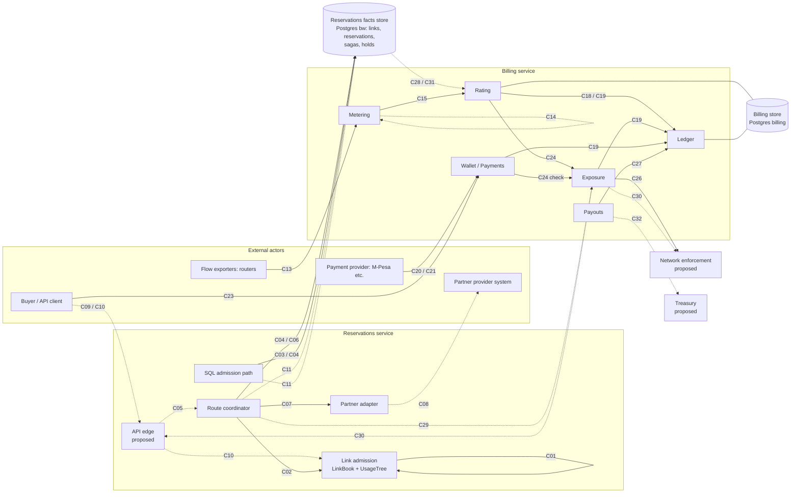
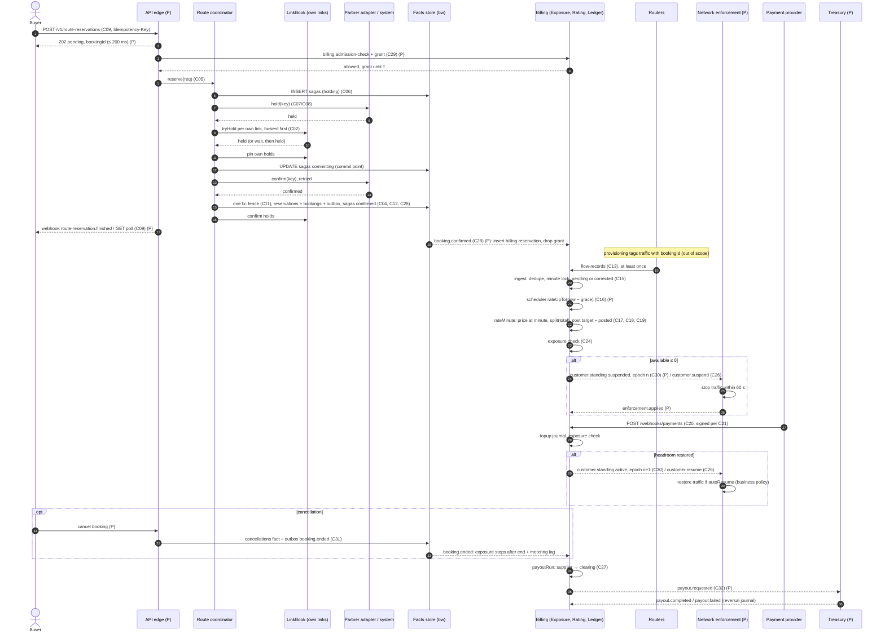

# Interfaces and contracts between components

> **Superseded.** This is a pre-baseline draft, kept for history only. It is not an authority. Its contract IDs do not match the C4 IDs. Use the frozen C4 contracts in [`contracts/`](contracts/) (C01 … C12, tags `contract-C01-v1` … `contract-C12-v1`).

Every interface that crosses a component boundary, as built in the prototype or as
proposed to close a gap. The [delivery plan](plan.md) says which increment introduces
each one. The RFCs say why each design was chosen; this document says exactly what goes
over the wire, who may write it, and what happens on retries, duplicates and timeouts.

**Status.** *Implemented* means the contract exists in the code today, with a file and
line reference. *Proposed* means it is not built; the schema and semantics given here
are the design to build. Some implemented contracts have proposed changes, listed under
the contract.

**Units.** These hold everywhere unless a contract says otherwise.

| Quantity | Unit and representation |
|---|---|
| Time inside the reservation side (tree, `LinkBook`, saga log) | Integer **minutes**, an offset from the start of the link's horizon `[0, n)`. The prototype coordinator maps minute `m` to `2026-01-01T00:00Z + m min` (`BASE`, `at()`, `src/routes.ts:20-22`) when it writes facts |
| Time in facts and billing | `timestamptz`; billing minutes are UTC minute starts, half-open `[m, m + 1 min)` |
| Time in JSON | ISO 8601 strings |
| Windows | Half-open `[start, end)`; `end = null` is open-ended |
| Rate | Integer **Mbps** (10⁶ bits per second) |
| Volume | Integer bytes; 1 GB = 10⁹ bytes |
| Money | Integer **micros** (10⁻⁶ of the currency unit), `bigint` in TypeScript and Postgres, decimal **strings** in JSON (`"5000000"`) |
| Durations | Milliseconds (`ttlMs`, `deadlineMs`, `expires_at` epoch ms) unless the name says seconds |

## Contents

- [Component map](#component-map)
- [Contract index](#contract-index)
- Reservation side: [C01](#c01-usagetree-api) · [C02](#c02-linkbook-api) ·
  [C03](#c03-sql-admission) · [C04](#c04-reservation-facts-tables) ·
  [C05](#c05-coordinatorreserve) · [C06](#c06-saga-log-and-recovery) ·
  [C07](#c07-partner-adapter-in-process) · [C08](#c08-partner-wire-protocol) ·
  [C09](#c09-buyer-route-reservation-api) · [C10](#c10-single-link-reservation-api) ·
  [C11](#c11-single-writer-per-link-fencing) · [C12](#c12-booking-identity-and-route-catalogue)
- Billing: [C13](#c13-flow-records-topic) · [C14](#c14-flow-records-dead-letter-topic) ·
  [C15](#c15-ingest-and-rating) · [C16](#c16-rating-watermark-scheduler) ·
  [C17](#c17-rates-and-rate-splits) · [C18](#c18-split) ·
  [C19](#c19-ledgerservice-and-the-ledger-tables) · [C20](#c20-payment-webhook) ·
  [C21](#c21-webhook-authentication-mismatch-and-zero-amounts) ·
  [C22](#c22-walletbalance-request-reply) · [C23](#c23-get-walletscustomerid) ·
  [C24](#c24-exposureservice) · [C25](#c25-billingadmission-check-request-reply) ·
  [C26](#c26-customersuspend-and-customerresume-events) · [C27](#c27-payout-run)
- Cross-system seams, all proposed: [C28](#c28-bookingconfirmed-reservations-to-billing) ·
  [C29](#c29-coordinator-consults-billing-before-admitting) ·
  [C30](#c30-enforcement-of-suspend-and-resume) ·
  [C31](#c31-cancellation-and-end-of-a-booking) ·
  [C32](#c32-payout-instructions-to-treasury) · [C33](#c33-currency-on-every-money-contract)
- [End-to-end sequence](#end-to-end-sequence)
- [Seams missing today](#seams-missing-today)

## Component map

Solid arrows exist in the prototype. Dashed arrows are proposed. Labels are contract IDs.



The two Postgres databases (`bw` and `billing`, `docker-compose.yml`, `src/sql.ts:4-5`,
`billing/src/billing.config.ts:9-10`) share a server in the prototype but no table,
no foreign key and no identifier. Every arrow from the left half to the right half is
therefore proposed.

## Contract index

| ID | Contract | Provider → Consumer | Transport | Status |
|---|---|---|---|---|
| C01 | `UsageTree` API | Link admission (tree) → `LinkBook`, tests | In-process call | Implemented |
| C02 | `LinkBook` API | Link admission → Route coordinator, Partner simulator | In-process call | Implemented |
| C03 | SQL `admit` | SQL admission path → its caller | In-process call over a Postgres transaction | Implemented |
| C04 | `links`, `reservations` facts | SQL path, Coordinator (writers) → Coordinator recovery, audits, C28 | Shared DB table | Implemented |
| C05 | `Coordinator.reserve` | Route coordinator → API edge (tests today) | In-process call | Implemented |
| C06 | `sagas`, `holds` and `recover` | Route coordinator → itself after a crash | Shared DB table (single owner) | Implemented |
| C07 | `PartnerLink` adapter | Partner adapter → Route coordinator | In-process call | Implemented (simulated partner) |
| C08 | Partner wire protocol | Partner system → Partner adapter | HTTP | Proposed |
| C09 | Buyer route reservation API, "pending" + webhook/poll (D16) | API edge → Buyer | HTTP + outbound webhook | Proposed |
| C10 | Single-link reservation API | API edge → Buyer | HTTP | Proposed |
| C11 | Single writer per link, fencing token | Link owner → facts store | Shared DB table | Proposed |
| C12 | Booking identity and route catalogue | Reservations → Billing, routers | Shared DB table + IDs in events | Proposed |
| C13 | `flow-records` topic, `FlowRecordDto` | Routers → Metering | Kafka event (fire-and-forget) | Implemented |
| C14 | `flow-records.dlq` | Metering → operators | Kafka event | Proposed |
| C15 | `ingest`, `rateUpTo`, `rerate`; `flow_records`, `minute_charges` | Metering, scheduler → Rating | In-process call, billing tables | Implemented |
| C16 | Rating watermark scheduler | Scheduler → Rating | In-process call | Proposed |
| C17 | `rates`, `rate_splits` | Pricing (writer) → Rating, Exposure | Shared DB table | Implemented (tables); writer proposed |
| C18 | `split()` | Ledger domain → Rating | In-process call | Implemented |
| C19 | `LedgerService.post/balance/balances`; `journals`, `entries` | Ledger → Rating, Wallet, Exposure, Payouts | In-process call, billing tables | Implemented |
| C20 | `POST /webhooks/payments`, `PaymentEventDto` | Wallet → Payment provider | HTTP | Implemented |
| C21 | Webhook authentication, content mismatch, zero amount | Wallet → Payment provider | HTTP | Proposed |
| C22 | `wallet.balance` | Wallet → any service | Kafka request-reply | Implemented |
| C23 | `GET /wallets/:customerId` | Wallet → Buyer, ops | HTTP | Implemented |
| C24 | `ExposureService.standing/check/canAdmit` | Exposure → Rating, Wallet | In-process call | Implemented |
| C25 | `billing.admission-check` | Exposure → Reservations | Kafka request-reply | Implemented, **defective** (see below) |
| C26 | `customer.suspend`, `customer.resume` | Exposure → Enforcement | Kafka event (fire-and-forget) | Implemented (producer only; no consumer) |
| C27 | Payout run | Ledger → Payouts / ops | In-process call | Implemented (ledger side only) |
| C28 | `booking.confirmed`: billing learns of a reservation | Reservations → Billing | Kafka event via outbox | Proposed |
| C29 | Coordinator consults billing before admitting | Billing → Coordinator | Kafka request-reply (C25) + headroom grant | Proposed |
| C30 | Enforcement of suspend/resume | Billing → Enforcement, Reservations | Kafka event via outbox | Proposed |
| C31 | `booking.ended`: cancellation and end feed exposure | Reservations → Billing | Kafka event via outbox | Proposed |
| C32 | Payout instructions | Payouts → Treasury | Kafka event via outbox | Proposed |
| C33 | Currency on every money contract | Billing ↔ all money consumers | Schema change | Proposed |

---

## Reservation side

### C01. UsageTree API

| | |
|---|---|
| Provider → Consumer | Link admission (`UsageTree`) → `LinkBook` (C02), the tree's own `admit`, tests |
| Transport | In-process call, single-threaded |
| Status | **Implemented**, `src/tree.ts:18-117` |
| Scenarios | P1-S01 to P1-S08, P1-S11 to P1-S14; underlies all of P2 |

```ts
// src/tree.ts
export type Decision =
  | { ok: true }
  | { ok: false; peak: number; conflicts: Array<[number, number]> };   // :18-20

export function checkWindow(s: number, e: number | null, n: number): void;  // :27-32, throws RangeError

export class UsageTree {
  readonly n: number;                                     // horizon [0, n), minutes
  constructor(n: number);
  addImpulse(t: number, v: number): void;                 // :50, t >= n is dropped
  usageAt(t: number): number;                             // :70, Mbps at minute t
  peak(s: number, e: number): number;                     // :75, max usage over [s, e)
  add(s: number, e: number | null, b: number): void;      // :80, b < 0 removes a pulse
  conflicts(s: number, e: number, limit: number): Array<[number, number]>; // :86, half-open minute ranges with usage > limit
  admit(s: number, e: number | null, b: number, capacity: number): Decision; // :107
}
```

**Semantics.** `admit` runs `checkWindow` (valid iff `0 ≤ s < n` integer and `e = null`
or `s < e ≤ n` integer), then admits iff `peak(s, e ?? n) + b ≤ capacity`. A rejection
carries the existing `peak` and every merged sub-range where `usage > capacity − b`. A
`RangeError` is a caller error and must be mapped to a 400 at the API edge, never to a
rejection. `peak` and `add` do not validate; only `admit` (and `LinkBook.tryHold`) do.

**Delivery, idempotency, ordering.** None: a synchronous call. `add` is not idempotent;
calling it twice books twice. Callers must apply each admission exactly once, which is
why the tree is wrapped by `LinkBook` keys or by the SQL facts.

**Ownership.** One owner per link, one thread (D9). Not safe to share.

**Timeouts.** O(log N) to admit, O(k log N) to explain; measured p99 3.1 µs.

### C02. LinkBook API

| | |
|---|---|
| Provider → Consumer | Link admission (`LinkBook`) → Route coordinator (C05), simulated partner (C07), recovery (C06) |
| Transport | In-process call; the async part is `changed()` |
| Status | **Implemented**, `src/links.ts:20-194` |
| Scenarios | P2-S04 to P2-S08, P2-S11, P2-S12, P2-S14, P2-S15, P2-S32 |

```ts
// src/links.ts
export type Ticket = readonly [startedAtMs: number, sagaId: number];               // :20
export const older = (a: Ticket, b: Ticket) => a[0] < b[0] || (a[0] === b[0] && a[1] < b[1]); // :22
export type Hold = { key: string; sagaId: number; ticket: Ticket; s: number; e: number | null;
                     mbps: number; expiresAt: number /* epoch ms */; pinned: boolean };  // :24-33
export type HoldRequest = Omit<Hold, 'expiresAt' | 'pinned'>;                       // :35
export type HoldOutcome =
  | { kind: 'held' }
  | { kind: 'reject'; peak: number; conflicts: Array<[number, number]> }
  | { kind: 'wait'; blockers: number[] };                                            // :37-40

class LinkBook {
  constructor(id: number, capacity: number, n: number, opts?: { woundWait?: boolean; clock?: () => number });
  onWound: (sagaId: number) => void;            // set by the coordinator
  tryHold(r: HoldRequest, ttlMs: number): HoldOutcome;   // :74-102
  has(key: string): boolean;                    // :111
  pin(key: string): boolean;                    // :117, false if the hold is gone
  confirm(key: string): void;                   // :126, throws if the hold is gone
  release(key: string): void;                   // :147, no-op if gone
  expire(): void;                               // :159
  nextExpiry(): number;                         // :172, epoch ms, Infinity if none
  changed(): Promise<void>;                     // :180
  addConfirmed(s: number, e: number | null, mbps: number): void;  // :135, recovery
  restoreHold(h: Hold): void;                   // :141, recovery
  peakUsage(): number;                          // :191, invariant check
}
```

**`tryHold` outcomes**, evaluated in this order:

| Step | Condition | Result |
|---|---|---|
| 1 | Window invalid for the horizon | throws `RangeError` (caller error) |
| 2 | — | `expire()` drops unpinned holds with `expiresAt ≤ now` |
| 3 | A hold with `r.key` exists | `held` (idempotent; parameters are **not** compared) |
| 4 | `confirmed.peak + mbps > capacity` | `reject {peak, conflicts}`: definite, confirmed reservations are never revoked |
| 5 | `total.peak + mbps > capacity` and wound-wait on | wound every saga with an unpinned, overlapping hold whose ticket is younger than `r.ticket`; each wounded saga's coordinator gets `onWound(sagaId)` |
| 6 | `total.peak + mbps ≤ capacity` | store the hold with `expiresAt = now + ttlMs`; `held` |
| 7 | otherwise | `wait {blockers}`: distinct saga ids of overlapping holds of other sagas |

**Other operations.** `pin` makes a hold immune to expiry and wounds; it is how the
coordinator records its commit decision on our links. `confirm` moves the hold into the
`confirmed` tree (total usage unchanged) and wakes waiters; it throws if the hold is gone,
so callers must only confirm a hold they pinned. `release` is idempotent. `changed()`
resolves at the next release, expiry (observed by a later call), wound or confirm; waiters
are woken FIFO. Expiry is lazy: it happens when `tryHold`, `has` or `pin` runs, so a
waiter must also sleep until `nextExpiry()`.

**Idempotency.** By hold key. The same key with different `s`, `e` or `mbps` returns
`held` for the old hold. This is safe only because keys are generated by the coordinator
(`${sagaId}.${attempt}.${linkId}`, `src/routes.ts:189`) and never reused for other
parameters; any other caller must keep that rule.

**Ownership.** The coordinator owns every `LinkBook` of our links. A book is not shared
with the SQL path (see C11).

**Timeouts.** Holds lapse after `ttlMs` (prototype 1,500 ms in tests, `docs/03-rfcs/RFC-002`
Parameters). Pinned holds never lapse.

### C03. SQL admission

| | |
|---|---|
| Provider → Consumer | SQL admission path → its caller (tests today; C10 proposed) |
| Transport | In-process call that runs one Postgres transaction |
| Status | **Implemented**, `src/sql.ts:43-80` |
| Scenarios | P1-S02, P1-S04, P1-S05, P1-S06, P1-S10, P1-S11, P1-S15 |

```ts
// src/sql.ts
export type Request = { linkId: number; start: Date; end: Date | null; mbps: number };  // :45
export type SqlDecision = { ok: true } | { ok: false; peak: number };                   // :43
export const admit: (db: pg.Pool, r: Request) => Promise<SqlDecision>;                   // :80
export function maxUsage(db: pg.Pool, linkId: number): Promise<number>;                 // :89, invariant
```

**Semantics.** `BEGIN` (READ COMMITTED, the default; not pinned explicitly), `SELECT
capacity_mbps FROM links WHERE id = $1 FOR UPDATE`, compute `PEAK_SQL` (`:21-41`), then
`ROLLBACK` with `{ok: false, peak}` or `INSERT INTO reservations` and `COMMIT`. Differences
from C01 that callers must know: no horizon check (any `end > start` is accepted, enforced
only by the table's `CHECK`); open-ended means "forever", not "to the horizon"; no
conflicting sub-ranges in a rejection; an unknown `linkId` throws a `TypeError` on
`link.rows[0]` rather than a clean error.

**Idempotency.** **None.** A caller that retries after a lost response books twice. C10
adds an idempotency key.

**Ownership.** Writes `reservations` under the link-row lock. Correct only if every writer
to that link takes the same lock first, which the coordinator does not (C11).

**Timeouts.** None set. Measured p99 115.5 ms under 50 clients on one link, mostly lock
queueing. The API edge must impose a statement or lock timeout inside the 200 ms budget.

**Proposed changes.** Set `READ COMMITTED` explicitly on the transaction (RFC-001 risk);
validate windows at the API edge as in C01; take the fencing step of C11.

### C04. Reservation facts tables

| | |
|---|---|
| Provider → Consumer | Writers: SQL path (C03), Coordinator `writeFacts`. Readers: coordinator recovery (C06), `maxUsage`, audits, proposed outbox relay (C28) |
| Transport | Shared DB table, database `bw` |
| Status | **Implemented**, `schema.sql:6-21` |
| Scenarios | P1-S05, P1-S10, P1-S15, P2-S01, P2-S23, P2-S29, P2-S32 |

```sql
-- schema.sql
CREATE TABLE links (
  id             bigint PRIMARY KEY,
  capacity_mbps  integer NOT NULL CHECK (capacity_mbps > 0)
);

CREATE TABLE reservations (
  id             bigint GENERATED ALWAYS AS IDENTITY PRIMARY KEY,
  link_id        bigint NOT NULL REFERENCES links,
  start_time     timestamptz NOT NULL,
  end_time       timestamptz,                       -- NULL = open-ended
  reserved_mbps  integer NOT NULL CHECK (reserved_mbps > 0),
  recorded_at    timestamptz NOT NULL DEFAULT now(),
  CHECK (end_time IS NULL OR end_time > start_time) -- half-open [start, end)
);
CREATE INDEX reservations_link_start ON reservations (link_id, start_time);
```

**Semantics.** One row per accepted reservation **per link** (D10). Rejected requests are
never stored. A route of `k` links writes `k` rows in one transaction
(`src/routes.ts:342-368`). Partner links are rows of `links` too (the `holds` foreign key
requires it); their facts mirror what the partner confirmed.

**What the facts do not carry, and every downstream consumer needs:** the customer, the
route, the saga or booking the leg belongs to, and any cancellation. Two legs of the same
route are indistinguishable from two unrelated single-link reservations. C12 adds these.

**Idempotency.** None at the table: identity is generated. Duplicate protection comes from
the writers (link lock for C03; saga status and hold keys for the coordinator).

**Ownership.** Append-only by convention; no trigger enforces it (contrast billing's
`forbid_mutation`). Proposed: an append-only trigger, and every writer passing C11's
fence.

### C05. Coordinator.reserve

| | |
|---|---|
| Provider → Consumer | Route coordinator → API edge (C09, proposed); tests today |
| Transport | In-process call returning a promise |
| Status | **Implemented**, `src/routes.ts:24-37, 122-220` |
| Scenarios | P2-S01 to P2-S03, P2-S10, P2-S13, P2-S16 to P2-S21, P2-S28 to P2-S32 |

```ts
// src/routes.ts
export type RouteRequest = {
  idemKey: string;
  links: number[];        // ordered; order is part of the idempotency comparison
  s: number;              // minutes
  e: number | null;       // minutes, null = open-ended
  mbps: number;
};                                                                        // :24-30

export type RouteResult =
  | { status: 'confirmed'; sagaId: number; restarts: number }
  | { status: 'rejected'; sagaId: number; linkId: number; conflicts: Array<[number, number]> }
  | { status: 'failed'; sagaId: number; reason: string }                  // 'deadline', 'coordinator crashed', ...
  | { status: 'pending'; sagaId: number }                                 // key known, no result yet
  | { status: 'crashed'; sagaId: number };                                // test-only: simulated crash
                                                                          // :32-37
type Options = { holdTtlMs: number; deadlineMs: number; random: () => number; /* test hooks */ };

class Coordinator {
  reserve(req: RouteRequest): Promise<RouteResult>;                        // :122
}
```

**Semantics.** Validation first (`:123-131`): every link must be known and the window valid
on it, or the promise rejects with `RangeError` before any saga row exists. Then the saga
of RFC-002: partner leg first, own legs busiest first, `wait` on held capacity until the
deadline, pin, `committing`, partner confirm, facts. Outcomes:

| Result | Meaning | Buyer-facing meaning (C09) |
|---|---|---|
| `confirmed` | Every leg is a fact | Booked |
| `rejected` | A leg does not fit on **confirmed** capacity; `linkId` and `conflicts` say where (`conflicts` is `[]` for a partner `nofit`) | Definitely not bookable for this window |
| `failed`, `reason: 'deadline'` | Still waiting at `deadlineMs` | Try again later |
| `failed`, other reasons | Recovery failed the saga | Try again; nothing booked |
| `pending` | Another process is running this key | Poll |
| `crashed` | Test artefact | Never exposed |
| promise rejects `RangeError` | Invalid window or unknown link | 400 |
| promise rejects `Error('idempotency key … reused for a different request')` | Same key, other parameters | 409 |

**Idempotency.** Key `idemKey`. Same key and same `(links in order, s, e, mbps)`: the same
in-flight promise (`:132-136`) or, across processes and restarts, the stored `result`
(`:168-177`); `pending` if there is none yet. Same key, different parameters: error, both
in memory and after a restart (P2-S30).

**Ordering.** None between requests; priority is by ticket (C02).

**Timeouts.** The promise resolves only when the saga finishes, at most about `deadlineMs`
(20,000 ms in tests) plus partner confirm retries, which have **no bound** after the
commit point (`retry`, `:320-330`). This is why the buyer-facing API must not block on it
(C09).

**Gaps.** No customer, no route id, no buyer-visible booking id (C12); no billing check
(C29); the in-flight map is never pruned (RFC-002 risk 11).

### C06. Saga log and recovery

| | |
|---|---|
| Provider → Consumer | Route coordinator → itself (another instance after a crash); read by C05's idempotency lookup |
| Transport | Shared DB tables in `bw`, single owner |
| Status | **Implemented**, `schema-routes.sql:3-27`, `src/routes.ts:332-339, 342-368, 371-456` |
| Scenarios | P2-S21 to P2-S27, P2-S29 to P2-S31 |

```sql
-- schema-routes.sql
CREATE TABLE sagas (
  id          bigint GENERATED ALWAYS AS IDENTITY PRIMARY KEY,
  idem_key    text NOT NULL UNIQUE,              -- client retries map to the same saga
  ticket_ms   bigint NOT NULL,                   -- priority ticket (D17): start time, then id
  links       bigint[] NOT NULL,
  start_min   integer NOT NULL,
  end_min     integer,                           -- NULL = open-ended
  mbps        integer NOT NULL CHECK (mbps > 0),
  status      text NOT NULL CHECK (status IN ('holding', 'committing', 'confirmed', 'rejected', 'failed')),
  result      jsonb,                             -- a RouteResult once final
  restarts    integer NOT NULL DEFAULT 0
);

CREATE TABLE holds (
  key         text PRIMARY KEY,                  -- `${sagaId}.${attempt}.${linkId}`
  saga_id     bigint NOT NULL REFERENCES sagas,
  link_id     bigint NOT NULL REFERENCES links,
  start_min   integer NOT NULL,
  end_min     integer,
  mbps        integer NOT NULL,
  expires_at  bigint NOT NULL,                   -- epoch ms
  status      text NOT NULL CHECK (status IN ('held', 'confirmed', 'released'))
);
CREATE INDEX holds_saga ON holds (saga_id);
```

**Semantics.** The status machine of RFC-002. Invariants the coordinator maintains and
recovery relies on:

- `committing` is written only after every own leg is pinned; a restart resets the status
  to `holding` **before** releasing anything (`:227-235`).
- Facts, `holds.status = 'confirmed'` and `sagas.status = 'confirmed'` commit in one
  transaction (`:342-368`).
- `recover()` (`:416-456`): load facts into both trees; restore `held` hold rows of
  `holding` and `committing` sagas with original expiry, pinned for `committing`; mark
  every `holding` saga `failed` (`'coordinator crashed'`); roll every `committing` saga
  forward, failing it if any leg's hold is missing or the partner answers `unknown-hold`.

**Idempotency.** `INSERT … ON CONFLICT (idem_key) DO NOTHING` for sagas, `ON CONFLICT
(key) DO NOTHING` for holds.

**Ownership.** The coordinator is the only writer and reader. With more than one
coordinator, two must never drive the same saga; today nothing prevents it, and recovery
assumes it runs alone. C11's lease covers this.

### C07. Partner adapter (in-process)

| | |
|---|---|
| Provider → Consumer | Partner adapter (`PartnerLink`) → Route coordinator |
| Transport | In-process call; the prototype simulates the partner in memory |
| Status | **Implemented** (simulated), `src/partner.ts:13-70` |
| Scenarios | P2-S01, P2-S02, P2-S18 to P2-S21, P2-S23, P2-S26, P2-S32 |

```ts
// src/partner.ts
export class PartnerError extends Error {}                       // :13, error or timeout: retry as is
export type PartnerHold = 'held' | 'busy' | 'nofit';             // :15
export type PartnerConfirm = 'confirmed' | 'unknown-hold';       // :16

class PartnerLink {
  readonly id: number;   // the partner link's id in `links`
  hold(key: string, s: number, e: number | null, mbps: number, ttlMs: number): Promise<PartnerHold>; // :50
  confirm(key: string): Promise<PartnerConfirm>;                 // :57
  release(key: string): Promise<void>;                           // :67
}
```

**Outcomes and the coordinator's response.**

| Answer | Meaning | Coordinator (`src/routes.ts`) |
|---|---|---|
| `hold` → `held` | The partner holds the capacity for `ttlMs` | record the hold row, continue (`:290-293`) |
| `hold` → `busy` | Fits on the partner's confirmed capacity, not with its current holds | sleep 5–20 ms and ask again (`:295`); never a rejection on its own (P2-S19) |
| `hold` → `nofit` | Does not fit even on confirmed capacity | reject the route naming the partner link, `conflicts: []` (`:294`, P2-S20) |
| `confirm` → `confirmed` | Booked at the partner; a repeat for a confirmed key also returns this | write facts |
| `confirm` → `unknown-hold` | The partner's hold lapsed | `restart` (live) or `failed` (recovery) |
| `release` | Always succeeds, also for unknown keys | — |
| throws `PartnerError` | Error before work, or timeout after work | retry the same call with the same key after `min(50, 2^attempt) × random()` ms (`:320-330`) |
| throws anything else | Bug or invalid window | propagates; the saga's promise rejects |

**Idempotency.** Every call carries the hold key. `hold` with a known key returns `held`
without comparing parameters (it is `LinkBook.tryHold`); `confirm` is remembered per key;
`release` is a no-op when gone.

**Timeouts.** The simulated partner has random latency up to `maxLatencyMs` and no per-call
timeout on our side; retries are unbounded. The partner's hold uses the same `ttlMs` as
ours, so it is the first to lapse (RFC-002 risk 5).

### C08. Partner wire protocol

| | |
|---|---|
| Provider → Consumer | Partner system → Partner adapter (one adapter per partner, mapping to C07) |
| Transport | HTTP (JSON). Real partners differ; this is the shape the adapter needs, to be mapped per partner |
| Status | **Proposed** |
| Scenarios | P2-S18 to P2-S21, P2-S26 |

```http
PUT /holds/{holdKey}
{ "linkRef": "MRS-DJI-1", "start": "2026-03-01T10:00:00Z", "end": "2026-03-01T20:00:00Z",
  "mbps": 400, "ttlMs": 120000 }
→ 200 { "status": "held", "expiresAt": "2026-03-01T09:42:00Z" }
→ 409 { "status": "busy", "retryAfterMs": 50 }
→ 422 { "status": "nofit" }

POST /holds/{holdKey}/confirm
→ 200 { "status": "confirmed", "partnerReservationId": "P-778812" }
→ 404 { "status": "unknown-hold" }

DELETE /holds/{holdKey}
→ 204          (also when the key is unknown)
```

**Mapping to C07.** 5xx, connection errors and our per-call timeout of **2 s** become
`PartnerError` (retry). Other 4xx are non-retryable: before the commit point the saga
finishes `failed` with `reason: 'partner-error'` and releases; after it, the saga alerts
and keeps retrying, since it must roll forward.

**Idempotency.** `holdKey` is the idempotency key for all three calls. The partner must
return the original answer for a repeated `PUT` with the same body, and must refuse (409
`key-reused`) the same key with a different body. `partnerReservationId` is stored with
the leg's fact (C12) for reconciliation.

**Timeouts and deadlines.** Request a partner hold TTL of at least `deadlineMs` plus the
commit window (D22), not our own `holdTtlMs`. Before the commit point retries stop at the
saga deadline; after it they are bounded by an alert threshold, not by giving up.

**Open.** Partners that only offer an immediate, final booking (P2 open question 6) cannot
implement `PUT /holds`. Partners with several links on one route need a fixed order among
themselves (RFC-002 risk 6).

### C09. Buyer route reservation API

| | |
|---|---|
| Provider → Consumer | API edge (Reservations) → Buyer, including AI agents |
| Transport | HTTP request; result by polling or by an outbound webhook |
| Status | **Proposed**. The D16 contract ("pending" within 200 ms, then webhook or poll) is designed in RFC-002 but not built; `reserve` blocks until the saga ends |
| Scenarios | P2-S09, P2-S28 to P2-S31; P2-S03 at the edge |

```http
POST /v1/route-reservations
Authorization: Bearer <buyer token>          -- determines customerId
Idempotency-Key: 7f1c2e4a-...                -- required, ≤ 128 chars
{ "routeId": "NBO-MBA-JIB-MRS",              -- C12 catalogue; links are taken from it
  "start": "2026-03-01T10:00:00Z",           -- minute-aligned
  "end": "2026-03-01T20:00:00Z",             -- or null
  "mbps": 400,
  "callbackUrl": "https://buyer.example/hooks/share" }   -- optional

→ 202 within 200 ms
{ "bookingId": "bk_01J9Z...", "status": "pending",
  "poll": "/v1/route-reservations/7f1c2e4a-..." }
→ 200 if the key already has a final result (same body as GET)
→ 400 { "error": "invalid-window", "detail": "end ... must be after start ... and at most ..." }
→ 409 { "error": "idempotency-key-reused" }

GET /v1/route-reservations/{idempotencyKey}
→ 200 RouteReservationView
```

```ts
type RouteReservationView = {
  bookingId: string;
  idempotencyKey: string;
  status: 'pending' | 'confirmed' | 'rejected' | 'refused' | 'failed';
  routeId: string;
  links: number[];
  start: string; end: string | null; mbps: number;
  rejection?: { linkId: number; conflicts: { start: string; end: string }[] };   // from RouteResult.rejected
  refusal?: { reason: 'insufficient-headroom' | 'customer-suspended'; availableMicros: string }; // C29
  failure?: { reason: 'deadline' | 'coordinator-crashed' | 'partner-hold-lapsed' | 'partner-error' | string };
  updatedAt: string;
};
```

Outbound webhook, on every transition to a final status:

```http
POST {callbackUrl}
X-Share-Signature: t=1767261600,v1=<hex HMAC-SHA256 of "t.body" with the buyer's secret>
{ "eventId": "evt_01J9Z...", "type": "route-reservation.finished",
  "occurredAt": "2026-03-01T09:40:02Z", "reservation": RouteReservationView }
```

**Semantics.** The edge validates (window, route, mbps), records the request under its
idempotency key and booking id, answers `pending`, and only then runs C29 and starts the
saga, so neither the billing check nor the saga counts against the 200 ms. The saga's final
`RouteResult` is mapped as in C05. `crashed` is never exposed; a saga failed by recovery is
`failed`. Minutes are converted to timestamps using the link horizon base.

**Delivery.** Webhook at least once, retried with exponential backoff for 24 h; the buyer
deduplicates by `eventId`. Polling is always available and authoritative.

**Idempotency.** As C05, keyed by `(customerId, Idempotency-Key)`; the comparison covers
`routeId`, `start`, `end`, `mbps`. `callbackUrl` is not part of the comparison.

**Timeouts.** 202 within 200 ms p99. The saga's own deadline (about a minute, D13) bounds
`pending`.

### C10. Single-link reservation API

| | |
|---|---|
| Provider → Consumer | API edge → Buyer |
| Transport | HTTP, synchronous |
| Status | **Proposed** (the admission engines exist: C01/C02 in memory, C03 in SQL) |
| Scenarios | P1-S01 to P1-S15 at the API edge, P1-S09 end to end |

```http
POST /v1/links/{linkId}/reservations
Idempotency-Key: ...
{ "start": "2026-03-01T10:00:00Z", "end": null, "mbps": 3 }

→ 201 { "bookingId": "bk_...", "status": "confirmed" }
→ 200 { "status": "rejected", "peakMbps": 10,
        "conflicts": [ { "start": "...", "end": "..." } ] }        -- conflicts only from C01/C02
→ 400 { "error": "invalid-window" }
→ 409 { "error": "idempotency-key-reused" }
```

**Semantics.** The request goes to the link's single owner (C11). If the owner is the
coordinator's `LinkBook`, it is `tryHold` then `pin` + facts + `confirm` immediately, i.e.
a route of one link with no partner. The `wait` outcome (fits only if a route's holds
release) has no agreed answer within 200 ms: that is a business decision (plan,
"Decisions"). Until it is made, the default is to answer `200 {"status": "busy",
"retryAfterMs": nextExpiry − now}`, which is a policy hook, not a guarantee. A rejection is
a 200 with a body, not an error.

**Idempotency.** `(customerId, Idempotency-Key)`, stored with the booking; same key with a
different body is 409. This closes the gap in C03.

**Timeouts.** p99 ≤ 200 ms (P1-S09). The edge sets a lock timeout well inside that.
Because this path is synchronous, the billing check (C29) must run inside the same budget:
proposed deadline 80 ms for C29 here, with the timeout outcome being the same business
decision as in C29.

### C11. Single writer per link (fencing)

| | |
|---|---|
| Provider → Consumer | Link owner (coordinator instance, or SQL path) → facts store (C04) |
| Transport | Shared DB table, checked inside every fact-writing transaction |
| Status | **Proposed**. RFC-001 risk "single owner per link" and RFC-002 risk 4 (D30) |
| Scenarios | P1-S10 and P2-S32 when both paths are live; a new scenario is needed ("the SQL path and the coordinator writing to the same link never oversell it") |

Today the SQL path decides under the link-row lock and the coordinator decides under its
in-memory `LinkBook`; each can admit against a schedule the other has changed. A second
coordinator instance, or a stale one after a pause, has the same problem.

```sql
ALTER TABLE links
  ADD COLUMN owner             text,                     -- e.g. 'coordinator:<instance>' or 'sql'
  ADD COLUMN owner_epoch       bigint NOT NULL DEFAULT 0,
  ADD COLUMN lease_expires_at  timestamptz,
  ADD COLUMN seq               bigint NOT NULL DEFAULT 0; -- D10's per-link sequence

ALTER TABLE reservations ADD COLUMN link_seq bigint;     -- NOT NULL once backfilled
CREATE UNIQUE INDEX reservations_link_seq ON reservations (link_id, link_seq);

-- Acquire or renew (owner process, every lease/3):
UPDATE links
   SET owner = $me, owner_epoch = owner_epoch + CASE WHEN owner = $me THEN 0 ELSE 1 END,
       lease_expires_at = now() + interval '10 seconds'
 WHERE id = $1 AND (owner = $me OR lease_expires_at IS NULL OR lease_expires_at < now())
RETURNING owner_epoch;

-- Fence, first statement of every fact-writing transaction, once per link written:
UPDATE links SET seq = seq + 1
 WHERE id = $1 AND owner = $me AND owner_epoch = $epoch
RETURNING seq;          -- 0 rows: fenced. ROLLBACK, stop serving the link, rebuild from facts.
```

**Semantics.** Exactly one owner per link at a time. Only the owner admits on that link,
and every fact it writes carries the new `seq`. A process that lost its lease (paused,
partitioned) fails the fence on its next write and cannot commit. A new owner rebuilds
the link's book from the facts (as `recover` does) before admitting. The SQL path either
owns a disjoint set of links (`owner = 'sql'`, and its `FOR UPDATE` lock is then
sufficient) or is retired; a route over a SQL-owned link is not possible without holds on
that path. The saga log uses the same lease: only the owner of all of a saga's own links
may drive or recover it.

**Idempotency.** `UNIQUE (link_id, link_seq)` makes a replayed fact write fail.

**Timeouts.** Lease 10 s, renewed every ~3 s; failover after at most the lease.

### C12. Booking identity and route catalogue

| | |
|---|---|
| Provider → Consumer | Reservations → Billing (C28), routers (via provisioning), buyer (C09/C10) |
| Transport | Shared DB tables in `bw`; the id travels in C13, C28, C31 |
| Status | **Proposed** |
| Scenarios | Prerequisite for P3-S21 and P3-S22 end to end; every P3 scenario in production |

Today there is no shared identifier. `bw.reservations.id` is a `bigint` per link leg;
`billing.reservations.id` is `text` per billed reservation with a `customer_id` and
`route_id` that the reservation side does not know; `RouteRequest` has neither a customer
nor a route id. Flow records name a `reservationId` that only billing's test harness
creates (`billing/test/harness.ts:87-92`).

**The booking** is the billable unit: one buyer's purchase of one rate over one window on
one route (a single-link reservation is a route of one link). Its id is the
`reservationId` everywhere in billing.

```sql
-- bw
CREATE TABLE routes (                        -- the catalogue billing prices against
  id     text PRIMARY KEY,                   -- = billing rates.route_id
  links  bigint[] NOT NULL                   -- ordered
);

CREATE TABLE bookings (
  id             text PRIMARY KEY,           -- 'bk_' || UUIDv7, assigned when the request is accepted
  customer_id    text NOT NULL,
  route_id       text NOT NULL REFERENCES routes,
  saga_id        bigint UNIQUE REFERENCES sagas,   -- NULL for single-link bookings
  start_time     timestamptz NOT NULL,
  end_time       timestamptz,
  reserved_mbps  integer NOT NULL CHECK (reserved_mbps > 0),
  confirmed_at   timestamptz NOT NULL
);

ALTER TABLE reservations ADD COLUMN booking_id text REFERENCES bookings;   -- one per leg
ALTER TABLE reservations ADD COLUMN partner_reservation_id text;           -- C08, partner legs
ALTER TABLE sagas ADD COLUMN customer_id text, ADD COLUMN route_id text, ADD COLUMN booking_id text;
```

**Semantics.** `bookings` is written in the same transaction as the facts
(`writeFacts`), so a booking exists iff all its legs do. The id is assigned before the
saga starts and returned in the 202 (C09), so it is stable across restarts of the saga.
Routers learn it from provisioning, which consumes C28 (provisioning itself is out of
scope, P2).

**Ownership.** Reservations writes; billing never reads `bw` directly, only C28/C31
events.

---

## Billing

### C13. flow-records topic

| | |
|---|---|
| Provider → Consumer | Flow exporters (routers, or a collector in front of them) → Metering |
| Transport | Kafka event, fire-and-forget; `@EventPattern('flow-records')` |
| Status | **Implemented**, `billing/src/metering/flow-record.dto.ts:5-12`, `billing/src/metering/metering.controller.ts:19-25`, topic name `billing/src/exposure/events.ts:10` |
| Scenarios | P3-S01, P3-S02, P3-S04 to P3-S06, P3-S24 to P3-S27 |

```ts
// billing/src/metering/flow-record.dto.ts
export class FlowRecordDto {
  @IsString() @IsNotEmpty() exporterId: string;
  @IsInt() @Min(0) sequence: number;
  @IsString() @IsNotEmpty() reservationId: string;   // the booking id (C12)
  @IsInt() @Min(0) bytes: number;
  @Type(() => Date) @IsDate() eventTime: Date;       // flow END time, ISO 8601 on the wire
}
```

```json
{ "exporterId": "rtr-nbo-01", "sequence": 7, "reservationId": "res1",
  "bytes": 1000000000, "eventTime": "2026-01-01T12:05:50Z" }
```

**Semantics.** Validated by the global `ValidationPipe({transform, whitelist})`, inherited
by the Kafka transport (`billing/src/main.ts:16, 30`); unknown fields are stripped. Then
`RatingService.ingest` (C15). No reply.

**Delivery.** At least once: Nest awaits the handler before kafkajs commits the offset, so
a crash mid-handler redelivers. **Partition key:** the producer should key by `exporterId`
(the end-to-end test does); ordering is not relied on. Consumer group `KAFKA_GROUP_ID`
(Nest appends `-server`), `fromBeginning: true` so a new group starts at the oldest record
(`main.ts:23-26`, P3-S27).

**Idempotency.** Key `(exporterId, sequence)`, the primary key of `flow_records`. A
duplicate returns `duplicate` and changes nothing (P3-S01, P3-S13). **Same key, different
contents** (other bytes, time or reservation) is also dropped silently: the first record
wins and the conflict is invisible. Over the system's life the key can repeat genuinely
(32-bit sequence wrap, exporter restart; RFC-003 risk 9): the key needs an epoch, e.g.
`exporterId = '<router>:<observation domain>:<boot time>'`.

**Errors.** A malformed payload fails validation; a record for an unknown reservation
fails the foreign key inside `ingest`. Either way the handler throws, the offset is not
committed and the record is retried, which can stall the partition (RFC-003 risk 8, not
tested). C14 fixes this.

**Ownership.** Exporters write; only Metering consumes.

### C14. flow-records dead-letter topic

| | |
|---|---|
| Provider → Consumer | Metering → operators, a replay tool |
| Transport | Kafka event |
| Status | **Proposed** |
| Scenarios | P3-S24, P3-S25 |

Topic `flow-records.dlq`, same key as the original message.

```ts
type FlowRecordDeadLetter = {
  sourceTopic: 'flow-records';
  partition: number;
  offset: string;                  // Kafka offsets exceed 2^53
  key: string | null;
  rawValue: string;                // the message value exactly as received (UTF-8)
  reason: 'validation' | 'unknown-reservation' | 'conflicting-duplicate';
  errors: string[];                // class-validator messages, or the database error
  failedAt: string;                // ISO 8601
};
```

**Semantics.** The handler validates the raw payload itself (instead of relying on the
pipe, which throws before the handler runs), and classifies failures:

| Failure | Action |
|---|---|
| Validation fails | publish to the DLQ, then return (offset commits) |
| `reservationId` unknown | publish to the DLQ with `unknown-reservation`, and also park it for replay when C28 delivers the booking (bookings and flow records race) |
| Same `(exporterId, sequence)` with different contents | store nothing, publish `conflicting-duplicate` |
| Database unavailable, deadlock, timeout | **not** dead-lettered: throw, let Kafka redeliver with backoff |

If publishing to the DLQ fails, the handler throws, so nothing is lost. Records behind a
bad one keep flowing (P3-S25).

**Delivery.** At least once; DLQ consumers deduplicate by `(partition, offset)`.

**Ownership.** Metering writes; operators own inspection and replay. Retention ≥ the
maximum lateness agreed with the business.

### C15. Ingest and rating

| | |
|---|---|
| Provider → Consumer | Rating (`RatingService`) → Metering controller (C13), scheduler (C16), pricing correction (C17) |
| Transport | In-process call; each runs its own `READ COMMITTED` transactions (`billing/src/database/database.module.ts:17-31`) |
| Status | **Implemented**, `billing/src/rating/rating.service.ts:18-155`, tables `billing/schema.sql:37-55` |
| Scenarios | P3-S01 to P3-S16 |

```ts
// billing/src/rating/rating.service.ts
export type IngestResult = 'duplicate' | 'pending' | 'corrected';      // :18
ingest(r: FlowRecord): Promise<IngestResult>;                          // :39
rateUpTo(watermark: Date): Promise<number>;                            // :66, rows considered
rerate(routeId: string, from: Date, to: Date): Promise<void>;          // :97
```

```sql
-- billing/schema.sql
CREATE TABLE flow_records (
  exporter_id     text NOT NULL,
  sequence        bigint NOT NULL,
  reservation_id  text NOT NULL REFERENCES reservations,
  bytes           bigint NOT NULL CHECK (bytes >= 0),
  event_time      timestamptz NOT NULL,     -- router's flow end time
  received_at     timestamptz NOT NULL DEFAULT now(),
  PRIMARY KEY (exporter_id, sequence)
);                                          -- append-only trigger, :102-103

CREATE TABLE minute_charges (
  reservation_id  text NOT NULL REFERENCES reservations,
  minute          timestamptz NOT NULL,
  rated_at        timestamptz NOT NULL DEFAULT now(),
  PRIMARY KEY (reservation_id, minute)
);
```

**Semantics.**

- `ingest`: minute = `floor(eventTime)` to the minute (D28); insert `ON CONFLICT DO
  NOTHING` (0 rows → `duplicate`); take the minute lock
  `pg_advisory_xact_lock(hashtextextended(reservation_id || '|' || minute, 0))` (`:23`);
  if the minute has a `minute_charges` row, re-rate it (`corrected`) and, after commit,
  run `ExposureService.checkReservation`; else `pending`.
- `rateUpTo(w)`: every (reservation, minute) with records, `minute + 1 min ≤ w` and no
  `minute_charges` row; per minute, lock, insert the marker (0 rows → another rater won,
  skip, P3-S16), rate. Then one exposure check per touched reservation.
- `rerate(route, from, to)`: re-rate every charged minute of the route in `[from, to)`.
  **It does not run an exposure check afterwards**, although RFC-003 says the check runs
  "after every correction"; a price correction that lowers charges therefore cannot lift a
  suspension until the next charge or top-up.
- `rateMinute` (private, `:120-155`): total bytes of the minute → price at the minute's
  start (C17) → `chargeMicros` half-up → `split(total)` + `wallet:<customer> = −total`
  → post `target − posted` as `charge` (nothing posted before) or `correction` (C19).

**Isolation is part of the contract.** `READ COMMITTED` is required: lock, then read with
a fresh snapshot (D12, D26).

**Ownership.** Rating is the only writer of `flow_records` and `minute_charges`, and the
only poster of `charge` and `correction` journals.

### C16. Rating watermark scheduler

| | |
|---|---|
| Provider → Consumer | Scheduler (in the billing process) → Rating (`rateUpTo`) |
| Transport | In-process call on a timer |
| Status | **Proposed**. Today only tests call `rateUpTo` (RFC-003 risk 3) |
| Scenarios | P3-S07 in production; the exposure bound P3-S17 depends on its settings |

```ts
type RatingSchedulerConfig = {
  RATING_INTERVAL_SECONDS: number;  // default 10
  RATING_GRACE_SECONDS: number;     // default 60: how long a minute waits for late records
};
// every RATING_INTERVAL_SECONDS, while holding pg_try_advisory_lock(hashtext('rating-scheduler')):
//   await rating.rateUpTo(new Date(Date.now() - RATING_GRACE_SECONDS * 1000))
```

**Semantics.** One active scheduler (advisory lock; others idle). Records later than the
grace are still charged, as corrections. **Constraint, checked at start-up:**
`METERING_LAG_SECONDS ≥ 60 (bucket) + RATING_GRACE_SECONDS + RATING_INTERVAL_SECONDS +
transport p99`. The defaults give 60 + 60 + 10 = 130 s plus transport, inside 180 s (D27).

### C17. Rates and rate splits

| | |
|---|---|
| Provider → Consumer | Pricing (writer) → Rating (`RatesService.rateAt`), Exposure (current price) |
| Transport | Shared DB tables in `billing` |
| Status | **Implemented** tables and reader, `billing/schema.sql:19-34`, `billing/src/rating/rates.service.ts:18-31`. **Writer proposed**: today only tests insert rates (`billing/test/harness.ts:68-85`) |
| Scenarios | P3-S08 to P3-S10, P4-S13, P4-S21 |

```sql
CREATE TABLE rates (
  id                   bigint GENERATED ALWAYS AS IDENTITY PRIMARY KEY,
  route_id             text NOT NULL,                 -- = bw routes.id (C12)
  effective_from       timestamptz NOT NULL,
  version              integer NOT NULL DEFAULT 1,
  price_micros_per_gb  bigint NOT NULL CHECK (price_micros_per_gb >= 0),
  UNIQUE (route_id, effective_from, version)
);
CREATE TABLE rate_splits (
  rate_id  bigint NOT NULL REFERENCES rates,
  account  text NOT NULL,                             -- 'supplier:<id>' or 'revenue:share'
  weight   integer NOT NULL CHECK (weight > 0),
  PRIMARY KEY (rate_id, account)
);
```

**Semantics.** `rateAt(route, t)`: latest `effective_from ≤ t`, then highest `version`;
throws `no rate for route … at …` if none (the minute's transaction fails). A later
`effective_from` is a price change; a higher `version` at the same `effective_from` is a
correction, after which `rerate(route, effective_from, next effective_from)` must run.
Exposure uses the rate with `effective_from ≤ now()` and returns 0 exposure for a route
with no rate (`exposure.service.ts:32-42`), which silently under-bounds the risk.

**Proposed writer.**

```http
POST /admin/routes/{routeId}/rates
{ "effectiveFrom": "2026-03-01T00:00:00Z",       -- must be minute-aligned (P3-S09)
  "version": 2,                                  -- omit for a new price; >1 is a correction
  "priceMicrosPerGb": "10000",
  "splits": [ { "account": "supplier:A", "weight": 3000 }, { "account": "revenue:share", "weight": 1500 } ] }
→ 201 { "rateId": "42", "rerated": { "from": "...", "to": "..." } }
```

Inserts `rates` and `rate_splits` in one transaction, rejects non-minute-aligned
`effectiveFrom` and an empty split, and triggers `rerate` for a correction. Both tables
get the append-only trigger. Idempotency: `UNIQUE (route_id, effective_from, version)`;
the same triple with different contents is 409.

### C18. split()

| | |
|---|---|
| Provider → Consumer | Ledger domain (`billing/src/domain/split.ts`) → Rating |
| Transport | In-process pure function |
| Status | **Implemented**, `billing/src/domain/split.ts:11-43` |
| Scenarios | P4-S13 to P4-S22 |

```ts
export interface Party { account: string; weight: number }       // integer weight > 0
export function split(amount: bigint, parties: Party[]): Map<string, bigint>;
```

**Semantics.** D'Hondt. Throws on `amount < 0` and on a non-positive total weight. Parties
sorted by `account` (UTF-16 order); a tie for a leftover micro goes to the account that
sorts first, which is `revenue:share` ahead of every `supplier:*`. Guarantees: exact sum,
house-monotone, each share within `n` micros of the exact proportion, deterministic.
Callers split the **total**, never a difference (D25).

### C19. LedgerService and the ledger tables

| | |
|---|---|
| Provider → Consumer | Ledger → Rating (charges, corrections), Wallet (top-ups), Exposure (balance), Payouts |
| Transport | In-process call inside the caller's transaction; billing tables |
| Status | **Implemented**, `billing/src/ledger/ledger.service.ts:5-88`, `billing/schema.sql:57-103` |
| Scenarios | P4-S09 to P4-S16, P4-S23, P4-S24; P3-S10 to P3-S12 |

```ts
export type JournalKind = 'charge' | 'correction' | 'topup' | 'payout';
export interface JournalInput {
  kind: JournalKind;
  reservationId?: string;          // charge, correction
  minute?: Date;                   // charge, correction
  reference?: string;              // topup: '<providerTxnId>:<type>'; payout: the account
  amounts: Map<string, bigint>;    // signed micros per account; must sum to zero
}
export const wallet = (customerId: string) => `wallet:${customerId}`;
export const CLEARING = 'clearing';

post(c: PoolClient, j: JournalInput): Promise<bigint | null>;   // :27, journal id or null
balance(account: string, c?: PoolClient): Promise<bigint>;     // :47
balances(): Promise<Map<string, bigint>>;                       // :53
payoutRun(): Promise<Map<string, bigint>>;                      // :64, see C27
```

```sql
CREATE TABLE journals (
  id              bigint GENERATED ALWAYS AS IDENTITY PRIMARY KEY,
  kind            text NOT NULL CHECK (kind IN ('charge', 'correction', 'topup', 'payout')),
  reservation_id  text,
  minute          timestamptz,
  reference       text,
  created_at      timestamptz NOT NULL DEFAULT clock_timestamp()
);
CREATE TABLE entries (
  journal_id  bigint NOT NULL REFERENCES journals,
  account     text NOT NULL,
  amount      bigint NOT NULL CHECK (amount <> 0),
  PRIMARY KEY (journal_id, account)
);
-- journal_balanced: CONSTRAINT TRIGGER AFTER INSERT ON entries DEFERRABLE INITIALLY DEFERRED
-- entries_append_only, journals_append_only: BEFORE UPDATE OR DELETE → '<table> is append-only'
```

**Semantics.** `post` drops zero lines; nothing left → no journal, `null`. Lines not
summing to zero → throws `unbalanced journal: sums to <n>` before writing. Otherwise one
`journals` row and its entries. The deferred trigger re-checks at `COMMIT` (`journal <id>
does not balance`) and aborts the whole transaction, including the caller's own rows. A
journal commits or rolls back with the fact that caused it.

**Idempotency.** `post` has none of its own; it inherits it from the caller's key in the
same transaction (`minute_charges` and the minute lock, `payment_events`, the payout-run
lock).

**Ownership.** `LedgerService` is the only writer of `journals` and `entries`. Anyone in
billing may read balances. Database gaps (RFC-004 risk 6): `TRUNCATE` is not blocked; a
journal with no entries passes; the service role owns the tables and could disable
triggers.

### C20. Payment webhook

| | |
|---|---|
| Provider → Consumer | Wallet → Payment provider (the provider calls us) |
| Transport | HTTP `POST /webhooks/payments` |
| Status | **Implemented**, `billing/src/wallet/webhook.controller.ts:12-16`, `billing/src/wallet/payment-event.dto.ts:5-12`, `billing/src/wallet/wallet.service.ts:20-42`, table `billing/schema.sql:106-113` |
| Scenarios | P4-S01 to P4-S03, P4-S07, P4-S25; P3-S19 |

```ts
export class PaymentEventDto {
  @IsString() @IsNotEmpty() providerTxnId: string;
  @IsIn(['completed', 'reversed']) type: 'completed' | 'reversed';
  @IsString() @IsNotEmpty() customerId: string;
  @IsNumberString({ no_symbols: true }) amountMicros: string;   // ^[0-9]+$
  @Type(() => Date) @IsDate() occurredAt: Date;
}
```

```http
POST /webhooks/payments
{ "providerTxnId": "MP1", "type": "completed", "customerId": "c1",
  "amountMicros": "5000000", "occurredAt": "2026-01-01T12:00:00Z" }
→ 200 { "result": "applied" }      first delivery
→ 200 { "result": "duplicate" }    any later delivery of the same (providerTxnId, type)
→ 400                              validation failure, before any database work
→ 500                              amountMicros = "0" (passes the DTO, fails CHECK amount_micros > 0)
```

```sql
CREATE TABLE payment_events (
  provider_txn_id  text NOT NULL,
  type             text NOT NULL CHECK (type IN ('completed', 'reversed')),
  customer_id      text NOT NULL,
  amount_micros    bigint NOT NULL CHECK (amount_micros > 0),
  occurred_at      timestamptz NOT NULL,
  PRIMARY KEY (provider_txn_id, type)
);
```

**Semantics.** One transaction: insert the event (`ON CONFLICT DO NOTHING`; 0 rows →
`duplicate`), post `topup` with `wallet:<c> ±amount`, `clearing ∓amount`. After commit,
`ExposureService.check(customerId)` (may emit `customer.resume`). A crash between commit
and the check leaves a suspended customer suspended until the next check. "1.5", "-5",
"+5" and "1e6" are rejected by the DTO (400); this was checked against the DTO but is not
covered by a test (P4-S25).

**Delivery.** The provider retries until it gets a 2xx; every well-formed event answers 200
so retries stop.

**Idempotency.** `(provider_txn_id, type)`. A reversal is a separate event under the same
transaction id; the two journals commute, so order does not matter (P4-S02). **Same key,
different contents: answered `duplicate` and silently ignored** (P4-S05; C21).

**Ownership.** Wallet writes `payment_events`; nobody else. Not append-only today.

### C21. Webhook authentication, mismatch and zero amounts

| | |
|---|---|
| Provider → Consumer | Wallet → Payment provider |
| Transport | HTTP |
| Status | **Proposed** (RFC-004 "To build") |
| Scenarios | P4-S04, P4-S05, P4-S06 |

Route per provider, so each can have its own verification: `POST
/webhooks/payments/{provider}` (keep the current path as an alias during migration).

| Step | Rule | Response |
|---|---|---|
| 1. Authenticate, **before** parsing | HMAC providers: header `X-Signature: t=<unix seconds>,v1=<hex>`; `v1 = HMAC-SHA256(secret, t + "." + rawBody)`, constant-time compare, `|now − t| ≤ 300 s`. Providers that do not sign (some mobile-money callbacks): source IP allowlist **and** an unguessable per-provider token in the callback path, then confirm the transaction with the provider's status API before crediting | 401, no journal |
| 2. Validate | As C20, plus `amountMicros` must match `^[1-9][0-9]*$` (rejects `"0"`) and `currency` (C33) | 400, no journal |
| 3. Idempotency with content check | On conflict, compare `customer_id`, `amount_micros`, `occurred_at` (and `currency`) with the stored row | equal: 200 `duplicate`; different: insert into `payment_event_conflicts`, 200 `{"result": "conflict"}` so the provider stops retrying, wallet unchanged |

```sql
CREATE TABLE payment_event_conflicts (
  id               bigint GENERATED ALWAYS AS IDENTITY PRIMARY KEY,
  provider         text NOT NULL,
  provider_txn_id  text NOT NULL,
  type             text NOT NULL,
  received         jsonb NOT NULL,              -- the event as delivered
  received_at      timestamptz NOT NULL DEFAULT now(),
  resolved_at      timestamptz,
  resolution       text
);
```

Also: `payment_events` gets the append-only trigger, and the key becomes `(provider,
provider_txn_id, type)` so two providers cannot collide.

### C22. wallet.balance request-reply

| | |
|---|---|
| Provider → Consumer | Wallet → any internal service |
| Transport | Kafka request-reply: `@MessagePattern('wallet.balance')`, reply on `wallet.balance.reply` |
| Status | **Implemented**, `billing/src/wallet/wallet-rpc.controller.ts:20-23`, `billing/src/wallet/wallet.service.ts:44-52` |
| Scenarios | P4-S08 |

```json
request  { "customerId": "c1" }                                    // CustomerQueryDto
reply    { "customerId": "c1", "balanceMicros": "5000000",
           "exposureMicros": "600000", "availableMicros": "4400000" }
```

**Semantics.** Nest's Kafka request-reply: the caller sends with headers
`kafka_correlationId`, `kafka_replyTopic` and `kafka_replyPartition`, must subscribe to
`wallet.balance.reply` first, and matches the reply by correlation id. An error in the
handler comes back as an error reply (header `kafka_nest-err`). `balanceMicros` is the sum
of committed entries for `wallet:<customerId>`; `availableMicros` follows the configured
policy (C24). Unknown customers get zeros, not an error.

**Delivery and timeouts.** At most one reply per request; no server-side deadline. Callers
set their own (proposed: 500 ms) and treat a timeout as "unknown", never as zero.

**Idempotency.** Read-only; safe to repeat.

### C23. GET /wallets/:customerId

| | |
|---|---|
| Provider → Consumer | Wallet → Buyer dashboards, operations |
| Transport | HTTP |
| Status | **Implemented**, `billing/src/wallet/webhook.controller.ts:18-21` |
| Scenarios | P4-S07 |

```http
GET /wallets/c1
→ 200 { "customerId": "c1", "balanceMicros": "5000000",
        "exposureMicros": "600000", "availableMicros": "4400000" }
```

Same body as C22. **No authentication or authorisation today**: anyone who can reach the
service can read any customer's balance. Proposed: buyer token scoped to its own
`customerId`; operations role for any.

### C24. ExposureService

| | |
|---|---|
| Provider → Consumer | Exposure → Rating (after charges and corrections), Wallet (after top-ups, and for balances), WalletRpc (C25) |
| Transport | In-process call |
| Status | **Implemented**, `billing/src/exposure/exposure.service.ts:9-89`, config `billing/src/billing.config.ts:14-20` |
| Scenarios | P3-S17 to P3-S21, P3-S23 |

```ts
interface Standing { balance: bigint; exposure: bigint; available: bigint }   // micros
standing(customerId: string, extra?: { routeId: string; reservedMbps: number }): Promise<Standing>;
canAdmit(customerId: string, routeId: string, reservedMbps: number): Promise<Standing & { allowed: boolean }>;
checkReservation(reservationId: string): Promise<void>;
check(customerId: string): Promise<'suspended' | 'resumed' | 'unchanged'>;
```

| Setting | Default | Meaning |
|---|---|---|
| `EXPOSURE_POLICY` | `reserve` | `reserve`: `available = balance − exposure`; `credit_limit`: `available = balance + CREDIT_LIMIT_MICROS` |
| `CREDIT_LIMIT_MICROS` | 0 | |
| `METERING_LAG_SECONDS` | 180 | bucket + watermark grace + transport (D27) |
| `ENFORCEMENT_LAG_SECONDS` | 60 | suspend event to traffic stopped |

**Semantics.** `exposure = Σ over the customer's reservations of chargeMicros(reserved_mbps
× 10⁶ × (metering + enforcement lag) / 8, current price)`. **Every** row in
`billing.reservations` counts, including ended ones (RFC-003 risk 10; C31). `check`:
`available ≤ 0` → insert `suspensions` (`ON CONFLICT DO NOTHING`), emit
`customer.suspend` if a row was inserted; else delete the row and emit `customer.resume`
if one was deleted. `canAdmit` adds the new reservation's exposure and allows iff
`available > 0`; under `credit_limit` the new reservation does not change `available`, so
it is allowed whenever the customer is not already at the limit.

**Concurrency.** `check` is not in a transaction and takes no per-customer lock; two
concurrent checks can each see a different standing, so the emitted transitions can
interleave (e.g. suspend then resume in the wrong order). C30 fixes this.

### C25. billing.admission-check request-reply

| | |
|---|---|
| Provider → Consumer | Exposure (hosted by `WalletRpcController`) → Reservations (no caller today) |
| Transport | Kafka request-reply: `@MessagePattern('billing.admission-check')`, reply on `billing.admission-check.reply` |
| Status | **Implemented, defective.** `billing/src/wallet/wallet-rpc.controller.ts:25-29`, DTO `billing/src/wallet/payment-event.dto.ts:18-22` |
| Scenarios | P3-S22 (unverified); P3-S21 is verified in-process only |

```json
request  { "customerId": "c1", "routeId": "R1", "reservedMbps": 2000 }
reply    { "allowed": false, "availableMicros": "-200000" }
```

**Defect.** `AdmissionQueryDto.reservedMbps` carries only `@Type(() => Number)`, which is a
class-transformer decorator, not a validator. With `whitelist: true` the pipe strips every
property that has no class-validator decorator, so the handler receives `{customerId,
routeId}` only. Checked by running the global pipe against the DTO: input `{customerId:
'c1', routeId: 'R1', reservedMbps: 2000}` comes out as `{"customerId":"c1","routeId":"R1"}`.
`canAdmit` then computes `BigInt(undefined)` and throws, so every admission check over
Kafka returns an error reply. Fix: `@Type(() => Number) @IsInt() @Min(1) reservedMbps:
number`, and a Kafka test for P3-S22.

**Semantics after the fix.** As `canAdmit` (C24). The reply omits `exposureMicros`;
proposed to add it, and `policy`, so the caller can explain a refusal.

**Delivery and timeouts.** As C22. Because nothing reserves the headroom between the check
and the booking, two concurrent bookings by one customer can both pass. C29 adds a grant.

### C26. customer.suspend and customer.resume events

| | |
|---|---|
| Provider → Consumer | Exposure → Network enforcement, Reservations (no consumer exists) |
| Transport | Kafka event, fire-and-forget, `ClientKafka.emit` through the `EventPublisher` port |
| Status | **Implemented (producer only)**, `billing/src/exposure/exposure.service.ts:73-88`, `billing/src/exposure/exposure.module.ts:31-43`, topics `billing/src/exposure/events.ts:11-12` |
| Scenarios | P3-S18 to P3-S20, P3-S23 |

```json
customer.suspend  { "customerId": "c1", "available": "0" }        // micros as a string
customer.resume   { "customerId": "c1", "available": "350000" }
```

**Delivery: at most once per transition, unordered.**

- The `suspensions` row is inserted or deleted in autocommit, then the event is emitted.
  If the process dies or the broker rejects the send in between, the row records the
  transition and every later `check` returns `unchanged`: the event is **never** sent.
- The payload is a plain object with no `key`, so Nest sends it with a null key; the two
  topics are separate. A consumer cannot order a suspend against a resume for the same
  customer, and the payload has no version or timestamp to order by.

**Idempotency.** The `suspensions` table makes each transition emit at most once. Consumers
should still deduplicate (C30).

### C27. Payout run

| | |
|---|---|
| Provider → Consumer | Ledger (`LedgerService.payoutRun`) → Payouts / operations (no scheduler; tests call it) |
| Transport | In-process call |
| Status | **Implemented (ledger side only)**, `billing/src/ledger/ledger.service.ts:64-88` |
| Scenarios | P4-S23, P4-S24 |

**Semantics.** One transaction under `pg_advisory_xact_lock(hashtext('payout-run'))`:
every `supplier:%` account with a positive sum gets a `payout` journal `supplier:s −B`,
`clearing +B`, `reference = account`. Returns `Map<account, B>`. Accounts at or below zero
are skipped, so clawback debt nets against later earnings. Charges posted concurrently and
committed after the read are paid next time.

**Idempotency.** Convergent rather than keyed: a second run right after the first pays
nothing, because the balances it pays are now zero. No money leaves the system; see C32.

---

## Cross-system seams (proposed)

These are the interfaces that would join the two prototypes into one system. None exists
today.

### C28. booking.confirmed: reservations to billing

| | |
|---|---|
| Provider → Consumer | Reservations (facts store, via an outbox) → Billing (and Provisioning) |
| Transport | Kafka event, topic `booking.confirmed`, published from a transactional outbox |
| Status | **Proposed**. Today `billing.reservations` is written only by tests (`billing/test/harness.ts:87-92`, `billing/test/rating.test.ts:187`) |
| Scenarios | Prerequisite for every P3 scenario outside tests; P3-S17, P3-S21, P3-S24 ("a reservation ID that does not exist") |

Today's billing table, which this event populates:

```sql
-- billing/schema.sql:10-15
CREATE TABLE reservations (
  id             text PRIMARY KEY,
  customer_id    text NOT NULL,
  route_id       text NOT NULL,
  reserved_mbps  integer NOT NULL CHECK (reserved_mbps > 0)
);
```

Proposed additions on both sides:

```sql
-- bw: written in the same transaction as the facts and the bookings row (C12)
CREATE TABLE outbox (
  id            bigint GENERATED ALWAYS AS IDENTITY PRIMARY KEY,
  topic         text NOT NULL,
  key           text NOT NULL,
  payload       jsonb NOT NULL,
  created_at    timestamptz NOT NULL DEFAULT now(),
  published_at  timestamptz
);

-- billing
ALTER TABLE reservations
  ADD COLUMN start_time    timestamptz NOT NULL,
  ADD COLUMN end_time      timestamptz,            -- NULL = open-ended
  ADD COLUMN ended_at      timestamptz,            -- C31
  ADD COLUMN confirmed_at  timestamptz NOT NULL;
```

```ts
type BookingConfirmed = {
  schemaVersion: 1;
  eventId: string;                 // UUID; = outbox id is also acceptable
  bookingId: string;               // C12, becomes billing reservations.id and flow-record reservationId
  customerId: string;
  routeId: string;                 // C12 routes.id, = billing rates.route_id
  legs: { linkId: number; linkReservationId: string; partnerReservationId?: string }[];
  start: string;                   // ISO 8601
  end: string | null;
  reservedMbps: number;
  confirmedAt: string;
};
```

**Semantics.** `writeFacts` (and C10's single-link path) adds one outbox row. A relay
publishes unpublished rows in id order, keyed by `bookingId`, and sets `published_at`.
Billing consumes with `INSERT INTO reservations … ON CONFLICT (id) DO NOTHING`; if a row
exists with different contents, it does not overwrite, logs an error and dead-letters the
event (`booking.events.dlq`). After insert, billing replays any parked flow records for
that booking (C14) and converts the headroom grant (C29).

**Delivery.** At least once, ordered per `bookingId`. Flow records can still arrive before
the event; the parking in C14 covers that race.

**Ownership.** Reservations owns the event; billing owns its copy and never writes back.

### C29. Coordinator consults billing before admitting

| | |
|---|---|
| Provider → Consumer | Billing (C25, fixed) → Route coordinator and single-link path |
| Transport | Kafka request-reply `billing.admission-check`, plus a headroom grant table in billing |
| Status | **Proposed**. RFC-003 says "the reservation side asks before admitting"; no caller exists in `src/routes.ts` |
| Scenarios | P3-S21, P3-S22 end to end |

Request, extended with a grant:

```json
request { "customerId": "c1", "routeId": "NBO-MBA-JIB-MRS", "reservedMbps": 400,
          "grantId": "bk_01J9Z...", "grantTtlMs": 90000 }
reply   { "allowed": true, "availableMicros": "3100000", "exposureMicros": "1200000",
          "policy": "reserve", "grantId": "bk_01J9Z...", "grantExpiresAt": "2026-03-01T09:41:30Z" }
```

```sql
-- billing
CREATE TABLE admission_grants (
  grant_id       text PRIMARY KEY,        -- the booking id
  customer_id    text NOT NULL,
  route_id       text NOT NULL,
  reserved_mbps  integer NOT NULL CHECK (reserved_mbps > 0),
  expires_at     timestamptz NOT NULL
);
```

**Semantics.**

1. The API edge (C09/C10) calls it after validation and **before** the saga starts.
   `allowed: false` → the request finishes `refused` with `insufficient-headroom` (or
   `customer-suspended` if a suspension is active); no saga, no holds.
2. Under a per-customer advisory lock, billing computes `canAdmit` counting live grants as
   exposure, and on `allowed` inserts the grant. This is a hold on headroom, as a link hold
   is on capacity: two concurrent bookings cannot both spend the same headroom.
3. `booking.confirmed` (C28) deletes the grant as it inserts the reservation; a grant that
   reaches `expires_at` (saga rejected, failed or abandoned) simply stops counting.
4. Billing does not re-check at the commit point. The window between grant and commit is
   bounded by `grantTtlMs` ≥ the saga deadline.

**Timeouts.** Deadline 500 ms. It runs after C09's 202, so it does not count against the
200 ms answer. On timeout or error the
outcome is a business decision (fail closed: `failed` with `billing-unavailable`; or fail
open). Default proposed: fail closed.

**Idempotency.** `grantId` = booking id: a repeated request with the same grant returns the
existing grant's answer; same grant id with different parameters is an error reply.

### C30. Enforcement of suspend and resume

| | |
|---|---|
| Provider → Consumer | Billing (Exposure) → Network enforcement; Reservations API edge |
| Transport | Kafka event via a billing outbox; a single topic `customer.standing`, keyed by `customerId`. `customer.suspend` / `customer.resume` (C26) are kept, published from the same outbox, until consumers migrate |
| Status | **Proposed**. No consumer of C26 exists; what "enforcement" does is undefined |
| Scenarios | P3-S18, P3-S19, P3-S20, P3-S23 end to end |

```ts
type CustomerStanding = {
  schemaVersion: 1;
  eventId: string;
  customerId: string;
  state: 'suspended' | 'active';
  epoch: number;               // increments on every transition of this customer
  availableMicros: string;
  policy: 'reserve' | 'credit_limit';
  reason: string;              // e.g. 'available 0 under reserve', 'top-up MP1'
  occurredAt: string;
  autoResume: boolean;         // business policy (D27): may enforcement restore traffic on 'active'?
};
```

```sql
-- billing
ALTER TABLE suspensions ADD COLUMN epoch bigint NOT NULL DEFAULT 1;
CREATE TABLE customer_epochs (customer_id text PRIMARY KEY, epoch bigint NOT NULL);
CREATE TABLE outbox ( /* as in C28 */ );
```

**Producer semantics.** `check` runs in one transaction under a per-customer advisory lock:
compute standing, insert or delete the suspension, bump `customer_epochs.epoch`, write the
outbox row. A relay publishes at least once. This replaces C26's at-most-once,
unordered emission.

**Consumer semantics.**

| Consumer | On `suspended` | On `active` |
|---|---|---|
| Network enforcement | Stop or throttle to zero the traffic of every active booking of the customer, within `ENFORCEMENT_LAG_SECONDS` (60 s); then publish `enforcement.applied {customerId, epoch, appliedAt}` so the real enforcement lag can be measured against the setting | Restore traffic only if `autoResume`; otherwise mark the customer "eligible for resume" for a manual or customer action |
| Reservations API edge | Refuse new bookings (`refused`, `customer-suspended`) without asking billing | Accept again |

Consumers keep the last applied `epoch` per customer and ignore any event with a lower or
equal epoch, which gives idempotency and ordering even across a relay replay.

**What suspension does to existing bookings** (stop traffic, keep the capacity reserved and
billed, or cancel) is a business decision; the contract carries the state, not the action.
Usage during the lag window is still charged.

### C31. Cancellation and end of a booking

| | |
|---|---|
| Provider → Consumer | Reservations → Billing (Exposure) |
| Transport | Kafka event `booking.ended` via the reservations outbox; a cancellation fact table in `bw` |
| Status | **Proposed**. Cancellation is not built (P1-S16); billing's `reservations` has no end, so ended bookings keep adding exposure (RFC-003 risk 10) |
| Scenarios | P1-S16; exposure correctness for P3-S17, P3-S21 |

```sql
-- bw: cancellations are appended facts (D10), taken under the link's owner/lock (C11)
CREATE TABLE cancellations (
  id              bigint GENERATED ALWAYS AS IDENTITY PRIMARY KEY,
  booking_id      text NOT NULL REFERENCES bookings,
  effective_from  timestamptz NOT NULL,        -- minute-aligned; ≥ now unless policy allows backdating
  requested_by    text NOT NULL,
  recorded_at     timestamptz NOT NULL DEFAULT now(),
  UNIQUE (booking_id)                          -- one cancellation per booking
);
-- Effective end of each leg: LEAST(end_time, effective_from). PEAK_SQL and recovery must use it;
-- the in-memory book applies add(effective_from, end, -mbps) on each of the booking's links.
```

```ts
type BookingEnded = {
  schemaVersion: 1;
  eventId: string;
  bookingId: string;
  endedAt: string;                       // effective end
  reason: 'cancelled' | 'shortened';
  cancellationId?: string;
};
```

**Semantics.** A cancellation frees capacity from `effective_from` (P1-S16) and keeps the
original fact. Billing sets `reservations.ended_at = endedAt`. Exposure counts a booking
while `start_time ≤ now < COALESCE(LEAST(end_time, ended_at), ∞) + METERING_LAG_SECONDS`,
because usage from just before the end is still unrated for up to the metering lag. A
booking that ends naturally needs no event: billing has `end_time` from C28. Flow records
with `eventTime` after the effective end are still stored and charged (they are facts);
whether such traffic is billable is a business decision.

**Idempotency.** `UNIQUE (booking_id)` on cancellations; billing applies `ended_at` only if
it is null or later than the new value.

### C32. Payout instructions to treasury

| | |
|---|---|
| Provider → Consumer | Payouts (billing) → Treasury, and back |
| Transport | Kafka events via the billing outbox: `payout.requested` out, `payout.completed` / `payout.failed` in |
| Status | **Proposed**. `payoutRun` only moves balances to `clearing` (RFC-004 risk 1) |
| Scenarios | Extends P4-S23, P4-S24; new scenarios needed for failed payouts |

```ts
type PayoutRequested = {
  payoutId: string;            // 'po-' || payout journal id: the treasury idempotency key
  supplierAccount: string;     // 'supplier:A'
  amountMicros: string;
  currency: string;            // C33
  journalId: string;
  requestedAt: string;
};
type PayoutCompleted = { payoutId: string; providerRef: string; completedAt: string; paidMinorUnits: string };
type PayoutFailed    = { payoutId: string; reason: string; failedAt: string };
```

**Semantics.** `payoutRun` writes one outbox row per payout journal in the same
transaction. Treasury executes each `payoutId` at most once (its idempotency key with the
bank or mobile-money provider). `payout.failed` posts a new journal kind
`payout_reversal` (`supplier:s +B`, `clearing −B`, `reference = payoutId`), idempotent by
`UNIQUE (kind, reference)` for that kind. Converting micros to the payment rail's unit
rounds down; the remainder stays in the supplier's balance for the next run. Schedule and
minimum payout are business settings.

### C33. Currency on every money contract

| | |
|---|---|
| Provider → Consumer | Billing ↔ every consumer of money fields (C17, C19 to C25, C29, C30, C32) |
| Transport | Schema change |
| Status | **Proposed** (RFC-004 risk 2; P4-S26) |
| Scenarios | P4-S26 |

```sql
CREATE TABLE accounts (
  account   text PRIMARY KEY,          -- 'wallet:c1', 'supplier:A', 'revenue:share:KES', 'clearing:mpesa:KES', 'fx:USD'
  currency  char(3) NOT NULL           -- ISO 4217
);
ALTER TABLE entries ADD CONSTRAINT entries_account_fk FOREIGN KEY (account) REFERENCES accounts;
-- check_journal_balanced(): SUM(amount) = 0 per (journal_id, currency of the account)
ALTER TABLE rates ADD COLUMN currency char(3) NOT NULL;
ALTER TABLE payment_events ADD COLUMN currency char(3) NOT NULL;
CREATE TABLE fx_rates (
  id bigint GENERATED ALWAYS AS IDENTITY PRIMARY KEY,
  base char(3) NOT NULL, quote char(3) NOT NULL,
  rate_numerator bigint NOT NULL, rate_denominator bigint NOT NULL,   -- exact, no floats
  observed_at timestamptz NOT NULL, source text NOT NULL
);
```

**Semantics.** Every account has exactly one currency; every JSON money field gets a
sibling `currency`. A charge in the wallet's currency credits suppliers in the same
currency; conversion is a separate `fx` journal through `fx:<CCY>` accounts at a recorded
`fx_rates` row, balancing per currency (P4-S26). `clearing` splits per provider and
currency (`clearing:<provider>:<CCY>`), which is also what reconciliation against
provider settlement reports needs (RFC-004 risk 5). At the provider edge, amounts convert
between micros and the provider's minor unit (M-Pesa: whole shillings, so
`amountMicros = shillings × 10⁶`); a non-integral outgoing amount rounds down.

---

## End-to-end sequence

The full path once the proposed seams exist. Proposed steps are marked *(P)*.



## Seams missing today

| Gap | Today | Proposed contract |
|---|---|---|
| Billing does not learn of confirmed reservations | `billing.reservations` is written only by tests; the coordinator writes facts that carry no customer or route | C12 identity + C28 `booking.confirmed` via outbox |
| No shared reservation identity | `bw.reservations.id` is a per-leg `bigint`; billing's id is free text; nothing maps them | C12 `bookings.id` used as billing `reservations.id` and flow-record `reservationId` |
| The coordinator never consults billing | `billing.admission-check` has no caller, and is broken by the DTO whitelist | C25 fix + C29 grant-based pre-check |
| Nobody consumes suspend/resume; enforcement is undefined | Events are emitted at most once, unkeyed, unordered | C30 outbox, epoch-ordered `customer.standing`, defined consumer actions |
| Ended or cancelled bookings keep counting in exposure | No cancellation (P1-S16), no end time in billing | C31 cancellation facts + `booking.ended`; C28 carries `end` |
| Two admission paths can write the same link | Different locks, no fencing (D30) | C11 lease + per-link `seq` fence |
| A malformed flow record can stall its partition | Handler throws; offset never commits | C14 DLQ and parking |
| Anyone can credit a wallet | Webhook unauthenticated; mismatches silently accepted; zero amount → 500 | C21 |
| One implicit currency | No currency anywhere | C33 |
| Nothing drives rating | `rateUpTo` called only by tests | C16 |
| Nothing writes prices | `rates` seeded by tests | C17 writer |
| No money leaves | `payoutRun` posts to `clearing` only | C32 |
| Buyers cannot use the system | No HTTP API; `reserve` blocks for up to the saga deadline | C09, C10 |
| Partners are simulated | In-process simulator, unbounded retries, no per-call timeout | C08 |
