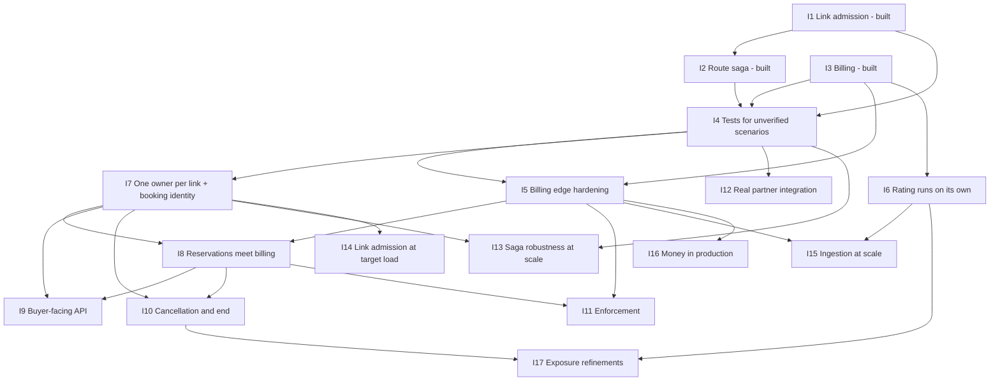

# Delivery plan and decomposition

This plan breaks RFC-001 to RFC-004 into components and increments. Each increment is tied
to the spec scenarios it delivers and to the contracts in [contracts.md](contracts.md)
(C01–C33) that it adds or changes. Increments I1–I3 are the prototype that exists. I4
onwards is the remaining work: tests for the scenarios the prototype does not yet verify,
the cross-system seams that do not exist today, and the risks and open issues in each RFC
turned into work items.

## Where things stand

The prototype is two separate programs that have never been run together:

- **Reservations** (`src/`, Postgres database `bw`): link admission in memory and in SQL,
  and a route saga with one simulated partner. It runs as a library under tests. There is
  no HTTP API, no customer, no route identity, and one coordinator process is assumed.
- **Billing** (`billing/`, NestJS, Postgres database `billing`, Kafka through Redpanda):
  metering, rating, exposure, ledger and wallet. It runs as a service, but its
  reservations and prices exist only because the tests insert them.

Nothing connects them. The contracts that would do so (C28–C31) are proposed.

| Area | Prototype quality, what it proves | Not production-ready because |
|---|---|---|
| Link admission (RFC-001) | Correct against a brute-force oracle; never oversells under 50 clients; p99 115 ms SQL, 3 µs in memory | No API; SQL path has no idempotency, no horizon, no fencing; isolation level not pinned; latency not asserted; one hot-link mutex |
| Route saga (RFC-002) | Never oversells with a faulty partner; competitors never all lose; crash recovery is all or nothing | One coordinator, in-memory books, simulated partner, unbounded retries, no client contract (blocks until done), unpruned memory |
| Metering and rating (RFC-003) | Order-independent ledger; minute lock proven by forced interleaving; Kafka end to end | ~800 records/s, one transaction per record; nothing drives the watermark; a bad record can stall a partition; `billing.admission-check` broken over Kafka |
| Wallet and ledger (RFC-004) | Books always balance (enforced by triggers); D'Hondt avoids the Alabama paradox; payments apply once | Webhooks unauthenticated; one implicit currency; no money leaves; no reconciliation; balances by full scan |

## Components

Owners are by component, not by person. A component owner is the team that runs it in
production and approves changes to the contracts it provides.

| Component | Responsibility | Owner | Code | Provides |
|---|---|---|---|---|
| Link admission | Per-link schedule: usage trees, holds, wound-wait, expiry | Reservations | `src/tree.ts`, `src/links.ts` | C01, C02 |
| SQL admission path | Single-link admission under the link-row lock | Reservations | `src/sql.ts` | C03 |
| Route coordinator | Route sagas: hold, pin, commit point, roll forward, recovery | Reservations | `src/routes.ts` | C05, C06 |
| Partner adapter | One adapter per partner system; idempotent hold, confirm, release | Partner integrations | `src/partner.ts` (simulated) | C07, C08 |
| Reservations facts store | `links`, `reservations`, saga log, bookings, cancellations, outbox, link ownership | Reservations | `schema.sql`, `schema-routes.sql` | C04, C06, C11, C12, C28, C31 |
| API edge | Buyer-facing HTTP: validation, idempotency, pending + webhook, single-link sync | Reservations | not built | C09, C10 |
| Metering | Consume `flow-records`, validate, dead-letter | Billing | `billing/src/metering` | C13, C14 |
| Rating | Ingest, minute lock, rate and re-rate, scheduler | Billing | `billing/src/rating` | C15, C16 |
| Pricing | Rates and split weights per route, effective-dated | Billing (data owned by commercial) | tables only | C17 |
| Exposure | Exposure bound, suspend/resume, admission rule, headroom grants | Billing | `billing/src/exposure` | C24, C25, C26, C29, C30 |
| Ledger | Journals and entries, balances, split | Billing / Finance | `billing/src/ledger`, `billing/src/domain` | C18, C19 |
| Wallet / Payments | Payment webhooks, balances | Billing / Payments | `billing/src/wallet` | C20, C21, C22, C23 |
| Payouts | Payout runs, payout instructions, reversals | Finance | `LedgerService.payoutRun` | C27, C32 |
| Network enforcement | Stop and restore a customer's traffic | Network operations | not built | consumes C30 |
| Treasury | Execute payouts to banks and mobile money | Finance | not built | consumes C32 |

## Increments

### Built (prototype)

#### I1. Link admission prototype — built

| | |
|---|---|
| Goal | Decide one link's admission correctly, in memory and in SQL, without overselling |
| Components | Link admission (tree), SQL admission path, facts store |
| Contracts | C01, C03, C04 |
| Scenarios delivered (verified) | P1-S01 to P1-S08, P1-S10 to P1-S15 |
| Left open | P1-S09 (latency measured, not asserted) → I4; P1-S16 (cancellation) → I10. P1-S12 and P1-S13 hold on the in-memory path only → I14 |
| Exit criteria (met) | `npm test`: tree, SQL and a per-minute oracle agree on 8 seeds × 150 requests; 50 clients on one link never exceed capacity; the unlocked negative control oversells |
| Dependencies | — |

#### I2. Route reservation prototype — built

| | |
|---|---|
| Goal | Book a route over our links and one partner all or nothing, with crash recovery and idempotent retries |
| Components | Link admission (`LinkBook`), Route coordinator, Partner adapter (simulated), facts store |
| Contracts | C02, C05, C06, C07 |
| Scenarios delivered (verified) | P2-S01 to P2-S08, P2-S11, P2-S13 to P2-S16, P2-S18, P2-S21 to P2-S25, P2-S28 to P2-S30, P2-S32 |
| Left open | P2-S10, S12, S17, S19, S20, S26, S27, S31 have no direct test → I4; P2-S09 (pending + webhook) → I9 |
| Exit criteria (met) | `npm test`: 60 concurrent routes per seed, 3 seeds, partner 10% errors and 10% timeouts; never oversold (sampled every ms and from facts); every saga ends confirmed or rejected; crossed sagas resolve in ~20 ms |
| Dependencies | I1 |

#### I3. Billing prototype — built

| | |
|---|---|
| Goal | Turn flow records into exact, order-independent charges split among suppliers, against a prepaid wallet with a bounded exposure |
| Components | Metering, Rating, Pricing (tables), Exposure, Ledger, Wallet / Payments, Payouts (ledger side) |
| Contracts | C13, C15, C17 (tables), C18, C19, C20, C22, C23, C24, C25 (defective), C26, C27 |
| Scenarios delivered (verified) | P3-S01, S02, S04, S06, S08, S10 to S12, S14, S15, S17 to S21, S23, S26; P4-S01, S03, S07 to S11, S13 to S15, S17 to S21, S23, S24 |
| Left open | Untested: P3-S03, S05, S07, S09, S13, S16, S27; P4-S02, S12, S16, S22, S25 → I4. Not built or broken: P3-S22, S24, S25; P4-S04 to S06 → I5; P4-S26 → I16 |
| Exit criteria (met) | Billing test suite: 3 seeds of shuffled and duplicated delivery give the in-order ledger; every journal balances; 3,000 Kafka records with ~20% duplicates are stored once and charged exactly |
| Dependencies | — (independent of I1 and I2) |

### Remaining work

#### I4. Close the unverified scenarios with tests

| | |
|---|---|
| Goal | Every scenario the prototype claims to satisfy has a test. No behaviour changes, except test hooks |
| Components | All built components |
| Contracts | None changed. Adds a crash hook inside `writeFacts` (C06) for P2-S27 |
| Scenarios delivered | P1-S09; P2-S10, S12, S17, S19, S20, S26, S27, S31; P3-S03, S05, S07, S09, S13, S16, S27; P4-S02, S12, S16, S22, S25 |
| Exit criteria | One named test per scenario, referenced by its `# Verified by` comment and tag flipped to `@verified`. In particular: P1-S09 asserts p99 ≤ 200 ms with stated headroom; P2-S17 asserts the ticket after a restart equals the original; P2-S12 asserts a wake-up on release, confirm and wound separately; P2-S31 uses two coordinator instances over one database; P2-S27 crashes between fact inserts and finds all or none; P3-S16 runs two `rateUpTo` concurrently and counts one `charge` journal per minute; P4-S02 delivers the reversal first; P4-S12 attempts `UPDATE`/`DELETE` on `entries` and `DELETE` on `journals`; P4-S22 uses equal weights and checks the earlier account gets the micro; P4-S25 posts each listed amount and gets 400 |
| Also | Regression test that `REPEATABLE READ` on the SQL path oversells and the code pins `READ COMMITTED` (RFC-001 risk); test that a malformed record today stalls its partition, to be inverted in I5 (RFC-003 risk 8) |
| Dependencies | I1, I2, I3 |

#### I5. Billing edge hardening

| | |
|---|---|
| Goal | No bad input can stall metering, credit a wallet or corrupt the books; billing's own events are reliable |
| Components | Metering, Exposure, Wallet / Payments, Ledger |
| Contracts | C25 (fix `reservedMbps` validation), C14 (new), C21 (new), C20 (changed: per-provider path, zero rejected, content check), C26 (published from an outbox; producer half of C30) |
| Scenarios delivered | P3-S22, P3-S24, P3-S25; P4-S04, P4-S05, P4-S06 |
| Work items | Fix `AdmissionQueryDto` (`@IsInt() @Min(1)`) and add a Kafka request-reply test; validate flow records in the handler and dead-letter; webhook signature or source verification; `payment_event_conflicts`; outbox for suspend/resume with a per-customer lock in `check`; run the exposure check after `rerate` (RFC-003 says it runs after every correction; the code does not); `BEFORE TRUNCATE` triggers, `payment_events` append-only, service role without table ownership, reject journals with no entries (RFC-004 risk 6) |
| Exit criteria | A Kafka test sends a malformed record followed by valid ones on one partition: the valid ones are charged and the bad one is on `flow-records.dlq`. An unsigned webhook gets 401 and posts nothing. A redelivery with a different amount leaves the wallet unchanged and creates a conflict row. Killing the process between the suspension write and the publish still delivers `customer.suspend` after restart. `billing.admission-check` answers over Kafka |
| Dependencies | I3, I4 |

#### I6. Rating runs on its own

| | |
|---|---|
| Goal | Minutes are charged without a test calling `rateUpTo`, and prices are entered through a controlled path |
| Components | Rating, Pricing |
| Contracts | C16 (new), C17 (writer added) |
| Scenarios delivered | P3-S07 in production (tested in I4 at the function level); P3-S09 and P3-S10 through the pricing API |
| Work items | Scheduler with single-active lock and the start-up lag check; index or per-minute work queue for `rateUpTo` (RFC-003 risk 2); pricing admin API with minute-aligned `effectiveFrom` and automatic `rerate` for a correction; append-only triggers on `rates` and `rate_splits`; exposure treats a route with no rate as an error rather than zero |
| Exit criteria | With only the service running, records published for minute `m` are charged by `m + 1 min + grace + interval`. Start-up refuses a configuration where `METERING_LAG_SECONDS` is below bucket + grace + interval. A price correction through the API produces correction journals for exactly the affected minutes |
| Dependencies | I3 |

#### I7. One owner per link, and booking identity

| | |
|---|---|
| Goal | Exactly one writer per link, fenced; every booking has one id that both systems use |
| Components | Reservations facts store, Route coordinator, SQL admission path |
| Contracts | C11 (new), C12 (new), C03 and C04 (changed: fence step, `booking_id`, `link_seq`), C05 (changed: carries `customerId`, `routeId`, `bookingId`) |
| Scenarios delivered | P1-S10 and P2-S32 with both paths live. A new scenario must be added to the specs: "the SQL path and the coordinator on the same link never oversell; a stale owner cannot write" |
| Work items | Lease and fence (D10 `seq`); decide whether the SQL path is retired or owns a disjoint set of links (RFC-001 and RFC-002 risk 4); `routes` catalogue and `bookings`; one window validation at the edge for both paths (RFC-001 "two paths differ at the edges") |
| Exit criteria | A test runs a stale coordinator (lease expired) and a new one on the same link: the stale one's fact transaction fails the fence and nothing is oversold. Every fact row has a `booking_id` and a unique `(link_id, link_seq)` |
| Dependencies | I1, I2, I4 |

#### I8. Reservations meet billing

| | |
|---|---|
| Goal | A confirmed booking becomes billable without manual steps, and a booking is refused when the customer lacks headroom |
| Components | Facts store (outbox), Route coordinator / API edge, Exposure, Rating |
| Contracts | C28 (new), C29 (new), C25 (extended with grant), C14 (parking for unknown reservations) |
| Scenarios delivered | P3-S21 and P3-S22 end to end; P3-S24's "reservation ID that does not exist" handled by parking and replay |
| Exit criteria | End-to-end test with both services: book a route, publish flow records for its `bookingId`, rate, and see the charge in the customer's wallet. Records published before `booking.confirmed` are charged once the event arrives. Two concurrent bookings that together exceed headroom: exactly one is admitted. The outbox relay can be killed and restarted without losing or duplicating a billing reservation |
| Dependencies | I5 (fixed admission check), I7 (identity) |

#### I9. Buyer-facing API

| | |
|---|---|
| Goal | Buyers and agents can book a route (pending + webhook/poll, D16) and a single link (synchronous) over HTTP |
| Components | API edge, Route coordinator, Link admission |
| Contracts | C09 (new), C10 (new), C05 (wrapped; `crashed` hidden) |
| Scenarios delivered | P2-S09; P2-S03, P2-S28 to P2-S31 at the HTTP edge; P1-S09 end to end through C10 |
| Exit criteria | `POST /v1/route-reservations` answers 202 in ≤ 200 ms p99 under the P2-S13 load; the final result arrives by signed webhook at least once and by `GET` with the idempotency key; a single-link request answers in ≤ 200 ms p99 on a hot link. Same key with a different body is 409 |
| Dependencies | I7, I8 (C29 runs inside the request flow) |
| Needs a decision | What a single-link request gets when it fits only if a route's holds release (RFC-002 risk 8) |

#### I10. Cancellation and the end of a booking

| | |
|---|---|
| Goal | A booking can be cancelled from a time onward, capacity returns, and ended bookings stop counting in exposure |
| Components | Link admission, SQL path or link owner, facts store, Exposure |
| Contracts | C31 (new), C28 (carries `end`), C24 (active bookings only) |
| Scenarios delivered | P1-S16 |
| Work items | Settle the deferred fact-model items first (RFC-001 risk "deferred fact-model items": appended cancellation facts, bitemporal queries, `tstzrange`); cancellation under the link owner; `booking.ended`; exposure counts a booking until its effective end plus metering lag (RFC-003 risk 10) |
| Exit criteria | P1-S16 passes on the in-memory and the database path, and the original fact and the cancellation are both readable. A cancelled booking stops contributing to exposure after `endedAt + METERING_LAG_SECONDS` |
| Dependencies | I7, I8 |
| Needs a decision | Who may cancel, notice period, refunds, and what a capacity reduction does to confirmed bookings (P1 open questions 2 and 5) |

#### I11. Enforcement of suspension

| | |
|---|---|
| Goal | A suspension actually stops traffic within the enforcement lag, and new bookings are refused while suspended |
| Components | Exposure, Network enforcement (new consumer), API edge |
| Contracts | C30 (new), C26 (kept for compatibility) |
| Scenarios delivered | P3-S18, P3-S19, P3-S20, P3-S23 end to end (verified today only at billing's boundary) |
| Exit criteria | A customer pushed to `available ≤ 0` has traffic stopped within `ENFORCEMENT_LAG_SECONDS` as measured by `enforcement.applied`; events replayed out of order do not flip state (epoch check); a suspended customer's new booking is `refused` |
| Dependencies | I5 (outbox), I8 (bookings known to billing) |
| Needs a decision | Auto-resume after a top-up; what suspension does to existing bookings |

#### I12. Real partner integration

| | |
|---|---|
| Goal | Replace the simulated partner with real partner adapters that behave like C07 |
| Components | Partner adapter, Route coordinator |
| Contracts | C08 (new), C07 (unchanged interface; adapters behind it) |
| Scenarios delivered | P2-S18 to P2-S21 and P2-S26 against a partner sandbox |
| Work items | Per-call 2 s timeout; retries bounded by the deadline before the commit point and alerted after it (RFC-002 risk 11); partner hold TTL that outlives the commit window (risk 5); fixed order among several partners and which one confirms last (risk 6); a policy for partners without holds (P2 open question 6); fewer polls for a busy partner (risk 3) |
| Exit criteria | Contract tests per partner adapter covering every row of C07's outcome table, including timeout-after-work; a route over two partners confirms or releases both |
| Dependencies | I2, I4 |

#### I13. Saga robustness at scale

| | |
|---|---|
| Goal | The coordinator can run as more than one instance and recovers without failing buyers needlessly |
| Components | Route coordinator, Link admission |
| Contracts | C06 (lease from C11 on sagas), C02 (narrower wounding) |
| Scenarios delivered | Strengthens P2-S16, P2-S17, P2-S22. New scenario needed if the business chooses to resume in-flight requests after a crash |
| Work items | Wound the fewest, youngest holds that free enough capacity (RFC-002 risk 1); resume `holding` sagas with their ticket if the business wants it (risk 2); tickets that stay a total order across instances (risk 10); prune the in-flight idempotency map (risk 11); tests for the crash points covered only by reasoning (risk 9) |
| Exit criteria | With two coordinator instances and a forced failover, P2-S13 and P2-S32 still pass; restarts per saga fall measurably with narrower wounding; memory stays flat over a long soak |
| Dependencies | I7, I4 |

#### I14. Link admission at target load

| | |
|---|---|
| Goal | Hot links stay inside 200 ms at production skew, and both paths give the same answers |
| Components | Link admission, SQL path (or its replacement) |
| Contracts | C03 or C02 (implementation behind an unchanged contract) |
| Scenarios delivered | P1-S09 at target load; P1-S12 and P1-S13 on the database path, if it is kept |
| Work items | Measure a persisted change-point table, or move to a single in-memory owner per link (RFC-001 risks "hot-link mutex", "peak query cost"); measure lock wait distribution for starvation; compute conflicting sub-ranges in SQL from the running sum |
| Exit criteria | Load test at the measured hottest-link rate: p99 ≤ 200 ms, no request waits longer than a stated bound; the SQL path returns the same sub-ranges as the tree on the property test |
| Dependencies | I7 (decides which path survives) |

#### I15. Ingestion at scale

| | |
|---|---|
| Goal | Metering keeps up with 50× today's traffic with headroom |
| Components | Metering, Rating |
| Contracts | C13 (exporter id carries an epoch), C15 (batched implementation) |
| Scenarios delivered | All P3 scenarios still pass under batching. A throughput scenario with a target in records/s must be added once the average record size is known (P3 open question 8) |
| Work items | One multi-row `INSERT … ON CONFLICT DO NOTHING RETURNING` per Kafka batch, minute locks in sorted order (RFC-003 risk 1); time-partitioned `flow_records`; exporter epoch in the key (risk 9); pre-aggregation per (reservation, minute) if needed; long flows (risk 7) |
| Exit criteria | A load test sustains the agreed records/s with lag below the grace; P3-S02 and P3-S14 pass with batched ingest; a sequence wrap after an exporter restart is not dropped as a duplicate |
| Dependencies | I5 (DLQ in the batch path), I6 |

#### I16. Money in production

| | |
|---|---|
| Goal | Several currencies, money actually paid out, and books that reconcile with providers |
| Components | Ledger, Wallet / Payments, Payouts, Treasury |
| Contracts | C33 (new), C32 (new), C19 and C20 to C23 (currency fields), C27 (writes payout outbox) |
| Scenarios delivered | P4-S26. New scenarios needed for failed payouts and reconciliation mismatches |
| Work items | Accounts with a currency and a per-currency balance trigger; FX journals; `clearing` per provider and currency, daily reconciliation (RFC-004 risk 5); payout instructions, schedule, minimum, reversal on failure (risk 1); balance snapshots or a checked balance table (risk 7); commission, tax and fee accounts (risk 11) |
| Exit criteria | P4-S26 passes; a failed payout returns the money to the supplier's balance through a reversal journal; a reconciliation run flags a reversal with no matching completion; balance queries stay flat in cost as history grows |
| Dependencies | I5 |
| Needs a decision | Currencies, payout currency, FX risk owner, payout schedule and minimum, maximum age of clawback debt |

#### I17. Exposure refinements

| | |
|---|---|
| Goal | The exposure bound stays a true bound when prices or bookings change |
| Components | Exposure, Pricing |
| Contracts | C24 |
| Scenarios delivered | Strengthens P3-S17 to P3-S21. New scenarios needed for "price rise during the window" and "re-check on price change" |
| Work items | Price increases inside the exposure window (RFC-003 risk 5); re-check every affected customer when a price changes (risk 11); per-customer policy and limit if the business wants segments |
| Exit criteria | A scheduled price rise is reflected in exposure before it takes effect; a price change triggers checks for every customer on the route |
| Dependencies | I6, I10 |

## Dependency graph

The critical path to a usable system is I4 → I5 → I7 → I8 → I9: tests, then a safe
billing edge, then one writer per link with a shared booking id, then the seam between the
two systems, then the API. I6, I12 and I16 can run in parallel with it.

## Scenario to increment

Every scenario in the four `.feature` files, with the increment that delivers it. "Status
today" is the tag in the spec. Increments after I4 that strengthen an already verified
scenario are noted in the increment, not here.

### P1. Link admission

| Scenario | Status today | Increment |
|---|---|---|
| P1-S01 | verified | I1 |
| P1-S02 | verified | I1 |
| P1-S03 | verified | I1 |
| P1-S04 | verified | I1 |
| P1-S05 | verified | I1 |
| P1-S06 | verified | I1 |
| P1-S07 | verified | I1 |
| P1-S08 | verified | I1 |
| P1-S09 | unverified | I4 (assert the bound); end to end in I9, at target load in I14 |
| P1-S10 | verified | I1 (both paths live: I7) |
| P1-S11 | verified | I1 |
| P1-S12 | verified (in memory only) | I1 (database path: I14) |
| P1-S13 | verified (in memory only) | I1 (database path: I7 edge validation) |
| P1-S14 | verified | I1 |
| P1-S15 | verified | I1 |
| P1-S16 | unverified, not built | I10 |

### P2. Route reservation

| Scenario | Status today | Increment |
|---|---|---|
| P2-S01 | verified | I2 |
| P2-S02 | verified | I2 |
| P2-S03 | verified | I2 (HTTP edge: I9) |
| P2-S04 | verified | I2 |
| P2-S05 | verified | I2 |
| P2-S06 | verified | I2 |
| P2-S07 | verified | I2 |
| P2-S08 | verified | I2 |
| P2-S09 | unverified, not built | I9 |
| P2-S10 | unverified | I4 |
| P2-S11 | verified | I2 |
| P2-S12 | unverified | I4 |
| P2-S13 | verified | I2 |
| P2-S14 | verified | I2 |
| P2-S15 | verified | I2 |
| P2-S16 | verified | I2 |
| P2-S17 | unverified | I4 |
| P2-S18 | verified | I2 (real partner: I12) |
| P2-S19 | unverified | I4 |
| P2-S20 | unverified | I4 |
| P2-S21 | verified | I2 |
| P2-S22 | verified | I2 |
| P2-S23 | verified | I2 |
| P2-S24 | verified | I2 |
| P2-S25 | verified | I2 |
| P2-S26 | unverified | I4 |
| P2-S27 | unverified | I4 (needs a crash hook in `writeFacts`) |
| P2-S28 | verified | I2 |
| P2-S29 | verified | I2 |
| P2-S30 | verified | I2 |
| P2-S31 | unverified | I4 |
| P2-S32 | verified | I2 (both paths live: I7) |

### P3. Metering and rating

| Scenario | Status today | Increment |
|---|---|---|
| P3-S01 | verified | I3 |
| P3-S02 | verified | I3 |
| P3-S03 | unverified | I4 |
| P3-S04 | verified | I3 |
| P3-S05 | unverified | I4 |
| P3-S06 | verified | I3 |
| P3-S07 | unverified | I4 (scheduler in production: I6) |
| P3-S08 | verified | I3 |
| P3-S09 | unverified | I4 (enforcing minute-aligned prices: I6) |
| P3-S10 | verified | I3 |
| P3-S11 | verified | I3 |
| P3-S12 | verified | I3 |
| P3-S13 | unverified | I4 |
| P3-S14 | verified | I3 |
| P3-S15 | verified | I3 |
| P3-S16 | unverified | I4 |
| P3-S17 | verified | I3 |
| P3-S18 | verified | I3 (traffic actually stopped: I11) |
| P3-S19 | verified | I3 (traffic actually restored: I11) |
| P3-S20 | verified | I3 |
| P3-S21 | verified (in-process) | I3 (end to end: I8) |
| P3-S22 | unverified, broken | I5 (end to end: I8) |
| P3-S23 | verified | I3 |
| P3-S24 | unverified | I5 |
| P3-S25 | unverified | I5 |
| P3-S26 | verified | I3 |
| P3-S27 | unverified | I4 |

### P4. Wallet and settlement

| Scenario | Status today | Increment |
|---|---|---|
| P4-S01 | verified | I3 |
| P4-S02 | unverified | I4 |
| P4-S03 | verified | I3 |
| P4-S04 | unverified, not built | I5 |
| P4-S05 | unverified, not built | I5 |
| P4-S06 | unverified, not built | I5 |
| P4-S07 | verified | I3 |
| P4-S08 | verified | I3 |
| P4-S09 | verified | I3 |
| P4-S10 | verified | I3 |
| P4-S11 | verified | I3 |
| P4-S12 | unverified | I4 |
| P4-S13 | verified | I3 |
| P4-S14 | verified | I3 |
| P4-S15 | verified | I3 |
| P4-S16 | unverified | I4 |
| P4-S17 | verified | I3 |
| P4-S18 | verified | I3 |
| P4-S19 | verified | I3 |
| P4-S20 | verified | I3 |
| P4-S21 | verified | I3 |
| P4-S22 | unverified | I4 |
| P4-S23 | verified | I3 |
| P4-S24 | verified | I3 |
| P4-S25 | unverified (the DTO already rejects every example) | I4 |
| P4-S26 | unverified, not built | I16 |

Totals: 101 scenarios (P1 16, P2 32, P3 27, P4 26). 71 are verified by I1–I3; 21 are
closed by tests alone in I4; 9 need new or fixed behaviour (P1-S16 in I10; P2-S09 in I9;
P3-S22, P3-S24, P3-S25, P4-S04, P4-S05, P4-S06 in I5; P4-S26 in I16).

New scenarios the specs need, because increments deliver behaviour no scenario describes
yet: two admission paths on one link (I7); `booking.confirmed` makes a booking billable,
including records that arrive first (I8); suspension stops traffic within the enforcement
lag (I11); partner per-call timeout and multi-partner routes (I12); ingestion throughput
target (I15); failed payout and reconciliation mismatch (I16); price rise inside the
exposure window (I17).

## Decisions needed from the business

The mechanism for each of these is built or designed so that the answer is configuration
or a small policy change, not a redesign (D15). Until each is decided, the default shown is
what the system does.

| # | Decision | Default today | Mechanism | Blocks |
|---|---|---|---|---|
| 1 | Terminate at zero (`reserve`) or allow leeway (`credit_limit`), and the limit, for which customers | `reserve` | `EXPOSURE_POLICY`, `CREDIT_LIMIT_MICROS` (C24) | I11, I17 |
| 2 | After a top-up restores headroom, is traffic resumed automatically | Billing emits `customer.resume`; nobody acts | `autoResume` in C30 | I11 |
| 3 | What suspension does to existing bookings: stop traffic, throttle, or cancel; are reserved-but-unused hours still billed | Not defined | C30 consumer action | I11 |
| 4 | If billing cannot answer the admission check: fail closed or fail open | Not called at all | C29 timeout outcome | I8, I9 |
| 5 | When a request fits only if others' holds release: wait (current), reject with retry-after, or value-based priority | Wait, bounded by the saga deadline (D16) | Coordinator's handling of `wait` (C02, C05) | — |
| 6 | What a 200 ms single-link request gets when it fits only if a route's holds release | Proposed: `busy` with `retryAfterMs` | C10 | I9 |
| 7 | Collision priority rule: oldest request wins, or by value of the request | Oldest wins (age tickets, D17) | `Ticket` ordering (C02) | — |
| 8 | Requests caught by a coordinator crash: fail (current) or resume with the original ticket | Fail; capacity returns at hold expiry | `recover` (C06) | I13 |
| 9 | Rounding of the split: D'Hondt (current) or Webster; and the tie winner, which today is `revenue:share` because it sorts first. To be written into supplier contracts | D'Hondt, ties to the earliest account name | `split()` (C18) | Supplier contracts |
| 10 | How late a flow record may be, and what to do with records later than that | Charged as corrections however late | `RATING_GRACE_SECONDS`, `METERING_LAG_SECONDS` (C16, C24) | I6 |
| 11 | Long flows: all bytes to the end minute (current) or spread across the minutes | End minute (D28) | `ingest` minute assignment (C15) | I15 |
| 12 | Prices that change inside a minute: forbid, or apply from the next minute (current) | Next whole minute | C17 validation | I6 |
| 13 | Price increases inside the exposure window: accept the risk, or bound at the highest scheduled price | Today's price | C24 | I17 |
| 14 | Malformed and unknown-reservation records: who inspects them, retention, whether to bill when replayed | Partition stalls | C14 | I5 |
| 15 | Traffic after a booking's end or cancellation: bill it, ignore it, or flag it | Billed (records are facts) | C31 | I10 |
| 16 | Cancellation: who may cancel, notice period, refunds, backdating; effect of a capacity reduction on confirmed bookings | Not built | C31 | I10 |
| 17 | Redelivered payment with different contents: who resolves, and what the provider is told | Accepted silently as a duplicate | C21 conflict table | I5 |
| 18 | Currencies; one or several per wallet; payout currency; who carries FX risk between charge and payout; conversion to each rail's minor unit | One implied currency | C33 | I16 |
| 19 | Payout schedule, minimum payout, maximum age of a clawback debt | Manual `payoutRun` | C27, C32 | I16 |
| 20 | Booking horizon length and what "open-ended" means beyond it | Fixed horizon per process (tree); forever (SQL) | `checkWindow`, C10 | I7 |
| 21 | Partners that offer no holds, only final bookings: sell routes through them or not | Not supported | C08 | I12 |
| 22 | Ranking of P2 objectives when they conflict (beyond "at least one competitor wins") | — | — | — |
| 23 | Whether reservation history must be queryable as of a past moment (audits, SLA claims) | Not queryable (`recorded_at` exists, unused) | Fact model (RFC-001 deferred items) | I10 |

## Errors found in the RFCs and code while writing this plan

These are recorded here and in [contracts.md](contracts.md). The RFCs and specs have since
been corrected to describe what the code does, with each defect marked as known and
pointing to the increment and contract below that fixes it. The code is unchanged.

1. **`billing.admission-check` does not work over Kafka.** `AdmissionQueryDto.reservedMbps`
   has only `@Type`, so the global pipe's `whitelist: true` strips it and `canAdmit`
   throws on `BigInt(undefined)`. RFC-003 and RFC-004 present the endpoint as built; P3-S22
   is correctly `@unverified`. Fixed in I5 (C25).
2. **`rerate` does not run the exposure check.** RFC-003 says `check` runs "after every
   correction"; `RatingService.rerate` posts corrections without it. I5.
3. **Suspend/resume events are at most once, not exactly once.** The `suspensions` row is
   written before the emit, outside any transaction; a crash or broker error in between
   loses the event permanently. RFC-003 says "each transition is emitted once"; it is
   emitted at most once. Events are also unkeyed. I5 / C30.
4. **RFC-003's data model says `reservations` is "inserted by the reservation side"**.
   Nothing on the reservation side writes it; only billing's tests do. C28 / I8.
5. **The SQL admission path has no idempotency**, which RFC-001 does not state; a retried
   request books twice. C10 / I9.
6. **`LinkBook.tryHold` and the partner's `hold` do not compare parameters** for an
   existing key; RFC-002 calls them "idempotent by key" without noting this. Safe today only
   because the coordinator generates keys. C02, C08.
7. **RFC-004's implementation status table** lists the untested S02, S12 and S22 but not
   P4-S16 or P4-S25, which the spec marks `@unverified`. Minor.
