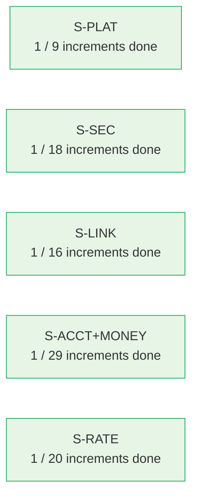

# Delivery dependency graph

Generated by `python3 tools/plan_graph.py --write` from the slice plans. Do not edit by hand.

## 1. Slices

An arrow A → B means some increment of B needs an increment of A. The label is the number of such increment dependencies.

## 2. Increments

Green: delivered. Bold border: on the critical path to the walking skeletons of every slice and the money path (S-PLAT-I1, MONEY-I2, AM-I5, AM-I6). Lanes are slices.

```mermaid
flowchart TB
  subgraph L_S_PLAT["S-PLAT"]
    direction TB
    S_PLAT_I1["S-PLAT-I1<br/>Minimal C01 runtime on the dev cell"]
    S_PLAT_I2["S-PLAT-I2<br/>Runtime completion for owner kinds"]
    S_PLAT_I3["S-PLAT-I3<br/>Moves, splitting and integrity stops"]
    S_PLAT_I4["S-PLAT-I4<br/>Multi-region topology and failover"]
    S_PLAT_I5["S-PLAT-I5<br/>History, archive, backups and restore"]
    S_PLAT_I6["S-PLAT-I6<br/>Alert service and notifier"]
    S_PLAT_I7["S-PLAT-I7<br/>Probes and availability"]
    S_PLAT_I8["S-PLAT-I8<br/>Disaster declaration and measurement …"]
    S_PLAT_I9["S-PLAT-I9<br/>Design-load acceptance and go-live ga…"]
  end
  subgraph L_S_SEC["S-SEC"]
    direction TB
    S_SEC_I1["S-SEC-I1<br/>Walking skeleton: an agent key from t…"]
    S_SEC_I2["S-SEC-I2<br/>Principal context, key records and th…"]
    S_SEC_I3["S-SEC-I3<br/>Operator envelope and operator check,…"]
    S_SEC_I4["S-SEC-I4<br/>Four eyes, approval expiry, cancellat…"]
    S_SEC_I5["S-SEC-I5<br/>Personal-data store: put and get, and…"]
    S_SEC_I6["S-SEC-I6<br/>Authenticity of money-moving inputs"]
    S_SEC_I7["S-SEC-I7<br/>Account users, sessions and administr…"]
    S_SEC_I8["S-SEC-I8<br/>Webhook endpoints and signed webhooks"]
    S_SEC_I9["S-SEC-I9<br/>Supplier administration, exporter cre…"]
    S_SEC_I10["S-SEC-I10<br/>Supplier visibility, consent and lega…"]
    S_SEC_I11["S-SEC-I11<br/>Audit trail integrity"]
    S_SEC_I12["S-SEC-I12<br/>Operator reads, documented requests a…"]
    S_SEC_I13["S-SEC-I13<br/>Payout destination"]
    S_SEC_I14["S-SEC-I14<br/>Non-conforming payloads, expiry and d…"]
    S_SEC_I15["S-SEC-I15<br/>Erasure requests and erasure"]
    S_SEC_I16["S-SEC-I16<br/>Deferred and retention erasures"]
    S_SEC_I17["S-SEC-I17<br/>Account recovery"]
    S_SEC_I18["S-SEC-I18<br/>No personal data outside the store"]
  end
  subgraph L_S_LINK["S-LINK"]
    direction TB
    S_LINK_I1["S-LINK-I1<br/>Walking skeleton: hold, convert and r…"]
    S_LINK_I2["S-LINK-I2<br/>Counter-offers, request records and t…"]
    S_LINK_I3["S-LINK-I3<br/>Waiting, grants and the waiting port"]
    S_LINK_I4["S-LINK-I4<br/>Validity and the rolling horizon"]
    S_LINK_I5["S-LINK-I5<br/>Yields, claims and waiting marks"]
    S_LINK_I6["S-LINK-I6<br/>Changes to confirmed legs"]
    S_LINK_I7["S-LINK-I7<br/>Schedule feed, alerts and known-at hi…"]
    S_LINK_I8["S-LINK-I8<br/>Deadlines, expiry, takeover, standbys…"]
    S_LINK_I9["S-LINK-I9<br/>Link registry, supply-command frame, …"]
    S_LINK_I10["S-LINK-I10<br/>Planned maintenance"]
    S_LINK_I11["S-LINK-I11<br/>Capacity levels, outages, increases a…"]
    S_LINK_I12["S-LINK-I12<br/>Affected flags and notices"]
    S_LINK_I13["S-LINK-I13<br/>Permanent reduction: the notice period"]
    S_LINK_I14["S-LINK-I14<br/>Permanent reduction: effect, cuts and…"]
    S_LINK_I15["S-LINK-I15<br/>Equivalent-path offer holds and moves"]
    S_LINK_I16["S-LINK-I16<br/>Design load, the hottest link and reg…"]
  end
  subgraph L_S_ACCT_MONEY["S-ACCT+MONEY"]
    direction TB
    AM_I1["AM-I1<br/>Walking skeleton: book one single-lin…"]
    MONEY_I2["MONEY-I2<br/>Ledger and settlement of reservation …"]
    MONEY_I3["MONEY-I3<br/>Usage batches, amendments, correction…"]
    ACCT_I4["ACCT-I4<br/>Reporting: status readers, pending, o…"]
    AM_I5["AM-I5<br/>Ledger movements applied in the accou…"]
    AM_I6["AM-I6<br/>Unposted usage, the lateness bound an…"]
    ACCT_I7["ACCT-I7<br/>Intake validation, idempotency and ra…"]
    ACCT_I8["ACCT-I8<br/>Routes over Share links, and every ou…"]
    AM_I9["AM-I9<br/>Funds admission complete, and key sta…"]
    ACCT_I10["ACCT-I10<br/>Contention on Share links"]
    AM_I11["AM-I11<br/>Standing: suspension, warnings, resum…"]
    MONEY_I12["MONEY-I12<br/>Payments"]
    ACCT_I13["ACCT-I13<br/>Reductions: cancel, shorten, decrease…"]
    AM_I14["AM-I14<br/>Additions: extend, renew, increase, w…"]
    ACCT_I15["ACCT-I15<br/>Partner adapter, partners with holds"]
    ACCT_I16["ACCT-I16<br/>Partners without holds, contention at…"]
    ACCT_I17["ACCT-I17<br/>Quotes, partner fees and changes on p…"]
    ACCT_I18["ACCT-I18<br/>Partner reconciliation and affected p…"]
    AM_I19["AM-I19<br/>Release after grace, termination and …"]
    ACCT_I20["ACCT-I20<br/>Cut targets and revocation"]
    ACCT_I21["ACCT-I21<br/>Equivalent-path offers and moves"]
    AM_I22["AM-I22<br/>Price changes"]
    AM_I23["AM-I23<br/>Recovery, moves and stops"]
    AM_I24["AM-I24<br/>Credit limits and probe accounts"]
    MONEY_I25["MONEY-I25<br/>Receivables, invoices and write-offs"]
    MONEY_I26["MONEY-I26<br/>Payouts"]
    MONEY_I27["MONEY-I27<br/>Reconciliation"]
    MONEY_I28["MONEY-I28<br/>Statements"]
    AM_I29["AM-I29<br/>Design load and soak"]
  end
  subgraph L_S_RATE["S-RATE"]
    direction TB
    S_RATE_I1["S-RATE-I1<br/>Walking skeleton"]
    S_RATE_I2["S-RATE-I2<br/>Record identity, deduplication and ou…"]
    S_RATE_I3["S-RATE-I3<br/>Spread and exact usage lines"]
    S_RATE_I4["S-RATE-I4<br/>Late traffic and amendments by total"]
    S_RATE_I5["S-RATE-I5<br/>Posting acknowledgements and exactly-…"]
    S_RATE_I6["S-RATE-I6<br/>Catalogue writes and price rules"]
    S_RATE_I7["S-RATE-I7<br/>Usage exposure, publish before emit a…"]
    S_RATE_I8["S-RATE-I8<br/>Reservation accrual and reservation b…"]
    S_RATE_I9["S-RATE-I9<br/>Reductions, POL-07 cuts and affected …"]
    S_RATE_I10["S-RATE-I10<br/>Price corrections"]
    S_RATE_I11["S-RATE-I11<br/>Moves, open-ended re-pricing and dear…"]
    S_RATE_I12["S-RATE-I12<br/>Fee lines"]
    S_RATE_I13["S-RATE-I13<br/>Reservation traffic by the POL-17 rule"]
    S_RATE_I14["S-RATE-I14<br/>Egress, attachment and tenancy in att…"]
    S_RATE_I15["S-RATE-I15<br/>Quarantine, finance attribution and r…"]
    S_RATE_I16["S-RATE-I16<br/>Corrected records and superseding rec…"]
    S_RATE_I17["S-RATE-I17<br/>Non-conforming payloads"]
    S_RATE_I18["S-RATE-I18<br/>Reproducibility and cold re-rate"]
    S_RATE_I19["S-RATE-I19<br/>Evidence segments and the evidence qu…"]
    S_RATE_I20["S-RATE-I20<br/>Hot standbys, moves and the design-lo…"]
  end
  ACCT_I10 --> ACCT_I15
  ACCT_I13 --> AM_I14
  ACCT_I13 --> AM_I22
  ACCT_I15 --> ACCT_I16
  ACCT_I16 --> ACCT_I17
  ACCT_I16 --> ACCT_I21
  ACCT_I17 --> ACCT_I18
  ACCT_I17 --> AM_I19
  ACCT_I18 --> AM_I23
  ACCT_I20 --> ACCT_I21
  ACCT_I4 --> ACCT_I7
  ACCT_I4 --> AM_I5
  ACCT_I7 --> ACCT_I8
  ACCT_I8 --> ACCT_I10
  ACCT_I8 --> ACCT_I13
  ACCT_I8 --> AM_I9
  AM_I1 --> ACCT_I4
  AM_I1 --> AM_I5
  AM_I11 --> ACCT_I13
  AM_I11 --> ACCT_I15
  AM_I11 --> AM_I19
  AM_I11 --> AM_I22
  AM_I11 --> MONEY_I12
  AM_I14 --> ACCT_I17
  AM_I14 --> ACCT_I20
  AM_I19 --> ACCT_I20
  AM_I19 --> AM_I24
  AM_I22 --> AM_I23
  AM_I23 --> AM_I24
  AM_I23 --> AM_I29
  AM_I24 --> AM_I29
  AM_I24 --> MONEY_I25
  AM_I5 --> AM_I6
  AM_I5 --> AM_I9
  AM_I6 --> AM_I11
  AM_I9 --> AM_I11
  MONEY_I12 --> AM_I23
  MONEY_I12 --> MONEY_I25
  MONEY_I2 --> AM_I5
  MONEY_I2 --> MONEY_I12
  MONEY_I2 --> MONEY_I3
  MONEY_I25 --> MONEY_I26
  MONEY_I26 --> MONEY_I27
  MONEY_I27 --> MONEY_I28
  MONEY_I28 --> AM_I29
  MONEY_I3 --> MONEY_I26
  S_LINK_I1 --> S_LINK_I2
  S_LINK_I1 --> S_LINK_I6
  S_LINK_I10 --> S_LINK_I11
  S_LINK_I11 --> S_LINK_I12
  S_LINK_I11 --> S_LINK_I13
  S_LINK_I12 --> S_LINK_I13
  S_LINK_I12 --> S_LINK_I15
  S_LINK_I13 --> S_LINK_I14
  S_LINK_I14 --> S_LINK_I15
  S_LINK_I15 --> S_LINK_I16
  S_LINK_I2 --> S_LINK_I3
  S_LINK_I2 --> S_LINK_I4
  S_LINK_I3 --> S_LINK_I5
  S_LINK_I3 --> S_LINK_I6
  S_LINK_I4 --> S_LINK_I9
  S_LINK_I6 --> S_LINK_I7
  S_LINK_I7 --> S_LINK_I10
  S_LINK_I7 --> S_LINK_I8
  S_LINK_I8 --> S_LINK_I11
  S_LINK_I8 --> S_LINK_I12
  S_LINK_I8 --> S_LINK_I14
  S_LINK_I8 --> S_LINK_I9
  S_LINK_I9 --> S_LINK_I10
  S_PLAT_I1 --> S_PLAT_I2
  S_PLAT_I1 --> S_PLAT_I3
  S_PLAT_I1 --> S_PLAT_I4
  S_PLAT_I1 --> S_PLAT_I5
  S_PLAT_I1 --> S_PLAT_I6
  S_PLAT_I1 --> S_PLAT_I9
  S_PLAT_I2 --> S_PLAT_I3
  S_PLAT_I2 --> S_PLAT_I4
  S_PLAT_I3 --> S_PLAT_I4
  S_PLAT_I3 --> S_PLAT_I5
  S_PLAT_I3 --> S_PLAT_I6
  S_PLAT_I3 --> S_PLAT_I7
  S_PLAT_I4 --> S_PLAT_I7
  S_PLAT_I4 --> S_PLAT_I8
  S_PLAT_I6 --> S_PLAT_I7
  S_PLAT_I7 --> S_PLAT_I8
  S_PLAT_I8 --> S_PLAT_I9
  S_RATE_I1 --> S_RATE_I2
  S_RATE_I1 --> S_RATE_I20
  S_RATE_I1 --> S_RATE_I3
  S_RATE_I1 --> S_RATE_I6
  S_RATE_I10 --> S_RATE_I11
  S_RATE_I10 --> S_RATE_I16
  S_RATE_I11 --> S_RATE_I13
  S_RATE_I11 --> S_RATE_I18
  S_RATE_I12 --> S_RATE_I18
  S_RATE_I13 --> S_RATE_I16
  S_RATE_I14 --> S_RATE_I15
  S_RATE_I14 --> S_RATE_I19
  S_RATE_I15 --> S_RATE_I16
  S_RATE_I16 --> S_RATE_I18
  S_RATE_I16 --> S_RATE_I19
  S_RATE_I19 --> S_RATE_I20
  S_RATE_I2 --> S_RATE_I16
  S_RATE_I2 --> S_RATE_I17
  S_RATE_I2 --> S_RATE_I19
  S_RATE_I3 --> S_RATE_I4
  S_RATE_I4 --> S_RATE_I5
  S_RATE_I5 --> S_RATE_I7
  S_RATE_I5 --> S_RATE_I8
  S_RATE_I6 --> S_RATE_I10
  S_RATE_I6 --> S_RATE_I7
  S_RATE_I7 --> S_RATE_I14
  S_RATE_I8 --> S_RATE_I10
  S_RATE_I8 --> S_RATE_I12
  S_RATE_I8 --> S_RATE_I13
  S_RATE_I8 --> S_RATE_I9
  S_RATE_I9 --> S_RATE_I18
  S_SEC_I1 --> S_SEC_I18
  S_SEC_I1 --> S_SEC_I2
  S_SEC_I11 --> S_SEC_I12
  S_SEC_I12 --> S_SEC_I15
  S_SEC_I13 --> S_SEC_I16
  S_SEC_I13 --> S_SEC_I17
  S_SEC_I14 --> S_SEC_I15
  S_SEC_I15 --> S_SEC_I16
  S_SEC_I15 --> S_SEC_I17
  S_SEC_I17 --> S_SEC_I18
  S_SEC_I2 --> S_SEC_I11
  S_SEC_I2 --> S_SEC_I3
  S_SEC_I2 --> S_SEC_I6
  S_SEC_I3 --> S_SEC_I4
  S_SEC_I3 --> S_SEC_I5
  S_SEC_I4 --> S_SEC_I10
  S_SEC_I4 --> S_SEC_I12
  S_SEC_I4 --> S_SEC_I15
  S_SEC_I4 --> S_SEC_I9
  S_SEC_I5 --> S_SEC_I12
  S_SEC_I5 --> S_SEC_I14
  S_SEC_I5 --> S_SEC_I7
  S_SEC_I7 --> S_SEC_I8
  S_SEC_I8 --> S_SEC_I10
  S_SEC_I8 --> S_SEC_I9
  S_SEC_I9 --> S_SEC_I13
  S_SEC_I9 --> S_SEC_I14
  S_SEC_I9 --> S_SEC_I17
  classDef done fill:#c8e6c9,stroke:#2e7d32
  class AM_I1,S_LINK_I1,S_PLAT_I1,S_RATE_I1,S_SEC_I1 done
  classDef key stroke-width:3px
  class S_PLAT_I1,MONEY_I2,AM_I5,AM_I6 key
```

## 3. Cross-slice dependencies

| Provider increment | Consumer increment | Part |
|---|---|---|
