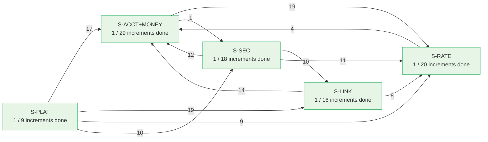

# Delivery dependency graph

Generated by `python3 tools/plan_graph.py --write` from the slice plans. Do not edit by hand.

## 1. Slices

An arrow A → B means some increment of B needs an increment of A. The label is the number of such increment dependencies.

## 2. Waves (planning view)

Each increment is placed in the earliest wave in which every increment it needs is done. Wave 0 is delivered. There are 23 waves after the delivered work. The chart draws one wave as one week from 2026-10-19; that pace is a placeholder, the order is what the graph proves. Red bars are the critical path (23 increments): S-PLAT-I2 → S-PLAT-I3 → S-SEC-I2 → S-SEC-I3 → S-SEC-I5 → S-SEC-I7 → S-SEC-I8 → S-SEC-I9 → S-LINK-I9 → S-LINK-I10 → S-LINK-I11 → ACCT-I10 → ACCT-I15 → ACCT-I16 → ACCT-I17 → AM-I19 → ACCT-I20 → ACCT-I21 → S-RATE-I11 → S-RATE-I13 → S-RATE-I16 → S-RATE-I19 → S-RATE-I20.

```mermaid
gantt
  title Delivery waves (one bar per increment)
  dateFormat YYYY-MM-DD
  axisFormat W%W
  tickInterval 1week
  section S-PLAT
  S-PLAT-I1 Minimal C01 runtime on the dev ce… :done, 2026-10-12, 7d
  S-PLAT-I2 Runtime completion for owner kinds :crit, 2026-10-19, 7d
  S-PLAT-I3 Moves, splitting and integrity st… :crit, 2026-10-26, 7d
  S-PLAT-I4 Multi-region topology and failover :2026-11-02, 7d
  S-PLAT-I5 History, archive, backups and res… :2026-11-02, 7d
  S-PLAT-I6 Alert service and notifier :2026-11-02, 7d
  S-PLAT-I7 Probes and availability :2026-11-09, 7d
  S-PLAT-I8 Disaster declaration and measurem… :2026-11-16, 7d
  S-PLAT-I9 Design-load acceptance and go-liv… :2026-11-23, 7d
  section S-SEC
  S-SEC-I1 Walking skeleton  an agent key fr… :done, 2026-10-12, 7d
  S-SEC-I2 Principal context, key records an… :crit, 2026-11-02, 7d
  S-SEC-I11 Audit trail integrity :2026-11-09, 7d
  S-SEC-I3 Operator envelope and operator ch… :crit, 2026-11-09, 7d
  S-SEC-I6 Authenticity of money-moving inpu… :2026-11-09, 7d
  S-SEC-I4 Four eyes, approval expiry, cance… :2026-11-16, 7d
  S-SEC-I5 Personal-data store  put and get,… :crit, 2026-11-16, 7d
  S-SEC-I12 Operator reads, documented reques… :2026-11-23, 7d
  S-SEC-I7 Account users, sessions and admin… :crit, 2026-11-23, 7d
  S-SEC-I8 Webhook endpoints and signed webh… :crit, 2026-11-30, 7d
  S-SEC-I10 Supplier visibility, consent and … :2026-12-07, 7d
  S-SEC-I9 Supplier administration, exporter… :crit, 2026-12-07, 7d
  S-SEC-I13 Payout destination :2026-12-14, 7d
  S-SEC-I14 Non-conforming payloads, expiry a… :2026-12-14, 7d
  S-SEC-I15 Erasure requests and erasure :2026-12-21, 7d
  S-SEC-I17 Account recovery :2026-12-28, 7d
  S-SEC-I18 No personal data outside the store :2027-01-04, 7d
  S-SEC-I16 Deferred and retention erasures :2027-03-08, 7d
  section S-LINK
  S-LINK-I1 Walking skeleton  hold, convert a… :done, 2026-10-12, 7d
  S-LINK-I2 Counter-offers, request records a… :2026-10-19, 7d
  S-LINK-I3 Waiting, grants and the waiting p… :2026-10-26, 7d
  S-LINK-I4 Validity and the rolling horizon :2026-10-26, 7d
  S-LINK-I5 Yields, claims and waiting marks :2026-11-02, 7d
  S-LINK-I6 Changes to confirmed legs :2026-11-02, 7d
  S-LINK-I7 Schedule feed, alerts and known-a… :2026-11-09, 7d
  S-LINK-I8 Deadlines, expiry, takeover, stan… :2026-11-16, 7d
  S-LINK-I9 Link registry, supply-command fra… :crit, 2026-12-14, 7d
  S-LINK-I10 Planned maintenance :crit, 2026-12-21, 7d
  S-LINK-I11 Capacity levels, outages, increas… :crit, 2026-12-28, 7d
  S-LINK-I12 Affected flags and notices :2027-01-04, 7d
  S-LINK-I13 Permanent reduction  the notice p… :2027-01-11, 7d
  S-LINK-I14 Permanent reduction  effect, cuts… :2027-01-18, 7d
  S-LINK-I15 Equivalent-path offer holds and m… :2027-01-25, 7d
  S-LINK-I16 Design load, the hottest link and… :2027-02-01, 7d
  section S-ACCT+MONEY
  AM-I1 Walking skeleton  book one single… :done, 2026-10-12, 7d
  MONEY-I2 Ledger and settlement of reservat… :2026-10-19, 7d
  MONEY-I3 Usage batches, amendments, correc… :2026-10-26, 7d
  ACCT-I4 Reporting  status readers, pendin… :2026-11-02, 7d
  ACCT-I7 Intake validation, idempotency an… :2026-11-09, 7d
  AM-I5 Ledger movements applied in the a… :2026-11-09, 7d
  AM-I6 Unposted usage, the lateness boun… :2026-11-16, 7d
  ACCT-I8 Routes over Share links, and ever… :2026-11-23, 7d
  AM-I9 Funds admission complete, and key… :2026-11-30, 7d
  AM-I11 Standing  suspension, warnings, r… :2026-12-07, 7d
  ACCT-I13 Reductions  cancel, shorten, decr… :2026-12-14, 7d
  MONEY-I12 Payments :2026-12-14, 7d
  AM-I14 Additions  extend, renew, increas… :2026-12-21, 7d
  AM-I22 Price changes :2026-12-28, 7d
  ACCT-I10 Contention on Share links :crit, 2027-01-04, 7d
  ACCT-I15 Partner adapter, partners with ho… :crit, 2027-01-11, 7d
  ACCT-I16 Partners without holds, contentio… :crit, 2027-01-18, 7d
  ACCT-I17 Quotes, partner fees and changes … :crit, 2027-01-25, 7d
  ACCT-I18 Partner reconciliation and affect… :2027-02-01, 7d
  AM-I19 Release after grace, termination … :crit, 2027-02-01, 7d
  ACCT-I20 Cut targets and revocation :crit, 2027-02-08, 7d
  AM-I23 Recovery, moves and stops :2027-02-08, 7d
  ACCT-I21 Equivalent-path offers and moves :crit, 2027-02-15, 7d
  AM-I24 Credit limits and probe accounts :2027-02-15, 7d
  MONEY-I25 Receivables, invoices and write-o… :2027-02-22, 7d
  MONEY-I26 Payouts :2027-03-01, 7d
  MONEY-I27 Reconciliation :2027-03-08, 7d
  MONEY-I28 Statements :2027-03-15, 7d
  AM-I29 Design load and soak :2027-03-22, 7d
  section S-RATE
  S-RATE-I1 Walking skeleton :done, 2026-10-12, 7d
  S-RATE-I3 Spread and exact usage lines :2026-10-19, 7d
  S-RATE-I4 Late traffic and amendments by to… :2026-11-02, 7d
  S-RATE-I5 Posting acknowledgements and exac… :2026-11-16, 7d
  S-RATE-I2 Record identity, deduplication an… :2026-12-14, 7d
  S-RATE-I17 Non-conforming payloads :2026-12-21, 7d
  S-RATE-I6 Catalogue writes and price rules :2026-12-21, 7d
  S-RATE-I8 Reservation accrual and reservati… :2026-12-21, 7d
  S-RATE-I10 Price corrections :2026-12-28, 7d
  S-RATE-I7 Usage exposure, publish before em… :2026-12-28, 7d
  S-RATE-I14 Egress, attachment and tenancy in… :2027-01-04, 7d
  S-RATE-I15 Quarantine, finance attribution a… :2027-01-11, 7d
  S-RATE-I12 Fee lines :2027-02-01, 7d
  S-RATE-I9 Reductions, POL-07 cuts and affec… :2027-02-15, 7d
  S-RATE-I11 Moves, open-ended re-pricing and … :crit, 2027-02-22, 7d
  S-RATE-I13 Reservation traffic by the POL-17… :crit, 2027-03-01, 7d
  S-RATE-I16 Corrected records and superseding… :crit, 2027-03-08, 7d
  S-RATE-I18 Reproducibility and cold re-rate :2027-03-15, 7d
  S-RATE-I19 Evidence segments and the evidenc… :crit, 2027-03-15, 7d
  S-RATE-I20 Hot standbys, moves and the desig… :crit, 2027-03-22, 7d
```

| Wave | S-PLAT | S-SEC | S-LINK | S-ACCT+MONEY | S-RATE |
|---|---|---|---|---|---|
| 0 (done) | S-PLAT-I1 | S-SEC-I1 | S-LINK-I1 | AM-I1 | S-RATE-I1 |
| 1 | S-PLAT-I2 | — | S-LINK-I2 | MONEY-I2 | S-RATE-I3 |
| 2 | S-PLAT-I3 | — | S-LINK-I3, S-LINK-I4 | MONEY-I3 | — |
| 3 | S-PLAT-I4, S-PLAT-I5, S-PLAT-I6 | S-SEC-I2 | S-LINK-I5, S-LINK-I6 | ACCT-I4 | S-RATE-I4 |
| 4 | S-PLAT-I7 | S-SEC-I11, S-SEC-I3, S-SEC-I6 | S-LINK-I7 | ACCT-I7, AM-I5 | — |
| 5 | S-PLAT-I8 | S-SEC-I4, S-SEC-I5 | S-LINK-I8 | AM-I6 | S-RATE-I5 |
| 6 | S-PLAT-I9 | S-SEC-I12, S-SEC-I7 | — | ACCT-I8 | — |
| 7 | — | S-SEC-I8 | — | AM-I9 | — |
| 8 | — | S-SEC-I10, S-SEC-I9 | — | AM-I11 | — |
| 9 | — | S-SEC-I13, S-SEC-I14 | S-LINK-I9 | ACCT-I13, MONEY-I12 | S-RATE-I2 |
| 10 | — | S-SEC-I15 | S-LINK-I10 | AM-I14 | S-RATE-I17, S-RATE-I6, S-RATE-I8 |
| 11 | — | S-SEC-I17 | S-LINK-I11 | AM-I22 | S-RATE-I10, S-RATE-I7 |
| 12 | — | S-SEC-I18 | S-LINK-I12 | ACCT-I10 | S-RATE-I14 |
| 13 | — | — | S-LINK-I13 | ACCT-I15 | S-RATE-I15 |
| 14 | — | — | S-LINK-I14 | ACCT-I16 | — |
| 15 | — | — | S-LINK-I15 | ACCT-I17 | — |
| 16 | — | — | S-LINK-I16 | ACCT-I18, AM-I19 | S-RATE-I12 |
| 17 | — | — | — | ACCT-I20, AM-I23 | — |
| 18 | — | — | — | ACCT-I21, AM-I24 | S-RATE-I9 |
| 19 | — | — | — | MONEY-I25 | S-RATE-I11 |
| 20 | — | — | — | MONEY-I26 | S-RATE-I13 |
| 21 | — | S-SEC-I16 | — | MONEY-I27 | S-RATE-I16 |
| 22 | — | — | — | MONEY-I28 | S-RATE-I18, S-RATE-I19 |
| 23 | — | — | — | AM-I29 | S-RATE-I20 |

## 3. Increments

Green: delivered. Bold border: on the critical path to the walking skeletons of every slice and the money path (S-PLAT-I1, MONEY-I2, AM-I5, AM-I6). Lanes are slices.

```mermaid
flowchart TB
  subgraph L_S_PLAT["S-PLAT"]
    direction TB
    S_PLAT_I1["S-PLAT-I1<br/>Minimal C01 runtime on the dev cell"]
    S_PLAT_I2["S-PLAT-I2<br/>Runtime completion for owner kinds"]
    S_PLAT_I3["S-PLAT-I3<br/>Moves, splitting and integrity stops"]
    S_PLAT_I4["S-PLAT-I4<br/>Multi-region topology and failover"]
    S_PLAT_I5["S-PLAT-I5<br/>History, archive, backups and restore"]
    S_PLAT_I6["S-PLAT-I6<br/>Alert service and notifier"]
    S_PLAT_I7["S-PLAT-I7<br/>Probes and availability"]
    S_PLAT_I8["S-PLAT-I8<br/>Disaster declaration and measurement …"]
    S_PLAT_I9["S-PLAT-I9<br/>Design-load acceptance and go-live ga…"]
  end
  subgraph L_S_SEC["S-SEC"]
    direction TB
    S_SEC_I1["S-SEC-I1<br/>Walking skeleton: an agent key from t…"]
    S_SEC_I2["S-SEC-I2<br/>Principal context, key records and th…"]
    S_SEC_I3["S-SEC-I3<br/>Operator envelope and operator check,…"]
    S_SEC_I4["S-SEC-I4<br/>Four eyes, approval expiry, cancellat…"]
    S_SEC_I5["S-SEC-I5<br/>Personal-data store: put and get, and…"]
    S_SEC_I6["S-SEC-I6<br/>Authenticity of money-moving inputs"]
    S_SEC_I7["S-SEC-I7<br/>Account users, sessions and administr…"]
    S_SEC_I8["S-SEC-I8<br/>Webhook endpoints and signed webhooks"]
    S_SEC_I9["S-SEC-I9<br/>Supplier administration, exporter cre…"]
    S_SEC_I10["S-SEC-I10<br/>Supplier visibility, consent and lega…"]
    S_SEC_I11["S-SEC-I11<br/>Audit trail integrity"]
    S_SEC_I12["S-SEC-I12<br/>Operator reads, documented requests a…"]
    S_SEC_I13["S-SEC-I13<br/>Payout destination"]
    S_SEC_I14["S-SEC-I14<br/>Non-conforming payloads, expiry and d…"]
    S_SEC_I15["S-SEC-I15<br/>Erasure requests and erasure"]
    S_SEC_I16["S-SEC-I16<br/>Deferred and retention erasures"]
    S_SEC_I17["S-SEC-I17<br/>Account recovery"]
    S_SEC_I18["S-SEC-I18<br/>No personal data outside the store"]
  end
  subgraph L_S_LINK["S-LINK"]
    direction TB
    S_LINK_I1["S-LINK-I1<br/>Walking skeleton: hold, convert and r…"]
    S_LINK_I2["S-LINK-I2<br/>Counter-offers, request records and t…"]
    S_LINK_I3["S-LINK-I3<br/>Waiting, grants and the waiting port"]
    S_LINK_I4["S-LINK-I4<br/>Validity and the rolling horizon"]
    S_LINK_I5["S-LINK-I5<br/>Yields, claims and waiting marks"]
    S_LINK_I6["S-LINK-I6<br/>Changes to confirmed legs"]
    S_LINK_I7["S-LINK-I7<br/>Schedule feed, alerts and known-at hi…"]
    S_LINK_I8["S-LINK-I8<br/>Deadlines, expiry, takeover, standbys…"]
    S_LINK_I9["S-LINK-I9<br/>Link registry, supply-command frame, …"]
    S_LINK_I10["S-LINK-I10<br/>Planned maintenance"]
    S_LINK_I11["S-LINK-I11<br/>Capacity levels, outages, increases a…"]
    S_LINK_I12["S-LINK-I12<br/>Affected flags and notices"]
    S_LINK_I13["S-LINK-I13<br/>Permanent reduction: the notice period"]
    S_LINK_I14["S-LINK-I14<br/>Permanent reduction: effect, cuts and…"]
    S_LINK_I15["S-LINK-I15<br/>Equivalent-path offer holds and moves"]
    S_LINK_I16["S-LINK-I16<br/>Design load, the hottest link and reg…"]
  end
  subgraph L_S_ACCT_MONEY["S-ACCT+MONEY"]
    direction TB
    AM_I1["AM-I1<br/>Walking skeleton: book one single-lin…"]
    MONEY_I2["MONEY-I2<br/>Ledger and settlement of reservation …"]
    MONEY_I3["MONEY-I3<br/>Usage batches, amendments, correction…"]
    ACCT_I4["ACCT-I4<br/>Reporting: status readers, pending, o…"]
    AM_I5["AM-I5<br/>Ledger movements applied in the accou…"]
    AM_I6["AM-I6<br/>Unposted usage, the lateness bound an…"]
    ACCT_I7["ACCT-I7<br/>Intake validation, idempotency and ra…"]
    ACCT_I8["ACCT-I8<br/>Routes over Share links, and every ou…"]
    AM_I9["AM-I9<br/>Funds admission complete, and key sta…"]
    ACCT_I10["ACCT-I10<br/>Contention on Share links"]
    AM_I11["AM-I11<br/>Standing: suspension, warnings, resum…"]
    MONEY_I12["MONEY-I12<br/>Payments"]
    ACCT_I13["ACCT-I13<br/>Reductions: cancel, shorten, decrease…"]
    AM_I14["AM-I14<br/>Additions: extend, renew, increase, w…"]
    ACCT_I15["ACCT-I15<br/>Partner adapter, partners with holds"]
    ACCT_I16["ACCT-I16<br/>Partners without holds, contention at…"]
    ACCT_I17["ACCT-I17<br/>Quotes, partner fees and changes on p…"]
    ACCT_I18["ACCT-I18<br/>Partner reconciliation and affected p…"]
    AM_I19["AM-I19<br/>Release after grace, termination and …"]
    ACCT_I20["ACCT-I20<br/>Cut targets and revocation"]
    ACCT_I21["ACCT-I21<br/>Equivalent-path offers and moves"]
    AM_I22["AM-I22<br/>Price changes"]
    AM_I23["AM-I23<br/>Recovery, moves and stops"]
    AM_I24["AM-I24<br/>Credit limits and probe accounts"]
    MONEY_I25["MONEY-I25<br/>Receivables, invoices and write-offs"]
    MONEY_I26["MONEY-I26<br/>Payouts"]
    MONEY_I27["MONEY-I27<br/>Reconciliation"]
    MONEY_I28["MONEY-I28<br/>Statements"]
    AM_I29["AM-I29<br/>Design load and soak"]
  end
  subgraph L_S_RATE["S-RATE"]
    direction TB
    S_RATE_I1["S-RATE-I1<br/>Walking skeleton"]
    S_RATE_I2["S-RATE-I2<br/>Record identity, deduplication and ou…"]
    S_RATE_I3["S-RATE-I3<br/>Spread and exact usage lines"]
    S_RATE_I4["S-RATE-I4<br/>Late traffic and amendments by total"]
    S_RATE_I5["S-RATE-I5<br/>Posting acknowledgements and exactly-…"]
    S_RATE_I6["S-RATE-I6<br/>Catalogue writes and price rules"]
    S_RATE_I7["S-RATE-I7<br/>Usage exposure, publish before emit a…"]
    S_RATE_I8["S-RATE-I8<br/>Reservation accrual and reservation b…"]
    S_RATE_I9["S-RATE-I9<br/>Reductions, POL-07 cuts and affected …"]
    S_RATE_I10["S-RATE-I10<br/>Price corrections"]
    S_RATE_I11["S-RATE-I11<br/>Moves, open-ended re-pricing and dear…"]
    S_RATE_I12["S-RATE-I12<br/>Fee lines"]
    S_RATE_I13["S-RATE-I13<br/>Reservation traffic by the POL-17 rule"]
    S_RATE_I14["S-RATE-I14<br/>Egress, attachment and tenancy in att…"]
    S_RATE_I15["S-RATE-I15<br/>Quarantine, finance attribution and r…"]
    S_RATE_I16["S-RATE-I16<br/>Corrected records and superseding rec…"]
    S_RATE_I17["S-RATE-I17<br/>Non-conforming payloads"]
    S_RATE_I18["S-RATE-I18<br/>Reproducibility and cold re-rate"]
    S_RATE_I19["S-RATE-I19<br/>Evidence segments and the evidence qu…"]
    S_RATE_I20["S-RATE-I20<br/>Hot standbys, moves and the design-lo…"]
  end
  ACCT_I10 --> ACCT_I15
  ACCT_I13 --> AM_I14
  ACCT_I13 --> AM_I22
  ACCT_I13 ==> S_RATE_I8
  ACCT_I15 --> ACCT_I16
  ACCT_I16 --> ACCT_I17
  ACCT_I16 --> ACCT_I21
  ACCT_I17 --> ACCT_I18
  ACCT_I17 --> AM_I19
  ACCT_I17 ==> S_RATE_I12
  ACCT_I18 --> AM_I23
  ACCT_I18 ==> S_RATE_I9
  ACCT_I20 --> ACCT_I21
  ACCT_I20 ==> S_RATE_I9
  ACCT_I21 ==> S_RATE_I11
  ACCT_I4 --> ACCT_I7
  ACCT_I4 --> AM_I5
  ACCT_I7 --> ACCT_I8
  ACCT_I8 --> ACCT_I10
  ACCT_I8 --> ACCT_I13
  ACCT_I8 --> AM_I9
  AM_I1 --> ACCT_I4
  AM_I1 --> AM_I5
  AM_I1 ==> S_RATE_I10
  AM_I1 ==> S_RATE_I8
  AM_I11 --> ACCT_I13
  AM_I11 --> ACCT_I15
  AM_I11 --> AM_I19
  AM_I11 --> AM_I22
  AM_I11 --> MONEY_I12
  AM_I14 --> ACCT_I17
  AM_I14 --> ACCT_I20
  AM_I19 --> ACCT_I20
  AM_I19 --> AM_I24
  AM_I22 --> AM_I23
  AM_I22 ==> S_RATE_I11
  AM_I23 --> AM_I24
  AM_I23 --> AM_I29
  AM_I24 --> AM_I29
  AM_I24 --> MONEY_I25
  AM_I5 --> AM_I6
  AM_I5 --> AM_I9
  AM_I6 --> AM_I11
  AM_I6 ==> S_RATE_I1
  AM_I6 ==> S_RATE_I7
  AM_I9 --> AM_I11
  MONEY_I12 --> AM_I23
  MONEY_I12 --> MONEY_I25
  MONEY_I2 --> AM_I5
  MONEY_I2 --> MONEY_I12
  MONEY_I2 --> MONEY_I3
  MONEY_I2 ==> S_RATE_I8
  MONEY_I25 --> MONEY_I26
  MONEY_I26 --> MONEY_I27
  MONEY_I26 ==> S_SEC_I16
  MONEY_I27 --> MONEY_I28
  MONEY_I28 --> AM_I29
  MONEY_I3 --> MONEY_I26
  MONEY_I3 ==> S_RATE_I1
  MONEY_I3 ==> S_RATE_I10
  MONEY_I3 ==> S_RATE_I11
  MONEY_I3 ==> S_RATE_I12
  MONEY_I3 ==> S_RATE_I13
  MONEY_I3 ==> S_RATE_I18
  MONEY_I3 ==> S_RATE_I4
  MONEY_I3 ==> S_RATE_I5
  S_LINK_I1 ==> ACCT_I8
  S_LINK_I1 ==> AM_I1
  S_LINK_I1 --> S_LINK_I2
  S_LINK_I1 --> S_LINK_I6
  S_LINK_I10 --> S_LINK_I11
  S_LINK_I10 ==> S_RATE_I9
  S_LINK_I11 ==> ACCT_I10
  S_LINK_I11 ==> AM_I1
  S_LINK_I11 --> S_LINK_I12
  S_LINK_I11 --> S_LINK_I13
  S_LINK_I11 ==> S_RATE_I9
  S_LINK_I12 --> S_LINK_I13
  S_LINK_I12 --> S_LINK_I15
  S_LINK_I12 ==> S_RATE_I9
  S_LINK_I13 ==> ACCT_I21
  S_LINK_I13 --> S_LINK_I14
  S_LINK_I13 ==> S_RATE_I9
  S_LINK_I14 ==> ACCT_I20
  S_LINK_I14 --> S_LINK_I15
  S_LINK_I14 ==> S_RATE_I9
  S_LINK_I15 ==> ACCT_I21
  S_LINK_I15 --> S_LINK_I16
  S_LINK_I2 ==> ACCT_I10
  S_LINK_I2 ==> ACCT_I8
  S_LINK_I2 --> S_LINK_I3
  S_LINK_I2 --> S_LINK_I4
  S_LINK_I3 ==> ACCT_I10
  S_LINK_I3 --> S_LINK_I5
  S_LINK_I3 --> S_LINK_I6
  S_LINK_I4 --> S_LINK_I9
  S_LINK_I5 ==> ACCT_I10
  S_LINK_I6 ==> ACCT_I13
  S_LINK_I6 ==> AM_I14
  S_LINK_I6 --> S_LINK_I7
  S_LINK_I7 --> S_LINK_I10
  S_LINK_I7 --> S_LINK_I8
  S_LINK_I7 ==> S_RATE_I8
  S_LINK_I8 ==> ACCT_I8
  S_LINK_I8 --> S_LINK_I11
  S_LINK_I8 --> S_LINK_I12
  S_LINK_I8 --> S_LINK_I14
  S_LINK_I8 --> S_LINK_I9
  S_LINK_I9 --> S_LINK_I10
  S_LINK_I9 ==> S_RATE_I15
  S_LINK_I9 ==> S_RATE_I6
  S_PLAT_I1 ==> ACCT_I15
  S_PLAT_I1 ==> ACCT_I4
  S_PLAT_I1 ==> ACCT_I7
  S_PLAT_I1 ==> ACCT_I8
  S_PLAT_I1 ==> AM_I1
  S_PLAT_I1 ==> AM_I23
  S_PLAT_I1 ==> AM_I9
  S_PLAT_I1 ==> MONEY_I12
  S_PLAT_I1 ==> MONEY_I2
  S_PLAT_I1 ==> MONEY_I25
  S_PLAT_I1 ==> MONEY_I26
  S_PLAT_I1 ==> MONEY_I27
  S_PLAT_I1 ==> S_LINK_I1
  S_PLAT_I1 ==> S_LINK_I11
  S_PLAT_I1 ==> S_LINK_I12
  S_PLAT_I1 ==> S_LINK_I2
  S_PLAT_I1 ==> S_LINK_I3
  S_PLAT_I1 ==> S_LINK_I5
  S_PLAT_I1 ==> S_LINK_I7
  S_PLAT_I1 ==> S_LINK_I8
  S_PLAT_I1 ==> S_LINK_I9
  S_PLAT_I1 --> S_PLAT_I2
  S_PLAT_I1 --> S_PLAT_I3
  S_PLAT_I1 --> S_PLAT_I4
  S_PLAT_I1 --> S_PLAT_I5
  S_PLAT_I1 --> S_PLAT_I6
  S_PLAT_I1 --> S_PLAT_I9
  S_PLAT_I1 ==> S_RATE_I1
  S_PLAT_I1 ==> S_RATE_I13
  S_PLAT_I1 ==> S_RATE_I17
  S_PLAT_I1 ==> S_RATE_I5
  S_PLAT_I1 ==> S_RATE_I8
  S_PLAT_I1 ==> S_SEC_I1
  S_PLAT_I1 ==> S_SEC_I17
  S_PLAT_I1 ==> S_SEC_I18
  S_PLAT_I1 ==> S_SEC_I2
  S_PLAT_I1 ==> S_SEC_I4
  S_PLAT_I2 ==> S_LINK_I12
  S_PLAT_I2 ==> S_LINK_I7
  S_PLAT_I2 ==> S_LINK_I8
  S_PLAT_I2 --> S_PLAT_I3
  S_PLAT_I2 --> S_PLAT_I4
  S_PLAT_I2 ==> S_RATE_I1
  S_PLAT_I3 ==> ACCT_I4
  S_PLAT_I3 ==> AM_I1
  S_PLAT_I3 ==> AM_I23
  S_PLAT_I3 ==> AM_I24
  S_PLAT_I3 ==> S_LINK_I8
  S_PLAT_I3 --> S_PLAT_I4
  S_PLAT_I3 --> S_PLAT_I5
  S_PLAT_I3 --> S_PLAT_I6
  S_PLAT_I3 --> S_PLAT_I7
  S_PLAT_I3 ==> S_RATE_I20
  S_PLAT_I3 ==> S_SEC_I1
  S_PLAT_I3 ==> S_SEC_I11
  S_PLAT_I3 ==> S_SEC_I2
  S_PLAT_I3 ==> S_SEC_I4
  S_PLAT_I4 ==> S_LINK_I11
  S_PLAT_I4 ==> S_LINK_I16
  S_PLAT_I4 --> S_PLAT_I7
  S_PLAT_I4 --> S_PLAT_I8
  S_PLAT_I4 ==> S_RATE_I20
  S_PLAT_I5 ==> AM_I23
  S_PLAT_I5 ==> S_LINK_I12
  S_PLAT_I5 ==> S_LINK_I7
  S_PLAT_I5 ==> S_RATE_I19
  S_PLAT_I5 ==> S_SEC_I12
  S_PLAT_I6 ==> S_LINK_I12
  S_PLAT_I6 --> S_PLAT_I7
  S_PLAT_I7 --> S_PLAT_I8
  S_PLAT_I8 ==> S_LINK_I16
  S_PLAT_I8 --> S_PLAT_I9
  S_RATE_I1 ==> ACCT_I7
  S_RATE_I1 --> S_RATE_I2
  S_RATE_I1 --> S_RATE_I20
  S_RATE_I1 --> S_RATE_I3
  S_RATE_I1 --> S_RATE_I6
  S_RATE_I10 --> S_RATE_I11
  S_RATE_I10 --> S_RATE_I16
  S_RATE_I11 --> S_RATE_I13
  S_RATE_I11 --> S_RATE_I18
  S_RATE_I12 --> S_RATE_I18
  S_RATE_I13 --> S_RATE_I16
  S_RATE_I14 --> S_RATE_I15
  S_RATE_I14 --> S_RATE_I19
  S_RATE_I15 --> S_RATE_I16
  S_RATE_I16 --> S_RATE_I18
  S_RATE_I16 --> S_RATE_I19
  S_RATE_I19 --> S_RATE_I20
  S_RATE_I2 --> S_RATE_I16
  S_RATE_I2 --> S_RATE_I17
  S_RATE_I2 --> S_RATE_I19
  S_RATE_I3 --> S_RATE_I4
  S_RATE_I4 --> S_RATE_I5
  S_RATE_I5 --> S_RATE_I7
  S_RATE_I5 --> S_RATE_I8
  S_RATE_I6 ==> ACCT_I15
  S_RATE_I6 ==> ACCT_I17
  S_RATE_I6 ==> AM_I22
  S_RATE_I6 --> S_RATE_I10
  S_RATE_I6 --> S_RATE_I7
  S_RATE_I7 --> S_RATE_I14
  S_RATE_I8 --> S_RATE_I10
  S_RATE_I8 --> S_RATE_I12
  S_RATE_I8 --> S_RATE_I13
  S_RATE_I8 --> S_RATE_I9
  S_RATE_I9 --> S_RATE_I18
  S_SEC_I1 ==> AM_I1
  S_SEC_I1 ==> S_LINK_I11
  S_SEC_I1 ==> S_LINK_I9
  S_SEC_I1 ==> S_RATE_I1
  S_SEC_I1 ==> S_RATE_I6
  S_SEC_I1 --> S_SEC_I18
  S_SEC_I1 --> S_SEC_I2
  S_SEC_I10 ==> MONEY_I28
  S_SEC_I11 --> S_SEC_I12
  S_SEC_I12 ==> AM_I19
  S_SEC_I12 --> S_SEC_I15
  S_SEC_I13 ==> MONEY_I26
  S_SEC_I13 --> S_SEC_I16
  S_SEC_I13 --> S_SEC_I17
  S_SEC_I14 ==> S_RATE_I17
  S_SEC_I14 --> S_SEC_I15
  S_SEC_I15 --> S_SEC_I16
  S_SEC_I15 --> S_SEC_I17
  S_SEC_I17 --> S_SEC_I18
  S_SEC_I2 ==> ACCT_I7
  S_SEC_I2 ==> AM_I1
  S_SEC_I2 ==> AM_I9
  S_SEC_I2 ==> S_LINK_I11
  S_SEC_I2 ==> S_LINK_I13
  S_SEC_I2 ==> S_LINK_I9
  S_SEC_I2 --> S_SEC_I11
  S_SEC_I2 --> S_SEC_I3
  S_SEC_I2 --> S_SEC_I6
  S_SEC_I3 ==> AM_I19
  S_SEC_I3 ==> MONEY_I12
  S_SEC_I3 ==> S_LINK_I11
  S_SEC_I3 ==> S_LINK_I9
  S_SEC_I3 ==> S_RATE_I10
  S_SEC_I3 ==> S_RATE_I15
  S_SEC_I3 ==> S_RATE_I5
  S_SEC_I3 ==> S_RATE_I6
  S_SEC_I3 --> S_SEC_I4
  S_SEC_I3 --> S_SEC_I5
  S_SEC_I4 ==> AM_I24
  S_SEC_I4 ==> S_RATE_I6
  S_SEC_I4 --> S_SEC_I10
  S_SEC_I4 --> S_SEC_I12
  S_SEC_I4 --> S_SEC_I15
  S_SEC_I4 --> S_SEC_I9
  S_SEC_I5 ==> MONEY_I28
  S_SEC_I5 ==> S_LINK_I11
  S_SEC_I5 ==> S_LINK_I9
  S_SEC_I5 ==> S_RATE_I19
  S_SEC_I5 --> S_SEC_I12
  S_SEC_I5 --> S_SEC_I14
  S_SEC_I5 --> S_SEC_I7
  S_SEC_I6 ==> MONEY_I12
  S_SEC_I7 --> S_SEC_I8
  S_SEC_I8 --> S_SEC_I10
  S_SEC_I8 --> S_SEC_I9
  S_SEC_I9 ==> S_LINK_I9
  S_SEC_I9 ==> S_RATE_I16
  S_SEC_I9 ==> S_RATE_I2
  S_SEC_I9 --> S_SEC_I13
  S_SEC_I9 --> S_SEC_I14
  S_SEC_I9 --> S_SEC_I17
  classDef done fill:#c8e6c9,stroke:#2e7d32
  class AM_I1,S_LINK_I1,S_PLAT_I1,S_RATE_I1,S_SEC_I1 done
  classDef key stroke-width:3px
  class S_PLAT_I1,MONEY_I2,AM_I5,AM_I6 key
```

## 4. Cross-slice dependencies

| Provider increment | Consumer increment | Part |
|---|---|---|
| ACCT-I13 Reductions: cancel, shorten, decrease, … | S-RATE-I8 Reservation accrual and reservation bat… | C04 lifecycle ends, E11 and E12 (double until then) |
| ACCT-I17 Quotes, partner fees and changes on par… | S-RATE-I12 Fee lines | C04 fees on lifecycle events (double until then) |
| ACCT-I18 Partner reconciliation and affected par… | S-RATE-I9 Reductions, POL-07 cuts and affected ma… | C04 partner_leg_affected (double until then) |
| ACCT-I20 Cut targets and revocation | S-RATE-I9 Reductions, POL-07 cuts and affected ma… | C04 cut, ended(revoked) (double until then) |
| ACCT-I21 Equivalent-path offers and moves | S-RATE-I11 Moves, open-ended re-pricing and dearer… | C04 moved (double until then) |
| AM-I1 Walking skeleton: book one single-link … | S-RATE-I10 Price corrections | C04 lifecycle read model, locked prices (double until then) |
| AM-I1 Walking skeleton: book one single-link … | S-RATE-I8 Reservation accrual and reservation bat… | C04 lifecycle feed confirmed, markers (double until then) |
| AM-I22 Price changes | S-RATE-I11 Moves, open-ended re-pricing and dearer… | C04 price_step (double until then) |
| AM-I6 Unposted usage, the lateness bound and … | S-RATE-I1 Walking skeleton | C06 §4 usage-applied acknowledgement (double until then) |
| AM-I6 Unposted usage, the lateness bound and … | S-RATE-I7 Usage exposure, publish before emit and… | C06 §4 usage-applied acknowledgement; C05 usage_applied_since (double until then) |
| MONEY-I2 Ledger and settlement of reservation ba… | S-RATE-I8 Reservation accrual and reservation bat… | C06 §7, §8 posting of reservation batches (double until then) |
| MONEY-I26 Payouts | S-SEC-I16 Deferred and retention erasures | DestinationVersionSettled event (CI4-1) |
| MONEY-I3 Usage batches, amendments, corrections,… | S-RATE-I1 Walking skeleton | C06 §7 posting acknowledgement, usage batches (double until then) |
| MONEY-I3 Usage batches, amendments, corrections,… | S-RATE-I10 Price corrections | C06 posting of price_correction amendments (double until then) |
| MONEY-I3 Usage batches, amendments, corrections,… | S-RATE-I11 Moves, open-ended re-pricing and dearer… | C06 posting of dearer_path cost lines (double until then) |
| MONEY-I3 Usage batches, amendments, corrections,… | S-RATE-I12 Fee lines | C06 posting of fee lines (double until then) |
| MONEY-I3 Usage batches, amendments, corrections,… | S-RATE-I13 Reservation traffic by the POL-17 rule | C06 posting of carried_excess cost lines (double until then) |
| MONEY-I3 Usage batches, amendments, corrections,… | S-RATE-I18 Reproducibility and cold re-rate | C06 §9 movement feed complete (double until then) |
| MONEY-I3 Usage batches, amendments, corrections,… | S-RATE-I4 Late traffic and amendments by total | C06 §7 posting acknowledgement, amendments (double until then) |
| MONEY-I3 Usage batches, amendments, corrections,… | S-RATE-I5 Posting acknowledgements and exactly-on… | C06 §7 posting acknowledgement, every exclusion reason (double until then) |
| S-LINK-I1 Walking skeleton: hold, convert and rel… | ACCT-I8 Routes over Share links, and every outc… | C02 release (double until then) |
| S-LINK-I1 Walking skeleton: hold, convert and rel… | AM-I1 Walking skeleton: book one single-link … | C02 hold, convert (double until then) |
| S-LINK-I10 Planned maintenance | S-RATE-I9 Reductions, POL-07 cuts and affected ma… | C03 CAPACITY_CHANGED for maintenance (double until then) |
| S-LINK-I11 Capacity levels, outages, increases and… | ACCT-I10 Contention on Share links | C02 displacement read (double until then) |
| S-LINK-I11 Capacity levels, outages, increases and… | AM-I1 Walking skeleton: book one single-link … | C02 link displacement read (double until then) |
| S-LINK-I11 Capacity levels, outages, increases and… | S-RATE-I9 Reductions, POL-07 cuts and affected ma… | C03 CAPACITY_CHANGED for outage, restoration, increase (double until then) |
| S-LINK-I12 Affected flags and notices | S-RATE-I9 Reductions, POL-07 cuts and affected ma… | C03 AFFECTED_CHANGED (double until then) |
| S-LINK-I13 Permanent reduction: the notice period | ACCT-I21 Equivalent-path offers and moves | C03 REDUCTION_AFFECTED (double until then) |
| S-LINK-I13 Permanent reduction: the notice period | S-RATE-I9 Reductions, POL-07 cuts and affected ma… | C03 CAPACITY_CHANGED(reduction announced) (double until then) |
| S-LINK-I14 Permanent reduction: effect, cuts and c… | ACCT-I20 Cut targets and revocation | C02 cut_target; C03 CUT_DECIDED, REDUCTION_FINAL (double until then) |
| S-LINK-I14 Permanent reduction: effect, cuts and c… | S-RATE-I9 Reductions, POL-07 cuts and affected ma… | C03 REDUCTION_EFFECTIVE, REDUCTION_SET_EXTENDED, CUT_DECIDED, REDUCTION_FINAL (double until then) |
| S-LINK-I15 Equivalent-path offer holds and moves | ACCT-I21 Equivalent-path offers and moves | C02 offer commands (double until then) |
| S-LINK-I2 Counter-offers, request records and the… | ACCT-I10 Contention on Share links | C02 query (double until then) |
| S-LINK-I2 Counter-offers, request records and the… | ACCT-I8 Routes over Share links, and every outc… | C02 counter-offer, link availability query (double until then) |
| S-LINK-I3 Waiting, grants and the waiting port | ACCT-I10 Contention on Share links | C02 link waiting port (double until then) |
| S-LINK-I5 Yields, claims and waiting marks | ACCT-I10 Contention on Share links | C02 yields, mark_waiting (double until then) |
| S-LINK-I6 Changes to confirmed legs | ACCT-I13 Reductions: cancel, shorten, decrease, … | C02 end_leg, reduce_parts, leg-command replies (double until then) |
| S-LINK-I6 Changes to confirmed legs | AM-I14 Additions: extend, renew, increase, wit… | C02 hold kind change, convert (double until then) |
| S-LINK-I7 Schedule feed, alerts and known-at hist… | S-RATE-I8 Reservation accrual and reservation bat… | C03 schedule feed CLOSED, feed_seq (double until then) |
| S-LINK-I8 Deadlines, expiry, takeover, standbys a… | ACCT-I8 Routes over Share links, and every outc… | C02 expire_if_undecided (double until then) |
| S-LINK-I9 Link registry, supply-command frame, au… | S-RATE-I15 Quarantine, finance attribution and rev… | link-registry feed, supplier of a link (no frozen contract) |
| S-LINK-I9 Link registry, supply-command frame, au… | S-RATE-I6 Catalogue writes and price rules | link-registry feed, route-leg check (no frozen contract) |
| S-PLAT-I1 Minimal C01 runtime on the dev cell | ACCT-I15 Partner adapter, partners with holds | C01 owner decl and migration, adapter kind (double until then) |
| S-PLAT-I1 Minimal C01 runtime on the dev cell | ACCT-I4 Reporting: status readers, pending, out… | C01 status-reader runtime, read leases, pendingAnswered (double until then) |
| S-PLAT-I1 Minimal C01 runtime on the dev cell | ACCT-I7 Intake validation, idempotency and rate… | C01 onResolved, closure topics (double until then) |
| S-PLAT-I1 Minimal C01 runtime on the dev cell | ACCT-I8 Routes over Share links, and every outc… | C01 timer, alert stream (double until then) |
| S-PLAT-I1 Minimal C01 runtime on the dev cell | AM-I1 Walking skeleton: book one single-link … | C01 owner decl, tables, append with decide, displacementRead, hooks, outbox, closure, markers, envelope, route, encryption binding (double until then) |
| S-PLAT-I1 Minimal C01 runtime on the dev cell | AM-I23 Recovery, moves and stops | C01 Ambiguous with 15 s backstop (double until then) |
| S-PLAT-I1 Minimal C01 runtime on the dev cell | AM-I9 Funds admission complete, and key statu… | C01 onResolved, closure topics (double until then) |
| S-PLAT-I1 Minimal C01 runtime on the dev cell | MONEY-I12 Payments | C01 owner decl and migration (double until then) |
| S-PLAT-I1 Minimal C01 runtime on the dev cell | MONEY-I2 Ledger and settlement of reservation ba… | C01 owner decl, roles, grants conformance (double until then) |
| S-PLAT-I1 Minimal C01 runtime on the dev cell | MONEY-I25 Receivables, invoices and write-offs | C01 owner decl; onResolved on movement feed (double until then) |
| S-PLAT-I1 Minimal C01 runtime on the dev cell | MONEY-I26 Payouts | C01 owner decl; closedTimestamp historical read (double until then) |
| S-PLAT-I1 Minimal C01 runtime on the dev cell | MONEY-I27 Reconciliation | C01 owner decl and migration (double until then) |
| S-PLAT-I1 Minimal C01 runtime on the dev cell | S-LINK-I1 Walking skeleton: hold, convert and rel… | C01 PLAT-A: owner decl, link tables, append static+decide, results, sessions, route, envelope, encryption binding (double until then) |
| S-PLAT-I1 Minimal C01 runtime on the dev cell | S-LINK-I11 Capacity levels, outages, increases and… | C01 PLAT-F: AppendOptions, batch retries keep intents, displacementRead (double until then) |
| S-PLAT-I1 Minimal C01 runtime on the dev cell | S-LINK-I12 Affected flags and notices | C01 PLAT-D: Kafka relay, closure emitter, alert episodes (double until then) |
| S-PLAT-I1 Minimal C01 runtime on the dev cell | S-LINK-I2 Counter-offers, request records and the… | C01 PLAT-B: projections with rowTtl and deletable (double until then) |
| S-PLAT-I1 Minimal C01 runtime on the dev cell | S-LINK-I3 Waiting, grants and the waiting port | C01 PLAT-C: notification outbox, relay, onNotification, gap fill (double until then) |
| S-PLAT-I1 Minimal C01 runtime on the dev cell | S-LINK-I5 Yields, claims and waiting marks | C01 PLAT-C: notification outbox, onNotification (double until then) |
| S-PLAT-I1 Minimal C01 runtime on the dev cell | S-LINK-I7 Schedule feed, alerts and known-at hist… | C01 PLAT-D: Kafka relay, producer ACL, closure emitter, alert episodes (double until then) |
| S-PLAT-I1 Minimal C01 runtime on the dev cell | S-LINK-I8 Deadlines, expiry, takeover, standbys a… | C01 PLAT-E: timer, handoff, re-home, standby role, Overloaded (double until then) |
| S-PLAT-I1 Minimal C01 runtime on the dev cell | S-LINK-I9 Link registry, supply-command frame, au… | C01 subscribe for registry, policy and key-certification feeds (double until then) |
| S-PLAT-I1 Minimal C01 runtime on the dev cell | S-RATE-I1 Walking skeleton | C01 owner leases, slot batch transactions, closure emitter, account slot map |
| S-PLAT-I1 Minimal C01 runtime on the dev cell | S-RATE-I13 Reservation traffic by the POL-17 rule | C01 alert feed |
| S-PLAT-I1 Minimal C01 runtime on the dev cell | S-RATE-I17 Non-conforming payloads | C01 alert feed |
| S-PLAT-I1 Minimal C01 runtime on the dev cell | S-RATE-I5 Posting acknowledgements and exactly-on… | C01 CommandEnvelope, admitCommand |
| S-PLAT-I1 Minimal C01 runtime on the dev cell | S-RATE-I8 Reservation accrual and reservation bat… | C01 account slot map |
| S-PLAT-I1 Minimal C01 runtime on the dev cell | S-SEC-I1 Walking skeleton: an agent key from the… | C01 I1 subset: owner decl, tables with chain, roles, append, hooks, consistentRead, outbox, closure, route, envelope, encryption binding (double until then) |
| S-PLAT-I1 Minimal C01 runtime on the dev cell | S-SEC-I17 Account recovery | C01 timer (double until then) |
| S-PLAT-I1 Minimal C01 runtime on the dev cell | S-SEC-I18 No personal data outside the store | C01 §3.12 sealed columns (double until then) |
| S-PLAT-I1 Minimal C01 runtime on the dev cell | S-SEC-I2 Principal context, key records and the … | C01 decide form with reads; Ambiguous (double until then) |
| S-PLAT-I1 Minimal C01 runtime on the dev cell | S-SEC-I4 Four eyes, approval expiry, cancellatio… | C01 timer, alert stream (double until then) |
| S-PLAT-I2 Runtime completion for owner kinds | S-LINK-I12 Affected flags and notices | C01 PLAT-D: streams with emitFn (double until then) |
| S-PLAT-I2 Runtime completion for owner kinds | S-LINK-I7 Schedule feed, alerts and known-at hist… | C01 PLAT-D: streams with emitFn, self-outboxed log (double until then) |
| S-PLAT-I2 Runtime completion for owner kinds | S-LINK-I8 Deadlines, expiry, takeover, standbys a… | C01 PLAT-E: checkpoints, hot standbys by push (double until then) |
| S-PLAT-I2 Runtime completion for owner kinds | S-RATE-I1 Walking skeleton | C01 self-outboxed log with relay, slot groups |
| S-PLAT-I3 Moves, splitting and integrity stops | ACCT-I4 Reporting: status readers, pending, out… | C01 isMovedOut (double until then) |
| S-PLAT-I3 Moves, splitting and integrity stops | AM-I1 Walking skeleton: book one single-link … | C01 slotOf with headDecides (double until then) |
| S-PLAT-I3 Moves, splitting and integrity stops | AM-I23 Recovery, moves and stops | C01 Moved, Moving, Stopped, onMovedOut, onAdopt, splitting, integrity stop (double until then) |
| S-PLAT-I3 Moves, splitting and integrity stops | AM-I24 Credit limits and probe accounts | C01 probeAccountSet, probeSetSummary (double until then) |
| S-PLAT-I3 Moves, splitting and integrity stops | S-LINK-I8 Deadlines, expiry, takeover, standbys a… | C01 PLAT-E: move protocol, onMovedOut, onAdopt, Stopped (double until then) |
| S-PLAT-I3 Moves, splitting and integrity stops | S-RATE-I20 Hot standbys, moves and the design-load… | C01 move protocol, integrity stop |
| S-PLAT-I3 Moves, splitting and integrity stops | S-SEC-I1 Walking skeleton: an agent key from the… | C01 slotOf with headDecides (double until then) |
| S-PLAT-I3 Moves, splitting and integrity stops | S-SEC-I11 Audit trail integrity | C01 integrity stop Stop/Resume, placement_integrity_stops, restore role (double until then) |
| S-PLAT-I3 Moves, splitting and integrity stops | S-SEC-I2 Principal context, key records and the … | C01 Moved, Moving, Stopped, onMovedOut, onAdopt; probe flag (double until then) |
| S-PLAT-I3 Moves, splitting and integrity stops | S-SEC-I4 Four eyes, approval expiry, cancellatio… | C01 probeAccountSet, probeSetSummary (double until then) |
| S-PLAT-I4 Multi-region topology and failover | S-LINK-I11 Capacity levels, outages, increases and… | PLAT-F: 2 + 2 + 1 cluster |
| S-PLAT-I4 Multi-region topology and failover | S-LINK-I16 Design load, the hottest link and regio… | PLAT-G: 2 + 2 + 1 cluster with R3 non-voter, region-wide lease move |
| S-PLAT-I4 Multi-region topology and failover | S-RATE-I20 Hot standbys, moves and the design-load… | 2 + 2 + 1 topology |
| S-PLAT-I5 History, archive, backups and restore | AM-I23 Recovery, moves and stops | C01 history query (double until then) |
| S-PLAT-I5 History, archive, backups and restore | S-LINK-I12 Affected flags and notices | C01 PLAT-D: history query (double until then) |
| S-PLAT-I5 History, archive, backups and restore | S-LINK-I7 Schedule feed, alerts and known-at hist… | C01 PLAT-D: history query and sealer (double until then) |
| S-PLAT-I5 History, archive, backups and restore | S-RATE-I19 Evidence segments and the evidence query | C01 history service and query |
| S-PLAT-I5 History, archive, backups and restore | S-SEC-I12 Operator reads, documented requests and… | C01 history query as read-grant reader (double until then) |
| S-PLAT-I6 Alert service and notifier | S-LINK-I12 Affected flags and notices | PLAT-G: notifier consumes AFFECTED_NOTICE (end-to-end only) |
| S-PLAT-I8 Disaster declaration and measurement pi… | S-LINK-I16 Design load, the hottest link and regio… | PLAT-G: disaster mode |
| S-RATE-I1 Walking skeleton | ACCT-I7 Intake validation, idempotency and rate… | C06 §2 catalogue closure (double until then) |
| S-RATE-I6 Catalogue writes and price rules | ACCT-I15 Partner adapter, partners with holds | C06 §2 partner terms (double until then) |
| S-RATE-I6 Catalogue writes and price rules | ACCT-I17 Quotes, partner fees and changes on par… | C06 §2 partner terms with effectiveFrom (double until then) |
| S-RATE-I6 Catalogue writes and price rules | AM-I22 Price changes | C06 §2 reservation_price with oeEffective (double until then) |
| S-SEC-I1 Walking skeleton: an agent key from the… | AM-I1 Walking skeleton: book one single-link … | C08 §A principal context at the edge (double until then) |
| S-SEC-I1 Walking skeleton: an agent key from the… | S-LINK-I11 Capacity levels, outages, increases and… | C08 audit_append, key-certification stream (double until then) |
| S-SEC-I1 Walking skeleton: an agent key from the… | S-LINK-I9 Link registry, supply-command frame, au… | C08 audit_append, key-certification stream (double until then) |
| S-SEC-I1 Walking skeleton: an agent key from the… | S-RATE-I1 Walking skeleton | C08 §A principal context (double until then) |
| S-SEC-I1 Walking skeleton: an agent key from the… | S-RATE-I6 Catalogue writes and price rules | C08 audit_append (double until then) |
| S-SEC-I10 Supplier visibility, consent and legal-… | MONEY-I28 Statements | C08 §D visibility and reference library (double until then) |
| S-SEC-I12 Operator reads, documented requests and… | AM-I19 Release after grace, termination and th… | C08 §H read grant (double until then) |
| S-SEC-I13 Payout destination | MONEY-I26 Payouts | C07 op 5 payout destination (C16) (double until then) |
| S-SEC-I14 Non-conforming payloads, expiry and dig… | S-RATE-I17 Non-conforming payloads | C09 put_payload, withdraw_payload, digest_key (double until then) |
| S-SEC-I2 Principal context, key records and the … | ACCT-I7 Intake validation, idempotency and rate… | C08 edge 400 malformed, exact poll limiter (double until then) |
| S-SEC-I2 Principal context, key records and the … | AM-I1 Walking skeleton: book one single-link … | C08 §B catch_up snapshot (double until then) |
| S-SEC-I2 Principal context, key records and the … | AM-I9 Funds admission complete, and key statu… | C08 §B identity status push, catch_up (double until then) |
| S-SEC-I2 Principal context, key records and the … | S-LINK-I11 Capacity levels, outages, increases and… | C08 principal context complete, policy feed (double until then) |
| S-SEC-I2 Principal context, key records and the … | S-LINK-I13 Permanent reduction: the notice period | C08 supplier principal checks (double until then) |
| S-SEC-I2 Principal context, key records and the … | S-LINK-I9 Link registry, supply-command frame, au… | C08 principal context complete, policy feed (double until then) |
| S-SEC-I3 Operator envelope and operator check, o… | AM-I19 Release after grace, termination and th… | C08 §E envelope, §F operator_check (double until then) |
| S-SEC-I3 Operator envelope and operator check, o… | MONEY-I12 Payments | C08 §E operator envelope (double until then) |
| S-SEC-I3 Operator envelope and operator check, o… | S-LINK-I11 Capacity levels, outages, increases and… | C08 operator envelope, operator_check, target summary (double until then) |
| S-SEC-I3 Operator envelope and operator check, o… | S-LINK-I9 Link registry, supply-command frame, au… | C08 operator envelope, operator_check, target summary (double until then) |
| S-SEC-I3 Operator envelope and operator check, o… | S-RATE-I10 Price corrections | C08 finance envelope, operator_check (double until then) |
| S-SEC-I3 Operator envelope and operator check, o… | S-RATE-I15 Quarantine, finance attribution and rev… | C08 finance envelope, operator_check (double until then) |
| S-SEC-I3 Operator envelope and operator check, o… | S-RATE-I5 Posting acknowledgements and exactly-on… | C08 operator envelope, operator_check (double until then) |
| S-SEC-I3 Operator envelope and operator check, o… | S-RATE-I6 Catalogue writes and price rules | C08 §E envelope, §F operator_check, §G target summary (double until then) |
| S-SEC-I4 Four eyes, approval expiry, cancellatio… | AM-I24 Credit limits and probe accounts | C08 §E four eyes, §F operator_check (double until then) |
| S-SEC-I4 Four eyes, approval expiry, cancellatio… | S-RATE-I6 Catalogue writes and price rules | C08 four eyes for prices and weights (double until then) |
| S-SEC-I5 Personal-data store: put and get, and r… | MONEY-I28 Statements | C09 get, C08 §H read grant (double until then) |
| S-SEC-I5 Personal-data store: put and get, and r… | S-LINK-I11 Capacity levels, outages, increases and… | C08 read grant (double until then) |
| S-SEC-I5 Personal-data store: put and get, and r… | S-LINK-I9 Link registry, supply-command frame, au… | C08 read grant (double until then) |
| S-SEC-I5 Personal-data store: put and get, and r… | S-RATE-I19 Evidence segments and the evidence query | C08 read grant (double until then) |
| S-SEC-I6 Authenticity of money-moving inputs | MONEY-I12 Payments | RFC-005 C7 verifier, edge payment ingress (double until then) |
| S-SEC-I9 Supplier administration, exporter crede… | S-LINK-I9 Link registry, supply-command frame, au… | RFC-005 C11 supplier-authority library |
| S-SEC-I9 Supplier administration, exporter crede… | S-RATE-I16 Corrected records and superseding recor… | C08 certificate serial, exporter principal (double until then) |
| S-SEC-I9 Supplier administration, exporter crede… | S-RATE-I2 Record identity, deduplication and outc… | C08 exporter credentials and revocation (double until then) |
