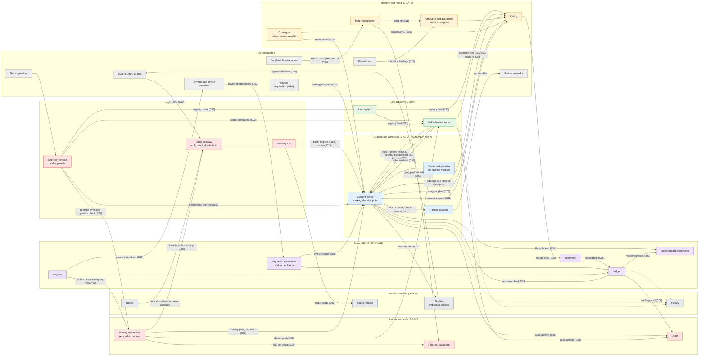
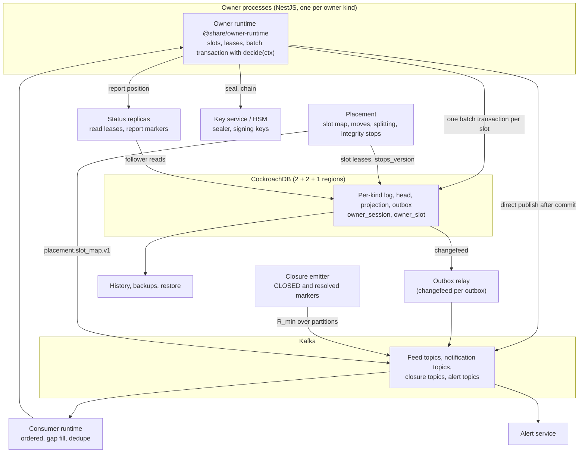

# Architecture diagram

Source: RFC-000 revision 4.5 §2 (components) and §8 (contracts), and the frozen contracts
C01 … C13 in [`04-delivery/contracts/`](04-delivery/contracts/). Each edge label names the
contract that governs that interface. Colours show the slice that owns each component.

## 1. Components and their contracts

## 2. The platform every owner runs on (C01)

Each owner kind in diagram 1 (account, link schedule, link registry, ingestion,
attribution, rating, catalogue, ledger, settlement, identity, audit) runs on the owner
runtime. No owner reads another owner's tables. Owners meet only through the contracts.

## Contract index

| Contract | Interface |
|---|---|
| C01 | Platform: owner runtime, slot map, history, probes, alerts, column encryption |
| C02 | Link hold port: hold, convert, release, waiting, offers, cut targets |
| C03 | Link supply commands and schedule feed |
| C04 | Reservation outcome and lifecycle feeds |
| C05 | Funds and standing (in-process, inside the account owner) |
| C06 | Catalogue, usage, charge lines, posting, movements |
| C07 | Receivables, credit limits, payments, payouts, payout destination |
| C08 | Identity and access: principal context, push, operator check, audit, webhooks |
| C09 | Personal-data store |
| C10 | Booking API |
| C11 | Metering ingress |
| C12 | Partner port and equivalent paths |
| C13 | Link registry |
