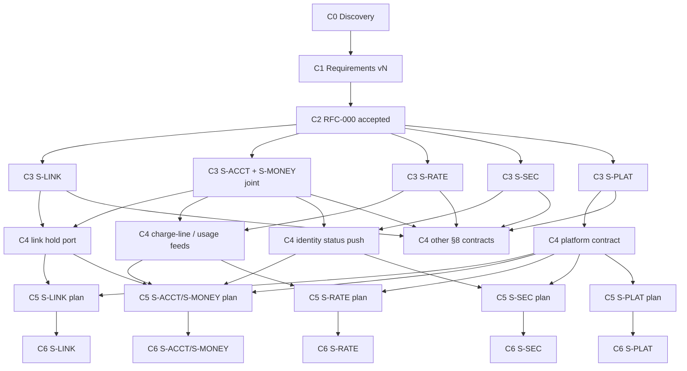
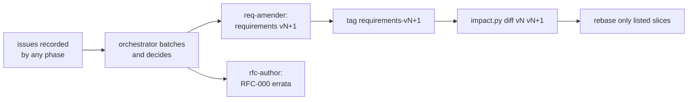

# Design pipeline

How work flows from discovery to delivery, what each checkpoint guarantees, and how a
slice moves through the pipeline without waiting for the others. The local harness that
runs it lives in `.claude/agents/` (purpose-built agents), `.claude/skills/design-pipeline/`
(the orchestrator's playbook) and `tools/` (mechanical checks).

## Principles

1. **Authority flows downward.** Discovery → requirements (specs, policy register,
   glossary) → architecture (RFC-000) → slice RFCs → contracts → delivery plan → code.
   A phase never edits the phase above it. The code conforms to the design, never the
   reverse.
2. **Defects flow upward as issues.** A phase that finds a defect above it records it
   (Requirements issue `RQ…`, Architecture issue `AI…`) and continues on a stated
   reading. Issues are settled in batches at a checkpoint, never silently worked around.
3. **Business decisions never block.** Where a promise to users is undecided, the agent
   decides the option that best balances buyers (incl. AI agents), suppliers, Share's
   risk and operability, records it with a one-line trade-off, and continues.
4. **Reviewers don't see what they judge against.** A reviewer reads the authority and the
   artefact under review, never the code and never the history log, so the current
   implementation cannot anchor it.
5. **Mechanics are tools, not agents.** Structure, traceability and impact are checked by
   `tools/check_specs.py` and `tools/impact.py`. No agent writes its own checker.

## Checkpoints

| ID | Checkpoint | Artefacts | Gate (all must hold) | Marker |
|---|---|---|---|---|
| C0 | Discovery baseline | `docs/01-discovery/*` | Problem statements have Needs tables; no solutions | — |
| C1 | Requirements baseline | `docs/02-specs/*`, needs in `01-discovery` | `check_specs.py` clean; requirements gate review (two reviewers, split by slice pairs) PASS or PASS WITH FIXES applied | tag `requirements-vN` |
| C2 | Architecture accepted | `RFC-000` | Review ACCEPT; fixes verified; every need allocated (§7); every cross-slice contract named (§8) | tag `rfc-000-accepted` / revision in Status |
| C3(s) | Slice RFC accepted | the slice's RFC | `impact.py coverage <slice>` shows 0 uncited, 0 dangling; adversarial review ACCEPT; fixes verified | Status "Accepted, revision n" + tag `rfc-<slice>-accepted` |
| C4(c) | Contract frozen | `docs/04-delivery/contracts/<C-id>.md` | Provider's and every consumer's C3 reached; schema matches RFC-000 §8 semantics; contract review ACCEPT | tag `contract-<C-id>-vN` |
| C5(s) | Slice plan accepted | `docs/04-delivery/plan/<slice>.md` | Every scenario of the slice in an increment; every contract it touches at C4; plan review ACCEPT | tag `plan-<slice>-accepted` |
| C6(s) | Slice conformant | code + `docs/02-specs/conformance.md` rows | Every scenario's test passes; conformance rows `met` | tag `conformant-<slice>` |

## Dependency graph

C3 is per slice: each slice depends only on C1 and C2, never on another slice's RFC. C4
is per contract and is the only point where two slices meet. C5 and C6 are per slice
again.

## Slices

Defined in [`slices.json`](slices.json): `S-LINK` (RFC-001, P1), `S-ACCT` (RFC-002, P2),
`S-RATE` (RFC-003, P3), `S-MONEY` (RFC-004, P4), `S-SEC` (RFC-005, X1), `S-PLAT`
(RFC-006, X2). `S-ACCT` and `S-MONEY` share the account owner and pass C3 together.

### What makes a slice independent

- **Pinned inputs.** A slice works against named tags (`requirements-vN`, an RFC-000
  revision). Upstream amendments do not touch in-flight slice work; the slice rebases
  only when `impact.py diff <its tag> <new tag>` lists it.
- **Contracts as the only seam.** A slice reads another slice's RFC only for the contract
  sections it consumes (§ named in RFC-000 §8), never its internals.
- **Issues, not edits.** A slice never edits requirements, RFC-000 or another slice. It
  records issues; the orchestrator batches them.
- **Own numbering.** Each slice's issues use its own prefix (`RQ-R1-`, `B-RQ-`, `RQ3-`,
  `RQ4-`, `RQ5-`, `RQ6-`; architecture `AI-R1-`, `B-AI-`, `AI3-` …). Reviews use the next
  free number in `docs/reviews/`.

## Change control

1. Collect issues from every agent report. Decide each (principle 3). Never escalate a
   policy question to the user.
2. One `req-amender` run per batch; one `rfc-author` run for RFC-000 errata. Run in
   parallel: they touch disjoint files.
3. Commit, tag `requirements-vN+1`.
4. `python3 tools/impact.py diff requirements-vN requirements-vN+1` lists the slices to
   rebase and the exact IDs; pass those IDs to the rebase brief instead of "read
   everything".
5. A review round converges when it finds no Blocker; then fixes go to a focused
   `fix-verifier`, not another full review.

## Run order for the current state

1. C3 reviews: `rfc-reviewer` × 5 (S-LINK, S-ACCT+S-MONEY joint, S-RATE, S-SEC, S-PLAT),
   in parallel, after each slice's coverage is clean.
2. Batch issues → requirements v1.8 / RFC-000 errata if any.
3. `rfc-author` revises each slice per its review; `fix-verifier` confirms; tag C3.
4. C4: `contract-author` per contract once both sides are at C3; `rfc-reviewer`
   (mode contract) reviews.
5. C5: `plan-author` per slice; `rfc-reviewer` (mode plan) reviews.
6. C6: implementation per slice against its plan; conformance matrix filled.
